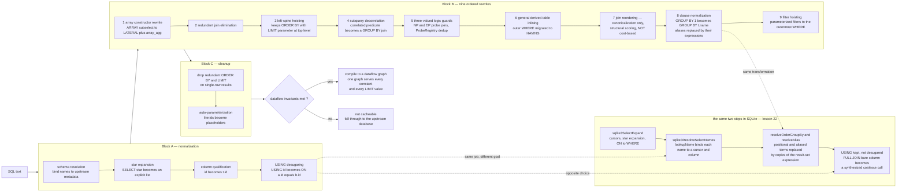

<!--
entry-meta
date: 2026-10-07
type: daily-diff
category: Daily Diff
title: Daily Diff — 2026-10-07
slug: sqlite-name-resolution-expr-select-trees
-->

# Daily Diff — 2026-10-07

**2026-10-07 · Daily Diff Digest**

## Which Edition This Covers

**There is no 2026-10-07 edition.** Fetched today (2026-10-07, 09:00 IST):

- `https://tdd.cat/` served **Tuesday, 6 October 2026 — 72 stories**.
- `https://tdd.cat/archive` still lists **073 — Mon, Oct 5, 2026 (64 stories)** as its newest, followed by 072 (Oct 4, 33), 071 (Oct 3, 22), 070 (Oct 2, 68), 069 (Oct 1, 64). It repeats the note that "Editions are published with a 2-day settling window so the highest-signal discussions and insights surface."

So the front page is now **ahead** of the archive — the inverse of yesterday, when the front page served 072 while the archive already listed 073. The newest edition that exists is the **6 October** one on the front page and at `https://tdd.cat/2026-10-06/`; the archive has not caught up to it. Yesterday's digest covered Edition 073 (5 October), so the 6 October edition is new and is what this digest covers.

---

## Edition — Tuesday, 6 October 2026 (72 stories)

The edition is overwhelmingly agent-infrastructure; roughly 35 of the 72 items are agent harnesses, agent memory, agent sandboxing or small "decision models". Grouped by what each item actually is:

### Databases, storage and query engines

- **[Readyset's query transformation pipeline](https://readyset.io/blog/how-readyset-rewrites-your-sql-inside-the-query-transformation-pipeline)** — the ordered pass list that turns arbitrary SQL into a form a dataflow engine can compile. **Deep dive below**; its first block is the same job as today's lesson.
- **[Radical MVCC and replay-based rebasing](https://6it.dev/blog/radical-mvcc-and-replay-based-rebasing-occ-re2occ-80742)** — deferring page modification entirely, so a transaction's write set is an overlay and rollback is a discard rather than an undo. Directly opposed to the rollback-journal design lesson 16 measured.
- **[Polars 2.0](https://pola.rs/posts/release-polars-2/)** and its [release notes](https://github.com/pola-rs/polars/releases/tag/py-2.0.0) — spill-to-disk (out-of-core) execution, a first-class SQL interface, filter pushdown and streaming changes, plus breaking SQL semantics.
- **["Postgres isn't slow, your storage is"](https://clickhouse.com/blog/posette-talk-recap-postgres-isnt-slow-your-storage-is)** — a ClickHouse write-up of a Posette talk arguing disk behaviour, not plan quality, dominates large PostgreSQL deployments.
- **[Dynamo to DynamoDB to Aurora DSQL](https://brooker.co.za/blog/2025/08/15/dynamo-dynamodb-dsql.html)** — Marc Brooker tracing one lineage's drift from eventual consistency toward SQL and strict serializability.
- **[CockroachDB's best-effort exclusive locks](https://gaultier.github.io/blog/what_good_is_a_best_effort_exclusive_lock_anyway.html)** — `SELECT FOR UPDATE` under serializable does not preserve the ordering of concurrent acquirers. Worth reading alongside lesson 20's finding that an `SQLITE_BUSY` from a checkpoint can mean "work complete, lock unavailable".
- **[What we learnt building a job queue on an LSM tree](https://zizq.io/blog/what-we-learnt-building-a-job-queue-on-an-lsm-tree)** — queue access patterns versus compaction.
- **[Grafana: fixing a production database with a coding agent](https://annanay.dev/fixing-db-with-codex/)** — a real multi-tenant alert-resolution bottleneck traced to graph query shape.
- **[Pre-warming DynamoDB tables](https://awsfundamentals.com/blog/dynamodb-warm-throughput)** — `WarmThroughput` buying 12k writes/sec on a fresh table against a 4k baseline.
- **[Four open-source semantic layers, 54 capabilities](https://motley.ai/blog-posts/four-open-source-semantic-layers-54-capabilities/)** — Cube, Malloy, MetricFlow, SLayer compared.
- **[ClickHouse Cloud versus Databricks for real-time analytics](https://clickhouse.com/blog/clickhouse-vs-databricks-real-time-performance-per-dollar)** — vendor-authored, read accordingly.

### Storage reliability and distributed systems

- **[Perseus: detecting fail-slow hardware faults](https://www.usenix.org/system/files/fast23-lu.pdf)** (FAST '23) and **[protocol-aware recovery for consensus-based storage](https://www.usenix.org/system/files/conference/fast18/fast18-alagappan.pdf)** (FAST '18) — two papers on failure modes that are not crashes. The second is the one to read against lesson 17's measured finding that a torn multi-file transaction leaves every participant reporting `integrity_check = ok`.
- **[Network time security at Meta](https://engineering.fb.com/2026/10/06/production-engineering/nts-authenticated-time-at-meta/)** — a stateless NTS implementation.
- **[Hybrid dedicated/shared core allocation at Uber](https://www.uber.com/in/en/blog/hybrid-core-allocation/)** — cpuset allocation for bursty containers without throttling.
- **[Meta's rebalancer](https://engineering.fb.com/2026/09/21/open-source/rebalancer-generic-high-performance-library-assignment-problems/)** — a generalized assignment solver separating problem specification from execution.
- **[Durable actors](https://github.com/TerseAI/durable-actors)** — stateful serverless compute without vendor lock-in.

### Concurrency, compilers, performance

- **[RwLock versus lock-free under read-heavy load](https://pranitha.dev/posts/rwlock-vs-lockfree/)** — the atomic reader-counter update invalidating a cache line even though the readers never conflict. Carried over from Edition 073.
- **[Where does the scheduler live in async Rust](https://herecomesthemoon.net/2026/10/async-rust-where-does-the-scheduler-live/)** — also carried over.
- **[`net/http` data races during buffer reuse](https://victoriametrics.com/blog/http-race-condition/index.html)** — pooled buffers reused across retries racing with the transport's background drain.
- **[Tuning a server for benchmarking](https://david.alvarezrosa.com/posts/tuning-a-server-for-benchmarking/)** — hardware isolation to make benchmark numbers repeatable. Relevant to anyone re-running this track's measurements.
- **[Designing Ninja](https://aosabook.org/en/posa/ninja.html)** — the AOSA chapter on minimising build-system startup overhead for Chrome.
- **[A C17 compiler written in ARM64 assembly](https://github.com/LiterateDrivenDevelopment/kcc)** — a literate program. Adjacent to lesson 21 if you want a second compiler front end to compare against.
- **[Toks](https://actual.inc/company/blog/introducing-toks)** — hand-written assembly hot paths reaching 1.6 GB/s tokenization.
- **[Fixed-rate lossy compression via recursive Hopf foliations](https://github.com/meridionalissoftware/hscq)** — deterministic sphere quantization with no codebook to transmit.
- **[Mold 3.0](https://www.phoronix.com/news/Mold-3.0-Released)** — the linker's post-Rust-rewrite release.
- **[Program status protocol, OSC 7501](https://mitchellh.com/writing/program-status-osc7501)** — and a [second write-up](https://www.superlogical.com/rex/docs/build/program-status) of the same escape sequence.
- **[Silent breaking changes](https://trysil.lastrucci.net/posts/trysil-2-0-0-what-breaks-and-why-we-counted/)** — a framework for behavioural breaks a compiler cannot catch. Useful vocabulary for the kind of 3.45.1-versus-trunk divergence today's lesson documents.

### Security

- **[subql-common npm supply-chain attack](https://flatt.tech/research/posts/subql-common-npm-supply-chain-attack/)** — a CI/CD compromise publishing through OpenID Connect trusted publishing.
- **[A fixed-window rate limiter letting 2x through](https://techinpencil.com/rate-limiter/)** — the classic window-boundary burst.
- **[Streaming guardrails and split-boundary leaks](https://llmshieldproxy.com/docs/split-boundary-leaks/)** — a sensitive value spanning two chunks defeats stateless filtering; stateful holdback buffers required.
- **[Cryptographic session continuity](https://github.com/mohammeddevsec-sys/session-continuity)** — hash-linked request chains against replay and session fork.

### Agent infrastructure — the bulk of the edition

Three items in this group are worth naming because they are claims about measurement rather than announcements:

- **[Most starred coding-agent skills fail against placebos](https://github.com/simonether/skill-placebo)** — only 2 of 9 popular skills beat neutral control text of equivalent length. Whatever else is true, "we added a skill and it got better" is not evidence without a length-matched control.
- **[Small language models fail agent tasks via transport defects](https://arxiv.org/abs/2609.21341)** — the claim that most agent failures are tool-harness bugs, not reasoning failures.
- **[Context compaction at half the cost](https://unreallabs.ai/blog/long-horizon-agents-at-half-the-cost/)** and **[Extra Headroom](https://extraheadroom.com/blog/claude-code-savings-real-usage)** — asynchronous summarization cutting tokens 48%, and a content-aware proxy claiming 34% input-token reduction while preserving prompt caching.

Also in the group: [Codemode](https://lucumr.pocoo.org/2026/10/6/codemode/), [one computer per agent](https://www.qawolf.com/blog/every-ai-agent-its-own-computer), [GitHub rebuilding Git for agent-scale development](https://github.blog/engineering/architecture-optimization/building-git-infrastructure-for-agent-scale-development/), [Obelisk durable workflows](https://obeli.sk/blog/announcing-obelisk-0-42/), [give your agent a DSL](https://www.modeloptic.com/blog/give-your-ai-agent-a-dsl), [deterministic safety gates](https://github.com/ulukaya/pawl), [ADHDev worktree orchestration](https://github.com/vilmire/adhdev), [agents need audited team decisions, not memory](https://gethrbr.com/blog/do-agents-need-memory), [Speck](https://github.com/doctarock/Speck), and [RigMark](https://github.com/alexellis/rigmark) for local serving benchmarks.

### Research and ML systems

[EmbeddingGemma 2](https://developers.googleblog.com/embeddinggemma-2-the-developer-guide/), [Burn 0.22 dropping backend generics](https://tracel.ai/blog/release-0.22.0/), [Pyramid-JiT pixel-space diffusion](https://www.linum.ai/field-notes/pyramid-jit), [adaptive latent recurrence for diffusion LMs](https://alo-dlm.github.io/), [base models reasoning from prefix cues](https://arxiv.org/abs/2610.06851), [TasteVal](https://arxiv.org/abs/2610.06824), [4DCodeBench](https://4dcodebench.com/), [federated learning with TEEs](https://research.google/blog/toward-provably-private-learning-from-federated-data/), [Chrome's neural residual echo suppression](https://webrtchacks.com/chrome-neural-echo-cancellation/), [an AI-designed open-source AI accelerator](https://github.com/FeSens/openTPU), [OpenAI's 722 Lean-proved manuscripts](https://github.com/openai/math), and [a 200-line probabilistic-programming compiler](https://jo3-l.dev/posts/probabilistic-programming/).

---

## Deep Dive: Readyset's Query Transformation Pipeline

Picked over the Radical MVCC post because it is the only item in the edition that is **about the layer today's lesson is about** — turning identifier strings into resolved, canonical structure — and because it solves the same problem with an explicitly different goal, which makes the comparison load-bearing rather than decorative.

### What the pipeline is for

Readyset is a caching layer that compiles a SQL query into a **dataflow graph** and then maintains that graph incrementally as the upstream database changes. The constraint that shapes everything is that the dataflow engine accepts a far narrower language than SQL. Per the article, a query must arrive satisfying all of:

- binary joins with **equality predicates only** (`a.id = b.id`);
- no correlated execution;
- a flat join structure, derived tables inlined;
- only `INNER JOIN`, `LEFT OUTER JOIN` and `CROSS JOIN` — **no `RIGHT`, no `FULL`**;
- explicit `GROUP BY` keys, not positional numbers;
- all `ORDER BY` expressions as explicit column references.

So the pipeline is not an optimizer. It is a **normalizer with teeth**: its job is to reach that form or fail, and — critically — to reach a form that is *identical* for queries that differ only in constants or syntax, so a single compiled graph can be reused.

### The three blocks

**Block A — normalization.** Four steps, and all four are the same job as `sqlite3SelectExpand` plus `sqlite3ResolveSelectNames`:

| Readyset Block A step | SQLite equivalent |
|---|---|
| schema resolution — bind names to upstream metadata | `sqlite3LocateTable` in expand; `lookupName`'s FROM-table scan |
| star expansion — `SELECT *` to an explicit list | `sqlite3SelectExpand`, which leaves `ENAME_TAB` spans behind |
| column qualification — `id` becomes `t.id` | implicit: resolution rewrites to `(iTable, iColumn)`, which is stronger |
| `USING` desugaring — `USING(id)` to `ON (a.id = b.id)` | **not done** — `lookupName` keeps `USING` and resolves the duplicate name by join type |

The article's own summary of the block is "After Block A, the query is fully resolved, qualified, and desugared — a clean foundation for the transformations that follow." That is a fair description of what `sqlite3SelectPrep` produces too.

**Block B — nine ordered rewrite passes.** Array-constructor rewrite (PostgreSQL `ARRAY(SELECT …)` becomes a `LATERAL LEFT JOIN` with `array_agg`); redundant join elimination; **left-spine hoisting** (inline the leftmost derived table at top level so `ORDER BY … LIMIT ?` stays where a parameterized Top-K operator can see it); **subquery decorrelation** (the worked example turns `WHERE o.total > (SELECT AVG(total) FROM orders WHERE region = o.region)` into an `INNER JOIN` against a `GROUP BY region`); three-valued-logic guards for `IN`/`NOT IN`; general derived-table inlining, including migrating an outer `WHERE` to `HAVING` when it filters an aggregate; join reordering; **clause normalization for semantic fingerprinting**; and filter hoisting.

**Block C — cleanup and auto-parameterization.** Redundant `ORDER BY`/`LIMIT` removal on single-row results, then literals are replaced with placeholders so `WHERE id = 5` and `WHERE id = 10` share one cached graph.

### The two passes that are the same mechanism as today's lesson

Pass 8, clause normalization, does exactly two things:

1. resolves positional references — `GROUP BY 1` becomes `GROUP BY t.name`;
2. converts alias references to the underlying expressions.

Those are `sqlite3ResolveOrderGroupBy` and `resolveAlias`. Same two transformations, same order, same reason: a positional or aliased reference is not a thing the downstream layer can evaluate, so it has to be replaced by the expression it names before anything else looks at it. SQLite does it because the VDBE code generator needs a real expression; Readyset does it because the graph's identity has to be syntax-independent.

But the *motivation* diverges in a way worth being precise about. SQLite normalizes only as far as code generation requires; it is perfectly happy for two queries that mean the same thing to compile to two different programs, because it is going to throw both away after one execution. Readyset normalizes until two queries that mean the same thing are *byte-identical*, because the normalized form is a **cache key**. That is why Readyset has a join-reordering pass that is explicitly **not cost-based** — the article says its purpose "is purely **canonicalization**: producing a deterministic, syntax-independent join sequence", scored structurally by predicate proximity and cross-table equality count. SQLite's join ordering is in `where.c` and is entirely cost-based; it is the subject of lesson 26. Two systems, one transformation, opposite reasons.

### The NULL-handling machinery, and why it exists

Pass 5 is the one with no SQLite counterpart at all. `NOT IN` against a subquery is three-valued: if the right-hand side contains a NULL, `x NOT IN (rhs)` is NULL rather than true, even when `x` matches nothing. An incrementally maintained join cannot discover that at read time, so Readyset installs **probe joins** into the graph:

- **NP (null-present)**: `EXISTS(rhs WHERE first_field IS NULL)`
- **EP (existence)**: `EXISTS(rhs)`

A **`ProbeRegistry`** deduplicates identical probes across subqueries and supports "lazy upgrade" when a later occurrence needs more probe machinery than an earlier one did; a nullability analysis suppresses probes it can prove unnecessary. SQLite needs none of this because it evaluates `NOT IN` at execution time and can simply look.

### Where this lands against the current track

The sharpest contrast is the no-`RIGHT`-no-`FULL` invariant. Today's lesson measured what SQLite's resolver does with `FULL JOIN … USING(x)`: `lookupName` rewrites the bare `x` into `TK_FUNCTION "coalesce"` with one argument per branch and `SQLITE_AFF_DEFER` affinity — a function call the user never typed, synthesized during name resolution precisely because neither side's column is the right answer. Readyset's answer to the same construct is to not accept it. Both are defensible; they are the two available answers, and seeing them side by side is the useful thing.

**What to check if you are evaluating this.** The load-bearing claim is the cache-key one: that Block A plus Block B pass 7 plus Block B pass 8 plus Block C auto-parameterization really do produce a canonical form, i.e. that two semantically identical queries written differently always normalize to the same graph. The failure mode is not a wrong answer, it is a silent cache miss — two spellings of one query compiling to two graphs, each separately maintained, doubling the maintenance cost with no error anywhere. The article asserts canonicalization as the *purpose* of the join-reordering pass; whether the structural scoring function is actually total and deterministic across equivalent spellings is the thing to test, and it is testable from outside by feeding in rewritten-but-equivalent queries and counting the graphs that result.

---

## Sources

- [The Daily Diff](https://tdd.cat/) — front page, fetched 2026-10-07 09:00 IST, serving the Tuesday 6 October 2026 edition (72 stories).
- [The Daily Diff — archive](https://tdd.cat/archive) — newest listed edition 073 (Mon, Oct 5, 2026, 64 stories), the 2-day settling-window note, and confirmation that no 7 October edition exists.
- [The Daily Diff — Tuesday, 6 October 2026](https://tdd.cat/2026-10-06/) — the 72-item edition summarised above; every item link in this digest comes from that page.
- [How Readyset rewrites your SQL: inside the query transformation pipeline](https://readyset.io/blog/how-readyset-rewrites-your-sql-inside-the-query-transformation-pipeline) — the three blocks, the nine Block B passes in order, the dataflow invariants (including no `RIGHT`/`FULL` join), the `ARRAY(SELECT …)` and decorrelation worked examples, the NP/EP probe definitions and `ProbeRegistry`, the "purely canonicalization" characterisation of join reordering, and auto-parameterization as the cache-sharing mechanism.
