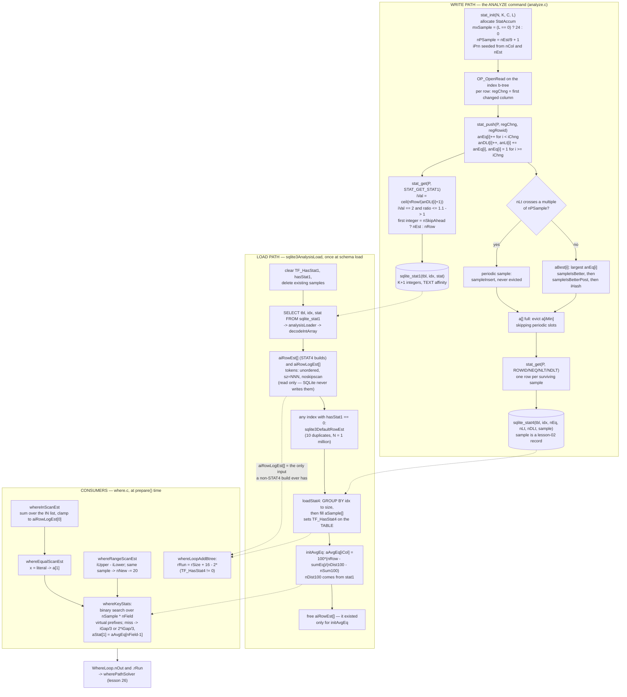

<!--
entry-meta
date: 2026-10-12
type: lesson
track: SQLite
lesson: 27
category: Database Internals
title: ANALYZE Statistics — One Integer Per Index Prefix, 24 Samples Chosen by an LCG, and a Two-Unit Discount Decided by a Column the Query Never Mentions
slug: sqlite-analyze-stat1-stat4-estimators
-->

# ANALYZE Statistics — One Integer Per Index Prefix, 24 Samples Chosen by an LCG, and a Two-Unit Discount Decided by a Column the Query Never Mentions

**2026-10-12 · SQLite Track · Lesson 27 of 33**

## Where This Fits

- [Lesson 26](../2026-10-11-sqlite-query-planner-whereloop-path-solver/README.md) established the cost model: `WhereLoop.rRun` and `.nOut` in `LogEst` units, `Index.aiRowLogEst[]` as the planner's input, `szTabRow`/`szIdxRow` derived from the DDL, and `wherePathSolver`'s strict-`<` tie rule. It took `aiRowLogEst[]` as given. This lesson is where those numbers come from.
- Lesson 26 also closed with an **unresolved claim**: `where.c`'s comment says the STAT4 full-scan discount (`3.0` → `2.75`) makes "a full table scan preferred over using an index on a column with just two distinct values". Derivation said it could not flip the decision. §7 settles it with a `-DSQLITE_ENABLE_STAT4` build and `WHERETRACE`: **the claim is true, and the boundary is set by a mechanism lesson 26 itself identified.**
- Added here: the `sqlite_stat1` and `sqlite_stat4` on-disk formats; the three SQL functions ANALYZE actually runs; sample selection and eviction; the load path into `Index`; and the four STAT4 estimators in `where.c`.
- Sets up lesson 28: `whereSortingCost` consumes `nOut`, which is what this lesson's estimators produce.

Everything from lessons 01–26 is assumed. In particular: the record format (lesson 02) — `sqlite_stat4.sample` is a record, decoded by hand in §8; `LogEst` and the cost model (lesson 26); index b-trees and key order (lesson 09).

---

## 1. The two tables, and what every integer means

```sql
CREATE TABLE sqlite_stat1(tbl, idx, stat);
CREATE TABLE sqlite_stat4(tbl, idx, nEq, nLt, nDLt, sample);
```

`sqlite_stat1` is the only statistics table a default build produces. `sqlite_stat4` exists only under `-DSQLITE_ENABLE_STAT4`. `sqlite_stat2` (3.6.18–3.7.8) and `sqlite_stat3` (3.7.9–3.29.0) are dead; `analyze.c`'s header says STAT4 "is the only variant that is still supported".

### `stat`: K+1 integers for a K-column index

| position | meaning |
|---|---|
| 1st | rows in the **index** (differs from the table for a partial index) |
| 2nd | average rows sharing the same value in column 1 |
| Nth (N>1) | average rows sharing the same values in the first N−1 columns |
| last, if UNIQUE | always 1 |

The per-column integer is computed in `statGet` (`analyze.c:868-872`) with exactly this arithmetic:

```c
u64 nDistinct = p->current.anDLt[i] + 1;
u64 iVal = (p->nRow + nDistinct - 1) / nDistinct;   /* ceil(K/D) */
if( iVal==2 && p->nRow*10 <= nDistinct*11 ) iVal = 1;
```

So `I = ceil(K/D)`, **with one special case**: if the ceiling lands on 2 but the true ratio is ≤ 1.1, it is forced back to 1. That exists so a near-unique index is not described as having two duplicates per key, which would cost it the `nEq`-driven selectivity lesson 26 priced.

The first integer is **not always `nRow`**:

```c
sqlite3_str_appendf(&sStat, "%llu", p->nSkipAhead ? (u64)p->nEst : (u64)p->nRow);
```

Under `PRAGMA analysis_limit` the scan skips ahead, so the row count written is the **planner's prior estimate** `nEst`, not anything counted. §9 shows what that does to the rest of the line.

### Which rows exist, measured

Built three tables (200k–1000 rows), ran `ANALYZE`, dumped `sqlite_stat1`:

```
noidx    | <NULL> | 1000
withidx  | wi     | 1000 143
wo       | wo     | 1000 1
```

- **`idx IS NULL` appears only when the table has no non-partial index.** `analyzeOneTable` sets `needTableCnt = 0` the moment it processes an index with `pPartIdxWhere==0` (`analyze.c:1067`), and the `OP_Count`-based NULL row is emitted only `if( pOnlyIdx==0 && needTableCnt )` (`analyze.c:1362`). For an indexed table the table's row count instead arrives via the index: `analysisLoader` does `pTable->nRowLogEst = pIndex->aiRowLogEst[0]` (`analyze.c:1636`).
- **WITHOUT ROWID tables use `idx == tbl`.** `wo|wo|1000 1` is the covering index that *is* the table; the trailing `1` is the unique PK.
- `1000 143` is `ceil(1000/7) = 143` for `i%7` — the `ceil` above, confirmed on the first try.

### Three tokens SQLite reads and never writes

`decodeIntArray` (`analyze.c:1556-1575`) parses trailing space-separated words after the integers:

| token | effect |
|---|---|
| `unordered` | `pIndex->bUnordered = 1` — the index is not used for range scans or to satisfy ORDER BY |
| `sz=NNN` | `pIndex->szIdxRow = sqlite3LogEst(sz)`, clamped to `sz>=2` — overrides the DDL-derived index row width lesson 26 measured |
| `noskipscan` | `pIndex->noSkipScan = 1` — disables the skip-scan lesson 26 pinned to exactly 18 duplicates |

(`costmult=NNN` also exists, behind `SQLITE_ENABLE_COSTMULT`.) Unrecognised words are skipped silently — the loop just advances past the next non-space run.

**`grep -c '"sz="' sqlite3.c` → 0 writers.** Nothing in SQLite emits any of these tokens. `statGet` appends only integers. They are a **read-only back door**: a hand-written hint, intended for the "fudge the sqlite_stat1 table" escape hatch that `optoverview.html` §7.1.1 mentions. §8 drives one and watches a plan change.

### `sqlite_stat4`: N integers per column position, per sample

For a sample with N encoded columns, `nEq`/`nLt`/`nDLt` are each a space-separated list of N integers. The Kth entry describes the **leftmost K columns**:

- `nEq[K]` — entries whose leftmost K columns equal the sample's
- `nLt[K]` — entries whose leftmost K columns sort **below** the sample's
- `nDLt[K]` — **distinct** leftmost-K prefixes sorting below the sample's

N is the indexed-column count **plus one** for a rowid table (the trailing rowid), or indexed-plus-PK for a WITHOUT ROWID index. Samples must appear in index order. `SQLITE_STAT4_SAMPLES` defaults to **24** (`analyze.c:255-257`).

---

## 2. What ANALYZE actually runs

ANALYZE is not C code walking a b-tree. It is a hand-built VDBE program calling three function definitions that are registered nowhere in generic SQL — `statInitFuncdef`, `statPushFuncdef`, `statGetFuncdef` — and that share a heap-allocated `StatAccum` passed between them **as a BLOB holding a raw pointer**:

```c
sqlite3_result_blob(context, p, sizeof(*p), statAccumDestructor);
```

The size argument is a lie by design; the comment says so outright: "only the pointer (the 2nd parameter) matters. The size of the object … is never used and can be any positive value."

```
stat_init(N, K, C, L)   N = columns incl. rowid/pk, K = key columns,
                        C = estimated rows, L = analysis_limit (0 = none)
   → per index: OP_OpenRead on the index b-tree, rewind
   → per row:   compare key prefix against regPrev[], set regChng = first
                changed column, then stat_push(P, regChng, regRowid)
   → at end:    stat_get(P, STAT_GET_STAT1)  → OP_MakeRecord "BBB" → OP_Insert
                stat_get(P, STAT_GET_{ROWID,NEQ,NLT,NDLT}) → one stat4 row per sample
```

The `"BBB"` affinity string on `OP_MakeRecord` (`analyze.c:1275`) — three TEXT affinities — is why `sqlite_stat1.stat` is text and not an integer vector.

### `StatAccum` layout

One `sqlite3DbMallocZero` for everything (`analyze.c:426-436`), sized up front and `assert`-checked at the end (`assert( (pSpace - (u8*)p)==n )`). The STAT4 part allocates `sizeof(StatSample)*(nCol+mxSample)` plus `sizeof(tRowcnt)*3*nColUp*(nCol+mxSample)` — three parallel `tRowcnt` arrays (`anEq`, `anLt`, `anDLt`) for every slot in both `a[mxSample]` and `aBest[nCol]`.

Two derived constants matter:

```c
p->mxSample = p->nLimit==0 ? mxSample : 0;            /* analysis_limit kills STAT4 outright */
p->nPSample = (tRowcnt)(p->nEst/(mxSample/3+1) + 1);  /* = nEst/9 + 1 for mxSample==24 */
p->iPrn     = 0x689e962d*(u32)nCol ^ 0xd0944565*(u32)nEst;
```

`nPSample` is the periodic-sample stride. For 400,000 rows it is `400000/9 + 1 = 44445`, and §5 shows exactly that spacing in the stored samples.

`iPrn` is seeded **deterministically from the schema and the row estimate**, then advanced per row by `p->iPrn = p->iPrn*1103515245 + 12345` (the glibc LCG constants). So which samples survive eviction is reproducible for a given table shape and size — not random across runs, but not stable across a row-count change either.

### `statPush`: the counter update

```c
for(i=0; i<iChng; i++)        p->current.anEq[i]++;            /* prefix unchanged → one more equal */
for(i=iChng; i<p->nCol; i++){
  p->current.anDLt[i]++;                                       /* a new distinct prefix */
  if( p->mxSample ) p->current.anLt[i] += p->current.anEq[i];   /* fold the finished run into nLt */
  p->current.anEq[i] = 1;                                      /* restart the run */
}
```

`iChng` is the index of the first column that differs from the previous row, computed in the VDBE, not in C. Everything to its left got one more duplicate; everything from it rightwards closed a run.

Note the asymmetry: `anDLt` is maintained **always**, `anEq` and `anLt` only under STAT4 (`anEq` is `#ifdef`'d out of the non-STAT4 build entirely). A non-STAT4 build needs only distinct counts, because `ceil(nRow/anDLt[i]+1)` is the whole output.

---

## 3. Sample selection: periodic plus best-per-column

Two mechanisms feed `a[]`, and only one of them can be evicted.

**Periodic.** In `statPush`, keyed on `nLt` of the last column (the rowid, hence unique, hence monotonic):

```c
nLt = p->current.anLt[p->nCol-1];
if( (nLt/p->nPSample)!=(nLt+1)/p->nPSample ){
  p->current.isPSample = 1; p->current.iCol = 0;
  sampleInsert(p, &p->current, p->nCol-1);
}
```

A crossing of a multiple of `nPSample`. Periodic samples give uniform coverage of the key space and are **never evicted** — `sampleInsert`'s eviction scan does `if( p->a[i].isPSample ) continue;`.

**Best-per-column.** `aBest[i]` tracks, for each column position `i`, the candidate with the largest `anEq[i]` — the most duplicated value seen. `sampleIsBetter` orders candidates:

```c
if( nEqNew>nEqOld ) return 1;                      /* more duplicates wins */
if( nEqNew==nEqOld ){
  if( pNew->iCol<pOld->iCol ) return 1;            /* then: a shorter prefix wins */
  return (pNew->iCol==pOld->iCol && sampleIsBetterPost(pAccum,pNew,pOld));
}
```

and `sampleIsBetterPost` breaks remaining ties on trailing `anEq[]` values and finally on `iHash` — the LCG value. So when every candidate has identical duplicate counts, **which ones survive is decided by a pseudo-random tiebreak**. §5 shows four values out of twenty-one losing that coin flip.

When `a[]` is full, `sampleInsert` finds the new minimum by a linear scan over all `mxSample` slots skipping periodic ones, and remembers it in `p->iMin`. There is an `assert` that keeps the array in index order:

```c
assert( p->nSample==0 || pNew->anLt[p->nCol-1] > p->a[p->nSample-1].anLt[p->nCol-1] );
```

which is the invariant `whereKeyStats`' binary search depends on.

---

## 4. The load path

`sqlite3AnalysisLoad(db, iDb)` (`analyze.c:1942`) runs at schema load, in a fixed order:

1. **Clear.** `TF_HasStat1` off every table; `hasStat1 = 0` and `sqlite3DeleteIndexSamples` for every index.
2. **`SELECT tbl,idx,stat FROM %Q.sqlite_stat1`** through `analysisLoader`. Per row: resolve `idx` to an `Index*` — with the special case `sqlite3_stricmp(argv[0],argv[1])==0` → `sqlite3PrimaryKeyIndex(pTable)`, which is how `wo|wo|…` lands on a WITHOUT ROWID table's PK index — then `decodeIntArray` into `aiRowEst[]` (STAT4 builds only) and `aiRowLogEst[]` (always), set `hasStat1 = 1`, and, for a non-partial index, publish `pTable->nRowLogEst` and `TF_HasStat1`.
   - For the `idx IS NULL` row, a **stack-allocated `Index fakeIdx`** is used purely so `decodeIntArray` has somewhere to put a `sz=` token, which is then copied out into `pTable->szTabRow`.
3. **`sqlite3DefaultRowEst(pIdx)`** for every index still without `hasStat1`. This is the unanalysed fallback — the "10 duplicates per leftmost value" and "N is one million" guesses `optoverview.html` documents.
4. **`loadStat4`**, guarded by `OptimizationEnabled(db, SQLITE_Stat4)`, via two queries:
   ```sql
   SELECT idx,count(*) FROM %Q.sqlite_stat4 GROUP BY idx COLLATE nocase   -- sizing pass
   SELECT idx,neq,nlt,ndlt,sample FROM %Q.sqlite_stat4                     -- fill pass
   ```
   One `sqlite3DbMallocZero` per index holds `IndexSample[nSample]`, the three `tRowcnt` arrays, and `aAvgEq[]`. `TF_HasStat4` is set on the **table** here (`sqlite3.c:125462`) — the flag lesson 26 found gating the full-scan discount is set by the *loader*, not by the compile option.
5. **`sqlite3_free(pIdx->aiRowEst); pIdx->aiRowEst = 0;`** for every index. The integer (non-log) row estimates exist only for `initAvgEq`'s benefit and are dropped immediately after.

Three consequences worth holding on to:

- If `sqlite_stat1` is **absent**, `sqlite3AnalysisLoad` returns an error and `sqlite_stat4` is not read at all — even if it exists.
- Statistics are read **once, at schema load**. Editing the tables changes nothing until the schema is reloaded; `ANALYZE sqlite_schema` is the documented way to force it. §8 measures exactly this.
- `lang_analyze.html`: "The results of an ANALYZE command are only available to database connections that are opened after the ANALYZE command completes."

### `initAvgEq`: the fallback for a value with no sample

`aAvgEq[iCol]` answers "how many rows does an equality match return when the value isn't one of our 24 samples?" (`analyze.c:1683-1740`):

```c
nRow     = pIdx->aiRowEst[0];
nDist100 = ((i64)100 * pIdx->aiRowEst[0]) / pIdx->aiRowEst[iCol+1];
/* sum anEq[iCol] over samples that end a distinct-prefix run; nSum100 += 100 each */
if( nDist100>nSum100 && sumEq<nRow )
  avgEq = ((i64)100 * (nRow - sumEq))/(nDist100 - nSum100);
if( avgEq==0 ) avgEq = 1;
```

In words: take the total rows, subtract the rows the samples already account for, and divide by the distinct values the samples *don't* cover — where "distinct values" comes from **stat1**, scaled by 100 to keep a fractional digit in integer arithmetic. §6 verifies this to the row.

---

## 5. Measured: 24 samples on a skewed column

400,000 rows, `t(a INTEGER, b TEXT)`, `a = 0` for 380,000 rows and `a = 1..20` for 1,000 rows each. One index `t_a ON t(a)`, so N = 2 (`a`, rowid).

```
sqlite_stat1:  t | t_a | 400000 19048
```

`ceil(400000/21) = 19048`. The index is described by one number, and that number is wrong for every single value in the column: too small by 20× for `a=0`, too large by 19× for the rest.

`sqlite_stat4` holds 24 rows — `SQLITE_STAT4_SAMPLES` exactly:

```
nEq        nLt              nDLt         sample
380000 1   0 44444          0 44444      X'03080300AD9D'     ← periodic ×8, stride 44445
380000 1   0 88889          0 88889      X'030803015B3A'
380000 1   0 133334         0 133334     X'0308030208D7'
   …          (×8)
  1000 1   380000 380238    1 380238     X'03090305DEF9'     ← a=1
  1000 1   382000 382715    3 382715     X'0301030306043F'   ← a=3
  1000 1   383000 383780    4 383780     X'03010304060954'   ← a=4
   …
  1000 1   399000 399801    20 399801    X'03010314060B08'   ← a=20
```

Reading this against §2 and §3:

- **Eight periodic samples**, `nLt[1]` at 44444, 88889, 133334, … — stride **44445**, which is `nEst/9 + 1` for 400,000. Predicted from `statInit` before looking.
- All eight carry `nEq = "380000 1"`: 380,000 rows share `a=0`, and the rowid is unique.
- `nDLt = "0 44444"` on the first: zero distinct `a` values sort below 0; 44,444 distinct `(a,rowid)` prefixes do.
- Sixteen non-periodic samples, one per distinct `a` value that survived. **`a = 2, 10, 12, 16` are missing.** All twenty values have `nEq[0] = 1000`, so `sampleIsBetter` fell through to `sampleIsBetterPost` and then to the `iHash` LCG tiebreak. Four values lost.

The `sample` column is a record in lesson 02's format. `X'03080300AD9D'`:

| bytes | meaning |
|---|---|
| `03` | header length 3 (the length byte plus two serial types) |
| `08` | serial type 8 — **integer 0, zero body bytes** |
| `03` | serial type 3 — 3-byte big-endian integer |
| `00AD9D` | 44445 |

So the sample is `(a=0, rowid=44445)` and `a=0` occupies **no bytes at all**. `X'0301030306043F'` decodes as header 3, types `01` (1-byte int) and `03`, body `03` + `06043F` → `(a=3, rowid=394303)`; and `394303 - 380001 = 14302`, `14302 % 20 = 2`, so `a = 1 + 2 = 3`. The generator agrees.

---

## 6. The four STAT4 estimators, measured

All four live in `where.c` and all four are `#ifdef SQLITE_ENABLE_STAT4`.

### `whereKeyStats` (`where.c:1718`) — the one the others call

Given a probe record, returns `aStat[0] = rows less than` and `aStat[1] = rows equal to`. It binary-searches not `aSample[]` but a **virtual array of `nSample * nField` entries**, where entry `i` is a prefix of `aSample[i/nField]`, extended if necessary so the sequence stays non-decreasing. The header comment works a five-sample example out to ten effective entries.

On an exact hit it reads the sample directly. On a miss it **interpolates by thirds**:

```c
iGap = iUpper - iLower;
if( roundUp ) iGap = (iGap*2)/3; else iGap = iGap/3;
aStat[0] = iLower + iGap;
aStat[1] = pIdx->aAvgEq[nField-1];
```

Not halves — one third for a lower bound, two thirds for an upper. And the **equal** count for an unsampled value is always `aAvgEq`, never zero.

### `whereEqualScanEst` (`where.c:2274`)

`WHERE x = <literal>`. Builds a probe with `sqlite3Stat4ProbeSetValue`, calls `whereKeyStats(…, roundUp=0, a)`, returns `a[1]`. Two early exits: `SQLITE_NOTFOUND` if values for the columns to the left aren't known (`pBuilder->nRecValid < nEq-1`), and a hard `*pnRow = 1` when `nEq >= p->nColumn` (every key column constrained ⇒ at most one row).

Measured, with `WHERETRACE=0x20` on the §5 table:

| predicate | trace | note |
|---|---|---|
| `a=0` | `equality scan regions t_a(0): 380000` | exact sample hit |
| `a=1` | `…: 1000` | exact sample hit |
| `a=5` | `…: 1000` | exact sample hit |
| `a=2` | `…: 1002` | **no sample — `aAvgEq`** |
| `a=999` | `…: 1002` | value does not exist at all; same `aAvgEq` |

**The 1002 is derivable to the unit.** `nRow = 400000`; `nDist100 = 100*400000/19048 = 2099` (integer division, truncating 2099.75). Samples ending a distinct-prefix run: the last of the eight `a=0` periodics contributes 380000, and the sixteen singletons contribute 1000 each — 17 terms, so `sumEq = 396000` and `nSum100 = 1700`. Then

```
avgEq = 100*(400000 - 396000)/(2099 - 1700) = 400000/399 = 1002.5 → 1002
```

A value that does not exist is estimated at 1002 rows, and both the 1002 and the fact that it isn't 1000 come out of **two truncating integer divisions**. That is the whole of `initAvgEq`, confirmed.

### `whereInScanEst` (`where.c:2338`)

`WHERE x IN (v1,v2,…)`: calls `whereEqualScanEst` per element, **sums**, clamps to `aiRowLogEst[0]`, restores `nRecValid` after each call.

```
a IN (2,5,9)  →  1002 + 1000 + 1000  →  IN row estimate: est=3002
```

The sum includes 1002 for the unsampled `2`. An `IN` list of values none of which exist still estimates `n * aAvgEq`, never 0.

### `whereRangeScanEst` (`where.c:2092`)

Probes both bounds, takes `iUpper - iLower`, and carries one tuning rule that is easy to miss:

```c
nNew = sqlite3LogEst(iUpper - iLower);
if( iLwrIdx==iUprIdx ){ nNew -= 20; }   /* assert( 20==sqlite3LogEst(4) ) */
```

If both bounds resolved to the **same** sample, assume 4× more selective — because without STAT4 the generic rule would have been more aggressive, and the comment says the subtraction "brings the estimated selectivity more in line with what it would be if estimated without the use of STAT4 tables". The non-STAT4 path below it is the familiar one: `whereRangeAdjust` applies likelihood 0.50 for `IS NOT NULL` and 0.25 otherwise, a two-sided range gets a further `-20`, and the floor is `nNew = 10` (`LogEst(2)`).

Measured:

```
a>5                 STAT4 range scan: 385000..400000  est=138   Range scan lowers nOut from 186 to 138
a BETWEEN 3 AND 7   STAT4 range scan: 382000..387000  est=122   Range scan lowers nOut from 186 to 122
```

`a>5`: 15,000 rows, and the true answer is 15,000 — exact, because both bounds fell on sample boundaries. The unanalysed guess would have been `186 - 20 = 166` (a quarter of the table, 100,000 rows) — wrong by 6.7×.

---

## 7. Resolving lesson 26's open question

Lesson 26 found this in `whereLoopAddBtree` (`where.c:4155-4171`):

```c
/* TUNING: Cost of full table scan is 3.0*N. … Reduce the 3.0 penalty slightly
** (to 2.75) if we have valid STAT4 information for the table.
** At 2.75, a full table scan is preferred over using an index on
** a column with just two distinct values where each value has about
** an equal number of appearances. */
#ifdef SQLITE_ENABLE_STAT4
      pNew->rRun = rSize + 16 - 2*((pTab->tabFlags & TF_HasStat4)!=0);
#else
      pNew->rRun = rSize + 16;
#endif
```

and flagged two things: that `LogEst 14` is 2.64, not the 2.75 the comment claims, and that substituting `nOut = LogEst(N/2)` left the index ahead, so the claim looked false. It handed the question forward with an instruction: settle it with a STAT4 build and `WHERETRACE 0x2`.

Two binaries from one SQLite 3.53.4 amalgamation, differing only in `-DSQLITE_ENABLE_STAT4`. Table `t(a INTEGER, b <type>)`, 400,000 rows, `a = i%2` (two values, exactly equal counts), index on `(a)`, `ANALYZE`, then `EXPLAIN QUERY PLAN SELECT b FROM t WHERE a=0` with `WHERETRACE=0x28`. `rSize = LogEst(400000) = 186`.

| `b` declared as | scan `rRun`, STAT4 | index `rRun` | **plan, STAT4** | scan `rRun`, no STAT4 | **plan, no STAT4** |
|---|---|---|---|---|---|
| `INTEGER` | **200** | 201 | **`SCAN t`** | 202 | `SEARCH … t_a` (201) |
| `VARCHAR(1)` | **200** | 201 | **`SCAN t`** | 202 | `SEARCH … t_a` (201) |
| `VARCHAR(4)` | **200** | 200 | **`SCAN t`** (tie) | 202 | `SEARCH … t_a` (200) |
| `TEXT` | 200 | **199** | `SEARCH … t_a` | 202 | `SEARCH … t_a` (199) |
| `VARCHAR(40)` | 200 | **199** | `SEARCH … t_a` | 202 | `SEARCH … t_a` |
| `VARCHAR(400)` | 200 | **198** | `SEARCH … t_a` | 202 | `SEARCH … t_a` |

**The comment is right, and lesson 26's derivation was right too — they were describing different tables.**

- `rSize + 16 - 2 = 200` and `rSize + 16 = 202` appear verbatim in the trace. The 2-unit discount is real and attaches only when `TF_HasStat4` is set, i.e. only when samples were actually loaded.
- For a **narrow** table the discount flips the plan: at `b INTEGER` the STAT4 build picks `SCAN t` at 200 while the non-STAT4 build picks the index at 201. That is exactly "a full table scan is preferred over using an index on a column with just two distinct values where each value has about an equal number of appearances", and the non-STAT4 build's behaviour matches the rest of the comment: "Without STAT4 data, we still want to use an index in that case."
- For a **wider** table the index costs 199 and wins in both builds. The flip boundary sits between `VARCHAR(4)` and `TEXT`, which is a boundary in `szTabRow` — lesson 26's finding that `Column.szEst` is 2 for `VARCHAR(4)` and 5 for a bare `TEXT`. **The declared type of a column the query does not constrain decides whether the 2.75 discount changes the plan.** Not one stored byte differs between the `VARCHAR(4)` and `TEXT` databases.
- Lesson 26's derivation assumed the wide case (its table was `t(a integer, b text)`), which is why it concluded the discount could not flip anything. Both results stand.

Two further confirmations fell out:

- **`equality scan regions t_a(0): 200000`.** With two equal-count values, STAT4's own estimate is 200,000 — *identical* to stat1's second integer. So the discount is the entire difference between the builds; STAT4 contributes nothing to `nOut` here. This is why lesson 26's substitution of `nOut = LogEst(N/2)` was the correct substitution.
- **The tie rule, a fifth time.** At `VARCHAR(4)` the STAT4 build prices both loops at exactly 200 and the trace reads `skip: … t.t_a … cost 0,200,176` — the index loop is not even inserted. Lesson 26 measured the tie going to the full scan four times; here the trace shows the mechanism, because `whereLoopAddBtree` inserts the IPK loop first and `whereLoopInsert` discards a non-strictly-better candidate.

The arithmetic complaint from lesson 26 also stands unchanged: `LogEst 14` is 2.639, the comment says 2.75, and the code is one unit more aggressive than its own prose. The *decision* the comment describes is nonetheless the one the code makes.

---



---

## 8. Hands-On

All of this runs on a stock `sqlite3` shell except §8.4, which needs a STAT4 build.

### 8.1 Read the numbers and check the arithmetic

```sql
CREATE TABLE t(a INTEGER, b TEXT);
WITH RECURSIVE c(i) AS (SELECT 1 UNION ALL SELECT i+1 FROM c WHERE i<200000)
INSERT INTO t(a,b) SELECT i%7, 'r'||i FROM c;
CREATE INDEX t_a ON t(a);
ANALYZE;
SELECT tbl, ifnull(idx,'<NULL>'), stat FROM sqlite_stat1;
```

**What to look for.** One row, `t|t_a|200000 28572`, and `ceil(200000/7) = 28572`. There is **no** `t|<NULL>|200000` row — `needTableCnt` was cleared by the index. Now `DROP INDEX t_a; ANALYZE;` and look again: the NULL row appears. That proves the two paths in §1 are mutually exclusive, not additive.

### 8.2 Prove statistics are read once, at schema load

```sql
UPDATE sqlite_stat1 SET stat='200000 400 unordered' WHERE idx='t_a';
EXPLAIN QUERY PLAN SELECT a FROM t ORDER BY a;      -- (1) same connection, no reload
ANALYZE sqlite_schema;
EXPLAIN QUERY PLAN SELECT a FROM t ORDER BY a;      -- (2) after the reload
EXPLAIN QUERY PLAN SELECT b FROM t WHERE a BETWEEN 10 AND 20;
```

**What to look for.** Measured on a 200,000-row table with `a = i%500`:

```
(1)  SCAN t USING COVERING INDEX t_a              ← the edit is invisible
(2)  SCAN t  +  USE TEMP B-TREE FOR ORDER BY      ← bUnordered took effect
     SCAN t                                       ← range query abandoned the index too
```

Two facts in one experiment: the `unordered` token is genuinely parsed and honoured, **and** the in-memory `Index` is not re-read until something forces it. `ANALYZE sqlite_schema` is the cheapest such force — it runs no scan, it only reloads.

This is also the mechanism behind the deployment advice in `lang_analyze.html`: dump `sqlite_stat1` on a representative database during development and replay the `INSERT`s in the field, instead of running `ANALYZE` on the customer's machine.

### 8.3 See `PRAGMA optimize` decide, without letting it act

```sql
PRAGMA optimize(-1);                       -- 0x01 = debug: print, do not run
SELECT count(*) FROM t WHERE a=3;
PRAGMA optimize(-1);
PRAGMA optimize;
SELECT tbl,idx,stat FROM sqlite_stat1;
```

**What to look for.** On an unanalysed 50,000-row table, `PRAGMA optimize(-1)` prints the statement it would run, verbatim:

```
ANALYZE "main"."t"
```

Then run it for real and read `stat`: measured **`50000 96`**, where the true average is `50000/500 = 100`. `PRAGMA optimize` has bit `0x10` on by default — "set a temporary `PRAGMA analysis_limit` to prevent excess run-time" — so it is deliberately buying speed with accuracy. 4% off here. §9 shows the same mechanism being 190× off.

Re-run `PRAGMA optimize(-1)` on a connection where statistics are already current and no query has touched the table: it prints nothing. By default it considers only tables queried on that connection, or tables with no `sqlite_stat1` entry.

### 8.4 Decode a stat4 sample by hand

Needs `-DSQLITE_ENABLE_STAT4`. The amalgamation is bundled in the `better-sqlite3` npm package at `deps/sqlite3/sqlite3.c` if you do not want to fetch it separately:

```sh
gcc -O2 -I. -DSQLITE_ENABLE_STAT4 -DSQLITE_DEBUG -DSQLITE_ENABLE_WHERETRACE \
    shell.c sqlite3.c -o sqlite3-stat4 -lm
```

(`WHERETRACE` needs **both** `SQLITE_DEBUG` and `SQLITE_ENABLE_WHERETRACE`; the macro in `sqlite3.c` is `#if defined(SQLITE_DEBUG) && (defined(SQLITE_TEST) || defined(SQLITE_ENABLE_WHERETRACE))`. Defining only the latter compiles cleanly and traces nothing, which is a quiet half-hour if you don't know.)

```sql
SELECT nEq, nLt, nDLt, quote(sample) FROM sqlite_stat4 ORDER BY rowid;
```

**What to look for.** Count the rows: 24, unless the index has fewer distinct prefixes than that. Then take the `nLt` second integers and difference them — they should step by `nEst/9 + 1`. Then decode one `sample` blob with lesson 02's rules: first byte is the header length, then one serial type per column, then the bodies. On the §5 table, `X'03080300AD9D'` is header 3, serial types 8 and 3, body `00AD9D` — `(a=0, rowid=44445)`, with serial type 8 meaning the integer 0 stored in **zero** bytes. The sample for the most common value in a 400,000-row table occupies six bytes.

### 8.5 Watch the estimators choose

```sh
sqlite3-stat4 skew.db
```
```sql
.wheretrace 0x20
EXPLAIN QUERY PLAN SELECT b FROM t WHERE a=0;
EXPLAIN QUERY PLAN SELECT b FROM t WHERE a=2;
EXPLAIN QUERY PLAN SELECT b FROM t WHERE a=999;
EXPLAIN QUERY PLAN SELECT b FROM t WHERE a IN (2,5,9);
EXPLAIN QUERY PLAN SELECT b FROM t WHERE a>5;
```

**What to look for.** `equality scan regions t_a(0): N` for each equality — and specifically that a value with a sample and a value without one give **different** N. On the §5 table the sampled values give 1000 and the unsampled ones give 1002, which is `aAvgEq`. Compute `aAvgEq` yourself from §4's formula using only `sqlite_stat1` and the `nEq` column; if you get 1002 and not 1000, you have both integer truncations right.

Then confirm the one thing STAT4 cannot do: replace the literal with a bound parameter. `whereEqualScanEst` needs `sqlite3Stat4ProbeSetValue` to extract a value at **prepare** time; a parameter has none, and the trace line disappears.

### 8.6 Make the stat1-only planner choose wrong, and time it

On the §5 skewed table, non-STAT4 build:

```sql
EXPLAIN QUERY PLAN SELECT b FROM t WHERE a=0;      -- SEARCH, cost 165
EXPLAIN QUERY PLAN SELECT b FROM t WHERE a=5;      -- SEARCH, cost 165
```

**What to look for.** The same cost for both — `165` — for a predicate matching 380,000 rows and one matching 1,000. Then force the scan with the unary-`+` trick and time both:

| build | plan chosen for `a=0` | index path | forced scan | ratio |
|---|---|---|---|---|
| no STAT4 | `SEARCH t USING INDEX t_a` | 25.1 ms | 18.3 ms | **1.37×** |
| STAT4 | `SCAN t` | 17.9 ms | 18.3 ms | 0.98× |

Per query, best of 4 × 8 repetitions, 400,000 rows, table hot in page cache. The non-STAT4 planner pays 37% to walk 95% of the table through an index. The margin is small here precisely because the data is cached — on a cold, larger table the index path pays random I/O and the ratio grows. Report what you measure, including when it is unexciting.

---

## 9. Where This Breaks Down

**One number per column prefix is the whole design.** `sqlite_stat1` stores an average. For `a` with 380,000 zeros and twenty 1,000s, that average (19,048) is wrong by 20× in one direction and 19× in the other, simultaneously, and §8.6 shows the planner acting on it with full confidence. This is not a tuning deficiency; it is the data model. STAT4 exists because no amount of care with one integer can fix it.

**`PRAGMA analysis_limit` can destroy the only number that matters.** Measured on the §5 table:

| | `stat` written | true average |
|---|---|---|
| `analysis_limit=0` (full scan) | `400000 19048` | 19048 |
| `analysis_limit=100` | **`400000 101`** | 19048 |

Off by 190×, and in the dangerous direction: the planner now believes every equality match returns ~101 rows. The resulting plan costs **90** instead of 165 for both `a=0` and `a=5` — it has become *more* confident while becoming *less* correct. The mechanism is in §1: `statGet` writes `nEst` rather than `nRow` for the first integer once `nSkipAhead` is set, but the per-column integers are still `ceil(nRow/nDistinct)` computed over the **sampled** rows only, and the skip-ahead visits roughly `N` rows per distinct leftmost value. `pragma.html` says only that 100 or 1000 "allows the ANALYZE command to run quickly"; `lang_analyze.html` says results "are approximate but usually close to a full scan". On a high-duplicate column they are not close. And since `PRAGMA optimize` turns a temporary limit on by default (bit `0x10`), this is the default path — §8.3 measured it 4% off on an easy table.

**`analysis_limit` silently disables STAT4 entirely.** `p->mxSample = p->nLimit==0 ? mxSample : 0`. Measured: `analysis_limit=100` → `sqlite_stat4` has **0 rows**; `analysis_limit=0` → 24. No warning, no error. So the configuration most likely to produce a bad stat1 is also the one that removes the mechanism that would have compensated for it.

**24 samples, and some values lose a coin flip.** §5: twenty-one distinct values, and `a = 2, 10, 12, 16` got no sample because `iPrn` said so. They fall back to `aAvgEq`. When the values genuinely are interchangeable this costs nothing — in §5 the fallback was 1002 against a true 1000. When they are not, four arbitrary values get the average treatment while their neighbours get the truth, and which four depends on `nCol`, `nEst` and an LCG.

**STAT4 only works on compile-time-known values.** `optoverview.html` §8.2: the histogram helps only when the right-hand side is "a simple compile-time constant or parameter and not an expression". `whereEqualScanEst` needs an actual value at prepare time. A prepared statement reused with `sqlite3_bind_int` gets the stat1 estimate — so **the plan a query gets depends on whether the application inlines its literals**, which is the opposite of the advice every other database gives.

**Nothing updates statistics.** No write path touches `sqlite_stat1`. `lang_analyze.html`: "Statistics are not updated as data changes." A table that grew 100× since the last `ANALYZE` is planned as it was. The counterweight — stale statistics being *better* than none — is real, and is why `lang_analyze.html` recommends shipping a recorded `sqlite_stat1` rather than analysing in the field.

**The three hint tokens are undocumented as a write interface, and only partly effective.** `unordered` demonstrably works (§8.2). `sz=4000` was parsed — `decodeIntArray` sets `szIdxRow` — but did **not** change the plan for `WHERE a=7` on the test table (cost 127 either way). So the token is read, yet which decisions it can actually move was not established here; it is lesson 31's `Next Steps` item 3 below. Do not assume a hint took effect because it parsed.

**Cost: memory and a startup scan.** Every schema load runs `SELECT tbl,idx,stat FROM sqlite_stat1`, and under STAT4 two more queries plus a per-index allocation of `IndexSample[nSample]` and `3 * nIdxCol * nSample` `tRowcnt`s. For a schema with hundreds of indexes that is a real open-time cost, paid by every connection. `sqlite3DefaultRowEst` costs nothing by comparison — which is part of why SQLite's unanalysed defaults are tuned to be *survivable* rather than *good*.

**And the discount is one `LogEst` unit from doing nothing.** §7: the whole observable effect of `TF_HasStat4` on a two-valued column is 2 units of `rRun`, and whether that changes the plan turns on the declared width of an unrelated column. A design that depends on a margin that thin is a design that will be re-tuned.

---

## Further Study

- [Query Planner Overview (`optoverview.html`)](https://www.sqlite.org/optoverview.html) — §6 on skip-scan (the "about 18 or more" duplicates figure lesson 26 measured as exactly 18), §8 "Choosing Between Multiple Indexes", §8.2 on when histograms help, §14 on the one-million-row guess for automatic indexes, and §7.1.1 on deliberately fudging `sqlite_stat1`.
- [`pragma.html`](https://www.sqlite.org/pragma.html) — the authoritative `PRAGMA optimize` bit table: `0x00001` debug, `0x00002` run ANALYZE (on by default), `0x00010` temporary analysis limit (on by default), `0x10000` check all tables; default MASK `0xfffe`. Also `analysis_limit`, where only the low 31 bits of N are used.
- [`sqlite/sqlite` at tag `version-3.53.4`](https://github.com/sqlite/sqlite/tree/version-3.53.4) — `src/analyze.c` and `src/where.c`, the two files this lesson is about. `src/build.c`'s `sqlite3DefaultRowEst` is the unanalysed fallback and was not read here.
- [SQLite documentation source](https://www.sqlite.org/docsrc/info/3eaa7f572e6af23d) — the docs are themselves a Fossil repository; useful when a documented number and the code disagree and you want the commit that changed one of them.

## Next Steps

1. **Build with `-DSQLITE_ENABLE_STAT4` and re-run lesson 26's crossover measurements.** Lesson 26 pinned the SEARCH/SCAN crossover to the single row at four table sizes with STAT4 off. Every one of those boundaries should move by 2 `LogEst` units with STAT4 on, and §7 predicts exactly where. Confirm, and check whether the tie rule still lands on the scan at the new boundary.
2. **Find the `szTabRow` flip boundary exactly.** §7 narrowed it to between `VARCHAR(4)` (`szEst` 2) and `TEXT` (`szEst` 5). Sweep `VARCHAR(k)` for `k = 4..20` and locate the single `k` where the plan changes, then check it against `szTabRow`'s `LogEst(width*4)`.
3. **Establish what `sz=NNN` can actually move.** It parses and sets `szIdxRow`, and did nothing to an equality plan. Find a query shape where it does — the ratio term `(15*szIdxRow)/szTabRow` from lesson 26 says a covering-index decision or a join is the place to look — and record the smallest `sz=` that flips one.
4. **Measure the cold-cache version of §8.6.** Drop the page cache between runs and re-time the stat1-only index plan against the forced scan at 10M rows. The 1.37× measured hot is a lower bound; the interesting number is what random I/O does to it.
5. **Reproduce `iPrn` eviction.** §5's missing values (2, 10, 12, 16) should be exactly predictable from `iPrn = 0x689e962d*nCol ^ 0xd0944565*nEst` and the LCG. Reimplement `sampleIsBetter` ordering in a script, predict the surviving set, then check it against `sqlite_stat4`. If it matches, the sample set is a pure function of the DDL and the row count.
6. **Carry forward to lesson 28.** `whereSortingCost` consumes the `nOut` these estimators produce, and lesson 26 flagged the "extra factor of 2.0 or 3.0" at `where.c:5562-5564` that the comment describes but does not code there. With STAT4's sharper `nOut`, check whether the sorter's cost estimate improves or whether the factor swamps it.

## Sources

- [SQLite Database File Format (`fileformat2.html`)](https://sqlite.org/fileformat2.html) — fetched this run. The `sqlite_stat1` and `sqlite_stat4` schemas and column semantics; the `unordered` / `sz=NNN` / `noskipscan` token definitions; the "typically 10 to 40 entries per index" note; the index-order requirement on samples; and the `sqlite_stat2` / `sqlite_stat3` version ranges.
- [ANALYZE (`lang_analyze.html`)](https://sqlite.org/lang_analyze.html) — fetched this run. The five ANALYZE syntax forms including `ANALYZE sqlite_schema` to force a reload; `PRAGMA analysis_limit` semantics and the "nonzero limit means sqlite_stat4 is not computed" statement; `PRAGMA optimize` recommendations including `0x10002` on a long-lived connection; "statistics are not updated as data changes"; and the record-and-replay deployment pattern for stable query plans.
- [`PRAGMA` reference (`pragma.html`)](https://www.sqlite.org/pragma.html) — fetched this run. The `PRAGMA optimize` MASK bit table (`0x00001`, `0x00002`, `0x00010`, `0x10000`, default `0xfffe`) and the full `analysis_limit` text.
- [Query Planner Overview (`optoverview.html`)](https://www.sqlite.org/optoverview.html) — fetched this run. The "about 18 or more" skip-scan duplicate threshold; the default 10-duplicates-per-value guess; the "N is one million" automatic-index guess; and the compile-time-constant restriction on histogram use.
- [`sqlite/sqlite`, tag `version-3.53.4`](https://github.com/sqlite/sqlite/tree/version-3.53.4) — `src/analyze.c` (2013 lines) and `src/where.c` (7886 lines) were retrieved in full this run through the GitHub API at that tag and read directly. All line numbers in this lesson refer to those two files at that tag. Origin of: the `analyze.c` header's table history and `sqlite_stat1` prose; `SQLITE_STAT4_SAMPLES`; `StatAccum` / `StatSample`; `statInit`, `statPush`, `statGet`, `sampleIsBetter`, `sampleIsBetterPost`, `sampleInsert`, `decodeIntArray`, `analysisLoader`, `initAvgEq`, `loadStatTbl`, `loadStat4`, `sqlite3AnalysisLoad`, `needTableCnt`; and `whereKeyStats`, `whereRangeAdjust`, `whereRangeScanEst`, `whereEqualScanEst`, `whereInScanEst` and the `whereLoopAddBtree` TUNING comment plus `pNew->rRun = rSize + 16 - 2*((pTab->tabFlags & TF_HasStat4)!=0)`.
- Measurements in §1, §5, §6, §7, §8 and §9 are original to this run: SQLite **3.53.4** amalgamation (the copy vendored in the `better-sqlite3` npm package at `deps/sqlite3/sqlite3.c`), compiled with `gcc -O2` into three binaries differing only in `-DSQLITE_ENABLE_STAT4` and `-DSQLITE_DEBUG -DSQLITE_ENABLE_WHERETRACE`, driven by a ~15-line `sqlite3_exec` harness on x86-64 Linux. `PRAGMA compile_options` confirmed `ENABLE_STAT4` present or absent as intended before each run.
- [Lesson 26 — the query planner: WhereLoop objects, cost estimation, and the path solver](../2026-10-11-sqlite-query-planner-whereloop-path-solver/README.md) — source of the open question §7 resolves, the `szTabRow`/`szIdxRow` derivation the resolution depends on, and the tie rule confirmed a fifth time here.
- [Lesson 02 — varints, serial types, and the record format](../../09/2026-09-17-sqlite-varints-serial-types-record-format/README.md) — used to decode the `sqlite_stat4.sample` blobs in §5 and §8.4.

## Takeaways

- `sqlite_stat1` is one integer per index prefix: `ceil(nRow/nDistinct)`, with a single special case that pulls a ceiling of 2 back to 1 when the true ratio is ≤ 1.1. Everything a default build's planner knows about your data distribution is in that line of text.
- ANALYZE is a VDBE program over three private SQL functions sharing a `StatAccum` passed as a BLOB that is really a pointer. `stat_init` sizes it, `stat_push` maintains `anEq`/`anLt`/`anDLt` keyed on which column first changed, `stat_get` formats both tables.
- Statistics are read **once**, at schema load. Editing the stat tables does nothing until a reload; `ANALYZE sqlite_schema` is the cheap way to force one. This is what makes hand-written `sqlite_stat1` a real deployment technique.
- `unordered`, `sz=NNN` and `noskipscan` are parsed by `decodeIntArray` and written by **nothing** in SQLite. They are a read-only hint channel for humans.
- STAT4 keeps 24 samples: periodic ones at `nEst/9 + 1` intervals that are never evicted, plus best-per-column ones that are, with a deterministic LCG as the final tiebreak. A value with no sample gets `aAvgEq`, computed from the samples *and* stat1 — never zero.
- Lesson 26's open question is settled: the `2.75` comment is correct, the discount really does flip a two-equal-values column to a full scan, and whether it flips is decided by the declared width of a column the query never mentions.
- `PRAGMA analysis_limit` is not a quality knob with a small cost. It wrote `101` where the truth was `19048`, made the planner *more* confident, and silently emptied `sqlite_stat4`. `PRAGMA optimize` enables it by default.
