<!--
entry-meta
date: 2026-10-12
type: daily-diff
category: Daily Diff
title: Daily Diff — 2026-10-12
slug: sqlite-analyze-stat1-stat4-estimators
-->

# Daily Diff — 2026-10-12

**2026-10-12 · Daily Diff Digest**

## Which Edition, and How It Was Found

**There is no 2026-10-12 edition.** The newest published edition is **2026-10-11**, it had not been covered by this log, and this digest covers it.

The probing order this log has settled into was followed. The endpoints disagreed again — and this time they disagreed in the *opposite* direction from yesterday, which is the newly interesting part:

| endpoint | result |
|---|---|
| [`https://tdd.cat/2026-10-12.md`](https://tdd.cat/2026-10-12.md) | client error. No edition for today. |
| [`https://tdd.cat/archive/`](https://tdd.cat/archive/) | 80 editions; newest **Sun, Oct 11, 2026** at `https://tdd.cat/2026-10-11/`, reported as edition **No. 079** and the target of the page's "Latest" link. |
| [`https://tdd.cat/2026-10-11/`](https://tdd.cat/2026-10-11/) | fetched cleanly. **18 stories**, masthead "Sunday, October 11, 2026". Used for this digest. |
| [`https://tdd.cat/md`](https://tdd.cat/md) (the documented "latest edition" endpoint) | **2026-10-10, 26 items — a full day stale.** |
| [`https://tdd.cat/`](https://tdd.cat/) (front page HTML) | masthead "Saturday, October 10, 2026", 26 stories. Also stale. Repeats the **"2-day settling window"** note. |

[Yesterday's digest](../2026-10-11-sqlite-query-planner-whereloop-path-solver/daily-diff.md) recorded the front page as a day behind `/md` and `/archive/`, and specifically recorded that the trailing-slash HTML edition pages **could not be fetched at all**. Today both of those facts are reversed: the trailing-slash page is the only endpoint carrying the newest edition, while `/md` is the stale one. So the pattern is not "the HTML is stale"; it is **that the endpoints are independently cached and any one of them can be a day behind**. The only reliable procedure is to take the date from `/archive/` and then fetch that date's own page, cross-checking the item count.

Item counts keep moving too: 30 (10-09), 26 (10-10), **18** (10-11).

## The 2026-10-11 Edition, Point-Wise

Eighteen items. Grouped by subject rather than running order.

**Databases and query engines** — thin this edition, but the one SQLite item is the deep dive.

- **Solving SQLite's single-writer limitation without modifying source code** — `sqlite-multiwriter`. Third consecutive edition for this link (items in 10-09, 10-10 and 10-11). Today's deep dive, and this time the repository behind it was actually read. [source](https://marcobambini.substack.com/p/we-solved-sqlites-single-writer-limitation)
- **Dynamic shredding of semi-structured JSON yields massive speedups** — Logfire promotes frequently-queried JSON attributes into real columns, converting row-by-row parsing into columnar scans. The same idea Postgres pursues with `jsonb` path indexes and ClickHouse with its `JSON` type; the interesting part is doing it *dynamically*, driven by observed query shapes. [source](https://pydantic.dev/articles/dynamic-shredding-2026-01-26)
- **Query pushdown in Postgres foreign data wrappers requires negotiation** — ClickHouse's Postgres FDW deciding, per operation, whether to push down, rewrite, or execute locally. This is the same problem as `xBestIndex` (lesson 30 on this track), one layer up: a planner negotiating with a remote planner that has its own cost model. [source](https://clickhouse.com/blog/postgres-fdw-pushdown-negotiation)

**Distributed systems and storage durability**

- **Common replication assumptions underestimate data loss in large clusters** — Kleppmann, 2017, resurfaced. Random replica placement across a large cluster makes correlated triple-failure loss far likelier than the independent-disk arithmetic suggests; topology dominates replica count. A 2017 post in a 2026 edition is the "2-day settling window" doing something other than what it says. [source](https://martin.kleppmann.com/2017/01/26/data-loss-in-large-clusters.html)
- **Versioned filesystems provide transactional state for disposable execution sandboxes** — copy-on-write deltas committed or discarded per step, with zero-copy branching. Second consecutive edition. [source](https://www.shayon.dev/post/2026/283/versioned-filesystem-for-disposable-sandboxes/)

**Isolation, VMMs and sandboxing** — five items, the largest cluster.

- **Containers fail as security boundaries making microVMs necessary** — the shared-kernel argument, with Firecracker and Cloud Hypervisor as the alternatives. [source](https://emirb.github.io/blog/microvm-2026/)
- **Why BoxLite is replacing libkrun with a custom VMM** — concrete reasons rather than NIH: kernel loading, error handling and interrupt limits unsuitable for per-agent micro-VMs. [source](https://blog.boxlite.ai/building-a-vmm-from-scratch-0-why-boxlite-is-replacing-libkrun)
- **Plimsoll reports verifiable isolation tiers for untrusted code** — tags each execution with its actual isolation tier (process / container / kernel / VM) and can refuse to run below a required tier. Making the isolation level a checkable property rather than a deployment assumption is the good idea here. [source](https://github.com/plimsollmark/plimsoll)
- **Megakernels underperform optimized separate kernels during Mac inference** — a fused megakernel 2.7% *slower* than separate kernels on an M5 Max, because mismatched matrix shapes starved the memory bus. A negative result with a named cause. [source](https://abhishek.it/blog/how-megakernels-work-and-how-to-build-kernels-for-mac)
- **LLMD unifies open model serving across multiple hardware accelerators** — one inference server across NVIDIA, AMD, Intel, TPU and Apple, with batching, paged attention and speculative decoding. [source](https://zml.ai/llmd/)

**Protocols and type-level correctness** — two papers on one idea.

- **Choreography-derived runtime enforcement executes finite multiparty protocols in Rust** — Hibana projects a global protocol into per-endpoint state machines running in `no_std` Rust with no heap allocation. [source](https://github.com/hibanaworks/hibana)
- **Projecting global protocol choreography into rust endpoint roles** — `hibana-quic` applies it to QUIC and HTTP/3 under `no_std`, no-`unsafe` constraints. Implementing QUIC this way is the real claim; the technique is only interesting if it survives a protocol that messy. [source](https://github.com/hibanaworks/hibana-quic)

**Agents** — six items, and two of them are audits rather than announcements.

- **Orchestrating autonomous agents to decompile a first-person shooter** — a 500-billion-token project, with the conclusion that harness design and verification loops mattered more than model choice. Second consecutive edition, with a different headline. [source](https://momo5502.com/posts/2026-10-09-game-decompilation/)
- **Tool-using agent benchmarks fail their advertised executable contracts** — seven tool defects across four benchmarks where the code did not match its own schema, so some published scores rested on state a broken tool never wrote. The most useful item in the edition: it invalidates numbers other people are citing. [source](https://arxiv.org/abs/2609.37315)
- **Multi-agent collective intelligence enables recursive self-improvement in AI** — MASS distils multi-agent team traces back into the base model. [source](https://pub.sakana.ai/mass/)
- **Jointly training tool creation and use improves agent reasoning** — SMITH trains one policy to both write and use tools under three reward signals; a 4B model beats much larger untrained ones. [source](https://tool-use-smith.github.io/)
- **Sandboxed JavaScript programs minimize context overhead from tool calls** — have the model write one script that calls MCP tools inside a sandbox and return only the filtered result. [source](https://github.com/gabe4coding/claude-code-mode)
- **Building an agent harness from scratch to pass intelligence tests** — the core loop, then what production actually needs: sandboxing, recovery, token pruning. [source](https://notesbylex.com/building-an-agent-harness-from-scratch)

---

## Deep Dive: What `sqlite-multiwriter` Actually Does

Chosen for a specific reason. This link has now appeared in three consecutive editions and yesterday's digest recorded it as "linked, not fetched". The write-up itself is thin — it names one component, the VFS, and gives no API names, no file names, no settings. The underlying thing is the repository, [`sqliteai/sqlite-multiwriter`](https://github.com/sqliteai/sqlite-multiwriter), and its README is where the mechanism and, more importantly, the limits are. It was read in full this run.

It is also the most direct commentary available on lessons 15–20 of this track: it replaces, from outside, exactly the machinery those lessons took apart.

### What it replaces

Lessons 15–20 established SQLite's concurrency control: the five pager lock states, the `-shm` wal-index with its read-mark slots, and the single `WRITER` lock in WAL mode that serialises commits. One writer at a time is not an implementation shortcut; it is the invariant the WAL design is built on.

`sqlite-multiwriter` is a **VFS** — the `sqlite3_vfs` / `sqlite3_io_methods` interface lesson 18 covered — loaded as an extension or linked in, with **no change to SQLite's source**. It gives each writer its own WAL and validates at commit instead of locking at begin:

```
writer 1 --> private WAL --+
writer 2 --> private WAL --+--> check and publish --> commit log --> database file
writer 3 --> private WAL --+    (first committer wins)               (compaction)
```

- Each transaction runs on a **snapshot**.
- At commit, the pages it wrote **and the pages it read** are validated against commits published since the snapshot.
- No conflict → publish. Conflict → `SQLITE_BUSY_SNAPSHOT`, and the application reruns the whole transaction. First committer wins.
- Commits go through a log with group commit, then are compacted into the real database file in the background.

So it is optimistic concurrency control with **page-granularity** write-write detection plus read-set validation, bolted under SQLite through the one interface SQLite exposes for exactly this kind of substitution. The file remains an ordinary SQLite database; `<db>-mw` and its segments are extra files that are part of the database while it is open, and the last process to close leaves a plain file behind.

### Two mechanism details that matter

**Page granularity is the problem, and `mw_rebase` is the workaround.** Two writers updating different rows routinely land on the same b-tree page — this is the whole point of lessons 03 and 04: a 4 KiB page holds many cells. Page-level validation therefore refuses commits that have no logical conflict at all. With `mw_rebase=1` the loser is not refused; its **row changes** are replayed on top of the new state and committed, and the application sees nothing. The benchmark that isolates this is the "own rows on shared pages" row: retries per 100 transactions go from 8.2 to **0** at 16 threads, and throughput from 37,789 to 55,098 tx/s.

The rebase's eligibility rules are the most informative part of the README, because they are a precise statement of what "a logically replayable transaction" means:

- Only **point statements**: `INSERT … VALUES`, or an `UPDATE`/`DELETE` of one row by rowid or unique index, with no subquery, no scan, no join. An `UPDATE` that matched nothing counts as a read and disqualifies the transaction.
- Any `SELECT`, `WITH` or `VALUES` read disqualifies it. So `SELECT` then `UPDATE` is never replayed; `UPDATE t SET n = n + 1 WHERE id = ?` is.
- Disqualified wholesale: DDL, triggers, virtual tables, self-referential or circular foreign keys, changing a key other tables reference, a WITHOUT ROWID table with a non-BINARY or descending key, `AUTOINCREMENT` (every insert writes the same `sqlite_sequence` row — a hot row by construction), a non-UTF-8 database.
- A transaction whose `sqlite3_total_changes` count does not exactly match the row changes found in its pages is not replayed. That is how a **no-op `UPDATE`** is detected — it counts a change but writes no page — along with a row changed twice, `REPLACE`, and a rolled-back savepoint.
- An application that installs its own `sqlite3_trace_v2` replaces the engine's statement hook, and the rebase then never applies on that connection. The engine detects this and degrades silently.

**The URI gotcha is a direct consequence of lesson 18's VFS layering.** Passing the VFS through `sqlite3_open_v2`'s `zVfs` argument with a plain filename **does not turn the engine on**. It must be a URI: `file:app.db?vfs=multiwriter` or `file:app.db?mw=1`, with `SQLITE_OPEN_URI`. The stated reason is exactly right: SQLite opens the databases of `ATTACH` and `VACUUM INTO` through the same VFS, and those must behave as stock SQLite. A `zVfs` argument would capture them too. Relatedly, a VFS stacked **above** this one must forward the `xShm*` methods; one that keeps its own shared memory makes commits fail with `SQLITE_IOERR`.

### The numbers, and the ones that are not wins

Apple M5 Pro, SQLite 3.53.4 in WAL mode, `synchronous=FULL`, 8-second runs:

| scenario, 16 writers | SQLite | multiwriter | gain | retries/100 | p99.9 commit |
|---|---:|---:|---:|---|---|
| threads, own rows | 8,630 | **49,277** | 5.7× | 189 → 0.2 | 157 → **2.08** ms |
| threads, own rows on shared pages (rebase) | 13,562 | **55,098** | 4.1× | 35 → 0 | 584 → **0.93** ms |
| processes, own rows | 8,636 | **25,987** | 3.0× | 189 → 0.1 | 233 → **1.54** ms |
| processes, shared pages (rebase) | 13,225 | **51,472** | 3.9× | 30 → 0 | 664 → 16.6 ms |
| threads, all on the same 4 rows | 13,277 | **29,976** | 2.3× | 24 → 17 | 609 → 122 ms |
| **1 writer** | 13,746 | 15,959 | 1.16× | 0 → 0 | 1.26 → **0.13** ms |

Three honest notes the README makes itself, and they are the reason to trust the rest:

- **SQLite's median can be *lower*** with many writers (`p50` 0.23 ms against 0.28 ms at 16 threads). A stock writer that finds the database busy fails immediately; the cost shows up at p99.9, not p50. Quoting only the median would have favoured stock SQLite.
- **At 64 threads multiwriter's p99.9 is 31.4 ms** and one configuration notes "a few transactions gave up after 1000 retries". The retry ceiling is real and reachable.
- **True conflicts do not get merged.** Four hot rows, 16 threads: 2.3×, retries still 17 per 100, and the rebase makes it *worse* (28,014 tx/s against 29,976). An optimistic scheme cannot beat contention; it can only stop penalising the non-contending case.

### Where it does not apply

The constraint list is where the design shows. WAL only; `locking_mode=EXCLUSIVE` and any `auto_vacuum` other than none unsupported — note that **lesson 13's auto-vacuum relocates pages**, which is precisely what page-version validation cannot tolerate. `PRAGMA page_size` on a new database is ignored. Not on a network filesystem. `PRAGMA data_version` changes on every transaction including the connection's own.

On isolation: snapshot isolation plus read-set validation, which rules out classic write skew — except in three named holes. `mw_readcheck=0` turns validation off. **Page 1 reads are not validated** (the file header — lesson 01), so an invariant living in the header is unprotected. And transactions spanning `ATTACH`ed databases are not atomic across files, which is lesson 17's super-journal problem reappearing in a design that has no super-journal. Serializability is **tested, not proved**: a randomised check with threads and killed processes, a power-loss test on ext4 in Docker, thousands of hunt runs — "not days". Not verified: other filesystems, TSan with processes, real hardware power loss.

Two operational edges worth repeating: a reader that never finishes blocks garbage collection of old page versions, with no timeout and no warning; and the shared-mode version index is a fixed size (`MW_IDX_ENTRIES`), so when compaction cannot keep up, a commit fails with `SQLITE_FULL`.

And one that lands squarely on this track's b-tree lessons: **rewritten interior pages of an index force transactions that read through them to retry**, because the shortcut that avoids this for table b-trees is not safe for indexes. A page split high in an index (lesson 11) therefore invalidates every concurrent reader that descended through it. That is an inherent cost of validating at page granularity against a structure whose interior nodes change shape under insertion.

### Why this is the right item to read against today's lesson

Today's lesson is about statistics — numbers SQLite collects once and then trusts. This project is about the opposite epistemic stance: do not acquire a lock up front on the assumption that you will need it; proceed, and check afterwards whether you were allowed to. Both are bets about contention, made at opposite ends of the transaction.

The connection is sharper than that, though. Lesson 27 §9's conclusion was that SQLite's planner is confidently wrong when it has one number for a skewed distribution. `sqlite-multiwriter`'s page-granularity validation has the same shape of error: a page is one unit of conflict detection standing in for many rows, so two transactions that never touch the same row are reported as conflicting. `mw_rebase` is the `sqlite_stat4` of that design — a more expensive, more detailed mechanism bolted on to recover the resolution the cheap one threw away, with a long list of cases where it does not apply. Coarse summaries are cheap and usually right, and the cost of fixing them is a second mechanism with its own eligibility rules.

```mermaid
flowchart TB
    subgraph STOCK["Stock SQLite in WAL mode — lessons 15 to 20"]
      direction TB
      S1["BEGIN: acquire a read mark in the -shm wal-index"]
      S2["first write: take the single WRITER lock"]
      S3{"lock already held?"}
      S4["SQLITE_BUSY — the application retries<br/>measured 189 retries per 100 commits at 16 writers"]
      S5["append frames to the one WAL, commit frame, fsync"]
      S1 --> S2 --> S3
      S3 -- yes --> S4
      S3 -- no --> S5
    end

    subgraph MW["sqlite-multiwriter — a VFS below SQLite, source unchanged"]
      direction TB
      M0["open via URI: file:app.db?vfs=multiwriter<br/>a plain zVfs argument does NOT enable it,<br/>because ATTACH and VACUUM INTO use the same VFS"]
      M1["BEGIN: take a snapshot<br/>writes go to this writer's PRIVATE WAL"]
      M2["record the write set AND the read set, by page"]
      M3{"COMMIT: validate against commits<br/>published since the snapshot"}
      M4["publish to the commit log<br/>group commit, synchronous=FULL durability"]
      M5{"conflict only on a SHARED page,<br/>and mw_rebase=1?"}
      M6{"point statement only?<br/>no SELECT, no scan, no join, no DDL,<br/>no trigger, no AUTOINCREMENT,<br/>total_changes matches pages"}
      M7["replay the ROW changes on the latest state,<br/>then commit — the application sees nothing"]
      M8["SQLITE_BUSY_SNAPSHOT<br/>the application reruns the WHOLE transaction"]
      M9[("compaction: merge the commit log<br/>into the ordinary database file")]
      M0 --> M1 --> M2 --> M3
      M3 -- "no conflict" --> M4
      M3 -- "write-write or read-set conflict" --> M5
      M5 -- yes --> M6
      M5 -- no --> M8
      M6 -- yes --> M7 --> M4
      M6 -- "disqualified" --> M8
      M4 --> M9
      M8 -. "retry ceiling is 1000;<br/>some transactions gave up at 64 threads" .-> M1
    end

    subgraph HOLES["Unprotected, by the project's own account"]
      H1["page 1 reads are NOT validated<br/>an invariant in the file header is unguarded"]
      H2["mw_readcheck=0 disables read validation<br/>write skew returns"]
      H3["ATTACHed databases: not atomic across files<br/>lesson 17's super-journal problem, with no super-journal"]
      H4["rewritten index INTERIOR pages force readers to retry<br/>a page split high in an index invalidates descenders"]
      H5["auto_vacuum relocates pages — unsupported<br/>page-version validation cannot tolerate it"]
    end

    STOCK --> MW --> HOLES
```



## Sources

- [`https://tdd.cat/archive/`](https://tdd.cat/archive/) — fetched this run. 80 editions; newest **Sun, Oct 11, 2026**, reported as No. 079 and the target of the "Latest" link. Confirmed no 2026-10-12 entry. This is the endpoint that was correct today.
- [`https://tdd.cat/2026-10-11/`](https://tdd.cat/2026-10-11/) — fetched this run. The **2026-10-11 edition**, masthead "Sunday, October 11, 2026", **18 stories**. Every title and source URL in the point-wise section above came from it.
- [`https://tdd.cat/2026-10-12.md`](https://tdd.cat/2026-10-12.md) — fetched this run; client error. Confirms there is no edition for today.
- [`https://tdd.cat/md`](https://tdd.cat/md) — fetched this run. Carried the **2026-10-10** edition, 26 items: a full day stale, the reverse of yesterday's finding. Recorded as a stale endpoint, not used for content.
- [`https://tdd.cat/`](https://tdd.cat/) — fetched this run. Masthead "Saturday, October 10, 2026", 26 stories, and the "Editions are published with a 2-day settling window" note. Also stale; not used for content.
- [We solved SQLite's single-writer limitation](https://marcobambini.substack.com/p/we-solved-sqlites-single-writer-limitation) — fetched this run. The article as linked by the edition. Source of the high-level framing and the headline 16-thread / 16-process figures; it names the custom VFS and no other implementation detail, which is why the repository was read instead.
- [`github.com/sqliteai/sqlite-multiwriter`](https://github.com/sqliteai/sqlite-multiwriter) — `README.md` retrieved in full this run through the GitHub API. Origin of: the private-WAL / check-and-publish / commit-log / compaction diagram; `SQLITE_BUSY_SNAPSHOT` and first-committer-wins; the `mw`, `mw_rebase`, `mw_mp`, `mw_profile`, `mw_log_max_mb`, `mw_fullfsync` and `mw_readcheck` URI parameters; the `sqlite3_open_v2` `zVfs`-versus-URI explanation and the `ATTACH` / `VACUUM INTO` reason for it; the `xShm*` forwarding requirement; `sqlite3_multiwriter_init` and `sqlite3_multiwriter_default_init`; version 0.6.3; the complete rebase eligibility list including the `sqlite3_total_changes` check and the `sqlite3_trace_v2` interaction; every benchmark figure quoted, including the 1-writer, 64-thread and same-4-rows rows and the p50-versus-p99.9 caveat; the limits section (WAL only, no `locking_mode=EXCLUSIVE`, no `auto_vacuum`, no network filesystem, `PRAGMA data_version`, the page-1 and `ATTACH` isolation holes, `MW_IDX_ENTRIES` / `SQLITE_FULL`, the never-ending-reader GC hold, and the index interior-page retry); the vendored SQLite 3.53.4; and the "tested, not proved" verification statement. Apache 2.0.
- [Yesterday's digest](../2026-10-11-sqlite-query-planner-whereloop-path-solver/daily-diff.md) — consulted to establish that 2026-10-10 was already covered and that `sqlite-multiwriter` had been linked but not fetched, which is why it is today's deep dive.
- [Today's lesson](README.md) — the statistics-versus-optimism comparison in the closing section.
