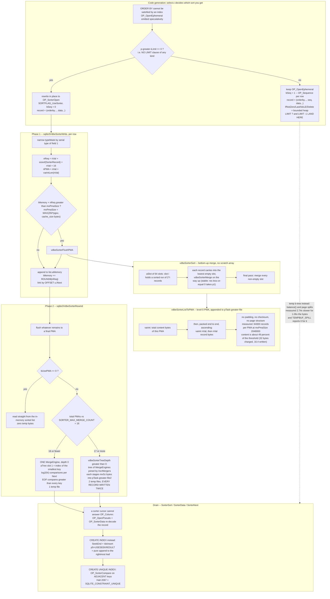

<!--
entry-meta
date: 2026-10-13
type: lesson
track: SQLite
lesson: 28
category: Database Internals
title: The VDBE sorter: PMAs, the merge tree, and the LIMIT that turns it off
slug: sqlite-vdbe-sorter-external-merge
-->

# The VDBE sorter: PMAs, the merge tree, and the LIMIT that turns it off

**2026-10-13 · SQLite Track · Lesson 28 of 33**

## Where This Fits

- [Lesson 27](../2026-10-12-sqlite-analyze-stat1-stat4-estimators/README.md) finished the question of where the planner's numbers come from: `sqlite_stat1`'s single average, `sqlite_stat4`'s 24 samples, `whereKeyStats`, `initAvgEq`, and the measured result that `STAT4`'s only effect on a two-value column was a 2-unit `rRun` discount. It handed this lesson two things: `whereSortingCost`'s *implementation* side — "`OP_SorterInsert` vs `OP_IdxInsert` and the extra factor of 2.0 or 3.0 the comment mentions but does not code there" — and the external merge itself.
- This lesson takes apart `vdbesort.c`: the in-memory list and its 64-slot merge sort, the **PMA** (Packed Memory Array) on-disk format, the exact byte at which the sorter decides to spill, the `aTree[]` loser-tree merge, the `SORTER_MAX_MERGE_COUNT` hierarchy, and the four type-specialised comparators. It also settles lesson 27's handoff in both directions: the 2.0x/3.0x **is** coded, as `rSortCost += 10` and `+= 6`, and the condition that selects `OP_IdxInsert` over `OP_SorterInsert` is not quite the condition that adds the penalty — the two disagree for `LIMIT ?` and `LIMIT -1`, measured.
- Everything from lessons 23–27 is assumed: registers and `Mem` cells, `OP_MakeRecord` and the record format from lesson 02, affinity and `sqlite3VdbeRecordCompare` from lesson 24, the `WhereLoop`/`wherePathSolver` machinery and `LogEst`/`estLog` arithmetic from lesson 26, and lesson 25's `aRegIdx[]` register contract. `OP_SorterInsert` appeared in lesson 25 only as `OP_IdxInsert`'s sibling; it is opened here.
- Lesson 29 (autocommit, savepoints, statement journals) gets the statement-journal side of temp storage, which this lesson deliberately does not touch; lesson 31 gets the memory allocator that `aMemory` leans on; lesson 32 inherits one new `SQLITE_TESTCTRL_` bit, `SQLITE_TESTCTRL_SORTER_MMAP`.

Everything below was measured on **SQLite 3.53.4**, built from the amalgamation vendored in `better-sqlite3@13.0.3` (`deps/sqlite3/sqlite3.c`) — the same source tree lesson 27 used, so its figures and these are comparable. Three binaries: a plain harness, one with `-DSQLITE_DEBUG -DSQLITE_ENABLE_WHERETRACE`, and one with a two-line patch that prints `whereSortingCost`'s locals and the `VdbeSorter` fields at `Rewind`. Page size 4096, `cache_size` −2000, `threads` 0 unless stated.

---

## 1. There are two sorts, and the switch is one line in `select.c`

The module doc of `vdbesort.c` says the `VdbeSorter` is used

> "to sort large numbers of keys for CREATE INDEX statements or by SELECT statements with ORDER BY clauses that cannot be satisfied using indexes **and without LIMIT clauses**."

That last clause is not a footnote; it is the whole decision, and it lives in `sqlite3Select` at tag-select-0650:

```c
if( p->iLimit==0 && sSort.addrSortIndex>=0 ){
  sqlite3VdbeChangeOpcode(v, sSort.addrSortIndex, OP_SorterOpen);
  sSort.sortFlags |= SORTFLAG_UseSorter;
}
```

An `OP_OpenEphemeral` is emitted speculatively when the ORDER BY needs a sort; it is **rewritten in place** into `OP_SorterOpen` only if `p->iLimit` is still 0 — that is, only if `computeLimitRegisters()` has not allocated a limit counter. `SORTFLAG_UseSorter` then flows into `pushOntoSorter`, where it picks the opcode and, through `bSeq`, the record shape:

```c
int bSeq = ((pSort->sortFlags & SORTFLAG_UseSorter)==0);
int nBase = nExpr + bSeq + nData;
...
if( pSort->sortFlags & SORTFLAG_UseSorter ){
  op = OP_SorterInsert;
}
```

Measured on `t(a integer, b text)`, 200,000 rows:

| | `SELECT a,b FROM t ORDER BY b` | `... ORDER BY b LIMIT 10` |
|---|---|---|
| open | `SorterOpen 1 4 0 k(1,B)` | `OpenEphemeral 1 4 0 k(1,B)` |
| per row | `Column`×2, `MakeRecord 1 2 4`, `SorterInsert 1 4` | `Column`, **`Sequence 1 3`**, `IfNotZero`/`Last`/`IdxLE`/`Delete`, `Column`, `MakeRecord 2 3 6`, `IdxInsert 1 6` |
| drain | `OpenPseudo 2 5 4`, `SorterSort`, `SorterData`, `Column`×2, `SorterNext` | `Sort`, `Column`×2, `Next` (no pseudo-cursor) |
| record fields | 2 — `(b, a)` | 3 — `(b, seq, a)` |
| `vmstep` | 2,000,009 | 1,200,195 |

Three things fall out of the diff, and all three are mechanism, not style:

- **`OP_Sequence` exists because a b-tree cannot hold duplicate keys.** The ephemeral index needs a unique key, so a monotonic counter is spliced in after the ORDER BY terms. The sorter needs no such thing: `vdbeSorterMerge` takes `p1` on `res<=0`, so the merge is stable by construction and duplicate keys are simply duplicate records. One extra column per row, and exactly **+1 VDBE instruction per row** — measured as a flat 200,000-step delta (2,000,009 → 2,200,009) on the `LIMIT -1` variant below, which sorts all 200,000 rows through the b-tree path.
- **The `LIMIT` path is a bounded priority queue, not a sort.** `IfNotZero`/`Last`/`IdxLE`/`Delete` at addresses 7–10 run *before* the insert: once the ephemeral index holds `LIMIT` entries, the largest is deleted to make room. The ephemeral index never exceeds 10 rows. That is why `ORDER BY b LIMIT 10` ran in **9.6 ms with zero temp bytes**, against 46.5 ms and 3.28 MB for the unbounded sort.
- **Column loading is deferred past the pruning.** In the `LIMIT` plan, `Column 0 1` (the ORDER BY column `b`) is read at address 5, but `Column 0 0` (`a`, not in the ORDER BY) is read at address **11** — after the `IdxLE`/`Delete`. That is `pSort->pDeferredRowLoad` / `innerLoopLoadRow`: columns that only have to appear in the output are materialised only for rows that survive the heap.

**And now the bad news, which is the central finding of this section.** The switch is `p->iLimit==0`, which is true only when there is no `LIMIT` clause *at all*. It is not `SF_FixedLimit`. Measured across every `LIMIT` form:

| query | opcode emitted | `WHERE_USE_LIMIT` seen by `whereSortingCost` |
|---|---|---|
| `ORDER BY b` | `SorterOpen` / `SorterInsert` | 0 |
| `ORDER BY b LIMIT 10` | `OpenEphemeral` / `IdxInsert` | **1** |
| `ORDER BY b LIMIT 10 OFFSET 5` | `OpenEphemeral` / `IdxInsert` | **1** |
| `ORDER BY b LIMIT ?` | `OpenEphemeral` / `IdxInsert` | **0** |
| `ORDER BY b LIMIT -1` | `OpenEphemeral` / `IdxInsert` | **0** |
| `ORDER BY b LIMIT (SELECT 10)` | `OpenEphemeral` / `IdxInsert` | 0 |

`LIMIT -1` means *no limit* in SQL — SQLite treats a negative LIMIT as unbounded, and the plan has no pruning to do. It still loses the sorter. Best of five on the 200,000-row table:

| | best ms | temp bytes | `TEMPBUF_SPILL` |
|---|---:|---:|---:|
| `ORDER BY b` (sorter) | **46.5** | 3,282,330 | 3,282,330 |
| `ORDER BY b LIMIT -1` (temp b-tree) | **127.3** | 3,465,216 | **0** |

**2.74x slower for 1.06x the bytes.** The cost is not I/O; it is b-tree insertion — `balance()` and page splits from lessons 11–12 — against an append-only PMA writer. Writing `LIMIT -1` instead of omitting the clause is a 2.7x pessimisation on this query, and the planner does not price it (§8).

The `TEMPBUF_SPILL` column is a second, separate finding; see §5.

---

## 2. The object and its contract

`sqlite3VdbeSorterInit`, `Write`, `Rewind`, `Next`, `Rowkey`, `Compare`, `Close`, `Reset`. The module comment states the call order as an invariant — `Write()` only between `Init`/`Reset` and `Rewind`; `Next`/`Rowkey`/`Compare` only between `Rewind` and `Close`/`Reset` — and the VDBE opcodes map one to one:

| opcode | calls | notes |
|---|---|---|
| `OP_SorterOpen P1 * P3 P4` | `sqlite3VdbeSorterInit(db, P3, pCsr)` | `P3` = number of key fields; `P4` is the `KeyInfo` |
| `OP_SorterInsert P1 P2` | `sqlite3VdbeSorterWrite` | `r[P2]` must be a `MEM_Blob` record; "Data for the entry is nil" |
| `OP_SorterSort P1 P2` | `sqlite3VdbeSorterRewind` | documented as "an alias for OP_Sort and OP_Rewind"; bumps `SQLITE_STMTSTATUS_SORT` then falls through into `OP_Rewind` |
| `OP_SorterData P1 P2 P3` | `sqlite3VdbeSorterRowkey` | writes the record to `r[P2]` and sets `apCsr[P3]->cacheStatus = CACHE_STALE` |
| `OP_SorterNext P1 P2` | `sqlite3VdbeSorterNext` | `goto next_tail` — shares `OP_Next`'s epilogue |
| `OP_SorterCompare P1 P2 P3 P4` | `sqlite3VdbeSorterCompare` | `P4` key columns of `r[P3]` against the current key; jumps if they differ |

The sorter stores **whole records and nothing else** — no column index, no cell pointer array, no page structure. That is why the drain loop needs `OP_OpenPseudo`: a sorter cursor cannot answer `OP_Column`. `OP_SorterData` copies the blob into a register and a pseudo-table cursor re-decodes it with the lesson 02 record reader. The ephemeral-index path skips that hop entirely, which is one of the few things it does better.

---

## 3. Phase 1 — the in-memory list and the 64-slot merge sort

Records accumulate in a `SorterList`:

```c
struct SorterList {
  SorterRecord *pList;            /* Linked list of records */
  u8 *aMemory;                    /* If non-NULL, bulk memory to hold pList */
  i64 szPMA;                      /* Size of pList as PMA in bytes */
};
struct SorterRecord {
  int nVal;                       /* Size of the record in bytes */
  union { SorterRecord *pNext; int iNext; } u;
  /* The data for the record immediately follows this header */
};
```

Two allocation strategies, chosen once at `Init`:

- **Bulk mode** (the default, when `sqlite3GlobalConfig.bSmallMalloc==0`): one `sqlite3Malloc(pgsz)` block, doubled by `sqlite3Realloc` as needed, records packed end to end. Because the block can move, the list is threaded by **offset** (`u.iNext`), not pointer.
- **Per-record mode** (`SQLITE_CONFIG_SMALL_MALLOC`): one `sqlite3Malloc` per record, threaded by `u.pNext`.

The list is built in **reverse insertion order** — `pNew->u.pNext = pSorter->list.pList` — and then sorted by `vdbeSorterSort`, which is a bottom-up binary merge over a 64-element slot array:

```c
SorterRecord *aSlot[64];
...
while( p ){
  ...
  p->u.pNext = 0;
  for(i=0; aSlot[i]; i++){
    p = vdbeSorterMerge(pTask, p, aSlot[i]);
    aSlot[i] = 0;
  }
  aSlot[i] = p;
  p = pNext;
}
```

`aSlot[i]` holds a sorted run of 2^i records or nothing; each new record carries into the lowest empty slot, merging as it goes. The source comment explains the magic number with a drawing:

> `,--Each aSlot[] holds twice as much as the previous. So we cannot use`
> `|  up all 64 aSlots[] with only a 64-bit address space.`

This is an ordinary stable merge sort with no recursion and no scratch array: the links are the scratch space. `vdbeSorterMerge` keeps a `bCached` flag across comparisons so that `p1`'s unpacked form is reused while `p1` keeps winning — an optimisation that is only sound because the comparison function is the one from §7.

---

## 4. The flush threshold, to the single record

Two numbers are computed once, in `sqlite3VdbeSorterInit`:

```c
u32 szPma = sqlite3GlobalConfig.szPma;      /* SQLITE_SORTER_PMASZ, default 250 */
pSorter->mnPmaSize = szPma * pgsz;

mxCache = db->aDb[0].pSchema->cache_size;
if( mxCache<0 ) mxCache = mxCache * -1024; else mxCache = mxCache * pgsz;
mxCache = MIN(mxCache, SQLITE_MAX_PMASZ);               /* 1<<29 = 512 MiB */
pSorter->mxPmaSize = MAX(pSorter->mnPmaSize, (int)mxCache);
```

and `sqlite3VdbeSorterWrite` spills on:

```c
nReq = pVal->n + sizeof(SorterRecord);
nPMA = pVal->n + sqlite3VarintLen(pVal->n);
...
bFlush = pSorter->iMemory && (pSorter->iMemory+nReq) > pSorter->mxPmaSize;
...
pSorter->iMemory += ROUND8(nReq);
```

**The threshold is on the in-memory footprint, not on the PMA.** `iMemory` advances by `ROUND8(nVal + sizeof(SorterRecord))` — on LP64 that is `ROUND8(nVal + 16)` — while `szPMA` advances by only `nVal + varintLen(nVal)`. For this table every record was 11–16 bytes, so **every record cost exactly 32 bytes of `iMemory`** and 12–17 bytes on disk.

Prediction: with `mxPmaSize` = 2,048,000 the level-0 PMA should hold exactly 2,048,000 / 32 = **64,000 records**. Captured and decoded (§Hands-On):

```
PMA 0: hdr_varint=3 bytes  content=1010793 bytes  records=64000  key-field sorted=True
PMA 1: hdr_varint=3 bytes  content=1049895 bytes  records=64000  key-field sorted=True
PMA 2: hdr_varint=3 bytes  content=1085898 bytes  records=64000  key-field sorted=True
PMA 3: hdr_varint=3 bytes  content= 135732 bytes  records= 8000  key-field sorted=True
record nVal histogram: {11: 9, 12: 120, 13: 1176, 14: 11654, 15: 90321, 16: 96720}
ROUND8(nVal+16)        : every one of those sizes -> 32
```

64,000 / 64,000 / 64,000 / 8,000 = 200,000. Exact, four times over. And note the consequence: **a level-0 PMA is about half the size the threshold suggests.** 1,010,793 of 2,048,000 is 49.4%; the memory accounting charges 32 bytes for what occupies 16.4 bytes on average on disk, a **1.95x inflation** that is pure `SorterRecord` header plus 8-byte rounding. The module comment's claim that "the threshold is set to the value returned by `PRAGMA main.page_size` multiplied by that returned by `PRAGMA main.cache_size`" is true of memory and misleading about the file.

### The `mnPmaSize` floor is real, and the documentation has the inequality backwards

`mxPmaSize = MAX(mnPmaSize, mxCache)`. Measured by varying `cache_size` on the same 200,000-row sort:

| `cache_size` | bytes implied | `mxPmaSize` (patched build) | level-0 PMAs | spill bytes |
|---|---:|---:|---:|---:|
| −100 | 102,400 | **1,024,000** | 7 | 3,282,339 |
| −500 | 512,000 | **1,024,000** | 7 | 3,282,339 |
| −2000 | 2,048,000 | 2,048,000 | 4 | 3,282,330 |
| −6249 | 6,398,976 | 6,398,976 | 2 | 3,282,324 |
| −6250 | 6,400,000 | 6,400,000 | **0** | **0** |

`−100` and `−500` are byte-identical because both clamp up to 250 × 4096. And the last two rows are a one-row-precision prediction: 200,000 records × 32 bytes = 6,400,000, the test is `iMemory + nReq > mxPmaSize` with `iMemory = 199,999 × 32 = 6,399,968`, so the sort stays entirely in memory iff `mxPmaSize >= 6,400,000`. `cache_size = -6250` gives exactly 6,400,000 and spills nothing; `-6249` gives 6,398,976 and spills everything. Confirmed on the first try.

The documentation for `SQLITE_CONFIG_PMASZ` says threads are launched when the content "exceeds the page size times the **minimum** of the `PRAGMA cache_size` setting and this value." In 3.53.4 the code is a `MAX`, and the measurement above agrees with the code: at `cache_size=-100` the operative threshold was the *larger* of the two values, 1,024,000, not 102,400. `mnPmaSize` appears in exactly two places in `vdbesort.c` — that `MAX`, and the `szPMA > mnPmaSize && sqlite3HeapNearlyFull()` arm of the per-record allocation mode — and in no thread-launch test at all.

---

## 5. The PMA on-disk format, decoded byte by byte

`vdbeSorterListToPMA`'s header comment is the whole spec:

> The format of a PMA is:
> * A varint. This varint contains the total number of bytes of content in the PMA (not including the varint itself).
> * One or more records packed end-to-end in order of ascending keys. Each record consists of a varint followed by a blob of data (the key). The varint is the number of bytes in the blob of data.

No page structure, no padding, no checksum, no header beyond that one varint. PMAs are appended to `pTask->file` back to back, and the `SQLITE_DEBUG` assertion at the end of the function states the packing exactly: `pTask->file.iEof == pList->szPMA + sqlite3VarintLen(pList->szPMA) + prior iEof`.

First 32 bytes captured off the wire by the VFS shim:

```
0000000  bd d8 69 | 0b | 03 17 03 72 6f 77 2d 31 06 87 17 | 0c | 03 19 03 72 6f 77 2d 31 30 04 3d da | 0d ...
```

- `bd d8 69` — 3-byte varint, `(0x3d<<14)|(0x58<<7)|0x69` = **1,010,793**: the PMA's content length. Matches the decoder's `content=1010793`.
- `0b` = 11 — the first record's length.
- `03 17 03` — record header: 3 header bytes, serial types `0x17` (= 23, text of length (23−13)/2 = 5) and `0x03` (3-byte big-endian integer).
- `72 6f 77 2d 31` = `"row-1"`, then `06 87 17` = 428,823. 3 + 5 + 3 = 11 ✓.
- `0c` = 12, then `"row-10"` and 277,978. 3 + 6 + 3 = 12 ✓.

The field order is `(b, a)` — ORDER BY key first, then the remaining output columns — because `makeSorterRecord` emits `OP_MakeRecord regBase+nOBSat, nBase-nOBSat`. Lesson 02's record format is reused verbatim; the sorter invents no encoding of its own.

One thing the decoder proves that is easy to assume wrongly: **a PMA is sorted in record order, not in byte order.** The naive `memcmp` check reports `byteswise_sorted=False` for every PMA, while decoding serial type 1 and comparing the text gives `key-field sorted=True` for all four. The leading serial-type byte varies with the text length, so `"row-9"` (`0x17`) sorts before `"row-10"` (`0x19`) byte-wise but after it under `sqlite3VdbeRecordCompare`. Any tool that tries to merge PMAs with `memcmp` is wrong.

### `SQLITE_DBSTATUS_TEMPBUF_SPILL` is the right instrument, and it has a hole

The spill is exposed through the C API, and the accounting is exact:

```c
/* sqlite3VdbeSorterClose */
for(ii=0; ii<pSorter->nTask; ii++){
  db->nSpill += pSorter->aTask[ii].nSpill;
}
```

`nSpill` is accumulated in `vdbePmaWriterFinish` (`*pnSpill += p->nPmaSpill`), and `sqlite3_db_status(db, SQLITE_DBSTATUS_TEMPBUF_SPILL, ...)` returns `db->nSpill` plus the TEMP database's `CACHE_WRITE` pages × page size. Measured: `TEMPBUF_SPILL` = 3,282,330 against the shim's independently counted 3,282,330 bytes of `xWrite` — the four PMA content lengths (1,010,793 + 1,049,895 + 1,085,898 + 135,732 = 3,282,318) plus the four 3-byte leading varints. To the byte.

Two caveats worth writing down:

1. **It lands at `Close`, not at the last `Next`.** The counter moves when the statement is finalised or reset. A harness that reads `db_status` before `sqlite3_finalize` sees zero.
2. **It misses the ephemeral-index path entirely.** The documentation says the value "includes writes to intermediate tables that are part of complex queries, external sorts that spill to disk, and writes to TEMP tables." The `LIMIT -1` sort in §1 wrote **3,465,216 bytes** to a temp file — counted by the VFS shim — and `TEMPBUF_SPILL` reported **0**. The b-tree arm of the API reads only `db->aDb[1].pBt`, the TEMP database; an `OP_OpenEphemeral` table is a separate transient `Btree` that is not in `aDb[1]`. So the one API for "how much did this query spill" is blind to exactly the path that spills more and runs 2.7x slower. If you want that number, you need a VFS shim.

---

## 6. Phase 2 — the merge, `aTree[]`, and the 16-PMA cliff

`Rewind` flushes whatever is left in memory to a final PMA, then builds a merge structure. The merge is an **explicit loser tree** held in a flat array:

```c
struct MergeEngine {
  int nTree;                 /* Used size of aTree/aReadr (power of 2) */
  SortSubtask *pTask;
  int *aTree;                /* Current state of incremental merge */
  PmaReader *aReadr;         /* Array of PmaReaders to merge data from */
};
```

`aTree[1]` holds the index of the `PmaReader` currently at the smallest key; the final N/2 elements hold pairwise winners; `aTree[0]` is unused. The source's own worked example:

```
aReadr[0]->Banana  [1]->Feijoa  [2]->Elderberry  [3]->Currant
aReadr[4]->Grapefruit  [5]->Apple  [6]->Durian  [7]->EOF

aTree[] = { X, 5,  0, 5,  0, 3, 5, 6 }     current element = "Apple"
```

EOF compares greater than every key, which is how readers retire without a special case. Advancing costs **log2(N) comparisons**, N being the number of segments rounded up to a power of two — not N comparisons, which is what a naive "scan all readers for the minimum" merge would cost.

`SORTER_MAX_MERGE_COUNT` is **16**, and it caps the fan-in of one `MergeEngine`:

```c
static int vdbeSorterTreeDepth(int nPMA){
  int nDepth = 0;
  i64 nDiv = SORTER_MAX_MERGE_COUNT;
  while( nDiv < (i64)nPMA ){ nDiv = nDiv * SORTER_MAX_MERGE_COUNT; nDepth++; }
  return nDepth;
}
```

So ≤ 16 PMAs merge in one pass with depth 0. At 17, depth becomes 1, `vdbeSorterAddToTree` builds a tree of `MergeEngine`s joined by `IncrMerger` objects, and a single-threaded `IncrMerger` "has exclusive access to `mxSz` bytes of space beginning at offset `iStartOff` of file `pTask->file2`" — a **second temp file**, into which the intermediate merge output is staged. `mxSz` is half the `Write()` threshold, per the module comment on parameter T.

The cliff is directly observable. Same 200,000 rows, `page_size=512` so that `mnPmaSize` = 128,000 and a positive `cache_size` (in pages) controls `mxPmaSize` finely:

| `cache_size` | `mxPmaSize` | records/PMA | total PMAs | temp files | bytes written | best ms |
|---|---:|---:|---:|---:|---:|---:|
| 782 | 400,384 | 12,512 | **16** | **1** | 3,282,366 | 56.5 |
| 781 | 399,872 | 12,496 | **17** | **2** | **6,564,686** | 67.4 |

One page of `cache_size` either side of the boundary. 32k + 32 > 400,384 gives 12,512 records per PMA and ⌈200,000/12,512⌉ = 16; 399,872 gives 12,496 and ⌈200,000/12,496⌉ = 17. **Crossing 16 PMAs exactly doubles the bytes written to disk** — 6,564,686 / 3,282,366 = 2.0001 — because every record is now written twice: once into its level-0 PMA and once again when the `IncrMerger` stages the merged run into `file2`.

The wall-clock cost here was only **1.19x** (56.5 → 67.4 ms), and that number should be read with suspicion rather than relief: the temp file was a few megabytes in the host's page cache, so the doubled writes largely never reached a device. On storage where a write costs what a write costs, a 2x amplification is a 2x amplification. The right way to read the measurement is: *the byte count doubled, reliably and reproducibly, at a threshold you can compute in advance from `page_size`, `cache_size` and your average record size.*

Depth 2 begins at 257 PMAs, depth 3 at 4,097, and each level adds another full rewrite.

---

## 7. Four comparators, and three ways to lose the fast one

`vdbeSorterGetCompare` dispatches on a single byte:

```c
if( p->typeMask & SORTER_TYPE_INTEGER )   return vdbeSorterCompareInt;
else if( p->typeMask & SORTER_TYPE_TEXT ) return vdbeSorterCompareText;
else if( p->typeMask & SORTER_TYPE_REAL ) return vdbeSorterCompareReal;
return vdbeSorterCompare;
```

`typeMask` starts optimistic, and only if three conditions hold at `Init`:

```c
if( pKeyInfo->nAllField<13
 && (pKeyInfo->aColl[0]==0 || pKeyInfo->aColl[0]==db->pDfltColl)
 && (pKeyInfo->aSortFlags[0] & KEYINFO_ORDER_BIGNULL)==0
){
  pSorter->typeMask = SORTER_TYPE_INTEGER|SORTER_TYPE_TEXT|SORTER_TYPE_REAL;
}
```

and is then narrowed on every `Write` by the serial type of the first field:

```c
getVarint32NR((const u8*)&pVal->z[1], t);
if( t>0 && t<10 ){
  if( t==7 ) pSorter->typeMask &= SORTER_TYPE_REAL;
  else       pSorter->typeMask &= (SORTER_TYPE_INTEGER|SORTER_TYPE_REAL);
}else if( t>10 && (t & 0x01) ){
  pSorter->typeMask &= SORTER_TYPE_TEXT;
}else{
  pSorter->typeMask = 0;
}
```

The specialised comparators read the first field straight out of the record bytes and only fall back to building an `UnpackedRecord` when the first fields tie. The generic one unpacks every time.

Measured on a 300,000-row single-key in-memory sort (`cache_size` −400000, no spill), with the patched build printing `typeMask` at `Rewind`, best of three:

| query | `typeMask` | comparator | best ms |
|---|---|---|---:|
| `ORDER BY c1` (INTEGER) | `0x01` | `vdbeSorterCompareInt` | **85.4** |
| `ORDER BY c1 NULLS LAST` | `0x00` | `vdbeSorterCompare` | 114.7 |
| `ORDER BY c1 DESC` | `0x01` | `vdbeSorterCompareInt` | **100.0** |
| `ORDER BY c1 DESC NULLS FIRST` | `0x00` | `vdbeSorterCompare` | 131.0 |
| `ORDER BY s` (TEXT) | `0x02` | `vdbeSorterCompareText` | **114.1** |
| `ORDER BY s NULLS LAST` | `0x00` | `vdbeSorterCompare` | 159.4 |
| `ORDER BY s COLLATE NOCASE` | `0x00` | `vdbeSorterCompare` | 191.1 |

**1.34x for integers, 1.40x for text.** The DESC pair is the control that makes it a mechanism rather than a correlation: for `DESC`, NULLS LAST is SQLite's default, so `KEYINFO_ORDER_BIGNULL` is *not* set and `DESC` keeps `typeMask=0x01`; `DESC NULLS FIRST` is the non-default, sets the bit, and loses it. The direction of the regression follows the **bit**, not the null semantics. `NULLS LAST` on an ASC sort is a 1.3x tax that appears nowhere in any query plan.

The `nAllField<13` gate is the one most likely to bite silently, because `nAllField` counts output columns:

| ORDER BY terms | result columns | `nAllField` | `typeMask` |
|---:|---:|---:|---|
| 1 | 9 | 11 | `0x01` |
| 1 | 10 | 12 | `0x01` |
| 1 | **11** | **13** | **`0x00`** |
| 2 | 9 | 12 | `0x01` |
| 2 | **10** | **13** | **`0x00`** |

`nAllField` = ORDER BY terms + result columns + 1. So with one ORDER BY term, **`SELECT` of 11 or more columns loses the specialised comparator**; with two ORDER BY terms, 10 columns. Adding a column to a `SELECT` list can change the comparator the sort uses. (In fairness, a 12-field record's sort is dominated by record decode — the 12-column A/B above showed no measurable comparator effect at all, 209 vs 212 ms. The gate is defensible; it is just invisible.)

`COLLATE NOCASE` loses it twice over: the collation gate fires, *and* the ORDER BY term is no longer the bare result column, so it gets its own field in the sorter record — measured as `nAllField` 4 → 4 with `vmstep` rising 2,400,009 → 2,700,009, one extra `OP_Column` per row.

---

## 8. What the planner charges for all this — lesson 27's handoff, settled

`whereSortingCost` in full, minus comments:

```c
nCol = sqlite3LogEst((pWInfo->pSelect->pEList->nExpr+59)/30);
rSortCost = nRow + nCol;
if( nSorted>0 ) rSortCost += sqlite3LogEst((nOrderBy-nSorted)*100/nOrderBy) - 66;
if( (pWInfo->wctrlFlags & WHERE_USE_LIMIT)!=0 ){
  rSortCost += 10;                              /* TUNING: Extra 2.0x if using LIMIT */
  if( nSorted!=0 ) rSortCost += 6;              /* TUNING: Extra 1.5x if also partial sort */
  if( pWInfo->iLimit<nRow ) nRow = pWInfo->iLimit;
}else if( (pWInfo->wctrlFlags & WHERE_WANT_DISTINCT) ){
  if( nRow>10 ){ nRow -= 10; }
}
rSortCost += estLog(nRow);
```

Lesson 27 asked where "an extra factor of 2.0 or 3.0 … if the sort is built using `OP_IdxInsert` and `OP_Sort` rather than with `OP_SorterInsert`" is coded. **It is those two lines.** `+10` is LogEst 10 = 2^1.0 = 2.00x; `+10+6 = +16` is 2^1.6 = **3.03x**, and `nSorted != 0` is precisely "partial sort", i.e. a block sort where only the trailing ORDER BY terms are out of order. The two comments describe the same two additions from different angles, and the bridge between them is §1: `WHERE_USE_LIMIT == SF_FixedLimit`, and `SF_FixedLimit` implies `p->iLimit != 0`, which is what selects `OP_IdxInsert`. The factor is real, it is coded, and lesson 27's reading of the comment was right.

The decomposition, printed from the patched build on the unanalysed 200,000-row table:

```
=== select a,b from t order by b
[SORTCOST] nRowIn=201 nCol=10 nOrderBy=1 nSorted=0 useLimit=0 iLimit=320 nRowFinal=201 estLog=43 -> 254
---- sort cost=254 (1/1) increases cost 216 to 258
=== select a,b from t order by b limit 10
[SORTCOST] nRowIn=201 nCol=10 nOrderBy=1 nSorted=0 useLimit=1 iLimit=33  nRowFinal=33  estLog=17 -> 238
---- sort cost=238 (1/1) increases cost 216 to 244
```

201 + 10 + 43 = 254 and 201 + 10 + 10 + 17 = 238, exactly. Note `pWInfo->iLimit` is a **LogEst**, not a row count: 33 = LogEst(10). It arrives as `sqlite3WhereBegin`'s `iAuxArg`, which the SELECT fills from `p->nSelectRow` — 320 ("4 billion rows") when there is no fixed limit.

Three results fall out that are new here.

**(a) The `LIMIT 10` sort is priced *lower* than the unlimited one — 238 against 254 — and that is correct.** The `+10` penalty is more than repaid by `nRow` collapsing from 201 to 33 before `estLog`. The penalty only wins when the limit is large: `LIMIT 100000` prices at 261, above the unlimited 254.

**(b) The model and the code generator disagree for `LIMIT ?` and `LIMIT -1`.** Both get `useLimit=0`, `iLimit=320` and a sort cost of **254 — identical to no LIMIT at all** — while §1 shows both actually generate `OpenEphemeral`/`IdxInsert`/`Sort` and run **2.74x slower** than the sorter. The planner under-prices those two forms by the full 2.0x factor, on a path where the measured penalty is larger than 2.0x. `LIMIT -1` is the sharpest case: semantically unbounded, pays the b-tree, and is costed as if it used the sorter.

**(c) `nCol` is a three-step staircase, flat below 31 columns.** `(nExpr+59)/30` is integer division, so measured directly:

| result columns | `nCol` | sort cost |
|---:|---:|---:|
| 1–30 | 10 | 254 |
| 31–60 | 16 | 260 |
| 61+ | 20 | 264 |

"TUNING: sorting cost proportional to the number of output columns" buys nothing at all for the overwhelming majority of real queries. A 1-column sort and a 30-column sort are priced identically, even though §7 shows the 12-column record sorts roughly 2.5x slower than the 1-column one.

**And one thing lesson 27 left explicitly unexamined, now measured.** `nRowIn` is **201** for this table — LogEst 200 is 2^20 = 1,048,576 rows — because the table has never been `ANALYZE`d and `sqlite3DefaultRowEst` supplies that default. After `ANALYZE` (`sqlite_stat1` = `t|NULL|200000`):

```
[SORTCOST] nRowIn=177 ... estLog=42 -> 229        (was 201 ... 43 -> 254)
---- sort cost=229 (1/1) increases cost 192 to 233   (was 216 to 258)
```

The unanalysed planner believes there are 5.2x more rows than there are, so it over-prices the sort by 25 LogEst units (5.6x) *and* over-prices the scan it would have to sort by the same amount. Since the two move together the sort/no-sort choice often survives, but every comparison against a plan that avoids sorting is being made with inflated inputs. This is a different failure from lesson 27's skew problem: not a bad distribution, a bad cardinality.

---

## 9. The other caller: `CREATE INDEX`

`sqlite3CreateIndex` opens a sorter directly, and the drain loop explains why the sorter exists at all:

```
12   SorterOpen       3    0    1    k(2,,)
...
15   Column           1    1    10          -- the indexed column
16   Rowid            1    11   0
17   MakeRecord       10   2    9           -- (b, rowid): the whole index key
18   SorterInsert     3    9    0
19   Next             1    15   0
20   OpenWrite        2    1    0    k(2,,)   p5=17
21   SorterSort       3    26   0
22   SorterData       3    9    2
23   SeekEnd          2    0    0
24   IdxInsert        2    9    0             p5=16   -- OPFLAG_USESEEKRESULT
25   SorterNext       3    22   0
```

`OP_SeekEnd` parks the cursor at the right edge of the new index and `OPFLAG_USESEEKRESULT` (p5=16, from lesson 25's flag table) tells `sqlite3BtreeInsert` to trust that position. Every insert is therefore an **append to the rightmost leaf**: no descent, no `balance_nonroot()` on interior pages except when the rightmost leaf fills. Sorting first converts random b-tree insertion into sequential leaf growth. That is the entire point.

`CREATE UNIQUE INDEX` adds the only use of `OP_SorterCompare` in the codebase:

```
21   SorterSort       3    29   0
22   Goto             0    25   0            -- skip the compare for the first row
23   SorterCompare    3    22   9    1       -- jump to 22 if the first 1 key column differs
24   Halt             2067 2    0    t.b     -- 2067 = SQLITE_CONSTRAINT_UNIQUE
25   SorterData       3    9    2
```

Uniqueness is checked by comparing **adjacent keys in the sorted stream**, not by probing the index per row. `sqlite3VdbeSorterCompare` exists so that this one check does not need a b-tree lookup.

---

## The whole thing, in one picture



---

## Hands-On

The sorter's temp files are opened with `SQLITE_OPEN_DELETEONCLOSE` and unlinked immediately, so you cannot find them in `/tmp`. Two instruments make everything above visible. Neither needs a debug build.

### A. Count the spill from SQL-adjacent code

`SQLITE_DBSTATUS_TEMPBUF_SPILL` (verb 13) is all you need for the byte counts. A 60-line C harness is the honest route, because the `sqlite3` CLI's `.stats` output does not include it:

```c
sqlite3_stmt *s; int cur, hi;
sqlite3_db_status(db, SQLITE_DBSTATUS_TEMPBUF_SPILL, &cur, &hi, 1);   /* reset */
sqlite3_prepare_v2(db, "SELECT a,b FROM t ORDER BY b", -1, &s, 0);
while( sqlite3_step(s)==SQLITE_ROW ){}
sqlite3_finalize(s);              /* <-- nSpill lands HERE, not at the last step */
sqlite3_db_status(db, SQLITE_DBSTATUS_TEMPBUF_SPILL, &cur, &hi, 0);
printf("spill=%d\n", cur);
```

**What to look for.** Build `t(a integer, b text)` with 200,000 rows of `'row-'||i`, then sweep `cache_size`:

```sql
PRAGMA cache_size = -2000;  -- 3282330 bytes spilled
PRAGMA cache_size = -500;   -- 3282339  (clamped UP to 250*page_size)
PRAGMA cache_size = -100;   -- 3282339  (identical: proves the mnPmaSize floor)
PRAGMA cache_size = -6249;  -- 3282324
PRAGMA cache_size = -6250;  -- 0
```

Two rows of `cache_size` apart, the spill goes to zero. That proves the threshold is `iMemory`, charged at `ROUND8(nVal + 16)` per record, against `MAX(250*page_size, |cache_size|*1024)` — not any disk quantity. Compute your own boundary as `rows × ROUND8(avg_record + 16)` and check it; if it is off, your average record size is what is wrong.

Then confirm the blind spot: run the same query with `LIMIT -1` appended. Spill reports **0**. Nothing got cheaper; the writes moved to an ephemeral b-tree the API does not count.

### B. Capture and decode the PMAs with a VFS shim

A pass-through `sqlite3_vfs` whose `xOpen` flags `SQLITE_OPEN_TEMP_JOURNAL`/`TEMP_DB`/`TRANSIENT_DB` (or a NULL filename) as "temp", and whose `xWrite` both counts bytes and mirrors them into a real file at the same offset, gives you the actual PMA stream. Register it with `sqlite3_vfs_register` and open the database with it as `zVfs`. Roughly 90 lines; the only subtlety is that `szOsFile` must be your wrapper's size and you must forward `xShm*` and, if you set `iVersion=3`, `xFetch`/`xUnfetch`.

Then decode the file with the format from §5:

```python
def varint(b, i):
    v = 0
    for k in range(9):
        c = b[i+k]
        if k == 8: return (v<<8)|c, i+9
        v = (v<<7)|(c & 0x7f)
        if not c & 0x80: return v, i+k+1

d = open('pma.bin','rb').read()
off = pma = 0
while off < len(d):
    sz, p = varint(d, off)            # total content bytes of this PMA
    end, q, n, prev, ok = p+sz, p, 0, None, True
    while q < end:
        rl, q2 = varint(d, q)         # length of this record
        rec = d[q2:q2+rl]
        hs, i = varint(rec, 0)        # record header size
        st, _ = varint(rec, i)        # serial type of key field 1
        key = rec[hs:hs+(st-13)//2].decode('latin1') if st >= 13 and st % 2 else None
        if prev is not None and key < prev: ok = False
        prev, n, q = key, n+1, q2+rl
    print(f"PMA {pma}: content={sz} records={n} key_sorted={ok}")
    off, pma = end, pma+1
```

**What to look for.**

1. **`records` is a constant.** At `cache_size=-2000` you should see 64000 / 64000 / 64000 / 8000. A constant record count across PMAs with *varying* content sizes is the signature of a memory-based threshold with 8-byte rounding. If you see a constant *content* size instead, your records are large enough that `ROUND8(nVal+16)` is no longer quantising them to one value.
2. **`key_sorted=True` but a `memcmp` check fails.** Swap the key extraction for `rec < prev` on raw bytes and watch it report unsorted. This is the concrete proof that PMA order is `sqlite3VdbeRecordCompare` order, not lexicographic byte order.
3. **The first three bytes decode to the first PMA's content length,** and `sum(content) + 3*nPMA` equals `TEMPBUF_SPILL` to the byte. If it does not, you are missing writes — check that your shim is catching a NULL filename.

### C. Walk off the 16-PMA cliff

Rebuild the table with `PRAGMA page_size=512` (so `mnPmaSize` = 128,000 and a *positive* `cache_size`, counted in pages, controls the threshold), then:

```sql
PRAGMA cache_size = 782;   -- 16 PMAs, 1 temp file,  3282366 bytes
PRAGMA cache_size = 781;   -- 17 PMAs, 2 temp files, 6564686 bytes
```

**What to look for.** `tempopen` going from 1 to 2 — that second file is `pTask->file2`, and its appearance *is* `vdbeSorterTreeDepth()` returning 1. The byte count doubling to within 0.01% is the write amplification of the extra merge level. Compute the boundary yourself: `⌈rows / floor(mxPmaSize/ROUND8(avg+16))⌉ > 16`. Getting this prediction right to the single page of `cache_size` is the test that you understand §4 and §6 together.

### D. See the comparator change

```sql
SELECT c1 FROM z ORDER BY c1;              -- typeMask 0x01, vdbeSorterCompareInt
SELECT c1 FROM z ORDER BY c1 NULLS LAST;   -- typeMask 0x00, generic
SELECT c1 FROM z ORDER BY c1 DESC;         -- typeMask 0x01  (NULLS LAST is the default here)
SELECT c1 FROM z ORDER BY c1 DESC NULLS FIRST;  -- typeMask 0x00
```

**What to look for.** Time all four on 300,000 rows with `cache_size` large enough that nothing spills (otherwise I/O swamps the effect). The ASC and DESC pairs should move in the same direction by the same ~1.3x, which is what makes `KEYINFO_ORDER_BIGNULL` — and not null ordering semantics — the cause. Then add result columns one at a time to `SELECT c1, c2, …` and find the step: with one ORDER BY term it is at the 11th column, where `nAllField` reaches 13.

### E. Decompose the planner's sort cost

`WHERETRACE` needs **both** `SQLITE_DEBUG` and `SQLITE_ENABLE_WHERETRACE` (lesson 27's note still holds), and `sqlite3WhereTrace` is `SQLITE_PRIVATE` in the amalgamation, so the harness must `#include "sqlite3.c"`. Set `sqlite3WhereTrace = 0x002` and prepare:

```
---- sort cost=254 (1/1) increases cost 216 to 258
```

**What to look for.** Run the same query with and without `LIMIT 10`, then with `LIMIT -1`. The first two differ; the first and third are identical, while §1's `EXPLAIN` shows the third generating the b-tree plan. Seeing the model and the code generator disagree in two adjacent commands is the point of the exercise.

---

## Where This Breaks Down

- **The sorter is off by default for any query with a `LIMIT`, including ones where `LIMIT` buys nothing.** `LIMIT ?` cannot be pruned at plan time (the value is unknown), so the bounded heap can still help — but `LIMIT -1` is unbounded by definition and gets the slower path for no benefit at all. Measured: 2.74x. The fix at the application level is to omit the clause rather than pass a sentinel.
- **The 2x write amplification above 16 PMAs is a cliff, not a slope.** One page of `cache_size`, or one extra row, can double the bytes your sort writes. Nothing in `EXPLAIN QUERY PLAN`, `sqlite3_stmt_status` or `sqlite3_db_status` tells you which side of it you are on. You can only compute it, or instrument the VFS.
- **The memory accounting over-charges small records by ~2x.** `sizeof(SorterRecord)` plus `ROUND8` means a 14-byte record occupies 32 bytes of the budget. A sort of narrow rows spills at roughly half the data volume you would predict from `page_size × cache_size`, and the designers accepted that in exchange for a single bulk allocation with offset-threaded links.
- **`SQLITE_DBSTATUS_TEMPBUF_SPILL` does not measure what its documentation claims.** It is exact for the sorter and blind to `OP_OpenEphemeral` tables, which is the path that spills more. Any capacity-planning number built on it is systematically low for exactly the queries that need attention.
- **Three invisible ways to lose the fast comparator**: `NULLS FIRST`/`NULLS LAST` against the default direction, a non-default collation on the first ORDER BY term, and an eleventh result column. All three cost ~1.3–1.4x on narrow sorts and none of them appear in any plan output.
- **`nCol` buys almost nothing.** The cost model's only acknowledgement of row width is a three-step staircase that first moves at 31 output columns, while a 12-field record measurably sorts ~2.5x slower than a 1-field one.
- **Unanalysed tables inflate the sort cost by the `sqlite3DefaultRowEst` default.** 2^20 assumed rows against 200,000 real ones is a 5.6x over-estimate of the sorting cost, and the comparison against sort-avoiding plans is made with that number.
- **Worker threads cost I/O to buy parallelism, and on a small machine they lose.** `PRAGMA threads=4` on this 2-core box gave `nTask=5`, **14** temp files, **9,846,966** spill bytes — 3.0x the single-threaded 3,282,330 — and 62 ms against 46.5. Each task writes its own level-0 PMAs and each multi-threaded `IncrMerger` keeps two staging files. The module comment's design is sound; the default of `threads=0` is the right default.
- **The sorter asked for a memory map and did not get one.** `vdbeSorterOpenTempFile` explicitly sets `SQLITE_FCNTL_MMAP_SIZE` to `SQLITE_MAX_MMAP_SIZE` on the temp file, so the PMA file is meant to be mapped regardless of `PRAGMA mmap_size`. Instrumented, there were **8 `xFetch` calls and 0 successful mappings**, and all 3.28 MB came back through buffered `xRead`. Disabling the path entirely with `SQLITE_TESTCTRL_SORTER_MMAP=0` made no measurable difference (48.3 vs 46.5 ms best-of-five), consistent with the map never having happened. Why the unix VFS declined was **not** established — see Next Steps 1. This is also a caveat on the read counts above; the *write* byte counts are unaffected.
- **`SQLITE_ENABLE_SORTER_REFERENCES` would change the record shape and is off.** With it, wide columns are replaced in the sorter record by a reference and re-loaded from the b-tree at drain time. The documented default "is to never use this optimization", and this build does not define the symbol, so every measurement above carries the full row through the sorter.

---

## Further Study

- [`src/vdbesort.c` on GitHub](https://github.com/sqlite/sqlite/blob/master/src/vdbesort.c) — the 140-line module comment is the best single description of the algorithm anywhere, including the `aTree[]` fruit example and the parameter-T explanation of incremental merging.
- [`SQLITE_CONFIG_SORTERREF_SIZE`](https://www.sqlite.org/c3ref/c_config_covering_index_scan.html) — the sorter-reference optimisation this build does not have, and the `SQLITE_CONFIG_PMASZ` entry whose "minimum" wording §4 disputes.
- [Temporary Files Used By SQLite](https://www.sqlite.org/tempfiles.html) — §2.8 "Transient indices" is the ephemeral-index path from §1, described from the file side; §4's "The temporary file is not opened and the information is not truly written to disk until the page cache is full" is the b-tree analogue of the PMA threshold, with its own default (`SQLITE_DEFAULT_TEMP_CACHE_SIZE`, 500 pages).
- [`SQLITE_DBSTATUS_TEMPBUF_SPILL`](https://www.sqlite.org/c3ref/c_dbstatus_options.html) — read the "overlap … with `SQLITE_DBSTATUS_CACHE_WRITE`" note alongside §5's measurement that the ephemeral path is missing.
- [`PRAGMA cache_size` / `temp_store`](https://www.sqlite.org/pragma.html) — the negative-KiB semantics that make `mxPmaSize` computable, and the `temp_store=MEMORY` setting that removes the file but not the threshold.
- [SQLite source check-in 8051c1767c4386b0](https://www.sqlite.org/src/info/8051c1767c4386b0) and the `vdbesort.c` artifacts [5a729a15fb46b175](https://www.sqlite.org/src/artifact/5a729a15fb46b175), [b36070436d333722](https://www.sqlite.org/src/artifact/b36070436d333722), [31c7794a517e8b0a](https://www.sqlite.org/src/artifact/31c7794a517e8b0a), [3e8827bb9d124655](https://www.sqlite.org/src/artifact/3e8827bb9d124655) — successive revisions of the file, useful for seeing how the threaded merge arrived. (`sqlite.org/src/file/...` is blocked to automated fetchers; the artifact URLs are reachable and the GitHub mirror above is the practical route.)
- A [2014-era `vdbesort.c`](https://mojo.googlesource.com/mojo-tools/+/55ff7f86b1dee9726b362532adbb48ae9a825f1a/third_party/sqlite/sqlite-src-3080704/src/vdbesort.c) (3.8.7.4) for a diff against the modern file — the PMA format and `SORTER_MAX_MERGE_COUNT` are unchanged; the `IncrMerger` machinery is what grew.

## Next Steps

1. **Settle why `xFetch` on the PMA temp file returned no mapping.** `vdbeSorterOpenTempFile` sets `SQLITE_FCNTL_MMAP_SIZE` to `SQLITE_MAX_MMAP_SIZE`, and 8 of 8 attempts still came back NULL. Read `unixFetch`/`unixMapfile` and `unixFileControl`'s `SQLITE_FCNTL_MMAP_SIZE` arm against `sqlite3GlobalConfig.mxMmap` (= `SQLITE_MAX_MMAP_SIZE`) and `szMmap` (= `SQLITE_DEFAULT_MMAP_SIZE`, 0), and determine whether the clamp, the zero-length map at extend time, or the `DELETEONCLOSE` locking style is responsible. Lesson 31 owns `mmap_size` and should inherit the answer either way.
2. **Measure the 16-PMA cliff on storage that is not the page cache.** Repeat §6C with `O_DIRECT` or a cgroup page-cache limit, or simply with a 20 GB sort, and check whether the wall-clock ratio approaches the 2.0001x byte ratio. The 1.19x measured here is a page-cache artefact and should not be quoted as the cost of the extra merge level.
3. **Find the record size at which the `ROUND8(nVal+16)` quantisation stops dominating.** Every record in this experiment rounded to 32 bytes, which is why PMAs held a constant record count. Sweep record width and locate the point at which PMA content size, rather than record count, becomes the constant — and check whether the ~2x memory inflation falls to ~1.1x as records grow, as the arithmetic predicts.
4. **Separate the two effects in the `LIMIT -1` regression.** The 2.74x covers both the ephemeral b-tree's insertion cost *and* the extra `OP_Sequence` column. Build a sorter-path query with a deliberately widened record to match the b-tree path's field count, or patch `select.c` to emit `SORTFLAG_UseSorter` for a negative limit, and attribute the 2.74x between the two.
5. **Check whether `STAT4`'s sharper `nOut` reaches the sorter estimate at all.** Lesson 27 handed this forward. `whereSortingCost` takes `nRowEst` from the solver, so a better `nOut` should flow in — but §8(c) shows `nCol` is nearly constant and §8's closing shows `sqlite3DefaultRowEst` dominating on unanalysed tables. Build the `-DSQLITE_ENABLE_STAT4` binary from lesson 27 and compare `[SORTCOST] nRowIn` across the two builds on the skewed table.
6. **Exercise the depth-2 merge tree.** 257 PMAs is reachable with `page_size=512`, a positive `cache_size` and ~3M rows. Verify that `vdbeSorterTreeDepth` returns 2, that the byte count goes to 3x, and that `vdbeSorterAddToTree`'s `(iSeq / nDiv) % SORTER_MAX_MERGE_COUNT` placement produces the fan-out the comment claims.
7. **Trace `sqlite3DefaultRowEst` properly.** §8 measured its effect (LogEst 200 = 1,048,576 assumed rows) but did not read the function. Lesson 26 read `build.c`'s `szTabRow` arithmetic and skipped this; it is still skipped, and it sets the baseline for every cost in lessons 26–28.

## Sources

- [`src/vdbesort.c`, sqlite/sqlite master](https://github.com/sqlite/sqlite/blob/master/src/vdbesort.c) — retrieved in full this run through the GitHub API and spot-confirmed by fetch. Source of the module comment, the `SorterList` / `SorterRecord` / `MergeEngine` / `PmaReader` / `PmaWriter` / `IncrMerger` / `SortSubtask` / `VdbeSorter` struct definitions, the `aTree[]` fruit example, `vdbeSorterSort`'s `aSlot[64]` loop and its comment, `vdbeSorterMerge`, `vdbeSorterGetCompare`, `sqlite3VdbeSorterInit`'s threshold arithmetic and `typeMask` gate, `sqlite3VdbeSorterWrite`'s `bFlush` test, `vdbeSorterListToPMA`'s PMA format comment, `vdbeSorterTreeDepth`, `vdbeSorterAddToTree`, `vdbeSorterSetupMerge`, `vdbeSorterFlushPMA`, `vdbeSorterOpenTempFile`, `vdbeSorterExtendFile`, `vdbeSorterMapFile`, `vdbePmaWriterFinish`, `sqlite3VdbeSorterClose`'s `db->nSpill` accumulation, and the verbatim values `SORTER_MAX_MERGE_COUNT 16`, `SQLITE_MAX_PMASZ (1<<29)`, `SORTER_TYPE_INTEGER 0x01`, `SORTER_TYPE_TEXT 0x02`, `SORTER_TYPE_REAL 0x04`.
- [`SQLITE_CONFIG_PMASZ` and `SQLITE_CONFIG_SORTERREF_SIZE`](https://www.sqlite.org/c3ref/c_config_covering_index_scan.html) — fetched this run. Quoted verbatim in §4 and the Further Study note on sorter references. The page gives no numeric PMASZ default (the amalgamation's `SQLITE_SORTER_PMASZ` is 250) and its "minimum of the `PRAGMA cache_size` setting and this value" is the wording §4 disputes against `MAX(...)` in the code and against measurement.
- [`SQLITE_DBSTATUS_TEMPBUF_SPILL`](https://www.sqlite.org/c3ref/c_dbstatus_options.html) — fetched this run. The verbatim entry quoted in §5, including the claim that it covers "writes to intermediate tables that are part of complex queries", and the `CACHE_WRITE` overlap note. Verb value 13.
- [Temporary Files Used By SQLite](https://www.sqlite.org/tempfiles.html) — fetched this run. The nine kinds of temporary file; §2.8 "Transient indices" ("Each transient index is stored in its own temporary file … automatically deleted at the end of the statement that uses it") as the file-side description of the `OP_OpenEphemeral` path; §3 on `SQLITE_TEMP_STORE` / `temp_store`; §4's page-cache-full behaviour and `SQLITE_DEFAULT_TEMP_CACHE_SIZE` = 500 pages.
- [`PRAGMA cache_size` and `PRAGMA temp_store`](https://www.sqlite.org/pragma.html) — fetched this run. The verbatim negative-KiB semantics ("the number of cache pages is adjusted to be a number of pages that would use approximately abs(N*1024) bytes of memory based on the current page size") and the `-2000` → 2,048,000-byte default that §4's arithmetic rests on. The page's `threads` section lies beyond the fetched window and was not read.
- [SQLite check-in 8051c1767c4386b0](https://www.sqlite.org/src/info/8051c1767c4386b0), [vinfo d03f5b8622d304f0](https://sqlite.org/src/vinfo/d03f5b8622d304f0?diff=1), and artifacts [5a729a15fb46b175](https://www.sqlite.org/src/artifact/5a729a15fb46b175), [b36070436d333722](https://www.sqlite.org/src/artifact/b36070436d333722), [31c7794a517e8b0a](https://www.sqlite.org/src/artifact/31c7794a517e8b0a), [3e8827bb9d124655](https://www.sqlite.org/src/artifact/3e8827bb9d124655), [237840ca](https://sqlite.org/src/artifact/237840ca) — surfaced by search this run as `vdbesort.c` revisions; listed for revision history, not quoted. `https://sqlite.org/src/file/src/vdbesort.c` was attempted and returned a robots-disallowed error, which is why the GitHub mirror was used for the source text.
- [`vdbesort.c` from SQLite 3.8.7.4 (2014)](https://mojo.googlesource.com/mojo-tools/+/55ff7f86b1dee9726b362532adbb48ae9a825f1a/third_party/sqlite/sqlite-src-3080704/src/vdbesort.c) and [a master copy mirrored at gitverse](https://gitverse.ru/clang/sqlite/content/master/src/vdbesort.c) — surfaced by search this run; listed in Further Study as diff targets, not quoted.
- **Measurements.** All figures in §1, §4, §5, §6, §7 and §8 were produced this run on SQLite **3.53.4**, built from `better-sqlite3@13.0.3`'s `deps/sqlite3/sqlite3.c` with `gcc -O2`, on a 2-core Linux container. Instruments: a pass-through `sqlite3_vfs` counting and mirroring temp-file I/O; `sqlite3_db_status(SQLITE_DBSTATUS_TEMPBUF_SPILL)`; `sqlite3_stmt_status(SQLITE_STMTSTATUS_SORT | VM_STEP)`; `EXPLAIN`; a `-DSQLITE_DEBUG -DSQLITE_ENABLE_WHERETRACE` build with `sqlite3WhereTrace=0x002`; and a two-hunk patch printing `whereSortingCost`'s locals and the `VdbeSorter` fields at `Rewind` entry (note that the `Rewind` print precedes the final in-memory flush, so printed `nPMA` is one less than the total). Timings are best-of-five on a shared 2-core container and should be read as ratios, not absolutes.

## Takeaways

- **The single most consequential fact about the sorter is when SQLite declines to use it.** Any `LIMIT` clause — including `LIMIT ?` and the semantically-unbounded `LIMIT -1` — rewrites `OP_SorterOpen` back to `OP_OpenEphemeral` and buys a temp b-tree with a sequence column, measured at 2.74x the wall time for 1.06x the bytes. With a real fixed limit that is a good trade, because the ephemeral index becomes a bounded heap. With `LIMIT -1` it is pure loss, and the planner does not even charge for it.
- **The spill threshold is a memory threshold, and it is computable.** `MAX(250 × page_size, |cache_size| × 1024)` against `iMemory`, which advances by `ROUND8(record + 16)`. That predicted the exact `cache_size` at which a 200,000-row sort stops spilling, and the exact record count in every PMA, first try.
- **A PMA is the simplest possible file: one varint, then length-prefixed records.** No pages, no padding, no checksum. The ordering inside it is `sqlite3VdbeRecordCompare` ordering, not byte ordering, which a hexdump will mislead you about.
- **`SORTER_MAX_MERGE_COUNT = 16` is a cliff you can fall off by one row.** Above it, every record is written to disk twice, and nothing in SQLite's own introspection tells you it happened.
- **The planner's sorting cost is three terms and two tuning constants**, and the constants are honest about what they are: `+10` is the 2.0x for the b-tree path, `+6` the extra 1.5x for a partial sort. The model's weakness is not the constants; it is that the condition which applies them is narrower than the condition which chooses the slow path, and that an unanalysed table feeds the whole formula a cardinality 5.2x too large.
