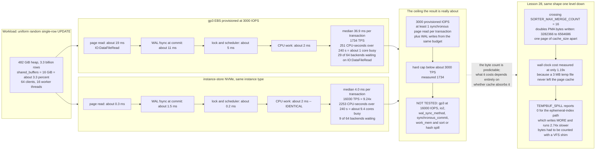

<!--
entry-meta
date: 2026-10-13
type: daily-diff
category: Daily Diff
title: Daily Diff — 2026-10-13
slug: sqlite-vdbe-sorter-external-merge
-->

# Daily Diff — 2026-10-13

**2026-10-13 · Daily Diff Digest**

## Which Edition, and How It Was Found

**There is no 2026-10-13 edition.** The newest published edition is **2026-10-12**, [yesterday's digest](../2026-10-12-sqlite-analyze-stat1-stat4-estimators/daily-diff.md) covered 2026-10-11, so 2026-10-12 is uncovered and is what this digest covers.

The probing order this log has settled into, run again:

| endpoint | result |
|---|---|
| [`https://tdd.cat/2026-10-13.md`](https://tdd.cat/2026-10-13.md) | client error. No edition for today. |
| [`https://tdd.cat/archive/`](https://tdd.cat/archive/) | newest **Mon, Oct 12, 2026 (21 stories)**, listed as **055**. No 2026-10-13 entry. |
| [`https://tdd.cat/2026-10-12/`](https://tdd.cat/2026-10-12/) | **client error** — the trailing-slash HTML page would not fetch. |
| [`https://tdd.cat/2026-10-12.md`](https://tdd.cat/2026-10-12.md) | fetched cleanly. Masthead "Monday, October 12, 2026", **21 items**. **Used for this digest.** |
| [`https://tdd.cat/`](https://tdd.cat/) | masthead "Monday, October 12, 2026", **21 stories** — in sync with the archive today. |

Two notes on the endpoint behaviour this log has been tracking.

- **The endpoints rotated again, in the third distinct pattern in three days.** On 10-11 the trailing-slash pages could not be fetched at all and the front page was a day behind; on 10-12 the trailing-slash page was the *only* one with the newest edition and `/md` was stale; today the front page and `/archive/` agree and are current, `.md` works, and the trailing-slash page is the broken one. That retires the "the HTML is stale" theory and the "take the date from `/archive/` then fetch that date's own page" procedure both: the right procedure is to get the date from `/archive/`, then try **both** `/<date>/` and `/<date>.md` and use whichever answers, cross-checking the item count.
- **The archive's edition numbering disagrees with yesterday's record.** Yesterday's run read `/archive/` as "80 editions; newest Sun, Oct 11, 2026, reported as No. 079". Today the same page reports the newest, Mon Oct 12, as **055**. One edition later and the number went *down* by 24. Either the numbering was renumbered, or one of the two reads is of a differently-cached copy of the page. Recorded as an observation, not a verdict; the **date** and the **item count** are the fields that have been consistently reliable, and the number is not.

Item counts continue to move: 30 (10-09), 26 (10-10), 18 (10-11), **21** (10-12).

## The 2026-10-12 Edition, Point-Wise

Twenty-one items, grouped by subject rather than running order.

**Storage and databases** — the strongest cluster this edition, and the deep dive comes from it.

- **Postgres scaling bottlenecks are often caused by slow storage** — eight identical Postgres clusters, four on instance-store NVMe and four on 3,000-IOPS gp3 EBS, same instance type and same 482 GiB dataset. 9.24x throughput difference. Today's deep dive. [source](https://clickhouse.com/blog/posette-talk-recap-postgres-isnt-slow-your-storage-is)
- **Implementing object storage directly in the DMU avoids filesystem costs** — an OpenZFS pull request putting buckets and objects directly in the Data Management Unit and skipping the POSIX layer entirely. The same move as a database bypassing the filesystem to own its own extents; worth watching for whether the DMU's transaction groups end up doing what a WAL does. [source](https://github.com/openzfs/zfs/pull/19358)
- **Litestream provides continuous streaming replication for sqlite** — tails the WAL and ships it to S3-compatible storage. Directly on top of lessons 19–20: the shipping unit is the WAL frame, so the replica's RPO is bounded by `wal_autocheckpoint` and by how fast frames are appended, not by anything in the b-tree. [source](https://github.com/benbjohnson/litestream)
- **Enabling concurrent SQLite writes across threads without modifying SQLite** — `sqlite-multiwriter`, now in its fourth consecutive edition. [Read in full in yesterday's digest](../2026-10-12-sqlite-analyze-stat1-stat4-estimators/daily-diff.md); not repeated. [source](https://github.com/sqliteai/sqlite-multiwriter)
- **Restricting language model outputs makes database classification more efficient** — the Quail engine constrains generation to a known label set with a prefix tree, cutting wasted decoding. A trie used as a decoding mask is the same structure as an index used as a filter: both buy their speed by making the impossible unrepresentable rather than by checking afterwards. [source](https://fsdatalab.github.io/blog/ai-classification/)

**Memory hierarchy and I/O** — three items that all amount to "the bottleneck moved to the next level down".

- **Janas outperforms llama.cpp on large models exceeding available memory** — an inference engine in pure C that streams inactive MoE experts from NVMe, claiming higher throughput than llama.cpp on an 80B model larger than RAM. This is lesson 28's problem statement with different nouns: a working set that does not fit, so you choose what to spill and in what order. [source](https://github.com/prabanta-dev/janas)
- **Parsing gigabytes of JSON per second with Go and SIMD** — MinIO's `simdjson-go`, AVX-512/AVX2 assembly finding structural characters in parallel blocks. [source](https://github.com/minio/simdjson-go)
- **Parsing JSON at tens of gigabytes per second in Python** — Python 3.14's free-threaded build plus SIMD parsing, i.e. the same technique with the GIL out of the way. [source](https://twitter.com/lemire/status/2109633500416557517)

**Concurrency and systems correctness**

- **Visualizing epoch-based reclamation in lock-free data structures** — defers deallocation until no reader can still hold a reference. The read-mark slots of lesson 19's wal-index are the same idea with a different name: a reader publishes which version it is pinning, and the reclaimer reads that. [source](https://sofiabelen.github.io/projects/visualizing-crossbeam-epoch-based-reclamation/)
- **A versioned filesystem lets disposable sandboxes commit transactional state** — copy-on-write snapshots committed per successful workflow step. Third consecutive edition. [source](https://www.shayon.dev/post/2026/283/versioned-filesystem-for-disposable-sandboxes/)
- **Cyclic trait impls require modular rather than external proofs** — each Rust trait implementation proving its own supertrait bounds rather than pushing obligations onto callers. [source](https://smallcultfollowing.com/babysteps/blog/2026/10/10/modular-vs-external-proofs/)

**Security**

- **Post-quantum transition requires completely new asymmetric cryptography standards** — AES-256 holds; most asymmetric primitives need replacing, with hybrid X25519 + ML-KEM-768 proposed for key exchange. [source](https://words.filippo.io/right-answers/)
- **Prompt injection classifiers are easily bypassed with gradient descent** — short optimised suffixes restore a "safe" verdict, so a classifier is not a security boundary. [source](https://thecout.com/blog/injection/)
- **Downloading machine learning models resembles running untrusted installer scripts** — pickle-based checkpoints execute code on load. [source](https://thecout.com/blog/modelsafety/)

**GPUs and rendering**

- **Compiler feedback helps agents write faster frontier GPU kernels** — structured schedule representations plus detailed compiler diagnostics, so the agent is told where the bottleneck is rather than guessing. [source](https://gangliao.me/blog/2026/cake-deep-dive/)
- **Code runs world logic while streaming diffusion renders visuals** — NVIDIA's StreamRender-H3 keeps game state in a deterministic code engine and uses diffusion only for pixels. [source](https://nvlabs.github.io/Sana/Sol-Engine/StreamRender-H3/)

**Agents** — six items, two of them critical rather than promotional.

- **Review bottlenecks limit productivity gains from AI agents** — 718 enterprise teams; AI-generated code raises review load enough to cap net output. The most quotable item in the edition. [source](https://fion.ac/jellyfish.pdf)
- **Agent harnesses lack the gradients that optimize model weights** — harness changes are discrete engineering decisions with no gradient signal, so evaluation discipline is the only guide. [source](https://rlafuente.com/posts/2026-10-11-agent-evals-1-two-hills.html)
- **Harness learning enables generalizable test-time agent adaptation** — adapt by revising the executable harness at test time rather than updating weights. The natural counterpart to the previous item. [source](https://arxiv.org/abs/2609.35738)
- **Elastic reinforcement learning accelerates training for long-horizon agents** — QwenGyre reallocates GPUs between rollout and training phases, up to 1.85x. [source](https://arxiv.org/abs/2609.33848)
- **Building agentic systems down through the serving stack** — a Harvard course tying agent control loops to prefix caching, batching and speculative decoding. [source](https://cs2680.seas.harvard.edu/)

---

## Deep Dive: "Postgres isn't slow, your storage is" — and what the latency breakdown actually says

Chosen because it is the only item in the edition that measures a real system end to end, publishes the per-component breakdown rather than only the headline, and states its own gaps. It also lands directly on today's lesson, which spent the whole run establishing *how many bytes* SQLite's sorter writes to temp files and finding that the wall-clock consequence was invisible on a cached container. This post is the other half of that: what those bytes cost when they actually reach a device.

### The setup, which is the part that makes it credible

- **Eight identical clusters**, four on instance-store NVMe and four on baseline **gp3 EBS provisioned at 3,000 IOPS**. Multiple instances per storage type specifically to smooth run-to-run variance — the thing single-instance benchmarks get wrong.
- `m6id.4xlarge`: 16 vCPUs, 64 GiB RAM, `shared_buffers` = **16 GiB**.
- A **482 GiB** `pgbench_accounts` heap, **3.3 billion rows**. That ratio matters: 16 GiB of buffer cache against 482 GiB of heap is a ~3.3% cache, so a uniform random access pattern essentially never hits.
- Workload: `\set aid random(1, 3300000000)` then `UPDATE pgbench_accounts SET abalance = abalance + 1 WHERE aid = :aid;` — 64 clients, 16 worker threads, five minutes.

A uniform random single-row update over a heap 30x larger than the cache is about the most storage-hostile shape you can construct in Postgres. That is not a criticism; it is the experiment the title claims to run.

### The numbers

| metric | gp3 EBS (3,000 IOPS) | instance NVMe | ratio |
|---|---:|---:|---:|
| median TPS | 1,734 | **16,030** | **9.24x** |
| median transaction latency | 36.9 ms | **4.0 ms** | 9.2x |
| VACUUM of ~10 GB of bloat | 964 s | **366 s** | 2.6x |
| drain a 10 GB logical replication backlog | 238 s | **139 s** | 1.7x |

And the breakdown of the ~37 ms, which is the actually useful table:

| component | EBS | NVMe |
|---|---:|---:|
| page reads (`IO:DataFileRead`-driven) | ~19 ms | ~0.3 ms |
| WAL fsync at commit | ~11 ms | ~1.5 ms |
| lock and scheduler overhead | ~5 ms | ~0.2 ms |
| CPU work | ~2 ms | ~2 ms |

**CPU is identical at ~2 ms on both.** Everything else is waiting. That is the claim, and the breakdown supports it: 35 of the 37 ms is not computation.

Two supporting observations, both correctly labelled as weaker evidence by the author:

- A single mid-run `pg_stat_activity` snapshot: **29 of 64** backends on EBS in `IO:DataFileRead` (~45%) against 9 on NVMe (~14%). A point sample, not a run average.
- CPU accounting over a ~240 s window: the NVMe host accumulated **2,253 CPU-seconds** (~9.4 cores busy) while the EBS host accumulated **251** (~1 core). The EBS machine was idle, not overloaded — which is the strongest single datum in the post, because it rules out the "Postgres is CPU-bound at scale" reading without needing any profile at all.

### Where the mechanism argument is solid, and where it is only a demonstration

The solid part is the arithmetic nobody disputes. A gp3 volume provisioned at 3,000 IOPS, serving 64 concurrent backends each needing at least one synchronous page read per transaction, cannot exceed 3,000 page reads per second. At one read per transaction that caps the workload at ~3,000 TPS before anything else happens, and the measured 1,734 TPS sits plausibly below that once WAL writes compete for the same IOPS budget. The 9.24x is therefore not a surprise; it is a provisioned-IOPS ceiling meeting a workload that cannot be cached.

Which is also the limitation, and the post says so: it "cautions that a differently configured EBS setup would likely produce different results". The honest framing is **"3,000 provisioned IOPS is not enough for this workload"**, not "EBS is slow". A gp3 volume can be provisioned to 16,000 IOPS, and io2 Block Express goes far higher; neither was tested, and no io2 or alternative volume class appears in the post at all. Nor are any disk-level IOPS, throughput or latency measurements given for either storage type beyond the 3,000 figure — so the breakdown table tells you where Postgres waited, but not what the device did.

Two more gaps worth naming, because they bear on how far the result travels:

- **No `wal_sync_method` or `synchronous_commit` setting is given**, and WAL fsync is ~30% of the EBS latency. `synchronous_commit = off` would have removed most of that 11 ms and changed the headline materially — at a durability cost, which is exactly the trade the post's own availability section (quorum synchronous replication, `ANY 1 (standby1, standby2)` across AZs, WAL-G for continuous archiving) is about.
- **No sorting, temp files, `work_mem` or spill behaviour at all.** For a post about storage being the bottleneck, the omission is notable: a `work_mem`-exceeding sort or hash is the other large consumer of synchronous storage I/O in Postgres, and it is the one the operator can actually tune without changing hardware.

### Why this is the right item to read against today's lesson

Lesson 28 measured, to the byte, that crossing SQLite's `SORTER_MAX_MERGE_COUNT` of 16 PMAs **exactly doubles** the bytes a sort writes to temp files — 3,282,366 to 6,564,686, one page of `cache_size` apart — and then measured the wall-clock cost of that doubling at only **1.19x**, because a 3 MB temp file lives entirely in the host's page cache. The lesson recorded that number with a warning attached rather than as a result.

This post is the warning cashed in. It is the same shape of finding one level up: an amount of I/O that is invisible when it is absorbed by cache, and decisive when it is not. 19 ms of page reads per transaction is what "the data does not fit" costs on a 3,000-IOPS volume; ~0.3 ms is what the identical Postgres costs when the same reads land on local NVMe. Nothing about the query changed.

There is a sharper parallel in the instrumentation, too. Lesson 28 found that `SQLITE_DBSTATUS_TEMPBUF_SPILL` — the one API whose documentation promises to count "writes to intermediate tables that are part of complex queries, external sorts that spill to disk, and writes to TEMP tables" — returns **0** for the ephemeral-index sort path, the path that writes *more* bytes and runs 2.74x slower, because its b-tree arm only inspects the TEMP database and an `OP_OpenEphemeral` table is a separate transient `Btree`. The number had to be recovered with a VFS shim counting `xWrite`. Postgres' `pg_stat_activity` wait events did better here — `IO:DataFileRead` is exactly the right instrument and it worked — but the post still needed a CPU-seconds comparison from outside the database to make the case airtight, because a wait-event snapshot is a sample and not an accounting.

The common lesson for both: **the counter that tells you where the time went is usually not the counter that tells you how many bytes moved**, and when the two disagree, the bytes are the thing you can predict in advance.

## Sources

- [`https://tdd.cat/2026-10-13.md`](https://tdd.cat/2026-10-13.md) — fetched this run; client error. Confirms there is no edition for today.
- [`https://tdd.cat/archive/`](https://tdd.cat/archive/) — fetched this run. Newest edition **Mon, Oct 12, 2026 (21 stories)**, listed as **055**, with 054 = Oct 11 (18), 053 = Oct 10 (26), 052 = Oct 9 (30), 051 = Oct 8 (43), 050 = Oct 7 (45). Confirmed no 2026-10-13 entry. Source of the edition-numbering disagreement noted above.
- [`https://tdd.cat/2026-10-12/`](https://tdd.cat/2026-10-12/) — attempted this run; client error. Recorded as the broken endpoint of the day.
- [`https://tdd.cat/2026-10-12.md`](https://tdd.cat/2026-10-12.md) — fetched this run. Masthead "Monday, October 12, 2026", **21 items**, no edition number in the document. **Every title and source URL in the point-wise section above came from this fetch.**
- [`https://tdd.cat/`](https://tdd.cat/) — fetched this run. Masthead "Monday, October 12, 2026", 21 stories, matching `.md` and `/archive/`. Also the source of the navigation links recorded in the endpoint table: `https://tdd.cat/stats/`, `https://tdd.cat/rss.xml`, `https://tdd.cat/llms.txt`, the dated PDF `https://tdd-edge.b-cdn.net/pdf/2026-10-12.pdf`, and the project repository `https://github.com/arpitbbhayani/the-daily-diff`.
- [Postgres isn't slow, your storage is](https://clickhouse.com/blog/posette-talk-recap-postgres-isnt-slow-your-storage-is) — fetched this run. Origin of every figure in the deep dive: the eight-cluster setup, `m6id.4xlarge` / 16 vCPU / 64 GiB / `shared_buffers` = 16 GiB, the 482 GiB and 3.3-billion-row `pgbench_accounts` heap, the `\set aid random(1, 3300000000)` UPDATE script, 64 clients / 16 threads / five-minute runs, 16,030 vs 1,734 median TPS (9.24x), 36.9 vs 4.0 ms median latency, the four-component latency breakdown (19/11/5/2 ms against 0.3/1.5/0.2/2 ms), VACUUM 366 vs 964 s, logical replication drain 139 vs 238 s, the 29-of-64 vs 9-of-64 `IO:DataFileRead` snapshot, the 2,253 vs 251 CPU-seconds over ~240 s, the `ANY 1 (standby1, standby2)` quorum-replication and WAL-G suggestions, and the author's own caution that a differently configured EBS setup would produce different results. The stated gaps (no disk-level IOPS/throughput/latency figures, no io2 or other volume class, no `wal_sync_method` or `synchronous_commit`, no sorting / temp-file / `work_mem` / spill coverage, no named hot functions) are from the same fetch.
- [`github.com/sqliteai/sqlite-multiwriter`](https://github.com/sqliteai/sqlite-multiwriter) — fetched this run to confirm it is the same project as the item in the 10-11 edition. Not re-analysed; [yesterday's digest](../2026-10-12-sqlite-analyze-stat1-stat4-estimators/daily-diff.md) covers it in full.
- [Yesterday's digest](../2026-10-12-sqlite-analyze-stat1-stat4-estimators/daily-diff.md) — read this run to establish that the 2026-10-11 edition was already covered, that `sqlite-multiwriter` was already deep-dived, and to compare the endpoint behaviour and archive numbering against today's.
- [Today's lesson](README.md) — the `SORTER_MAX_MERGE_COUNT` byte-doubling measurement, the 1.19x page-cache caveat, the 2.74x ephemeral-index regression, and the `SQLITE_DBSTATUS_TEMPBUF_SPILL` blind spot quoted in the closing comparison.
