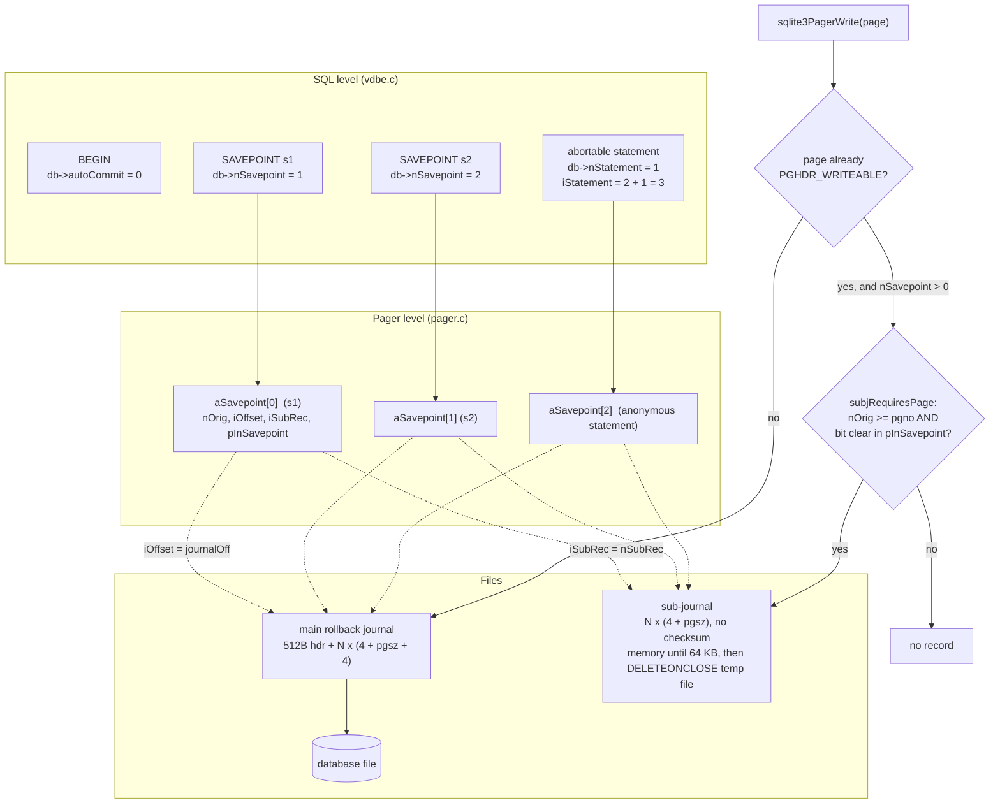

<!--
entry-meta
date: 2026-10-14
type: lesson
track: SQLite
lesson: 29
category: Database Internals
title: Savepoints and Statement Journals — One Stack, Two Counters, and a 64 KB Threshold That Decides Whether Rollback Touches the Disk
slug: sqlite-savepoints-statement-journals
-->

# Savepoints and Statement Journals — One Stack, Two Counters, and a 64 KB Threshold That Decides Whether Rollback Touches the Disk

**2026-10-14 · SQLite Track · Lesson 29 of 33**

## Where This Fits

- **Lesson 28** ([the VDBE sorter](../2026-10-13-sqlite-vdbe-sorter-external-merge/README.md)) covered two of the nine kinds of temporary file SQLite creates: transient indices and the sorter's own PMA files. It closed with the statement journal as the one it deliberately did not touch. This lesson takes it.
- **Lessons 15–18** established the pager state machine, the rollback-journal record format (`4-byte pgno + page + 4-byte checksum` after a 512-byte header), and hot-journal recovery. Everything here sits *inside* one of those write transactions and reuses that journal.
- **Lessons 25–26** left a specific handoff: `WHERE_ONEPASS_DESIRED` / `WHERE_ONEPASS_MULTIROW` / `WHERE_DUPLICATES_OK` and `sqlite3MultiWrite()` as a caller-side contract. **Both are closed here**, and the answer is not what lesson 26 expected: `isMultiWrite` alone buys nothing, so the whole ONEPASS machinery turns out to have no effect at all on whether a statement journal is opened for a `DELETE`.
- **This lesson adds** the one object that sits between a transaction and a single row: the savepoint. SQL-level `SAVEPOINT`/`RELEASE`/`ROLLBACK TO`, the *anonymous* savepoint SQLite opens around an abortable statement, the sub-journal that both share, and the exact prepare-time and run-time tests that decide whether that file exists.
- **It sets up lesson 30** (virtual tables): every branch of `OP_Savepoint` calls `sqlite3VtabSavepoint()` with the same index, so the xSavepoint/xRelease/xRollbackTo protocol is the savepoint stack re-exported to extensions.

All source references are to the **SQLite 3.53.4** amalgamation vendored in `better-sqlite3@13.0.3` at `deps/sqlite3/sqlite3.c` — the same file lessons 27 and 28 used, so line numbers are comparable across the three lessons.

---

## 1. There Is Exactly One Stack, And Statement Transactions Sit On Top Of It

Three fields on the `sqlite3` connection object hold the whole model:

| Field | Meaning |
|---|---|
| `db->pSavepoint` | Head of a singly-linked `Savepoint` list. **Most recent first.** |
| `db->nSavepoint` | Count of *named, SQL-level* savepoints |
| `db->nStatement` | Count of *anonymous* statement transactions currently open |
| `db->isTransactionSavepoint` | 1 if the outermost savepoint is also the transaction |

The pager keeps a parallel array, `Pager.aSavepoint[]`, indexed 0-based, and the two are glued by one arithmetic identity in `OP_Transaction` (sqlite3.c:100750):

```c
db->nStatement++;
p->iStatement = db->nSavepoint + db->nStatement;
```

A statement transaction is therefore **not a different mechanism** — it is a savepoint whose index is guaranteed to be above every named one. `sqlite3BtreeBeginStmt()`'s comment (sqlite3.c:77813) states the invariant directly:

> At the pager level, a statement transaction is a savepoint with an index greater than all savepoints created explicitly using SQL statements. It is illegal to open, release or rollback any such savepoints while the statement transaction savepoint is active.

That invariant is enforced, not assumed: `OP_Savepoint` refuses `SAVEPOINT` and `RELEASE` outright while a write statement is live.

- `SAVEPOINT` with `db->nVdbeWrite>0` → `SQLITE_BUSY`, *"cannot open savepoint - SQL statements in progress"*
- `RELEASE` with `db->nVdbeWrite>0` → `SQLITE_BUSY`, *"cannot release savepoint - SQL statements in progress"*
- `ROLLBACK TO` is **not** on that list and is allowed.

### The transaction savepoint

`SAVEPOINT x` outside `BEGIN` takes a branch that has no SQL syntax of its own (sqlite3.c:100481):

```c
if( db->autoCommit ){
  db->autoCommit = 0;
  db->isTransactionSavepoint = 1;
}else{
  db->nSavepoint++;
}
```

The outermost savepoint *becomes* the transaction and is **not counted** in `nSavepoint`. `RELEASE` of it is literally a commit: the code sets `db->autoCommit = 1` and calls `sqlite3VdbeHalt(p)`, the same function an explicit `COMMIT` reaches through `OP_AutoCommit`. Measured on this build:

```
  SAVEPOINT outer      rc=0  autocommit=0  txn_state=NONE    <- deferred, like BEGIN DEFERRED
  INSERT INTO t ...    rc=0  autocommit=0  txn_state=WRITE
  BEGIN                rc=1  autocommit=0  txn_state=WRITE   cannot start a transaction within a transaction
  RELEASE outer        rc=0  autocommit=1  txn_state=NONE    <- this was the COMMIT
```

Note the first line: `autocommit` flips to 0 immediately but `sqlite3_txn_state()` stays `NONE`. The savepoint has opened a *logical* transaction with no lock and no pager state behind it yet — exactly the `BEGIN DEFERRED` behaviour the documentation describes, visible as two different answers from two different APIs at the same instant.

---

## 2. `OP_Savepoint`: Three Operations, One Opcode, Measured Semantics

`P1` selects `SAVEPOINT_BEGIN`, `SAVEPOINT_RELEASE` or `SAVEPOINT_ROLLBACK`; `P4` carries the name. The lookup is a linear walk with `sqlite3StrICmp`, counting hops into `iSavepoint`, then **inverted**:

```c
iSavepoint = db->nSavepoint - iSavepoint - 1;
```

Because the list is most-recent-first and the pager array is oldest-first, that one line converts a list position into a pager index. Everything else follows from it.

| Operation | Pager call | Savepoints destroyed | Named savepoint itself |
|---|---|---|---|
| `RELEASE x` | `sqlite3BtreeSavepoint(pBt, SAVEPOINT_RELEASE, i)` | all inner | **popped** |
| `ROLLBACK TO x` | `BtreeTripAllCursors` then `sqlite3BtreeSavepoint(..., SAVEPOINT_ROLLBACK, i)` | all inner | **kept** |

Three details that are easy to get wrong and are measurable:

- **`ROLLBACK TO` is idempotent and repeatable.** Measured: three consecutive `ROLLBACK TO k` all return `SQLITE_OK`; only after `RELEASE k` does a fourth return `SQLITE_ERROR` / *"no such savepoint: k"*.
- **Duplicate names resolve to the innermost match.** With two savepoints both named `s`, `RELEASE s` pops only the inner one, and a following `ROLLBACK TO s` finds the outer one and undoes work done before the inner savepoint existed. Measured: row count went to 0, not to 1.
- **`ROLLBACK TO` restores the deferred-FK counters, `RELEASE` does not.** `pNew->nDeferredCons`/`nDeferredImmCons` are snapshotted at `SAVEPOINT_BEGIN` and copied back only on the rollback branch. A savepoint is a checkpoint of constraint-violation *counters*, not only of pages.

`ROLLBACK TO` also carries a schema special case: if `DBFLAG_SchemaChange` is set, it calls `sqlite3ExpirePreparedStatements()` and `sqlite3ResetAllSchemasOfConnection()`, then **re-sets the flag it just acted on**. Rolling back a DDL statement invalidates every prepared statement on the connection, not just the ones touching the altered table.

---

## 3. The Statement Transaction: One Prepare-Time Flag, Three Run-Time Conditions

### Prepare time

One line in `sqlite3VdbeMakeReady()` (sqlite3.c:90569) settles it for the life of the prepared statement:

```c
p->usesStmtJournal = (u8)(pParse->isMultiWrite && pParse->mayAbort);
```

- `sqlite3MultiWrite()` sets `isMultiWrite` — "this statement might write more than one entry".
- `sqlite3MayAbort()` sets `mayAbort` — "this statement might abort partway through".

The comment on `sqlite3MayAbort()` is unusually candid about a deliberate pessimisation: the flag technically only matters if `isMultiWrite` was set *first*, and exploiting that time dependency "makes some statements involving the REPLACE conflict resolution algorithm go a little faster", but it was rejected because it would prevent an effective `sqlite3AssertMayAbort()`. SQLite chose provability over a micro-optimisation and said so in the source.

**This flag is directly observable.** `sqlite3FinishCoding()` (sqlite3.c:126684), which emits the prologue, attaches a `VdbeComment` to the very `OP_Transaction` that will consult the flag at run time (sqlite3.c:126761):

```c
VdbeComment((v, "usesStmtJournal=%d", pParse->mayAbort && pParse->isMultiWrite));
```

So on a build with `SQLITE_DEBUG` (which turns on `SQLITE_ENABLE_EXPLAIN_COMMENTS`), `EXPLAIN <stmt>` prints the answer in the comment column of the `Transaction` row. Measured, every row below:

| Statement | `usesStmtJournal` |
|---|---|
| `INSERT INTO t SELECT * FROM src` (t has `b INTEGER UNIQUE`) | **1** |
| `INSERT OR IGNORE` / `OR REPLACE` / `OR FAIL` / `OR ROLLBACK` … same statement | **0** |
| `INSERT INTO t VALUES(1,1,'x')` (single row) | 0 |
| `INSERT INTO plain SELECT …` (`a INTEGER PRIMARY KEY`, nothing else) | **1** |
| `INSERT INTO nokey SELECT …` (no PK, no constraints at all) | 0 |
| `INSERT INTO nn SELECT …` (`c TEXT NOT NULL`) | **1** |
| `INSERT INTO chk SELECT …` (`CHECK(c>0)`) | **1** |
| `UPDATE t SET b=b+1` (indexed, UNIQUE) | **1** |
| `UPDATE t SET c='z'` (column not indexed, no constraint) | 0 |
| `DELETE FROM t WHERE a=5` | 0 |
| `DELETE FROM t WHERE a>5` (**many rows**) | **0** |
| `DELETE FROM plain` | 0 |
| `CREATE INDEX ix ON plain(c)` | **1** |
| `CREATE UNIQUE INDEX ux ON plain(c)` | **1** |
| `SELECT * FROM t` | 0 (and `OP_Transaction.p2=0`) |

Four results worth stating plainly:

1. **`DELETE` never needs a statement journal, however many rows it deletes.** This closes lessons 25/26's handoff, and inverts its premise. `where.c` does call `sqlite3MultiWrite(pParse)` when `eOnePass != ONEPASS_SINGLE`, so `isMultiWrite` *is* set for a multi-row delete — but nothing in a `DELETE` can raise a constraint, so `mayAbort` stays 0 and the `&&` fails. **The entire ONEPASS decision is irrelevant to statement journalling.** (It still matters for cursor strategy, which is what lesson 26 measured it for.)
2. **A conflict clause removes the journal, including `OR ROLLBACK` and `OR FAIL`.** `OR FAIL` leaves earlier rows of the same statement in place — that is its documented semantics — so there is nothing to undo. `OR ROLLBACK` discards the whole transaction, which the main journal already covers. Only the default, `ABORT`, needs a middle ground, and the middle ground is the only case that costs a file.
3. **A bare `INTEGER PRIMARY KEY` is enough.** `INSERT INTO plain SELECT …` has no index and no declared constraint, yet gets the journal, because a supplied rowid can collide. The same statement against a table with no PK gets 0.
4. **The trigger that matters is `RAISE(ABORT)`, not the trigger.** An `AFTER INSERT` trigger whose body is `SELECT RAISE(ABORT,'no')` flips even a **single-row** `INSERT … VALUES` to 1 (the trigger body is itself a second write, so `isMultiWrite` is satisfied too). Replace the body with `INSERT INTO logt VALUES('i')` and it drops back to 0.

### `PRAGMA foreign_keys` silently changes the answer

| Statement | FK off | FK on |
|---|---|---|
| `INSERT INTO kid SELECT a,a FROM src` | 0 | **1** |
| `INSERT INTO kid VALUES(1,1)` | 0 | 0 |
| `DELETE FROM par WHERE a=1` | 0 | **1** |

A single-row `DELETE` by rowid on the **parent** table acquires a statement journal when foreign keys are enabled, because FK enforcement makes it both multi-write and abortable. Turning on `foreign_keys` therefore changes the I/O profile of statements that do not mention a foreign key.

### Run time

The flag is necessary, not sufficient. `OP_Transaction` (sqlite3.c:100747) adds three more conditions, all checked at execution:

```c
if( p->usesStmtJournal
 && pOp->p2                               /* this is a WRITE transaction */
 && (db->autoCommit==0 || db->nVdbeRead>1)
){
```

- `pOp->p2` is the per-database write mask — read-only statements never qualify.
- `db->autoCommit==0` means an explicit transaction is open: there is earlier work in it that must survive the statement's failure.
- `db->nVdbeRead>1` covers autocommit with another statement still active on the same connection.

In the common case — one abortable statement, in autocommit, nothing else running — **no statement transaction is opened at all**, because the implicit transaction and the statement are the same thing and the ordinary rollback journal already undoes exactly the right amount. Measured, same statement both ways (100,000 rows, a `NOT NULL` violation engineered onto the **last** row so the statement runs to completion before failing):

| | sub-journal records | outcome |
|---|---|---|
| inside `BEGIN`, after an earlier `UPDATE` | **307** | statement undone; the earlier `UPDATE` **survived**, `autocommit` still 0 |
| autocommit, nothing else active | **0** | everything undone, `autocommit` back to 1 |

---

## 4. The Pager Side: What A Savepoint Actually Records

```c
struct PagerSavepoint {
  i64 iOffset;            /* Starting offset in main journal */
  i64 iHdrOffset;
  Bitvec *pInSavepoint;   /* Set of pages in this savepoint */
  Pgno nOrig;             /* Original number of pages in file */
  Pgno iSubRec;           /* Index of first record in sub-journal */
  int bTruncateOnRelease;
  u32 aWalData[WAL_SAVEPOINT_NDATA];
};
```

`pagerOpenSavepoint()` fills each new slot with four things: the current database size, the **current main-journal offset**, the current sub-journal record count, and an empty bitvec. Nothing is copied. A savepoint is a *position*, not a snapshot.

That position is why the sub-journal is usually empty. `pagerPlaybackSavepoint()` rolls back in two passes:

1. **Main journal**, from `pSavepoint->iOffset` to the end, adding each restored page to a `pDone` bitvec.
2. **Sub-journal**, records `iSubRec` to `nSubRec`, skipping anything already in `pDone`.

A page dirtied for the first time *after* the savepoint opened has its main-journal record *after* `iOffset`, so pass 1 restores it and the sub-journal never needed to know about it. The sub-journal exists for exactly the complementary case, and `subjRequiresPage()` (sqlite3.c:60702) tests for precisely that:

```c
for(i=0; i<pPager->nSavepoint; i++){
  p = &pPager->aSavepoint[i];
  if( p->nOrig>=pgno && 0==sqlite3BitvecTestNotNull(p->pInSavepoint, pgno) ){
    for(i=i+1; i<pPager->nSavepoint; i++){
      pPager->aSavepoint[i].bTruncateOnRelease = 0;
    }
    return 1;
  }
}
return 0;
```

Two conditions, one side effect:

- `p->nOrig >= pgno` — the page existed when the savepoint opened. Pages appended afterwards are reverted by truncation (`pPager->dbSize = pSavepoint->nOrig`), not by journalling.
- the bit is clear — this savepoint has not already saved the page. **One record per page per savepoint**, not per write.
- the inner loop clears `bTruncateOnRelease` on every *later* savepoint, because the record now in the sub-journal is needed by an *earlier* one and must not be truncated away when the later one is released.

The call sites are narrow: the tail of `pager_write()`, the early-return arm of `sqlite3PagerWrite()` for an already-writeable page, `pagerStress()` (cache spill), and `sqlite3PagerMovepage()`. The second one is the common path — a page already dirty from earlier in the transaction, written again inside a savepoint.

### Sub-journal record format, decoded

`subjournalPage()` writes two things and nothing else:

```c
i64 offset = (i64)pPager->nSubRec*(4+pPager->pageSize);
rc = write32bits(pPager->sjfd, offset, pPg->pgno);
if( rc==SQLITE_OK ){
  rc = sqlite3OsWrite(pPager->sjfd, pData2, pPager->pageSize, offset+4);
}
```

Captured off a VFS shim at `page_size=4096`, records at 0, 4100, 8200:

```
record 0 @    0: pgno=3  page[0..7]=0d 00 00 01 b2 03 6d 00
record 1 @ 4100: pgno=4  page[0..7]=0d 00 00 01 98 03 40 00
record 2 @ 8200: pgno=5  page[0..7]=0d 00 00 01 98 03 40 00
```

`4 + page_size` per record, big-endian page number, then the raw page — whose first byte is `0x0d`, lesson 03's table-b-tree-leaf type code. **No file header, no checksum, no nonce, no sector padding.** Compare the main rollback journal from lesson 16, visible in the same shim log on the same run:

```
xWrite journal n=512  off=0        <- journal header
xWrite journal n=4    off=512      <- pgno
xWrite journal n=4096 off=516      <- page
xWrite journal n=4    off=4612     <- checksum
```

`4104` bytes per main-journal record against `4100` for a sub-journal record. The sub-journal can drop the checksum and the header because it is never read after a crash: it is `SQLITE_OPEN_DELETEONCLOSE`, unnamed, and only ever replayed by the same process that wrote it. The flags measured on the `xOpen` call are `0x201e` = `SUBJOURNAL|READWRITE|CREATE|EXCLUSIVE|DELETEONCLOSE`, with `zName=NULL`.

### The whole picture



And the rollback path, which is where the two files combine:

```mermaid
sequenceDiagram
  participant V as vdbe.c
  participant B as btree.c
  participant P as pager.c
  participant MJ as main journal
  participant SJ as sub-journal
  V->>V: ROLLBACK TO s1 (OP_Savepoint, P1=ROLLBACK)
  V->>B: sqlite3BtreeTripAllCursors(SQLITE_ABORT_ROLLBACK)
  V->>B: sqlite3BtreeSavepoint(pBt, ROLLBACK, i)
  B->>P: sqlite3PagerSavepoint(op=ROLLBACK, iSavepoint=i)
  P->>P: nNew = i + 1; destroy bitvecs above it
  P->>P: dbSize = aSavepoint[i].nOrig  (truncate appended pages)
  P->>MJ: replay records from iOffset .. journalOff, mark each in pDone
  P->>SJ: replay records iSubRec .. nSubRec, SKIP anything in pDone
  P-->>V: SQLITE_OK
  V->>V: pop inner savepoints; restore nDeferredCons from the snapshot
  Note over V: s1 itself stays on the stack — ROLLBACK TO is repeatable
```

---

## 5. The 64 KB Threshold, Predicted And Then Measured To The Single Row

`openSubJournal()` does **not** call the VFS directly:

```c
int nStmtSpill = sqlite3Config.nStmtSpill;
if( pPager->journalMode==PAGER_JOURNALMODE_MEMORY || pPager->subjInMemory ){
  nStmtSpill = -1;
}
rc = sqlite3JournalOpen(pPager->pVfs, 0, pPager->sjfd, flags, nStmtSpill);
```

`sqlite3Config.nStmtSpill` defaults to `SQLITE_STMTJRNL_SPILL`, which the amalgamation sets at line 24052:

```c
#ifndef SQLITE_STMTJRNL_SPILL
# define SQLITE_STMTJRNL_SPILL (64*1024)
#endif
```

`sqlite3JournalOpen` with `nSpill > 0` installs `MemJournalMethods` and sets `nChunkSize = nSpill`. The spill test in `memjrnlWrite()` is one line:

```c
if( p->nSpill>0 && (iAmt+iOfst)>p->nSpill ){
```

So at `page_size=4096` the arithmetic is fully determined before running anything. Record *k* occupies `[4100k, 4100k+4100)`. The file is created on the first write whose end exceeds 65,536:

- `4100 × 16 = 65,600 > 65,536`, and `4100 × 15 = 61,500`, so **the 16th record (k=15) is the first to spill** — specifically its 4096-byte page write, since its 4-byte page-number write ends at 61,504 and stays in memory.

Measured by re-dirtying a growing prefix of a 581-page table inside an open savepoint (`UPDATE p SET c=c+1 WHERE a<=K`, 200,000 rows, so about 344 rows per leaf page):

| K | sub-journal records | VFS `xOpen` | `xWrite` | bytes |
|---|---|---|---|---|
| 5,800 | 15 | 0 | 0 | 0 |
| 6,100 | 15 | 0 | 0 | 0 |
| **6,146** | 15 | **0** | 0 | 0 |
| **6,147** | 16 | **1** | 2 | **65,600** |
| 6,500 | 16 | 1 | 2 | 65,600 |

The boundary is a single row wide, and the byte count is exactly `16 × 4100`. The two writes are also predictable: `memjrnlCreateFile()` flushes the 61,504 buffered bytes in one `xWrite` at offset 0, then the 4096-byte page lands at 61,504.

The same arithmetic predicts the write count for any larger case. For the 307-record statement journal in §3: 15 records buffered, then `2 + (307-15-1)×2 = 584` writes and `307 × 4100 = 1,258,700` bytes. **Measured: 584 writes, 1,258,700 bytes.**

Below that threshold a statement journal has **no VFS footprint at all** — no `xOpen`, no filename, nothing for `strace` or an `lsof` to show. Every statement-journal experiment that looks only at the filesystem will report that statement journals do not exist, which is how this lesson's first four harnesses were wrong.

`PRAGMA journal_mode=memory` forces `nStmtSpill = -1`, which `memjrnlWrite` reads as "never spill". Measured: a savepoint-heavy workload that wrote 2.69 MB to a sub-journal file in `journal_mode=delete` wrote **zero** bytes with `journal_mode=memory`, holding all 657 records in `FileChunk`s on the heap instead.

### `bTruncateOnRelease` only works in memory

```c
if( op==SAVEPOINT_RELEASE ){
  PagerSavepoint *pRel = &pPager->aSavepoint[nNew];
  if( pRel->bTruncateOnRelease && isOpen(pPager->sjfd) ){
    /* Only truncate if it is an in-memory sub-journal. */
    if( sqlite3JournalIsInMemory(pPager->sjfd) ){
      i64 sz = (pPager->pageSize+4)*(i64)pRel->iSubRec;
      rc = sqlite3OsTruncate(pPager->sjfd, sz);
      assert( rc==SQLITE_OK );
    }
    pPager->nSubRec = pRel->iSubRec;
  }
}
```

`nSubRec` is rewound either way, so the space is logically reclaimed and the next records overwrite it — but the `sqlite3OsTruncate` is gated on the journal still being in memory. Once a sub-journal has spilled, `RELEASE` never shrinks the file; it only stops growing until the write offset catches up again.

---

## 6. Who Decides `RELEASE` Versus `ROLLBACK`: `sqlite3VdbeHalt`

The statement transaction is closed by `sqlite3VdbeHalt()`, which picks `eStatementOp` from the error and the statement's own `errorAction`:

| Condition | `eStatementOp` |
|---|---|
| `p->rc == SQLITE_OK` or `errorAction == OE_Fail` | `SAVEPOINT_RELEASE` |
| `errorAction == OE_Abort` | `SAVEPOINT_ROLLBACK` |
| anything else | no statement op — full `sqlite3RollbackAll` + `sqlite3CloseSavepoints` + `autoCommit = 1` |
| `SQLITE_NOMEM` or `SQLITE_FULL` **and** `usesStmtJournal` | `SAVEPOINT_ROLLBACK` |
| `SQLITE_IOERR` / `SQLITE_INTERRUPT` (the other two "special" errors) | full rollback, **never** a statement rollback |

That fourth row is the interesting one. Of the four special errors (`SQLITE_NOMEM`, `SQLITE_IOERR`, `SQLITE_INTERRUPT`, `SQLITE_FULL`) only two are eligible for statement-level recovery, and only if a statement journal exists. `SQLITE_IOERR` always takes the whole transaction down, because the I/O error may have happened while writing the journal that the rollback would have to read.

`vdbeCloseStatement()` then does the work, and it is worth noting that **both** branches run on the rollback path:

```c
if( eOp==SAVEPOINT_ROLLBACK ){
  rc2 = sqlite3BtreeSavepoint(pBt, SAVEPOINT_ROLLBACK, iSavepoint);
}
if( rc2==SQLITE_OK ){
  rc2 = sqlite3BtreeSavepoint(pBt, SAVEPOINT_RELEASE, iSavepoint);
}
```

Roll back, then release — because the anonymous savepoint must disappear either way. And `db->nStatement = 0` is reset wholesale in `sqlite3VdbeHalt`'s commit branch, not decremented, since a commit ends every statement transaction at once.

---

## Hands-On

Everything below runs against the vendored amalgamation; no SQLite build flags are needed except where stated.

```bash
npm pack better-sqlite3@13.0.3 && tar xzf better-sqlite3-13.0.3.tgz
cp package/deps/sqlite3/sqlite3.{c,h} .
```

### 1. Read `usesStmtJournal` straight off `EXPLAIN` (needs `SQLITE_DEBUG`)

The npm tarball ships the amalgamation without `shell.c`, so run `EXPLAIN` from a harness and print the `comment` column by name:

```c
/* gcc -O1 -o t t.c sqlite3.c -lm -lpthread -ldl \
     -DSQLITE_DEBUG -DSQLITE_ENABLE_EXPLAIN_COMMENTS */
sqlite3_prepare_v2(db, "EXPLAIN INSERT INTO t SELECT * FROM src", -1, &st, 0);
int icom = -1, n = sqlite3_column_count(st);
for(int i=0;i<n;i++)
  if( strcmp(sqlite3_column_name(st,i),"comment")==0 ) icom = i;
while( sqlite3_step(st)==SQLITE_ROW ){
  const char *op = (const char*)sqlite3_column_text(st,1);
  if( op && strcmp(op,"Transaction")==0 )
    printf("p2=%d  %s\n", sqlite3_column_int(st,3),
           (const char*)sqlite3_column_text(st,icom));
}
```

Schema to run it against, then vary the statement:

```sql
CREATE TABLE t(a INTEGER PRIMARY KEY, b INTEGER UNIQUE, c TEXT);
CREATE TABLE src(a,b,c);
-- EXPLAIN INSERT INTO t SELECT * FROM src;            -> usesStmtJournal=1
-- EXPLAIN INSERT OR IGNORE INTO t SELECT * FROM src;  -> usesStmtJournal=0
-- EXPLAIN DELETE FROM t WHERE a>5;                    -> usesStmtJournal=0
```

**What to look for:** the `comment` column on the `Transaction` row reads `usesStmtJournal=1` for the first and `0` for the other two. This is the only place SQLite exposes the flag, and it proves the decision is made at *prepare* time, from the schema and the conflict clause alone — the data is never consulted. Changing `src`'s contents cannot change the answer; adding `NOT NULL` to a column can.

### 2. Make the sub-journal visible

The statement journal is invisible to the filesystem below 64 KB, so count records instead. Two ways:

**(a) Turn on `PAGERTRACE`.** In your copy of the amalgamation, change the `#if 0` above `int sqlite3PagerTrace=1;` (around line 59751) to `#if 1`, set the variable from your harness, and grep the output for `STMT-JOURNAL`:

```c
extern int sqlite3PagerTrace;   /* plain external linkage, not SQLITE_PRIVATE */
...
sqlite3PagerTrace = 1;
```

**(b) Push past the threshold** and watch a real file appear, with a VFS shim that classifies `xOpen` by `flags & SQLITE_OPEN_SUBJOURNAL`:

```sql
PRAGMA page_size=4096;  PRAGMA journal_mode=delete;
CREATE TABLE p(a INTEGER PRIMARY KEY, c INTEGER);
WITH RECURSIVE s(i) AS (SELECT 1 UNION ALL SELECT i+1 FROM s WHERE i<200000)
  INSERT INTO p SELECT i,i FROM s;
BEGIN;
  UPDATE p SET c=c+1;                      -- journal every page into the MAIN journal
  SAVEPOINT s1;
  UPDATE p SET c=c+1 WHERE a<=6147;        -- re-dirty 16 pages -> 65,600 bytes -> spill
```

**What to look for:** `xOpen` with `flags=0x201e` and `zName=NULL`, followed by exactly two writes — `n=61504 off=0` then `n=4096 off=61504`. Re-run with `a<=6146` and the file never opens. The one-row boundary is not a coincidence; it is `4100 × 16 > 65536`. Re-run with `PRAGMA journal_mode=memory` and it never opens at any `K`.

### 3. Prove a statement journal is the thing saving your earlier work

Engineer the violation onto the **last** row, so the statement does real work before failing:

```sql
CREATE TABLE p(a INTEGER PRIMARY KEY, b INTEGER UNIQUE, c INTEGER NOT NULL);
-- ... 100000 rows, c=0 ...
BEGIN;
  UPDATE p SET c=1;                                           -- earlier work
  UPDATE p SET c = CASE WHEN a=100000 THEN NULL ELSE 7 END;   -- aborts at the last row
SELECT sum(c) FROM p;          -- 100000, not 700000 and not 0
SELECT sqlite3_get_autocommit();  -- 0: still inside the transaction
COMMIT;
```

**What to look for:** `sum(c)` is 100,000 — the aborted `UPDATE` left nothing behind, the earlier one survived, and the transaction is still open. Then run the *same* second `UPDATE` with no `BEGIN`: `sum(c)` goes to 0, zero `STMT-JOURNAL` records are written, and `autocommit` is 1. Identical SQL, identical failure, two completely different mechanisms — selected by `db->autoCommit` at `OP_Transaction`.

### 4. Watch `ROLLBACK TO` stay on the stack

```sql
BEGIN;
  SAVEPOINT k;
  ROLLBACK TO k;   -- ok
  ROLLBACK TO k;   -- ok
  RELEASE k;
  ROLLBACK TO k;   -- Error: no such savepoint: k
```

**What to look for:** two successes then an error. Also try `SAVEPOINT s` twice with writes in between, `RELEASE s`, then `ROLLBACK TO s` — the surviving outer `s` undoes work from before the inner one existed. Savepoint names are a stack discipline, not a dictionary.

---

## Where This Breaks Down

- **An open savepoint taxes every subsequent write.** Every page already dirtied in the transaction pays one `4 + page_size` record on its first write inside the savepoint. Measured on 300,000 rows, a second full `UPDATE` pass over the same pages: 48.3 ms and zero extra bytes with no savepoint open, versus 53.3 ms and **657 records / 2,693,700 bytes** with one open. Wall-clock cost was only ~10% because the temp file stayed in the host page cache — **do not quote 10% as the cost**; the reproducible result is the 2.69 MB of writes that did not exist before, on a workload whose SQL did not change.
- **The savepoint is a position, so overlap is penalised, not deduplicated across savepoints.** A page is journalled once per savepoint that needs it. Deeply nested savepoints over the same hot pages multiply the records, and `subjRequiresPage()` is a linear scan of `aSavepoint[]` on **every** write to an already-writeable page.
- **The statement journal protects the statement, not your intent.** Default `ABORT` undoes the failed statement and keeps the transaction. That is usually what you want *and* it is the only conflict mode that costs a file. `OR IGNORE` and `OR REPLACE` are cheaper partly because they have nothing to undo — if you reach for them to avoid the journal, you are changing the semantics, not just the I/O.
- **`PRAGMA foreign_keys=ON` changes which statements journal.** Measured above: a single-row parent `DELETE` by rowid goes from 0 to 1. The cost appears in statements that never mention a foreign key.
- **`SQLITE_IOERR` is not recoverable at statement level, ever.** Only `NOMEM` and `FULL` get the statement-rollback path. An I/O error during a long transaction discards the whole transaction regardless of how carefully you placed savepoints.
- **Releasing a savepoint durably commits nothing.** The documentation is explicit: an inner `RELEASE` writes nothing to the database file, can still be undone by an outer `ROLLBACK`, and after a crash the entire outermost transaction is rolled back including parts previously released. A savepoint is not a partial commit; treating it as one is a durability bug.
- **Rolling back DDL invalidates every prepared statement on the connection**, via the `isSchemaChange` branch's `sqlite3ExpirePreparedStatements` + `sqlite3ResetAllSchemasOfConnection`. A `ROLLBACK TO` that happens to span a `CREATE TABLE` is far more expensive than one that does not.
- **Not established this run:** the `db->nVdbeRead>1` arm of the run-time test. It is plainly there in the source, but in autocommit with one writer the externally visible outcome is identical whether the statement transaction opens or not (`sqlite3VdbeHalt` commits immediately afterwards either way), so this harness could not distinguish it. Doing so needs an instrumented build that prints `p->iStatement`, and is left as Next Steps item 1 rather than filled in with a plausible claim.

---

## Further Study

- [SAVEPOINT documentation](https://sqlite.org/lang_savepoint.html) — the stack rules, including the durability warning about released inner savepoints.
- [Temporary Files Used By SQLite](https://sqlite.org/tempfiles.html) — §2.5 on statement journals, and the full nine-file taxonomy that lessons 16, 17, 28 and this one have now covered seven of.
- [BEGIN / COMMIT / ROLLBACK](https://sqlite.org/lang_transaction.html) — DEFERRED/IMMEDIATE/EXCLUSIVE, and the four errors that may force an automatic rollback.
- [`sqlite3_txn_state()`](https://sqlite.org/c3ref/txn_state.html) and [its constants](https://www.sqlite.org/c3ref/c_txn_none.html) — the API that exposed the `autocommit=0, txn_state=NONE` window in §1.
- [`SQLITE_CONFIG_STMTJRNL_SPILL`](https://www.hwaci.com/sw/sqlite/matrix/c3ref/c_config_covering_index_scan.html) — *"Statement journals are held in memory until their size (in bytes) exceeds this threshold … Or if the threshold is -1, statement journals are always held exclusively in memory."*
- [Atomic Commit In SQLite](https://www.sqlite.org/atomiccommit.html) — the transaction-level counterpart to the savepoint-level playback in §4.
- [sqlite-multiwriter](https://github.com/sqliteai/sqlite-multiwriter) and its [design document](https://github.com/sqliteai/sqlite-multiwriter/blob/main/docs/design.md) — a VFS that gives each connection a private WAL and validates page read/write sets at commit. Relevant here because its rebase path replays losing transactions *each under a savepoint*, and it detects a rolled-back savepoint via `sqlite3_total_changes` and refuses to rebase that transaction. A worked example of the savepoint stack being used as a primitive by code outside SQLite.

## Next Steps

1. Build with an instrumented `OP_Transaction` that prints `p->iStatement`, `db->nStatement` and `db->nVdbeRead`, and settle the `db->nVdbeRead>1` arm left open above — an abortable write issued while a `sqlite3_step()`-ed `SELECT` is mid-scan on the same connection.
2. Measure `sqlite3_config(SQLITE_CONFIG_STMTJRNL_SPILL, n)` directly: confirm the boundary moves to `ceil(n / (4+page_size))` records for `n` of 4 KB and 1 MB, and that `-1` matches `journal_mode=memory`'s zero-byte result.
3. Find a case where `bTruncateOnRelease` is cleared and verify the consequence: a three-deep savepoint stack where an inner `RELEASE` must **not** rewind `nSubRec` because an outer savepoint still needs the records. Check whether `nSubRec` is correctly left alone.
4. Quantify the savepoint tax per nesting level: the same second `UPDATE` pass under 1, 2, 4 and 8 open savepoints, counting records and bytes. The prediction from `subjRequiresPage` is linear in depth for records and linear in depth for the scan cost.
5. Repeat §5's spill boundary in `journal_mode=wal`. `subjournalPageIfRequired` is called from `pagerStress`'s WAL arm too, and `PagerSavepoint.aWalData` plus `sqlite3WalSavepointUndo` are a parallel rollback path this lesson did not exercise.
6. Check whether `OR FAIL`'s zero statement journal is actually safe for an `UPDATE` that fails *after* modifying index entries for the current row — i.e. whether partial single-row work is undone by something other than a statement journal.

## Sources

- [SQLite: SAVEPOINT](https://sqlite.org/lang_savepoint.html)
- [SQLite: Temporary Files Used By SQLite](https://sqlite.org/tempfiles.html)
- [SQLite: BEGIN TRANSACTION](https://sqlite.org/lang_transaction.html)
- [SQLite: sqlite3_txn_state()](https://sqlite.org/c3ref/txn_state.html)
- [SQLite: SQLITE_TXN_NONE / READ / WRITE](https://www.sqlite.org/c3ref/c_txn_none.html)
- [SQLite: Configuration Options (SQLITE_CONFIG_STMTJRNL_SPILL)](https://www.hwaci.com/sw/sqlite/matrix/c3ref/c_config_covering_index_scan.html)
- [SQLite: Atomic Commit In SQLite](https://www.sqlite.org/atomiccommit.html)
- [sqliteai/sqlite-multiwriter](https://github.com/sqliteai/sqlite-multiwriter) · [design.md](https://github.com/sqliteai/sqlite-multiwriter/blob/main/docs/design.md)
- SQLite 3.53.4 amalgamation, `better-sqlite3@13.0.3`, `deps/sqlite3/sqlite3.c` — `OP_Savepoint` (100430), `OP_AutoCommit` (100620), `OP_Transaction` (100709), `sqlite3VdbeMakeReady` (90569), `vdbeCloseStatement` (91094), `sqlite3VdbeHalt` (91190), `sqlite3MultiWrite`/`sqlite3MayAbort` (131960/131981), `struct PagerSavepoint` (60067), `subjRequiresPage` (60702), `openSubJournal`/`subjournalPage` (64202/64228), `pagerPlaybackSavepoint` (63088), `sqlite3PagerSavepoint` (66689), `pagerOpenSavepoint` (66601), `memjrnlWrite`, `sqlite3JournalOpen`, `sqlite3BtreeBeginStmt` (77813), `SQLITE_STMTJRNL_SPILL` (24052).

## Takeaways

- **A statement transaction is a savepoint.** `iStatement = db->nSavepoint + db->nStatement` is the whole relationship: one stack, one pager array, one sub-journal, with anonymous entries always above named ones.
- **A savepoint stores a position, not a snapshot.** `iOffset` into the main journal plus `iSubRec` into the sub-journal. That is why rollback replays the main journal first and the sub-journal only for pages the main journal cannot cover.
- **`usesStmtJournal = isMultiWrite && mayAbort`, decided at prepare time, and `mayAbort` is the scarce half.** A multi-row `DELETE` has `isMultiWrite` and still gets no journal. Lessons 25–26's ONEPASS flags turn out to be irrelevant to this decision.
- **Any conflict clause removes the statement journal.** Default `ABORT` is the only mode that needs a middle ground between "undo one statement" and "undo everything", and it is the only one that costs a file.
- **The 64 KB spill threshold is exact and predictable.** `4100 × 16 > 65536` put the boundary at the 16th record, measured to a single row of input (K=6146 in memory, K=6147 on disk) and to the byte (65,600). Below it, statement journals leave no trace on the filesystem at all — which is why they are so easy to conclude do not exist.
- **`RELEASE` is not durability.** Nothing reaches the database file until the outermost transaction commits; a crash rolls back released inner savepoints with everything else.
