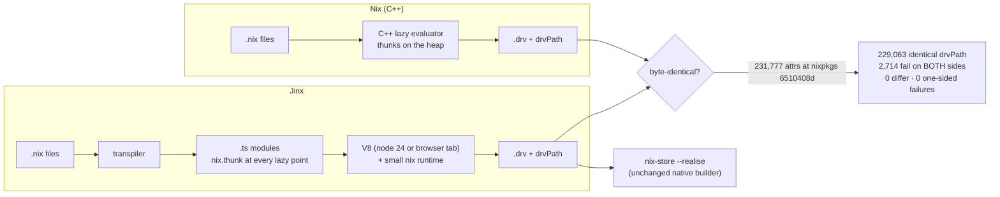

<!--
entry-meta
date: 2026-10-14
type: daily-diff
category: Daily Diff
title: Daily Diff — 2026-10-14
slug: sqlite-savepoints-statement-journals
-->

# Daily Diff — 2026-10-14

**2026-10-14 · Daily Diff Digest**

## Which Edition, And How It Was Found

Following the procedure in the repo README (endpoints are independently cached and any one of them can lead, lag or fail):

| Endpoint | Result |
|---|---|
| [`/archive/`](https://tdd.cat/archive/) | newest = **2026-10-13**, labelled "Latest"; 105 editions listed |
| [`https://tdd.cat/2026-10-13/`](https://tdd.cat/2026-10-13/) | **failed to fetch** |
| [`https://tdd.cat/2026-10-13.md`](https://tdd.cat/2026-10-13.md) | answered — **3 items** |
| [`/md`](https://tdd.cat/md) | answered, also 2026-10-13, **3 items** — cross-check agrees |
| [front page](https://tdd.cat/) | a day behind: **2026-10-12**, 21 stories (already covered by lesson 28's digest) |

So this digest covers the **2026-10-13 edition**, which is the newest not yet covered. A fourth distinct failure pattern in four days: this time the dated trailing-slash page failed while the dated `.md` and `/md` both worked and agreed, and the front page lagged.

**This edition is unusually small — 3 items, against 30/26/18/21 on the four preceding days.** Both independent endpoints report 3, so this is the edition, not a truncated fetch.

## The Edition, Point-Wise

1. **[What makes an agent expensive is what it remembers](https://talcaldeg.github.io/articulos/context-economy/)** — argues that most of an autonomous coding agent's token cost comes from reprocessing accumulated history rather than from generating new output; blind truncation erases needed constraints, so the recommendation is selective summarisation, a structured memory store, and evicting ephemeral file buffers.
2. **[Compiling Nix to TypeScript preserves decades of package fixes](https://fzakaria.com/2026/10/12/nixpkgs-for-the-frontend-impaired)** (Farid Zakaria) — Jinx transpiles `.nix` files to `.ts` modules so nixpkgs evaluates in a browser tab with no local Nix. Claims byte-identical `.drv` files and drvPaths. [HN discussion](https://news.ycombinator.com/item?id=50077828)
3. **[AICR delivers verifiable configuration recipes for GPU clusters](https://developer.nvidia.com/blog/aicr-v1-0-open-stable-and-verifiable-gpu-cluster-configuration/)** (Mark Chmarny, Nathan Taber) — NVIDIA's AI Cluster Runtime v1.0 uses version-locked recipes to cut dependency drift across kernels, GPU drivers and container runtimes, and checks running nodes against the recipe with signed evidence. [HN discussion](https://news.ycombinator.com/item?id=50068237)

## Deep Dive — Jinx: A Second Nix Evaluator, Validated Against 231,777 Attributes

Item 2 is the one with a falsifiable claim and a published test of it, so I followed the link and read the post.

### The mechanism

Jinx is a **transpiler**, not an interpreter. Each `.nix` file becomes a `.ts` module of the same name in a mirrored tree, and the generated code calls a small runtime:

| Nix construct | TypeScript output |
|---|---|
| lambda | arrow function, via `nix.lambda` / `nix.formals` / `nix.arg` |
| `let … in` | a block of `const`s |
| attribute set | object literal, selected through `nix.sel` |
| function application | `nix.app` |
| string interpolation | `nix.str` |
| relative path | `nix.here` |
| **any lazily-evaluated expression** | `nix.thunk(() => …)` |

That last row is the whole design. Nix's semantics are lazy; TypeScript's are not. So laziness is not emulated by the host language — it is **compiled in explicitly**, one `nix.thunk` wrapper at every point where the C++ evaluator would have allocated a thunk. Source maps link output back to original `.nix` line numbers, which means you can step through a nixpkgs package in a JavaScript debugger.

The split of responsibilities is conventional: `jinx eval` writes nothing to `/nix/store`; `jinx instantiate` writes the `.drv` closure; `nix-store --realise` still does the build. Jinx replaces the *evaluator*, not the builder.

### Why the verification is the interesting part

Anyone can write a Nix evaluator that is 95% right; the result is useless, because a derivation hash is an all-or-nothing artifact. One wrong byte in a `.drv` gives a different store path, which gives a cache miss, which means rebuilding the world. So the only meaningful test is exact equality at scale, and the post runs it: nixpkgs' own `ci/eval/outpaths.nix` at commit `6510408d`, under both Jinx and `nix-eval-jobs`, on x86_64-linux, aarch64-linux and aarch64-darwin.

| Attributes | Identical drvPath | Fail on both | Differ | Fail on one side only |
|---|---|---|---|---|
| 231,777 | 229,063 | 2,714 | **0** | **0** |

The last two columns are the result. Zero differing paths means hashing, string context propagation and evaluation order all match. Zero one-sided failures means the **errors** match too: the 2,714 shared failures are attributes Nix itself refuses (unsupported, broken, insecure), so Jinx is bug-compatible on the failure path as well as the success path. That is a stronger claim than "it evaluates nixpkgs".

### The cost of compiled laziness

| Probe | Nix | Jinx | Ratio | Peak RSS (Nix → Jinx) |
|---|---|---|---|---|
| `lib` | 0.53 s | 1.31 s | 2.5× | 238 → 501 MB |
| `hello` | 0.37 s | 1.72 s | 4.6× | 88 → 376 MB |
| `firefox` | 3.19 s | 11.44 s | 3.6× | 488 → 1608 MB |
| `nixos` | 4.21 s | 21.35 s | 5.1× | 603 → 2377 MB |

Warm. Cold evaluation, which must compile every reached module, is reported at 3×–10× slower with 2×–4× the memory. The author attributes the memory cost to thunk allocation pressure on V8's garbage collector — which is the predictable consequence of the design: a purpose-built lazy evaluator can represent a thunk as a small tagged heap cell it controls, while `nix.thunk(() => …)` is a JavaScript closure with everything V8 attaches to one. **3–5× slower for an evaluator ported to an unrelated host language and runtime is a good result**, not a bad one, and it is the price of the thing that makes the project work at all.

### What changes

- **nixpkgs becomes a library you can evaluate from a web page.** The demo fetches compiled modules from GitHub on demand and evaluates `hello` in a browser tab with no Nix installed. Store-path computation for an arbitrary package stops requiring a daemon, a `/nix/store`, or root.
- **It separates "what Nix computes" from "how Nix is implemented."** Historically the C++ evaluator *was* the specification. A second implementation that matches on 229,063 attributes turns parts of that behaviour into something testable rather than definitional.
- **A compiled tree per revision is a new artifact.** `jinx-nixpkgs` keeps one commit per nixpkgs revision, so the transpiled output is itself versioned and cacheable.

### What the post does not say

Worth stating rather than guessing: the article does **not** describe how builtins are implemented, which parts of the Nix language are unsupported, how import-from-derivation is handled, or how hashing and store-path computation are done internally. It reports only that the output matches. The 231,777-attribute result is strong evidence that those pieces are right for nixpkgs as it actually exists; it is not a specification of them.

## Sources

- [The Daily Diff — archive](https://tdd.cat/archive/) · [front page](https://tdd.cat/) · [`/md`](https://tdd.cat/md) · [2026-10-13 edition (markdown)](https://tdd.cat/2026-10-13.md) · [`llms.txt`](https://tdd.cat/llms.txt)
- [Nixpkgs for the frontend impaired — Farid Zakaria](https://fzakaria.com/2026/10/12/nixpkgs-for-the-frontend-impaired) (the deep-dive source)
- [github.com/fzakaria/jinx](https://github.com/fzakaria/jinx) · [github.com/fzakaria/jinx-nixpkgs](https://github.com/fzakaria/jinx-nixpkgs) · [playground](https://fzakaria.github.io/jinx) · [browser eval of `hello`](https://fzakaria.github.io/jinx/nixpkgs/#attr=hello) · [benchmarks](https://fzakaria.github.io/jinx/bench/)
- [The context economy of coding agents](https://talcaldeg.github.io/articulos/context-economy/)
- [NVIDIA AICR v1.0 — open, stable and verifiable GPU cluster configuration](https://developer.nvidia.com/blog/aicr-v1-0-open-stable-and-verifiable-gpu-cluster-configuration/)
- HN discussions: [Jinx](https://news.ycombinator.com/item?id=50077828) · [AICR](https://news.ycombinator.com/item?id=50068237)
