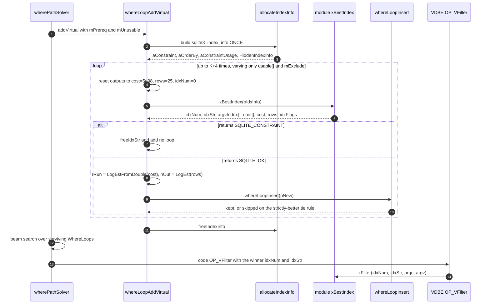

<!--
entry-meta
date: 2026-10-15
type: lesson
track: SQLite
lesson: 30
category: Database Internals
title: Virtual Tables and xBestIndex — A Cost Channel Only 10 Bits Wide, a Planner That Asks the Same Question Up to K+4 Times, and One Integer Field That Explains Three Documented Limitations
slug: sqlite-vtab-xbestindex-dbstat-dbpage
-->

# Virtual Tables and xBestIndex — A Cost Channel Only 10 Bits Wide, a Planner That Asks the Same Question Up to K+4 Times, and One Integer Field That Explains Three Documented Limitations

**2026-10-15 · SQLite Track · Lesson 30 of 33**

## Where This Fits

- **Lesson 29** ([savepoints and statement journals](../2026-10-14-sqlite-savepoints-statement-journals/README.md)) established the single savepoint stack, `db->pSavepoint` / `db->nSavepoint` / `db->nStatement`, and the sub-journal they share. It handed this lesson one named item: every branch of `OP_Savepoint` calls `sqlite3VtabSavepoint()` with the same index, so `xSavepoint`/`xRelease`/`xRollbackTo` is that stack re-exported to extensions. **That handoff is closed here**, and closing it turns out to explain, and partly contradict, a documented limitation of `sqlite_dbpage` (§7).
- **Lesson 26** ([the query planner](../2026-10-11-sqlite-query-planner-whereloop-path-solver/README.md)) established `WhereLoop`, the `(rSetup, rRun, nOut)` triple, the `LogEst` 10·log₂ unit, `whereLoopInsert`'s three-way domination test with its strictly-better tie rule, and `wherePathSolver`'s beam search. A virtual table does not get its own planner: it gets **one function call that fills in exactly those three fields**. Everything lesson 26 proved about domination and about the solver applies unchanged, which is why §3 is about a *unit conversion* and not about a new cost model. Lesson 27 ([ANALYZE](../2026-10-12-sqlite-analyze-stat1-stat4-estimators/README.md)) is where `nOut` normally comes from; a vtab bypasses it entirely.
- **Lesson 23** established `allocateCursor()` and the register file; the `OP_VOpen`/`OP_VFilter`/`OP_VColumn`/`OP_VNext` opcodes in §5 are the `CURTYPE_VTAB` arm of the same cursor machinery.
- **This lesson adds** the `sqlite3_module` method table and its four `iVersion` generations; `allocateIndexInfo`'s single allocation and the `HiddenIndexInfo` struct hidden immediately behind it; the exact entry values of every output field; `whereLoopAddVirtual`'s call *schedule* (how many times `xBestIndex` runs for one `FROM`-clause term, and why); the lossy conversion from `double estimatedCost` to `LogEst rRun`; the two run-time checks that produce `"xBestIndex malfunction"`; and the two introspection modules, `dbstat` and `sqlite_dbpage`, read as worked `xBestIndex` implementations rather than as tools.
- **It sets up lesson 31** (mmap and memory allocation), which inherits `allocateIndexInfo`'s one-malloc-for-four-arrays pattern as a sibling of the lookaside question, and **lesson 32** (`PRAGMA integrity_check`), which gets `xIntegrity` — the `iVersion` 4 method — plus the corrupted databases §6 produces.

All source references are to the **SQLite 3.53.4** amalgamation vendored in `better-sqlite3@13.0.3` at `deps/sqlite3/sqlite3.c`, the same file lessons 27, 28 and 29 used, so line numbers are comparable across four lessons. Every number below marked *measured* came from binaries built from that file this run; the harness is in §Hands-On.

---

## 1. The Method Table, and the Four Generations

`sqlite3_module` is a plain struct of function pointers with a version integer in front. The generations are strictly additive — a new `iVersion` only appends fields, so an old module struct stays binary-compatible:

| `iVersion` | Added | Since |
|---|---|---|
| 1 | `xCreate` `xConnect` `xBestIndex` `xDisconnect` `xDestroy` `xOpen` `xClose` `xFilter` `xNext` `xEof` `xColumn` `xRowid` `xUpdate` `xBegin` `xSync` `xCommit` `xRollback` `xFindFunction` `xRename` | — |
| 2 | `xSavepoint` `xRelease` `xRollbackTo` | 3.7.7 |
| 3 | `xShadowName` | — |
| 4 | `xIntegrity` | 3.44.0 |

`sqlite3VtabSavepoint` gates on this number directly — `pMod->iVersion>=2` (sqlite3.c:163005) — so a module declaring `iVersion` 1 is silently excluded from the savepoint protocol rather than being an error. Keep that in mind for §7.

### xCreate versus xConnect, and the error message that lies

Both constructors take identical arguments and must both call `sqlite3_declare_vtab()`. What distinguishes them is ownership of backing store: `xCreate` runs for `CREATE VIRTUAL TABLE` and creates it; `xConnect` runs whenever a connection parses the schema and only attaches to what exists. Three configurations follow:

- `xCreate == xConnect` → the table is **eponymous**: the module name is itself usable as a table name, with no `CREATE`.
- `xCreate == 0` → **eponymous-only**; `CREATE VIRTUAL TABLE` is prohibited.
- `xCreate != xConnect`, both non-NULL → a conventional created table.

The prohibition is enforced in `sqlite3VtabCallCreate` (sqlite3.c:162681), and the test is wider than the documentation suggests:

```c
if( pMod==0 || pMod->pModule->xCreate==0 || pMod->pModule->xDestroy==0 ){
  *pzErr = sqlite3MPrintf(db, "no such module: %s", zMod);
  rc = SQLITE_ERROR;
}
```

**A registered module with a working `xCreate` but a NULL `xDestroy` reports `no such module`.** *Measured:* a module registered successfully (`sqlite3_create_module` returned `SQLITE_OK`) and queryable eponymously (`SELECT * FROM tvt` returned rows) still failed `CREATE VIRTUAL TABLE vt USING tvt()` with `no such module: tvt` until `xDestroy` was filled in. Note also that `createModule` at sqlite3.c:162533 discards its registration result — `(void)sqlite3VtabCreateModule(...)` — so `sqlite3_create_module`'s return code reports allocation health, not whether the module is usable.

---

## 2. One Allocation, Four Arrays, and a Struct Hidden Behind the Public One

`allocateIndexInfo` (sqlite3.c:170267) builds the object passed to `xBestIndex` in a **single** `sqlite3DbMallocZero`:

```c
pIdxInfo = sqlite3DbMallocZero(pParse->db, sizeof(*pIdxInfo)
                         + (sizeof(*pIdxCons) + sizeof(*pUsage))*nTerm
                         + sizeof(*pIdxOrderBy)*nOrderBy
                         + SZ_HIDDENINDEXINFO(nTerm) );
```

The layout, in address order, is: the public `sqlite3_index_info`; then a private `HiddenIndexInfo` (sqlite3.c:168886) whose last member is a flexible `sqlite3_value *aRhs[]`; then `aConstraint[nTerm]`, `aOrderBy[nOrderBy]`, `aConstraintUsage[nTerm]`. The hidden struct is the entire backing store for the four accessor functions a module may call *during* `xBestIndex`:

| Hidden field | What it serves |
|---|---|
| `pWC`, `pParse` | `sqlite3_vtab_collation()` — walks back to the `WhereTerm`'s `Expr` to find the effective collation |
| `aRhs[]` | `sqlite3_vtab_rhs_value()` — lazily materialised right-hand-side values |
| `eDistinct` | `sqlite3_vtab_distinct()` — 0/1/2/3 set from `WHERE_DISTINCTBY`, `WHERE_GROUPBY`, `WHERE_WANT_DISTINCT` and `WHERE_SORTBYGROUP` |
| `mIn`, `mHandleIn` | `sqlite3_vtab_in()` — which terms are `IN (...)` and which the module has volunteered to handle itself |

Every accessor reaches it the same way, by pointer arithmetic off the public struct: `HiddenIndexInfo *pHidden = (HiddenIndexInfo*)&pIdxInfo[1];`. That is why those functions are only legal inside `xBestIndex` — outside it, there is no guarantee anything sits at `&pIdxInfo[1]`.

### `op` is a direct cast, not a translation

The `WO_*` bit values in `whereInt.h` (sqlite3.c:163913) were chosen to equal the public `SQLITE_INDEX_CONSTRAINT_*` values, so the conversion is an assignment with an assertion instead of a switch:

```c
pIdxCons[j].op = (u8)op;
/* The direct assignment in the previous line is possible only because
** the WO_ and SQLITE_INDEX_CONSTRAINT_ codes are identical. */
assert( WO_EQ==SQLITE_INDEX_CONSTRAINT_EQ );
```

Four rewrites happen before that assignment, and each is observable:

1. **`WO_IN` becomes `WO_EQ`.** An `IN (...)` term is presented to `xBestIndex` as `op = SQLITE_INDEX_CONSTRAINT_EQ`; its index is recorded in `pHidden->mIn` instead. There is no `SQLITE_INDEX_CONSTRAINT_IN`. *Measured:* `SELECT a FROM vt WHERE a IN (1,2,3)` produced one constraint, `op=EQ`, and then **three** `xFilter` calls, `argv[0]` = 1, 2, 3.
2. `WO_ISNULL` → `SQLITE_INDEX_CONSTRAINT_ISNULL`, `WO_IS` → `..._IS`.
3. `WO_AUX` → the term's own `eMatchOp`, which is how `MATCH`, `LIKE`, `GLOB`, `REGEXP`, `LIMIT` (73), `OFFSET` (74) and the `..._FUNCTION` family (≥150) arrive.
4. **Vector comparisons are weakened and pinned.** For a row-value right-hand side, `<` becomes `LE` and `>` becomes `GE`, and the term's bit is set in `mNoOmit` so the module's `omit` request will be ignored later. The comparison the module is told about is deliberately *looser* than the one in the SQL.

`colUsed` is copied from `pSrc->colUsed`, with one correction: for a `WITHOUT ROWID` table every primary-key column's bit is forced on, so a `RIGHT JOIN` or an `OR`-loop can still reconstruct the key.

*Measured* `colUsed`, confirming it is a real used-columns mask and not a constraints mask: `SELECT a FROM vt WHERE a=5` → `0x1`; `... WHERE a=5 AND b=6 AND c>7` → `0x7`; `SELECT c FROM vt WHERE a=1 ...` → `0x5`; `SELECT a FROM vt ORDER BY b` → `0x3`.

---

## 3. The Cost Channel: A `double` In, Ten Bits Out

`whereLoopAddVirtualOne` (sqlite3.c:173212) resets the output half of the struct before every call. These are the exact entry values a module sees:

```c
memset(pUsage, 0, sizeof(pUsage[0])*nConstraint);
pIdxInfo->idxStr = 0;
pIdxInfo->idxNum = 0;
pIdxInfo->orderByConsumed = 0;
pIdxInfo->estimatedCost = SQLITE_BIG_DBL / (double)2;
pIdxInfo->estimatedRows = 25;
pIdxInfo->idxFlags = 0;
```

`SQLITE_BIG_DBL` is `1e99` (sqlite3.c:15708), so the default cost is **`5e98`**, not the "very large value" of the prose. *Measured:* an instrumented module printed `estimatedCost on entry = 5e+98   estimatedRows on entry = 25` on every one of its calls.

What the module writes there is then squeezed into lesson 26's integer units:

```c
pNew->rSetup = 0;
pNew->rRun   = sqlite3LogEstFromDouble(pIdxInfo->estimatedCost);
pNew->nOut   = sqlite3LogEst(pIdxInfo->estimatedRows);
```

Two structural consequences, neither of them cosmetic:

- **`rSetup` is hard-wired to 0.** A virtual table cannot price a one-time setup. Lesson 26's automatic-index loop paid `rSetup` to build a transient index and earned it back over repeated probes; a module has no way to express that shape at all. Its only lever is `rRun`, which the solver multiplies by the outer loop's row count on every visit.
- **The conversion is lossy, and above 2×10⁹ it is catastrophically lossy.** `sqlite3LogEstFromDouble` (sqlite3.c:38519):

```c
if( x<=1 ) return 0;
if( x<=2000000000 ) return sqlite3LogEst((u64)x);
memcpy(&a, &x, 8);
e = (a>>52) - 1022;
return e*10;
```

Above 2×10⁹ it stops computing a logarithm and simply **reads the IEEE-754 exponent field**, returning `10 × (unbiased exponent + 1)`. The result is quantised to multiples of 10 — one distinct value per power of two. Two costs that differ by 1.9× can convert to the same `rRun`, and `whereLoopInsert`'s tie rule from lesson 26 (strictly better, or it is skipped) then discards one of them outright.

*Measured*, by varying one module's `estimatedCost` and reading the third column of `EXPLAIN QUERY PLAN` — which is the loop's `rRun`:

| `estimatedCost` | `rRun` | 10·log₂(cost), for comparison |
|---|---|---|
| 1.0 | 0 | 0 |
| 2.0 | 10 | 10 |
| 10.0 | 33 | 33 |
| 100.0 | 66 | 66 |
| 1.0e6 | 199 | 199 |
| **1.0e12** | **400** | **399** |
| **5e98** (the default) | **3280** | **3279** |

The first five rows are the logarithm; the last two are the exponent field, and both are one whole unit off the true value. **Practical rule: keep `estimatedCost` under 2×10⁹.** Anything above it is a 10-bit-granular number pretending to be a double.

`estimatedRows` takes the ordinary `sqlite3LogEst` path with no such cliff, and feeds `nOut`, which the solver uses to price *everything downstream* of this loop. Getting `estimatedRows` wrong is usually more expensive than getting `estimatedCost` wrong.

`idxFlags` has exactly two bits (sqlite3.h, sqlite3.c:8190): `SQLITE_INDEX_SCAN_UNIQUE` (0x1) sets `WHERE_ONEROW` on the loop, and `SQLITE_INDEX_SCAN_HEX` (0x2) only changes how `idxNum` is rendered in `EXPLAIN QUERY PLAN`. Both are observable in §Hands-On.

---

## 4. The Call Schedule: `xBestIndex` Is Not Asked Once

This is the part most module authors get wrong, because the documentation describes one call and the planner makes several. `whereLoopAddVirtual` (sqlite3.c:173536) allocates the `sqlite3_index_info` **once** and then calls `whereLoopAddVirtualOne` repeatedly, varying only the `usable` flags, keeping whichever loops survive `whereLoopInsert`.

For one FROM-clause term with **K** distinct non-empty values of `prereqRight & ~mPrereq` among its constraints, the schedule is:

1. **All usable** (`mUsable = ALLBITS`, `mExclude = 0`). Plus a repeat of this call if the first set `bRetryLimit` — which happens when a `LIMIT`/`OFFSET` term was claimed alongside an `IN` term or alongside unclaimed terms.
2. **Short circuit.** If that plan needed no other tables (`mBest == 0`) and used no `IN`, the planner stops: `if( rc==SQLITE_OK && ((mBest = (pNew->prereq & ~mPrereq))!=0 || bIn) )`. A module that ignores `usable` entirely therefore often sees exactly one call, which is how the misconception survives.
3. **All usable without `IN`** (`mExclude = WO_IN`), only if step 1 reported `bIn`.
4. **One call per distinct prereq mask**, walked in increasing order by a scan that picks the smallest mask greater than the previous one, skipping any equal to `mBest` or `mBestNoIn`. Up to **K** calls.
5. **All disabled** (`mUsable = mPrereq`), if no earlier call produced a plan with no prerequisites.
6. **All disabled without `IN`**, if no earlier call produced such a plan that also avoided `IN`.

Upper bound: **K + 4** calls for one virtual table in one query. Steps 5 and 6 exist to guarantee at least one *unconditionally usable* plan, so the solver always has something to fall back on no matter how it orders the join.

*Measured.* `SELECT a FROM vt, t1 WHERE a=t1.x` → **2** calls: first `aConstraint[0]` with `usable=1`, then the same constraint with `usable=0`. `SELECT a FROM vt WHERE a IN (1,2,3)` → **2** calls, same shape, because of step 3. `SELECT a FROM vt WHERE a=5` → **1** call, the short circuit.



### The two malfunction checks

`argvIndex` values must be **contiguous from 1** and **unique**. `whereLoopAddVirtualOne` builds `pNew->aLTerm[argvIndex-1]` and then verifies no slot below `mxTerm` was left empty:

```c
if( iTerm>=nConstraint || j<0 || (pTerm = termFromWhereClause(pWC, j))==0
 || pNew->aLTerm[iTerm]!=0 || pIdxCons->usable==0 ){
  sqlite3ErrorMsg(pParse,"%s.xBestIndex malfunction",pSrc->pSTab->zName);
```

*Measured*, against `SELECT a FROM vt, t1 WHERE a=5 AND b=t1.x`:

| What `xBestIndex` did | Result |
|---|---|
| claimed nothing | `SQLITE_OK` |
| set `argvIndex = 2` only (gap at 1) | `vt.xBestIndex malfunction` |
| set `argvIndex = 1` on every usable term | `vt.xBestIndex malfunction` |
| set `argvIndex = i+1`, contiguous | `SQLITE_OK` |

Claiming an *unusable* constraint is also checked by the same condition, but my test did not trigger it — the chosen plan came from a call in which no constraint was unusable — so I can confirm the code path exists without confirming the error fires.

### `omit` is honoured only for the first 16 constraints

```c
if( pUsage[i].omit ){
  if( i<16 && ((1<<i)&mNoOmit)==0 ){
    pNew->u.vtab.omitMask |= 1<<iTerm;
  }
```

`omitMask` is a 16-bit field, so `omit` on constraint 16 or beyond is silently dropped and SQLite re-checks the term itself. That is safe — `omit` is a hint — but it means a module with many constraints quietly pays for duplicate filtering. `OFFSET` is the exception the documentation calls out: `bOmitOffset` is set regardless of position, and the module then *must* skip those rows itself.

### `IN` cancels ordering, after the fact

If a claimed term is an `IN` the module did not volunteer to handle (`mHandleIn`), the planner overrides two of the module's answers:

```c
pIdxInfo->orderByConsumed = 0;
pIdxInfo->idxFlags &= ~SQLITE_INDEX_SCAN_UNIQUE;
```

The reasons are in the comment: the order of `IN` values is unrelated to output order, and multiple outputs from one `IN` value will not merge. So a module cannot claim sorted output *and* let SQLite loop an `IN` for it.

---

## 5. Execution: Four Opcodes and One Fake `FuncDef`

The run-time side is small. `OP_VOpen` (sqlite3.c:104963) creates a `CURTYPE_VTAB` cursor; `OP_VFilter` (sqlite3.c:105100) reads `idxNum` from register P3, `argc` from P3+1, and `argv[0..argc-1]` from P3+2 onward, with `idxStr` carried in P4; `OP_VColumn` and `OP_VNext` are thin forwarders. Three details worth having:

- **`OP_VFilter` tests EOF immediately.** After `xFilter` returns it calls `pModule->xEof(pVCur)` and jumps to P2 if true, so a module must leave the cursor positioned (or at EOF) before returning — the loop header has already been coded on that assumption.
- **`OP_VColumn` fabricates a `FuncDef`.** It builds a stack `sqlite3_context` whose `pFunc` is a local `nullFunc` with `funcFlags = SQLITE_RESULT_SUBTYPE`, purely so `sqlite3_result_subtype()` works inside `xColumn`. There is no real function involved.
- **`OPFLAG_NOCHNG` is how `sqlite3_vtab_nochange()` works.** During an `UPDATE`, P5 carries `OPFLAG_NOCHNG` for columns that are not changing; the destination register is set to the `MEM_Null|MEM_Zero` combination, and the module can detect it and skip the work.
- **`OP_VInitIn` (sqlite3.c:105063)** is the `sqlite3_vtab_in()` path: it wraps an ephemeral-table cursor in a heap-allocated `ValueList` and stores it in a register as a `"ValueList"` pointer, so the module can pull RHS values itself instead of being called once per value.

---

## 6. `dbstat`: idxNum as a Four-Bit Mask

`dbstat` is the smallest complete `xBestIndex` worth reading. Its declared schema (sqlite3.c, `zDbstatSchema`) is twelve columns, the last two hidden:

```
name TEXT(0) path TEXT(1) pageno INTEGER(2) pagetype TEXT(3) ncell INTEGER(4)
payload INTEGER(5) unused INTEGER(6) mx_payload INTEGER(7) pgoffset INTEGER(8)
pgsize INTEGER(9) schema TEXT HIDDEN(10) aggregate BOOLEAN HIDDEN(11)
```

`statBestIndex` (sqlite3.c:232012) uses `idxNum` as a bitmask over four facts, and nothing else:

| Bit | Meaning | `argvIndex` assigned | `omit` |
|---|---|---|---|
| `0x01` | `schema=?` present (column 10) | 1st | yes |
| `0x02` | `name=?` present (column 0) | next | **no** |
| `0x04` | `aggregate=?` present (column 11) | next | **no** |
| `0x08` | output ordered by `(name)` or `(name, path)` | — | — |

Three things in those twenty lines are worth copying:

1. **An unusable `EQ` constraint is fatal, deliberately.** `if( pIdxInfo->aConstraint[i].usable==0 ) return SQLITE_CONSTRAINT;` — with the comment "Force DBSTAT table should always be the right-most table in a join". `SQLITE_CONSTRAINT` means *infinite cost for this combination*, not an error, so returning it from the "all disabled" calls of §4 removes every plan in which `dbstat` is not innermost.
2. **`estimatedCost = 1.0` unconditionally.** `dbstat` does not pretend to cost itself; it makes itself look free and relies on (1) to fix the join order.
3. **`orderByConsumed` is claimed only for the two exact prefixes it really produces** — `(name ASC)` or `(name ASC, path ASC)` — never for a `DESC` or a reordered pair. That is the correct discipline: the documentation warns that a wrong `orderByConsumed` yields wrong answers, with no diagnostic.

`statBestIndex` also sets `SQLITE_INDEX_SCAN_HEX`, which is why its plans print in hex. *Measured*, on a 120-page database with a 3,000-row table:

```
EXPLAIN QUERY PLAN SELECT * FROM dbstat WHERE name='users';
  -> SCAN dbstat VIRTUAL TABLE INDEX 0x2:
EXPLAIN QUERY PLAN SELECT * FROM dbstat WHERE name='users' ORDER BY name, path;
  -> SCAN dbstat VIRTUAL TABLE INDEX 0xa:
EXPLAIN QUERY PLAN SELECT * FROM dbstat;
  -> SCAN dbstat VIRTUAL TABLE INDEX 0x0:
EXPLAIN QUERY PLAN SELECT data FROM sqlite_dbpage WHERE pgno=1;
  -> SCAN sqlite_dbpage VIRTUAL TABLE INDEX 1:
```

`0x2` is the `name=?` bit; `0xa` is `0x8|0x2`, ordering plus name. `sqlite_dbpage` prints `1` in decimal because it does not set the HEX bit — one flag bit, visible in the plan text.

### What the rows actually show

`path` is the b-tree address: `/` for the root, then one 3-hex-digit child index per level (`/000/`, `/001/`, …), and `+` plus a 6-hex-digit sequence number for overflow pages hanging off a cell (`/1c2/000+000000`). Under `BINARY` a cell's overflow pages sort before its child page. In aggregate mode `path`, `pagetype` and `pgoffset` are NULL and `pageno` becomes a page *count*. Freelist, pointer-map and lock pages are excluded — which is why `count(*) FROM dbstat` is not `PRAGMA page_count`.

*Measured* on that database, with the lesson-03 and lesson-04 quantities now readable as SQL:

```
name |path  |pageno|pagetype|ncell|payload|unused|mx_payload|pgoffset|pgsize
users|/     |2     |internal|103  |0      |3264  |0         |4096    |4096
users|/000/ |4     |leaf    |30   |3921   |17    |131       |12288   |4096
users|/001/ |5     |leaf    |30   |3930   |8     |131       |16384   |4096
users|/003/ |7     |leaf    |29   |3819   |124   |132       |24576   |4096
```

Cross-checking against the raw bytes of the same pages, read through `sqlite_dbpage`, closes the loop on lesson 03's page header:

- page 2 header `05 0000 0067 0D9A 00` + `00000078` → type `0x05` interior-table, `ncell = 0x0067 = 103` (= dbstat's `ncell`), rightmost child `0x78 = 120` (= the file's page count).
- page 4 header `0D 0000 001E 0055 00` → type `0x0D` leaf-table, `ncell = 0x1E = 30`, cell-content-area start `0x0055 = 85`. Header 8 + pointer array 60 = 68, content area 4096−85 = 4011, and 68 + 4011 = 4079, leaving exactly **17** bytes — dbstat's `unused` for that page, derived independently.

Aggregate mode on the same file gave `users` 105 pages at 97.06% packed and `users_name` 14 pages at 81.84%: a sequential `INTEGER PRIMARY KEY` load fills table leaves almost completely (lesson 11's right-most split), while the text index, whose keys arrive in effectively random order, splits in the middle and sits near the 81% that random b-tree insertion converges to.

---

## 7. `sqlite_dbpage`: One `Pgno` Field Explains Three Documented Limitations

`sqlite_dbpage` declares `CREATE TABLE x(pgno INTEGER PRIMARY KEY, data BLOB, schema HIDDEN)` and configures itself twice (sqlite3.c:232779):

```c
sqlite3_vtab_config(db, SQLITE_VTAB_DIRECTONLY);
sqlite3_vtab_config(db, SQLITE_VTAB_USES_ALL_SCHEMAS);
```

`DIRECTONLY` is the interesting one. *Measured:* `CREATE VIEW v AS SELECT * FROM dbstat;` **succeeds**, and `SELECT * FROM v` then fails with `unsafe use of virtual table "dbstat"`. The restriction is enforced at use, not at definition — so a schema can contain a view that can never be read.

`dbpageBestIndex` (sqlite3.c:232828) uses `idxNum` as a two-bit plan — bit 0 for `pgno=?`, bit 1 for `schema=?` — and prices itself honestly, unlike `dbstat`: `estimatedCost = 1.0e6` for a scan, dropping to `1.0` with `estimatedRows = 1` and `SQLITE_INDEX_SCAN_UNIQUE` when `pgno` is pinned. That 1.0e6 is the `rRun = 199` seen in the `EXPLAIN QUERY PLAN` output above, and it sits comfortably below the 2×10⁹ cliff from §3.

### The write path, and `pgnoTrunc`

`DbpageTable` carries exactly two mutable fields: `int iDbTrunc` and `Pgno pgnoTrunc`. They are the whole truncation mechanism, and they explain the documented limitations one for one. In `dbpageUpdate` (sqlite3.c:233046):

- `db->flags & SQLITE_Defensive` → error `"read-only"`. *Measured:* with `SQLITE_DBCONFIG_DEFENSIVE` set, an `UPDATE` failed with `rc=11`, surfaced through the vtab error path. The official CLI sets defensive mode for `sqlite_dbpage` unless started with `--unsafe-testing`.
- `argc==1` → error `"cannot delete"`. *Measured:* `DELETE FROM sqlite_dbpage WHERE pgno=50` → `cannot delete`. **`DELETE` is not how you shrink a database.**
- A null-`data` `INSERT` with `pgno>1` sets `pgnoTrunc = pgno-1`, `iDbTrunc = iDb`, and then **redirects the write to page 1** so the transaction has a dirty page. For `pgno<=1` it falls through to `"bad page value"`. *Measured:* `INSERT INTO sqlite_dbpage(pgno,data) VALUES(1,NULL)` → `bad page value`; there is no special-cased message for page 1.
- Any **successful page write** sets `pTab->pgnoTrunc = 0`.
- `dbpageBegin` (`xBegin`) zeroes it; `dbpageSync` (`xSync`) acts on it just before commit, and only if it would actually shrink: `if( pTab->pgnoTrunc < sqlite3BtreeLastPage(pBt) ) sqlite3PagerTruncateImage(pPager, pTab->pgnoTrunc);`
- `dbpageRollbackTo` (`xRollbackTo`) zeroes it.

So: the field is a single `Pgno`, which is why only one database can be truncated per transaction; it is cleared by any later successful write, which is why the null-`INSERT` must be the last write before `COMMIT`; and it is cleared by `xRollbackTo`, which is where lesson 29's handoff lands.

```mermaid
stateDiagram-v2
    [*] --> Clear : "xBegin / dbpageBegin sets pgnoTrunc = 0"
    Clear --> Armed : "INSERT(pgno>1, NULL)\npgnoTrunc = pgno-1; write redirected to page 1"
    Armed --> Clear : "any successful page write\n(pgnoTrunc = 0)"
    Armed --> Clear : "xRollbackTo via sqlite3VtabSavepoint\n(only if pVTab->iSavepoint > iSavepoint)"
    Armed --> Truncated : "xSync, iff pgnoTrunc < BtreeLastPage"
    Armed --> Clear : "update_fail: read-only / cannot delete / bad page value"
    Truncated --> [*] : "COMMIT: sqlite3PagerTruncateImage"
    Clear --> [*] : "COMMIT with no truncation"
```



### Closing lesson 29's handoff — and correcting the documentation

`sqlite3VtabSavepoint` (sqlite3.c:162995) walks `db->aVTrans[]` and dispatches on `op`:

```c
case SAVEPOINT_BEGIN:
  xMethod = pMod->xSavepoint;
  pVTab->iSavepoint = iSavepoint+1;
  break;
case SAVEPOINT_ROLLBACK: xMethod = pMod->xRollbackTo; break;
default:                 xMethod = pMod->xRelease;    break;
}
if( xMethod && pVTab->iSavepoint>iSavepoint ){
  u64 savedFlags = (db->flags & SQLITE_Defensive);
  db->flags &= ~(u64)SQLITE_Defensive;
  rc = xMethod(pVTab->pVtab, iSavepoint);
  db->flags |= savedFlags;
}
```

Two things to notice. First, defensive mode is **temporarily cleared around the callback** — a module's savepoint bookkeeping is allowed to do what its `xUpdate` would be refused. Second, and this is the load-bearing detail: `xRollbackTo` is skipped unless `pVTab->iSavepoint > iSavepoint`. `iSavepoint` is only ever set at `SAVEPOINT_BEGIN`, and only for vtabs that are **already in `db->aVTrans[]`** at that moment. A module that joins the transaction *after* a savepoint was taken has `iSavepoint == 0` and never hears about rolling back to it.

The dbpage documentation states that "any `ROLLBACK TO` will cancel the null-INSERT". *Measured*, on fresh 120-page copies, reading the resulting file size:

| Statement sequence | Result |
|---|---|
| `BEGIN; INSERT(100,NULL); COMMIT;` | 99 pages — truncated |
| `BEGIN; INSERT(100,NULL); UPDATE ... WHERE pgno=3; COMMIT;` | **120 pages — no-op**, as documented |
| `BEGIN; SAVEPOINT s1; INSERT(100,NULL); ROLLBACK TO s1; COMMIT;` | **99 pages — truncation NOT cancelled** |
| `BEGIN; UPDATE ... WHERE pgno=3; SAVEPOINT s1; INSERT(100,NULL); ROLLBACK TO s1; COMMIT;` | **120 pages — cancelled** |
| `BEGIN; UPDATE ... WHERE pgno=3; SAVEPOINT s1; INSERT(100,NULL); RELEASE s1; COMMIT;` | 99 pages — truncated (correct; `RELEASE` is not a cancel) |
| `BEGIN; INSERT(100,NULL); ROLLBACK;` | 120 pages — full rollback, nothing written |

Rows 3 and 4 differ only in whether `sqlite_dbpage` had already joined `aVTrans[]` before `SAVEPOINT s1`. That is `pVTab->iSavepoint > iSavepoint` deciding the outcome, exactly as the code says, and it means the documented claim holds only when the vtab was already enrolled in the transaction when the savepoint was taken. **This is a divergence between the documentation and the implementation, reproduced here on 3.53.4; I have not reported it upstream and have not checked whether it is already known.**

One more measured boundary: a null-`INSERT` at `pgno = 121` on a file whose header says 120 pages was a no-op, because `pgnoTrunc` (120) was not less than `sqlite3BtreeLastPage` (120) — the `xSync` guard, visible from the outside.

---

## Hands-On

Everything below was run this session. The three C files are small enough to paste.

### 1. See the whole `xBestIndex` conversation

Get an amalgamation (any 3.53.x works; this run used the copy inside `better-sqlite3`), then build a module whose only job is to print what it is handed.

```bash
mkdir vtlab && cd vtlab
npm install better-sqlite3@13.0.3 --no-audit --no-fund
cp node_modules/better-sqlite3/deps/sqlite3/sqlite3.{c,h} .
```

The module needs `xCreate`, `xConnect`, `xBestIndex`, `xDisconnect`, **`xDestroy`** (see §1 — omit it and `CREATE VIRTUAL TABLE` reports `no such module`), `xOpen`, `xClose`, `xFilter`, `xNext`, `xEof`, `xColumn`, `xRowid`. In `xBestIndex`, print `nConstraint`, `nOrderBy`, `colUsed`, `estimatedCost` and `estimatedRows` **on entry**, then each `aConstraint[i]` as `iColumn/op/usable`, claim every usable `EQ` with a contiguous `argvIndex`, and print what you returned. In `xFilter`, print `idxNum`, `argc`, and each `argv[i]`.

```bash
gcc -O0 -o bi bestindex_trace.c sqlite3.c -DSQLITE_THREADSAFE=0 -lm
./bi
```

**What to look for, and what each observation proves:**

- `estimatedCost on entry = 5e+98`, `estimatedRows on entry = 25` on *every* call → confirms `SQLITE_BIG_DBL/2` and the per-call output reset in `whereLoopAddVirtualOne`, not a one-time initialisation.
- `WHERE a IN (1,2,3)` shows **one** constraint with `op=EQ` and **three** `xFilter` calls → proves `WO_IN` is folded to `WO_EQ` and that SQLite, not the module, loops the values.
- `WHERE a=5` → one call; `FROM vt, t1 WHERE a=t1.x` → two calls, the second with `usable=0` → that is §4's short circuit versus its step 4/5.
- `SELECT c FROM vt WHERE a=1 LIMIT 5 OFFSET 2` → three constraints: the `EQ`, then `op=OFFSET` (74), then `op=LIMIT` (73), both with `iColumn=0` even though neither constrains column 0. Do not switch on `iColumn` before checking `op`.
- `colUsed` changing between `0x1`, `0x5` and `0x7` as you change the select list → it is a used-columns mask, and a module can legitimately skip computing unrequested columns.

### 2. Measure the cost cliff yourself

Make `estimatedCost` a global, sweep it over `{1, 2, 10, 100, 1e6, 1e12, 5e98}`, and after each setting run `EXPLAIN QUERY PLAN SELECT a FROM vt;`, printing **column 2** (zero-based) of the EQP row alongside the detail text.

**What to look for:** the printed integer is the loop's `rRun`. It tracks 10·log₂(cost) exactly up to 2×10⁹ and then jumps to multiples of 10 — 1e12 prints `400` where the true value is 399, and 5e98 prints `3280` where it is 3279. That one-unit error is the IEEE exponent branch of `sqlite3LogEstFromDouble`, and it proves the cost channel carries roughly ten bits, not fifty-two.

### 3. Trigger `xBestIndex malfunction` on purpose

Add a mode switch to `xBestIndex` and run `SELECT a FROM vt, t1 WHERE a=5 AND b=t1.x;` under each:

| Mode | Expected |
|---|---|
| claim nothing | works |
| `argvIndex = 2` on the first usable term only | `vt.xBestIndex malfunction` |
| `argvIndex = 1` on every usable term | `vt.xBestIndex malfunction` |
| `argvIndex = i+1` | works |

**What to look for:** the error names *your table*, not the planner, and it is raised at prepare time. It proves `argvIndex` is a dense 1-based permutation into `aLTerm[]`, not a set of labels.

### 4. Read your own b-tree, two ways, and reconcile them

Build a shell-equivalent with both introspection modules on (`-DSQLITE_ENABLE_DBSTAT_VTAB -DSQLITE_ENABLE_DBPAGE_VTAB`), or use the official CLI, which enables both by default — `sqlite_dbpage` read-only unless you pass `--unsafe-testing`.

```sql
PRAGMA page_size=4096;
CREATE TABLE users(id INTEGER PRIMARY KEY, name TEXT, bio TEXT);
CREATE INDEX users_name ON users(name);
WITH RECURSIVE c(i) AS (SELECT 1 UNION ALL SELECT i+1 FROM c WHERE i<3000)
INSERT INTO users SELECT i, 'user'||i, hex(randomblob(60)) FROM c;

SELECT name, path, pageno, pagetype, ncell, payload, unused, pgsize
  FROM dbstat WHERE name='users' ORDER BY path LIMIT 8;

SELECT name, pageno AS npages, (pgsize-unused)*100.0/pgsize AS pct_full
  FROM dbstat WHERE aggregate=TRUE;

SELECT pgno, hex(substr(data,1,12)) FROM sqlite_dbpage WHERE pgno IN (1,2,4);
```

**What to look for:**

- Page 1's first 16 bytes are `53514C69746520666F726D6174203300` — `"SQLite format 3\0"`, lesson 01's header, now reachable from SQL.
- The root page's byte 0 is `0x05` (interior table) and its bytes 3–4 equal dbstat's `ncell`; its last four header bytes are the rightmost-child pointer, which equals `count(*) FROM sqlite_dbpage`. **Two independent modules agreeing is the check** — if they disagree, one of your assumptions about the page layout is wrong, not the file.
- Compute `8 + 2*ncell + (pgsize − cell_content_start)` for a leaf and subtract from `pgsize`: it should equal dbstat's `unused` exactly (17 bytes, in the run above). This is lesson 04's free-space accounting, derived from raw bytes and confirmed by a second source.
- The table is ~97% full and the text index ~82%. That gap is lesson 11's right-most-split optimisation versus ordinary middle splits, measured rather than asserted.

### 5. Watch the `pgnoTrunc` state machine from outside

**On a throwaway copy.** Writing to `sqlite_dbpage` corrupts databases easily and on purpose.

```sql
-- variant A
BEGIN; INSERT INTO sqlite_dbpage(pgno,data) VALUES(100,NULL); COMMIT;
-- variant B
BEGIN; INSERT INTO sqlite_dbpage(pgno,data) VALUES(100,NULL);
       UPDATE sqlite_dbpage SET data=data WHERE pgno=3; COMMIT;
-- variant C
BEGIN; SAVEPOINT s1; INSERT INTO sqlite_dbpage(pgno,data) VALUES(100,NULL);
       ROLLBACK TO s1; COMMIT;
-- variant D
BEGIN; UPDATE sqlite_dbpage SET data=data WHERE pgno=3;
       SAVEPOINT s1; INSERT INTO sqlite_dbpage(pgno,data) VALUES(100,NULL);
       ROLLBACK TO s1; COMMIT;
```

Check the **file size on disk** after each, not `PRAGMA page_count` — a truncated-mid-btree database answers `PRAGMA page_count` with `database disk image is malformed`.

**What to look for:** A shrinks, B does not, C shrinks, D does not. C and D differ only in whether `sqlite_dbpage` was already in `db->aVTrans[]` when `s1` was created, so the pair isolates `pVTab->iSavepoint > iSavepoint` as the deciding condition — a one-comparison gate in `sqlite3VtabSavepoint`, observed through nothing but `stat`.

Then zero a live page and run `PRAGMA integrity_check`:

```sql
UPDATE sqlite_dbpage SET data=zeroblob(4096) WHERE pgno=99;
PRAGMA integrity_check;
```

It reported `Tree 2 page 99: btreeInitPage() returns error code 11` and `wrong # of entries in index users_name`. That is lesson 32's subject announcing itself, and it proves the write went through the pager transactionally rather than around it.

---

## Where This Breaks Down

- **`rSetup` is unavailable.** A module whose real shape is "expensive once, cheap thereafter" — build a bitmap, open a remote connection, sort a batch — cannot say so. It must either amortise the setup into `rRun`, which makes it look bad in a nested loop where it would actually win, or lie, which makes the solver place it badly. Lesson 26's automatic-index loop had this lever; extensions do not.
- **Ten bits of cost, one `double` of false precision.** The `estimatedCost` API accepts a 53-bit mantissa and keeps, at best, a 10·log₂ integer — and above 2×10⁹ keeps only the exponent. Combined with `whereLoopInsert`'s strictly-better tie rule, two genuinely different plans can collapse to one `rRun` and the second is discarded with no diagnostic. Module authors tuning costs past the second significant figure are tuning noise.
- **`xBestIndex` is a prepare-time oracle with no run-time feedback.** The module commits to a strategy before a single row exists, cannot revise it in `xFilter`, and never learns it was wrong. There is no vtab equivalent of `ANALYZE`: lesson 27's `sqlite_stat1`/`stat4` machinery is unreachable, and a module must invent its own statistics or guess.
- **The protocol is easy to get subtly, silently wrong.** `orderByConsumed` set too eagerly returns wrong answers with no error. `omit` beyond constraint 15 is dropped silently. `estimatedRows` left at the default 25 under-prices everything downstream. Only two mistakes — a gap or a duplicate in `argvIndex` — are actually caught, and the message, `"xBestIndex malfunction"`, names the table and nothing else.
- **`SQLITE_CONSTRAINT` is a blunt instrument.** It is the only way to say "this combination is unusable", and `dbstat` uses it to force itself innermost in every join. That works, but it also means the planner cannot consider `dbstat` as an outer loop even when that would be cheaper, and the user gets no explanation.
- **`DIRECTONLY` is enforced late.** A view over a `DIRECTONLY` table can be created and will never be readable. The schema accepts an object that is permanently broken.
- **`sqlite_dbpage`'s write path is a loaded gun with three arbitrary-looking rules** — last write before commit, one database per transaction, cancelled by `ROLLBACK TO` — none of which are checked or warned about. They are not design decisions so much as consequences of storing the pending truncation in one `Pgno` field, and as §7 shows, the third rule does not even hold in the case most likely to surprise you.
- **`dbstat` is not free despite claiming `estimatedCost = 1.0`.** It walks every b-tree page of the schema it is pointed at. On a large database `SELECT * FROM dbstat` is a full read of the file, priced to the planner as if it were a single-row lookup.

## Further Study

- [Constraint values in xBestIndex (`sqlite3_vtab_rhs_value`)](https://www.sqlite.org/c3ref/vtab_rhs_value.html) — the `aRhs[]` half of `HiddenIndexInfo`, and the rules about when a value is and is not available.
- [Virtual Table Indexing Information](https://sqlite.org/c3ref/index_info.html) — the reference page for the struct, worth reading next to §2's memory layout.
- [Identify and handle IN constraints in xBestIndex (`sqlite3_vtab_in`)](https://www3.sqlite.org/c3ref/vtab_in.html) — how a module volunteers to consume an `IN` list itself instead of being called per value, which is the `mHandleIn` path in §4.
- [Determine if a virtual table query is DISTINCT (`sqlite3_vtab_distinct`)](https://www2.sqlite.org/c3ref/vtab_distinct.html) — the four return values and what each permits the module to skip.
- [List Of Virtual Tables](https://sqlite.org/draft//vtablist.html) — the other modules shipped in the tree; `pragma_*`, `json_each` and `generate_series` are all short enough to read in one sitting.
- [Compile-time Options](https://www.sqlite.org/compile.html) — for `SQLITE_ENABLE_DBSTAT_VTAB`, `SQLITE_ENABLE_DBPAGE_VTAB` and the `SQLITE_OMIT_VIRTUALTABLE` switch that removes all of this.
- [C/C++ Interface For SQLite Version 3](https://sqlite.org/capi3ref.html) — the full index, for `sqlite3_vtab_config`, `sqlite3_vtab_nochange`, `sqlite3_vtab_on_conflict` and `sqlite3_declare_vtab`.
- [SQLite User Forum: dbinfo usage](https://sqlite.org/forum/info/2312c2f392a6135af74c25bf3ead24e0ba6ac714db7b69b95ab50058cbb9ace2) — `sqlite3_analyzer`/`dbinfo` are built on `dbstat`; useful for seeing what real queries against it look like.

## Next Steps

1. **Write a module with a real cost model and verify the solver obeys it.** Implement a table-valued function over an in-memory array with two strategies (scan, and binary search on a sorted key), price them honestly, and confirm from `EXPLAIN QUERY PLAN` that the crossover lands where your arithmetic says. Use lesson 26's `LogEst` tools; keep every cost below 2×10⁹.
2. **Close the one check I could not trigger.** Construct a query in which the *winning* plan comes from a `whereLoopAddVirtualOne` call that has an unusable constraint, and have `xBestIndex` claim it, to confirm the `pIdxCons->usable==0` arm of the malfunction test fires.
3. **Implement `sqlite3_vtab_in` and measure it.** Compare the per-value `xFilter` loop (§2) against consuming the `ValueList` in one call, on an `IN` list of 10,000 values. Report calls and wall time.
4. **Narrow the `iSavepoint` divergence in §7.** Determine the earliest SQLite version in which variant C behaves as documented, if any, and whether the dbpage documentation or `sqlite3VtabSavepoint` is the thing that should change. Then report it on the SQLite forum, with the four-variant table as the reproduction.
5. **Count `xBestIndex` calls against the K+4 bound.** Build a query joining one virtual table to four ordinary tables with constraints of mixed prerequisites, instrument a call counter, and check the observed count against K+4 computed by hand from the prereq masks. Any excess means §4's schedule is incomplete.
6. **Carry forward for lesson 32:** implement `xIntegrity` on the module from step 1 and watch `PRAGMA integrity_check` call it.

## Sources

- [The Virtual Table Mechanism Of SQLite](https://sqlite.org/vtab.html) — the `sqlite3_module` generations, `xCreate`/`xConnect`/eponymous rules, every `sqlite3_index_info` field, the `SQLITE_INDEX_CONSTRAINT_*` values, and the `omit`/`orderByConsumed` rules.
- [The DBSTAT Virtual Table](https://sqlite.org/dbstat.html) — the twelve-column schema, the `path` encoding, aggregate mode, and `SQLITE_ENABLE_DBSTAT_VTAB`.
- [The SQLITE_DBPAGE Virtual Table](https://www.sqlite.org/dbpage.html) — the declared schema, defensive-mode and CLI restrictions, the null-`INSERT` truncation rules and their four limitations, and the 3.47.0 `INSERT` support.
- [Virtual Table Indexing Information](https://sqlite.org/c3ref/index_info.html) — the struct reference.
- [Constraint values in xBestIndex](https://www.sqlite.org/c3ref/vtab_rhs_value.html)
- SQLite **3.53.4** amalgamation, `better-sqlite3@13.0.3`, `deps/sqlite3/sqlite3.c`. Specific sites read this run: `sqlite3_index_info` 8154; `SQLITE_INDEX_SCAN_*` 8190; `SQLITE_BIG_DBL` 15708; `sqlite3LogEstFromDouble` 38519; `createModule` 162533; `sqlite3VtabCallConnect` 162608; `sqlite3VtabCallCreate` 162681; `sqlite3VtabSavepoint` 162995; `WO_*` 163913; `HiddenIndexInfo` 168886; `allocateIndexInfo` 170267; `freeIndexInfo` 170497; `vtabBestIndex` 170528; `whereLoopAddVirtualOne` 173212; `sqlite3_vtab_collation` 173420; `whereLoopAddVirtual` 173536; `OP_VOpen` 104963; `OP_VInitIn` 105063; `OP_VFilter` 105100; `OP_VColumn` 105161; `OP_VNext` 105217; `zDbstatSchema`/`statConnect` 231953; `statBestIndex` 232012; `dbpageConnect` 232779; `dbpageBestIndex` 232828; `dbpageUpdate` 233046.

## Takeaways

- A virtual table does not get a planner. It gets one callback that fills in `rRun` and `nOut` on a `WhereLoop`, after which lesson 26's machinery runs unchanged — which is why understanding `xBestIndex` is mostly understanding what *cannot* be expressed through it.
- The cost channel is about ten bits wide. `sqlite3LogEstFromDouble` is a logarithm up to 2×10⁹ and a raw IEEE exponent read above it, so costs beyond that point are quantised one value per power of two. `rSetup` is always 0.
- `xBestIndex` runs up to K+4 times per table per query, with only the `usable` flags varying. A module that ignores `usable` usually sees one call and appears to work, until it is put on the inside of a join.
- `WO_IN` is folded to `SQLITE_INDEX_CONSTRAINT_EQ`, and `LIMIT`/`OFFSET` arrive as constraints with a meaningless `iColumn`. Switch on `op` first, always.
- `dbstat` and `sqlite_dbpage` are the two readable reference implementations: `idxNum` as a bitmask, `SQLITE_CONSTRAINT` used to force join order, `orderByConsumed` claimed only for exactly the prefixes actually produced, and `SQLITE_INDEX_SCAN_HEX` as one bit you can see in a query plan.
- `sqlite_dbpage`'s three odd truncation rules are one `Pgno` field — and the fourth, "`ROLLBACK TO` cancels it", holds only when the module was already in `db->aVTrans[]` when the savepoint was taken. Lesson 29's `pVTab->iSavepoint > iSavepoint` is the gate, and `stat` on the file is enough to see it.
