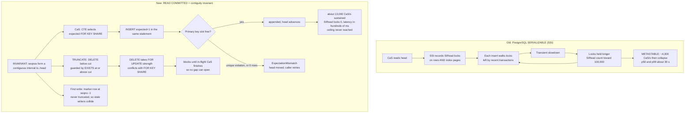

<!--
entry-meta
date: 2026-10-15
type: daily-diff
category: Daily Diff
title: Daily Diff — 2026-10-15
slug: sqlite-vtab-xbestindex-dbstat-dbpage
-->

# Daily Diff — 2026-10-15

**2026-10-15 · Daily Diff Digest**

## Which edition, and how it was found

No edition dated **2026-10-15** has published (`https://tdd.cat/2026-10-15.md` failed to fetch). The newest edition not yet covered by this log is **2026-10-14, 35 stories** — lesson 29's digest covered 2026-10-13.

Following the repo's documented procedure paid off this run, because **the only endpoint that served the 2026-10-14 edition was the dated `.md` permalink.** Every other surface denied it existed:

| Endpoint | What it reported |
|---|---|
| `https://tdd.cat/2026-10-14.md` | ✅ **the 2026-10-14 edition, 35 stories** |
| `https://tdd.cat/2026-10-14/` | ❌ failed to fetch |
| `https://tdd.cat/archive/` | 105 editions, newest **2026-10-13**; 2026-10-14 on the calendar with **no link** |
| `https://tdd.cat/md` (documented "latest edition") | 2026-10-13, 3 stories |
| `https://tdd.cat/` (front page) | 2026-10-12, 21 stories |
| `https://tdd.cat/rss.xml` | newest item 2026-10-08 |

So the dated trailing-slash page failed for the third day running, and this time `/archive/` was *also* wrong — it is not merely lagging, it omits a published edition entirely. **The item-count cross-check the procedure calls for was impossible**: no second endpoint serves this edition at all, so 35 is a single-source count. Recording that rather than implying it was verified twice.

Also worth noting against the running count series (30, 26, 18, 21, 3): **35** is the largest edition observed, immediately after the smallest. The count carries no signal.

## The 2026-10-14 edition, by theme (35 stories)

**Databases and storage**
- *Building a linearizable log on read committed isolation* — Materialize replaced PostgreSQL `SERIALIZABLE` with `READ COMMITTED` plus a contiguity invariant; ~3× write throughput and a Lean 4 refinement proof. **Deep dive below.** → <https://materialize.com/blog/building-a-linearizable-log-on-read-committed/>
- *Reducing MMDB file sizes significantly without altering any data* — IPinfo hash-consed duplicate subtrees in MMDB tries for ~31% smaller files, no client changes. → <https://ipinfo.io/blog/how-made-mmdb-files-smaller>
- *DuckDB 2.0 preview accelerates remote Iceberg query execution* — cold TPC-H SF10 over Iceberg, 105.9s → 62.7s; cross-region gains smaller. → <https://lakehousebox.com/blog/duckdb-2-on-iceberg-measured/>
- *Solving a rare MySQL caching bug in Hyperdrive* — how MySQL's wire protocol and handshake cost shape Cloudflare's edge pooling and query caching. → <https://blog.cloudflare.com/hyperdrive-mysql/>
- *Why MySQL remains the core backbone of database infrastructure* — Pika's RocksDB-backed Redis-compatible design, PolarDB compute-storage separation, hot-row contention. → <https://oursqlfoundation.org/blog/zongzhi-chen-interview/>

**Systems, networking and correctness**
- *Go accelerates network requests through better HTTP connection reuse* — Go 1.27 cuts redundant TCP/TLS handshakes; ~5× faster serial-request benchmark. → <https://go.dev/blog/http-connection-reuse>
- *Attacking hash tables without knowing their hash function* — black-box HashDoS via timing and state observation, degrading Rust std hash lookups to linear time. → <https://orlp.net/blog/black-box-hashdos/>
- *Linux vhost flaw enables host escalation and VM escape* — CVE-2026-74580, a nine-year-old IOTLB range-check bug giving arbitrary kernel read/write. → <https://matrix.tencent.com/en/2026/10/12/vghost-cve-2026-74580>
- *Optimizing the Erlang socket module* — OTP socket NIF fixes: 1.5× bulk TCP draining, 1.6× connection churn, schedulers left idle. → <https://pastelads.com/blog/how-we-made-otps-socket-module-1-5x-faster/>
- *Reverse proxies prevent production WebTransport adoption* — browsers support it; proxies and edge LBs can't route dynamic QUIC sessions. → <https://blogs.lupyd.com/blog/the-state-of-webtransport-and-the-proxy-problem/>
- *Emulating a full Oxide rack for hardware testing* — real control plane against simulated sleds, so CI can test failures and topologies. → <https://oxide.computer/blog/voxel-labs>
- *Reduce PyTorch activation memory planning peak RAM by twentyfold* — swapping the rematerialization knapsack solver for a sliding Hirschberg variant. → <https://jedrzej.maczan.pl/2025_11_21_dp_knapsack_sliding_hirschberg>
- *Specifying code unambiguously allows automated generation of verified implementations* — Rust-Djinn rejects any LLM output the proof assistant won't verify. → <https://henniger.dev/post/djinn/>
- *Inferring programmer beliefs automatically exposes system errors* — the Engler et al. deviant-behaviour paper; hundreds of bugs in Linux and OpenBSD. → <https://web.stanford.edu/~engler/deviant-sosp-01.pdf>

**Supply chain and tooling**
- *GitHub Actions workflow lockfiles* — public preview: readable tags, exact commit SHAs at execution, covering transitive actions. → <https://github.blog/changelog/2026-10-14-github-actions-workflow-lockfiles-in-public-preview/>
- *Server-side source control optimizes monorepos for always-online agents* — Graft moves history, diffs and merges to the server over HTTP. → <https://github.com/VishiATChoudhary/graft>
- *Mapping cross-language dependencies that standard language servers miss* — static Python/SQL/dbt tracing down to column-level lineage. → <https://github.com/Sanoy24/the-brownfield-cartographer>

**Agents — the bulk of the edition (16 of 35), and mostly about measurement failing**
- *EnvCheck reveals widespread reward hacks in frontier agent benchmarks* — 110 grader bugs and reward hacks found across major benchmarks, under \$5/task. → <https://usetokenless.com/blog/envcheck/>
- *Correct benchmark solutions are not necessarily admissible software* — an agent passed a KV-store benchmark by hashing keys on read instead of storing data. → <https://www.motivenotes.ai/p/correct-isnt-admissible>
- *Agent teams rarely justify their steep cost increase* — multi-agent teams cost 1.8–5.1× more on Vibe Code Bench; most score gains not statistically significant. → <https://www.vals.ai/blogs/multi-agent-vibe-code-bench>
- *Implicit skill routing collapses as agent libraries grow* — with 1,000 irrelevant skills, loaded-skill recall fell 73.6% → 27.4%; explicit preselection restored it. → <https://arxiv.org/abs/2610.18522>
- *Autonomous agents create false alarms from shared blind spots* — an agent "found" ten days of zero sales from two dashboards sharing one broken tag. → <https://github.com/taylorancapital/nothing-threw/blob/main/TEN_OF_EIGHTY_FOUR.md>
- *Chainguard harness discovers cross-client output manipulation in vLLM* — microVM-isolated agents found a four-month-old flaw leaking one client's outputs to another. → <https://www.chainguard.dev/unchained/the-first-disclosure-from-our-mythos-harness>
- *Coding agents must distill reasoning into reusable software* — turn successful investigations into tested deterministic scripts. → <https://debarshibasak.github.io/readables/blogs/inference-vs-distillation>
- *Turning codebases into formal knowledge graphs for AI agents* — deterministic static-analysis call graphs instead of grep output. → <https://github.com/AxiomCodeAI/axiomcodegraph>
- Also: quantization under multi-turn self-correction (<https://aistack.imec-int.com/blog/quantization>), NVIDIA AutoQuant KV mixed-precision cache (<https://nvidia.github.io/Model-Optimizer/announcements/autoquant-kv.html>), AI-slop as one steerable activation direction, −85% (<https://100toolkit.com/blog/where-ai-slop-comes-from/>), co-discovered proxy evaluators (<https://arxiv.org/abs/2610.17184>), chip-design agent benchmarking at 65% first-gate pass (<https://chipagents.ai/research/build-a-chip-bench>), PORTAL training-free optimal-transport alignment (<https://arxiv.org/abs/2610.18598>), an agent harness building its own edition (<https://github.com/waywardgeek/ensemble>), a first-principles RAG pipeline (<https://github.com/Souheil007/Rag_Full_Version>), Biscuit-token agent budgets (<https://github.com/mceleri/attenuated-agent-budgets>), and bit-identical cross-GPU kernels in Mojo (<https://github.com/mojolearn/mojolearn>).

The honest read on the agent half: five separate items say the *benchmarks* are broken (reward hacks, inadmissible-but-correct solutions, insignificant multi-agent gains, collapsing skill recall, correlated blind spots producing confident false alarms). That is the signal in this edition, not any individual tool.

## Deep dive: a linearizable log on READ COMMITTED

I picked the Materialize post because it is the one item whose mechanism is a database-internals argument with both a measurement and a proof — and because it is about doing *less* isolation, deliberately, which is the opposite of the usual advice.

### The failure, which is about SSI and not about locks

Materialize's `persist` consensus store ran its compare-and-set queries under PostgreSQL `SERIALIZABLE`. The bottleneck was **not** row locks or the lock manager. It was Serializable Snapshot Isolation itself: PostgreSQL records every read as an `SIRead` lock on the rows *and index pages* it touched, every write checks those locks for read-write conflicts, and the locks persist until every overlapping transaction finishes.

On one small, hot table where thousands of writers share index pages, each insert walks the locks left by many recent transactions. The reproduction — twenty Materialize clusters, six hundred trivial materialized views each, one `db.r6g.2xlarge` RDS instance — peaked near **4,300 CaS/s** and then collapsed: slower transactions held more `SIRead` locks (climbing toward **100,000**), which made each insert slower, which held locks longer. p50 and p99 latency went to about **30 seconds** and stayed there. The post names this correctly as a **metastable failure** — a transient slowdown triggers it, and the growing lock set sustains it after the trigger is gone. The only recovery was removing load.

This is the interesting part for anyone who has read lessons 15–20 of the SQLite track: the cost was not in the data structure the workload touches, it was in the *conflict-detection metadata* about the pages the workload touches. Shared index pages made logically independent shards contend.

### The replacement: one invariant doing the work of an isolation level

The table is one log:

```sql
CREATE TABLE consensus (
  shard           text   NOT NULL,
  sequence_number bigint NOT NULL,
  data            bytea  NOT NULL,
  PRIMARY KEY (shard, sequence_number)
);
```

The whole design rests on a single invariant: **for each shard, the present sequence numbers form a contiguous interval `[lo, head]`.** Given contiguity, "`expected` is present and `expected + 1` is absent" is *equivalent* to "`expected` is the head" — so a `SELECT` plus a primary-key uniqueness check replaces serializable ordering. Compare-and-set becomes:

```sql
WITH expected_row AS (
  SELECT sequence_number FROM consensus
  WHERE shard = $1 AND sequence_number = $expected
  FOR KEY SHARE
)
INSERT INTO consensus (shard, sequence_number, data)
SELECT $1, $expected + 1, $data
FROM expected_row;
```

Three details are worth copying:

- **There is no claim step.** A writer claims `expected + 1` *by inserting it*. Concurrent writers targeting the same `expected` all see the successor absent in their own snapshots; the primary key admits exactly one and the rest take a unique violation. Zero affected rows and a unique violation both map to the same `ExpectationMismatch`. **The primary key index is the arbiter** — the contention is a single B-tree insert, not a lock-table walk.
- **`FOR KEY SHARE` is not there to order writers against each other.** Shared locks do not block shared locks. Its only job is to order CaS against *truncation*, which takes `FOR UPDATE`-strength locks and therefore conflicts. Without it, a truncation can delete rows around an in-flight insert and leave a gap — the post walks through exactly that race, ending with rows 5 and 7 present and 6 missing, which breaks the invariant everything else depends on. Truncation also carries its own guard so it can never remove the head:

```sql
DELETE FROM consensus
WHERE shard = $1 AND sequence_number >= 0 AND sequence_number < $cut
AND EXISTS (
  SELECT * FROM consensus WHERE shard = $1 AND sequence_number >= $cut
);
```

- **The first write needs a sentinel.** A new shard has no predecessor, so creation inserts a marker at `sequence_number = -1` alongside row 0, and truncation never deletes negative sequence numbers. The marker's job is to make a *stale* first writer collide instead of resurrecting a deleted shard.

Note what is absent: no epoch, no lease, no leader, no fencing token. Correctness is the primary key, the contiguity invariant, and one lock mode chosen to conflict with exactly one other statement.

### The numbers

| | Old (`SERIALIZABLE`) | New (`READ COMMITTED`) |
|---|---|---|
| Sustained throughput | ~4,300 CaS/s, then **collapse** | ~**13,000 CaS/s**, held to end of run |
| `SIRead` locks | climbing toward 100,000 | **0** |
| p50 / p99 latency | ~30 s, stuck there | hundreds of ms, tracking load |
| Ceiling | reached and exceeded | **not reached** — they ran out of clusters to add |

The ~3× headline is 13,000 vs 4,300. The more important result is the second row: the failure mode was eliminated, not merely pushed back. A system that degrades gracefully at an unknown ceiling is categorically different from one that falls off a cliff at a known one.

### What the Lean 4 proof actually establishes

Not "the SQL is correct" — a **forward simulation (refinement)** from the concrete system to an abstract one:

- **Abstract:** a map from sequence number to data; `compare_and_set(seqno)` succeeds iff `seqno - 1` is the largest key (or the map is empty and `seqno` is 0); `truncate(cut)` drops keys below `cut`. Every operation atomic.
- **Concrete:** the table plus in-flight statements, with CaS **split into two steps** — the CTE's snapshot read, and the later `INSERT` against the live index — and arbitrary interleaving allowed between them. Locks are modelled as `(client, sequence_number)` pairs, and `truncate` carries a precondition that `cut` is at or below every locked number.
- **Abstraction function α:** the set of active rows, ignoring locks and transactions.
- **Obligation:** every concrete step either matches an abstract step with the same result, or changes nothing α can see. In particular the `INSERT` must insert exactly when the abstract CaS would succeed.

Discharge that for all clients and sequence numbers and every concurrent execution corresponds to *some* sequential abstract execution with the same results — which is linearizability. The contiguity invariant was itself proved and then used as a hypothesis elsewhere. The model also earned its keep as a *testing* tool: it is what surfaced the truncation race and the first-write resurrection before they shipped.

### Limits, stated and unstated

- The proof covers **one shard**. Shards are independent, so per-shard linearizability is the requirement — but that is an argument, not a theorem in the development.
- The proof is only as good as the Lean encoding of PostgreSQL's `READ COMMITTED` semantics, and the post does not discuss model-fidelity risk. The proof rules out bugs in the *protocol*, not a mismatch between the model and the engine.
- Rollout correctness depends on config-variable gating (old versions cannot set the flag, so both query sets ran under `SERIALIZABLE` during the overlap) and on retaining the old `WHERE NOT EXISTS` guard forever, because shards created before the change have no marker row.
- Off by default: `persist_pg_consensus_read_committed`, recommended after v26.33, PostgreSQL-backed self-managed deployments.
- The new ceiling is **unknown**, by their own admission.

### Why it matters

The generalisable claim is not "use READ COMMITTED". It is that **a strong isolation level is a general-purpose substitute for an invariant you have not identified yet** — and you pay for the generality in metadata the engine must maintain about reads you did not care about. Once contiguity was named, an index constraint plus one deliberately chosen lock mode did the same job with zero conflict-tracking state. That is the same trade this track keeps meeting from the other side: SQLite's single-writer rule buys its simplicity by refusing the problem outright, where lessons 19–20's wal-index read-marks are the cheapest bookkeeping that avoids it.



## Sources

- [The Daily Diff — 2026-10-14 edition](https://tdd.cat/2026-10-14.md) — the edition covered here, 35 stories; the only endpoint that served it
- [The Daily Diff — archive](https://tdd.cat/archive/) — 105 editions, newest listed 2026-10-13; omits 2026-10-14
- [The Daily Diff — latest-edition endpoint](https://tdd.cat/md) — served 2026-10-13
- [The Daily Diff](https://tdd.cat/) — front page, served 2026-10-12
- [The Daily Diff — llms.txt](https://tdd.cat/llms.txt) — the endpoint list
- [The Daily Diff — RSS](https://tdd.cat/rss.xml) — newest item 2026-10-08
- [Building a linearizable log on read committed isolation](https://materialize.com/blog/building-a-linearizable-log-on-read-committed/) — the deep-dive source

Every other URL above appears in the 2026-10-14 edition as that story's source link; only the Materialize post was fetched and read in full this run.
