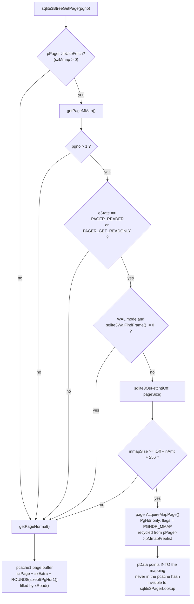
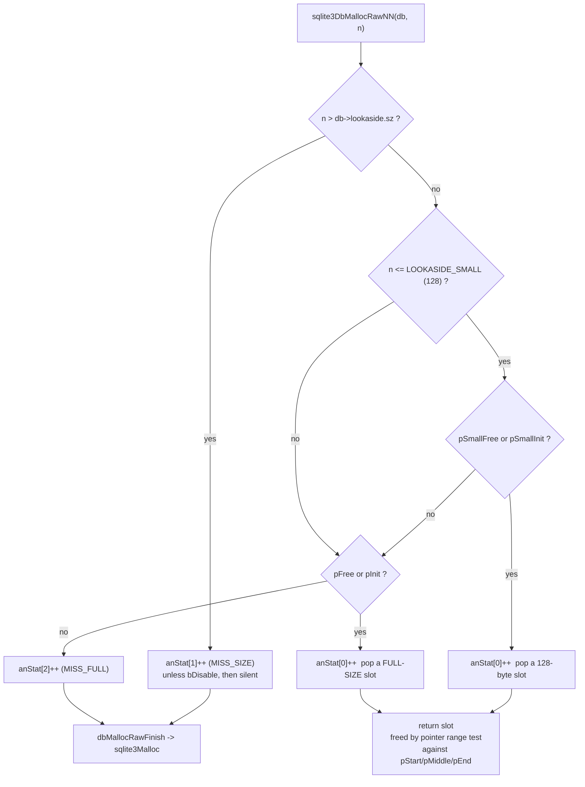

<!--
entry-meta
date: 2026-10-16
type: lesson
track: SQLite
lesson: 31
category: Database Internals
title: Memory-Mapped I/O and the Allocator Stack — A Mapping That Is Always 256 Bytes Too Short, a Page Cache That Costs 4368 Bytes Per 4096-Byte Page, and a Lookaside Buffer That Hands Out 123 Slots When You Asked For 40
slug: sqlite-mmap-memory-allocation-lookaside
-->

# Memory-Mapped I/O and the Allocator Stack — A Mapping That Is Always 256 Bytes Too Short, a Page Cache That Costs 4368 Bytes Per 4096-Byte Page, and a Lookaside Buffer That Hands Out 123 Slots When You Asked For 40

**2026-10-16 · SQLite Track · Lesson 31 of 33**

## Where This Fits

- **Lesson 30** ([virtual tables and `xBestIndex`](../2026-10-15-sqlite-vtab-xbestindex-dbstat-dbpage/README.md)) ended on `allocateIndexInfo`'s single malloc carved into four arrays plus a `HiddenIndexInfo` struct tucked in behind it, and handed that here as a sibling of the lookaside question. §9 answers it: that allocation is a `sqlite3DbMallocRaw`, so whether it is one malloc or five is only half the story — the other half is which of the two free lists it comes off, and whether 1200 bytes is wide enough to hold it.
- **Lesson 28** ([the VDBE sorter](../2026-10-13-sqlite-vdbe-sorter-external-merge/README.md)) left one explicitly unresolved item: `vdbeSorterOpenTempFile` sets `SQLITE_FCNTL_MMAP_SIZE` to `SQLITE_MAX_MMAP_SIZE` on every PMA temp file, yet 8 `xFetch` calls produced 0 mappings and the reason was not established. **§6 closes it, and the answer is not the one lesson 28 guessed.** The unix VFS did not decline anything; it built the mapping exactly as asked. The fetch failed on arithmetic, by 250 bytes, and it will fail that way on every PMA file SQLite will ever write.
- **Lesson 14** established `PgHdr`, `pcache.c`/`pcache1.c` and the dirty list; **lesson 15** established the pager state machine. Both are load-bearing here: §4 is about a page object that is *not* in the page cache and is not reachable by `sqlite3PagerLookup`, and the condition that decides whether you get one is a pager state. **Lesson 29**'s memjournal `FileChunk` chain and **lesson 28**'s `list.aMemory` bulk buffer reappear in §7 as the second and third large consumers of the general allocator.
- **This lesson adds** the full clamp chain from `PRAGMA mmap_size` down to `mmap(2)`; the 256-byte end-of-file buffer in `unixFetch` and the exact page it makes unmappable in every database; `getPageMMap`'s five conditions, measured one at a time; the three allocator backends and what memsys5 actually costs; `pcache1`'s per-page overhead and its bulk allocation; the soft heap limit's real mechanism (which is not `sqlite3_release_memory`); and `setupLookaside`'s three-branch slot arithmetic, predicted in closed form and then matched exactly at six configurations.
- **It sets up lesson 32** (`PRAGMA integrity_check` and the test strategy), which inherits the overread hazard that the 256-byte buffer exists to contain, and **lesson 33** (`VACUUM`), which inherits the fact that a mapped file cannot be shrunk on some platforms and that `VACUUM`'s index rebuild runs the sorter path once per index.

All source references are to the **SQLite 3.53.4** amalgamation vendored in `better-sqlite3@13.0.3` at `deps/sqlite3/sqlite3.c`, the same file lessons 27–30 used, so line numbers are comparable across five lessons. Build: gcc 13.3.0 `-O2`, `-DSQLITE_THREADSAFE=0`, 2-core Linux container, system page size 4096. Test database unless stated: `t(a INTEGER PRIMARY KEY, b TEXT, c INTEGER)` with 200,000 rows and an index `tc ON t(c)`, `page_size=4096`, **3,836 pages / 15,712,256 bytes**. Everything marked *measured* came from binaries built from that file this run; the harnesses are in §Hands-On.

---

## 1. Three Places a Byte Can Live

A connection reading a row touches memory from three different suppliers, and almost every tuning knob in this lesson picks between them:

| Region | Who allocates it | Who owns the bytes | Counted by `sqlite3_memory_used()`? |
|---|---|---|---|
| The **mmap region** | `mmap(2)`, via `unixRemapfile` | the kernel; SQLite holds a read-only pointer into the page cache of the OS | **no** |
| The **page cache** | `pcache1Alloc` → `sqlite3Malloc` (or a fixed-slot pool) | SQLite; one buffer per resident page | yes |
| **Lookaside + general heap** | `sqlite3DbMallocRawNN` → lookaside slot, else `sqlite3Malloc` | SQLite; parse trees, VDBE programs, `Mem` cells, cursors | yes (the lookaside *buffer* once, not each slot) |

The first is the only one that is free in the accounting sense, and §3–§5 are about how narrow the conditions are for getting it.



---

## 2. The Clamp Chain: Four Knobs That Can Only Lower Each Other

`PRAGMA mmap_size=N` is the top of a chain in which every link can reduce the value and none can raise it.

| Step | Code | Effect |
|---|---|---|
| Compile-time ceiling | `SQLITE_MAX_MMAP_SIZE`, sqlite3.c:16131–16142 | `0x7fff0000` (2,147,418,112) on Linux, Windows, macOS, Solaris, FreeBSD, DragonFly; **0** everywhere else, and forced to 0 on OpenBSD and QNX at 16120–16123 |
| Compile-time default | `SQLITE_DEFAULT_MMAP_SIZE`, 16147–16155 | **0**, and then clamped down to `SQLITE_MAX_MMAP_SIZE` if someone set it higher |
| Start-time | `sqlite3_config(SQLITE_CONFIG_MMAP_SIZE, szMmap, mxMmap)` | sets `sqlite3GlobalConfig.szMmap` / `.mxMmap`; the defaults at 24111 are the two macros above |
| Per connection | `db->szMmap`, seeded from `sqlite3GlobalConfig.szMmap` at 190844 | `PRAGMA mmap_size` writes it; `sqlite3BtreeSetMmapLimit` (75911, 76251) pushes it into the pager |
| Per pager | `sqlite3PagerSetMmapLimit` → `pagerFixMaplimit` (63215) | sets `pPager->bUseFetch = (sz>0)`, calls `setGetterMethod`, and issues `SQLITE_FCNTL_MMAP_SIZE` |
| Per file | `unixFileControl` case `SQLITE_FCNTL_MMAP_SIZE` (44426) | `if( newLimit > sqlite3GlobalConfig.mxMmap ) newLimit = sqlite3GlobalConfig.mxMmap;` then stores `pFile->mmapSizeMax` |
| Per `mmap()` | `unixMapfile` (45875) | `nMap = fstat().st_size; if( nMap > mmapSizeMax ) nMap = mmapSizeMax;` |

Two consequences worth stating plainly:

- **`bUseFetch` is a function pointer swap, not a branch.** `pagerFixMaplimit` calls `setGetterMethod`, which installs `getPageMMap` as `pPager->xGet` (60685). Turning mmap off at run time restores `getPageNormal`. There is no per-page test of `mmap_size`.
- **The mapping is a prefix of the file, not a cache of hot pages.** `unixMapfile` always maps from offset 0 and always `min(file size, mmapSizeMax)` bytes. A 15.7 MB database with `mmap_size=4194304` gets its first 4 MB mapped and nothing else — and if your hot pages are the index at the tail of the file, you get **nothing at all**. *Measured* on an index-only scan touching 581 pages:

| `mmap_size` | `xFetch` calls | mapped | `xRead` calls |
|---|---|---|---|
| 0 | 0 | 0 | 582 |
| 262,144 | 581 | **0** | 582 |
| 1,048,576 | 581 | **0** | 582 |
| 4,194,304 | 581 | **0** | 582 |
| 20,971,520 | 581 | **580** | **2** |

All 581 pages of the index `tc` live past the 4 MB mark, so three of the four non-zero settings bought exactly nothing while still paying for 581 failed `xFetch` round trips. There is no partial credit and no warning.

---

## 3. The 256-Byte End-of-File Buffer, and the Page No Database Can Map

`unixFetch` (45912) will not hand back a pointer unless there is slack past the end of the request:

```c
/* Ensure that there is always at least a 256 byte buffer of addressable
** memory following the returned page. If the database is corrupt,
** SQLite may overread the page slightly (in practice only a few bytes,
** but 256 is safe, round, number).  */
const int nEofBuffer = 256;
if( pFd->pMapRegion==0 ){
  int rc = unixMapfile(pFd, -1);
  if( rc!=SQLITE_OK ) return rc;
}
if( pFd->mmapSize >= (iOff+nAmt+nEofBuffer) ){
  *pp = &((u8 *)pFd->pMapRegion)[iOff];
  pFd->nFetchOut++;
}
```

The mapping can never be longer than the file, so for the **last page** of any database the test is `fileSize >= fileSize + 256`, which is false. **The final page of every SQLite database is unmappable at every `mmap_size`.** That is the single failure in the 580/581 row above: `read=2` at `mmap_size=20971520` is page 1 (§4) plus page 3,836.

The boundary is predictable to the byte, and *measured* to the byte. Page *P* is mappable iff `min(fileSize, mmap_size) >= (P-1)·4096 + 4096 + 256`:

| `mmap_size` | predicted highest mappable page | mapped / 581 |
|---|---|---|
| 15,708,160 | 3,834 (3,835 needs 15,708,416) | **579** |
| 15,708,416 | 3,835 | **580** |
| 15,712,256 (= file size) | 3,835 | **580** |

256 bytes of `mmap_size` moved exactly one page across the line, on the first try, in both directions. Note what the comment is admitting: this buffer exists so that a *corrupt* page that makes the b-tree layer run off the end of a cell does not run off the end of the mapping and take a `SIGSEGV`. Hand that to lesson 32 — it is the same overread that `PRAGMA integrity_check` is looking for, except that on the read path there is no checker, only 256 bytes of padding.

---

## 4. `getPageMMap`: Five Conditions, Measured One at a Time

```c
const int bMmapOk = (pgno>1
 && (pPager->eState==PAGER_READER || (flags & PAGER_GET_READONLY))
);
```

Plus the WAL test and the fetch test that follow it (65323–65386). Taking them in order, each verified against the counting VFS shim:

**(a) Page 1 is never mapped.** The `pgno>1` term is unconditional, and `sqlite3PagerSharedLock`'s `assert( pPager->nMmapOut==0 ); /* because page1 is never memory mapped */` at 65155 depends on it. Page 1 holds the file header the pager rereads on every lock acquisition, and it is the page most likely to be written. *Measured:* with `mmap_size=256MB` an index-only scan did exactly **2** `xRead` calls — page 1, and the unmappable last page.

**(b) A read inside a write transaction still gets mapped pages.** The `eState==PAGER_READER` term looks like "no mmap during writes", but `PAGER_GET_READONLY` is passed for every read-only cursor, so it survives. *Measured*, `journal_mode=delete`, `mmap_size=256MB`:

| statement | `xRead` | `xFetch` | mapped |
|---|---|---|---|
| `SELECT sum(c) FROM t` | 2 | 581 | 580 |
| `BEGIN IMMEDIATE; SELECT sum(c) FROM t; COMMIT` | 1 | 581 | **580** |
| `UPDATE t SET c=c+1 WHERE a<=200` | 192 | **0** | 0 |
| `SELECT sum(c) FROM t` (after) | 1 | 581 | 580 |

So the rule is not "a write transaction disables mmap" — it is **"a page you intend to write is never a mapped page."** The `UPDATE` issued zero `xFetch` calls: every page it touched came through `getPageNormal` into the page cache, was journalled (186 `xWrite` to the db, 560 to `-journal`), and was written back with `xWrite`. The mapping is `PROT_READ` only (`unixRemapfile`, 45791, with `PROT_WRITE` added solely under the non-default `SQLITE_MMAP_READWRITE`), so this is enforced by the MMU as well as by the state test.

**(c) In WAL mode, a page that lives in the WAL is not mapped.** `getPageMMap` calls `sqlite3WalFindFrame` *before* `sqlite3OsFetch` and falls through to `getPageNormal` whenever `iFrame!=0`. *Measured*, same database in `journal_mode=wal`, same `UPDATE` of 200 rows:

| statement | `xFetch` | mapped |
|---|---|---|
| `SELECT sum(c) FROM t` (before) | 581 | 580 |
| `SELECT sum(c) FROM t` (after the UPDATE) | **399** | **398** |

182 of the 581 pages had moved into the WAL and were served from the page cache instead. **In a write-heavy WAL database, the fraction of your working set that mmap can serve decays with every uncheckpointed commit and is restored by checkpointing** — the mapping covers the main file only, which is lesson 20's checkpoint arithmetic reappearing as a memory-residency question.

**(d) A mapped page is a `PgHdr` and nothing else.** `pagerAcquireMapPage` (63752) allocates `sizeof(PgHdr) + pPager->nExtra` — no page buffer — sets `flags = PGHDR_MMAP`, points `pData` into the mapping, and bumps `nMmapOut`. On release the header is not freed; it goes on `pPager->pMmapFreelist` and the next mapped page reuses it after a `memset(p->pExtra, 0, 8)`. These objects are **not inserted into the pcache hash**, so `sqlite3PagerLookup` cannot find them; `getPageMMap` only consults the pcache at all when `eState > PAGER_READER || tempFile`, to avoid handing out two references to one page.

That is where the memory saving comes from, and it is large. *Measured*, identical index-only scan, `cache_size=-2000`:

| | `mmap_size=0` | `mmap_size=20971520` |
|---|---|---|
| `sqlite3_memory_used()` after the scan | **2,166,280** | **146,864** |
| heap growth during the scan | 2,020,072 | **656** |
| `SQLITE_DBSTATUS_CACHE_USED` | 2,103,096 | **14,136** |
| `SQLITE_DBSTATUS_CACHE_MISS` | 582 | **2** |
| `xRead` | 582 (2,379,792 B) | 2 (4,112 B) |

**14.8× less heap for the same query**, and `CACHE_MISS` — which counts page-cache misses that went to disk — drops to 2 because 580 of the 582 pages never entered the page cache at all. The 656-byte heap growth is the handful of `PgHdr` objects cycling through `pMmapFreelist`.

**(e) The wall-clock win is the small part.** Best-of-seven, same container, file resident in the host page cache: **6.4 ms → 5.6 ms** (1.14×) at `cache_size=-2000`, and **6.0 ms → 5.7 ms** at `cache_size=-10`. What is being removed is a `memcpy` from the kernel's page cache into SQLite's, not a disk read — the disk read was not happening. Do not quote 1.14× as "what mmap is worth"; quote the 14.8× memory figure, which is reproducible, and expect the time figure to grow only when the alternative is real I/O.

---

## 5. What `mmap_size` Does Not Buy

- **Nothing for writes.** Every modification is made in heap memory and goes out through `xWrite`. sqlite.org/mmap.html states this directly; §4(b) measures it as `xFetch=0` for an `UPDATE`.
- **Nothing you can revoke safely.** `unixUnfetch(fd, iOff, 0)` calls `unixUnmapfile`, and `unixMapfile` is a no-op while `nFetchOut>0`. A cursor holding a mapped page pins the whole mapping.
- **No error channel.** An I/O error on a mapped page is a signal, not a return code. SQLite cannot catch it; the process dies. The counterpart on the `xRead` path is `SQLITE_IOERR_READ`, which the pager handles.
- **One failure disables it permanently for that file.** If `mmap()` fails, `unixRemapfile` logs and sets `pFd->mmapSizeMax = 0` (45853), on the assumption that subsequent attempts will also fail. There is no retry and no way to observe this short of noticing that `xFetch` stopped mapping.

---

## 6. Closing Lesson 28's Handoff: Sorter mmap Is Unreachable, and Not for the Reason We Guessed

Lesson 28 observed `xFetch` calls on PMA temp files with zero mappings and listed three candidate causes: the `mxMmap`/`szMmap` clamp in `unixFileControl`, a zero-length map at extend time, or the `DELETEONCLOSE` locking style. **All three are wrong.** There are two findings, and they stack.

### 6.1 The sorter's mmap path is compiled out by default

`db->nMaxSorterMmap` is set to `0x7FFFFFFF` at 190852 — but only inside `#ifdef SQLITE_ENABLE_SORTER_MMAP`, which is **not defined** in this amalgamation. The `sqlite3` struct is zeroed at open, so the field is 0, and both call sites gate on it:

```c
/* vdbeSorterMapFile, 107150 */
if( pFile->iEof<=(i64)(pTask->pSorter->db->nMaxSorterMmap) ){ ... sqlite3OsFetch(...) }
/* vdbeSorterExtendFile, 107838 */
if( nByte<=(i64)(db->nMaxSorterMmap) && pFd->pMethods->iVersion>=3 ){ ... }
```

`iEof` and `nByte` are positive for any real PMA, so with `nMaxSorterMmap==0` **no `sqlite3OsFetch` is ever issued from vdbesort.c**. The comment at 190846 says so: "Beginning with version 3.37.0, using the VFS xFetch() API to memory-map the temporary files used to do external sorts (see code in vdbesort.c) is disabled."

*Measured*, 200,000-row `ORDER BY b` spilling 11,088,919 bytes across 8 PMAs, `cache_size=-2000`, `threads=0`:

| build | `SQLITE_TESTCTRL_SORTER_MMAP` | temp-file `xFetch` | mapped | best-of-5 |
|---|---|---|---|---|
| default | not called | **0** | 0 | 46.5 ms |
| default | `0x7FFFFFFF` | 16 | **0** | — |
| `-DSQLITE_ENABLE_SORTER_MMAP` | not called | 16 | **0** | 47.0 ms |
| `-DSQLITE_ENABLE_SORTER_MMAP` | `0` | **0** | 0 | — |

46.5 ms is byte-for-byte lesson 28's number on the same database, and the two builds are indistinguishable — consistent with the map never having happened in either.

### 6.2 Even when enabled, it cannot succeed — it misses by 250 bytes

The 16 fetches that *do* occur when the feature is enabled still map nothing. Instrumenting `unixFetch` to print its inputs (a 12-line patch, in §Hands-On) gives the whole story:

```
FETCH (temp) iOff=0 nAmt=1553323  need=1553579  mmapSize=1553323  mmapSizeMax=2147418112 st_size=1556480  -> null
FETCH (temp) iOff=0 nAmt=3117746  need=3118002  mmapSize=3117746  mmapSizeMax=2147418112 st_size=3121152  -> null
...
FETCH (temp) iOff=0 nAmt=11088925 need=11089181 mmapSize=11088925 mmapSizeMax=2147418112 st_size=11091968 -> null
FETCH (temp) iOff=0 nAmt=11088919 need=11089175 mmapSize=11088925 mmapSizeMax=2147418112 st_size=11091968 -> null   (x8)
```

Read that line by line:

- `mmapSizeMax = 2,147,418,112` = `SQLITE_MAX_MMAP_SIZE`. **The `FCNTL_MMAP_SIZE` hint was accepted in full; the clamp lesson 28 suspected did not fire.**
- `mmapSize = nAmt` on every call. The mapping exists and is exactly as long as the request, because `SQLITE_FCNTL_SIZE_HINT` (44292–44303) calls `unixMapfile(pFile, nByte)` with the hinted size. **The VFS did not decline anything.**
- `need = nAmt + 256` is therefore always 256 greater than `mmapSize`. Never satisfiable.
- The first 8 lines are `vdbeSorterExtendFile` growing the file ahead of each PMA; the last 8 are `vdbeSorterMapFile` called once per `vdbePmaReaderSeek`, all asking for `iEof = 11,088,919` bytes at offset 0.
- `st_size = 11,091,968` is larger than `mmapSize` because `SQLITE_FCNTL_CHUNK_SIZE=4096` rounds the *file* up, but `unixMapfile` was given the un-rounded hint, so the mapping did not follow.

The structural statement: **`vdbeSorterMapFile` asks for the entire file at offset 0, and `unixFetch` refuses any request that reaches within 256 bytes of the end of the mapping.** The only slack the sorter ever creates is `vdbeSorterExtendFile(db, pTask->file.pFd, pTask->file.iEof + pList->szPMA + 9)` at 108132 — **9 bytes**. On the final seek the gap was `11,089,175 − 11,088,925 = 250` bytes. For this to ever succeed the preallocation would have to overshoot the final content by ≥256 bytes, and nothing in vdbesort.c arranges that.

**Conclusion, stated at the strength the evidence supports:** on the unix VFS in 3.53.4, sorter mmap is off by default, and turning it on by either documented route produces failed fetches rather than mappings, for an arithmetic reason that no configuration exposed through the API can change. I did not test other VFSes, and I did not bisect which release introduced the mismatch; a VFS whose `xFetch` has no end-of-file buffer would behave differently.

---

## 7. The Allocator Stack

Every `sqlite3_malloc` goes through `mallocWithAlarm` (one indirection away from the backend) and then into one of these:

| Backend | Enabled by | Behaviour |
|---|---|---|
| **memsys1** | default | the C library's `malloc`/`realloc`/`free`. `sqlite3MemSize` uses `malloc_usable_size()` on Linux (28003), so SQLite's accounting counts what glibc actually reserved, not what was asked for |
| **memsys2** | `SQLITE_MEMDEBUG` | ~100 bytes of sentinel per allocation, junk fill, backtraces. Testing only |
| **memsys3** | `SQLITE_ENABLE_MEMSYS3` | deprecated; auto-disabled if memsys5 is also defined (21775–21779) |
| **memsys5** | `SQLITE_ENABLE_MEMSYS5` + `sqlite3_config(SQLITE_CONFIG_HEAP, pBuf, n, mnReq)` | buddy allocator over a caller-supplied buffer; every request rounded **up to a power of two**; no `malloc` ever called |
| none | `SQLITE_ZERO_MALLOC` | the application must install one |

### memsys5 costs 1.8× the memory, and page_size=4096 is the worst case

*Measured*, identical index-only scan with `cache_size=-2000`, 32 MB static heap:

| allocator | `SQLITE_STATUS_MEMORY_USED` | allocations | largest single allocation |
|---|---|---|---|
| system malloc | **2,165,680** | 513 | 87,360 |
| memsys5, `mnReq=32` | **3,917,376** (1.81×) | 503 | 87,360 |
| memsys5, `mnReq=512` | 3,936,768 | 503 | 87,360 |
| memsys5, `mnReq=4096` | 4,104,192 | 503 | 87,360 |

The 1.81× is not fragmentation — memsys5 has a Robson bound against that. It is **rounding on the one allocation size that dominates**: a cached page costs 4,368 bytes (§8), which rounds to 8,192. The arithmetic is unavoidable, because the page cache's allocation is always `page_size + 272`, and `2^k + 272` is never a power of two for any legal page size. If you need memsys5's determinism, budget roughly double, and note that raising `mnReq` from 32 to 4096 cost only a further 4.8% — the big allocations were already the problem.

### The soft heap limit works without `SQLITE_ENABLE_MEMORY_MANAGEMENT`, by a different mechanism than the docs imply

The chain is `mallocWithAlarm` → `if( nUsed >= mem0.alarmThreshold - nFull )` → `AtomicStore(&mem0.nearlyFull, 1)` → `sqlite3MallocAlarm` → `sqlite3_release_memory`. And `sqlite3_release_memory` is, verbatim:

```c
#ifdef SQLITE_ENABLE_MEMORY_MANAGEMENT
  return sqlite3PcacheReleaseMemory(n);
#else
  UNUSED_PARAMETER(n);
  return 0;
#endif
```

So in a default build the reclaim arm does nothing. The limit is nonetheless honoured, tightly, in **both** builds. *Measured*, `cache_size=-20000` (a 20 MB cache the scan never gets to fill):

| `sqlite3_soft_heap_limit64` | default build heap | `-DSQLITE_ENABLE_MEMORY_MANAGEMENT` heap | `CACHE_MISS` |
|---|---|---|---|
| unset | 2,606,576 | 2,606,496 | 582 |
| 10,000,000 | 2,606,576 | 2,606,496 | 582 |
| 2,000,000 | **2,004,064** | 1,999,616 | 582 |
| 500,000 | **503,792** | 499,344 | 582 |
| 200,000 | **202,400** | 197,952 | 582 |

Within 1.2% of the target in every case, and the two builds differ by 4,448 bytes — one page. The actual mechanism is the `nearlyFull` flag, read by `pcache1UnderMemoryPressure` (58204), which is consulted twice in `pcache1FetchStage2`: once to refuse a `createFlag==1` allocation, and once to make step 4 **recycle an LRU page instead of allocating a new one**. The page cache stops growing rather than being shrunk. `CACHE_MISS` is identical at 582 in every row, which is the tell: the same pages were read either way; only the buffers they landed in were reused. `SQLITE_ENABLE_MEMORY_MANAGEMENT` adds the ability to give memory *back*, which this workload never needed.

`sqlite3HeapNearlyFull()` has exactly one other consumer in the amalgamation — vdbesort.c:108375, the `szPMA > mnPmaSize && sqlite3HeapNearlyFull()` spill arm that lesson 28 identified and could not trigger. The soft heap limit is the knob that triggers it.

---

## 8. The Page Cache Is the Big Consumer, and It Costs 272 Bytes a Page

`pcache1Create` sets `pCache->szAlloc = szPage + szExtra + ROUND8(sizeof(PgHdr1))` (58473), and `pcache1AllocPage` lays the result out backwards: the page buffer first, then `PgHdr1`, then `pExtra` at `(u8*)p + ROUND8(sizeof(*p))`. One allocation per page, three objects inside it.

*Measured* at `page_size=4096`, by watching `sqlite3_memory_used()` across single-row point lookups:

```
after open           heap=57184      (= 9,184 base + 48,000 default lookaside)
after mmap_size=0    heap=57184
after schema read    heap=145608     (+88,424)
after cache_size     heap=145608
after 1st row        heap=145608
after 5000 rows      heap=412056     (+266,448 = 61 x 4368 exactly)
```

and then, page by page, a clean staircase of **+4,368 bytes, one `malloc` each**. So:

- **`szAlloc` = 4,368 for a 4,096-byte page: 272 bytes of overhead, 6.6%.** Your `cache_size=-2000` is a 2,048,000-byte budget that holds 468 pages, not 500.
- **The first 20 pages arrive in one 87,360-byte allocation.** `pcache1InitBulk` (57982) fires on the first fetch into an empty cache, allocating `szAlloc × sqlite3GlobalConfig.nPage` with `SQLITE_DEFAULT_PCACHE_INITSZ = 20` (15779), capped at `szAlloc × nMax`. 20 × 4,368 = 87,360, which is the `+88,424` at schema-read time (the remaining 1,064 bytes are schema objects) and the `largest single allocation` in the memsys5 table above. Pages from the bulk block carry `isBulkLocal=1` and go back on `pCache->pFree` instead of being freed, so a cache that stays under 20 pages never calls `malloc` for a page at all after the first.
- The bulk path is skipped entirely when `nMax<3`, and `pcache1.nInitPage` is forced to 0 unless `separateCache && nPage!=0 && pPage==0` (58416–58422) — i.e. configuring `SQLITE_CONFIG_PAGECACHE` turns the bulk allocation off, because the fixed-slot pool supersedes it.

Two other large consumers of the general allocator, handed forward from earlier lessons and worth naming here because neither goes through lookaside:

- **vdbesort's `list.aMemory`** (lesson 28): a single block doubled by `sqlite3Realloc`, with the record list threaded by *offset* rather than pointer precisely because the block moves.
- **memjournal's `FileChunk` chain** (lesson 29): `nChunkSize == nSpill == 64 KB` for a statement journal, so these are large allocations that will round badly under memsys5.

---

## 9. Lookaside: Ask for 40 Slots, Get 123

`sqlite3DbMallocRawNN` (32120) is the allocator for everything owned by a connection — parse trees, `Expr` nodes, `VdbeOp` arrays, `Mem` cells, cursors, `sqlite3_index_info` (lesson 30's one-malloc-for-four-arrays), and `sqlite3StackAllocRawNN` (21767, used by `wherePathSolver` at 174748) unless the build defines `SQLITE_USE_ALLOCA`. Its fast path is a pointer pop off a free list:



Note the fall-through at `U -- no --> V`: **a ≤128-byte request that finds no small slots free will consume a full-size 1200-byte slot.** Note also that when lookaside is disabled by `DisableLookaside` (`bDisable++; sz=0`, 32627) every request takes the first branch and `anStat[1]` is *not* incremented, so `MISS_SIZE` undercounts by however much ran inside a disabled region.

### The slot arithmetic, in closed form

`setupLookaside` (188162) does, in order: `sz = ROUNDDOWN8(sz)`; `if( sz <= sizeof(LookasideSlot*) ) sz = 0`; cap `sz` at 65,528; `szAlloc = sz*cnt`; then a three-branch split (`LOOKASIDE_SMALL` is 128):

| branch | condition | `nBig` | `nSm` |
|---|---|---|---|
| 1 | `sz >= 384` | `szAlloc/(384+sz)` | `(szAlloc − sz·nBig)/128` |
| 2 | `384 > sz >= 256` | `szAlloc/(128+sz)` | `(szAlloc − sz·nBig)/128` |
| 3 | `sz < 256` | `szAlloc/sz` | 0 |

*Measured* against that formula by holding prepared statements open until `MISS_FULL` starts climbing and reading the `SQLITE_DBSTATUS_LOOKASIDE_USED` high-water mark. Every configuration matched on the first try:

| `sz`,`cnt` | branch | predicted `nBig + nSm` | measured high-water |
|---|---|---|---|
| **1200, 40** (the default) | 1 | 30 + 93 = **123** | **123** |
| 1200, 100 | 1 | 75 + 234 = **309** | **309** |
| 1201, 100 | 1 (after `ROUNDDOWN8`) | 309 | **309**, buffer 120,000 B not 120,100 |
| 384, 1000 | 1 | 500 + 1500 = **2000** | **2000** |
| 256, 1000 | 2 | 666 + 668 = **1334** | **1334** |
| 248, 1000 | 3 | 1000 + 0 = **1000** | **1000** |
| 128, 500 | 3 | 500 + 0 = **500** | **500** |
| 16, 100 | 3 | 100 | **100** |
| 8, 100 | — (`sz<=8` → `sz=0`) | **0** | **0**, and no buffer allocated |

The default is `SQLITE_DEFAULT_LOOKASIDE 1200,40` (24069–24075) — **48,000 bytes, not 120,000** — because `SQLITE_OMIT_TWOSIZE_LOOKASIDE` is not defined. That is confirmed independently by the heap: `sqlite3_memory_used()` is 9,184 immediately after `sqlite3_open` with lookaside off and **57,184** with the default, a difference of exactly 48,000. `cnt` is not the number of slots and has not been since 3.31.0; it is one of two factors in a byte budget.

### What it is worth

*Measured*, 300 × prepare+finalize of a two-way self-join with `GROUP BY`, `HAVING`, `ORDER BY` and `LIMIT`:

| configuration | µs per prepare | hits | `MISS_SIZE` | steady-state heap |
|---|---|---|---|---|
| 1200, 100 | **10.4** | 35,747 | 600 (2 per prepare) | 217,616 |
| 128, 500 | **9.7** | 33,041 | 3,006 | 161,616 |
| off (0, 0) | **13.6** | 0 | 0 | 97,616 |

**1.31× faster prepares**, in the same ballpark as the 10–15% sqlite.org/malloc.html quotes for a mixed workload — prepare is the lookaside-heaviest thing a connection does, so treat 1.31× as an upper bound, not a typical figure. The memory is prepaid, not saved: the steady-state heap difference between the first and last rows is exactly the 120,000-byte buffer. And the 128/500 row is a useful counterexample to "bigger slots are better": 64,000 bytes of 128-byte slots beat 120,000 bytes of 1200-byte slots on this statement, because most of what a parser allocates is small.

Finally, the ceiling is hard. Holding 400 statements open against the 1200/100 configuration gave `used=307`, `high-water=309`, and **42,818 `MISS_FULL` events** — once the 309 slots are gone every subsequent allocation goes to `malloc` with an extra branch in front of it, and `sqlite3_db_config(SQLITE_DBCONFIG_LOOKASIDE, ...)` returns `SQLITE_BUSY` rather than letting you resize it while allocations are outstanding (`setupLookaside`'s first test). Lookaside is sized for *one statement at a time*, and an application that keeps a large prepared-statement cache open is running without it.

---

## Hands-On

Everything below runs against the amalgamation in `better-sqlite3@13.0.3` (`npm pack better-sqlite3@13.0.3`, then `tar xzf`, then `package/deps/sqlite3/sqlite3.c`). Build once: `gcc -O2 -c sqlite3.c -o sqlite3_base.o -DSQLITE_THREADSAFE=0`.

### 1. Count `xFetch` versus `xRead` with a VFS shim

Write a VFS that wraps `sqlite3_vfs_find(0)` and counts `xRead`, `xWrite`, `xFetch` and the number of `xFetch` calls that returned a non-NULL pointer. The only subtlety is that `sqlite3_io_methods.iVersion` must be 3 or `xFetch` is never called at all:

```c
static int cFetch(sqlite3_file *f, sqlite3_int64 o, int n, void **pp){
  CntFile *p = (CntFile*)f; int rc;
  g_st[p->idx].nFetch++;
  rc = p->pReal->pMethods->xFetch(p->pReal, o, n, pp);
  if( rc==SQLITE_OK && *pp ) g_st[p->idx].nFetchOk++;
  return rc;
}
static sqlite3_io_methods g_m = { 3, cClose, cRead, /* ... */ cFetch, cUnfetch };
```

**What to look for:** the gap between `nFetch` and `nFetchOk`. A fetch that returns NULL is invisible from SQL, from `PRAGMA mmap_size` (which happily reports the value you set) and from timing. The difference between "mmap is enabled" and "mmap is working" is this one counter.

### 2. Find the last mappable page of your own database

With the shim in place, run an index-only scan at a sweep of `mmap_size` values around `fileSize − 4096 − 256`:

```sh
for m in 15707904 15708160 15708416 15712256; do ./mmapsweep big.db $m "SELECT sum(c) FROM t"; done
```

**What to look for:** one page crossing the line for every 256 bytes of `mmap_size`, and `nFetchOk` never reaching `nFetch` no matter how large you make it. Compute `floor((min(mmap_size, fileSize) − 256) / page_size)` by hand first and predict the counts; if your prediction is off, you have found something the 256-byte buffer does not explain.

### 3. Watch WAL eat your mapping

Set `journal_mode=wal` and `mmap_size=256MB`, scan, `UPDATE` a few hundred rows, scan again, and compare `nFetch` between the two scans. Then `PRAGMA wal_checkpoint(TRUNCATE)` and scan a third time.

**What to look for:** `nFetch` dropping by exactly the number of distinct pages the `UPDATE` touched, and returning to its original value after the checkpoint. This makes "the mapping covers the main file only" into a number you can watch move, and it is the measurement to run before enabling `mmap_size` on a write-heavy WAL database.

### 4. Instrument `unixFetch` to see why a fetch failed

Twelve lines, no `SQLITE_DEBUG` build needed. Add a file-scope `int sqlite3FetchTrace = 0;` immediately above `unixFetch`, and after the `if( pFd->mmapSize >= ... )` block print `iOff`, `nAmt`, `iOff+nAmt+256`, `mmapSize`, `mmapSizeMax` and `fstat().st_size`. Because the symbol has plain external linkage, a separate translation unit can `extern` it and flip it around the statement you care about.

**What to look for:** whether `mmapSizeMax` is the value you set (if not, the clamp fired) and whether `need − mmapSize` is exactly 256 or less (if so, the EOF buffer is your problem, not the VFS). Run this against a sorter spill with `-DSQLITE_ENABLE_SORTER_MMAP` to reproduce §6.2 — the gap on the last PMA seek was 250 bytes.

### 5. Derive your page-cache overhead instead of assuming it

Open read-only with `mmap_size=0` and a generous `cache_size`, then issue single-row point lookups that each miss, printing `sqlite3_memory_used()` after every one.

**What to look for:** one large step at the start (the bulk block: `20 × szAlloc`), then a constant step per page. That constant is `page_size + szExtra + ROUND8(sizeof(PgHdr1))` — 4,368 on this build — and it is what `cache_size` is actually spending. Divide your `cache_size` budget by it to get the real page count, and multiply by 2 if you are considering memsys5.

### 6. Make the lookaside slot count come out of the formula

```c
sqlite3_db_config(db, SQLITE_DBCONFIG_LOOKASIDE, 0, sz, cnt);   /* immediately after open */
/* prepare the same statement several hundred times WITHOUT finalizing */
sqlite3_db_status(db, SQLITE_DBSTATUS_LOOKASIDE_USED, &cur, &hi, 0);
sqlite3_db_status(db, SQLITE_DBSTATUS_LOOKASIDE_MISS_FULL, &d, &mfull, 0);
```

**What to look for:** `hi` equal to the three-branch formula in §9, not to `cnt`. Try `sz=256` and `sz=248` back to back — a difference of 8 bytes crosses a branch boundary and changes the slot count from 1,334 to 1,000. Try `sz=8` and watch the whole feature silently switch off. And confirm the buffer size independently: `sqlite3_memory_used()` right after the config call, minus its value with lookaside off, must equal `ROUNDDOWN8(sz) × cnt`.

### 7. Prove the soft heap limit is a growth brake, not a reclaimer

Run the same scan at several `sqlite3_soft_heap_limit64` values and record `SQLITE_STATUS_MEMORY_USED` and `SQLITE_DBSTATUS_CACHE_MISS`. Then rebuild with `-DSQLITE_ENABLE_MEMORY_MANAGEMENT` and repeat.

**What to look for:** heap tracking the limit in *both* builds, and `CACHE_MISS` identical across every row. If the limit worked by reclaiming pages, evicted pages would have to be re-read and `CACHE_MISS` would climb. It does not, because the mechanism is `pcache1UnderMemoryPressure` making step 4 of `pcache1FetchStage2` recycle an LRU buffer instead of calling `malloc`.

---

## Where This Breaks Down

- **mmap trades a catchable error for an uncatchable signal.** On the `xRead` path a bad sector is `SQLITE_IOERR_READ` and the pager unwinds. On the mmap path it is a signal delivered to a process that has no idea which page caused it. For a server that must survive bad media, `mmap_size=0` is the defensible default even though it is slower.
- **The 256-byte buffer is a mitigation, not a fix.** It bounds overread from a corrupt page at 256 bytes *past the request*, which is enough for the few bytes a malformed cell header can run on by. It is not a bounds check, and the value is documented in the source as "safe, round" rather than derived.
- **A prefix mapping is the wrong shape for most schemas.** Indexes created after their tables live at the tail of the file, which is precisely the region a sub-file-size `mmap_size` excludes. Either map the whole file or do not bother; the measurements in §2 show three settings that cost 581 failed syscalls and returned nothing.
- **mmap and WAL fight.** Every uncheckpointed frame removes a page from the mappable set. A write-heavy WAL workload gets a mapping that decays between checkpoints, which is the opposite of the steady-state behaviour the feature is sold on.
- **Lookaside is per connection and sized for one statement.** It cannot be resized while any slot is out, and an application holding hundreds of prepared statements exhausts it permanently — after which it is pure overhead: a comparison and a branch in front of every `malloc`.
- **`cnt` means bytes, not slots, and the split may change.** sqlite.org/malloc.html says the small-slot split "may change between releases". Code that sizes lookaside by reasoning about slot counts is depending on an implementation detail; code that sizes it by bytes is not.
- **memsys5 buys determinism at roughly 2× memory on SQLite's own allocation profile**, and nothing in the configuration can avoid it, because the dominant allocation is `2^k + 272` bytes.
- **The soft heap limit does not cover lookaside or the mmap region.** The former is one allocation made before the limit matters; the latter is not SQLite's memory at all. A process whose RSS is dominated by a 1 GB mapping will see `sqlite3_memory_used()` report a few hundred KB and be telling the truth.
- **The sorter mmap path is dead weight in the amalgamation.** Two gates, one test-control, one compile flag, and a hint on every temp file — all for a code path that, per §6, cannot produce a mapping on the unix VFS.

---

## Further Study

- [SQLITE_CONFIG_PAGECACHE and the fixed-slot pool](https://sqlite.org/malloc.html) — the branch of `pcache1Alloc` this lesson did not exercise, where `pcache1UnderMemoryPressure` reads `bUnderPressure` instead of `sqlite3HeapNearlyFull`.
- [PRAGMA mmap_size and its ATTACH-inheritance behaviour](https://sqlite.org/pragma.html) — setting it without a schema name makes it the default for databases attached later, which is easy to miss when auditing a connection's memory.
- [The Robson bound discussion in the malloc notes](https://sqlite.org/malloc.html) — `N = M·(1 + log2(n)/2) − n + 1`, and why keeping the largest allocation under 2–4 KB puts the pool requirement at 2–2.5× peak usage. This is the reasoning behind the `(64,64)` and `(32,32)` lookaside examples for memory-constrained builds.
- [The mmap limitations list](https://sqlite.org/mmap.html) — in particular the Windows case where a mapped file cannot be truncated, so `VACUUM` and auto-vacuum silently fail to shrink it. Relevant to lesson 33.

## Next Steps

1. **Establish whether any VFS can satisfy `vdbeSorterMapFile`.** §6.2 shows the unix VFS cannot. A custom `xFetch` without an end-of-file buffer, or a `vdbeSorterExtendFile` patched to overshoot by ≥256 bytes, would say whether the sorter mmap path has any measurable value at all — and therefore whether the 3.37.0 default change gave anything up.
2. **Read `sqlite3DefaultRowEst` in src/build.c.** Carried unexamined from lessons 27, 28, 29 and 30. Its effect is measured (an unanalysed table is assumed to have 2²⁰ rows); the function itself is still unread, and it is the baseline for every cost number in lessons 26–28.
3. **Price `loadStatTbl`'s allocations.** Handed here from lesson 28 and not done this run: `sqlite_stat4` sample loading allocates per sample, and whether those land in lookaside decides whether `ANALYZE`-heavy schemas pay a connection-open cost. Re-handed to lesson 32 or 33.
4. **Measure `wherePathSolver`'s `sqlite3StackAllocRawNN` against the 1200-byte line.** `nSpace = (sizeof(WherePath) + sizeof(WhereLoop*)·nLoop)·mxChoice·2 + sizeof(LogEst)·nOrderBy` with `mxChoice` up to 12; the 2 `MISS_SIZE` events per prepare measured in §9 are unattributed, and this is the obvious candidate. Build with `SQLITE_USE_ALLOCA` for the control.
5. **Check whether `SQLITE_CONFIG_PAGECACHE` plus `SQLITE_CONFIG_HEAP` removes the memsys5 penalty.** If page buffers come from the fixed-slot pool they never reach memsys5's power-of-two rounding, which would make the 1.81× an artefact of an incomplete configuration rather than a property of memsys5.

## Sources

- [Memory-Mapped I/O — sqlite.org](https://sqlite.org/mmap.html) — the `xFetch`/`xUnfetch` contract, silent fallback to `xRead`, the read-only mapping, the unified-buffer-cache requirement, and the limitations list including the Windows truncation case.
- [Dynamic Memory Allocation In SQLite — sqlite.org](https://sqlite.org/malloc.html) — memsys1/2/3/5, `SQLITE_CONFIG_HEAP`, the page-cache pool, two-size lookaside and the 1200,40 → 30 large + 93 small split, the soft heap limit's stated scope, and the Robson bound.
- [PRAGMA statements — sqlite.org](https://sqlite.org/pragma.html) — `mmap_size`, `cache_size` (default `-2000` = 2,048,000 bytes, per-session), and `page_size` (default 4096 since 3.12.0).
- SQLite 3.53.4 amalgamation, `better-sqlite3@13.0.3`, `deps/sqlite3/sqlite3.c` — every line number cited above, read from the file obtained this run via [`npm pack better-sqlite3`](https://www.npmjs.com/package/better-sqlite3).

## Takeaways

- **`mmap_size` maps a prefix, and the last page of that prefix is always excluded.** `unixFetch` demands 256 bytes of slack past every request, so the final page of every database is unmappable at any setting, and a setting smaller than the file silently excludes everything past it — including, in the common schema, all your indexes.
- **The measurable benefit of mmap is memory, not time.** 14.8× less heap for an identical scan here; 1.14× less wall clock. `CACHE_MISS` fell from 582 to 2 because mapped pages are `PgHdr`-only objects that never enter the page cache.
- **A page you will write is never a mapped page**, but a page you read inside a write transaction can be. The distinction is `PAGER_GET_READONLY`, not the pager state, and in WAL mode any page with a live frame drops off the mappable set until the next checkpoint.
- **Sorter mmap cannot work on unix** — disabled by default since 3.37.0, and even when enabled, `vdbeSorterMapFile` asks for the whole file at offset 0 and loses to the 256-byte buffer by 250 bytes. Lesson 28's open question is closed, and the cause was arithmetic, not the VFS.
- **A cached 4,096-byte page costs 4,368 bytes**, and the first 20 arrive in one allocation. Under memsys5 that 4,368 rounds to 8,192, which is where the measured 1.81× memory penalty comes from.
- **Lookaside's `cnt` is a byte budget, not a slot count.** The default 1200,40 yields 123 slots in two sizes; the three-branch split in `setupLookaside` predicted the slot count exactly at every configuration tested. It buys 1.31× on prepares, and it is exhausted permanently by an application that keeps a few hundred statements open.
- **The soft heap limit is a growth brake.** `sqlite3_release_memory` is a no-op in a default build, yet the limit is still honoured within 1.2%, because `sqlite3HeapNearlyFull()` makes the page cache recycle instead of allocate. `CACHE_MISS` is unchanged, which is how you can tell the difference.
