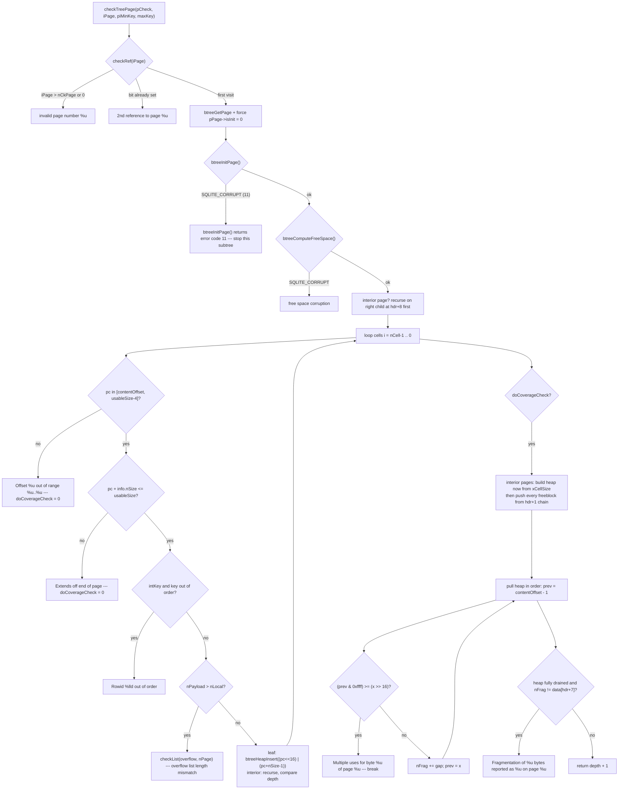

<!--
entry-meta
date: 2026-10-17
type: lesson
track: SQLite
lesson: 32
category: Database Internals
title: Verifying a Database — A 282-Byte Bitmap That Finds Orphaned Pages, a 4096-Byte Min-Heap That Proves Every Byte Is Used Exactly Once, and a quick_check That Quietly Still Counts Index Entries
slug: sqlite-integrity-check-test-strategy
-->

# Verifying a Database — A 282-Byte Bitmap That Finds Orphaned Pages, a 4096-Byte Min-Heap That Proves Every Byte Is Used Exactly Once, and a quick_check That Quietly Still Counts Index Entries

**2026-10-17 · SQLite Track · Lesson 32 of 33**

## Where This Fits

- **Lesson 31** ([memory-mapped I/O and the allocator stack](../2026-10-16-sqlite-mmap-memory-allocation-lookaside/README.md)) ended on `unixFetch`'s **256-byte end-of-file buffer**, and on the comment that explains why it exists: a *corrupt* page can make SQLite overread "a few bytes" past the logical end of the page. It handed this lesson four things explicitly — `xIntegrity` (`iVersion` 4, never exercised in this track), `btreeInitPage`'s error path, the corrupted databases lesson 30 produced, and that 256-byte allowance as the read-path counterpart of what the verifier looks for.
- **This lesson** reads the verifier. `PRAGMA integrity_check` is not one algorithm, it is **two layers stacked**: a C-level b-tree walk (`sqlite3BtreeIntegrityCheck`) that proves the *file* is structurally sound, and a **generated VDBE program** that proves the *logical* content agrees with itself. Everything earlier in the track is what that walk is checking: lesson 03's page header and cell pointer array, lesson 04's freeblocks and fragmented-bytes byte, lesson 05's overflow chains, lesson 06's freelist, lesson 08's rowid ordering, lesson 09's index key records, lesson 13's pointer map. The second half of the lesson is SQLite's test strategy, which is the reason `integrity_check` exists at all: it is the oracle every crash and I/O-error test asserts against.
- **It sets up lesson 33** (`VACUUM` / `VACUUM INTO`): a rewrite of the whole file is only trustworthy if something can say the result is well-formed, and `VACUUM`'s output is the thing most obviously *expected* to pass this check. The never-used-page sweep below is also exactly the condition `VACUUM` exists to eliminate.

**Build used for every number in this lesson.** SQLite **3.53.4** amalgamation from `better-sqlite3@13.0.3` (`deps/sqlite3/sqlite3.c`, 269,668 lines — all line numbers below are into that file), `gcc 13.3.0 -O2`, `-DSQLITE_THREADSAFE=0 -DSQLITE_ENABLE_DBSTAT_VTAB -DSQLITE_ENABLE_DBPAGE_VTAB`, 2-core container. Test database: `t(a INTEGER PRIMARY KEY, b TEXT, c INTEGER)` with 200,000 rows plus `CREATE INDEX tc ON t(c)`, `page_size=4096`, rollback-journal mode — **2,254 pages / 9,232,384 bytes**. Note this is a *different* test database from lessons 28–31 (narrower rows), so its page count is 2,254 rather than 3,836; every figure here was re-measured on it.

---

## 1. Two Layers, Two Completely Different Checkers

`PRAGMA integrity_check` is handled at `sqlite3.c:146494` (`case PragTyp_INTEGRITY_CHECK`). It does **not** call one function. It emits a program.

| Layer | Where | What it proves | Implemented as |
|---|---|---|---|
| B-tree / file structure | `OP_IntegrityCk` (103870) → `sqlite3BtreeIntegrityCheck` (84370) | Every page is reachable exactly once; every page is internally well-formed; freelist length is honest; ptrmap agrees | One C call per attached database |
| SQL / logical content | generated VDBE opcodes (146590–146990) | Index entries match table rows; counts agree; `NOT NULL`, type and `CHECK` constraints hold; `UNIQUE` is actually unique | A full table scan per table, with index cursors open alongside |

The pragma loops over `db->nDb` and emits one `OP_IntegrityCk` per schema, with the schema index in **P5**:

```
sqlite3_prepare_v2("EXPLAIN PRAGMA integrity_check") on the test database
  addr   opcode        p1  p2  p3  p4         p5
     4   IntegrityCk    1   3   8  [2,3,1]     0     <- main
   100   IntegrityCk    1   1   8  [1]         1     <- temp
```

Three roots for `main`, not two. `t` is root page 2 and index `tc` is root page 3 — the third is **page 1**: `sqlite_schema` is an entry in the schema's table hash, so **the schema table is checked as an ordinary table b-tree**, with its 100-byte file header offset handled by the usual `hdrOffset`. The `temp` database contributes `[1]` for its own (empty) schema table.

Register allocation is fixed and worth knowing, because the error strings are assembled from it:

| Register | Holds |
|---|---|
| `1` | errors remaining (`mxErr - 1`, `SQLITE_INTEGRITY_CHECK_ERROR_MAX` = **100** at 146466) |
| `2` | scratch: the b-tree error message, then literal prefixes |
| `3` | the string that `OP_ResultRow` emits |
| `7` | row counter for the current table scan |
| `8 + i` | entry count for the i-th root / i-th index |

---

## 2. `IntegrityCk`: Two Allocations and a Prefix Machine

The context struct is at 72886:

```c
struct IntegrityCk {
  BtShared *pBt;      Pager *pPager;
  u8 *aPgRef;         /* 1 bit per page in the db */
  Pgno nCkPage;       /* pages in the database; 0 for partial check */
  int mxErr;          /* stop accumulating errors when this reaches zero */
  int nErr;  int rc;  /* SQLITE_OK, SQLITE_NOMEM or SQLITE_INTERRUPT */
  u32 nStep;          /* steps into the process -> progress handler */
  const char *zPfx;   Pgno v0; Pgno v1; int v2;   /* message prefix + args */
  StrAccum errMsg;    u32 *heap;  i64 nRow;  /* ... */
};
```

Exactly **two** heap allocations exist for the whole check (84417, 84423):

- **`aPgRef` — the reachability bitmap.** `sqlite3MallocZero((nCkPage/8)+1)`. For the 2,254-page test database that is **282 bytes**. One bit per page, set by `setPageReferenced` (83883), tested by `getPageReferenced` (83874). This single bitmap is what makes both "used twice" and "never used" detectable; nothing else in SQLite maintains a page-reachability set.
- **`heap` — the per-page coverage min-heap.** `sqlite3PageMalloc(pBt->pageSize)` — **4,096 bytes**, i.e. 1,024 `u32` slots, and `mxHeap = pageSize/4 - 1 = 1023` under `SQLITE_DEBUG`. The invariant that makes this safe: each heap entry is one cell or one freeblock, a cell costs at least 4 content bytes plus 2 pointer bytes, so a 4,096-byte page cannot hold more than ⌊4096/6⌋ = **682** of them. 682 < 1023, with room to spare at every legal page size.

Everything else is on the stack, including the message buffer: `char zErr[100]` fed to `sqlite3StrAccumInit(..., sizeof(zErr), SQLITE_MAX_LENGTH)` (84409), so short reports never allocate. `errMsg.printfFlags = SQLITE_PRINTF_INTERNAL`, which is what permits the `%u`-with-`Pgno` formats.

`zPfx` plus `v0/v1/v2` is a small prefix machine: `checkAppendMsg` (83842) formats `zPfx` with those three values *before* the message body. That is where every message shape in this lesson comes from:

| `zPfx` set at | Produces |
|---|---|
| `"Freelist: "` (84432) | `Freelist: size is 0 but should be 5` |
| `"Tree %u page %u: "` (84123) | `Tree 2 page 4: btreeInitPage() returns error code 11` |
| `"Tree %u page %u cell %u: "` (84147) | `Tree 2 page 4 cell 0: Offset 0 out of range 297..4092` |
| `0` (84417, 84233) | `Page 2255: never used`, `Multiple uses for byte 320 of page 4` |

Both `checkAppendMsg` and `checkTreePage` call `checkProgress` (83817), which checks `db->u1.isInterrupted` **and** ticks `nStep` against `db->nProgressOps`. So the b-tree walk — not just the VDBE program around it — is interruptible, and participates in the progress handler.

---

## 3. The B-Tree Walk, In Execution Order

`sqlite3BtreeIntegrityCheck` (84370) runs these steps, in this order:

1. **Decide whether this is a partial check** (84390). `aRoot[0]==0` → `bPartial = 1`; `bCkFreelist` stays 1 only if `aRoot[1]==1` (i.e. the named object was `sqlite_schema`). This is the whole implementation of `PRAGMA integrity_check(TABLENAME)`.
2. **Reserve the lock-byte page**: `i = PENDING_BYTE_PAGE(pBt); if( i<=nCkPage ) setPageReferenced(...)` (84428). Lesson 18's lock-byte page is marked reachable so the final sweep does not call it an orphan.
3. **Walk the freelist** with `checkList(&sCheck, 1, get4byte(&page1[32]), get4byte(&page1[36]))` (84433) — the header's trunk pointer and page count from lesson 01. `checkList` (83946) decrements an expected counter per page and per trunk leaf, rejects a trunk whose leaf count `n > usableSize/4 - 2`, and reports `size is X but should be Y` only if no other error has already been recorded on this list (`nErrAtStart==pCheck->nErr`, 84002).
4. **Auto-vacuum header cross-check** (84443–84461): with auto-vacuum on, the largest root page among `aRoot[]` must equal the 4-byte field at **offset 52**; with auto-vacuum off, offset **64** (`incremental_vacuum`) must be zero. Both are lesson 13's fields.
5. **Disable `SQLITE_CellSizeCk` for the duration** (84464): `testcase( pBt->db->flags & SQLITE_CellSizeCk ); pBt->db->flags &= ~(u64)SQLITE_CellSizeCk;` then restores it at 84481. The cheap always-on cell-size check is suppressed precisely because the expensive one is now running and would turn a reportable message into an aborting `SQLITE_CORRUPT`.
6. **`checkTreePage` per root** (84475), with `sCheck.nRow` reset before each and written out with `sqlite3MemSetArrayInt64(aCnt, i, sCheck.nRow)` — that is how the per-root row counts reach registers `8+i`.
7. **The never-used sweep** (84484–84500), skipped entirely when `bPartial`. For each page 1..`nCkPage`: unreferenced → `Page %u: never used`; referenced *and* being a ptrmap page → `Page %u: pointer map referenced`.
8. **`assert( nRef==sqlite3PagerRefcount(pBt->pPager) )`** (84519) — the checker is required to leave the pager refcount exactly as it found it.

### `checkTreePage` (84081): the five per-page checks



Four details in there are the whole trick:

- **`pPage->isInit` is deliberately zeroed** (84133) before `btreeInitPage`, with the comment "to make sure the corruption detection code in `btreeInitPage()` is executed". A page already validated and cached would otherwise skip its own validation. This is lesson 31's handed-forward `btreeInitPage` error path, and it is reachable: corrupting page 4's type byte from `0x0d` to `0x07` yields exactly `btreeInitPage() returns error code 11` (11 = `SQLITE_CORRUPT`).
- **The heap entry encoding is `(start<<16) | end`** (84249), so a single `u32` comparison orders ranges by start address and the low half carries the end. `btreeHeapInsert`/`btreeHeapPull` (84035/84047) are a textbook array min-heap with `aHeap[0]` as the count.
- **`prev = contentOffset - 1` is an implied first entry** (84313) covering the page header, the cell pointer array, and the gap before the content area. Without it the unallocated gap would be counted as fragmentation.
- **Fragmentation is only compared when the heap drained cleanly**: `if( heap[0]==0 && nFrag!=data[hdr+7] )` (84333). An overlap breaks out of the pull loop with entries left on the heap, so the byte at `hdr+7` is not also reported wrong — one fault, one message.

**What `checkTreePage` does not check: index key order.** The ordering test at 84210 is guarded by `if( pPage->intKey )`. Table b-trees get `Rowid %lld out of order`; index b-trees get nothing. A mis-sorted index page is structurally perfect as far as this walk is concerned. Measured below — it is caught only by the SQL layer, and therefore not at all by `quick_check`.

---

## 4. The SQL Layer: What Is Conditional on `isQuick`, and What Is Not

`isQuick = (sqlite3Tolower(zLeft[0])=='q')` (146498). There is exactly **one** `if( !isQuick )` block of consequence, at 146857, plus the WITHOUT ROWID PK-order test at 146822. Everything else in the generated program runs for **both** pragmas. The documentation's summary — "it does not verify UNIQUE constraints and does not verify that index content matches table content" — is accurate but easy to over-read.

| Generated check | Code | `integrity_check` | `quick_check` |
|---|---|---|---|
| Fetch the right-most column (`OP_Column` + `sqlite3VdbeTypeofColumn`) to force the **whole record header to be parsed** | 146800 | yes | **yes** |
| `wrong # of entries in index <name>` — `OP_Eq` between reg `8+cnt` (b-tree count) and reg `8+iTab` (table count); **partial indexes excluded** (`pIdx->pPartIdxWhere==0`) | 146591–146618 | yes | **yes** |
| `NULL value in <tab>.<col>` for `NOT NULL` columns, with an `OP_Column` reload when the header type is REAL because `OP_IsType` cannot see NaN | 146753–146771 | yes | **yes** |
| `non-<TYPE> value in <tab>.<col>` for STRICT tables (`aStdTypeMask[]`) | 146785–146800 | yes | **yes** |
| `NUMERIC value in …` / `TEXT value in …` affinity checks for non-STRICT tables | 146803–146820 | yes | **yes** |
| `CHECK constraint failed in <tab>` | 146832–146855 | yes | **yes** |
| `row not in PRIMARY KEY order for <tab>` (WITHOUT ROWID) | 146822 | yes | no |
| `row N missing from index <name>` — per-row `OP_Found` on each index cursor | 146868 | yes | **no** |
| `index <name> stores an imprecise floating-point value for row N` — `OP_IFindKey` | 146871 | yes | no |
| `rowid not at end-of-record for row N of index <name>` | 146895 | yes | no |
| `row N values differ from index <name>` — exact text re-compare for non-BINARY collations | 146909–146926 | yes | no |
| `non-unique entry in index <name>` — `OP_Next` + `OP_IdxGT` | 146929–146947 | yes | no |
| `xIntegrity` on virtual tables (`OP_VCheck`) | 146984 | yes | **yes** (with `mFlags=1`) |

Two mechanisms hold the program together:

**The error budget is a register, and it halts the program.** `integrityCheckResultRow` (145184) is three opcodes: `OP_ResultRow 3,1` then `OP_IfPos 1, here+2, 1` then `OP_Halt`. Every message decrements register 1 and the program stops at zero. Measured on a database with two faults on page 4:

```
PRAGMA integrity_check(1)  -> 1 message,  4.4 ms, 1,619 xRead
PRAGMA integrity_check(2)  -> 2 messages, 4.3 ms, 1,619 xRead
PRAGMA integrity_check(20) -> 2 messages + "database disk image is malformed", 16.2 ms, 2,258 xRead
```

The cap does not merely truncate output — it **truncates the walk**, because `mxErr` reaching zero ends `checkTreePage`'s loops too. `integrity_check(1)` read 639 fewer pages than `integrity_check(20)` on the same file. Note also that the b-tree layer's messages arrive as **one newline-joined result row**, so the row count and the message count are not the same number.

**`OP_Column` is given an escape hatch so corruption becomes a row, not an error.** At 147015 the pragma writes `aOp[5].p4.z = (char*)sqlite3ErrStr(SQLITE_CORRUPT)` into its epilogue, and then `sqlite3VdbeChangeP3(v, 0, addr-2)` stores that address in **P3 of instruction 0**. In `vdbe.c`, `op_column_corrupt` (99867) reads it:

```c
op_column_corrupt:
  if( aOp[0].p3>0 ){ pOp = &aOp[aOp[0].p3-1]; break; }
  else { rc = SQLITE_CORRUPT_BKPT; goto abort_due_to_error; }
```

Only two sites `goto op_column_corrupt` (99680, 99757), both inside `OP_Column`. So a malformed *record* found during the scan produces the result row `database disk image is malformed` and `sqlite3_step` still returns `SQLITE_DONE` — confirmed: final rc **101**, two rows. Any other opcode hitting `SQLITE_CORRUPT` still aborts the statement, and `abort_due_to_error` sets `db->flags |= SQLITE_CorruptRdOnly` if a transaction is open.

---

## 5. Measured: the Corruption Matrix

Each row: `base.db` copied, one targeted edit applied with a 40-line Python script, then both pragmas run with a cap of 20. `xRead` counted by a pass-through VFS wrapping `xRead`.

| Injected fault | `integrity_check` says | `quick_check` says |
|---|---|---|
| Append a page, header page-count 2254→2255 | `Page 2255: never used` | same |
| Header freelist count 0→5 (head still 0) | `Freelist: size is 0 but should be 5` | same |
| Page 4 type byte `0x0d`→`0x07` | `Tree 2 page 4: btreeInitPage() returns error code 11` + `wrong # of entries in index tc` | **same, both messages** |
| Page 4 `cell[0]` pointer 4067→0 | `Tree 2 page 4 cell 0: Offset 0 out of range 297..4092` + `row 1 missing from index tc` | **only the first** |
| Page 4 `cell[0]` pointer 4067→320 (overlap) | `Rowid 111 out of order` + `Multiple uses for byte 320 of page 4` + `database disk image is malformed` | same |
| Page 4 fragmented-bytes byte 0→9 | `Fragmentation of 0 bytes reported as 9 on page 4` | same |
| Page 4 `nCell` 131→130 | `Fragmentation of 30 bytes reported as 0 on page 4` + `wrong # of entries in index tc` | **same, both messages** |
| Page 3 right-child 1870→4 | `2nd reference to page 4`, `Child page depth differs`, then 18 × `Page N: never used` (cap hit) | same |
| One payload byte inside index leaf page 7's `cell[0]` (`0x9d`→`0x9e`) | `row 96157 missing from index tc` | **`ok`** |
| Swap `cell[0]` and `cell[1]` pointers on index leaf page 7 (keys now out of order, nothing else changed) | `row 192314 missing from index tc` | **`ok`** |

The two bottom rows are the point of the table. A single flipped bit inside an index key, and a pair of index entries in the wrong order, are both **invisible** to `quick_check` and invisible to the b-tree structural walk — the page covers itself perfectly and the entry count is unchanged. They surface only from the per-row `OP_Found` probe. The second one reports **one** missing row rather than two, because the b-tree binary search over the now-mis-ordered page happens to still find one of the swapped pair.

Conversely, rows 3 and 7 are the correction to the folk summary of `quick_check`: it reported `wrong # of entries in index tc` in both, because the count comparison is generated unconditionally and is fed by the counts the b-tree walk already produced for free.

### Cost, measured two ways

| | `quick_check` | `integrity_check` | ratio |
|---|---|---|---|
| Cache large enough for the whole file (`cache_size=-1000000`) | 19.8 ms | 94.1 ms | **4.8× CPU** |
| `xRead` calls, same run | 2,254 | 2,254 | **1.0× I/O** |
| Default cache (`-2000` KiB ≈ 488 pages) | 23.0 ms, 3,874 `xRead` | 121.6 ms, **35,380 `xRead`** | **9.1× I/O** |

Both pragmas read the file exactly once when the cache can hold it. With the default cache, `integrity_check` issues **15.7 reads per page of the file** — 9.1 extra reads per page versus `quick_check` — because the per-row index probes jump between the table scan's position and random index leaves, and the cache cannot hold both working sets. `quick_check`'s I/O barely moves. If you run `integrity_check` on a big database on a slow disk, `PRAGMA cache_size` is the knob that matters, not the pragma.

### Scaling, second run of each, cache holding the whole file

| rows | pages | `quick_check` | factor | `integrity_check` | factor |
|---|---|---|---|---|---|
| 25,000 | 275 | 2.5 ms | — | 9.3 ms | — |
| 50,000 | 557 | 4.8 ms | 1.92× | 24.7 ms | 2.66× |
| 100,000 | 1,122 | 9.5 ms | 1.98× | 45.5 ms | 1.84× |
| 200,000 | 2,254 | 19.8 ms | 2.08× | 96.6 ms | 2.12× |
| 400,000 | 4,524 | 40.3 ms | 2.03× | 213.7 ms | 2.21× |

`quick_check` doubles when the row count doubles — four consecutive factors of 1.92–2.08, flatly linear. `integrity_check` averages **≈2.1×** per doubling. That is consistent with the documented O(N log N), but be honest about the size of the effect: over this 16× range the log term contributes only about 5–10% per doubling, and the single 2.66× outlier is cache-warmth noise. The 4.8× constant factor matters far more than the asymptotics at any size you are likely to check.

### The progress handler, and interruption

```
sqlite3_progress_handler(db, 1000, ...)   integrity_check -> 2,202 callbacks, 123.2 ms
sqlite3_progress_handler(db, 1000, ...)   quick_check     -> 1,002 callbacks,  24.1 ms
sqlite3_progress_handler(db, 1)           quick_check     -> 1,002,322 callbacks (~5 VDBE ops/row)
callback returns 1 after 50 calls         integrity_check -> 0 rows, rc=9 SQLITE_INTERRUPT at 17.8 ms
```

`integrity_check` fires roughly twice as many callbacks at the same `nOps` because `checkProgress` ticks its own `nStep` counter on top of the VDBE's instruction counter. The interrupt lands **mid-walk**, 18 ms into a 123 ms check — you can abort an integrity check on a large file.

---

## 6. `xIntegrity`: Closing Lesson 31's Handoff

`sqlite3_module.iVersion` 4 added one method, last in the struct, after `xShadowName`:

```c
int (*xIntegrity)(sqlite3_vtab *pVTab, const char *zSchema,
                  const char *zTabName, int mFlags, char **pzErr);
```

The pragma's **second pass** over the table hash (146965–146991) calls it, gated on five conditions: not skipped by `tableSkipIntegrityCheck`, not an ordinary table, `IsVirtual`, `pVTab->pModule->iVersion >= 4`, and `xIntegrity != 0`. It emits `OP_VCheck i, 3, isQuick` (146984, implemented at 105016), then `OP_IsNull` — a non-NULL string in register 3 becomes a result row.

Measured with a 60-line module (`ckvtab`) that logs its arguments and optionally returns a complaint:

```
PRAGMA integrity_check   -> [xIntegrity: schema=main table=v mFlags=0]
                            ckvtab main.v: 5 shadow rows unaccounted for
PRAGMA quick_check       -> [xIntegrity: schema=main table=v mFlags=1]
                            ckvtab main.v: 5 shadow rows unaccounted for
PRAGMA integrity_check(v)-> [xIntegrity: schema=main table=v mFlags=0]
```

So, concretely: **`mFlags` is `isQuick` and nothing else** — 0 for `integrity_check`, 1 for `quick_check`, and a module is expected to do less work when it is 1. `zSchema`/`zTabName` are passed so the callback can address its own shadow tables. The `pzErr` string is a *finding*, not an error: returning `SQLITE_OK` with a message produces a result row and the check continues.

**An eponymous virtual table is never checked.** Measured: with a module registered and queried as `SELECT count(*) FROM ckvtab` (no `CREATE VIRTUAL TABLE`), `PRAGMA integrity_check` returned plain `ok` and `xIntegrity` was never called. The pass walks `db->aDb[i].pSchema->tblHash`, and eponymous tables are not in `sqlite_schema` and not in that hash. So `dbstat`, `sqlite_dbpage`, `pragma_*` and `generate_series` are structurally outside the reach of this check — which is fine for them, but means an extension that wants to be verified must be instantiated with `CREATE VIRTUAL TABLE`.

A second measured trap worth recording, because it cost time here: a module with `xConnect` but **no `xCreate`** cannot be used with `CREATE VIRTUAL TABLE` at all, and the failure is silent at prepare time — the statement prepares, steps without error, and the table simply does not exist afterwards. Lesson 30 found the mirror-image case (good `xCreate`, NULL `xDestroy` → misleading `no such module`); this is the same family of symptom.

### Partial checks, measured

```
database with an appended orphan page 2255:
  PRAGMA integrity_check             -> Page 2255: never used
  PRAGMA integrity_check(t)          -> ok            (never-used sweep skipped)
  PRAGMA integrity_check(sqlite_schema) -> ok
database with header freelist count lied to 3:
  PRAGMA integrity_check(t)          -> ok            (freelist check skipped)
  PRAGMA integrity_check(sqlite_schema) -> Freelist: size is 0 but should be 3
```

That is `bPartial`/`bCkFreelist` (84390) behaving exactly as written, and it matches the documentation's warning. Note the cost: `integrity_check(t)` took **125.8 ms and 35,363 reads** against the full check's 121.1 ms and 35,380 — on a single-table schema a partial check is *not* cheaper, it is only weaker. It also runs in **0.1 ms / 1 read** for `sqlite_schema`, which makes `PRAGMA integrity_check(sqlite_schema)` a genuinely cheap freelist-and-schema-page smoke test.

---

## 7. Why This Function Exists: SQLite's Test Strategy

`integrity_check` is not primarily a user tool. It is the **oracle** SQLite's own anomaly testing asserts against, and that is why it is willing to be slow and exhaustive. From the project's own testing document:

| Harness | Size / scale |
|---|---|
| TCL tests | 1,390 files, 23.2 MB, **51,445** distinct cases; harness C code 27.2 KSLOC |
| TH3 (proprietary) | **50,362** cases, ~2.4 M instances per coverage run, ~**248.5 M** tests in a pre-release soak; 76.9 MB / 1,055.4 KSLOC |
| SQL Logic Test | **7.2 M** queries over 1.12 GB, results compared against PostgreSQL, MySQL, SQL Server and Oracle 10g |
| dbsqlfuzz | libFuzzer with a custom mutator that mutates **both the SQL and the database file**; 336 seed files; ~1 B mutations/day (~500 M cases/day on 16 cores) |
| fuzzcheck | replays historical AFL / OSS-Fuzz / dbsqlfuzz cases during `make test` |

Library ≈ **155.8 KSLOC** of C against ≈ **92,053 KSLOC** of test code and scripts — a ratio of about **590:1**. Coverage is **100% branch** and claimed **100% MC/DC** under TH3 in the default configuration, with **1,184** uses of the `testcase()` macro to force specific boundary paths and **6,754** `assert()` statements. We read two of each in this lesson's code without looking for them: `testcase( pBt->db->flags & SQLITE_CellSizeCk )` at 84464 and `assert( nRef==sqlite3PagerRefcount(...) )` at 84519.

Where `integrity_check` is the assertion:

- **Simulated I/O errors.** A custom VFS fails after a set number of operations, in single-failure and continuous modes; after the simulator is switched off, the test runs `PRAGMA integrity_check` to confirm no corruption was introduced.
- **Simulated crashes (TCL).** A child process is killed at a random point during a write, with a VFS that reorders and corrupts unsynchronised writes; the parent then asserts both atomicity and `integrity_check`.
- **Simulated crashes (TH3).** An in-memory VFS snapshots the filesystem after N I/O operations, applies several random power-loss damage patterns per snapshot, reopens, and checks well-formedness.
- **Malformed database files.** Build a valid database, corrupt bytes externally, assert `SQLITE_CORRUPT` with no buffer overflow and no NULL dereference. Structural bytes are called out as the most important case — which is precisely the ten-row matrix in section 5, and precisely why `checkTreePage` reports rather than crashes.

This closes the loop on lesson 31's 256-byte allowance: the read path is permitted to overread a corrupt page by a few bytes because *this* function, plus the fuzzers above, is responsible for noticing that the page is corrupt in the first place — and the read path must not fault before it gets the chance.

---

## Hands-On

Everything below was run to produce this lesson's numbers. No SQLite CLI is needed; the amalgamation plus two short C files is enough.

**1. Get the amalgamation and build it once.**

```bash
mkdir sqlite-work && cd sqlite-work
npm install better-sqlite3@13.0.3 --ignore-scripts
cp node_modules/better-sqlite3/deps/sqlite3/sqlite3.{c,h} .
grep -n '#define SQLITE_VERSION ' sqlite3.h          # expect 3.53.4
gcc -O2 -c sqlite3.c -o sqlite3.o -DSQLITE_THREADSAFE=0 \
    -DSQLITE_ENABLE_DBSTAT_VTAB -DSQLITE_ENABLE_DBPAGE_VTAB   # ~25 s
```

**What to look for:** the line numbers quoted in this lesson are into this exact file. `grep -n 'static int checkTreePage' sqlite3.c` should print **84081**. If it does not, your amalgamation is a different version and every offset below shifts.

**2. Read the checker in the order it executes.** Four `sed` ranges cover the whole thing:

```bash
sed -n '72886,72905p'  sqlite3.c   # struct IntegrityCk
sed -n '83898,84005p'  sqlite3.c   # checkRef, checkPtrmap, checkList
sed -n '84081,84350p'  sqlite3.c   # checkTreePage, the min-heap coverage loop
sed -n '84370,84520p'  sqlite3.c   # sqlite3BtreeIntegrityCheck, the never-used sweep
sed -n '146494,146600p' sqlite3.c  # the pragma's codegen and the aRoot[] build
```

**What to look for:** at 84133, `savedIsInit = pPage->isInit; pPage->isInit = 0;`. That one line is why a cached, already-validated page is re-validated, and it is the difference between a checker and a cache tour.

**3. Build a database and a counting harness.** The harness is a pass-through VFS that increments a counter in `xRead` and forwards everything else, plus a loop that runs each argument as a statement and prints rows, elapsed time, read count and the final `sqlite3_step` return code. ~120 lines. Then:

```bash
./mkdb base.db 200000
./ck base.db "PRAGMA cache_size=-1000000" "PRAGMA quick_check" "PRAGMA integrity_check"
./ck base.db "PRAGMA quick_check" "PRAGMA integrity_check"      # default cache
```

**What to look for:** identical `xRead` counts (2,254 = the page count) in the first command, and a ~15× difference in the second. That is the proof that the extra cost of `integrity_check` is **cache pressure from random index probes**, not extra passes over the file. If both numbers come out equal in the second run too, your cache is still big enough — lower `cache_size` until the file no longer fits.

**4. Make the b-tree walk fail, one byte at a time.** Copy the file, patch one field, run both pragmas:

```python
# page 4 is the first table leaf; its header is at file offset (4-1)*4096
b = bytearray(open('base.db','rb').read())
b[3*4096] = 0x07                     # type byte 0x0d -> 0x07
open('c.db','wb').write(bytes(b))    # -> btreeInitPage() returns error code 11

b = bytearray(open('base.db','rb').read())
b[3*4096+7] = 9                      # fragmented-bytes byte 0 -> 9
                                     # -> Fragmentation of 0 bytes reported as 9 on page 4
import struct
b = bytearray(open('base.db','rb').read())
b += bytearray(4096)
b[28:32] = struct.pack('>I', 2255)   # -> Page 2255: never used
```

**What to look for:** the message *prefix* tells you which layer caught it. `Tree 2 page 4 cell 0:` is `checkTreePage` with `zPfx` and `v0/v1/v2` set; a bare `Page 2255:` is the final sweep over `aPgRef`; `wrong # of entries in index tc` and `row N missing from index tc` are VDBE opcodes, not C.

**5. The experiment that actually separates the two pragmas.** Find an index leaf page (type byte `0x0a`), and flip one byte inside the first cell's payload:

```python
b = open('base.db','rb').read()
leaves = [n for n in range(1, 2255) if b[(n-1)*4096] == 0x0a]   # 630 of them; first is 7
off = (leaves[0]-1)*4096
cp  = struct.unpack('>H', b[off+8:off+10])[0]                   # cell[0] offset = 4089
print(b[off+cp:off+cp+8].hex())                                 # 0603080301779d...
# payload is (c, rowid): header 03, serial types 08 (integer 0) and 03 (3-byte int)
# 0x01779d = 96157 -> flip the last byte to 0x9e
```

**What to look for:** `quick_check` returns **`ok`** and `integrity_check` returns **`row 96157 missing from index tc`**. This is the single observation that tells you what `quick_check` is for. Then swap `cell[0]` and `cell[1]`'s two-byte pointers on the same page — the page still covers itself exactly, the entry count is unchanged, the keys are now out of order, and the result is the same asymmetry. If you only ever run `quick_check`, a corrupt index is a silent wrong-answer generator, not an error.

**6. Exercise `xIntegrity`.** Write a module with `.iVersion = 4`, real `xCreate`/`xDestroy`, and an `xIntegrity` that prints its arguments, then:

```sql
CREATE VIRTUAL TABLE v USING ckvtab(5);
PRAGMA integrity_check;   -- mFlags=0
PRAGMA quick_check;       -- mFlags=1
```

**What to look for:** `mFlags` flipping to 1 under `quick_check` — that is your signal to skip the expensive half of your own check. Then delete the `CREATE VIRTUAL TABLE` and query the module eponymously instead: `xIntegrity` is never called at all. Use designated initialisers for `sqlite3_module`; positional ones put your function pointer in `xShadowName` and the compiler's warning is the only thing standing between you and a very confusing afternoon.

**7. Prove it is interruptible.** Install a progress handler with `nOps=1000` that returns 1 after 50 calls, and run `integrity_check`: `sqlite3_step` returns **9** (`SQLITE_INTERRUPT`) about 18 ms into a 123 ms check. **What to look for:** that the abort happens during the b-tree walk, not at a statement boundary — `checkProgress` at 83817 is called from `checkTreePage` and from every `checkAppendMsg`.

---

## Where This Breaks Down

- **It is not a semantic check.** `integrity_check` proves the file agrees with itself. It cannot know that a row is wrong, and the documentation is explicit that it **does not find FOREIGN KEY errors** — that is `PRAGMA foreign_key_check`, a separate scan.
- **`quick_check`'s name oversells what it skips and undersells what it keeps.** It does *not* skip record-header parsing, index entry counts, `NOT NULL`, affinity/STRICT type checks, `CHECK` constraints, or `xIntegrity`. It skips exactly the per-row index probe, `UNIQUE`, the WITHOUT ROWID PK-order test, and the collation/rowid-placement tests. For the one failure mode that matters most — a corrupt index that returns wrong answers instead of errors — it is **blind**, as measured twice above.
- **A partial check is weaker without being faster.** `integrity_check(TABLENAME)` drops the never-used sweep and (unless the name is `sqlite_schema`) the freelist check, and on a one-table schema measured *slower* than the full check. The one genuinely cheap form is `integrity_check(sqlite_schema)`: 0.1 ms, 1 read, and it still validates the freelist.
- **The error cap silently reduces coverage.** `integrity_check(1)` is not "the same check, less output" — it stopped 639 pages early. A low cap on a damaged file gives you a biased sample of the damage.
- **`aPgRef` is `nPages/8` bytes, and it is not optional.** 282 bytes here; **33.5 MB** for a 1 TB database at 4 KiB pages (arithmetic, not measured). The reachability set is the whole basis of the orphan and double-use checks, so there is no low-memory mode.
- **Cost is dominated by cache pressure, not by the algorithm.** 4.8× CPU when the file fits in cache; 15.7 reads per page when it does not. Scheduling `integrity_check` on a large database without raising `cache_size` is how it turns into an I/O event.
- **It is a point-in-time check inside a read transaction.** It proves nothing about the file one write later, and a `SQLITE_CORRUPT` raised with a transaction open sets `SQLITE_CorruptRdOnly`, so the connection goes read-only rather than writing more into a damaged file.
- **Structural soundness does not imply sorted.** Index key order is unchecked by the b-tree walk (84210 is `intKey`-only). Depth equality, coverage and counts can all be perfect on an index whose keys are shuffled.
- **One fault can mask another.** An overlap breaks the coverage loop early, which suppresses the fragmentation comparison for that page (`heap[0]==0` guard at 84333); a `checkList` length error suppresses the list-size message (`nErrAtStart` at 84002); `doCoverageCheck = 0` disables coverage entirely for a page with one bad cell pointer. These are deliberate — one fault, one message — but they mean the message count is a floor, not a census.
- **Eponymous virtual tables and anything outside the schema hash are never verified** — including, in practice, every introspection module the earlier lessons used.

## Further Study

- [PRAGMA statements](https://www.sqlite.org/pragma.html) — the `integrity_check` / `quick_check` / `foreign_key_check` entries, including the O(N) vs O(N log N) claim measured in section 5, and the partial-check caveat added in 3.33.0. *(fetched this run)*
- [How SQLite Is Tested](https://sqlite.org/testing.html) — sections 3.2 (I/O error simulation), 3.3 (crash testing) and 4.2 (malformed database files) are the three places `integrity_check` is used as the oracle. *(fetched this run)*
- [`sqlite3_module` / virtual table methods](https://sqlite.org/c3ref/module.html) — the struct with `iVersion` groupings; `xIntegrity` is the version-4 addition and the last field. *(fetched this run)*
- [How To Corrupt An SQLite Database File (w3cub mirror)](https://docs.w3cub.com/sqlite/howtocorrupt) — the catalogue of real-world mechanisms that produce the faults section 5 injects synthetically. *(seen in search results this run; not fetched)*
- [SQLite source timeline entry seen while searching for the pragma docs](https://sqlite.org/src/info/aa02bd3c95e37400) *(seen in search results this run; not fetched)*

## Next Steps

1. **Measure whether `OP_IFindKey` is reachable at all.** It exists to stop expression indexes holding floating-point values 1–2 ULPs off from being reported as corrupt. Build an index on an expression like `c * 1.0000000000000002`, perturb the stored value by one ULP, and check whether the result is `index tc stores an imprecise floating-point value for row N` rather than `missing from index`. Nothing in this run triggered it.
2. **Find out what it costs to check a WITHOUT ROWID table.** The PK-order test at 146822 and the `r2` key-register range are the only parts of the program gated on `pPk`, and lesson 08's WITHOUT ROWID tables were never put through `integrity_check` here.
3. **Quantify the ptrmap half.** Every `checkPtrmap` call in section 3 was compiled in but never exercised, because the test database is not auto-vacuum. Rebuild with `PRAGMA auto_vacuum=FULL`, corrupt one ptrmap entry, and get the exact `Bad ptr map entry key=%u expected=(%u,%u) got=(%u,%u)` message plus the cost of the extra reads.
4. **Check whether `sqlite3_recover` / the recovery extension uses this code.** The obvious question after reading the walk is what a recovery tool does differently when the structure is already known to be broken — the checker stops at the first fault per page, which is the opposite of what recovery wants.
5. **Settle whether the 256-byte overread allowance is actually needed given this checker.** Lesson 31 measured that the last page of every database is unmappable because of it. The comment says a corrupt page can make SQLite overread a few bytes; it should be possible to construct that page and watch the read happen under a VFS that logs `xRead` extents.

## Sources

- [PRAGMA statements — SQLite](https://www.sqlite.org/pragma.html) — fetched; `integrity_check` syntax forms, the seven documented classes of problem it looks for, the default limit of 100 errors, the partial-check semantics and version (3.33.0), the `quick_check` delta, and the FOREIGN KEY exclusion.
- [How SQLite Is Tested — SQLite](https://sqlite.org/testing.html) — fetched; all harness sizes and case counts, the 590:1 test-to-library ratio, 100% branch and MC/DC coverage, 1,184 `testcase()` and 6,754 `assert()` counts, and the three places `integrity_check` is the assertion.
- [Virtual Table Methods Object (`sqlite3_module`) — SQLite](https://sqlite.org/c3ref/module.html) — fetched; the `xIntegrity` signature and its position after `xShadowName`, and the `iVersion` grouping comments.
- SQLite **3.53.4** amalgamation, read locally from `better-sqlite3@13.0.3`'s `deps/sqlite3/sqlite3.c`: `struct IntegrityCk` (72886), `checkOom` (83807), `checkProgress` (83817), `checkAppendMsg` (83842), `getPageReferenced`/`setPageReferenced` (83874/83883), `checkRef` (83898), `checkPtrmap` (83917), `checkList` (83946), `btreeHeapInsert`/`btreeHeapPull` (84035/84047), `checkTreePage` (84081), `sqlite3BtreeIntegrityCheck` (84370), `op_column_corrupt` (99867), `OP_IntegrityCk` (103870), `OP_IFindKey` (103932), `OP_VCheck` (105016), `integrityCheckResultRow` (145184), `tableSkipIntegrityCheck` (145201), `SQLITE_INTEGRITY_CHECK_ERROR_MAX` (146466), `case PragTyp_INTEGRITY_CHECK` (146494).
- Search results consulted while locating the above documentation pages: [sqlite.org/src/info/aa02bd3c95e37400](https://sqlite.org/src/info/aa02bd3c95e37400), [w3cub mirror of howtocorrupt](https://docs.w3cub.com/sqlite/howtocorrupt) — listed because they were seen this run; neither was fetched and nothing here depends on them.

## Takeaways

- **`integrity_check` is two checkers.** A C b-tree walk with a page-reachability **bitmap** and a per-page **min-heap**, and a generated VDBE program that scans every table with every index cursor open. They catch disjoint sets of faults, and the messages tell you which one fired.
- **The min-heap is the elegant part.** Encoding each cell and freeblock as `(start<<16)|end`, adding an implied entry for the header and pointer array, then pulling in order, proves in one pass that every byte of the page is used **exactly once** — and gets the fragmented-bytes field validated for free as the sum of the gaps.
- **`quick_check` is not "the structural half".** It keeps the record-header parse, the index **entry counts**, `NOT NULL`, STRICT/affinity checks, `CHECK` constraints and `xIntegrity`. It drops the per-row index probe and `UNIQUE`. Measured: a one-byte flip inside an index key, and a pair of index entries swapped, are both `ok` to `quick_check` and both fatal to `integrity_check`.
- **The extra 4.8× of `integrity_check` is CPU; the extra 15.7 reads per page are cache.** Same file, same read count, when the cache holds the database. Raise `cache_size` before you blame the pragma.
- **The error cap truncates the check, not just the output**, and a partial check (`integrity_check(t)`) is weaker without being faster. `integrity_check(sqlite_schema)` is the one cheap variant: 1 read, and the freelist still gets verified.
- **`xIntegrity`'s `mFlags` is exactly `isQuick`**, and eponymous virtual tables are never checked because the pass walks the schema's table hash.
- **This function is the reason the rest of the library is trusted.** Against ~155.8 KSLOC of C there are ~92 MSLOC of tests; the crash and I/O-error harnesses have no way to assert "the database survived" except by calling this.
