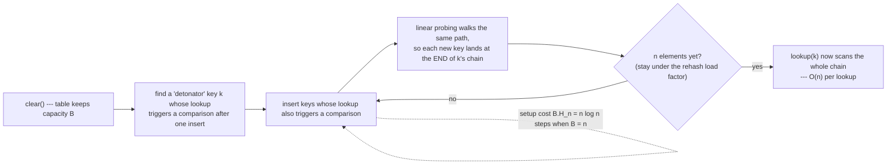

<!--
entry-meta
date: 2026-10-17
type: daily-diff
category: Daily Diff
title: Daily Diff — 2026-10-17
slug: sqlite-integrity-check-test-strategy
-->

# Daily Diff — 2026-10-17

**2026-10-17 · Daily Diff Digest**

## Which Edition This Covers, and How It Was Found

**Covered: the 2026-10-16 edition, 39 items** — the newest edition not previously covered (yesterday's digest covered 2026-10-15, 55 items).

The endpoint flakiness documented in the repository README held again today, in a **sixth distinct pattern**:

| Endpoint | Served |
|---|---|
| `https://tdd.cat/2026-10-16.md` | **the 2026-10-16 edition, 39 items** ← used |
| `https://tdd.cat/archive/` | newest listed = 2026-10-15 (55 stories); 16 and 17 appear on the calendar as plain numbers with **no link and no count** |
| `https://tdd.cat/` (front page) | the 2026-10-15 edition, 55 stories — one day behind |
| `https://tdd.cat/md` (documented "latest") | the **2026-10-13** edition, 3 items — three days behind |
| `https://tdd.cat/2026-10-17.md` | fetch error (no 2026-10-17 edition exists) |

So the dated `.md` permalink was again the only endpoint serving the newest edition — the same shape as 2026-10-15, and the inverse of 2026-10-16, when `/archive/` was the current one. **The item count could not be cross-checked**: no second endpoint serves the 2026-10-16 edition at all, so the 39 is from a single source and is recorded as such. `/md` serving a 3-item edition from three days ago is also a reminder that the archive's own "Latest" pointer and the documented latest-edition endpoint can disagree by days.

## The Edition, Point-Wise

The 2026-10-16 edition is dominated by **agent harnesses and the infrastructure under them**, with a solid systems/database minority. Grouping the 39 items:

- **Harness and scaffolding economics** — the largest cluster. [Anthropic shifting PR review work onto automated checks](https://claude.dev/blog/solving-code-review-at-anthropic/) as agent-generated code volume rose; [harness edits to early messages causing prompt-cache misses and measurable energy cost](https://neuralwatt.com/news/why-harnesses-matter-for-energy-efficiency); [self-evolving scaffolding with frozen weights](https://arxiv.org/abs/2610.18813); [step-level grading of agent actions rather than final answers](https://github.com/Christopher4113/JudgeMan); [replacing large MCP tool collections with three dynamic search calls](https://rabin-a.github.io/mcp-router/#benchmark).
- **Source control and dev infrastructure at agent scale** — [Anthropic replacing Git with a custom centralised system](https://simonwillison.net/2026/Oct/13/redesigning-source-control-at-anthropic/) because Git strained under agent-scale commit volume; [Modal's metadata-first lazy filesystem for sub-second sandbox cold starts](https://modal.com/blog/vm-sandbox-filesystem); [a single Go binary mocking AWS, GCP and Azure locally](https://github.com/nrndev/pogi).
- **Databases and storage** — [Cloudflare's D1 control-plane redesign that keeps metadata management off the query path](https://blog.cloudflare.com/d1-control-plane/) (directly adjacent to this track: D1 is SQLite at the edge); [Citus query routers removing the single-coordinator bottleneck](https://stackgres.io/blog/scaling-citus-beyond-one-coordinator-announcing-query-routers-stackgres/); [learned indexes as piecewise geometric CDF models replacing pointer hierarchies](https://github.com/gilnett/learned_index_lab); [separating fixed-size headers from variable blobs in a binary format so it stays indexable and mmap-friendly](https://blog.demofox.org/2026/10/15/binary-serialization-in-df_game_data/); [PostGIS spatial joins offloaded to a CUDA daemon holding geometry in GPU memory](https://github.com/landstats-us/postgis-cuda).
- **Security and correctness** — [a black-box HashDoS that needs neither the hash function nor the seed](https://orlp.net/blog/black-box-hashdos/) (deep dive below); [abliterated open-weight models carrying undetectable trigger-activated exfiltration backdoors](https://projectdiscovery.io/research/how-abliterated-models-can-get-you-pwned); [linear probes on internal activations detecting reward hacking mid-generation](https://www.goodfire.com/research/reward-hacking-activation-monitors).
- **Formal methods** — [Lean 4.35 shipping a verified kernel](https://leodemoura.github.io/blog/2026-10-15-lean-now-ships-with-verified-kernels/); [proving barrier synchronisation and race freedom in warp-specialised Hopper/Blackwell kernels](https://sentryward.io/blog/); [using Lean to auto-label step correctness for process reward models](https://huggingface.co/papers/2610.17697); [a gateway that admits AI-written code only with Z3-backed proofs](https://github.com/newmathphys/kern).
- **Inference systems and kernels** — [distributed inference over clustered Apple silicon with MLX](https://machinelearning.apple.com/research/mlx-distributed-inference); [a 125B MoE split across two 16 GB GPUs with CPU expert offloading](https://github.com/ValerioDolci/capy-flash); [naive CUDA matmul brought near cuBLAS through tiling and register blocking](https://www.abhik.ai/articles/cuda-matrix-multiplication-optimization); [reasoning blocks evicted from the KV cache in favour of learned pause-token summaries](https://github.com/JackCai1206/abridgekv); [kernel packet processing offloaded to consumer AMD GPUs via XDP](https://www.servers99.com/blog/linux-knod-amd-gpu-network-offload/).
- **Also notable** — [Iroh's move from IPFS protocols to BLAKE3 verified streaming over QUIC](https://www.iroh.computer/blog/the-road-to-iroh-1-0); [treating Go channel communications as first-class composable values](https://nikhilism.com/post/2026/golang-racket-concurrency/); [bgfx's shader compiler surviving on the C preprocessor and text patching rather than a real front-end](https://bkaradzic.github.io/posts/shaderc-overview/); [four Gemini 4 Argon agents coordinating for 27 hours to kill the Ender Dragon](https://arxiv.org/abs/2610.22319).

## Deep Dive: HashDoS Without Knowing the Hash Function

**Item:** "Attacking hash tables without knowing their hash function" → [orlp.net/blog/black-box-hashdos](https://orlp.net/blog/black-box-hashdos/) (Orson Peters, dated 2026-10-14). Source followed and read.

This is the most significant item in the edition, and it is picked over the Anthropic-replaces-Git and Cloudflare-D1 stories deliberately: it invalidates a defence that essentially every modern language runtime relies on.

### What it overturns

Classical HashDoS needs **colliding hashes**. The standard mitigation is a secret random per-process or per-table seed: you cannot precompute collisions for a hash function whose seed you do not know. That reasoning is why `SipHash` with a random key became the default in Rust, Python, Perl and others.

This attack **never computes a hash and never inverts one**. It is a **side channel**. All attack keys share a long common prefix and the same length, so the *time* a lookup takes is a direct readout of **how many full key comparisons the table performed**. That reveals which buckets are occupied and in what order — enough to reconstruct the probe sequence and then stuff it.

### Threat model (narrow, and the author says so)

- Attacker chooses string keys and can call `lookup`, `insert` and `clear` on the target table.
- No other user may be mutating that table concurrently.
- The table must not use tombstones.
- The attacker observes lookup latency. The proof of concept substitutes a comparison counter for timing, to be deterministic.

The author calls this access "quite niche" — fairly. It is realistic for an in-process cache, an interning table, or any per-request table an untrusted client can both populate and probe.

### Linear probing: the easy case

The oracle is binary and cheap: "did this lookup perform a comparison?" tells you the slot was occupied. Because linear probing is deterministic and path-preserving, every key that answers *yes* extends the same chain.

### General probing `probe(b, i) = (b + f(i)) mod B`

Works for any known `f`, quadratic probing (`f(i) = i²`) included, in four phases:

1. **Covering sets.** Collect two sets `S₁`, `S₂`, each hitting every bucket once — a coupon-collector problem. The article gives `s ≥ 2B(g + ln(B/ε))` samples for `g = 2` copies at failure probability `ε` (example uses `ε = 0.01`).
2. **Mapping, bit by bit.** Over `log₂B` rounds, fill the table with the `S₁` elements whose index has a given bit set, probe each `S₂` element, and read off the comparison result to recover its partner's index. **O(B log B)**.
3. **Successors.** Same bit-by-bit trick to learn, for each element, which element sits at offset `f(1)` from it.
4. **Order and detonate.** `f` plus the successor relation gives the full cyclic bucket order; insert the keys occupying one element's probe sequence, and every lookup of that element is linear.

### Rust's `hashbrown` — the hardest target, still broken

`hashbrown` (Rust's `HashMap`) compares every occupied bucket in a **window of W = 8 or 16 slots** and checks a **7-bit tag** before each string comparison. Both features blunt the oracle, neither stops it:

- **Beating the tag filter:** generate all keys up front while the table is nearly empty, so any comparison at all implies a tag match. Cost: a **~128× slowdown in setup** — exactly the 1-in-128 probability of a 7-bit tag collision.
- **Covering:** build a set with one element per bucket via repeated clear/insert/lookup rounds, estimated **O(W log B)** iterations of **O(B)** each.
- **Structure:** for each element compute the **sum of indices of elements in its window**, one bit at a time; consecutive differences of those sums reveal the next index in bucket order.
- **Finish:** start from a detonator with `W` elements in its window, derive the order, insert the probe sequence.

Result: a working **~200-line proof of concept** against Rust's standard `HashMap`. The article gives no end-to-end wall-clock figure for the attack, and it does not discuss SipHash, universal hashing or tree fallback as defences — worth stating plainly rather than filling in.

### What actually defends against it

| Defence | Verdict (per the article) |
|---|---|
| Random per-table seed / `SipHash` | Stops *classical* HashDoS. Irrelevant here — the attack never uses the hash function. |
| 7-bit tag filtering alone | Slows setup ~128×. **Not a fix.** |
| **Compare the full 64-bit hash before the key comparison** | Stops every variant the author could construct. Cost: you lose the cheap per-slot filter the attack has to work around. |
| Non-linear probe order in the hash | Unclear; the author does not claim safety. |
| Relying on "needs tombstone-free, exclusive access" | Explicitly warned against — more sophisticated side channels may work with insert/remove only. |

### Why this matters here

The relevance to this track is direct. Every hash table the earlier lessons touched — SQLite's schema `tblHash`, the module hash, `pcache1`'s page hash — is a **bucketed table whose probe behaviour is observable through timing** if an attacker controls the keys. The general lesson is the one today's track lesson is also about: a structure can satisfy every invariant it was designed to check (correct contents, correct counts, correct coverage) and still be **adversarially degraded** through a property nobody specified. `integrity_check` can tell you a hash of pages is internally consistent; nothing in it can tell you the lookup path has been made linear on purpose. **Store-and-compare the full hash** is cheap insurance, and it is the one mitigation here that is not a constant factor.

## Sources

- [https://tdd.cat/2026-10-16.md](https://tdd.cat/2026-10-16.md) — fetched; the 2026-10-16 edition, 39 items, the basis of the summary above.
- [https://tdd.cat/archive/](https://tdd.cat/archive/) — fetched; newest listed edition 2026-10-15 (55 stories), 109 editions total, 16 and 17 unlinked on the calendar.
- [https://tdd.cat/](https://tdd.cat/) — fetched; front page served the 2026-10-15 edition, 55 stories.
- [https://tdd.cat/md](https://tdd.cat/md) — fetched; served the 2026-10-13 edition, 3 items.
- `https://tdd.cat/2026-10-17.md` — fetch error this run; no 2026-10-17 edition exists.
- [https://orlp.net/blog/black-box-hashdos/](https://orlp.net/blog/black-box-hashdos/) — fetched; the deep-dive source: threat model, linear-probing construction, the four-phase general-probing attack, the `hashbrown` window/tag adaptation, the ~200-line proof of concept, and the defence table.
- Item source URLs linked in the point-wise summary were read from the 2026-10-16 edition listing this run; apart from the HashDoS post, none of them were fetched, and the one-line descriptions are the edition's own framing rather than verified claims.
