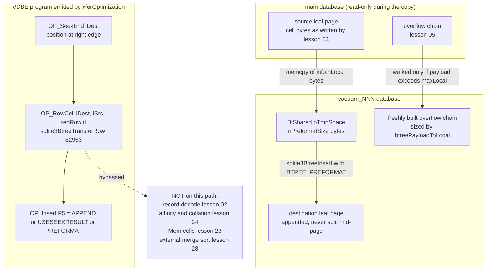
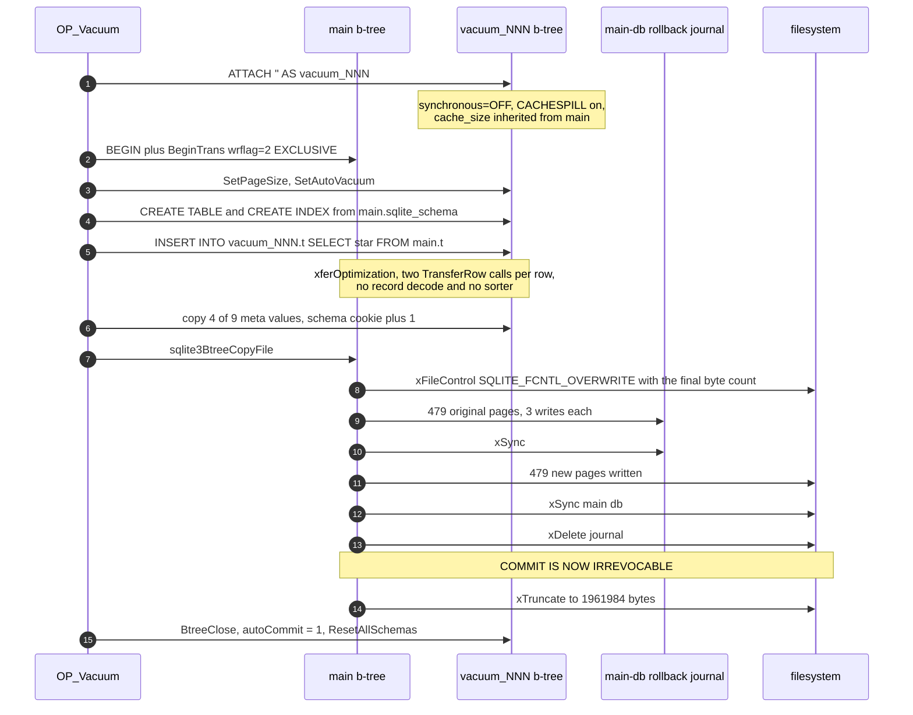

<!--
entry-meta
date: 2026-10-18
type: lesson
track: SQLite
lesson: 33
category: Database Internals
title: VACUUM and VACUUM INTO — A Randomly-Named ATTACH, a 3x Write Amplification You Can Halve With One Pragma, and a Truncate That Happens After the Commit
slug: sqlite-vacuum-into-backup-api
-->

# VACUUM and VACUUM INTO — A Randomly-Named ATTACH, a 3× Write Amplification You Can Halve With One Pragma, and a Truncate That Happens After the Commit

**2026-10-18 · SQLite Track · Lesson 33 of 33**

## Where This Fits

- **Lesson 32** ([verifying a database](../2026-10-17-sqlite-integrity-check-test-strategy/README.md)) ended on the b-tree walk's **never-used-page sweep** and on the observation that `integrity_check` reads every page exactly once when the cache holds the file. It handed this lesson six things: the **backup API**, that `VACUUM` does not recompute `ANALYZE` statistics, the claim that `VACUUM` "reruns the `CREATE INDEX` sorter path once per index", that `sqlite_dbpage`'s `xSync` calls `sqlite3PagerTruncateImage` and that this is *not* how `VACUUM` shrinks a file, the Windows memory-map truncation caveat, and the never-used-page condition that `VACUUM` exists to eliminate.
- **This lesson** reads `vacuum.c`, `backup.c`, and the part of `insert.c` that actually moves the bytes. Three things turn out to be true and worth the day: `VACUUM` is **four SQL statements and one C call**, not an algorithm; the row copy is the **transfer optimisation**, which bypasses the record decoder *and* the sorter entirely (so lesson 32's handed-forward claim is **wrong**, and section 3 corrects it); and the file is **shrunk after the transaction has already committed**, which is why `VACUUM` is crash-safe at all. Every layer the track has built shows up: lesson 02's record format (never decoded here), lesson 03's cell layouts (copied verbatim), lesson 05's overflow chains (rebuilt cell by cell), lesson 06's freelist (the thing being destroyed), lesson 13's auto-vacuum flag (the one property only `VACUUM` can change), lesson 16's rollback journal (the thing that makes the overwrite safe), lesson 28's sorter (which does *not* run), and lesson 32's verifier (which is the before/after instrument).
- **It closes the track.** Lesson 33 is the last item on the syllabus; the next run writes the capstone and opens a new subject. What this lesson leaves open is recorded in `## Next Steps` and in `TRACK.md`.

**Build used for every number in this lesson.** SQLite **3.53.4** amalgamation from `better-sqlite3@13.0.3` (`deps/sqlite3/sqlite3.c`, 269,668 lines — **all line numbers below are into that file**), `gcc 13.3.0 -O2`, `-DSQLITE_THREADSAFE=0 -DSQLITE_ENABLE_DBSTAT_VTAB -DSQLITE_ENABLE_DBPAGE_VTAB -DSQLITE_USE_URI=1`, 2-core container, system page size 4096. Source id `2026-07-24 19:02:57 bf7c7f30…`.

**Test databases — NEW THIS LESSON, do not compare page counts with lessons 28–32.** Same schema as lesson 32, deterministic row bodies instead of random ones, so the file is reproducible:

```sql
PRAGMA page_size=4096;
CREATE TABLE t(a INTEGER PRIMARY KEY, b TEXT, c INTEGER);
WITH RECURSIVE s(i) AS (SELECT 1 UNION ALL SELECT i+1 FROM s WHERE i<200000)
  INSERT INTO t(a,b,c) SELECT i, printf('%024d',(i*7919)%1000000), (i*2654435761)%200000 FROM s;
CREATE INDEX tc ON t(c);
```

| file | rows | pages | freelist | bytes | notes |
|---|---|---|---|---|---|
| `base.db` | 200,000 | 2,391 | 0 | 9,793,536 | dense; inserted in rowid order, so already optimally packed |
| `frag.db` | 40,000 | 2,391 | **1,669** | 9,793,536 | `base.db` after `DELETE FROM t WHERE (a%5)<>0` |

Lesson 32's database was 2,254 pages because its `b` column was narrower. One patched build was used (section 3); everything else is stock.

---

## 1. VACUUM Is Four SQL Statements and One C Call

`sqlite3Vacuum` (161564) is a two-line code generator. It resolves the optional schema name, codes the optional `INTO` expression into a register, and emits a single opcode:

```c
sqlite3VdbeAddOp2(v, OP_Vacuum, iDb, iIntoReg);
```

Everything happens inside `sqlite3RunVacuum` (161612), and the file's own header comment states the algorithm:

```
**   (1)  Create a new transient database file
**   (2)  Copy all content from the database being vacuumed into
**        the new transient database file
**   (3)  Copy content from the transient database back into the
**        original database.
```

and then, crucially, states the cost up front:

```
** Hence, temporary disk space that is approximately 2x the size of the
** original database is required.  Every page of the database is written
** approximately 3 times:  Once for step (2) and twice for step (3).
```

Both of those numbers are measured in section 7, and both are right to within 0.3%.

### The preconditions, with exact error strings

Two guard clauses, both before anything is opened (161628–161635):

| condition | code | message |
|---|---|---|
| `!db->autoCommit` | `SQLITE_ERROR` (1) | `cannot VACUUM from within a transaction` |
| `db->nVdbeActive>1` | `SQLITE_ERROR` (1) | `cannot VACUUM - SQL statements in progress` |

Measured, with a single stepped-but-unfinalised `SELECT` on the same connection, and then with that statement finalised:

```
[1] unfinalized SELECT on the SAME connection:
  VACUUM                 -> rc=1  cannot VACUUM - SQL statements in progress
  VACUUM INTO 'lk1.db'   -> rc=1  cannot VACUUM - SQL statements in progress
[2] after finalize:
  VACUUM                 -> rc=0
```

`nVdbeActive>1` counts the `VACUUM` statement itself, which is why the threshold is 1 and not 0. Note that **`VACUUM INTO` is subject to both guards too** — they are connection-state guards, not write-lock guards.

### The flags it changes under you

Before doing any work, `sqlite3RunVacuum` rewrites eight pieces of connection state and restores them at `end_of_vacuum` (161657–161662):

```c
db->flags |= SQLITE_WriteSchema | SQLITE_IgnoreChecks | SQLITE_Comments
           | SQLITE_AttachCreate | SQLITE_AttachWrite;
db->mDbFlags |= DBFLAG_PreferBuiltin | DBFLAG_Vacuum;
db->flags &= ~(u64)(SQLITE_ForeignKeys | SQLITE_ReverseOrder
                 | SQLITE_Defensive | SQLITE_CountRows);
db->mTrace = 0;
```

Three of these are observable from outside:

- **`db->mTrace = 0` makes the whole operation invisible to `sqlite3_trace_v2`.** Measured: with `SQLITE_TRACE_STMT` registered, a `VACUUM` emits exactly one trace line — `VACUUM` — and none of the internal statements appear. If you are profiling a process by its statement trace, `VACUUM`'s four internal statements and ~80,000 b-tree operations are a blank.
- **`SQLITE_Defensive` is cleared**, which is how the internal `INSERT INTO vacuum_x.sqlite_schema` is allowed to run at all.
- **The authorizer is *not* cleared.** `xAuth` is untouched, so every internal statement is authorized. That is both a security hook and the best available window into what `VACUUM` does (section 2).

### The transient database is ATTACHed under a random name

```c
sqlite3_randomness(sizeof(iRandom),&iRandom);
sqlite3_snprintf(sizeof(zDbVacuum), zDbVacuum, "vacuum_%016llx", iRandom);
rc = execSqlF(db, pzErrMsg, "ATTACH %Q AS %s", zOut, zDbVacuum);
```

`zDbVacuum[42]`, 16 hex digits of `sqlite3_randomness`. Measured over two consecutive runs on the same file: `vacuum_37d13d0c530fd8ab`, then `vacuum_d98ad946caf5091b`. The name is not `vacuum_db` and must not be relied on.

`zOut` is `""` for a plain `VACUUM` — an `ATTACH ''`, which is a *transient* database whose file obeys `temp_store` and is created lazily (section 7). For `VACUUM INTO`, `zOut` is the output filename and the `ATTACH` creates a real file, with `db->openFlags` temporarily forced to `SQLITE_OPEN_CREATE|SQLITE_OPEN_READWRITE` (161643–161644) and restored immediately after the `ATTACH` returns.

The transient database then gets the main database's cache size and spill size, and `PAGER_SYNCHRONOUS_OFF`:

```c
sqlite3BtreeSetCacheSize(pTemp, db->aDb[iDb].pSchema->cache_size);
sqlite3BtreeSetSpillSize(pTemp, sqlite3BtreeSetSpillSize(pMain,0));
sqlite3BtreeSetPagerFlags(pTemp, pgflags|PAGER_CACHESPILL);
```

`synchronous=OFF` for the transient file is safe for the reason the comment gives: it is never recovered. The source also records a measurement someone already did — `"PRAGMA vacuum_XXXXXX.journal_mode=OFF"` was tried and **made VACUUM slower**, because parsing and running the pragma costs more than writing the one journal header that a from-empty database needs. Section 9 measures that header: **524 bytes** of journal for a 1,961,984-byte `VACUUM INTO` output.

---

## 2. What the Schema Copy Actually Executes

Four `execSqlF` calls do the logical work. `execSql` (161491) prepares the statement, and if it returns rows, **recurses into each row's single text column as SQL** — which is how `SELECT sql FROM sqlite_schema` turns into executed `CREATE` statements.

| # | statement (schema names substituted) | purpose |
|---|---|---|
| 1 | `SELECT sql FROM "main".sqlite_schema WHERE type='table' AND name<>'sqlite_sequence' AND coalesce(rootpage,1)>0` | recreate tables in the vacuum db |
| 2 | `SELECT sql FROM "main".sqlite_schema WHERE type='index'` | recreate indexes (on still-empty tables) |
| 3 | `SELECT 'INSERT INTO vacuum_x.'\|\|quote(name)\|\|' SELECT*FROM"main".'\|\|quote(name) FROM vacuum_x.sqlite_schema WHERE type='table' AND coalesce(rootpage,1)>0` | copy the rows |
| 4 | `INSERT INTO vacuum_x.sqlite_schema SELECT*FROM "main".sqlite_schema WHERE type IN('view','trigger') OR (type='table' AND rootpage=0)` | copy storage-less objects verbatim |

Statement 1 and 2 are run with `db->init.iDb = nDb`, which forces the `CREATE` statements into the vacuum schema rather than `main`. Statement 3 reads the schema **of the vacuum database**, not of main — by that point they are equivalent, and it means a table whose `CREATE` failed is not copied into. Statement 4 moves views, triggers and virtual tables as *rows*, not as executed DDL, because none of them owns storage.

Note what each filter implies:

- `name<>'sqlite_sequence'`: the `AUTOINCREMENT` bookkeeping table is not created explicitly — it is created implicitly by the first `CREATE TABLE … AUTOINCREMENT` — but it **is** in statement 3's row-copy set, so its contents survive. Measured: three rows inserted, all deleted, `sqlite_sequence.seq = 3` before `VACUUM` and **3 after**, and the next `INSERT` gets rowid 4.
- `coalesce(rootpage,1)>0`: `rootpage=0` marks a virtual table, and `NULL` is treated as 1 so a `NULL` rootpage is still a storage-owning table. Virtual tables fall into statement 4.
- `DBFLAG_Vacuum` is cleared immediately after statement 3 (161784), so statement 4 and everything after it runs with normal semantics.

### The authorizer trace, verbatim

Because `xAuth` survives, you can read the whole sequence out of a running `VACUUM`. `SQLITE_READ` and `SQLITE_FUNCTION` suppressed:

```
>>> VACUUM
  TRACE_STMT: VACUUM                            <- the only trace line for the whole operation
  AUTH[  1] ATTACH         a=
  AUTH[  2] TRANSACTION    a=BEGIN
  AUTH[  3] SELECT                                                  (statement 1)
  AUTH[  4] INSERT         a=sqlite_master   db=vacuum_37d13d0c530fd8ab
  AUTH[  5] CREATE_TABLE   a=t               db=vacuum_37d13d0c530fd8ab
  AUTH[  6] UPDATE         a=sqlite_master   b=type      db=vacuum_37d13d0c530fd8ab
  AUTH[  7] UPDATE         a=sqlite_master   b=name      db=vacuum_37d13d0c530fd8ab
  AUTH[  8] UPDATE         a=sqlite_master   b=tbl_name  db=vacuum_37d13d0c530fd8ab
  AUTH[  9] UPDATE         a=sqlite_master   b=rootpage  db=vacuum_37d13d0c530fd8ab
  AUTH[ 10] UPDATE         a=sqlite_master   b=sql       db=vacuum_37d13d0c530fd8ab
  AUTH[ 11] SELECT                                                  (statement 2)
  AUTH[ 12] INSERT         a=sqlite_master   db=vacuum_37d13d0c530fd8ab
  AUTH[ 13] CREATE_INDEX   a=tc  b=t         db=vacuum_37d13d0c530fd8ab
  AUTH[ 14] INSERT         a=sqlite_master   db=vacuum_37d13d0c530fd8ab
  AUTH[ 15] REINDEX        a=tc              db=vacuum_37d13d0c530fd8ab
  AUTH[ 16] SELECT                                                  (statement 3)
  AUTH[ 17] INSERT         a=t               db=vacuum_37d13d0c530fd8ab
  AUTH[ 18] INSERT         a=sqlite_master   db=vacuum_37d13d0c530fd8ab
  AUTH[ 19] SELECT                                                  (statement 4)
```

Three things fall out of this trace:

1. **There is no `SQLITE_DETACH`.** The vacuum database is not detached by SQL — `end_of_vacuum` calls `sqlite3BtreeClose(pDb->pBt)` directly, sets `db->autoCommit = 1` by hand, and then `sqlite3ResetAllSchemasOfConnection` shrinks `db->aDb[]` (161883). The comment explains why this is legal: by that point the main file has already been committed at the b-tree level and no locks are held anywhere else.
2. **An authorizer can veto `VACUUM`** by denying `SQLITE_ATTACH` with an empty filename, or `SQLITE_INSERT` on `sqlite_master`. If you have a `xAuth` that blanket-denies schema writes, `VACUUM` is one of the things you have denied.
3. **`AUTH[15] REINDEX tc`** is emitted by `CREATE INDEX` on an empty table. That is the beginning of the correction in the next section.

### `execSql`'s `CRE`/`INS` prefix guard

The recursion is not unconditional (161499–161512):

```c
/* The secondary SQL must be one of CREATE TABLE, CREATE INDEX,
** or INSERT.  Historically there have been attacks that first
** corrupt the sqlite_schema.sql field with other kinds of statements
** then run VACUUM to get those statements to execute at inappropriate
** times. */
if( zSubSql
 && (strncmp(zSubSql,"CRE",3)==0 || strncmp(zSubSql,"INS",3)==0)
){
```

Measured, three ways:

- **A trailing statement is ignored.** Setting `sqlite_schema.sql` to `'CREATE TABLE t(x); DELETE FROM victim'` under `writable_schema=ON`: `VACUUM` succeeds and `victim` still has its row. `sqlite3_prepare_v2` compiles only the first statement and `execSql` never looks at the tail.
- **A non-`CREATE` table or index `sql` no longer reaches the guard.** Setting it to `'DELETE FROM victim'` makes the schema itself unloadable: `SELECT count(*) FROM t` fails with rc=11 and `malformed database schema (tx)`, and `VACUUM` fails with `database disk image is malformed` before `execSql` is ever called. In 3.53.4 I **could not make the guard's reject arm fire** through sqlite_schema corruption; the schema loader gets there first. Stated plainly because it is a negative result: the guard is now defence in depth, not the first line.
- **The `INS` allowance is a real hole, and it is structurally necessary.** Statement 3 generates strings that begin with `INSERT`, so `execSql` must accept that prefix. Under `PRAGMA writable_schema=ON` — which lets the malformed schema load — an index row whose `sql` is `INSERT INTO t VALUES('INJECTED')` **is executed by `VACUUM`**:

  ```
  $ ./sq hs6.db "PRAGMA writable_schema=ON" "VACUUM" "SELECT x FROM t"
  orig
  INJECTED
  ```

  The injected row persists, and the index entry is dropped. This is not a vulnerability in any normal configuration: it needs `writable_schema=ON` on the connection running the `VACUUM`, which the documentation describes as dangerous and which `SQLITE_DBCONFIG_DEFENSIVE` blocks. It is worth knowing because it is exactly the attack class the comment describes, still reachable through the one prefix the implementation cannot give up. **Not reported upstream, and not bisected across versions** — see `## Next Steps`.

---

## 3. The Row Copy Is the Transfer Optimisation — and the Sorter Never Runs

Statement 3 is `INSERT INTO vacuum_x."t" SELECT*FROM"main"."t"`. That exact syntactic shape — one table, `SELECT *`, no `WHERE`/`ORDER BY`/`GROUP BY`/`LIMIT`/`DISTINCT`, not a compound — is the entry condition for `xferOptimization` (141916), and the function's own comment says who it is for: *"the main beneficiary of the transfer optimization is the VACUUM command."*

With `DBFLAG_Vacuum` set, `xferOptimization` relaxes six of its own refusals (`__hidden__` columns, differing `CHECK` constraints, the empty-destination probe, the rowid-collision probe, `OPFLAG_NCHANGE`, the pre-update hook path) because the destination table is **known** to be empty and constraints are off. What it emits for each row is three opcodes:

```
SeekEnd    iDest                     <- position at the right edge of the destination b-tree
RowCell    iDest, iSrc, regRowid     <- preformat the source cell into the destination's pTmpSpace
Insert     iDest, regData, regRowid  P5 = APPEND|USESEEKRESULT|PREFORMAT
```

`OP_RowCell` (102454) is a VACUUM-era opcode whose entire body is a call to `sqlite3BtreeTransferRow` (82953). That function does **not** decode the record. It writes a payload varint, writes the rowid varint if the destination is an intkey table, and then, in the common case:

```c
nIn = pSrc->info.nLocal;
aIn = pSrc->info.pPayload;
nRem = pSrc->info.nPayload;
if( nIn==nRem && nIn<pDest->pPage->maxLocal ){
  memcpy(aOut, aIn, nIn);
  pBt->nPreformatSize = nIn + (int)(aOut - pBt->pTmpSpace);
  return SQLITE_OK;
}
```

One `memcpy` of lesson 02's serialised record, straight from the source page into the destination's `BtShared.pTmpSpace`, with `nPreformatSize` left for `sqlite3BtreeInsert` to consume. Lesson 24's affinity rules, lesson 02's serial-type decoder and every `Mem` cell in lesson 23 are all skipped. When the payload does *not* fit locally, the `else` arm walks the source's overflow chain (lesson 05) and **builds a fresh chain** in the destination sized by `btreePayloadToLocal(pDest->pPage, …)`, which is why a `VACUUM` can legitimately change how many overflow pages a row occupies if the page size changed.

### The counter, and the correction to lesson 32

One patched build, adding four `int` counters: one incremented in `sqlite3BtreeTransferRow`, one where `xferOptimization` commits to the optimisation (142141), and one on each side of the index branch at 142261/142268. These symbols are **not in stock SQLite** — do not look for them.

```
frag.db  (40,000 rows, 1 index on an INTEGER column, BINARY collation)
  VACUUM -> xferOpt engaged=1   TransferRow calls=80000   idx fast(RowCell)=1   idx slow(RowData)=0
```

**80,000 = 2 × 40,000.** One `TransferRow` per table row, and one per index entry. The index is copied the same way the table is, by raw cell transfer in b-tree order, because of this block (142241–142263):

```c
if( db->mDbFlags & DBFLAG_Vacuum ){
  /* ... If all indexed columns use collation sequence BINARY, then it can
  ** also be assumed that the index will be populated by inserting keys in
  ** strictly sorted order.  In this case, instead of seeking within the
  ** b-tree as part of every OP_IdxInsert opcode, an OP_SeekEnd is added
  ** before the OP_IdxInsert ... This is faster. */
  for(i=0; i<pSrcIdx->nColumn; i++){
    const char *zColl = pSrcIdx->azColl[i];
    if( sqlite3_stricmp(sqlite3StrBINARY, zColl) ) break;
  }
  if( i==pSrcIdx->nColumn ){
    idxInsFlags = OPFLAG_USESEEKRESULT|OPFLAG_PREFORMAT;
    sqlite3VdbeAddOp1(v, OP_SeekEnd, iDest);
    sqlite3VdbeAddOp2(v, OP_RowCell, iDest, iSrc);
  }
}
```

**So lesson 32's handed-forward claim — that `VACUUM` "reruns the `CREATE INDEX` sorter path once per index" — is wrong.** The `CREATE INDEX` statements of step 2 run against *empty* tables, so the sorter of lesson 28 has nothing to sort; the `REINDEX tc` in the authorizer trace is a no-op over zero rows. The index is then filled by appending already-sorted cells. The negative evidence is decisive: a `VACUUM` of `base.db` with a cache large enough to hold the transient database opens **zero temporary files** (section 7), and a sorter PMA cannot exist without one.

### One `COLLATE NOCASE` index costs you the fast path

Measured on a 1,000-row table with two indexes on the same column, one `BINARY` and one `NOCASE`:

```
2 indexes (b, b COLLATE NOCASE) -> TransferRow=2000  idx fast=1  idx slow=1
1 index   (b)                   -> TransferRow=2000  idx fast=1  idx slow=0
WITHOUT ROWID, TEXT PK          -> TransferRow=1000  idx fast=1  idx slow=0
```

`2000 = 1000` table rows `+ 1000` entries for the **binary** index. The `NOCASE` index contributes **zero** `TransferRow` calls: it falls to `OP_RowData` + a real `OP_IdxInsert` seek per row. The reason given in the comment is not performance pessimism but correctness — a user can redefine a collation sequence between the `CREATE INDEX` and the `VACUUM`, so keys may not arrive in sorted order and the append shortcut is unsound.

The `WITHOUT ROWID` row is worth noting on its own: `1000`, not `2000`, because `HasRowid(pSrc)` is false, the table-copy loop is skipped entirely, and the PK index *is* the table. This partly closes lesson 32's open item 2.



---

## 4. Which Header Values Survive, Measured Field by Field

Between the row copy and the copy-back there is a five-entry table (161817–161823):

```c
static const unsigned char aCopy[] = {
   BTREE_SCHEMA_VERSION,     1,  /* Add one to the old schema cookie */
   BTREE_DEFAULT_CACHE_SIZE, 0,  /* Preserve the default page cache size */
   BTREE_TEXT_ENCODING,      0,  /* Preserve the text encoding */
   BTREE_USER_VERSION,       0,  /* Preserve the user version */
   BTREE_APPLICATION_ID,     0,  /* Preserve the application id */
};
```

Even entries are the meta index, odd entries an increment. Of the nine real `BTREE_*` meta values (17218–17227) only four are carried over, and only the schema cookie is deliberately *changed* — `+1`, so that other connections notice they must reread the schema.

Measured by diffing the 100-byte file header before and after, on a copy of `base.db` with `user_version=77`, `application_id=1234567` and `default_cache_size=9000` set first:

| header field | before | after `VACUUM` | after `VACUUM INTO` |
|---|---|---|---|
| `page_size` | 4096 | 4096 | 4096 |
| `reserved_bytes` | 0 | 0 | 0 |
| `file_change_counter` | 6 | **7** | **1** |
| `page_count` | 2391 | 2391 | 2391 |
| `freelist_head` / `freelist_count` | 0 / 0 | 0 / 0 | 0 / 0 |
| `schema_cookie` | 2 | **3** | **3** |
| `schema_format` | 4 | 4 | 4 |
| `default_cache_size` | 9000 | 9000 | 9000 |
| `text_encoding` | 1 | 1 | 1 |
| `user_version` | 77 | 77 | 77 |
| `incremental_vacuum` | 0 | 0 | 0 |
| `application_id` | 1234567 | 1234567 | 1234567 |
| `version_valid_for` | 6 | **7** | **1** |

Three readings:

- The `VACUUM INTO` output's change counter is **1**, not 7 — it is a brand-new file whose first transaction is the vacuum itself. If you fingerprint databases by change counter, a vacuumed copy is indistinguishable from a freshly created one.
- `page_count` did not move on `base.db`, because `base.db` was inserted in rowid order and is already optimally packed. **`VACUUM` on a dense file reclaims nothing** and still costs everything in section 7 — 78 ms and 3× writes for zero bytes recovered.
- `journal_mode` is not in `aCopy` and is not preserved. Measured: `VACUUM INTO` from a WAL database produces an output in `delete` mode (section 8).

`auto_vacuum` is handled outside `aCopy`, through the b-tree layer (161749, 161845), and that is the subject of section 8.

---

## 5. The Copy-Back Is One `sqlite3_backup_step` Call

Step 3 is a single line:

```c
if( pOut==0 ){
  rc = sqlite3BtreeCopyFile(pMain, pTemp);
}
```

`sqlite3BtreeCopyFile` (85563) is in `backup.c`, not `vacuum.c`, and it is a thin wrapper over the public online-backup API used in a private mode:

```c
memset(&b, 0, sizeof(b));
b.pSrcDb = pFrom->db;  b.pSrc = pFrom;  b.pDest = pTo;  b.iNext = 1;
/* 0x7FFFFFFF is the hard limit for the number of pages in a database file ...
** we can guarantee that the copy finishes within a single call */
sqlite3_backup_step(&b, 0x7FFFFFFF);
assert( b.rc!=SQLITE_OK );
rc = sqlite3_backup_finish(&b);
```

The `sqlite3_backup` object is stack-allocated with `pDestDb == 0`, and that NULL is the signal that `backup_step` and `backup_finish` use to tell "called from `VACUUM`" from "called by a user". It changes three behaviours inside `backup_step`: the `inTransaction==TRANS_WRITE` early `SQLITE_BUSY` check is skipped (85168), `findBtree` is not consulted, and `sqlite3ResetAllSchemasOfConnection` is not called on the destination.

Before any page moves, `sqlite3BtreeCopyFile` issues a file control that announces the outcome:

```c
i64 nByte = sqlite3BtreeGetPageSize(pFrom)*(i64)sqlite3BtreeLastPage(pFrom);
rc = sqlite3OsFileControl(pFd, SQLITE_FCNTL_OVERWRITE, &nByte);
```

Measured as the **first** I/O operation of the whole copy-back, with the final size already known:

```
[   1] xFileControl fc.db   op=11  arg=1961984        ^ SQLITE_FCNTL_OVERWRITE
```

`SQLITE_NOTFOUND` is mapped to `SQLITE_OK`, so a VFS that ignores it is fine; a compressing or encrypting VFS uses it to discard everything it has instead of rewriting block by block.

### `backupOnePage`, and the one field the copy does not copy

`backupOnePage` (85053) loops once per destination page spanned by the source page, `memcpy`s `MIN(srcPageSize,destPageSize)` bytes, and then does two deliberately odd things:

```c
memcpy(zOut, zIn, nCopy);
((u8 *)sqlite3PagerGetExtra(pDestPg))[0] = 0;
if( iOff==0 && bUpdate==0 ){
  sqlite3Put4byte(&zOut[28], sqlite3BtreeLastPage(p->pSrc));
}
```

- Zeroing the first byte of the destination page's extra space clears `MemPage.isInit`, invalidating the b-tree layer's cached parse. This is the same trick lesson 32 found in `checkTreePage`, used here for the opposite reason — there to force revalidation, here because the parse now belongs to different bytes.
- **Page 1's byte offset 28 is overwritten** with the source's page count, because the source's own header field may be stale with respect to `sqlite3BtreeLastPage`. The guard `bUpdate==0` means this is done on the initial copy but *not* when `backupUpdate` re-copies a page that the source changed mid-backup.

`PENDING_BYTE_PAGE` is skipped on both sides (85141 loop, and `continue` at 85081): the lock-byte page from lesson 18 is never a payload page and is never copied.

---

## 6. The Truncate Happens *After* the Commit

This is the part worth the whole lesson. Trace the VFS with a sequence counter, hide the 1,920 `xWrite` calls, and the commit of a `VACUUM` on `frag.db` reads:

```
[   1] xFileControl fc.db          op=11 arg=1961984   ^ SQLITE_FCNTL_OVERWRITE
[   2] xOpen        fc.db-journal  flags=0x806
[1306] xSync        fc.db-journal  flags=2
[1308] xSync        fc.db-journal  flags=2
[1490] xSync        fc.db-journal  flags=2
[1492] xSync        fc.db-journal  flags=2
[1927] xSync        fc.db          flags=2
[1928] xDelete      fc.db-journal                      <- the commit becomes irrevocable HERE
[1929] xTruncate    fc.db          1961984             <- the file shrinks only AFTER that
[1930] xFileControl fc.db          op=22               ^ SQLITE_FCNTL_COMMIT_PHASETWO
```

The journal is written and synced, the 479 new pages are written and synced, the journal is **deleted**, and only then is 7.8 MB cut off the end of the file. The shrink is not part of the transaction.

It has to be this way, and the source says so. There are exactly three `pager_truncate` call sites (61799, 62588, 66349):

- **66349, inside `sqlite3PagerCommitPhaseOne`**, handles only the *grow* case — `if( pPager->dbSize>pPager->dbFileSize )`, for a database that was extended and then had its last page freed.
- **62588, inside `pager_playback`**, re-establishes `nOrigSize` from the journal header at the start of a rollback.
- **61799, inside `pager_end_transaction`**, is the shrink, and its comment is the whole argument:

  ```c
  }else if( rc==SQLITE_OK && bCommit && pPager->dbFileSize>pPager->dbSize ){
    /* This branch is taken when committing a transaction in rollback-journal
    ** mode if the database file on disk is larger than the database image.
    ** At this point the journal has been finalized and the transaction
    ** successfully committed, but the EXCLUSIVE lock is still held on the
    ** file. So it is safe to truncate the database file to its minimum
    ** required size.  */
  ```

The consequences are precise:

- **Crash before `xDelete`**: the journal is hot, the file is still 9,793,536 bytes, pages 480–2,391 are *untouched on disk*, and `pager_playback` restores pages 1–479 from the journal. The original database comes back whole. This is the only reason the journal needs to contain **479** records and not 2,391 — nothing above the new high-water mark was modified.
- **Crash between `xDelete` and `xTruncate`**: the committed, vacuumed database, followed by up to 7.8 MB of stale trailing bytes. Harmless, because the header's `page_count` is 479 and `sqlite3BtreeLastPage` reads that field, so nothing — including lesson 32's never-used-page sweep — ever looks past page 479. The next write transaction's `pager_end_transaction` trims it.
- **`sqlite3PagerTruncateImage` is not what shrinks a `VACUUM`.** This settles lesson 32's handed-forward note. `TruncateImage` (63699) only sets `pPager->dbSize` in memory, and its own comment says *"This function is only called right before committing a transaction."* `sqlite_dbpage`'s `xSync` calls it to shrink a file *inside* a transaction; `VACUUM`'s shrink is an `xTruncate` **outside** the transaction. Two different mechanisms with the same visible effect.



---

## 7. Cost: 3× Writes, 2× Peak Disk, and Two Levers That Halve Both

All figures from the pass-through VFS, vacuuming **`base.db`** (9,793,536 bytes, 2,391 pages, nothing to reclaim — so this is pure overhead).

### Default cache (`cache_size=-2000`, about 488 pages)

```
FILE                open   nRead  nWrite     bRead    bWrite  sync  del
base copy              0    4782    2391  19582992   9793536     1    0
(anonymous-temp)       1    1909    2392   7819264   9797632     0    0   flags 0x21e
  -journal             1       6    7185        48   9815808    12    1
```

- **Bytes written: 9,793,536 + 9,797,632 + 9,815,808 = 29,406,976 = 3.003× the database.** The source comment's "approximately 3 times" is right to three significant figures.
- **Peak extra disk: transient file 9,793,536 + journal 9,816,328 = 19,609,864 = 2.002×.** The documentation's "as much as twice the size of the original database file is required in free disk space" is right to 0.2%.
- **The main file is read twice per page** (4,782 = 2 × 2,391). Once by the row copy; once again during the copy-back, because overwriting page *n* means journaling page *n*'s original content first, and with a 488-page cache the original is long evicted.
- The transient file's open flags are `0x21e` = `TEMP_DB|EXCLUSIVE|DELETEONCLOSE|CREATE|READWRITE`, and `zName` is NULL — an anonymous file, which is why there is no `xDelete` for it.

### Lever 1: a cache big enough for the result

```
PRAGMA cache_size=-40000;   -- 40 MB, the vacuumed db is 9.3 MB
FILE                open   nRead  nWrite     bRead    bWrite  sync  del
base copy              0    2391    2391   9789456   9793536     1    0
  -journal             1       1    7175         8   9813188     2    1
   (no temp file at all)
```

**The transient database never reaches the filesystem.** Writes drop to 19,606,724 bytes = **2.002×**, reads drop to exactly one per page, and journal syncs drop from 12 to 2. This is also the negative evidence that no sorter runs: zero temporary files were opened.

The same effect appears from the other direction: a `VACUUM` of **`frag.db`**, whose *result* is only 479 pages, opens no temporary file even at the default cache size, because 479 < 488. Whether `VACUUM` touches the disk for scratch space is decided by `cache_size` versus the **output** page count, not the input.

### Lever 2: `temp_store=MEMORY`

```
PRAGMA temp_store=MEMORY;
FILE                open   nRead  nWrite     bRead    bWrite  sync  del
base copy              0    4782    2391  19582992   9793536     1    0
  -journal             1       6    7185        48   9815808    12    1
   (no temp file at all)
```

Identical main-db and journal traffic, zero temp-file I/O. On-disk peak extra drops from 2.0× to **1.0× (the journal alone)**, at the price of holding the whole vacuumed image in RAM. Note this lever does *not* reduce the double read of the main file — only a bigger cache does that.

### Timings, best of three, 2-core container

| source | `VACUUM` | `VACUUM INTO` | `backup_step(-1)` | output bytes |
|---|---|---|---|---|
| `frag.db` (70% free) | 25.0 ms | **16.6 ms** | 30.4 ms | 1,961,984 / 1,961,984 / **9,793,536** |
| `base.db` (0% free) | 78.1 ms | 45.2 ms | **30.3 ms** | 9,793,536 / 9,793,536 / 9,793,536 |

That crossover is the operational answer and it is sharper than the documentation's one-liner:

- **The backup API copies pages: cost is O(file size), output size equals input size.** `sqlite3_backup_pagecount` returned 2,391 for both files — it does not know or care that 1,669 of them are free. On `frag.db` it was the slowest option *and* produced a file 5× larger than necessary.
- **`VACUUM INTO` copies rows: cost is O(live data), output is minimal.** On `frag.db` it is 1.8× faster than the backup API; on a dense file it is 1.5× *slower*, because it is doing real b-tree construction where the backup is doing `memcpy`.
- **`VACUUM` is `VACUUM INTO` plus a journaled overwrite of the original.** On `frag.db` that overwrite costs 8.4 ms (25.0 vs 16.6); on `base.db`, 32.9 ms.

---

## 8. `VACUUM INTO`: Seven Differences, All Measured

`pOut != 0` changes nine lines of `sqlite3RunVacuum`, and every one of them is observable.

### 1. The output must not exist — but there are two different failures

```c
if( id->pMethods!=0 && (sqlite3OsFileSize(id, &sz)!=SQLITE_OK || sz>0) ){
  rc = SQLITE_ERROR;
  sqlite3SetString(pzErrMsg, db, "output file already exists");
```

| target | result |
|---|---|
| does not exist | OK |
| exists, **0 bytes** | **OK** — the check is `sz>0`, and the output is written into it |
| exists, 8,192 bytes, a valid database | rc=1 `output file already exists` |
| exists, 2 bytes of text | rc=**26** `file is not a database` — the `ATTACH` fails first, before this check |
| the source file itself | rc=1 `output file already exists` |
| a non-text expression (`VACUUM INTO 42`) | rc=1 `non-text filename` |

An existing non-empty file that is not a database never reaches the friendly error, because the check lives *after* the `ATTACH` that parses its header.

### 2. The source is never written, and never write-locked

```c
rc = sqlite3BtreeBeginTrans(pMain, pOut==0 ? 2 : 0, 0);
```

`wrflag=2` (exclusive) for `VACUUM`, `wrflag=0` (read) for `VACUUM INTO`. The locking matrix, measured with two connections on one file:

| condition | `VACUUM` | `VACUUM INTO` |
|---|---|---|
| unfinalised statement, same connection | rc=1 `cannot VACUUM - SQL statements in progress` | same |
| open transaction, same connection | rc=1 `cannot VACUUM from within a transaction` | same |
| **another connection holds a read transaction** | rc=**5** `database is locked` | **succeeds** |
| **another connection holds `BEGIN IMMEDIATE`** | rc=**5** `database is locked` | **succeeds** |

And the trace confirms zero bytes written to the source: `vi.db  nRead=723  nWrite=0`, file size unchanged at 9,793,536.

### 3. Rowids: the documented rule is wider than the real one

The documentation says only that *"VACUUM may change the ROWIDs of entries in any tables that do not have an explicit INTEGER PRIMARY KEY."* The actual branch is three-way (142182–142196):

```c
if( pDest->iPKey>=0 ){                                            /* keep */
  addr1 = sqlite3VdbeAddOp2(v, OP_Rowid, iSrc, regRowid);
}else if( pDest->pIndex==0 && !(db->mDbFlags & DBFLAG_VacuumInto) ){
  addr1 = sqlite3VdbeAddOp2(v, OP_NewRowid, iDest, regRowid);     /* RENUMBER */
}else{                                                            /* keep */
  addr1 = sqlite3VdbeAddOp2(v, OP_Rowid, iSrc, regRowid);
}
```

Measured on a table with rowids 10, 20, 30:

| table shape | `VACUUM` | `VACUUM INTO` |
|---|---|---|
| no `INTEGER PRIMARY KEY`, **no indexes** | **1, 2, 3** | 10, 20, 30 |
| no `INTEGER PRIMARY KEY`, has an index | 10, 20, 30 | 10, 20, 30 |
| `INTEGER PRIMARY KEY` | 10, 20, 30 | 10, 20, 30 |

So rowids are renumbered in exactly one case: a rowid table with no `INTEGER PRIMARY KEY` **and no indexes at all**, under plain `VACUUM`. Adding any index to such a table makes `VACUUM` rowid-stable, and `VACUUM INTO` never renumbers. The reason for the index condition is in `xferOptimization`'s own comment: *"If the destination is not initially empty, the rowid fields of index entries might need to change"* — with an index present, the rowid is part of index keys being transferred verbatim, so it cannot be reassigned.

### 4. `auto_vacuum` is applied to the output, not the source

```c
sqlite3BtreeSetAutoVacuum(pTemp, db->nextAutovac>=0 ? db->nextAutovac
                                 : sqlite3BtreeGetAutoVacuum(pMain));
...
if( pOut==0 ){
  sqlite3BtreeSetAutoVacuum(pMain, sqlite3BtreeGetAutoVacuum(pTemp));
}
```

Measured:

| sequence | source `auto_vacuum` after | output `auto_vacuum` |
|---|---|---|
| `PRAGMA auto_vacuum=FULL; VACUUM` | **1** (persisted in the header) | — |
| `PRAGMA auto_vacuum=INCREMENTAL;` … `VACUUM` | **2** (preserved) | — |
| `PRAGMA auto_vacuum=FULL; VACUUM INTO 'o.db'` | **0 — unchanged** | **1** |

`PRAGMA auto_vacuum=FULL` on its own reads back as `0`: it only sets `db->nextAutovac`, and the header is not rewritten until a `VACUUM` consumes it. `VACUUM` is still the only way to change the mode of an existing database — but `VACUUM INTO` will quietly give you a *differently configured copy* while leaving the original alone, which is easy to misread as the pragma having failed. Note also that `INCREMENTAL` survives even though `BTREE_INCR_VACUUM` (meta 7) is not in `aCopy`; it travels through `BtreeGetAutoVacuum`/`BtreeSetAutoVacuum`, which encode all three modes.

### 5. `page_size` in WAL mode: the one the documentation says is impossible

```c
if( sqlite3PagerGetJournalMode(sqlite3BtreePager(pMain))==PAGER_JOURNALMODE_WAL
 && pOut==0
){
  db->nextPagesize = 0;
}
```

The documentation says *"When in write-ahead log mode, only the auto_vacuum support property can be changed using VACUUM."* True for `VACUUM`, and the `&& pOut==0` is why it is not true for `VACUUM INTO`:

| database | `PRAGMA page_size=8192` then… | resulting `page_size` | resulting `journal_mode` |
|---|---|---|---|
| rollback journal | `VACUUM` | **8192** | delete |
| WAL | `VACUUM` | 4096 (unchanged) | wal |
| WAL | `VACUUM INTO 'o.db'` | **8192** (output) | **delete** (output) |

So `VACUUM INTO` is the supported route to re-page-size a WAL database, and the output also comes out of WAL mode, because `journal_mode` is not among the preserved meta values.

### 6. Pager flags follow the source, plus a forced spill

```c
pgflags = db->aDb[iDb].safety_level | (db->flags & PAGER_FLAGS_MASK);
```

A plain `VACUUM`'s transient file is `PAGER_SYNCHRONOUS_OFF`; a `VACUUM INTO` output inherits the source's `synchronous` setting, which is what makes the documentation's durability promise ("SQLite syncs the output") true. Confirmed in the trace: one `xSync` on `out.db`, one on `out.db-journal`.

### 7. `reserve=N` in a URI filename

Buried at 161712–161716:

```c
zFilename = sqlite3BtreeGetFilename(pTemp);
if( ALWAYS(zFilename) ){
  int nNew = (int)sqlite3_uri_int64(zFilename, "reserve", nRes);
  if( nNew>=0 && nNew<=255 ) nRes = nNew;
}
```

Measured with `-DSQLITE_USE_URI=1`:

```
VACUUM INTO 'file:rs.db?reserve=32'
  -> output header byte 20 (reserved-bytes) = 32,  page_size = 4096
  -> source header byte 20 = 0
```

This is the only way I know of to set the reserved-bytes field of an existing database without recompiling or calling `sqlite3_file_control(SQLITE_FCNTL_RESERVE_BYTES)`. It is in the source and it is not in the `VACUUM` documentation page.

---

## 9. What You Get, and What VACUUM Quietly Does Not Fix

### The layout, before and after, from `dbstat`

`frag.db` before (2,391 pages, 1,669 free):

| object | pages | page range | discontinuous runs | payload % | unused % |
|---|---|---|---|---|---|
| `sqlite_schema` | 1 | 1–1 | 1 | 2.66 | — |
| `t` | 456 | 2–1812 | **450** | 66.04 | — |
| `tc` | 265 | 1817–2388 | **245** | 31.95 | — |

After (479 pages, 0 free, 1,961,984 bytes):

| object | pages | page range | discontinuous runs | payload % | unused % |
|---|---|---|---|---|---|
| `sqlite_schema` | 1 | 1–1 | 1 | 2.64 | 94.53 |
| `t` | **363** | 2–365 | **2** | **82.96** | **0.71** |
| `tc` | **115** | 3–479 | **2** | **73.63** | **0.60** |

"Discontinuous runs" counts pages whose predecessor belongs to a different object — 450 for a 456-page table means the table and index were almost perfectly interleaved. After the rewrite each object is **two** runs, and the physical map says exactly why:

```
page 1   sqlite_schema  leaf
page 2   t              internal   <- t's root, allocated by CREATE TABLE
page 3   tc             internal   <- tc's root, allocated by CREATE INDEX
page 4..365    t   leaf            <- 362 leaves, appended in rowid order
page 366..479  tc  leaf            <- 114 leaves, appended in key order
```

The two roots are allocated first, by the `CREATE` statements, before any row exists. Every leaf after that is appended. `t`'s 0.71% unused is as full as a b-tree gets: 456 pages → 363 for the same rows, and payload density up from 66.04% to 82.96%. The index does better still in relative terms, 265 → 115 pages.

### Deleted content really is purged — even when the file does not shrink

```
CREATE TABLE t(x);
INSERT INTO t VALUES('SECRET-NEEDLE-12345');
INSERT INTO t VALUES('keep-me');
DELETE FROM t WHERE x LIKE 'SECRET%';
-> before VACUUM: needle present = True   file bytes = 8192
-> after  VACUUM: needle present = False  file bytes = 8192
```

Byte-level confirmation of the documentation's "clean the database of all traces of deleted content". Note the file size did **not** change: the purge comes from every page being rebuilt from scratch, not from truncation. A `VACUUM` that reclaims zero pages still scrubs.

### The thing it does not do: statistics

```
ANALYZE;                       -> sqlite_stat1: t|tc|"200000 1"
DELETE FROM t WHERE a>1000;    -> 1,000 rows remain
VACUUM;                        -> sqlite_stat1: t|tc|"200000 1"
```

`sqlite_stat1` is an ordinary table with `rootpage>0`, so statement 3 copies its rows verbatim. After reclaiming 80% of the file, the planner of lesson 26 still believes the table has 200,000 rows — wrong by 200×, which is more than enough to pick the wrong `WhereLoop`. **`ANALYZE` after `VACUUM`, never instead of it.** `VACUUM` improves the physical layout and leaves the planner's model of it stale.

### And `integrity_check` says nothing interesting either way

`frag.db` → `ok`, 16.7 ms. The vacuumed copy → `ok`, 14.8 ms. The 1,669 free pages were legitimately on the freelist, so lesson 32's never-used sweep had nothing to report before the rewrite. `integrity_check` is useful here as an instrument, not an oracle: because it reads every page exactly once when the cache fits, the before/after read counts are a direct measure of what the rewrite bought.

---

## Hands-On

Build the amalgamation and the two databases first. Everything below runs against stock SQLite except where noted.

```bash
npm pack better-sqlite3@13.0.3 && tar xzf better-sqlite3-13.0.3.tgz
gcc -O2 -I package/deps/sqlite3 -o sq sq.c package/deps/sqlite3/sqlite3.c \
    -DSQLITE_THREADSAFE=0 -DSQLITE_ENABLE_DBSTAT_VTAB -DSQLITE_USE_URI=1 -lm
```

### 1. Watch the truncate happen after the commit

The single most informative exercise. Wrap the default VFS in a pass-through that prints an incrementing sequence number for `xOpen`/`xSync`/`xTruncate`/`xDelete`/`xFileControl`, register it with `sqlite3_vfs_register(&vfs,1)`, and run a `VACUUM` on a file with a large freelist. Filter out `xWrite`.

**What to look for:** `xSync(main)` → `xDelete(journal)` → `xTruncate(main)`, strictly in that order. That ordering is the proof that `VACUUM` cannot lose your database: until the journal is gone, every byte needed to reconstruct the original is either still in the file (pages above the new size) or in the journal (pages below it). If you see the truncate *before* the delete, you are not looking at rollback-journal mode.

### 2. Make the transient file appear and disappear

```bash
cp base.db a.db && ./trace a.db --on "VACUUM"                        # temp file present
cp base.db b.db && ./trace b.db "PRAGMA cache_size=-40000" --on "VACUUM"   # no temp file
cp base.db c.db && ./trace c.db "PRAGMA temp_store=MEMORY" --on "VACUUM"   # no temp file
```

**What to look for:** sum `bWrite` across all files in each run and divide by the database size. You should get 3.00, 2.00, 2.00. The first run proves the source comment's "3 times"; the second proves the main file is read twice only because the journal needs the originals back from disk; the third proves the transient database is a `temp_store` citizen like any other. Zero temp files in runs 2 and 3 is also your proof that no sorter PMA exists.

### 3. Read `VACUUM`'s internal SQL out of a live connection

Register an authorizer that prints `(code, arg1, arg2, dbname)` and a `sqlite3_trace_v2(SQLITE_TRACE_STMT)` callback, then `VACUUM`.

**What to look for:** exactly one trace line (`VACUUM`) versus ~19 authorizer callbacks, including the random `vacuum_<16 hex>` schema name. The asymmetry *is* the finding: `db->mTrace = 0` but `db->xAuth` survives. Run it twice and confirm the random name changes.

### 4. Pin down the rowid rule

```sql
CREATE TABLE u(x);                           -- then INSERT INTO u(rowid,x) VALUES(10,'a'),(20,'b'),(30,'c');
-- VACUUM        -> rowids become 1,2,3
-- VACUUM INTO   -> rowids stay 10,20,30
CREATE INDEX ux ON u(x);
-- VACUUM        -> rowids stay 10,20,30
```

**What to look for:** that adding an index changes `VACUUM`'s rowid behaviour. If you have application code keying off rowids in a table with no `INTEGER PRIMARY KEY`, this is the experiment that tells you whether you are one `DROP INDEX` away from a silent renumber.

### 5. Count the raw cell transfers

One patched build: add `int sqlite3TransferRowCount = 0;` above `sqlite3BtreeTransferRow` and increment it as the function's first statement. Then compare a table with a `BINARY` index against the same table with an extra `COLLATE NOCASE` index.

**What to look for:** `2 × nrows` for the binary case, and the `NOCASE` index contributing **nothing** — it goes through `OP_RowData` and a real seek per entry instead. This is the cheapest available demonstration that a non-binary collation changes the *shape* of the program `VACUUM` runs, not just its constants.

### 6. Diff the file header

Set `user_version`, `application_id` and `default_cache_size`, copy the file, `VACUUM` one copy and `VACUUM INTO` from the other, then dump bytes 16–96 of all three.

**What to look for:** the schema cookie `+1` in both outputs (the one deliberate change in `aCopy`), the four preserved fields, and `file_change_counter` going to 7 for `VACUUM` but **1** for `VACUUM INTO`. Then try it on a WAL database with `PRAGMA page_size` pending and watch `VACUUM` ignore it while `VACUUM INTO` honours it.

### 7. Find your own crossover point

Time `VACUUM`, `VACUUM INTO` and `sqlite3_backup_step(b,-1)` on a dense database and on the same database after deleting 80% of its rows, and record the output sizes.

**What to look for:** the output size column, not the time column. The backup API's output is always the input size because `sqlite3_backup_pagecount` counts *file* pages, free ones included. The time crossover will land wherever your free-page ratio does; the size difference is structural.

---

## Where This Breaks Down

- **`VACUUM` is a full-file exclusive write transaction.** `wrflag=2` means no other connection can read or write for the duration — measured as `SQLITE_BUSY` (5) against both a concurrent reader and a concurrent writer. On a large database that is a multi-second global stall, and it is not interruptible into pieces: there is no incremental `VACUUM`. `PRAGMA incremental_vacuum` is a different mechanism (lesson 13) that only walks the freelist and never repacks pages.
- **It needs 2× the file size in free disk, unless you give it RAM instead.** Measured peak extra: 19,609,864 bytes for a 9,793,536-byte database. `temp_store=MEMORY` moves half of that into the heap, which converts an `SQLITE_FULL` into an OOM on a constrained box. There is no mode that needs neither.
- **3× write amplification, and on a dense file it buys nothing.** `base.db` vacuumed to 2,391 pages — exactly its original size — after writing 29.4 MB and taking 78 ms. A database that was loaded in primary-key order and never deleted from has nothing for `VACUUM` to reclaim. Check `PRAGMA freelist_count` and `dbstat`'s payload ratio *before* scheduling it.
- **It leaves the query planner holding stale statistics.** `sqlite_stat1` is copied verbatim; after deleting 199,000 of 200,000 rows and vacuuming, the planner still reads `200000 1`. This is the single most common way a `VACUUM` makes things measurably worse.
- **Rowids can change, and the rule is narrower and stranger than the documentation's.** Only a rowid table with no `INTEGER PRIMARY KEY` *and no indexes*, and only under plain `VACUUM`. The condition includes "has an index", which no application developer would guess.
- **`VACUUM INTO` is not a backup you can retry cheaply.** It is one transaction; interrupt it and you have an incomplete output file that you must delete yourself, because the "file must not exist or be empty" check will refuse to reuse it. The backup API has `sqlite3_backup_step(b, N)` and resumes; `VACUUM INTO` is all or nothing.
- **The backup API's cost is the file, not the data.** `pagecount` was 2,391 for a file with 1,669 free pages. For sparse databases it is both slower and produces a 5× larger artifact. For dense ones it is 1.5–2.6× faster than either `VACUUM` form. Neither tool is the default answer.
- **Trailing garbage is normal after an interrupted `VACUUM`.** A crash between the journal delete and the truncate leaves a valid database followed by stale bytes. Anything that validates a database by `len(file) == page_size * page_count` will reject a file SQLite considers perfect.
- **`VACUUM` is invisible to `sqlite3_trace_v2`.** `db->mTrace = 0`. If your observability is built on the statement trace, the single most I/O-intensive operation your process performs produces one line.
- **The `execSql` prefix guard still permits `INS`.** Under `writable_schema=ON` a planted `INSERT` in `sqlite_schema.sql` is executed by `VACUUM` — measured. That is not reachable without `writable_schema`, and `SQLITE_DBCONFIG_DEFENSIVE` closes it, but it means `VACUUM` is not a safe operation to run on an untrusted database file with `writable_schema` enabled.
- **A memory-mapped file cannot be truncated on Windows**, so `VACUUM` and auto-vacuum there can rewrite the content without shrinking the file. Carried over from lesson 32's handoff; **not verified this run** — this container is Linux only.

## Further Study

- [VACUUM — SQLite](https://www.sqlite.org/lang_vacuum.html) — the four reasons to run it, the "twice the size in free disk space" claim measured in section 7, the `INTO` semantics, and the `page_size`/`auto_vacuum` rules that section 8 narrows. *(fetched this run)*
- [The SQLite Online Backup API](https://www.sqlite.org/backup.html) — the three shortcomings of file copying that the API exists to fix, the restart-on-external-write behaviour, the in-memory-destination `SQLITE_READONLY` case, and the incremental `step(5)` + `sqlite3_sleep(250)` pattern that `VACUUM` deliberately does not use. *(fetched this run)*
- [`sqlite3_backup_finish` / `sqlite3_backup_init` C reference](https://www.sqlite.org/c3ref/backup_finish.html) — linked from the backup page as the normative semantics for the functions section 5 reads. *(seen in the fetched backup page this run; not fetched separately)*
- `vacuum.c`'s own header comment, lines 161535–161562 of the amalgamation — the clearest statement of the 3-writes/2×-space tradeoff anywhere, including the paragraph explaining why step 3 is not a rename.

## Next Steps

1. **Bisect the `writable_schema` + `INS` injection.** Section 2 measured that `VACUUM` executes a planted `INSERT` from `sqlite_schema.sql` when `writable_schema=ON`. Find the first version where the schema loader started rejecting non-`CREATE` table/index `sql` (which closed the other half of the hole), confirm whether the `INS` path was ever intended to be reachable, and decide whether it is worth a note to the mailing list. Do not re-derive the measurement; it is reproducible from the Hands-On recipe.
2. **Verify the Windows memory-map truncation claim.** Lesson 32 handed it forward and this run could not test it. The prediction is that with `mmap_size>0` on Windows, `VACUUM` leaves the file at its original length with a smaller `page_count` in the header — i.e. exactly the "trailing garbage" state, permanently. A Windows runner or Wine would settle it.
3. **Measure `VACUUM` on an auto-vacuum database.** Every number here is from `auto_vacuum=NONE` files. With `auto_vacuum=FULL` the destination b-tree also maintains ptrmap pages (lesson 13), which should both enlarge the output and add writes. This is also the remaining half of lesson 32's open item 3 — a vacuumed auto-vacuum file is the easiest way to get `checkPtrmap` to fire.
4. **Settle whether `backupUpdate` is reachable from `VACUUM`.** `sqlite3BackupUpdate` exists so a user backup can absorb writes made through the source handle mid-copy. `sqlite3BtreeCopyFile` sets `b.pDestDb = 0` and never calls `attachBackupObject`, so it should be structurally unreachable during a `VACUUM` — but the `bUpdate` parameter of `backupOnePage` is read on the page-1 path, so proving it with a counter in a patched build is worth ten minutes.
5. **Quantify the `COLLATE NOCASE` penalty in time, not just in opcode shape.** Section 3 proved the fast path is disabled for a non-binary index. What that costs — a real `OP_IdxInsert` seek plus a record round-trip through a `Mem` cell, per entry — was never timed. Build two 200,000-row databases differing only in one index's collation and compare `VACUUM` wall time and page-cache reads.
6. **Instrument the `sqlite3BtreeTransferRow` overflow arm.** All 80,000 transfers measured here took the `nIn==nRem && nIn<maxLocal` single-`memcpy` fast path. Build rows large enough to overflow (lesson 05) and `VACUUM` across a page-size change, which is the one case where the destination's overflow chain has a different *shape* from the source's.

## Sources

- [VACUUM — SQLite](https://www.sqlite.org/lang_vacuum.html) — fetched; the syntax diagram, the four motivations, the exact "copying the contents of the database into a temporary database file and then overwriting the original" description, the "as much as twice the size of the original database file is required in free disk space" claim, the `INTO`-must-not-exist rule, the ROWID caveat, the open-transaction and unfinalised-statement caveats, the lock caveat for `VACUUM` but not `VACUUM INTO`, the WAL restriction on `page_size`, and the comparison with the backup API ("uses fewer CPU cycles and can be executed incrementally").
- [The SQLite Online Backup API](https://www.sqlite.org/backup.html) — fetched; the call sequence, the bit-wise-identical-snapshot guarantee, `sqlite3_backup_remaining`/`pagecount` reporting values from the previous `step`, the restart-on-external-write rule and the same-handle exception, the differing-page-size behaviour and the in-memory `SQLITE_READONLY` case, the locking behaviour of `step(-1)` versus `step(5)`, and both worked examples.
- SQLite **3.53.4** amalgamation, read locally from `better-sqlite3@13.0.3`'s `deps/sqlite3/sqlite3.c`: `BTREE_*` meta defines (17218–17227), `DBFLAG_Vacuum`/`DBFLAG_VacuumInto` (18905/18906), `OPFLAG_PREFORMAT` (21094), `pager_truncate` (62354) and its three call sites (61799, 62588, 66349), `sqlite3PagerTruncateImage` (63699), `pager_write_pagelist` (64111), `sqlite3PagerCommitPhaseOne` (66147), `sqlite3BtreeTransferRow` (82953), `setDestPgsz` (84931), `sqlite3_backup_init` (84957), `isFatalError` (85044), `backupOnePage` (85053), `backupTruncateFile` (85116), `attachBackupObject` (85129), `sqlite3_backup_step` (85141), `sqlite3_backup_finish` (85414), `backupUpdate`/`sqlite3BackupUpdate` (85506/85531), `sqlite3BackupRestart` (85546), `sqlite3BtreeCopyFile` (85563), `OP_RowCell` (102454), `OP_SeekEnd` (102860), `xferCompatibleIndex` (141855), `xferOptimization` (141916) with the `DBFLAG_Vacuum` relaxations at 142024/142111/142152/142184/142192/142199/142241/142261/142268, `execSql` (161491), `execSqlF` (161521), `sqlite3Vacuum` (161564), `sqlite3RunVacuum` (161612) and its `aCopy` table (161817).
- Search results consulted while locating the documentation pages above: [sqlite.org/c3ref/backup_finish.html](https://www.sqlite.org/c3ref/backup_finish.html) *(seen as a link in the fetched backup page; not fetched separately, and nothing here depends on it)*.
- All measurements original to this run: a pass-through VFS with per-file counters and a global sequence log, an authorizer + `sqlite3_trace_v2` harness, a two-connection locking harness, a timing harness covering `VACUUM` / `VACUUM INTO` / `sqlite3_backup_step(-1)` / `PRAGMA integrity_check`, a 100-byte header differ, and one patched build adding four `int` counters around `sqlite3BtreeTransferRow` and `xferOptimization`.

## Takeaways

- **`VACUUM` is four SQL statements plus one `sqlite3_backup_step` call.** `ATTACH '' AS vacuum_<16 random hex digits>`, recreate the schema, `INSERT INTO vacuum_x.T SELECT * FROM main.T` per table, copy views and triggers as rows — then `sqlite3BtreeCopyFile`, which is the public backup API driven with `pDestDb = 0`.
- **The row copy never decodes a record.** The transfer optimisation emits `SeekEnd`/`RowCell`/`Insert` and `sqlite3BtreeTransferRow` `memcpy`s the serialised cell into the destination's `pTmpSpace`. Measured: exactly `2 × nrows` transfers for a one-index table. **The sorter does not run** — the `CREATE INDEX`es execute against empty tables — which corrects what lesson 32 handed forward.
- **The file is truncated *after* the journal is deleted.** Sequence-numbered: `xSync(db)` → `xDelete(journal)` → `xTruncate(db)`. That is why the journal holds only the 479 pages below the new high-water mark, and why a crash at any point either restores the original intact or leaves the new database with harmless trailing bytes.
- **3× writes and 2× peak disk, both confirmed to within 0.3% — and both halvable.** `cache_size` large enough for the *output* removes the transient file entirely and drops writes to 2.0× and reads to one per page; `temp_store=MEMORY` removes the transient file from disk at the cost of RAM.
- **`VACUUM INTO` is the cheaper, safer, less powerful sibling.** One read lock on the source, zero bytes written to it, 1× writes, 524 bytes of journal, works with concurrent readers *and* writers, and is the only route to a new `page_size` out of a WAL database. It does not renumber rowids and does not change the source's `auto_vacuum`.
- **The backup API costs file pages; `VACUUM INTO` costs live rows.** On a 70%-free file: 30.4 ms for a 9.79 MB copy versus 16.6 ms for a 1.96 MB one. On a dense file: 30.3 ms versus 45.2 ms. `sqlite3_backup_pagecount` counts free pages, which is the whole explanation.
- **`VACUUM` fixes the layout and leaves the statistics lying.** 456 → 363 pages, 450 → 2 discontinuous runs, 66% → 83% payload density, deleted bytes scrubbed from the file — and `sqlite_stat1` still claiming 200,000 rows for a table with 1,000. Run `ANALYZE` after.
