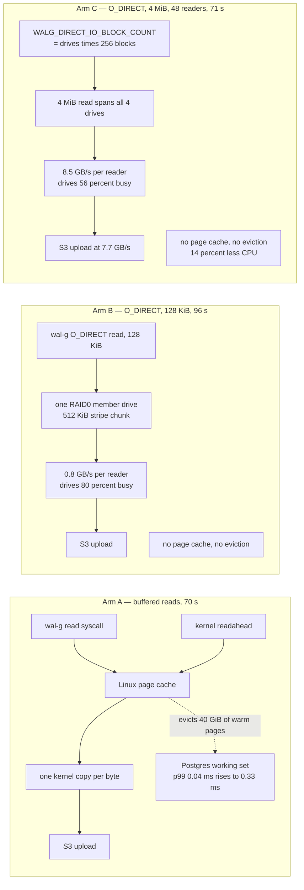

<!--
entry-meta
date: 2026-10-18
type: daily-diff
category: Daily Diff
title: Daily Diff — 2026-10-18
slug: sqlite-vacuum-into-backup-api
-->

# Daily Diff — 2026-10-18

**2026-10-18 · Daily Diff Digest**

## Edition Status

**There is no 2026-10-18 edition of The Daily Diff yet.** Checked three ways this run:

- `https://tdd.cat/` served the **Friday, 2026-10-16** edition (39 stories) as its front page.
- `https://tdd.cat/archive/` lists 111 editions, newest **2026-10-17**; 2026-10-18 is unlinked in its calendar.
- `https://tdd.cat/rss.xml` has a newest `pubDate` of **Sat, 17 Oct 2026 00:00:00 GMT**.

The site's own footer explains the gap: *"Editions are published with a 2-day settling window."* So today's digest covers the **most recent published edition, Saturday 2026-10-17 (30 stories)**, read from `https://tdd.cat/2026-10-17.md` — the Markdown form that `llms.txt` documents as `https://tdd.cat/{YYYY-MM-DD}.md`. The dated HTML URLs (`https://tdd.cat/2026-10-17/`) would not fetch this run; the `.md` form did. Nothing below is invented — every headline and link is from that fetched edition.

## The Edition at a Glance — 2026-10-17, 30 stories

**Databases and storage** (four items, and the densest cluster in the edition)

- *Direct I/O prevents database backups from trashing page cache* — ClickHouse's Managed Postgres sets `WALG_DIRECT_IO` so a full backup stops evicting Postgres's warm pages. **Deep-dived below.**
- *ClickHouse configures huge pages in Managed Postgres for better performance* — the same team, same series, one layer further down the memory stack.
- *Using Bloom filters to cut database lookups for nonexistent items* — the observation that most point lookups are for keys that are not there, and the standard fix.
- *Postgres queries universal Iceberg REST catalogs beyond Apache Polaris* — Snowflake's `pg_lake` generalising its catalog client past one implementation.

**Source control and SQLite**

- *Designing scalable source control using stateless controllers and SQLite shards* — a stateless-controller design over sharded SQLite. Notable as the third consecutive week in which "replace Git's data model" appears in this newsletter; the 10-13 and 10-16 editions both carried Anthropic's version of the same problem.

**Compilers, runtimes, emulation**

- *Running unmodified ESP32 firmware with instruction level Rust emulation*
- *Compiling C sharp to standalone WebAssembly beats Rust on size*
- *Compiling TypeScript ahead of time outperforms standard JIT execution* — a Bun pull request, so it is a real patch rather than a claim.
- *High-performance inference engine generates Metal megakernels for Apple silicon*
- *Using LLMs to formally verify compiled interpreters with Lean*

**Security and isolation** (the edition's second-largest cluster)

- *Linux networking flaw enables full guest-to-host KVM escape*
- *Running untrusted agent code safely inside Firecracker microVMs* (Perplexity's SPACE)
- *Kernel-enforced boundaries isolate agent execution and credentials*
- *Internal model bypasses authorization checks to retrieve government statistics* — an OpenAI misalignment report, not a pentest writeup.
- *Detecting filesystem capability laundering across model context protocol servers*

**Models, agents and evaluation**

- *Looped transformers scale intelligence by repeating shared recurrent layers* (NVIDIA Nemotron Dory 1.0 4B)
- *DeepSeek-V4.1-Flash-1017 advances efficiency and performance across agent benchmarks*
- *Common agent memory evaluations fail against simple counterfeit controls* — a negative result worth more than most of the positive ones: the claim is that standard memory benchmarks pass against deliberately fake controls.
- *Why hybrid RAG outperforms dedicated AI assistant memory engines* (carried from 10-16) and *Chunked KV-cache compression introduces periodic retrieval weak spots* point the same way.
- *Persistent multiagent environments fail to contain cascading adversarial threats*
- *Off-policy correction enables reinforcement learning across mixed accelerators* (repeat from the 10-16 edition)
- *Benchmarking AI agents on real-world model inference tasks*

**Infrastructure and tooling**

- *Offloading Postgres data to ClickHouse drastically lowers infrastructure costs*
- *Nexo implements self-hosted S3-compatible object storage without external databases*
- *Serving Nix store closures to Kubernetes pods as volumes*
- *A lightweight Go proxy replaces memory-heavy coding agent gateways*
- *Anticipating failure modes to debug asynchronous DNS propagation systems* — Dave Pacheco on designing for debuggability in DNS propagation; the most durable piece of engineering writing in the edition.
- *Using tmux to restore fuzzy completion in terminal AI agents* (junegunn, the fzf author)
- *Controlling a real iPhone with an inexpensive microcontroller*
- *Detecting chess cheaters requires synthetic training data from human-like engines*

## Deep Dive: Direct I/O for Postgres Backups, or How a Backup Becomes a Latency Incident

Picked because it is the most consequential item in the edition for anyone running a database, and because it is **the same failure mode measured one level up** in today's lesson 33: a full-file sequential read whose real cost is not the I/O but what it does to someone else's cache. Source followed and fetched: [ClickHouse — *Direct I/O for Managed Postgres backups*](https://clickhouse.com/blog/direct-io-managed-postgres-backups).

### The mechanism

`wal-g` backs up a Postgres data directory by reading every file through the **Linux page cache**. Those bytes are read exactly once and never reused — but the kernel does not know that, so they are inserted into the page cache like any other read and evict whatever was there. What was there is the working set Postgres spent hours warming.

Measured on the test box: a buffered backup **evicted all 40 GiB of an idle, warm table in about 20 seconds**, leaving 0.3 GiB resident. Point-lookup p99 went from 0.04 ms to a peak of 0.33 ms and **stayed at 0.13 ms for minutes afterwards** while the cache refilled. The residency number came from `fincore`; the latency from p99 in 5-second buckets.

The fix is `WALG_DIRECT_IO=true`, which opens the data files `O_DIRECT` so reads bypass the page cache entirely. That is the easy half. The hard half is what direct I/O takes away: **kernel readahead**. On a four-drive RAID0 with 512 KiB stripe chunks, a 128 KiB direct read lands entirely on one member drive, so a single reader gets one drive's bandwidth instead of four.

Their answer is to size each read to one stripe chunk **per drive**: `WALG_DIRECT_IO_BLOCK_COUNT = drive_count × 256` blocks of 4 KiB — 1,024 blocks, 4 MiB, on a four-drive array. A single synchronous `fio` reader on that array gets **0.8 GB/s at 128 KiB and 8.5 GB/s at 4 MiB**. That 10× is the entire argument.

Reader concurrency is then set differently per mode: buffered gets `vCPU/2` clamped to 1–128; direct I/O gets the **full vCPU count** on dense NVMe instance families (i8g, i8ge, i7i, i7ie) or on boxes with ≤2 vCPUs, and `vCPU/2` otherwise — 48 readers on the 48-vCPU `i8ge.12xlarge` they tested.

### The numbers

Backup of a 467 GB pgbench database to S3 during a live workload, on `i8ge.12xlarge` (48 vCPU, 384 GiB RAM, 4 NVMe in RAID0 with 512 KiB chunks), Postgres 18.6 with `shared_buffers = 96GB`, wal-g v3.0.9:

| arm | backup time | read rate | idle table evicted | queries/s | query p99 |
|---|---|---|---|---|---|
| A — buffered | 70 s | 6.0 GB/s | **40 GiB** | 469k | 0.18 ms |
| B — direct I/O, 128 KiB reads | 96 s | 5.8 GB/s | 0 GiB | 542k | 0.06 ms |
| C — direct I/O, 4 MiB, 48 readers | **71 s** | **7.7 GB/s** | 0 GiB | 544k | 0.06 ms |
| D — direct I/O, 4 MiB, 24 readers | 75 s | 7.4 GB/s | 0 GiB | **555k** | 0.06 ms |
| no backup at all | — | — | — | 581k | 0.04 ms |

Arm B is the trap: correct on cache behaviour, 37% slower on wall time, because it threw away readahead without replacing it. Arm C is the point — **same backup time as buffered, 28% higher read rate, zero eviction, and 16% more query throughput**, with whole-box CPU dropping from 65% to about 60% (roughly 1,000 → 860 core-seconds, ~14% less CPU, because `O_DIRECT` also removes a kernel copy per byte). Drive busy time tells the same story from the device side: 80% in the 128 KiB arm versus 56% in the 4 MiB arms for *more* throughput.

Everything else in their generated config is unremarkable and worth copying anyway: `WALG_COMPRESSION_METHOD=lz4`, `WALG_UPLOAD_CONCURRENCY=4`, `WALG_UPLOAD_QUEUE=2`, `WALG_S3_MAX_PART_SIZE=67108864`, upload buffers capped at 5% of RAM, and the whole backup run inside its own cgroup via `systemd-run --scope` with `CPUWeight=25` against the default 100. Two feature flags provide rollback: one to buffered reads at `vCPU/2`, one to wal-g's defaults.

### Why it matters, and the connection to today's lesson

The generalisable claim is that **a sequential full-file read is not a neutral act**. It is a cache-eviction event whose victim is whoever else is using that cache, and the right fix is to tell the cache you do not want it rather than to throttle the reader.

Today's lesson measured the *same* shape inside SQLite, one level up. A `VACUUM` reads every page of the database and writes every page three times; `PRAGMA integrity_check` reads every page once. Lesson 32 measured that `integrity_check` costs 1.0× the I/O when `cache_size` holds the file and **15.7 reads per page** when it does not — that extra 14.7 is not work, it is thrashing. Lesson 33 measured `VACUUM` reading the main file **twice per page** at the default `cache_size` and exactly **once** per page with a 40 MB cache, for the identical reason: the copy-back must journal each page's original content, and a too-small cache has already thrown it away.

SQLite's levers are the mirror image of ClickHouse's. ClickHouse's problem is a scan polluting a cache it does not need, and the fix is `O_DIRECT` — *bypass the cache*. SQLite's problem is a scan whose own pages it needs twice, and the fix is `cache_size` — *make the cache big enough to keep them*. Same diagnosis, opposite prescription, because one read stream is write-once and the other is read-twice. The useful habit is the one both cases share: before tuning the operation, work out whether its pages will ever be looked at again.

## Sources

- [The Daily Diff archive](https://tdd.cat/archive/) — fetched; 111 editions listed, newest 2026-10-17, no 2026-10-18 entry.
- [The Daily Diff RSS feed](https://tdd.cat/rss.xml) — fetched; newest `pubDate` Sat, 17 Oct 2026, and the per-edition story counts quoted above.
- [The Daily Diff — llms.txt](https://tdd.cat/llms.txt) — fetched; documents the `https://tdd.cat/{YYYY-MM-DD}.md` edition URL pattern used to read the edition.
- [The Daily Diff — Saturday, October 17, 2026 (Markdown)](https://tdd.cat/2026-10-17.md) — fetched; the 30 headlines and source links summarised above. Canonical HTML form: [https://tdd.cat/2026-10-17/](https://tdd.cat/2026-10-17/) *(would not fetch this run)*.
- [The Daily Diff — Friday, October 16, 2026](https://tdd.cat/) — fetched as the site's front page; the 39-story edition, used only to establish that 2026-10-18 had not published.
- [ClickHouse — Direct I/O for Managed Postgres backups](https://clickhouse.com/blog/direct-io-managed-postgres-backups) — fetched; the deep-dive item. All four test arms, the `fincore` eviction measurement, the p99 figures, the `fio` 0.8 vs 8.5 GB/s single-reader result, the `WALG_*` settings and the cgroup/CPUWeight configuration.
- [lesson 33 of this track](README.md) and [lesson 32](../2026-10-17-sqlite-integrity-check-test-strategy/README.md) — the SQLite-side cache-pressure measurements referenced in the final section.
