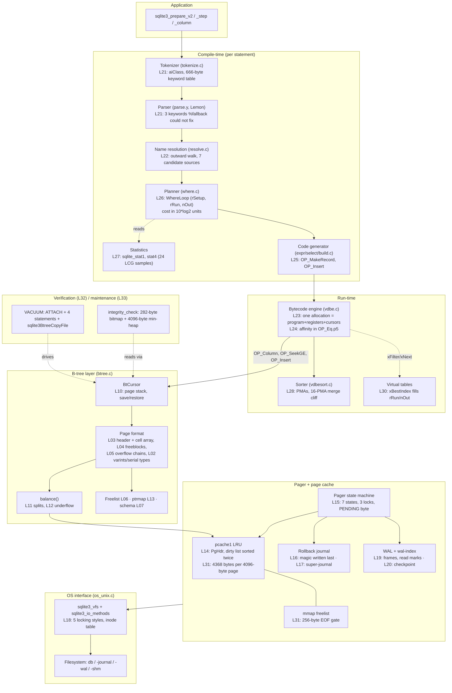

<!--
entry-meta
date: 2026-10-19
type: capstone
track: SQLite
lesson: —
category: Database Internals
title: SQLite Capstone — The Whole Engine, Ten Layers Deep, and the Four Tradeoffs It Is Built On
slug: sqlite-capstone
-->

# SQLite Capstone — The Whole Engine, Ten Layers Deep, and the Four Tradeoffs It Is Built On

**2026-10-19 · SQLite Track · Capstone (lessons 01–33 complete)**

## Where This Fits

- **What the track established.** Thirty-three lessons, 2026-09-16 to 2026-10-18, walked SQLite in the order it is layered: the on-disk format and the b-tree ([01](../../09/2026-09-16-sqlite-file-header-page1-bootstrap/README.md)–[13](../../09/2026-09-28-sqlite-autovacuum-ptrmap-page-relocation/README.md)), the pager and the VFS ([14](../../09/2026-09-29-sqlite-page-cache-pghdr-dirty-lists/README.md)–[18](../2026-10-03-sqlite-vfs-locking-styles-inode-emulation/README.md)), WAL ([19](../2026-10-04-sqlite-wal-frames-walindex-readmarks/README.md)–[20](../2026-10-05-sqlite-wal-checkpoint-algorithm/README.md)), the compiler and bytecode engine ([21](../2026-10-06-sqlite-tokenizer-and-lemon-parser/README.md)–[28](../2026-10-13-sqlite-vdbe-sorter-external-merge/README.md)), and operational topics ([29](../2026-10-14-sqlite-savepoints-statement-journals/README.md)–[33](../2026-10-18-sqlite-vacuum-into-backup-api/README.md)).
- **What this capstone adds.** The assembly: one diagram with every layer and the interface between each pair, the four end-to-end traversals (read, write, commit, recover), and the cross-cutting tradeoffs that are invisible from inside any single lesson because each one is a *consequence of a decision taken in a different layer*.
- **What it corrects.** Three claims that only become checkable once the layers sit side by side: the page cache is not the only place a page can live, `quick_check` is not a cheap `integrity_check`, and the b-tree is not what makes a `VACUUM` row copy fast.
- **What it sets up.** The next track starts at lesson 01 of a new subject. SQLite is the baseline every later engine gets compared against: one file, one writer, a b-tree per object, and a bytecode interpreter in the middle.

---

## 1. The Ten Layers, As the Project Names Them

`sqlite.org/arch.html` names ten modules. The mapping to this track is exact — every module got at least one lesson, and no lesson covered a module the project does not name:

| # | Module (arch.html's own heading) | Source file(s) | Lessons |
|---|---|---|---|
| 1 | Interface | `main.c`, `legacy.c`, `vdbeapi.c` | 23, 29, 33 |
| 2 | Tokenizer | `tokenize.c` | 21 |
| 3 | Parser | `parse.y` (Lemon) | 21 |
| 4 | Code Generator | `expr.c`, `where.c`, `select.c`, `build.c` | 22, 25, 26, 27 |
| 5 | Bytecode Engine | `vdbe.c` | 23, 24, 28 |
| 6 | B-Tree | `btree.c` | 01–13, 32 |
| 7 | Page Cache | `pager.c`, `wal.c`, `pcache.c`, `pcache1.c` | 14–17, 19, 20, 31 |
| 8 | OS Interface | `os_unix.c`, `os_win.c` | 18 |
| 9 | Utilities | `util.c`, `hash.c`, `utf.c`, `printf.c`, `random.c` | 07 (hash), 27 (random) |
| 10 | Test Code | `src/test*` | 32 |

Two things that diagram does *not* show, and that the track found:

- **Virtual tables cut across layers 4 and 6.** `xBestIndex` ([lesson 30](../2026-10-15-sqlite-vtab-xbestindex-dbstat-dbpage/README.md)) is a planner interface, not a storage interface: the module fills in `rRun` and `nOut` on a `WhereLoop` and never touches `btree.c`. So a vtab is a code-generator plug-in that happens to produce rows.
- **The pager is three caches, not one** ([lesson 31](../2026-10-16-sqlite-mmap-memory-allocation-lookaside/README.md)): `pcache1`'s page cache, the mmap freelist (`pPager->pMmapFreelist`), and the OS page cache underneath both. A mapped page is a `PgHdr` that never enters `pcache1` at all.

---

## 2. The System Map



---

## 3. Four End-to-End Traversals

### 3.1 A point read: `SELECT x FROM t WHERE id = 42`

1. `tokenize.c` classifies bytes via `aiClass`; Lemon's tables reduce to a `Select` tree (L21).
2. `resolve.c` binds `id` and `x` by walking outward through the candidate sources (L22).
3. `where.c` builds one `WhereLoop` per access path, costs each in **10·log₂ units**, and takes the cheapest path; equal costs go to the full scan (L26). `sqlite_stat1`/`stat4` supply `nOut` if `ANALYZE` has run (L27).
4. The code generator emits `OP_OpenRead`, `OP_SeekGE`/`OP_IdxRowid`, `OP_Column`, `OP_ResultRow`.
5. `vdbe.c` runs the program out of the single allocation holding program, registers and cursors (L23). `OP_Column` decodes the record using the serial-type varints (L02).
6. `BtCursor` walks root→leaf, pushing a page per level (L10); each page is a `MemPage` over a cached `PgHdr` (L14) or an mmapped page that bypasses `pcache1` (L31).
7. A page miss goes `pcache1` → pager → `xRead`/`xFetch` → filesystem.

The whole read path takes a **SHARED** lock in rollback mode, or no file lock at all in WAL mode beyond a read mark (L15, L19).

### 3.2 A write: `UPDATE t SET x = x + 1 WHERE id = 42`

The interesting part is that the *record* is built last on purpose (L25): `OP_MakeRecord` cannot run until every column register is final, because the affinity string travels with the opcode. Index maintenance is a delete-then-insert on each affected index b-tree, and a page that overflows triggers `balance()` (L11) — which may split a leaf, propagate a divider cell upward, and in the limit call `balance_deeper()` to grow the tree by a level.

### 3.3 A commit

`sqlite.org/atomiccommit.html` names twelve steps. Compressed, with the layer that owns each:

| Step | Owner | What makes it the interesting one |
|---|---|---|
| Acquire SHARED → RESERVED | pager (L15) | RESERVED coexists with readers; the PENDING byte is how a writer stops *new* readers without blocking current ones (L18) |
| Create the rollback journal | pager (L16) | Original pages are copied out *before* any modification |
| Modify pages in user space | pcache (L14) | Dirty list is kept sorted twice — once by page number for writing, once by LRU |
| Flush journal, then rewrite its header page count, then flush again | pager (L16) | The magic number is written **last**: a journal is "hot" only once it is complete |
| PENDING → EXCLUSIVE | VFS (L18) | POSIX advisory locks, five locking styles, an inode table because `fcntl` locks are per-process |
| Write pages to the db file, fsync | VFS (L18) | Assumes 512-byte sectors and *linear* writes — not atomic sector writes |
| **Delete the journal** | pager (L16) | This unlink **is** the commit point |
| Release EXCLUSIVE | pager (L15) | |

In WAL mode the shape changes completely: pages are appended as frames to `-wal`, the commit is the frame with a nonzero commit counter, readers pick an end mark and never block (L19), and the database file is only touched later by a checkpoint (L20).

### 3.4 A recovery

A reader that finds a complete `-journal` whose magic is present plays it back before it is allowed to read (L17). With multiple attached databases, the super-journal is the arbiter: a 285-byte file decides whether three databases commit. In WAL mode recovery is a wal-index rebuild — the `-shm` file is derivable from `-wal` and is discarded, not replayed.

---

## 4. The Four Cross-Cutting Tradeoffs

### 4.1 One file forces every structure to be a page number

There is no catalog outside the file, so page 1 holds both the 100-byte header and the `sqlite_schema` b-tree (L01, L07) — which is why `integrity_check`'s `aRoot` for a two-object schema is `[2,3,1]` and **page 1 is checked as an ordinary table b-tree** (L32). Everything that would be a separate file elsewhere becomes an in-file structure instead: the freelist is a trunk/leaf chain (L06), the auto-vacuum back-pointers are ptrmap pages (L13), and both are reachable only by walking from the header fields at offsets 32/36 and 52.

**Cost:** a page number is 4 bytes and is *position-dependent*, so the only way to change the page size or the auto-vacuum mode is to rewrite the whole file — which is exactly what `VACUUM` is (L33), and why `VACUUM INTO` is the only route to a new `page_size` out of a WAL database.

### 4.2 One writer buys away every concurrency problem — and creates the checkpoint problem

With a single writer, there are no tuple locks, no MVCC chains, no multixacts, no deadlock detector. The whole concurrency surface is three file locks plus a byte (L15, L18). WAL mode adds reader/writer concurrency on top with five read-mark slots (L19) and still never admits a second writer.

**Cost:** the cost moves to checkpointing. A checkpoint cannot pass a frame a live reader still needs, so it records `mxSafeFrame` and returns `SQLITE_BUSY` **with all the work already done** (L20); a long-running reader turns WAL growth into an operational problem that no amount of write tuning fixes.

### 4.3 A bytecode interpreter in the middle makes the engine inspectable and the cost model narrow

The VDBE is why every lesson in Part IV could be read off `EXPLAIN` output. It is also why the planner's interface to the outside world is only **10 bits wide**: `EXPLAIN QUERY PLAN`'s third column *is* `rRun`, and above 2×10⁹ `sqlite3LogEstFromDouble` stops computing a logarithm and reads the IEEE-754 exponent (`e = (a>>52)-1022; return e*10`), quantising cost to one value per power of two — measured 1e12→400 where 10·log₂ is 399, and the default 5e98→3280 where it is 3279 (L26, L30).

**Cost:** everything downstream inherits that resolution. `PRAGMA analysis_limit=100` wrote `101` where the truth was `19048` (L27); a vtab's `estimatedCost` cannot express a fine distinction even if the module knows one.

### 4.4 Correctness is bought with tests, not with types

155.8 KSLOC of library against **92,053.1 KSLOC** of test code — about **590:1** — with 100% branch and 100% MC/DC coverage under TH3. And the assertion in all three anomaly harnesses is `integrity_check` (L32): after simulated I/O errors, after TCL's random-point crashes, after TH3's snapshot damage.

**Cost:** the oracle has a gap, and the gap is exactly where the format is least self-describing. `quick_check` skips the per-row index probe and `UNIQUE`, so **one flipped byte inside an index key, and a pair of index entries swapped out of order, are both `ok` to `quick_check` and both fatal to `integrity_check`** — because the C walk's ordering test is guarded by `if( pPage->intKey )` and never checks index key order at all.

---

## 5. Three Corrections the Assembly Makes

| Claim from inside one lesson | What the whole stack shows |
|---|---|
| "Pages live in the page cache." | Three places: `pcache1`, the mmap freelist, the OS cache. The mmap path is gated by `unixFetch`'s 256-byte end-of-file buffer (`mmapSize >= iOff + nAmt + 256`), so **a mapping can never reach the last page of any database** — and `mmap_size` maps a *prefix*, never a hot set (L31). |
| "`quick_check` is the cheap `integrity_check`." | There is **one** consequential `if( !isQuick )` block. `quick_check` still parses every record header, compares index entry counts, and enforces `NOT NULL`, STRICT affinity, `CHECK` and `xIntegrity`. The difference is 19.8 ms vs 94.1 ms of CPU at **identical I/O** — 2,254 reads each, exactly the page count (L32). |
| "`VACUUM` is fast because the b-tree copies pages." | It is fast because of the *transfer optimisation* one layer up: `sqlite3BtreeTransferRow` `memcpy`s the serialised cell into the destination's `pTmpSpace`, bypassing the record decoder (L02), `Mem` cells (L23) and affinity (L24) entirely — 80,000 transfers for 40,000 rows and one index. A single `COLLATE NOCASE` index silently loses that path (L33). |

---

## 6. Hands-On — Rebuild the Stack From the Bytes Up

A project-scale exercise: write a **read-only SQLite reader** that answers one query without linking SQLite, then validate it against SQLite itself at every layer. Each step is checkable against a lesson.

### Step 0 — Build the subject file

```sql
PRAGMA page_size = 4096;
CREATE TABLE t(id INTEGER PRIMARY KEY, k TEXT, v BLOB);
CREATE INDEX t_k ON t(k);
WITH RECURSIVE s(i) AS (SELECT 1 UNION ALL SELECT i+1 FROM s WHERE i < 20000)
INSERT INTO t SELECT i, 'key-' || i, randomblob(80) FROM s;
-- force at least one overflow chain (lesson 05)
INSERT INTO t(k, v) VALUES ('big', randomblob(9000));
```

### Step 1 — Parse the header yourself (L01)

```bash
xxd -l 100 -g 1 cap.db
```

**What to look for:** bytes 0–15 spell `SQLite format 3\0`; offset 16 is the page size; offsets 21/22/23 are **fixed at 64/32/32** (the max/min embedded payload fractions — SQLite refuses a file where they differ); offset 28 is the in-header page count; offsets 32 and 36 are the freelist trunk and count; offset 44 is the schema format. Verify offset 28 equals `stat -c %s cap.db` ÷ page size. That it does is the whole point of the header being *inside* page 1.

### Step 2 — Walk `sqlite_schema` and find the root pages (L02, L07)

Decode page 1 from offset 100: the b-tree page header, the cell pointer array, then each cell as `varint(payload) varint(rowid) record`. Decode the record header's serial-type varints to split the five columns (`type, name, tbl_name, rootpage, sql`).

**Cross-check:**

```sql
SELECT name, rootpage FROM sqlite_schema;
SELECT * FROM dbstat WHERE name='t' LIMIT 5;
```

**What to look for:** your decoded `rootpage` for `t_k` must match, and `dbstat`'s `pageno` set for `t` must be exactly the set of pages your walk reaches. If it is not, you have mis-decoded a varint — which is the most common single bug in this exercise, because the 9-byte case does not follow the 7-bits-per-byte rule.

### Step 3 — Prove every byte of one page is accounted for (L03, L04, L32)

For one leaf page, build `integrity_check`'s own argument: emit `(start<<16)|end` for every cell and every freeblock, add the **implied entry at `contentOffset - 1`** covering the header and cell pointer array, sort, and pull in order.

**What to look for:** no overlaps, and the gaps must sum to the page header's fragmented-bytes byte. For the 30-cell page the track used, `8 + 2·30 + (4096−85) = 4079` leaves exactly the **17 unused bytes** `dbstat` reports. Getting the same number from your own arithmetic, from `dbstat`, and from `sqlite_dbpage` is the same claim verified three ways.

### Step 4 — Follow one overflow chain (L05)

Find the `'big'` row's cell, compute `nLocal` from the max/min-local formula, then follow the 4-byte next-page pointer at the head of each overflow page.

**What to look for:** the chain length must equal `ceil((9000 − nLocal) / (pagesize − 4))`, and the final page's first four bytes must be zero. A chain one page longer than the formula means you used `maxLeaf` where `minLocal` was required — the sawtooth.

### Step 5 — Answer the query two ways (L09, L26)

Implement `SELECT id FROM t WHERE k = 'key-17777'` twice: once as a full table-b-tree scan, once as a seek into `t_k` followed by a rowid lookup.

**Cross-check:**

```sql
EXPLAIN QUERY PLAN SELECT id FROM t WHERE k = 'key-17777';
ANALYZE; -- then run it again
```

**What to look for:** the plan's third column is the loop's `rRun` in 10·log₂ units — your own page-touch counts for the two implementations should be ordered the same way the costs are. Then scale the table and find the `SEARCH`/`SCAN` crossover; if your reader's page counts cross at a different size than SQLite's cost model does, you have found the gap between a cost model and a cost.

### Step 6 — Watch a commit from underneath (L16, L19, L20)

```bash
# rollback mode
stat -c '%n %s' cap.db*; sqlite3 cap.db "UPDATE t SET v=randomblob(80) WHERE id<100;" &
# in another shell, during the write:
ls -l cap.db-journal && xxd -l 28 cap.db-journal
```

**What to look for:** the journal's first 8 bytes are the magic, and they are written **last** — a journal captured mid-write has a zeroed magic and is therefore *not* hot. Then `PRAGMA journal_mode=WAL` and repeat: `cap.db-wal` grows by frames, `cap.db` does not change at all until `PRAGMA wal_checkpoint`, and `cap.db-shm` reappears from nothing if you delete it while no process has the database open.

### Step 7 — Break it on purpose, then catch it (L32)

Flip one byte inside an index key in the `t_k` b-tree (not in a header), then run both pragmas.

**What to look for:** `PRAGMA quick_check` returns `ok`; `PRAGMA integrity_check` does not. That asymmetry is the single most useful operational fact in the whole track.

---

## Where This Breaks Down

- **The exercise above is read-only for a reason.** Writing SQLite format correctly means implementing `balance()` (L11, L12) and the journal protocol (L16); a third-party writer that gets the 2/3 rule or the fsync ordering slightly wrong produces a file that passes `quick_check` and loses data on crash.
- **Every number in this track is one build, one filesystem, one page size.** The 4,368-byte-per-page cache overhead, the 3.003× `VACUUM` write amplification, the 256-byte mmap gate: the first is `sizeof` on one platform, the second is arithmetic SQLite's own comments predict, the third is a literal in `os_unix.c`. Only the third is portable as written.
- **Single-writer is the design, not a limitation to engineer around.** Every "how do I get more write concurrency out of SQLite" answer is really "shard into more files" or "use something else." The track's honest conclusion is that SQLite's performance envelope is set by `btree.c` and `pager.c`, and both assume exactly one writer.
- **The capstone deliberately does not cover** FTS5, R-Tree, session/changesets, `sqlite3_recover`, or the WAL savepoint path (`sqlite3WalSavepointUndo`) — all flagged as out of scope during the track and all still unread.

## Further Study

- [SQLite: Write-Ahead Logging](https://sqlite.org/wal.html) — read it again *after* lessons 19 and 20; the "Disadvantages" list is nine items and every one of them is a consequence of a mechanism the track dissected.
- [How SQLite Is Tested](https://sqlite.org/testing.html) — the four harnesses (TCL, TH3, SQL Logic Test, dbsqlfuzz) and what each one can and cannot find.
- [Atomic Commit In SQLite](https://sqlite.org/atomiccommit.html) — §2's hardware assumptions are the most under-read page in the project's documentation.
- [The SQLite Database File Format](https://sqlite.org/fileformat2.html) — the only document you need to write a reader, and it is 100 KB of text.

## Next Steps

1. Finish the Step 0–7 reader and publish the page-count-versus-`rRun` comparison from Step 5; that is a real benchmark of a cost model against a cost.
2. Instrument a pass-through VFS (the technique from L33) and record the full `xWrite`/`xSync`/`xTruncate`/`xDelete` sequence for: rollback commit, WAL commit, checkpoint, `VACUUM`, `VACUUM INTO`. Five sequences, one table.
3. Re-run the L32 corruption matrix across all four cell layouts (L03) — the track only broke index keys and a page-type byte.
4. Carry the four tradeoffs forward as the comparison axes for the next track: how does the next engine handle catalog placement, writer concurrency, cost-model resolution, and its own verification oracle?

## Sources

- [SQLite Architecture](https://sqlite.org/arch.html) — the ten-module decomposition and the source file for each.
- [The SQLite Database File Format](https://sqlite.org/fileformat2.html) — the 100-byte header field table (offsets 0–96), the payload fractions fixed at 64/32/32, and the four top-level sections.
- [Atomic Commit In SQLite](https://sqlite.org/atomiccommit.html) — the twelve-step commit sequence (§3.1–3.12) and the 512-byte hard-coded sector size and linear-write assumptions (§2).
- [Write-Ahead Logging](https://sqlite.org/wal.html) — read marks and end marks, the `-shm` wal-index, the advantages/disadvantages lists, and the checkpoint/reset rules.
- [How SQLite Is Tested](https://sqlite.org/testing.html) — 155.8 KSLOC library, 92,053.1 KSLOC test code, ≈590:1, 100% branch and MC/DC coverage under TH3.

## Takeaways

- **The whole engine is four decisions.** One file, one writer, a bytecode interpreter in the middle, and tests instead of types. Every mechanism in thirty-three lessons is downstream of one of those four, and so is every limitation.
- **The commit point is a filesystem operation, not a database operation.** In rollback mode it is `unlink("-journal")`; in WAL mode it is a frame header with a nonzero commit counter. Both are single writes that the VFS must make durable, and both are the reason SQLite's correctness depends on assumptions about hardware it cannot verify.
- **Inspectability is a design property here.** `EXPLAIN`, `dbstat`, `sqlite_dbpage`, `sqlite3_trace_v2` and the authorizer between them exposed every number in this track — including the one place the documentation was wrong (`sqlite_dbpage`'s `ROLLBACK TO` claim, L30) and the two places an earlier lesson was (L28's sorter-mmap guesses and L32's `VACUUM` sorter claim, both corrected in L33).
- **Know where the oracle is blind.** `quick_check` is not a faster `integrity_check`; it is a *weaker* one at nearly the same I/O, and it is blind to index key order. If you run a check in production, run the real one.
