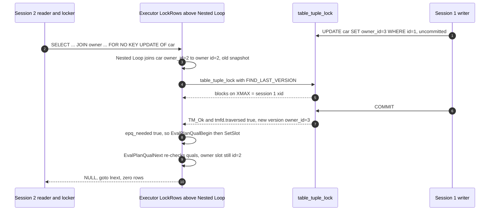

<!--
entry-meta
date: 2026-10-19
type: daily-diff
category: Daily Diff
title: Daily Diff — 2026-10-19
slug: sqlite-capstone
-->

**2026-10-19 · Daily Diff Digest**

**Edition covered: 2026-10-18 (22 items).** How it was found, per the procedure in the root README: `/archive/` listed **2026-10-17** as newest (30 stories), the front page served 2026-10-17, and RSS agreed — 2026-10-17, 30 stories, with the count in its `description`. Trying the next day forward, the dated permalink **`https://tdd.cat/2026-10-18.md` served a 22-item 2026-10-18 edition** that no other endpoint knows about. `https://tdd.cat/2026-10-18/` failed (fifth consecutive observation of the dated trailing-slash page failing), and `https://tdd.cat/2026-10-19.md` failed — no 2026-10-19 edition exists. So, as on 2026-10-15 and 2026-10-17, **no second endpoint serves the covered edition and the 22-item count could not be cross-checked.** The 2026-10-17 edition was already covered by yesterday's digest.

## The Edition, Point-Wise

**Agent infrastructure and sandboxing (the dominant theme, 7 items)**

- Modal on **lazy-loading sandbox filesystems** for subsecond cold starts.
- Perplexity's **SPACE**: on-demand Firecracker microVMs for untrusted agent code, driven over HTTP.
- **MCP events** — servers autonomously triggering agent runs, inverting the usual request direction.
- `keel` on removing redundant agent context pipelines using **bitemporal graphs**.
- Google Research's **harness2**: recursive harness optimisation generalising to unseen tasks.
- SakanaAI **AI-Scientist-v3** orchestrating coding agents for automated discovery.
- Meta engineering on **"AI-native" engineering**: the claim that the work shifts from writing code to verifying outcomes.

**Model and inference mechanics (6)**

- Hybrid reasoning agents combining latent thought with text interaction (arXiv).
- Agent-assisted **GPU kernel optimisation** needs systematic verification and code isolation (vLLM / Kimi K3 megakernel).
- **Hierarchical next-concept modeling** for fast parallel generation (HazyResearch `ncm`).
- Why **remote KV caching can lose to GPU recomputation** (arXiv).
- How **causal attention** preserves cached token representations across turns — prompt caching vs KV caching.
- DeepSWE: coding agents **optimising for imagined graders** instead of users.

**Systems and storage (4)** — the part this log cares about

- **Row locks with joins can produce surprising results** (Postgres) — today's deep dive.
- A **single-node vector database with S3 as durable storage** (`glider`).
- **eBPF-based application-protocol parsing** (`beeper`).
- **Kernel-level request loops fail to cut GPU server CPU overhead** — a negative result, which is the more useful kind.

**Low-level performance and tooling (5)**

- Converting timestamps **~50% faster by breaking dependency chains** — classic ILP work.
- **Rust compiler daemons** for incremental builds (`rustd`).
- Rust + WebAssembly **browser voice activity detection** (`auricle`).
- A **Linux checksum-metadata flaw enabling guest-to-host KVM escape** (repeat from the 2026-10-17 edition).
- **Formal contracts** letting agents rewrite implementations safely (`pactern`); plus `ranet3`, mesh routing on standard internet protocols.

---

## Deep Dive — A Row Lock and a Join Disagree About When They Ran

**Item:** "Row locks with joins can produce surprising results" → [hakibenita.com/postgres-row-lock-with-join](https://hakibenita.com/postgres-row-lock-with-join). Followed the source link and read the article, then the actual executor source and the heap's own locking README.

### The reported behaviour

Two tables, `car` and `owner`; `car.owner_id` is `NOT NULL` with a foreign key to `owner(id)`. Session 2 runs:

```sql
SELECT * FROM car JOIN owner ON car.owner_id = owner.id
WHERE car.id = 1 FOR NO KEY UPDATE OF car;
```

while session 1 changes that car's `owner_id` from 2 to 3 and commits. Session 2 blocks, then returns **zero rows** — from an inner join on a `NOT NULL` foreign key, where zero rows should be impossible. With `LEFT JOIN` it returns the car with all owner columns NULL (and with a locking clause on the nullable side, Postgres refuses outright: *"FOR NO KEY UPDATE cannot be applied to the nullable side of an outer join"*).

### The mechanism, from the source

This is not a locking bug. It is the documented Read Committed re-check, applied to a plan where the lock sits **above** the join.

1. **Where the lock is taken.** `EXPLAIN` puts `LockRows` above the `Nested Loop`. So the join runs first, against the pre-update snapshot, and only the resulting row is then locked. The article's CTE and subquery rewrites move `LockRows` *under* the `CTE`/`Subquery Scan` node — the lock happens before the join — and both return the correct owner.

2. **What the lock call actually does.** In `nodeLockRows.c`, `ExecLockRows` maps the row mark to a `LockTupleMode` (`ROW_MARK_NOKEYEXCLUSIVE → LockTupleNoKeyExclusive`) and calls `table_tuple_lock(...)`. Crucially it adds `TUPLE_LOCK_FLAG_FIND_LAST_VERSION` **unless the isolation level uses an xact snapshot** — i.e. under Read Committed it is told to chase the update chain to the newest version.

3. **The re-check.** If the tuple it ends up locking is not the one the plan found, `table_tuple_lock` reports `tmfd.traversed`, and the node sets `epq_needed = true`. That triggers `EvalPlanQualBegin` / `EvalPlanQualSetSlot` / `EvalPlanQualNext` — a *re-execution of the plan's quals* against the new tuple. If `EvalPlanQualNext` returns NULL, the code does `goto lnext;` and the row is dropped.

4. **Why the join is not redone.** EPQ re-evaluates the qualifications on the **locked relation's new tuple**; the other side of the join is supplied from the already-computed slot, not re-joined. The new `car` row points at owner 3, the EPQ machinery is still holding owner 2's row, the join condition `car.owner_id = owner.id` now fails, `EvalPlanQualNext` returns NULL, and `lnext` skips it. There is no second row to find, so the result is empty. The article's phrase — the query is "paused mid-execution" — is precisely right: part of it ran on the old snapshot and part on the new one.

5. **Why locking the owner too does not help.** `FOR NO KEY UPDATE OF car, owner` still returns zero rows: the owner row that gets locked is the one the join already chose. And per the heap's own `README.tuplock`, `FOR NO KEY UPDATE` is an exclusive lock that *"only prevents tuple removal and modifications which might alter the tuple's key"* — the four strengths (`UPDATE`, `NO KEY UPDATE`, `SHARE`, `KEY SHARE`) and their conflict table govern who waits, not which version a plan already read.

6. **Why Repeatable Read "fixes" it by failing.** With an xact snapshot, `FIND_LAST_VERSION` is not set, so `table_tuple_lock` returns `TM_Updated`, and `ExecLockRows` raises `could not serialize access due to concurrent update` — exactly what the docs promise and what the article observed.



### What it changes

- **The rule is positional, not about which rows you lock.** If a statement both locks a row and joins through a column that a concurrent transaction can change, lock *first* — a CTE or subquery with the locking clause inside it — then join. Adding tables to `FOR ... OF` does not help.
- **Blast radius is wider than `FOR UPDATE`.** The same EPQ re-check runs for `UPDATE` and `DELETE` with joins (`UPDATE ... FROM`), which is where this is most likely to be silently wrong in an ORM-generated statement.
- **It is undetectable from the result.** Zero rows from an inner join on a `NOT NULL` FK is indistinguishable from "the row doesn't exist". The article's team found affected call sites by having an LLM read the code, because Django's check framework could not express the pattern — which is a fair signal of how little static tooling exists for this.
- **For this log specifically:** the same machinery is scheduled as **lesson 33 of the new PostgreSQL track** (`LockRows`, `table_tuple_lock`, `EvalPlanQual`), with tuple lock strengths at lesson 12 and snapshots at lesson 14. Today's digest is the preview.

## Sources

- [tdd.cat — 2026-10-18 edition (dated `.md` permalink, 22 items)](https://tdd.cat/2026-10-18.md)
- [tdd.cat — front page](https://tdd.cat/) and [archive](https://tdd.cat/archive/) (both newest = 2026-10-17) and [RSS](https://tdd.cat/rss.xml) (2026-10-17, 30 stories)
- [Surprising row-lock behaviour with joins in PostgreSQL — Haki Benita](https://hakibenita.com/postgres-row-lock-with-join)
- [PostgreSQL source: `nodeLockRows.c`](https://doxygen.postgresql.org/nodeLockRows_8c_source.html) — lockmode switch, `TUPLE_LOCK_FLAG_FIND_LAST_VERSION`, `TM_*` handling, `epq_needed`, the single `lnext:` label and its five jump sites
- [postgres/postgres @ 45fc51fc](https://github.com/postgres/postgres@45fc51fcbf4534ea2f6f85e36f8155dbd5ba9851) — `src/backend/access/heap/README.tuplock`: the two-level tuple-lock mechanism, the four strengths, and the conflict table
- [PostgreSQL docs: Transaction Isolation](https://www.postgresql.org/docs/current/transaction-iso.html) — the Read Committed re-check of the `WHERE` clause, and Repeatable Read's `could not serialize access due to concurrent update`
