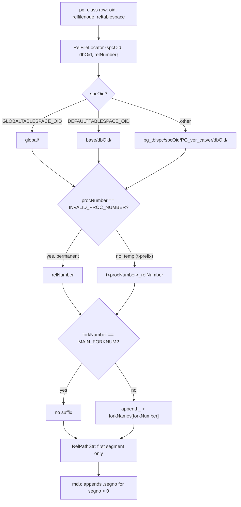
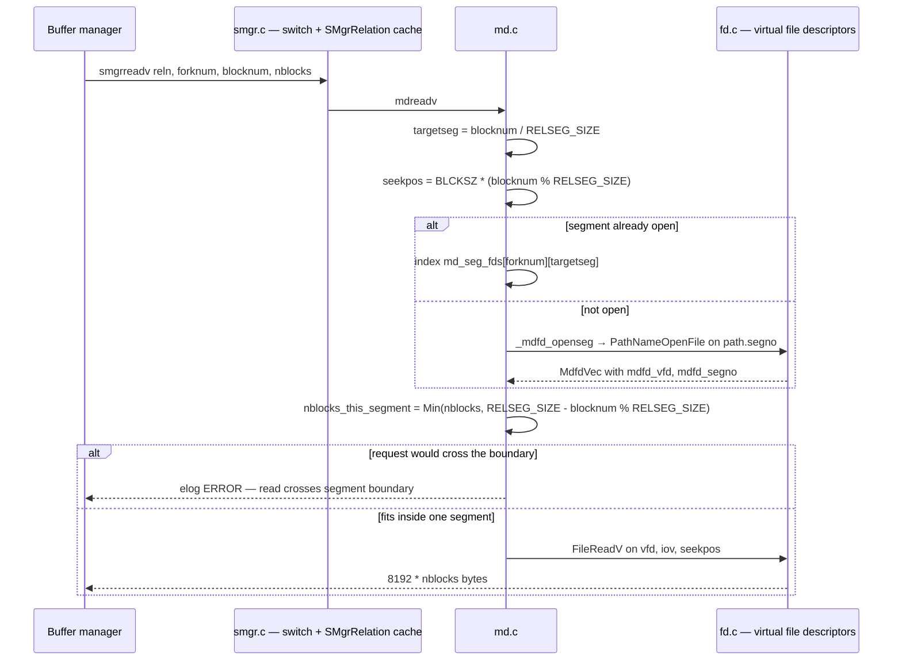

<!--
entry-meta
date: 2026-10-20
type: lesson
track: PostgreSQL
lesson: 01
category: Database Internals
title: The Cluster on Disk — Nine sprintf Branches, Four Fork Names With No Underscore In Them, and a 32,767-Segment Ceiling
slug: postgres-cluster-on-disk-forks-segments
-->

# The Cluster on Disk — Nine `sprintf` Branches, Four Fork Names With No Underscore In Them, and a 32,767-Segment Ceiling

**2026-10-20 · PostgreSQL Track · Lesson 01 of 35**

## Where This Fits

- **The previous track established the opposite answer.** The [SQLite capstone](../2026-10-19-sqlite-capstone/README.md) closed 33 lessons on an engine where the *entire* database — catalog, every table, every index, the freelist — is one file, addressed by a page number that starts at 1 and is multiplied by a page size read out of bytes 16–17 of that same file. There is no name resolution step at all: the filename is whatever you passed to `sqlite3_open()`.
- **This lesson adds the layer SQLite does not have.** PostgreSQL puts a *name resolution* stage between "this relation" and "these bytes": a relation is identified by a triple (tablespace, database, file number), that triple is turned into a path string by one function with nine `sprintf` branches, and the resulting path names only the *first* 1 GB of only *one* of up to four physical files. Nothing in this lesson touches page contents.
- **It is the addressing layer every later lesson sits on.** Lesson 02 opens the first 8 KB of the main fork and reads `PageHeaderData`. Lesson 05 and 06 open the `_fsm` and `_vm` forks whose existence is established here. Lesson 08 returns to `smgr`/`md.c` for the fsync request queue and relation extension locking, which this lesson deliberately leaves alone.
- **What it sets up next:** a block number. Everything from lesson 02 onward is "given block *N* of fork *F* of relation *R*, here are its 8192 bytes". This lesson is how `(R, F, N)` becomes a file descriptor and a byte offset.

Source commit for every code reference below: **`postgres/postgres@ddd468ca`**, read through the GitHub API during this run. The documentation references are PostgreSQL 18 (`/docs/current/` at time of reading).

---

## 1. The identity triple, and why the filename is not the OID

A relation's *logical* identity is its OID in `pg_class`. Its *physical* identity is a different number. The documentation is blunt about not conflating them:

> Do not assume that filenode equals table OID. Operations such as `TRUNCATE`, `REINDEX`, `CLUSTER`, and some `ALTER TABLE` forms can change the filenode while keeping the OID.

Three numbers name the bytes, and they travel together in a `RelFileLocator`:

| Field | What it selects | Catalog source |
|---|---|---|
| `spcOid` | tablespace — which of three path shapes to use | `pg_class.reltablespace` (0 means the database default) |
| `dbOid` | database directory | `pg_database.oid` |
| `relNumber` | the file number itself, type `RelFileNumber` | `pg_class.relfilenode` |

`RelFileNumber` is **not a distinct integer type** — `src/include/common/relpath.h` declares it as a typedef of `Oid`:

```c
typedef Oid RelFileNumber;
#define InvalidRelFileNumber		((RelFileNumber) InvalidOid)
```

So the two namespaces that must never be confused are the *same C type*, and the compiler will not catch a mix-up. That is why the codebase is pedantic about the names `relNumber` versus `dbOid`.

**The catalog's own trap.** For some system catalogs, including `pg_class` itself, `pg_class.relfilenode` is `0`. You cannot bootstrap the location of `pg_class` out of `pg_class`. The escape hatch is the function `pg_relation_filenode()`, which returns the real number for those relations; `pg_relation_filepath()` is the version that returns the whole path.

## 2. `GetRelationPath()` — nine branches, three shapes

`src/common/relpath.c` holds the only function that turns the triple into a path. It is a three-way branch on tablespace, each arm split by temp-vs-permanent, each of those split again by main-fork-vs-other — nine `sprintf` calls in total. The three shapes:

| Tablespace | Path shape |
|---|---|
| `GLOBALTABLESPACE_OID` (shared catalogs) | `global/<relNumber>` |
| `DEFAULTTABLESPACE_OID` | `base/<dbOid>/<relNumber>` |
| anything else | `pg_tblspc/<spcOid>/<TABLESPACE_VERSION_DIRECTORY>/<dbOid>/<relNumber>` |

And the four modifiers layered on top of each shape:

```c
/* permanent, main fork        */ "base/%u/%u"
/* permanent, non-main fork    */ "base/%u/%u_%s"
/* temporary, main fork        */ "base/%u/t%d_%u"
/* temporary, non-main fork    */ "base/%u/t%d_%u_%s"
```

Three things fall out of reading the actual code rather than the docs:

- **The underscore before a fork suffix is in the format string, not in the fork's name.** The name table is four bare strings with no punctuation:

  ```c
  const char *const forkNames[] = {
      [MAIN_FORKNUM]          = "main",
      [FSM_FORKNUM]           = "fsm",
      [VISIBILITYMAP_FORKNUM] = "vm",
      [INIT_FORKNUM]          = "init",
  };
  ```

  The file is `16384_fsm` because the format is `"%u_%s"`. This is exactly why `pg_relation_size(rel, 'fsm')` takes `fsm` and not `_fsm` — the SQL-level argument is fed to `forkname_to_number()`, which `strcmp`s against that array. Its error hint enumerates the same four strings: `Valid fork names are "main", "fsm", "vm", and "init".`

- **The main fork has no suffix at all, by an explicit `if`.** Every branch tests `if (forkNumber != MAIN_FORKNUM)` before appending. `MAIN_FORKNUM` is `0`, the first enum member, and `smgr/README` states the invariant that depends on it: *"It is assumed that the main fork, fork number 0 or MAIN_FORKNUM, always exists."*

- **The `t` prefix for temp relations carries a proc number, not a PID.** The format is `t%d_%u` where `%d` is `procNumber` — a backend slot index, not `getpid()`. `relpath.h` sizes the field from `MAX_BACKENDS`, which it states is `2^18-1`, i.e. 262,143, hence `#define PROCNUMBER_CHARS 6`. A shared catalog can never be temporary, and the code asserts it:

  ```c
  if (spcOid == GLOBALTABLESPACE_OID)
  {
      Assert(dbOid == 0);
      Assert(procNumber == INVALID_PROC_NUMBER);
  ```

**The return type is a struct, on purpose.** `GetRelationPath()` returns `RelPathStr` — a `struct` wrapping a fixed `char str[REL_PATH_STR_MAXLEN + 1]` — and the header explains why it is not a plain `char *`:

> We return this struct, instead of `char[REL_PATH_STR_MAXLEN + 1]`, as the pointer would decay to a plain `char *` too easily, possibly preventing the compiler from detecting invalid references to the on-stack return value of `GetRelationPath()`.

That is a deliberate anti-footgun: a by-value struct is safe to build inside a critical section where `palloc` is forbidden, and the type system stops you from returning a dangling pointer to it. `REL_PATH_STR_MAXLEN` is assembled at compile time from `sizeof(PG_TBLSPC_DIR) - 1`, two `OIDCHARS` (10 each), `PROCNUMBER_CHARS` (6), `FORKNAMECHARS` (4), `sizeof(TABLESPACE_VERSION_DIRECTORY) - 1` and six separator bytes. The tablespace-version term depends on `CATALOG_VERSION_NO`, which this run did not read, so the numeric total is build-specific and is not quoted here.



## 3. Four forks, and `forkname_chars()`'s deliberate blind spot

`ForkNumber` is a four-member enum with `MAX_FORKNUM` pinned to its last member:

```c
typedef enum ForkNumber
{
	InvalidForkNumber = -1,
	MAIN_FORKNUM = 0,
	FSM_FORKNUM,
	VISIBILITYMAP_FORKNUM,
	INIT_FORKNUM,
} ForkNumber;

#define MAX_FORKNUM		INIT_FORKNUM
#define FORKNAMECHARS	4		/* max chars for a fork name */
```

| Fork | On-disk suffix | Exists for | Covered in |
|---|---|---|---|
| `MAIN_FORKNUM` | *(none)* | everything | lesson 02 onward |
| `FSM_FORKNUM` | `_fsm` | tables and indexes | lesson 05 |
| `VISIBILITYMAP_FORKNUM` | `_vm` | tables | lesson 06 |
| `INIT_FORKNUM` | `_init` | unlogged tables and their indexes | here, briefly |

- `FORKNAMECHARS` is 4 and the longest name, `init`, is exactly 4 — zero slack.
- A `StaticAssertDecl` ties the array to the enum, so adding a fork without extending `forkNames[]` fails the build: `StaticAssertDecl(lengthof(forkNames) == (MAX_FORKNUM + 1), "array length mismatch")`.
- **`forkname_chars()` cannot recognise the main fork, by construction.** It is the function that decides whether a stray filename in a database directory is a relation fork, and its loop starts at 1:

  ```c
  for (forkNum = 1; forkNum <= MAX_FORKNUM; forkNum++)
  ```

  So a file literally named `16384_main` is *not* classified as a fork of 16384 — correctly, since no such file is ever created. The function also documents an assumption that holds only because of the names chosen: *"the present coding assumes that there are no fork names which are prefixes of other fork names."* `fsm`, `vm`, `init` satisfy it. A future fork named `in` or `vmap` would silently break the scanner.

**The init fork is a template, not metadata.** Section 66.5 says it is "an empty table or index of the appropriate type", and crash recovery resets an unlogged relation by *copying the init fork over the main fork*, erasing the other forks, which are then recreated on demand. It is the only fork whose job is to be copied rather than read.

## 4. Segments: `blocknum / RELSEG_SIZE` and `blocknum % RELSEG_SIZE`

`pg_relation_filepath()` names one file. A relation is a *chain* of files. `md.c`'s header comment states the on-disk invariant precisely:

> On disk, a relation must consist of consecutively numbered segment files in the pattern
> — Zero or more full segments of exactly `RELSEG_SIZE` blocks each
> — Exactly one partial segment of size `0 <= size < RELSEG_SIZE` blocks
> — Optionally, any number of inactive segments of size 0 blocks.

`RELSEG_SIZE` is a compile-time constant from `pg_config.h`, not a runtime setting. `pg_config.h.in` explains the choice of default:

> `RELSEG_SIZE` is the maximum number of blocks allowed in one disk file. Thus, the maximum size of a single file is `RELSEG_SIZE * BLCKSZ` […] By default, we make the limit 1 GB to avoid any possible integer-overflow problems within the OS. A limit smaller than necessary only means we divide a large relation into more chunks than necessary, so it seems best to err in the direction of a small limit. A power-of-2 value is recommended to save a few cycles in `md.c`, but is not absolutely required. Changing `RELSEG_SIZE` requires an `initdb`.

The arithmetic, with the stock `BLCKSZ = 8192` and 1 GB segments:

| Quantity | Value | Where it comes from |
|---|---|---|
| `BLCKSZ` | 8192 bytes (max possible 32768) | `pg_config.h`; the 32768 ceiling is set by 15-bit `lp_off`/`lp_len` in `ItemIdData` — lesson 02's territory |
| `RELSEG_SIZE` | 131,072 blocks (1 GiB / 8 KiB) | `pg_config.h`, `--with-segsize` |
| `MaxBlockNumber` | `0xFFFFFFFE` = 4,294,967,294 | `src/include/storage/block.h` |
| Max segments per fork | `MaxBlockNumber / RELSEG_SIZE` = **32,767** | `md.c`'s own comment on `SEGMENT_CHARS` |
| Max bytes per fork | 4,294,967,294 × 8192 = **35,184,372,072,448** | = 32 TiB − 16 KiB |

The "32 TB table limit" everyone quotes is 16 KiB short of 32 TiB, because `BlockNumber` is a `uint32` whose top value `0xFFFFFFFF` is reserved as `InvalidBlockNumber` and `MaxBlockNumber` is therefore `0xFFFFFFFE` — two blocks, not one, are unavailable.

Two guard rails worth knowing about:

```c
StaticAssertDecl(RELSEG_SIZE > 0 && RELSEG_SIZE <= INT_MAX,
				 "RELSEG_SIZE must fit in an integer");
```

The comment above it: *"`RELSEG_SIZE` must fit into `BlockNumber`; but since we expose its value as an integer GUC, it actually needs to fit in signed int. It's worth having a cross-check for this since configure's `--with-segsize` options could let people select insane values."*

### Block number → (segment, offset)

Every read and write path in `md.c` does the same two divisions:

```c
targetseg = blkno / ((BlockNumber) RELSEG_SIZE);                 /* _mdfd_getseg  */
seekpos   = (pgoff_t) BLCKSZ * (blocknum % ((BlockNumber) RELSEG_SIZE));
```

Open file descriptors are cached per fork in `SMgrRelation`, in the `md_seg_fds[forknum]` array whose length is `md_num_open_segs[forknum]` — so segment lookup for an already-open segment is an array index, not a path rebuild:

```c
if (targetseg < reln->md_num_open_segs[forknum])
    /* ... we're done */
```



### Three consequences of segmentation that are easy to miss

- **Vectored I/O stops dead at a segment boundary.** `mdreadv()` and `mdwritev()` compute `nblocks_this_segment` and then refuse to proceed if it differs from what was asked: `elog(ERROR, "read crosses segment boundary")` / `"write crosses segment boundary"`. The caller is expected to have asked a legal question; `mdmaxcombine()` is how it finds out the cap, and it is nothing but the remaining distance to the boundary:

  ```c
  segoff = blocknum % ((BlockNumber) RELSEG_SIZE);
  return RELSEG_SIZE - segoff;
  ```

  So with 1 GB segments, no single I/O ever spans the 1 GiB line — a 128-block readahead starting at block 131,070 is split, not stretched.

- **A zero-length `.1` file is legal and expected.** `mdtruncate()` keeps the last segment it wants rather than unlinking it, and the comment states the corner case explicitly: *"if `nblocks` is exactly a multiple K of `RELSEG_SIZE`, we will truncate the K+1st segment to 0 length but keep it. This adheres to the invariant given in the header comments."* Seeing `16384.1` at 0 bytes next to a `16384` of exactly 1 GiB is not corruption. The header explains the reason for not unlinking: other backends may still hold open descriptors, and *"data might get written out to an unlinked old copy of a segment file that will eventually disappear."*

- **Extension can write zeroes into segments nobody asked for.** `_mdfd_getseg()` with `EXTENSION_CREATE` must preserve "segments before the last active segment are of size `RELSEG_SIZE`", so when it has to skip ahead it pads:

  ```c
  if (nblocks < ((BlockNumber) RELSEG_SIZE))
  {
      char *zerobuf = palloc_aligned(BLCKSZ, PG_IO_ALIGN_SIZE, MCXT_ALLOC_ZERO);
      mdextend(reln, forknum, nextsegno * ((BlockNumber) RELSEG_SIZE) - 1, zerobuf, skipFsync);
      pfree(zerobuf);
  }
  ```

  The comment names the only non-recovery caller that does this: *"this can happen in hash indexes."*

- **`_mdnblocks()` learns the size by walking.** There is no stored block count. It opens segments in order, and the first one shorter than `RELSEG_SIZE` ends the walk: `return (segno * ((BlockNumber) RELSEG_SIZE)) + nblocks;`. A segment longer than `RELSEG_SIZE` is a `FATAL`: `elog(FATAL, "segment too big")`.

## 5. The rest of `PGDATA`, in one pass

`base/` and `global/` hold relations. Everything else in the data directory is a different subsystem, and most of them are later lessons in this track:

| Directory | Contents | Track lesson |
|---|---|---|
| `base/<dboid>/` | per-database relations, including each database's own catalogs | — |
| `global/` | cluster-wide shared catalogs, e.g. `pg_database` | — |
| `pg_wal/` | WAL files | 21–25 |
| `pg_xact/` | transaction commit status (two bits per xid) | 13 |
| `pg_subtrans/` | subtransaction parent links | 16 |
| `pg_multixact/` | multitransaction (shared row lock) state | 17 |
| `pg_commit_ts/` | commit timestamps | — |
| `pg_serial/` | committed serializable transaction info | 20 (SSI) |
| `pg_replslot/`, `pg_logical/` | replication slots, logical decoding state | 26–27 |
| `pg_tblspc/` | symlinks named by tablespace OID | here |
| `pg_twophase/`, `pg_snapshots/`, `pg_notify/`, `pg_dynshmem/` | 2PC state files, exported snapshots, LISTEN/NOTIFY, DSM | — |
| `base/pgsql_tmp/` | spill files, named `pgsql_tmpPPP.NNN` (PID + sequence) | — |

Note the asymmetry: of the whole list, only `base/` is reachable through the tablespace mechanism. `pg_default` *is* `base/` and `pg_global` *is* `global/`; neither has a symlink in `pg_tblspc`. The version subdirectory inside a real tablespace (`PG_18_<catversion>`, built by `TABLESPACE_VERSION_DIRECTORY`) exists so two major versions can share one tablespace location without colliding — and `GetDatabasePath()` has the matching three-way branch, with an `XXX this must agree with GetRelationPath()!` comment admitting the duplication.

---

## Hands-On

The point of this exercise is to see the *path* and the *segment chain*, not to query data. Run against any PostgreSQL 15+ cluster you can read the data directory of. Everything below is observation only.

### Setup

```sql
-- Which build are we measuring? State these with any numbers you report.
SHOW block_size;      -- expect 8192
SHOW segment_size;    -- blocks per segment; expect 131072 (the integer GUC md.c mentions)
SHOW data_directory;

-- Part I of this track is observable only with these. Install once, now.
CREATE EXTENSION IF NOT EXISTS pageinspect;
CREATE EXTENSION IF NOT EXISTS pg_freespacemap;
CREATE EXTENSION IF NOT EXISTS pg_visibility;
```

Lessons 05–07 assume these three are present and will not repeat the install.

### 1. OID ≠ filenode, and the catalog that cannot name itself

```sql
CREATE TABLE seg_demo (id bigint PRIMARY KEY, pad text);

SELECT oid, relfilenode, reltoastrelid, reltablespace
FROM pg_class WHERE relname = 'seg_demo';

SELECT pg_relation_filepath('seg_demo');

-- The bootstrap problem, demonstrated:
SELECT relfilenode AS catalog_says, pg_relation_filenode('pg_class') AS real_filenode
FROM pg_class WHERE relname = 'pg_class';
```

**What to look for:** `relfilenode` for `pg_class` is `0` while `pg_relation_filenode('pg_class')` returns a real number. That single row is the reason `pg_relation_filepath()` exists as a function instead of being a join you could write yourself — it proves the catalog is not self-describing for its own storage, which is the exact opposite of SQLite, where page 1 describes page 1.

### 2. Force a rewrite; watch the filenode move and the OID stand still

```sql
SELECT oid AS oid_before, relfilenode AS node_before FROM pg_class WHERE relname='seg_demo';
VACUUM FULL seg_demo;
SELECT oid AS oid_after,  relfilenode AS node_after  FROM pg_class WHERE relname='seg_demo';
SELECT pg_relation_filepath('seg_demo');
```

**What to look for:** `oid_before = oid_after`, `node_before ≠ node_after`, and a *different path*. Any backup tool, monitoring agent or audit script that cached the path is now pointing at a file that the next checkpoint may unlink. Repeat with `TRUNCATE seg_demo;` and `CLUSTER` — same result, same reason.

### 3. See all four forks, by name

```sql
SELECT pg_relation_size('seg_demo', 'main') AS main,
       pg_relation_size('seg_demo', 'fsm')  AS fsm,
       pg_relation_size('seg_demo', 'vm')   AS vm,
       pg_relation_size('seg_demo', 'init') AS init;

-- The errhint from forkname_to_number(), live:
SELECT pg_relation_size('seg_demo', '_fsm');
```

**What to look for:** the last statement errors with `invalid fork name` and a hint listing exactly `"main", "fsm", "vm", "init"` — the `forkNames[]` array, read back to you through `strcmp`. That is the proof that the underscore on disk belongs to the `"%u_%s"` format string and not to the fork's name. Note also that `fsm` and `vm` are `0` on a tiny table: those forks are created lazily, and `_init` is `0` because `seg_demo` is logged.

Then compare against an unlogged relation, the only kind with a real init fork:

```sql
CREATE UNLOGGED TABLE unlogged_demo (id int);
SELECT pg_relation_size('unlogged_demo','init') AS init_fork_bytes;
SELECT pg_relation_filepath('unlogged_demo');
```

**What to look for:** `init_fork_bytes` is nonzero (an empty heap, 0 blocks of data but a created file) while the logged table's is 0. On disk you will find `<node>_init` beside `<node>`. That file is the template crash recovery copies over the main fork.

### 4. Cross the 1 GB line

```sql
-- ~1.1 GB of heap. Takes a minute or two; adjust downward at your own risk,
-- but below ~1 GiB of main fork you will not see the .1 file at all.
INSERT INTO seg_demo
SELECT g, repeat('x', 900) FROM generate_series(1, 1_200_000) g;
VACUUM seg_demo;

SELECT pg_relation_filepath('seg_demo')                AS first_segment,
       pg_relation_size('seg_demo','main')              AS main_bytes,
       pg_relation_size('seg_demo','main') / 8192       AS main_blocks,
       pg_relation_size('seg_demo','main') / (8192*131072.0) AS segments_worth;
```

Then, in a shell on the server, with `$PGDATA` and the path from above:

```bash
cd "$PGDATA"
P=$(psql -Atc "select pg_relation_filepath('seg_demo')")
ls -l "$P" "$P".* "${P}_fsm" "${P}_vm" 2>&1
stat -c '%n %s bytes' "$P" "$P".1 2>/dev/null
```

**What to look for, and what each observation proves:**

- `$P` is **exactly 1073741824 bytes** — not approximately. A full segment is `RELSEG_SIZE * BLCKSZ` on the nose, because `md.c` asserts `_mdnblocks(...) <= RELSEG_SIZE` after every extend and `_mdfd_getseg()` only advances once the current segment is exactly full. Any other value for a non-final segment would be the `elog(FATAL, "segment too big")` path or a bug.
- `$P.1` exists and is **shorter** than 1 GiB. That is the "exactly one partial segment" clause of the invariant.
- `pg_relation_size(…,'main')` equals `stat` of `$P` **plus** `stat` of `$P.1`. This proves `pg_relation_size` sums the chain while `pg_relation_filepath` names only its head — the single most common cause of "my table is bigger than its file".
- `${P}_fsm` now exists and is a small multiple of 8192. It appeared because `VACUUM` built it, not because the table was created.

### 5. Watch `_mdnblocks()`'s walk from the outside

```bash
# Truncate to a multiple of the segment size and keep the empty tail segment.
psql -c "TRUNCATE seg_demo"
P=$(psql -Atc "select pg_relation_filepath('seg_demo')")
ls -l "$PGDATA/$P"*
```

**What to look for:** after `TRUNCATE`, the filenode changed (exercise 2), so you are looking at a fresh, empty chain. The instructive version is `DELETE` + `VACUUM` on a >1 GB table instead: `mdtruncate()` may leave `$P.1` at **0 bytes** rather than removing it. If you see that, you have observed the documented corner case — a zero-length segment is part of the invariant, not a leftover, and it is kept because another backend may still hold a descriptor on it.

---

## Where This Breaks Down

- **The path is not a stable identifier, and nothing warns you.** Every rewrite (`VACUUM FULL`, `CLUSTER`, `TRUNCATE`, some `ALTER TABLE`) allocates a new filenode. Any external tool that resolves a path once and reuses it — a file-level backup diff, an inotify watcher, a "hot file" report — is wrong after the next maintenance window. The OID is stable; the path is a lease.
- **Segmentation buys portability at the cost of a hard ceiling on I/O size.** No read or write can span a segment boundary, enforced by `elog(ERROR)` rather than by splitting inside `md.c`. Every caller that wants large sequential I/O must consult `mdmaxcombine()` and chop its request. The original motivation — OS file-size limits of 2 GB on 32-bit systems — is essentially gone, but `RELSEG_SIZE` cannot be changed without an `initdb`, so the constraint is permanent for any existing cluster.
- **Open file descriptors scale with segment count.** `md_seg_fds[forknum]` grows as segments are touched. A 10 TB table is ~10,000 segments; a scan that walks it holds descriptors (virtualized by `fd.c`, which is what keeps this from exhausting the process limit — but virtualization means re-`open()` traffic instead). A bigger `--with-segsize` trades that for fewer, larger files. Neither choice is free.
- **The 32 TB limit is per *fork*, not per table, and it is not round.** 4,294,967,294 × `BLCKSZ`. At the default `BLCKSZ` that is 16 KiB shy of 32 TiB. Doubling `BLCKSZ` to 16384 doubles it — and changes the maximum tuple size, the `ItemIdData` packing, and requires an `initdb`. The limit is a consequence of `BlockNumber` being 32 bits, a decision visible in `ItemPointerData`'s on-disk width (lesson 03), so it is not independently tunable.
- **Four forks is a hard cap in a `StaticAssertDecl`, and `FORKNAMECHARS` has no slack.** Adding a fifth fork means touching the enum, `forkNames[]`, `FORKNAMECHARS`, the `pg_relation_size()` docs, and `forkname_to_number()`'s hint — the code says so in a comment. And because `forkname_chars()` assumes no fork name is a prefix of another, the *choice of string* is a compatibility surface, not a label.
- **Three path-construction sites must agree by hand.** `GetRelationPath()`, `GetDatabasePath()` and `md.c`'s segment-suffix logic all encode the same layout, and the only enforcement is a comment: `XXX this must agree with GetRelationPath()!`. `relpath.h` adds that the `pg_tblspc` constants "should not be changed as many tools rely on it" — the layout is a de facto public API with no versioned contract.
- **What this layer does *not* give you is any integrity signal.** Nothing here can tell you a file is the right file. SQLite has `integrity_check` as a built-in oracle; PostgreSQL's nearest equivalent, `amcheck`, is an extension, checks only indexes, and knows nothing about whether `base/16384/16401` is the heap the catalog thinks it is. That gap is one of the four comparison axes this track is tracking, and it opens here, in lesson 01.

## Further Study

- [66.2. TOAST](https://www.postgresql.org/docs/current/storage-toast.html) — the out-of-line storage whose tables get their own filenodes, OIDs and indexes. Lesson 04.
- [66.3. Free Space Map](https://www.postgresql.org/docs/current/storage-fsm.html) and [66.4. Visibility Map](https://www.postgresql.org/docs/current/storage-vm.html) — what is actually inside `_fsm` and `_vm`. Lessons 05 and 06.
- [66.6. Database Page Layout](https://www.postgresql.org/docs/current/storage-page-layout.html) — the next 8192 bytes down. Lesson 02.
- [62. Table Access Method Interface Definition](https://www.postgresql.org/docs/current/tableam.html) — the interface that lets something other than `heap` own these files. Lesson 35 closes the track on it.
- [Part VII. Internals](https://www.postgresql.org/docs/current/internals.html) — the chapter list this track's syllabus was built from.

## Next Steps

1. Record your build's `block_size` and `segment_size` and keep them beside every measurement for the rest of this track; a non-default `BLCKSZ` changes almost every number in Part I.
2. Write a 30-line script that, given a relation name, prints every file on disk belonging to it: all four forks × all segments, each with its size, and the sum cross-checked against `pg_table_size()`. You will need it constantly from lesson 05 on.
3. Verify the segment invariant mechanically: for any relation over 1 GB, assert that every segment but the last is exactly `segment_size × block_size` bytes and the last is strictly smaller or zero.
4. Before lesson 02, open block 0 of `seg_demo`'s main fork with `hexdump -C -n 64` and *do not* interpret it. Lesson 02 is `PageHeaderData`, field by field, and it is more useful to meet those 24 bytes cold.

## Sources

Documentation, fetched this run:

- [66.1. Database File Layout](https://www.postgresql.org/docs/current/storage-file-layout.html) — PGDATA table, `base/<dboid>`, filenode vs OID, fork suffixes, the 1 GB segment rule, tablespace symlinks, `pgsql_tmp`
- [66.5. The Initialization Fork](https://www.postgresql.org/docs/current/storage-init.html)
- [Chapter 66. Database Physical Storage](https://www.postgresql.org/docs/current/storage.html) — section list
- [Part VII. Internals](https://www.postgresql.org/docs/current/internals.html) — chapter list
- [62. Table Access Method Interface Definition](https://www.postgresql.org/docs/current/tableam.html)

Source, read via the GitHub API at commit `postgres/postgres@ddd468ca` (cited by path and commit rather than by URL, because no web URL for these blobs was fetched in this run):

- `src/backend/storage/smgr/README` — the storage manager switch, and the `MAIN_FORKNUM` always-exists invariant
- `src/include/common/relpath.h` — `RelFileNumber`, `ForkNumber`, `MAX_FORKNUM`, `FORKNAMECHARS`, `PROCNUMBER_CHARS`, `REL_PATH_STR_MAXLEN`, `RelPathStr`, the `relpath*` macros
- `src/common/relpath.c` — `forkNames[]`, `forkname_to_number()`, `forkname_chars()`, `GetDatabasePath()`, `GetRelationPath()`
- `src/include/storage/block.h` — `BlockNumber`, `InvalidBlockNumber`, `MaxBlockNumber`, `BlockIdData`
- `src/backend/storage/smgr/md.c` — the segment invariant, `RELSEG_SIZE` static assert, `_mdfd_getseg()`, `_mdnblocks()`, `mdtruncate()`, `mdmaxcombine()`, the segment-boundary `elog`s
- `src/include/pg_config.h.in` — the `BLCKSZ` and `RELSEG_SIZE` comments, including the 2^15 `BLCKSZ` ceiling and the "err in the direction of a small limit" rationale

## Takeaways

- A PostgreSQL relation is addressed by a *triple* — tablespace, database, file number — not by a name, and the file number is not the OID. `RelFileNumber` is a typedef of `Oid`, so the compiler will not catch the confusion for you.
- `pg_relation_filepath()` returns the first segment of the main fork and nothing else. A relation on disk is up to 4 forks × up to 32,767 segments; `pg_relation_size()` sums a chain that `pg_relation_filepath()` only points at the head of.
- The underscore in `16384_fsm` lives in a `sprintf` format string. `forkNames[]` is four bare words, which is why the SQL argument is `'fsm'` and why `forkname_chars()` deliberately refuses to recognise `main`.
- Segmentation is enforced as a strict on-disk invariant — full segments, then exactly one partial, then optionally zero-length tails — and it costs you the ability to issue any I/O across a 1 GiB boundary. `mdmaxcombine()` is how callers find the line.
- The "32 TB" per-fork limit is 4,294,967,294 × 8192 = 35,184,372,072,448 bytes, i.e. 32 TiB minus 16 KiB, because two `BlockNumber` values are reserved.
- Compared with SQLite: there, one filename and a page number are the whole addressing story, and page 1 describes itself. Here the catalog describes the files, except for the catalog, which cannot — `pg_class.relfilenode` is `0` for `pg_class`. That one row is the whole cost of moving the catalog into real tables.
