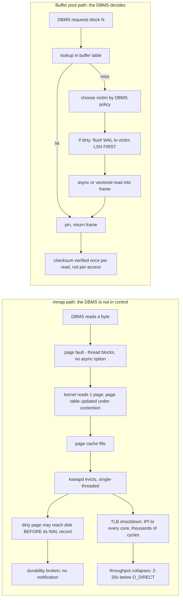

<!--
entry-meta
date: 2026-10-20
type: daily-diff
category: Daily Diff
title: Daily Diff — 2026-10-20
slug: postgres-cluster-on-disk-forks-segments
-->

# Daily Diff — 2026-10-20

**2026-10-20 · Daily Diff Digest**

## Which edition this covers, and how it was found

**No 2026-10-20 edition exists yet.** This run fired at 03:32 UTC (09:02 IST), and nothing was published for today. This digest therefore covers the **2026-10-19 edition, 39 stories** — the newest edition not yet covered by this log (the 2026-10-19 lesson folder covered 2026-10-18).

Endpoint observations for the run log in the root [`README.md`](../../../README.md), following the documented procedure (archive → RSS → dated `.md`, plus a day or two forward):

| Endpoint | Served | Verdict |
|---|---|---|
| [`/archive/`](https://tdd.cat/archive/) | 2026-10-19 listed as "Latest", **39 stories**; 2026-10-20 present in the calendar but **unlinked** | current |
| [`https://tdd.cat/2026-10-19.md`](https://tdd.cat/2026-10-19.md) | 2026-10-19, **39 stories**, curator Arpit Bhayani | current — used for this digest |
| [`https://tdd.cat/2026-10-20.md`](https://tdd.cat/2026-10-20.md) | fetch error | no edition |
| [`https://tdd.cat/2026-10-19/`](https://tdd.cat/2026-10-19/) | fetch error, twice | failed |
| [front page](https://tdd.cat/) | 2026-10-18, 22 stories | one day behind |
| [RSS](https://tdd.cat/rss.xml) | newest item 2026-10-17, 30 stories | **two days behind** |

**Today's lesson from the endpoints:** the cross-check succeeded — `/archive/` and the dated `.md` independently agree on *both* the date and the count (39). That is the second clean two-endpoint agreement in eleven observations. The dated trailing-slash page has now failed on **six consecutive** observations and should be treated as dead rather than retried first. RSS, which carried the newest edition on 2026-10-18, is back to lagging — confirming the 2026-10-19 note that agreement among the cheap endpoints is not evidence of currency, and adding its converse: a *single* cheap endpoint being current one day predicts nothing about the next.

## The edition, point-wise

**Databases and storage**

- **Why mmap fails as a replacement for buffer pools** — the CIDR 2022 CMU/FAU paper. The OS controls eviction and can flush dirty pages ahead of their WAL records. *Deep dive below.*
- **DocumentDB 1.0 reaches GA** — an MIT-licensed engine speaking the MongoDB wire protocol while storing BSON in PostgreSQL tables. The release notes fix aggregation crashes, index-drop deadlocks and RUM vacuum issues.
- **How savepoints quietly throttled our Postgres queue** — incident.io traced a queue bottleneck to MultiXact lock contention created by nested savepoints around queue claims; removing them from the worker polling path fixed it. This is lesson 17 of the current track arriving early, from a production incident.
- **Bloom filters to eliminate expensive database queries** (listed twice in this edition, items 6 and 18) — Bluesky answers block/mute checks from in-memory Bloom filters before they reach Scylla, deriving multiple bit positions from one 64-bit hash by linear combination; reportedly deflects 99% of checks.
- **KiviDB** — a lock-sharded multi-threaded Rust Redis/Valkey alternative claiming ~21M pipelined GETs/s on 32 cores.
- **pgdeclare** — keeps the desired schema as plain SQL, diffs it against live PostgreSQL catalogs, with `migrate-before`/`migrate-after` escape hatches and a hash ledger over history.
- **A5 geospatial index** — equal-area pentagonal cells mapped to 64-bit IDs along a space-filling curve, so DuckDB and PostgreSQL can answer spatial queries as integer range scans.
- **Galera write bursts after a kernel upgrade** — Percona found ~60% of unexplained gigabyte-scale writes in PXC 8.0 came from Galera receiver/applier threads while InnoDB metrics stayed flat.

**Systems, kernel and security**

- **Guest-to-host KVM escape via a Linux networking flaw** — checksum-metadata handling lets a guest make the host rewrite an IPv4 header *after* validation; escalated to full host compromise, bypassing KVM.
- **Poisoned open weights carry undetectable backdoors** — an abliterated model behaves normally until a trigger string appears, then exfiltrates secrets through the agent runtime; static scanners miss it because the payload is in the weights.
- **Unvetted agent skills execute untrusted instructions** — skill files are effectively installers, since the model cannot separate developer instructions from injected ones; audits found registry packages running unauthorized shell scripts and harvesting environment variables.
- **Unified addressability hides NUMA cliffs on GB200** — local HBM ~3,963 GB/s, host-mapped memory 304 GB/s, cold managed memory 14.1 GB/s. Explicit prefetching is not optional.
- **Why edge runtimes cannot compile LaTeX** — V8 isolates have no subprocesses, filesystem or native binaries; the recommendation is a locked-down container with egress blocking and CPU/memory quotas.
- **Mac.apk** — Android binaries as native macOS processes on Apple Silicon, rendering through Metal, no VM.
- **ZGC adaptive heap sizing (JEP 546)** — tracks host memory pressure and allocation rate, returns unused pages to the OS.
- **Erlang DNS hot-path rewrite** — DNSimple cut per-query CPU ~12% by removing allocations and copies in binary encode/decode.
- **Fastly canary misconfiguration behind PyPI's intermittent 502/503s** — origin fallback from Backblaze B2 to S3 Glacier IR, plus range-header bugs.

**Agents and inference infrastructure**

- Harnesses as the real substrate (a working agent loop in <300 lines); Google Research's **Harness2** recursive harness optimization claiming up to +11.5 points; **pi-harness-rsi** gating self-improvement on a context budget.
- **Cloudflare cut AI code-review cost per review 68%** and median latency to 92s, mostly via prompt pruning and model routing.
- **Speculative decoding** explained as a workload-type change: autoregressive decode is memory-bandwidth bound, so trade FLOPs for utilization. Paired with Meta's **multi-token prediction** (separate heads, built-in draft heads).
- **Overmind** — shared-memory daemon holding deserialized PyTorch tensors; load times 15s → 200ms.
- **Kompressor** — deterministic prompt compression so identical inputs produce identical bytes and provider prefix caches stay warm; >22% net bill reduction on Terminal-Bench.
- **vLLM TorchTPU** backend and the Rust **vLLM Agentic API** (server-side conversation state by response ID).
- **Wiz: machine-speed AI-driven cloud intrusions** — an autonomous agent running the full attack lifecycle, debugging its own errors and pivoting in seconds.
- **Four Gemini 4 Argon agents beat Minecraft** in 27 hours, 2,783 programs written and debugged, 605 deaths recovered from, coordinating through shared memory and in-game chat.
- **monday.com's API edge rebuild** — 2.5B weekly requests, much of it agent traffic; −92% CPU, −11× tail latency at 2.5× the load.
- Also: **a2a-rs** (A2A 1.0 in hexagonal Rust), **one route for both web APIs and agents** (three meta-tools over an OpenAPI catalog), **WunderOS** (BEAM control plane + Firecracker guests over a labelled tuple space), **STROT** (compile LLM intent into a frozen local decision graph), and a Claude Code hooks repo that requires a failing test before accepting a fix.

---

## Deep dive — "Are You Sure You Want to Use MMAP in Your Database Management System?"

Item 1, and the right pick for this log on the day the PostgreSQL track opens: this paper is the argument *for* the existence of the layer today's lesson just mapped. Followed the source link to [the CIDR 2022 landing page](https://db.cs.cmu.edu/mmap-cidr2022/), which carries only the abstract, then read [the full paper PDF](https://db.cs.cmu.edu/papers/2022/cidr2022-p13-crotty.pdf).

**Crotty (CMU), Leis (FAU), Pavlo (CMU), CIDR 2022.** The claim: mmap looks like a free buffer pool and is not, for reasons that are structural rather than incidental.

### The four problems, in the paper's order

| Problem | Mechanism | Usual workaround |
|---|---|---|
| **Transactional safety** | The OS may flush a dirty page to disk at any time, including before the transaction that dirtied it commits — and the DBMS is not told. This breaks WAL's ordering requirement outright. | OS copy-on-write, user-space copy-on-write, shadow paging |
| **I/O stalls** | mmap has no asynchronous read. A page fault blocks the faulting thread, and the DBMS cannot see it coming. | `mlock`, `madvise`, dedicated prefetch threads |
| **Error handling** | Checksums must be validated on *every* access rather than once per read, because the page may have been re-faulted silently. Corrupted pages can be persisted silently. I/O errors arrive as **SIGBUS**, so correctness requires a signal handler. | — |
| **Performance** | Three separate bottlenecks: page-table contention, single-threaded eviction, and TLB shootdowns. | — |

### Why the performance ceiling is in the kernel, not the disk

- **TLB shootdown.** Evicting a page means invalidating its mapping in *every* core's TLB. Current CPUs do not coordinate remote TLBs in hardware, so the OS sends an inter-processor interrupt — the paper puts the cost at "thousands of cycles". Flushing the *local* TLB is cheap; the expense is entirely in the cross-core broadcast, so the penalty grows with core count.
- **Single-threaded eviction.** Eviction is handled by `kswapd`, one process, and the paper measured it CPU-bound. One core evicting for 64 is the bottleneck no amount of SSD bandwidth fixes.
- **Page-table contention.** Many concurrent threads serialize on the OS's page-table synchronization.

### The measurements

Setup: **AMD EPYC 7713**, single socket, **64 cores / 128 threads**, 512 GB RAM with **100 GB** available to Linux 5.11 for the page cache, and **10 × 3.8 TB Samsung PM1733 SSDs** (rated 7000 MB/s read, 3800 MB/s write) accessed as raw block devices. Baseline is **fio 3.25 with `O_DIRECT`**, bypassing the page cache.

- **Random reads, 1 SSD, 2 TB range, 100 threads** (95% of accesses fault): fio reaches close to **900K reads/s**. mmap with `MADV_RANDOM` *matches* fio for the first **27 seconds** — then collapses to near zero for about **five seconds** as the page cache fills and eviction begins, and recovers only to roughly **half** of fio. Other `madvise` hints did worse.
- **Sequential scan, 1 SSD:** fio saturates the device and stays flat. mmap falls off a cliff after about **17 seconds**, again at the moment the page cache fills. Here `MADV_NORMAL` and `MADV_SEQUENTIAL` beat `MADV_RANDOM` — the opposite ordering from the random-read experiment.
- **Sequential scan, 10 SSDs in software RAID 0:** the gap widens to roughly **20×**, and mmap barely improves over the single-SSD number. That is the headline result: mmap cannot absorb added device bandwidth at all, because the limit was never the device.

Summary from the paper: once eviction starts, or once more than one SSD is involved, mmap is **2–20× slower** than fio.

### The industrial record

The paper's survey is the most quotable part, because it is a list of people who tried it:

| System | Window | Outcome |
|---|---|---|
| MonetDB | 2002– | still mmap-based, with user-space copy-on-write |
| MongoDB | 2009–2019 | MMAPv1 removed in 2019; limited mmap returned inside WiredTiger in 2020 |
| LevelDB | 2011– | mmap read bottlenecks were among the reasons Facebook forked it into RocksDB |
| LMDB | 2011– | exclusively mmap + shadow paging — and permits exactly **one writer** |
| SQLite | 2013– | optional mmap, user-space copy-on-write |
| SingleStore | 2013–2015 | removed it: mmap calls cost **10–20 ms per query**, nearly **half** of runtime |
| InfluxDB | 2015–2020 | replaced after I/O spikes once databases passed a few GB |
| WiredTiger | 2020– | deliberately limited use, to avoid user/kernel boundary-crossing cost |
| QuestDB, RavenDB | 2014– | mmap-based storage engines |

TileDB, Scylla, VictoriaMetrics and RDF-3X are also named as having ruled it out or abandoned it.

### Why this matters for the track that starts today

The lesson written alongside this digest is the layer the paper says you cannot skip. Today's lesson showed PostgreSQL turning `(relation, fork, block)` into a file descriptor and a byte offset *by hand*, with its own path resolution, its own segment chain, and its own per-fork descriptor cache — and lessons 09–10 will show the clock-sweep buffer manager, pins, and content locks sitting on top. Every one of those is work the OS would happily do for free, and the paper is the measurement of what "free" costs.

Two specific connections worth holding:

- **The WAL ordering constraint is the non-negotiable one.** Lessons 21–25 cover `XLogFlush` and the per-page LSN comparison in redo. The entire correctness argument there depends on *nobody else* being able to write a page out. mmap hands that authority to the kernel, which is why the paper puts transactional safety first and why no amount of `madvise` tuning addresses it.
- **The previous track's engine is on the list.** SQLite appears in the table with "optional mmap, user-space copy-on-write" — and the SQLite track's lesson 31 found the mapping is always 256 bytes short and sits beside, not instead of, the page cache. That is the paper's "maybe" case exactly: read-mostly, working set in memory, and a copy-on-write scheme bolted on to recover safety.

**The prescription, verbatim in structure.** Do not use mmap if you need transactionally safe updates; need page faults that do not block on slow I/O, or explicit control over residency; care about error handling and must return correct results; or need high throughput on fast storage. *Maybe* use it if the working set fits in memory and the workload is read-only, or if you must ship fast and do not care about consistency or long-term maintenance. The paper's closing line: **"Otherwise, never."**

Benchmark code is at `github.com/viktorleis/mmapbench` (MIT), per the landing page.

## Sources

- [The Daily Diff — 2026-10-19 edition (dated `.md` permalink)](https://tdd.cat/2026-10-19.md) — the 39-story edition this digest covers
- [The Daily Diff archive](https://tdd.cat/archive/) — currency cross-check; confirmed 2026-10-19 / 39 stories and showed 2026-10-20 unlinked
- [The Daily Diff front page](https://tdd.cat/) — served 2026-10-18, one day behind
- [The Daily Diff RSS](https://tdd.cat/rss.xml) — served 2026-10-17, two days behind
- [Canonical page for the 2026-10-19 edition](https://tdd.cat/2026-10-19/) — would not fetch (recorded for the endpoint log)
- [Are You Sure You Want to Use MMAP in Your Database Management System? — CIDR 2022 landing page](https://db.cs.cmu.edu/mmap-cidr2022/)
- [The full paper (PDF)](https://db.cs.cmu.edu/papers/2022/cidr2022-p13-crotty.pdf) — the deep dive's substance

Source links for items summarized above, as listed in the edition: [CMU mmap](https://db.cs.cmu.edu/mmap-cidr2022/) · [DocumentDB 1.0](https://documentdb.io/blogs/posts/documentdb-1-0/) · [incident.io savepoints](https://incident.io/blog/how-savepoints-quietly-throttled-our-postgres-queue) · [Bluesky Bloom filters](https://calabro.io/ohbf) · [KiviDB](https://github.com/kividbio/kividb) · [pgdeclare](https://github.com/powertime-org/pgdeclare) · [A5](https://a5geo.org/) · [Percona/Galera](https://www.percona.com/blog/when-a-small-change-writes-too-much-how-a-linux-kernel-improvement-can-strike-you-in-pxc-galera-workloads/) · [KVM escape](https://pwn.ai/blog/pwnescape) · [abliterated-model backdoors](https://projectdiscovery.io/research/how-abliterated-models-can-get-you-pwned) · [agent-skill risks](https://aiskills402.com/blog/agent-skills-security-risks) · [GB200 memory](https://arxiv.org/abs/2610.20354) · [LaTeX on edge](https://bhargav.dev/writing/shipping-a-latex-compiler-behind-an-edge-app) · [Mac.apk](https://github.com/kksimp/Mac.apk) · [JEP 546](https://openjdk.org/jeps/546) · [Erlang DNS](https://blog.dnsimple.com/2026/10/making-dns-erlang-fast/) · [PyPI postmortem](https://blog.pypi.org/posts/2026-09-08-file-hosting-errors/) · [Harness2](https://github.com/google-research/harness2) · [harness-engineering-101](https://github.com/IsuruMaduranga/harness-engineering-101) · [pi-harness-rsi](https://github.com/grigio/pi-harness-rsi) · [Cloudflare inference optimization](https://blog.cloudflare.com/obsessive-inference-optimization/) · [speculative decoding](https://jbarrow.ai/2026-10-08-why-is-speculative-decoding-fast/) · [multi-token prediction](https://arxiv.org/abs/2404.19737) · [Overmind](https://github.com/meshy-dev/overmind) · [Kompressor](https://github.com/hystax/optscale-kompressor) · [vLLM TorchTPU](https://github.com/vllm-project/vllm-torchtpu) · [vLLM Agentic API](https://vllm-project.github.io/agentic-api/) · [Wiz](https://www.wiz.io/blog/anatomy-of-ai-driven-cloud-attacks) · [Minecraft agents](https://arxiv.org/abs/2610.22319) · [monday.com API edge](https://engineering.monday.com/rebuilding-monday-api-edge-for-agents/) · [a2a-rs](https://github.com/EmilLindfors/a2a-rs) · [one-route API/MCP](https://parallellabs.app/api-openapi-mcp-architecture/) · [WunderOS](https://pentad.ai/system/) · [STROT](https://github.com/strot-ai/Project-STROT) · [claude-skills](https://github.com/ehnruiz/claude-skills) · [chat agent architecture](https://www.peterp.me/articles/what-actually-happens-when-you-message-grok-bot/)
