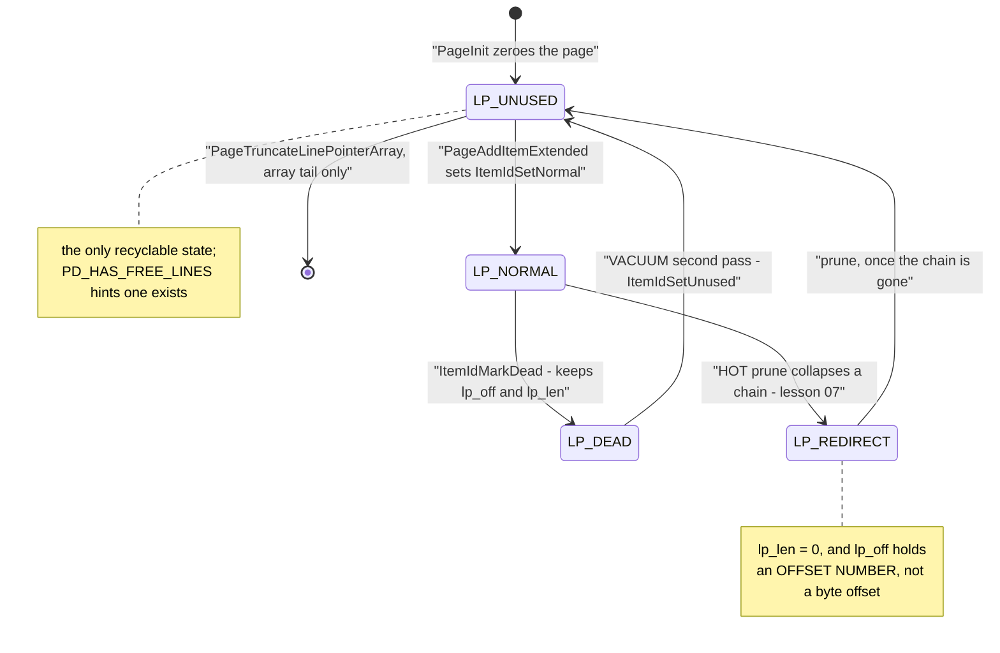
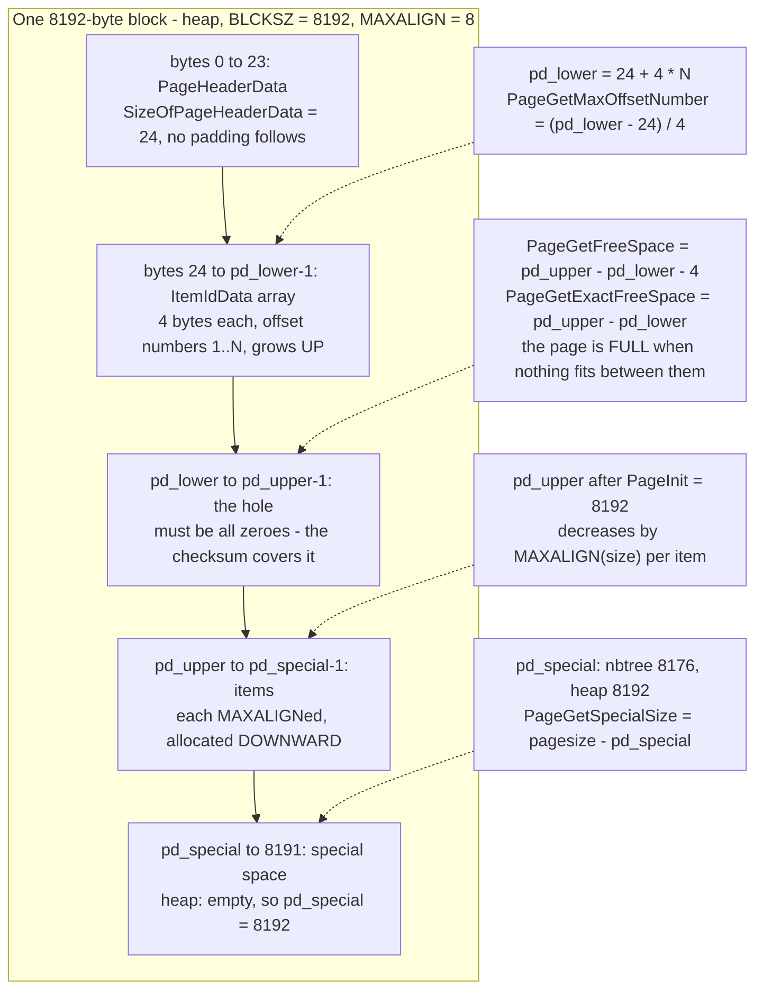
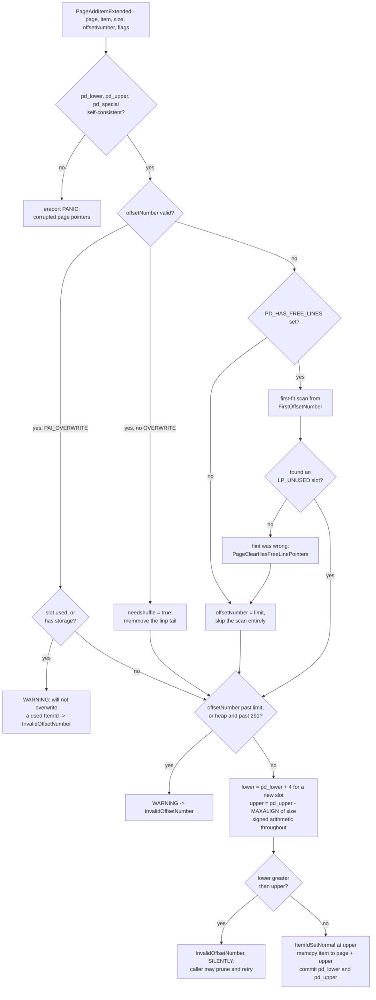

<!--
entry-meta
date: 2026-10-21
type: lesson
track: PostgreSQL
lesson: 02
category: Database Internals
title: The Page — Four Bytes at Offset 16 That Identify Every Heap Page, Two 15-Bit Fields That Cap BLCKSZ at 32 KB, and Why MaxHeapTupleSize Is 8160 and Not 8164
slug: postgres-page-header-line-pointers
-->

# The Page — Four Bytes at Offset 16 That Identify Every Heap Page, Two 15-Bit Fields That Cap `BLCKSZ` at 32 KB, and Why `MaxHeapTupleSize` Is 8160 and Not 8164

**2026-10-21 · PostgreSQL Track · Lesson 02 of 35**

## Where This Fits

- **Lesson 01 ended by handing you 64 uninterpreted bytes.** [Lesson 01](../2026-10-20-postgres-cluster-on-disk-forks-segments/README.md) closed with an instruction to `hexdump -C -n 64` block 0 of `seg_demo`'s main fork and deliberately *not* read it. This lesson interprets exactly those bytes, in order, and then the four bytes after them.
- **This lesson adds the first on-disk structure.** Everything in lesson 01 was addressing: a triple, a path, a segment chain, an offset. Nothing in it looked *inside* a block. `PageHeaderData` is the first thing PostgreSQL actually writes into a block, and it is the only part of a block whose layout every access method shares.
- **It stops at the line pointer.** This lesson decodes `ItemIdData` — the 4-byte `(offset, flags, length)` triple a `CTID` resolves through — and the free-space arithmetic that places tuples. What a line pointer *points at* is `HeapTupleHeaderData`, which is lesson 03.
- **What it sets up next.** Three threads start here and are picked up later: `pd_prune_xid` and `LP_REDIRECT` (lesson 07, HOT and pruning), `PD_ALL_VISIBLE` (lesson 06, the visibility map), and `pd_lsn` with the checksum's write-time-only validity (lessons 09–10 for the buffer manager, 21–25 for WAL and redo).

Source commit for every code reference below: **`postgres/postgres@3cde90ec`**, read through the GitHub API during this run. Note that lesson 01 read `@ddd468ca`; the tree moved between the two runs, which is why each lesson states its own commit. Documentation references are PostgreSQL 18 unless marked otherwise.

---

## 1. The 24 bytes, by offset

`PageHeaderData` in `src/include/storage/bufpage.h` is eight fields with no padding between them. The byte offsets are not documented as offsets, but they are fixed by the field order and the fact that every field is naturally aligned inside a 24-byte prefix:

| Offset | Size | Field | Type | What it is |
|---:|---:|---|---|---|
| 0 | 8 | `pd_lsn` | `PageXLogRecPtr` | Next byte after the last byte of the WAL record for the last change to this page |
| 8 | 2 | `pd_checksum` | `uint16` | Page checksum, *if set* — see §5 |
| 10 | 2 | `pd_flags` | `uint16` | Three defined bits; `PD_VALID_FLAG_BITS` is `0x0007` |
| 12 | 2 | `pd_lower` | `LocationIndex` | Byte offset to the start of free space |
| 14 | 2 | `pd_upper` | `LocationIndex` | Byte offset to the end of free space |
| 16 | 2 | `pd_special` | `LocationIndex` | Byte offset to the start of special space |
| 18 | 2 | `pd_pagesize_version` | `uint16` | Page size **and** layout version, packed |
| 20 | 4 | `pd_prune_xid` | `TransactionId` | Oldest prunable XID on the page, or 0 |
| 24 | 4·N | `pd_linp[]` | `ItemIdData[]` | Flexible array — the line pointers |

Two constants follow from this and are used everywhere:

- `SizeOfPageHeaderData` is `offsetof(PageHeaderData, pd_linp)` = **24**. The header macro's comment is explicit about why it is `offsetof` and not `sizeof`: *"line pointer(s) do not count as part of header"*.
- `MAXALIGN(SizeOfPageHeaderData)` is also **24** on any platform with 8-byte `MAXALIGN`, so there is no padding between the header and the first line pointer. `PageGetContents()` still writes `MAXALIGN(SizeOfPageHeaderData)` and carries a warning that this was *not* guaranteed before 8.3 — *"Beware of old code that might think the offset to the contents is just `SizeOfPageHeaderData`"*.

### `pd_pagesize_version` is one field doing two jobs

```c
#define PG_PAGE_LAYOUT_VERSION  4

static inline Size
PageGetPageSize(const PageData *page)
{
    return (Size) (((const PageHeaderData *) page)->pd_pagesize_version & (uint16) 0xFF00);
}

static inline uint8
PageGetPageLayoutVersion(const PageData *page)
{
    return (((const PageHeaderData *) page)->pd_pagesize_version & 0x00FF);
}
```

- The size occupies the high 8 bits, the version the low 8. That works only because **page sizes are constrained to multiples of 256**, which the header states as the reason for the packing: before 7.3 there was no version number, and this encoding lets pre-7.3 pages read back as version 0.
- `PageSetPageSizeAndVersion()` asserts both halves are in range rather than masking, so a bad size is a crash in an assert build and silent corruption in a release build.
- At `BLCKSZ = 8192` the stored value is `8192 | 4 = 0x2004`.
- The size is **only a cross-check**. The documentation says it plainly: *"there is no support for having more than one page size in an installation."* A page whose recorded size disagrees with `BLCKSZ` is a page from another cluster.

### The four bytes that identify a heap page

Put `pd_special` and `pd_pagesize_version` together, little-endian, and bytes **16–19 of every page** become a fingerprint of its access method:

| Page kind | `pd_special` | Bytes 16–19 (LE, `BLCKSZ`=8192) |
|---|---:|---|
| Heap (and sequences, TOAST) | 8192 — no special space | `00 20 04 20` |
| nbtree | 8176 — `MAXALIGN(sizeof(BTPageOpaqueData))` = 16 | `f0 1f 04 20` |

`BTPageOpaqueData` is `btpo_prev` + `btpo_next` (`BlockNumber`, 4 each) + `btpo_level` (`uint32`) + `btpo_flags` (`uint16`) + `btpo_cycleid` (`BTCycleId`, a `uint16`) — exactly 16 bytes, already `MAXALIGN`ed. The docs state the heap case directly: *"Ordinary tables set `pd_special` equal to the page size, meaning no special space."*

This is the cheapest identification you can do on a raw block, and it costs nothing: two reads at fixed offsets, no catalog lookup.

### `pd_lsn` reads in printed order, by accident of history

`PageXLogRecPtr` is now a single `uint64`, but the accessors swap halves on little-endian machines:

```c
static inline XLogRecPtr
PageXLogRecPtrGet(const volatile PageXLogRecPtr *val)
{
    PageXLogRecPtr tmp = {val->lsn};
    return (tmp.lsn << 32) | (tmp.lsn >> 32);
}
```

The comment says why: *"For historical reasons, the storage of 64-bit LSN values depends on CPU endianness; `PageXLogRecPtr` used to be a struct consisting of two 32-bit values."* The consequence for anyone reading a hexdump on x86 or ARM: **bytes 0–3 are the high half of the LSN and bytes 4–7 are the low half**, each itself little-endian. That is the same order as the printed `X/Y` form, so a hexdump of bytes 0–7 maps onto `page_header()`'s `lsn` column left-to-right. The conversion is the caller's job — the comment says so — which is why the field is reached only through `PageGetLSN`/`PageSetLSN` and never read directly.

### `pd_flags`: three bits, all of them hints, one of them not WAL-logged

```c
#define PD_HAS_FREE_LINES   0x0001  /* are there any unused line pointers? */
#define PD_PAGE_FULL        0x0002  /* not enough free space for new tuple? */
#define PD_ALL_VISIBLE      0x0004  /* all tuples on page are visible to everyone */
#define PD_VALID_FLAG_BITS  0x0007
```

- `PD_HAS_FREE_LINES` is a hint *"rather than the truth, since changes to it are not WAL-logged."* §4 shows the code that discovers the hint is wrong and clears it mid-scan.
- `PD_PAGE_FULL` is set when an `UPDATE` cannot find room for a new tuple version — a nudge toward pruning, also a hint.
- `PD_ALL_VISIBLE` is the page-level half of the visibility map (lesson 06). It is *not* a hint in the same sense, and that asymmetry is lesson 06's subject.
- `PageIsVerified()` tests `(p->pd_flags & ~PD_VALID_FLAG_BITS) == 0`, so an undefined bit set on disk is enough to reject the page. Adding a fourth flag is therefore a hard compatibility boundary, not a free bit.

### `pd_prune_xid` only ever moves backwards

```c
#define PageSetPrunable(page, xid) \
do { \
    Assert(TransactionIdIsNormal(xid)); \
    if (!TransactionIdIsValid(((PageHeader) (page))->pd_prune_xid) || \
        TransactionIdPrecedes(xid, ((PageHeader) (page))->pd_prune_xid)) \
        ((PageHeader) (page))->pd_prune_xid = (xid); \
} while (0)
```

It is a *minimum*, maintained monotonically downward, so one comparison against the pruning horizon answers "is pruning this page worth the cleanup lock?" The header notes it is *"currently unused in index pages"* — the field is in every page but means something in only one access method. Lesson 07 picks it up.

---

## 2. `ItemIdData`: 32 bits, three fields, two of them 15 bits wide

```c
typedef struct ItemIdData
{
    unsigned    lp_off:15,      /* offset to tuple (from start of page) */
                lp_flags:2,     /* state of line pointer, see below */
                lp_len:15;      /* byte length of tuple */
} ItemIdData;
```

Four bytes, exactly, and this is the single most consequential packing decision in PostgreSQL's storage layer. `bufpage.h` states the consequence twice:

> *"note that this is actually limited to 2^15 because we have limited `ItemIdData.lp_off` and `ItemIdData.lp_len` to 15 bits (see itemid.h)."* — on `LocationIndex`
>
> *"On the high end, we can only support pages up to 32KB because `lp_off`/`lp_len` are 15 bits."*

So `BLCKSZ`'s documented 32768 ceiling, which lesson 01 mentioned in one line and deferred, is *this struct*. Not a block-number limit, not a file-format version — two bitfields that had to fit in one 32-bit word alongside a 2-bit state.

### Decoding a line pointer by hand

On a little-endian platform with GCC or Clang, bitfields are allocated from the least significant bit of the storage unit, so the 32-bit word is `lp_off | (lp_flags << 15) | (lp_len << 17)`:

```python
# b is the 4-byte line pointer, read little-endian
u        = int.from_bytes(b, 'little')
lp_off   =  u        & 0x7FFF
lp_flags = (u >> 15) & 0x3
lp_len   = (u >> 17) & 0x7FFF
```

Bitfield layout is implementation-defined in C, which is precisely why `pageinspect` exists: `heap_page_items()` decodes these in the server, with the server's own compiler, instead of asking you to. Use the arithmetic above to *check* a hexdump against `heap_page_items()`, never as a substitute for it.

### The four states, and the `lp_len == 0` convention

`itemid.h` states an invariant that spans all four states: *"By convention, `lp_len == 0` in every line pointer that does not have storage, independently of its `lp_flags` state."*

| State | Value | `lp_len` | `lp_off` means | Set by |
|---|---:|---|---|---|
| `LP_UNUSED` | 0 | 0 (always) | nothing (zeroed) | `PageInit`, `ItemIdSetUnused` |
| `LP_NORMAL` | 1 | > 0 (always) | byte offset of the item | `ItemIdSetNormal(off, len)` |
| `LP_REDIRECT` | 2 | 0 | **an offset number**, not a byte offset | `ItemIdSetRedirect(link)` |
| `LP_DEAD` | 3 | may or may not be 0 | byte offset, if storage remains | `ItemIdSetDead` / `ItemIdMarkDead` |

- `LP_REDIRECT` reuses `lp_off` as a *line pointer index* — `ItemIdGetRedirect()` is a second name for `ItemIdGetOffset()`. The same 15 bits mean a byte address in one state and an array index in another. That is the HOT chain's root link; lesson 07.
- `LP_DEAD` has two setters on purpose. `ItemIdSetDead` clears the storage; `ItemIdMarkDead` only writes the 2-bit `lp_flags` field and keeps `lp_off`/`lp_len`. The comment on the latter is a concurrency claim: *"in indexes, this is used as if it were a hint-bit mechanism; we trust that multiple processors can do this in parallel and get the same result."*
- Only `LP_UNUSED` is reusable. `ItemIdHasStorage()` tests `lp_len != 0` and is *not* the same question as `ItemIdIsUsed()`, which tests `lp_flags != LP_UNUSED`. Code paths that conflate them are why `PageAddItemExtended()` checks both and asserts the invariant.

### The indirection is the point

`bufpage.h` gives the reason the array exists at all:

> *"tuple1..N are added 'backwards' on the page. Since an `ItemPointer` offset is used to access an `ItemId` entry rather than an actual byte-offset position, tuples can be physically shuffled on a page whenever the need arises. This indirection also keeps crash recovery relatively simple, because the low-level details of page space management can be controlled by standard buffer page code during logging, and during recovery."*

And the documentation adds the stability guarantee: *"Because an item identifier is never moved until it is freed, its index can be used on a long-term basis to reference an item, even when the item itself is moved around on the page to compact free space."* Offset numbers start at **1**, not 0 — `PageGetItemId()` subtracts one.



---

## 3. The slotted page, with real numbers

`bufpage.h` carries an ASCII diagram of the layout; here it is with the offsets a `BLCKSZ = 8192` heap page actually uses.



### `PageInit` writes four numbers and zeroes everything else

```c
void
PageInit(Page page, Size pageSize, Size specialSize)
{
    PageHeader  p = (PageHeader) page;

    specialSize = MAXALIGN(specialSize);

    Assert(pageSize == BLCKSZ);
    Assert(pageSize > specialSize + SizeOfPageHeaderData);

    /* Make sure all fields of page are zero, as well as unused space */
    MemSet(p, 0, pageSize);

    p->pd_flags = 0;
    p->pd_lower = SizeOfPageHeaderData;
    p->pd_upper = pageSize - specialSize;
    p->pd_special = pageSize - specialSize;
    PageSetPageSizeAndVersion(page, pageSize, PG_PAGE_LAYOUT_VERSION);
    /* p->pd_prune_xid = InvalidTransactionId;      done by above MemSet */
}
```

Three things worth naming:

- The `MemSet` of the **whole** page is not tidiness. §5 explains why the hole must be zero.
- `pd_upper == pd_special` on a fresh page, which is the `PageIsEmpty`/`PageIsNew` distinction: `PageIsNew` is `pd_upper == 0`, true only for a never-initialized (all-zero) block; `PageIsEmpty` is `pd_lower <= SizeOfPageHeaderData`, true for an initialized page with no line pointers. Lesson 01's `_mdfd_getseg()` zero-padding and `PageIsVerified()`'s all-zeroes tolerance are both about the first case.
- The checksum is deliberately *not* computed here. The comment: *"Note that we don't calculate an initial checksum here; that's not done until it's time to write."*

### A heap page's fresh-page byte signature

Immediately after `PageInit` on an 8 KB heap page, offsets 12–19 read:

```
offset:  12    14    16    18
bytes:   18 00 00 20 00 20 04 20
         ^pd_lower  ^pd_special
               ^pd_upper  ^pd_pagesize_version
```

`pd_lower = 24 = 0x0018`, `pd_upper = pd_special = 8192 = 0x2000`, `pd_pagesize_version = 0x2004`. On an nbtree page the two bytes at offset 14 and at offset 16 both read `f0 1f`.

---

## 4. Placing an item: `PageAddItemExtended` and the free-space family

### The arithmetic, verbatim

```c
if (offsetNumber == limit || needshuffle)
    lower = phdr->pd_lower + sizeof(ItemIdData);
else
    lower = phdr->pd_lower;

alignedSize = MAXALIGN(size);

upper = (int) phdr->pd_upper - (int) alignedSize;

if (lower > upper)
    return InvalidOffsetNumber;
```

The comment above it explains the casts: *"do arithmetic as signed ints, to avoid mistakes if, say, `alignedSize > pd_upper`."* Every free-space function in the file repeats the same defence — `space = (int) phdr->pd_upper - (int) phdr->pd_lower;` with the comment *"Use signed arithmetic here so that we behave sensibly if `pd_lower > pd_upper`."* The layer does not trust its own header.

### Why `MaxHeapTupleSize` is 8160

Two macros from `src/include/access/htup_details.h`:

```c
#define MaxHeapTupleSize  (BLCKSZ - MAXALIGN(SizeOfPageHeaderData + sizeof(ItemIdData)))

#define MaxHeapTuplesPerPage    \
    ((int) ((BLCKSZ - SizeOfPageHeaderData) / \
            (MAXALIGN(SizeofHeapTupleHeader) + sizeof(ItemIdData))))
```

At `BLCKSZ = 8192`, `SizeOfPageHeaderData = 24`, `sizeof(ItemIdData) = 4`, `SizeofHeapTupleHeader = 23` (it is `offsetof(HeapTupleHeaderData, t_bits)` — lesson 03):

- `MaxHeapTupleSize` = `8192 - MAXALIGN(28)` = `8192 - 32` = **8160**
- `MaxHeapTuplesPerPage` = `(8192 - 24) / (24 + 4)` = `8168 / 28` = **291**

But `PageGetFreeSpace()` on a freshly initialized heap page returns `8192 - 24 - 4` = **8164**. The two numbers disagree by four, and the reason is the `MAXALIGN` inside the placement code, not an off-by-one anywhere:

- Insert needs `lower <= upper`, i.e. `24 + 4 <= 8192 - MAXALIGN(size)`, i.e. `MAXALIGN(size) <= 8164`.
- `MAXALIGN(size)` is a multiple of 8, and the largest multiple of 8 that is ≤ 8164 is **8160**.
- So the largest `size` that fits is 8160 — exactly `MaxHeapTupleSize`. A tuple of 8161 bytes rounds to 8168 and is refused.

`htup_details.h` warns about the second-order version of this: *"Because `ItemId`s and tuples have different alignment requirements, don't assume that you can, say, fit 2 tuples of size `MaxHeapTupleSize/2` on the same page."*

### Four free-space functions, because the question has four forms

| Function | Returns | Use |
|---|---|---|
| `PageGetExactFreeSpace` | `pd_upper - pd_lower` | the raw hole; no allowance for a line pointer |
| `PageGetFreeSpace` | minus `sizeof(ItemIdData)` | **index pages** — room for one more item *plus* its pointer |
| `PageGetFreeSpaceForMultipleTuples` | minus `ntups * sizeof(ItemIdData)` | batched index insertion |
| `PageGetHeapFreeSpace` | `PageGetFreeSpace`, **or 0** | **heap pages** — see below |

`PageGetHeapFreeSpace()` exists purely to enforce the 291 ceiling, and its comment says why that is not implied by the space arithmetic:

> *"this will return zero if there are already `MaxHeapTuplesPerPage` line pointers in the page and none are free... (Although no more tuples than that could fit anyway, in the presence of redirected or dead line pointers it'd be possible to have too many line pointers.)"*

`LP_REDIRECT` and `LP_DEAD` pointers have `lp_len == 0`, so they consume a slot without consuming item space. Without this check a heavily-HOT-updated page could grow its line pointer array past the bound that `MaxHeapTuplesPerPage`-sized stack arrays elsewhere assume. `PageRepairFragmentation()` declares exactly such an array: `itemIdCompactData itemidbase[MaxHeapTuplesPerPage];`.

### The hint being wrong is a normal code path

```c
if (PageHasFreeLinePointers(page))
{
    /*
     * Always use earlier items first.  PageTruncateLinePointerArray
     * can only truncate unused items when they appear as a contiguous
     * group at the end of the line pointer array.
     */
    for (offsetNumber = FirstOffsetNumber; offsetNumber < limit; offsetNumber++)
    {
        itemId = PageGetItemId(page, offsetNumber);
        Assert(ItemIdIsUsed(itemId) || !ItemIdHasStorage(itemId));
        if (!ItemIdIsUsed(itemId) && !ItemIdHasStorage(itemId))
            break;
    }
    if (offsetNumber >= limit)
    {
        /* the hint is wrong, so reset it */
        PageClearHasFreeLinePointers(page);
    }
}
else
{
    /* don't bother searching if hint says there's no free slot */
    offsetNumber = limit;
}
```

Two policies are visible at once. The scan is **first-fit from the front**, and the comment says it is first-fit *in order to help a different function*: truncation can only reclaim a contiguous unused run at the array's tail, so filling from the front keeps unused slots clustered at the end. And a false-positive hint costs a linear scan and is then self-correcting; a false *negative* would lose a slot silently, which is why only the positive direction is a hint.

### Corruption is a `PANIC`, and the function may not `ereport(ERROR)`

```c
if (phdr->pd_lower < SizeOfPageHeaderData ||
    phdr->pd_lower > phdr->pd_upper ||
    phdr->pd_upper > phdr->pd_special ||
    phdr->pd_special > BLCKSZ)
    ereport(PANIC, ... "corrupted page pointers: lower = %u, upper = %u, special = %u" ...);
```

`PageAddItemExtended` carries the banner comment `!!! EREPORT(ERROR) IS DISALLOWED HERE !!!` — it runs inside a critical section, where an `ERROR` would be promoted anyway, so every *recoverable* refusal is a `WARNING` plus `InvalidOffsetNumber` (`"will not overwrite a used ItemId"`, `"specified item offset is too large"`, `"can't put more than MaxHeapTuplesPerPage items in a heap page"`), and the one unrecoverable case is `PANIC` outright.

`PageRepairFragmentation()` performs the *same* four-way check but uses `ereport(ERROR)` — it is not in a critical section — and explains the paranoia: *"we are about to reshuffle data in (what is usually) a shared disk buffer. If we aren't careful then corrupted pointers, lengths, etc could cause us to clobber adjacent disk buffers, spreading the data loss further."*

### Defragmentation sorts for the memmove fast path

`compactify_tuples()` has two modes, chosen by a `presorted` flag:

- **Presorted** (items in descending `itemoff` order): plain `memmove` toward the end of the page, no temporary buffer. It even skips the suffix of tuples already in place: `if (upper != itemidptr->itemoff + itemidptr->alignedlen) break;`.
- **Not presorted**: copy every moving tuple into a temp buffer first, *"Doing so could cause us to overwrite the memory belonging to a tuple we've not moved yet."* Tuples are then copied back in line-pointer order, which **restores** the presorted property: *"This will increase the chances of hitting the presorted case the next time around."*

So the slow path pays once and leaves the page in the fast path's preferred shape. `PageRepairFragmentation()` detects the condition while it builds the array (`if (last_offset > itemidptr->itemoff) ... else presorted = false;`) and passes it down.



Note the asymmetry in the failure modes: "no room" returns `InvalidOffsetNumber` with **no** warning, because it is an expected outcome that triggers pruning or a new page. Every *other* refusal logs.

---

## 5. The checksum: 16 bits, valid only on disk, and it checks the hole

### The algorithm

`src/include/storage/checksum_impl.h` is unusually explicit about its design constraints, because the file is published for external tools to `#include`.

- **Base primitive:** FNV-1a, modified. Plain FNV-1a has *"bad mixing of high bits — high order bits in input data only affect high order bits in output data."* The fix is an extra xor-shift: `hash = (hash ^ value) * FNV_PRIME ^ ((hash ^ value) >> 17)`, with `FNV_PRIME = 16777619`. The shift distance 17 *"doesn't have common denominator with set bit positions in `FNV_PRIME`"*.
- **Shape:** the page is treated as a 2-D array of 32-bit words, `N_SUMS = 32` columns wide, each column folded into its own partial checksum from its own random base offset (`checksumBaseOffsets[]`, 32 hardcoded constants). 32 was chosen because it is *"the largest state that fits into architecturally visible x86 SSE registers while leaving some free registers for intermediate values"* — and *"the number chosen is a fixed part of the algorithm because changing the parallelism changes the checksum result."*
- **Finalization:** two extra rounds with value 0 to avalanche the last word, xor the 32 partials together, then:

```c
checksum = pg_checksum_block(cpage);
checksum ^= blkno;                      /* detect transposed pages */
return (uint16) ((checksum % 65535) + 1);   /* never zero */
```

- The block number is mixed in, so a block written to the wrong offset fails verification even if its bytes are intact.
- `% 65535` then `+ 1` means a valid checksum is in `1..65535` and **never 0**, *"which seems like a good idea"* — because `pd_checksum` is 0 on pages that have no checksum.
- `pg_checksum_page()` transiently zeroes `pd_checksum` and restores it: *"actually updating the checksum is NOT part of the API of this function."*
- Measured false-positive rate claimed in the header: *"optimal 2e-16 ... within margin of error"* for 1–4 uncorrelated bit errors, stray `0x00`/`0xFF` bytes, and tail truncation.

### When it is valid — and the answer is "almost never, in memory"

`src/backend/storage/page/README` is blunt:

> *"The checksum is not valid at all times on a data page!! The checksum is valid when the page leaves the shared pool and is checked when it later re-enters the shared pool as a result of I/O... many or even most pages in shared buffers have invalid page checksums, so be careful how you interpret the `pd_checksum` field."*

And the design choice behind that:

> *"Note that there is no indication on a page as to whether the checksum is valid or not, a deliberate design choice which avoids the problem of relying on the page contents to decide whether to verify it. Hence there are no flag bits relating to checksums."*

This is the point the CMU mmap paper (yesterday's digest) makes from the other side: PostgreSQL gets to verify **once per read into the buffer pool** rather than on every access, precisely because it owns the read path. `PageSetChecksum()` runs immediately before flush; `PageIsVerified()` runs immediately after read. There is no third place.

### Two separate protection domains

> *"WAL CRCs protect records entering the WAL stream, and data page verification protects blocks entering the shared buffer pool. They are similar in purpose, yet completely separate... the WAL checksum is a 32-bit CRC, whereas the page checksum is only 16-bits."*

Consequences the README spells out: WAL-logged changes do **not** update `pd_checksum`, so a full-page image in WAL may carry an invalid checksum, and *"WAL replay should not test the checksum of a full-page image."*

### Why the hole must be zero

> *"when we write a page checksum we include the hopefully zeroed bytes that form the hole in the centre of a standard page. Thus, when we read the block back from storage we implicitly check that the hole is still all zeroes."*

That is what `PageInit`'s full-page `MemSet` is buying. And the asymmetry is deliberate: full-page images in WAL *skip* the hole and re-zero it on reapply, *"because a failure in WAL is a fatal error and prevents further recovery, whereas a checksum failure on a normal data block is a hard error but not a critical one."*

### Hint bits, torn pages, and `MarkBufferDirtyHint`

The README's sharpest operational point:

> *"Setting hint bits when a page is already dirty is OK because a full page write must already have been written for it since the last checkpoint. Setting hint bits on an otherwise clean page can allow torn pages; this doesn't normally matter since they are just hints, but when the page has checksums, then losing a few bits would cause the checksum to be invalid. So if we have `full_page_writes = on` and checksums enabled then we must write a WAL record specifically so that we record a full page image in WAL."*

A one-bit hint can therefore cost a full 8 KB WAL record. That is lesson 15's subject, and this is where the cost originates. In recovery the option disappears entirely — no new WAL records can be written, so with checksums on, a standby *cannot* dirty a clean page to set a hint bit and must wait for the primary's full-page image.

### What `PageIsVerified` actually accepts

```c
if ((p->pd_flags & ~PD_VALID_FLAG_BITS) == 0 &&
    p->pd_lower <= p->pd_upper &&
    p->pd_upper <= p->pd_special &&
    p->pd_special <= BLCKSZ &&
    p->pd_special == MAXALIGN(p->pd_special))
    header_sane = true;
```

- Five conditions, and the comment is careful not to oversell them: *"The following checks don't prove the header is correct, only that it looks sane enough to allow into the buffer pool."*
- **An all-zero page passes**, by design, and the reason is lesson 01's territory: *"a backend extends a relation, then crashes before it can write any WAL entry about the new page. The kernel will already have the zeroed page in the file."* The all-zeroes test runs *after* the checksum test so that the WARNING is not emitted for a legitimately new page.
- `ignore_checksum_failure` (`PIV_IGNORE_CHECKSUM_FAILURE`) lets a checksum failure through **only if `header_sane`** — a corrupt header is rejected regardless.
- The error message is exact and worth recognising in a log: `page verification failed, calculated checksum %u but expected %u`.

### A version note, honestly flagged

The tree read for this lesson (`@3cde90ec`, master) differs from PostgreSQL 18 here, and the difference is visible in the code rather than inferred:

- `bufpage.c` calls `DataChecksumsNeedVerify()` and `DataChecksumsNeedWrite()` — predicates, not a plain boolean — and wraps verification in `HOLD_INTERRUPTS()` / `RESUME_INTERRUPTS()` because *"the data checksum state could change during verifying checksums."*
- `storage/page/README` at this commit says checksums *"can also be enabled at runtime using `pg_enable_data_checksums()`, and disabled by using `pg_disable_data_checksums()`."*
- The **PostgreSQL 18** documentation, by contrast, describes enabling and disabling as an **offline** operation using `pg_checksums`, with `data_checksums` a read-only variable. PG 18 does turn checksums **on by default** at `initdb`.

So: if your cluster is 18, checksums are probably on and changing that needs downtime; the runtime-toggle functions and the interrupt-holding they require are a later-than-18 development. This lesson does not claim the runtime functions exist in any released version — only that they exist in the tree read today.

---

## Hands-On

Everything below assumes the `seg_demo` table from [lesson 01's hands-on](../2026-10-20-postgres-cluster-on-disk-forks-segments/README.md). If you are starting clean, `CREATE EXTENSION pageinspect;` is the only extension this lesson needs. All `pageinspect` functions are **superuser-only**.

Record your build first, because every number above is `BLCKSZ`-dependent:

```sql
SHOW block_size;      -- expect 8192
SHOW data_checksums;  -- on, off, or (PG18+) a value worth writing down
```

### 1. Interpret the 64 bytes lesson 01 told you not to interpret

```bash
P=$(psql -Atc "select pg_relation_filepath('seg_demo')")
hexdump -C -n 64 "$PGDATA/$P"
```

Now read it against §1's offset table, then check yourself:

```sql
SELECT * FROM page_header(get_raw_page('seg_demo', 0));
```

**What to look for, and what each observation proves:**

- Bytes **16–19 are `00 20 04 20`**. `pd_special = 8192` proves there is no special space, i.e. this is a heap page; `pd_pagesize_version = 0x2004` proves page size 8192 and layout version 4. These four bytes are the whole access-method identification, with no catalog access.
- Bytes **0–3 match the part of `page_header.lsn` before the slash** and bytes 4–7 the part after, each little-endian. That confirms the half-swap in `PageXLogRecPtrSet` reproduces the pre-9.3 two-`uint32` byte order on your little-endian machine. On a big-endian machine the swap is a no-op and the bytes read as a plain 64-bit value — same result.
- `lower` is `24 + 4 × (number of line pointers)`. Cross-check: `SELECT count(*) FROM heap_page_items(get_raw_page('seg_demo', 0));` must equal `(lower - 24) / 4` exactly. That *is* `PageGetMaxOffsetNumber()`, computed by division because the count is not stored anywhere.
- `upper - lower` is the hole. `upper - lower - 4` is what `PageGetFreeSpace()` would return.

### 2. Decode one line pointer by hand and prove the bitfield order

```sql
-- offsets and lengths as the server decodes them
SELECT lp, lp_off, lp_flags, lp_len
FROM heap_page_items(get_raw_page('seg_demo', 0))
ORDER BY lp LIMIT 3;
```

```bash
# the first line pointer is at byte 24
hexdump -C -s 24 -n 12 "$PGDATA/$P"
```

**What to look for:** take the first 4 bytes, read little-endian as a 32-bit integer `u`, and compute `u & 0x7FFF`, `(u >> 15) & 3`, `(u >> 17) & 0x7FFF`. They must equal `lp_off`, `lp_flags`, `lp_len` from the query. What this proves is narrow and worth stating precisely: that *your* compiler packs these bitfields from the least significant bit on *your* little-endian platform. It does **not** prove the layout is portable — C leaves it implementation-defined, which is the reason `heap_page_items()` exists at all. If the two disagree, trust the SQL.

Also check the invariant directly:

```sql
SELECT lp_flags, count(*) AS n, count(*) FILTER (WHERE lp_len = 0) AS zero_len
FROM heap_page_items(get_raw_page('seg_demo', 0))
GROUP BY lp_flags ORDER BY lp_flags;
```

**What to look for:** `lp_flags = 1` (`LP_NORMAL`) rows must all have `lp_len > 0`; any `lp_flags` of 0 or 2 must have `lp_len = 0`. That is `itemid.h`'s *"`lp_len == 0` in every line pointer that does not have storage"* holding on real bytes.

### 3. Watch `pd_lower` and `pd_upper` converge, and hit 8160 exactly

```sql
CREATE TABLE pg2_fill (id int, pad text) WITH (fillfactor = 100);

-- grow the page and watch the two pointers move toward each other
DO $$
DECLARE h record;
BEGIN
  FOR i IN 1..40 LOOP
    INSERT INTO pg2_fill VALUES (i, repeat('x', 150));
    SELECT lower, upper, upper - lower AS hole
      INTO h FROM page_header(get_raw_page('pg2_fill', 0));
    RAISE NOTICE 'rows=% lower=% upper=% hole=%', i, h.lower, h.upper, h.hole;
  END LOOP;
END $$;
```

**What to look for:** `lower` rises by exactly 4 per row (one `ItemIdData`); `upper` falls by `MAXALIGN(tuple length)`, so the step is always a multiple of 8 and is *not* equal to the row's data size. The hole shrinks by the sum. When it can no longer fit `MAXALIGN(size)` plus 4, the next insert lands on block 1 — not because an error was raised, but because `PageAddItemExtended` returned `InvalidOffsetNumber` silently and the caller moved on.

Then find the ceiling:

```sql
CREATE TABLE pg2_big (b bytea);
ALTER TABLE pg2_big ALTER b SET STORAGE PLAIN;   -- keep TOAST out of it
INSERT INTO pg2_big VALUES (repeat('a', 8140)::bytea);
SELECT lp_len, lp_off FROM heap_page_items(get_raw_page('pg2_big', 0));
```

**What to look for:** one row, and `lp_off` equal to `8192 - MAXALIGN(lp_len)`. Push the payload upward a few bytes at a time and the insert eventually fails with *"row is too big"* rather than silently going out of line, because `SET STORAGE PLAIN` removed the TOAST escape hatch (lesson 04 covers what it removed). The largest `lp_len` you can get on the page is **8160** = `BLCKSZ - MAXALIGN(24 + 4)`, which is `MaxHeapTupleSize`, and at that size `lp_off` is exactly **32** — the proof of §4's derivation, read off a real page.

### 4. Read an nbtree page's special space and compare the fingerprint

```sql
CREATE INDEX pg2_fill_id ON pg2_fill (id);
SELECT * FROM page_header(get_raw_page('pg2_fill_id', 1));   -- block 1: a leaf
SELECT * FROM bt_metap('pg2_fill_id');
```

**What to look for:** `special` is **8176**, not 8192 — the 16 bytes of `BTPageOpaqueData`. `PageGetSpecialSize()` is `pagesize - pd_special` = 16. `pagesize` and `version` are identical to the heap page's, because the header is access-method-generic; `pd_special` is the only field that differs structurally. Block 0 is the metapage (`bt_metap` reads it) and has special space too, which is why `pd_special` alone identifies the *access method* and not the page's role.

```bash
# the last 16 bytes of the leaf block are btpo_prev, btpo_next, btpo_level, btpo_flags, btpo_cycleid
PI=$(psql -Atc "select pg_relation_filepath('pg2_fill_id')")
hexdump -C -s $((8192 + 8176)) -n 16 "$PGDATA/$PI"
```

**What to look for:** two 4-byte block numbers (right-link and left-link, or `P_NONE`), a 4-byte level that is `0` for a leaf, then two 2-byte fields. Lessons 28–29 take this struct apart; here it is only evidence that `pd_special` points where it says.

### 5. Verify the checksum yourself, then break it

```sql
SELECT (page_header(p)).checksum  AS stored,
       page_checksum(p, 0)        AS recomputed
FROM get_raw_page('seg_demo', 0) AS p;
```

**What to look for:** if `data_checksums` is on **and** the block has been written out since its last modification, the two agree. If they disagree, that is not necessarily corruption — it is §5's central point: the checksum is set at flush time, so a page dirty in shared buffers legitimately carries a stale `pd_checksum`. Run `CHECKPOINT;` first to make the comparison meaningful, then re-read.

```sql
-- the block-number mixing, demonstrated without touching a file
SELECT page_checksum(p, 0) AS as_block_0,
       page_checksum(p, 1) AS as_block_1
FROM get_raw_page('seg_demo', 0) AS p;
```

**What to look for:** two different values from identical bytes. That is `checksum ^= blkno` in `pg_checksum_page()`, and it is why a block restored to the wrong offset fails verification even when every byte is intact.

For the real failure path, on a **throwaway cluster only**:

```bash
psql -c "CHECKPOINT"
# flip one byte well inside the item area of block 0
printf '\xff' | dd of="$PGDATA/$P" bs=1 seek=8100 count=1 conv=notrunc
# restart (or evict the buffer) so the block is read from disk again
psql -c "SELECT count(*) FROM seg_demo"
```

**What to look for:** `WARNING: page verification failed, calculated checksum N but expected M`, followed by `ERROR`. Then set `ignore_checksum_failure = on` and retry: the read succeeds, because `PageIsVerified()` returns true when `header_sane` is set even on a checksum mismatch. Finally corrupt a *header* byte instead — say `pd_special` at offset 16 — and observe that `ignore_checksum_failure` does **not** help, because `header_sane` is false. Two different rejections, two different switches.

And the zero-hole check: read `lower` and `upper` from `page_header()`, write a single non-zero byte at any offset strictly between them, and re-read the block. **What to look for:** the same checksum failure, triggered by a byte that holds no data at all. That is the README's *"we do this to ensure that we spot errors that could have destroyed data even if they haven't actually done so."*

---

## Where This Breaks Down

- **Two bitfields cap the page size, and the cap is not independently tunable.** `lp_off:15` and `lp_len:15` are what limit `BLCKSZ` to 32768, not any file-format version. Raising the page size past 32 KB means widening `ItemIdData` past 32 bits, which changes the on-disk size of every line pointer on every page of every access method. The 8 KB default is therefore flanked by a hard ceiling two doublings away.
- **The item count is not stored, it is divided.** `PageGetMaxOffsetNumber()` is `(pd_lower - 24) / 4`. Any corruption of `pd_lower` does not just misreport free space — it changes how many line pointers the page is believed to have, and a value not congruent to 24 mod 4 silently truncates. SQLite's page header, by contrast, stores an explicit 2-byte cell count, which is redundant with its cell pointer array and therefore checkable against it. PostgreSQL removed the redundancy and with it the cross-check.
- **A 16-bit checksum over 8192 bytes, verified at one point in the lifecycle.** The 2⁻¹⁶ residual collision rate is the advertised tradeoff for speed, and the header is candid that speed was the design driver. But the sharper limit is *when*: between the read into shared buffers and the flush out of them, nothing re-verifies anything. Memory corruption inside the buffer pool is explicitly out of scope — the README cites a SIGMETRICS paper on server-farm memory error rates as the justification. A page can be corrupted in memory, written out with a freshly computed *correct* checksum, and pass every future verification.
- **Hint bits cost a full-page WAL record, or they cost availability.** With checksums and `full_page_writes` on, setting a hint bit on a clean page requires `MarkBufferDirtyHint()` to emit a full page image — 8 KB of WAL for one bit. During recovery that option does not exist, so a hot standby simply cannot set hint bits on clean pages and must wait for the primary's images. The checksum feature is not free even when nothing is corrupt.
- **Three places encode the same page-pointer invariant, with no shared function.** `PageAddItemExtended` (as `PANIC`), `PageRepairFragmentation` (as `ERROR`), and `PageIsVerified` (as a boolean, with an extra `MAXALIGN(pd_special)` condition) each spell out `pd_lower <= pd_upper <= pd_special <= BLCKSZ` by hand. The three disagree slightly on strictness and completely on severity, and the only thing keeping them aligned is that they sit in the same file.
- **`MaxHeapTuplesPerPage` is enforced, not implied.** Space arithmetic alone cannot bound the line pointer array, because `LP_REDIRECT` and `LP_DEAD` slots cost 4 bytes and zero item space. `PageGetHeapFreeSpace()` is a guard function that exists only to protect `MaxHeapTuplesPerPage`-sized stack arrays elsewhere in the codebase — an internal implementation limit leaking into the page-level API.
- **Reading a page by hand is correct only on your platform, with your compiler.** The bitfield packing, the LSN half-swap, and `MAXALIGN` are all platform- or compiler-dependent. The layout is a de facto public interface — `checksum_impl.h` is published specifically so external tools can verify checksums — but it is published as *source to compile*, not as a specification to implement. There is no versioned byte-level contract.
- **And still no integrity oracle.** Lesson 01 noted that nothing in the addressing layer can tell you a file is the right file. This layer gets closer — `checksum ^= blkno` detects a transposed block, and the zero-hole check detects some writes that damaged nothing — but both are I/O-corruption detectors, not consistency checks. Nothing here validates that a line pointer points at a plausible tuple, which is exactly what SQLite's `integrity_check` does for cells. `amcheck` is still an extension, still index-only, and arrives in lesson 28.

## Further Study

- [28.2. Data Checksums](https://www.postgresql.org/docs/18/checksums.html) — the user-facing contract for the mechanism in §5, as of PostgreSQL 18: cluster-wide, `data_checksums` read-only, `ignore_checksum_failure` for recovery, `pg_checksums` offline.
- [`pageinspect`](https://www.postgresql.org/docs/19/pageinspect.html) — the full function list, including `page_checksum()`, `heap_tuple_infomask_flags()` and `tuple_data_split()`. Note this is the 19 documentation; the signatures used in the hands-on are stable, but check your own version's page.
- [66.6. Database Page Layout](https://www.postgresql.org/docs/current/storage-page-layout.html) — the documentation for this lesson; also contains the `HeapTupleHeaderData` table that lesson 03 takes apart.
- [FNV hash reference](http://www.isthe.com/chongo/tech/comp/fnv/) — the primitive `checksum_impl.h` modifies, cited from the header itself.
- [DRAM errors in the wild: a large-scale field study](http://www.cs.toronto.edu/~bianca/papers/sigmetrics09.pdf) — the paper `storage/page/README` cites as the reason buffer-pool memory errors are deliberately out of scope.

## Next Steps

1. Write a 40-line script that reads a raw block and prints all eight header fields plus every line pointer decoded, with no server involvement, and diff its output against `page_header()` + `heap_page_items()` for 20 random blocks of a real table. Any divergence is a platform assumption you made without noticing.
2. Add a `pd_special`-based access-method detector to it: 8192 means heap, `BLCKSZ - 16` means nbtree, anything else is a method this track has not reached yet. Run it over every block of every file in one database and tabulate what you find.
3. Measure the hint-bit cost from §5 directly: with `data_checksums` on and `full_page_writes` on, compare `pg_current_wal_lsn()` before and after the first `SELECT count(*)` over a freshly `INSERT`ed, checkpointed table. The delta is full-page images for hint bits. Repeat with `full_page_writes = off` to isolate it. Keep the number — lesson 15 is about exactly this.
4. Before lesson 03, run `SELECT lp, lp_off, lp_len, t_hoff FROM heap_page_items(get_raw_page('seg_demo', 0)) LIMIT 5;` and note that `lp_len - t_hoff` is not the size of your row's data, and that `t_hoff` is a multiple of 8. Do not work out why yet.

## Sources

Documentation, fetched this run:

- [66.6. Database Page Layout](https://www.postgresql.org/docs/current/storage-page-layout.html) — the overall page layout table, the `PageHeaderData` field table and lengths, the 24-byte figure, the `ItemIdData` description and `CTID` composition, the page-size cross-check note, the layout-version history
- [28.2. Data Checksums](https://www.postgresql.org/docs/18/checksums.html) — what checksums cover, cluster-wide scope, `data_checksums` as read-only, `ignore_checksum_failure`, `pg_checksums` as an offline tool, and that PG 18 enables checksums by default
- [`pageinspect`](https://www.postgresql.org/docs/19/pageinspect.html) — `get_raw_page`, `page_header`'s nine columns, `page_checksum`, `heap_page_items`, `bt_page_items`, `bt_metap`, `fsm_page_contents`; superuser-only; the caveat that `page_header.checksum` is meaningless when checksums are disabled

Source, read via the GitHub API at commit `postgres/postgres@3cde90ec` (cited by path and commit rather than by URL, because no web URL for these blobs was fetched in this run):

- `src/include/storage/bufpage.h` — the slotted-page ASCII diagram and its notes, `LocationIndex` and the 2^15 comment, `PageXLogRecPtr` and the endianness accessors, `PageHeaderData`, the `pd_checksum` and `pd_prune_xid` commentary, `pd_flags` bits and `PD_VALID_FLAG_BITS`, `PG_PAGE_LAYOUT_VERSION`, `SizeOfPageHeaderData`, `PageIsEmpty`/`PageIsNew`/`PageGetMaxOffsetNumber`/`PageGetContents`, `PageGetPageSize`/`PageGetPageLayoutVersion`/`PageSetPageSizeAndVersion`, `PageGetSpecialSize`/`PageValidateSpecialPointer`, `PageSetPrunable`, the `PIV_*` and `PAI_*` flags
- `src/include/storage/itemid.h` — `ItemIdData`'s three bitfields, the `lp_len == 0` convention, `LP_UNUSED`/`LP_NORMAL`/`LP_REDIRECT`/`LP_DEAD`, `ItemIdGetRedirect`, `ItemIdHasStorage` vs `ItemIdIsUsed`, `ItemIdSetDead` vs `ItemIdMarkDead` and its parallelism comment
- `src/backend/storage/page/bufpage.c` — `PageInit`, `PageIsVerified`'s five header conditions and all-zeroes tolerance, `PageAddItemExtended` including the `PANIC`, the `EREPORT(ERROR) IS DISALLOWED` banner, the first-fit scan and hint reset, `compactify_tuples`' presorted/temp-buffer split, `PageRepairFragmentation`, `PageTruncateLinePointerArray`, the four free-space functions, `PageSetChecksum`
- `src/backend/storage/page/README` — checksum validity window, the no-flag-bit design choice, WAL CRC vs page checksum as separate domains, the zero-hole check, hint bits and torn pages, `MarkBufferDirtyHint`, the recovery restriction, and the `pg_enable_data_checksums()` note that is newer than PG 18
- `src/include/storage/checksum_impl.h` — the modified FNV-1a formula and the choice of 17, `FNV_PRIME`, `N_SUMS = 32` and why, `checksumBaseOffsets[]`, `pg_checksum_page()`'s block-number xor and the `% 65535 + 1` reduction
- `src/include/access/htup_details.h` — `MaxHeapTupleSize`, `MaxHeapTuplesPerPage`, `SizeofHeapTupleHeader` as `offsetof(HeapTupleHeaderData, t_bits)`, and the warning about two half-size tuples
- `src/include/access/nbtree.h` — `BTPageOpaqueData`'s five fields, `BTCycleId` as `uint16`, `BTPageGetOpaque` via `PageGetSpecialPointer`, the `BTP_*` flags

**Not measured.** This run had no PostgreSQL cluster available, so every figure above is derived from source and documentation, not observed. The byte signatures (`00 20 04 20`, `f0 1f`, `18 00 00 20 00 20 04 20`), 8160, 8164, 291 and 8176 are arithmetic over constants read this run; the hands-on is written to verify them, not to report them.

## Takeaways

- `PageHeaderData` is 24 bytes with no padding, and the two bytes at offset 16 (`pd_special`) plus the two at offset 18 (`pd_pagesize_version`) identify the access method and the build: `00 20 04 20` is an 8 KB heap page, `f0 1f 04 20` an 8 KB nbtree page. No catalog lookup required.
- `BLCKSZ`'s 32 KB ceiling is `lp_off:15` and `lp_len:15` in `ItemIdData`, fitting into one 32-bit word with a 2-bit state. That is the entire reason, stated twice in `bufpage.h`.
- `lp_len == 0` means "no storage" in *every* `lp_flags` state, and `LP_REDIRECT` reuses `lp_off` as an offset number rather than a byte offset. `ItemIdHasStorage()` and `ItemIdIsUsed()` are different questions.
- `MaxHeapTupleSize` is 8160 and `PageGetFreeSpace()` on an empty page is 8164, and the gap is `MAXALIGN`: insertion needs `MAXALIGN(size) <= 8164`, and the largest multiple of 8 that satisfies that is 8160. `MaxHeapTuplesPerPage` is `(8192 - 24) / 28 = 291`.
- The item count is derived, not stored: `(pd_lower - 24) / 4`. SQLite stores a cell count that is redundant with its pointer array; PostgreSQL dropped the redundancy, and the cross-check with it.
- The page checksum is valid *only on disk*. It is set immediately before flush and verified immediately after read, it covers the zero hole and the block number, and it is 16 bits against WAL's 32-bit CRC. Most pages in shared buffers carry a stale `pd_checksum`, by design, and there are no flag bits to tell you which.
- Compared with SQLite: there the page header is 8 or 12 bytes and carries a cell count; here it is 24 and carries an LSN. The LSN is the whole difference — it exists because a *shared* buffer pool must enforce "write WAL before data" per page, and SQLite's single-writer pager enforces the same rule with file locks and a journal instead, so it needs nothing in the page to do it.
