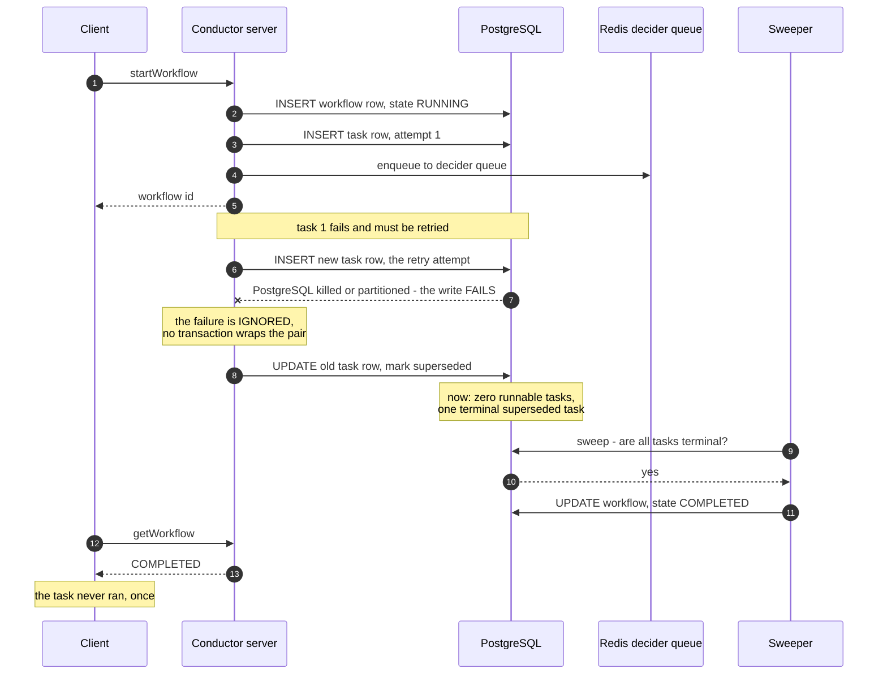

<!--
entry-meta
date: 2026-10-21
type: daily-diff
category: Daily Diff
title: Daily Diff — 2026-10-21
slug: postgres-page-header-line-pointers
-->

# Daily Diff — 2026-10-21

**2026-10-21 · Daily Diff Digest**

## Which edition this covers, and how it was found

**No 2026-10-21 edition exists yet.** This run fired at 03:32 UTC (09:02 IST). This digest covers the **2026-10-20 edition, 36 stories** — the newest edition not yet covered by this log (yesterday's digest covered 2026-10-19).

Endpoint observations for the run log in the root [`README.md`](../../../README.md), following the documented procedure (archive → RSS → dated `.md`, plus a day or two forward):

| Endpoint | Served | Verdict |
|---|---|---|
| [`/archive/`](https://tdd.cat/archive/) | 2026-10-19 (39) as **"Latest"**; 2026-10-20 **and** 2026-10-21 present in the calendar but **unlinked** | **a day behind, and actively misleading** |
| [RSS](https://tdd.cat/rss.xml) | newest item **2026-10-20, 36 stories** | **current** |
| [`https://tdd.cat/2026-10-20.md`](https://tdd.cat/2026-10-20.md) | 2026-10-20, **36 stories** | current — used for this digest |
| [`https://tdd.cat/2026-10-21.md`](https://tdd.cat/2026-10-21.md) | fetch error | no edition |
| [front page](https://tdd.cat/) | 2026-10-19, 39 stories (footer: "End of Edition — Monday, October 19, 2026") | **two** days behind |

**Today's lesson from the endpoints, and it corrects the documented procedure.** The roles inverted from yesterday. Yesterday `/archive/` and the dated `.md` agreed and were right while RSS lagged two days; today **RSS and the dated `.md` agree on 2026-10-20 / 36 stories and are right, while `/archive/` and the front page agree on 2026-10-19 and are wrong.** So the 2026-10-19 rule — agreement among the cheap endpoints is not evidence of currency — holds for a second time, and the only thing agreement establishes is the story count once an edition has already been located.

The sharper correction concerns `/archive/`. On 2026-10-15 and again on 2026-10-20, a date appearing in the archive calendar **unlinked** was read as evidence that no edition had published for it. Today 2026-10-20 is *still* unlinked in the archive while `2026-10-20.md` serves a complete 36-story edition. So **absence from `/archive/` is not evidence that an edition does not exist** — the archive's calendar and its "Latest" link lag the dated permalink by at least a day. The dated `.md` is the only endpoint that has never been observed to report an edition that does not exist, and it is now the only existence test worth trusting. The trailing-slash dated page was not retried; it has failed six consecutive times and is treated as dead.

## The edition, point-wise

The 2026-10-20 edition is unusually lopsided: roughly two thirds of the 36 items are agent-harness and inference-infrastructure posts. The database and systems material is thin but includes the single most rigorous item the log has seen in weeks.

**Databases and storage**

- **Jepsen analysis of Orkes Conductor 5.3.2 → 5.5.0-rc2** — three serious safety violations in a production workflow orchestrator, all of them caused by multi-statement PostgreSQL writes performed *without* a transaction. *Deep dive below.*
- **How Turso handles row lifecycles from bytecode to checkpoint** — an MVCC design where `Insert` does not write to disk at all. The VDBE program (`Init`, `Transaction`, `OpenWrite`, `String8`, `NewRowid`, `MakeRecord`, `Insert`, `Halt`) appends a `RowVersion { begin, end, row }` to an in-memory store, a `SkipMap<RowId, RwLock<Vec<RowVersion>>>` with a per-row-chain lock. `begin` holds a `TxId` while uncommitted and is rewritten to a commit timestamp at commit; `end: None` means live, and a transaction that finds `end` already set gets a `WriteWriteConflict`. Commit is `Active → Preparing → Committed` with first-committer-wins validation that also covers `UNIQUE` and `PRIMARY KEY` keys, then an `fsync` of a logical log (`.db-log`, crc32c per frame, torn tail frames ignored). Checkpointing moves versions out to `.db-wal` and then into the `.db` B-tree, triggered by `PRAGMA mvcc_checkpoint_threshold` at roughly 4 MB / 1,000 frames, in a blocking `truncate` mode or an experimental `passive` one; reads merge the in-memory and B-tree iterators and the in-memory version wins a rowid tie.
- **ClickHouse will let you be wrong at scale** — an argument that ClickHouse's failure mode is silence rather than error, and that strict verification habits are the only defence.
- **pgdeclare** and **searchgres-js** — declarative PostgreSQL schema diffing, and composable search in PostgreSQL pitched as a replacement for a retrieval pipeline.
- **Rebuilding the API edge to scale for AI agents** — monday.com, carried over from the 2026-10-19 edition.

**Compilers, runtimes and systems**

- **Porting the TypeScript compiler to Rust** (Cloudflare) and **PyTorch 2.15's custom Metal kernels for Apple silicon**.
- **Anthropic replaces git to handle massive automated commit volume** — a source-control redesign motivated by machine-generated commit volume rather than human workflow.
- **Subsecond GPU cold starts by bypassing monolithic container state**, via checkpoint/restore rather than image pulls.
- **Structured concurrency replaces unrestricted background task spawning** — the "go statement considered harmful" argument.
- **Adversaries can exfiltrate model weights via inference-API logprobs** — a weights-extraction channel through an ordinary scoring API.
- **Only half of public MCP registry endpoints work reliably** — a Q4 2026 reliability survey.
- **Automating root-cause attribution for large-scale GPU failures**, and **FP16 GEMM kernel optimization using AMD RDNA WMMA instructions**.

**Agents and inference infrastructure**

- Two independent **TorchTPU** items (the GitHub repo and Google's own announcement) for running unmodified PyTorch on Cloud TPUs; **llm-d 1.0** also appears twice, framed once as "distributed inference matures to day-2 operations" and once as coordinating distributed model servers.
- **Push-based KV transfer** to improve TTFT and TPOT in disaggregated vLLM inference (AWS).
- Three items arguing the harness is the substrate, and two arguing the opposite: **"Complex agent harnesses provide no advantage over strong backbones"** (arXiv) against Meta's **thin-orchestrator** architecture and **"hooked control planes erase speedup gains from faster models."** Worth reading as a set.
- **Raw language models match dedicated code review tools**, and **governing agent tool calls** to prevent unsafe mutations and retries.
- Also: GraphQL operations to shrink agent tool context, recurrent-depth / looped transformers, gradient routing to remove unintended RL behaviours, batching agent merges into deploy waves, sandboxing multiple tool calls in JavaScript, an agent built from `bash` and `curl`, RL for e-commerce search, Bauplan's typed data contracts, Jev's reranker benchmark, Muse Glimmer 30B on-device, and a Princeton position paper on evaluating agents beyond outcome benchmarks.

---

## Deep dive — Jepsen's analysis of Orkes Conductor 5.3.2

Item 3, and the right pick on a day whose lesson is about PostgreSQL page writes: **every serious bug in this report is a multi-statement PostgreSQL write that was not wrapped in a transaction.** Followed the source link to the [full analysis](https://jepsen.io/analyses/orkes-conductor-5.3.2).

Conductor is a workflow orchestrator originally built at Netflix; Orkes leads the Conductor OSS Foundation and sells a proprietary version, which is what was tested. Orkes funded the research under Jepsen's ethics policy.

### Setup

| | |
|---|---|
| Versions | 5.3.2, 5.4.0, 5.5.0-rc1, 5.5.0-rc2; fixes verified in **5.5.6** |
| Cluster | Ten Debian nodes (containers and EC2 VMs): **one** PostgreSQL node for the primary DB, **one** Redis node or a Redis Cluster for the queue, the rest split between Conductor servers, standard workers, and a custom Java SDK worker |
| Client | Conductor Java SDK 5.0.1 under the Jepsen harness |
| Workload | One workflow, one task. The task slept up to 30 s, returned random output, logged its execution |
| Operations | `startWorkflow`, `getWorkflow`, `getRunningWorkflow` |
| Faults | Process pause and kill; partitions between servers and PostgreSQL, Redis, and workers |
| Phases | Main (ops + faults) → recovery (faults end, wait for the decider queue to drain) → final read of all workflows |

Note the deliberate simplicity: **a single-task workflow and a single PostgreSQL node.** No replication, no clock skew, no high latency. Everything below was found without any of those.

### The nine findings

| # | Issue | Mechanism | Trigger | Status |
|---|---|---|---|---|
| 1 | **Concurrent task execution** | `conductor.workflow.lockLeaseTime` (default 1 minute) reduces but cannot prevent duplicate execution; a time-of-check-to-time-of-use bug let the sweeper re-enqueue a task a worker had already claimed | Healthy clusters, ~every 6 h at ~1,100 workflows/s. A 1-second lease made it every few minutes | Fixed in 5.5.6 |
| 2 | **Tasks stall before execution** | A worker or server marked a task `IN_PROGRESS` without calling `execute()`; stuck until `responseTimeoutSeconds` (default ~1 h) | Pause / crash / partition of Redis, PostgreSQL, servers or workers | Consistent with design; not addressed |
| 3 | **Null workflow IDs** | `startWorkflow()` returned `null` instead of an ID string. Root cause unknown | Redis kill | **Open**; Java client 6.0.2 mitigates |
| 4 | **Syntax error on `startWorkflow`** | A race during date-partitioned table creation/rotation let the partition manager observe an empty shard-to-table map, so Conductor built `INSERT INTO null ...` | Healthy clusters | Fixed in 5.5.6 — shard map initialized before writes are accepted |
| 5 | **Abandoned workflows** | The workflow row was written to PostgreSQL but the enqueue to the decider queue could fail; the sweeper consulted only the queue, so the workflow stayed `RUNNING` forever | Server kill, PostgreSQL kill, partition | Fixed in 5.5.0 — a background process re-enqueues abandoned executions |
| 6 | **Aborted read** | The Java client retried a **non-idempotent** `startWorkflow` after a timeout; the retry failed to connect and surfaced only that error, hiding the original request's success. **~1,752 of 25,920 "failed" calls had actually succeeded** | Server / Redis / PostgreSQL kill | **Open**; client no longer retries non-idempotent requests (java-sdk PR 175); an `isDefinite()` method is being explored |
| 7 | **Lost workflows** | After a failed decider-queue append, the server **deleted** the PostgreSQL row. Clients saw the workflow, then `getWorkflow` returned null and `/api/workflow/<id>` returned 404 permanently | PostgreSQL partition or kill | Fixed in 5.5.0 — executions are no longer deleted on step failure |
| 8 | **Duplicate key error** | A retry added in 5.5.0-rc1 re-inserted a workflow row after a failed write, surfacing a PostgreSQL unique-constraint violation to the client | PostgreSQL kill and pause | Fixed in 5.5.6 — duplicate-ID errors ignored on retry |
| 9 | **Never-run workflows marked `COMPLETED`** | A retry wrote a *new* task row and then marked the old one superseded. A PostgreSQL failure between the two writes was **ignored**, so no retry task existed. The sweeper then saw only terminal tasks and marked the workflow `COMPLETED` | PostgreSQL kill and partition | Fixed in 5.5.6 — failed retry-task writes are no longer ignored. **Jepsen notes a transaction would have been the proper fix** |

### The shape of it

Findings 5, 7, 8 and 9 are the same mistake four times: **two or more writes that must be atomic, issued as separate statements, with the failure of one of them either unhandled or handled by a repair that itself is not atomic.** The database underneath was PostgreSQL the whole time — a system that would have made every one of these a non-event inside `BEGIN`/`COMMIT`.

Finding 9 is the worst outcome a workflow engine can produce, and it is worth tracing precisely:

The client is told `COMPLETED` for a workflow whose business logic never executed. There is no error, no `RUNNING` row to find later, and no way to distinguish it from a genuine success without checking whatever the task was supposed to have done. Finding 6 is the mirror image: 6.8% of calls that reported failure had in fact succeeded.

### What Jepsen tells operators to do

- **Upgrade to 5.5.6**, which fixes every serious safety issue.
- **Treat every Conductor error as indefinite.** A failure may have succeeded. This is not advice about retries; it is advice about what an error *means*.
- **Audit affected clusters by hand**: search for `RUNNING` workflows that never executed and restart them; find `COMPLETED` workflows whose tasks never ran; recover missing workflows from upstream systems.
- **Make tasks idempotent and commutative**, including across failure workflows, with idempotency keys and logical clocks downstream.
- **Conductor is only as safe as its storage.** Evaluate Redis and PostgreSQL replication and durability deliberately — `appendfsync always` for Redis, `--durability sync` on ElastiCache — because *"some managed Redis and Postgres setups can lose acknowledged writes."*

And the standard caveat, which matters more than usual given how shallow the test configuration was: Jepsen can prove bugs exist, not that they are absent. Single-task workflows, one PostgreSQL node, standalone Redis, no clock skew.

### Why this is the right item on this day

Today's lesson is about the layer that makes PostgreSQL's atomicity *possible*: `pd_lsn` in every page header, the checksum set at flush and verified at read, `PageAddItemExtended` running inside a critical section where `ereport(ERROR)` is banned outright because a half-modified page is not a thing that may exist. The entire apparatus exists so that a set of writes either all land or none do.

Findings 5, 7, 8 and 9 are what happens when an application sits on top of that and declines to use it. The irony is precise: Conductor's `COMPLETED`-without-running bug is a lost update across two statements, while the `README-SSI` work this track reaches at lesson 20 exists to catch anomalies an order of magnitude subtler. Two complementary readings for later in the track:

- **Finding 1 is a lock-lease argument, not a correctness one.** `lockLeaseTime` is time-based mutual exclusion: shorten it and duplicates get *more* frequent, lengthen it and stalls get longer. Lessons 11–12 cover PostgreSQL's heavyweight lock manager and tuple locks, where mutual exclusion is held by a lock table with a deadlock detector rather than by a clock — the clearest available illustration of why a time-based lease is a liveness mechanism masquerading as a safety one.
- **Finding 6 is the aborted-read problem that `startWorkflow`'s non-idempotence creates.** Jepsen's proposed `isDefinite()` is the same question PostgreSQL answers with `pg_xact`'s two status bits per transaction (lesson 13): "did this commit?" is answerable only because there is one authoritative place that records it.

## Sources

- [The Daily Diff — 2026-10-20 edition (dated `.md` permalink)](https://tdd.cat/2026-10-20.md) — the 36-story edition this digest covers
- [The Daily Diff RSS](https://tdd.cat/rss.xml) — independently confirmed 2026-10-20 / 36 stories; the only other endpoint that was current
- [The Daily Diff archive](https://tdd.cat/archive/) — showed 2026-10-19 / 39 as "Latest" with 2026-10-20 unlinked, i.e. wrong; also the source for the 113-edition count history
- [The Daily Diff front page](https://tdd.cat/) — served 2026-10-19, two days behind
- [`https://tdd.cat/2026-10-21.md`](https://tdd.cat/2026-10-21.md) — fetch error; no edition had published by 03:32 UTC
- [Jepsen: Orkes Conductor 5.3.2](https://jepsen.io/analyses/orkes-conductor-5.3.2) — the deep dive's substance: setup, findings 1–9, mechanisms, fix versions, and the operator recommendations
- [How Turso handles row lifecycles from bytecode to checkpoint](https://turso.tech/blog/mvcc-row-lifetime) — read for the MVCC summary above: `RowVersion`, the `SkipMap` store, commit-timestamp rewriting, the logical log and the two checkpoint modes

Source links for items summarized above, as listed in the edition: [Jepsen / Orkes Conductor](https://jepsen.io/analyses/orkes-conductor-5.3.2) · [Turso MVCC row lifetime](https://turso.tech/blog/mvcc-row-lifetime) · [ClickHouse at scale](https://matduggan.com/clickhouse-will-let-you-be-wrong-at-scale/) · [searchgres-js](https://www.tigerdata.com/blog/introducing-searchgres-js-composable-search-postgresql) · [TypeScript to Rust](https://blog.cloudflare.com/typescript-rust-port/) · [torch_tpu](https://github.com/google-pytorch/torch_tpu) · [TorchTPU open source](https://cloud.google.com/blog/topics/ai-infrastructure/torchtpu-is-now-open-source-run-native-pytorch-on-tpus) · [Anthropic source control](https://www.anthropic.com/research/redesigning-source-control) · [GPU cold starts](https://numerata.com/blog/post-gpu-cold-start-checkpoint-restore) · [push-based KV transfer](https://aws.amazon.com/blogs/machine-learning/push-based-kv-transfer-to-improve-ttft-and-tpot-for-disaggregated-inference-in-vllm/) · [structured concurrency](https://vorpus.org/blog/notes-on-structured-concurrency-or-go-statement-considered-harmful/) · [weights exfiltration via logprobs](https://weights-exfil.github.io/model-weights-exfiltration/) · [MCP registry reliability](https://mcpcanary.com/blog/state-of-mcp-reliability-q4-2026/) · [GPU failure attribution](https://github.com/dsx-ai-factory/attribution) · [RDNA FP16 GEMM](https://rocm.blogs.amd.com/software-tools-optimization/rdna-fp16-gemm/README.html) · [PyTorch 2.15 on MPS](https://huggingface.co/blog/mps-pytorch-2-15) · [harnesses provide no advantage](https://arxiv.org/abs/2609.40303) · [thin orchestrator](https://engineering.fb.com/2026/10/19/ml-applications/thin-orchestrator-ai-agent-architecture/) · [hooked control planes](https://pentad.ai/PLRN/031/) · [harness engineering 101](https://isuruwijesiri.com/harness-engineering-101/) · [raw LLM code review benchmark](https://ironbee.ai/blog/the-honest-raw-llm-code-review-benchmark) · [melra tool-call governance](https://github.com/XAGI-Lab/melra) · [GraphQL operations for agents](https://magiroux.com/posts/from-use-case-to-graphql-operation) · [looped transformers](https://saulius.io/blog/what-are-looped-transformers-recurrent-depth) · [gradient routing](https://arxiv.org/abs/2610.17062) · [git-zmarshal](https://github.com/suthakamal2/git-zmarshal) · [llm-d v1.0](https://llm-d.ai/blog/llm-d-v1.0-state-of-the-art-inference-ready-for-day-2) · [llm-d on Google Cloud](https://cloud.google.com/blog/topics/ai-infrastructure/llm-d-1-0-an-open-source-stack-for-distributed-inference) · [claude-code-mode](https://github.com/gabe4coding/claude-code-mode) · [bash-harness](https://github.com/antonum/bash-harness) · [RL for e-commerce search](https://www.searchagora.com/blog/building-a-reinforcement-learning-system-for-e-commerce-search) · [Bauplan data contracts](https://bauplanlabs.com/post/devex-for-developers-who-dont-write-code) · [Jev reranker benchmark](https://www.kapa.ai/blog/jev-reranker-benchmark) · [Muse Glimmer 30B](https://ai.meta.com/research/publications/muse-glimmer-30b-an-on-device-agentic-model/) · [evaluating agents](https://sage.cs.princeton.edu/trends/emerging-trends-paper.pdf) · [monday.com API edge](https://engineering.monday.com/rebuilding-monday-api-edge-for-agents/)
