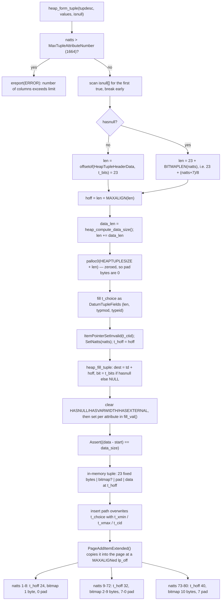

<!--
entry-meta
date: 2026-10-22
type: lesson
track: PostgreSQL
lesson: 03
category: Database Internals
title: The Heap Tuple Header — Twenty-Seven Documented Bytes That Occupy Twenty-Three, a Null Bitmap That Is Free Below Nine Columns, and Two Different Ways to Store a NULL
slug: postgres-heap-tuple-header
-->

# The Heap Tuple Header — Twenty-Seven Documented Bytes That Occupy Twenty-Three, a Null Bitmap That Is Free Below Nine Columns, and Two Different Ways to Store a `NULL`

**2026-10-22 · PostgreSQL Track · Lesson 03 of 35**

## Where This Fits

- **Lesson 02** ([`../2026-10-21-postgres-page-header-line-pointers/README.md`](../2026-10-21-postgres-page-header-line-pointers/README.md)) established the page: the 24-byte `PageHeaderData`, the `ItemIdData` line pointer array growing up from offset 24, and the item space growing down from `pd_special`. It ended by telling you to run `heap_page_items()` and notice that `lp_len - t_hoff` is *not* the row's data size, and that `t_hoff` is always a multiple of 8 — without saying why.
- **This lesson** opens the thing a line pointer points *at*. Every byte from `lp_off` to `lp_off + t_hoff` is header; this lesson accounts for all of them, including the ones that are padding and the ones that are two different fields depending on a flag.
- **It is deliberately about the struct, not about what the struct means.** `t_xmin`/`t_xmax` are introduced as 4-byte fields and as the operands of visibility; the visibility *rules* belong to lesson 14, hint bits to lesson 15, combo CIDs to 16, MultiXact bits to 17, and `t_ctid`-as-HOT-chain to lesson 07. Each deferral is named where it arises.
- **It sets up lesson 04** (attribute storage), which picks up exactly where `t_hoff` leaves off: what the bytes *after* the header look like, MAXALIGN padding between attributes, 1-byte vs 4-byte varlena headers, and TOAST.

## Preamble: what was read, and — for the first time in this track — what was measured

**Source tree read:** `postgres/postgres@f2edf5dd` (master). Lesson 01 read `@ddd468ca`, lesson 02 read `@3cde90ec`; the tree moved again. Stating the commit each time is the only way these lessons stay checkable.

**And this run had a cluster.** Lessons 01 and 02 both carried a "not measured" note — every figure in Part I so far has been arithmetic over constants. That ends here. Every number in this lesson marked **measured** was observed on:

```
PostgreSQL 16.15 (Ubuntu 16.15-0ubuntu0.24.04.1) on x86_64-pc-linux-gnu,
compiled by gcc (Ubuntu 13.3.0-6ubuntu2~24.04.1) 13.3.0, 64-bit
block_size = 8192   segment_size = 1GB   data_checksums = off
```

**Read the version gap honestly.** The struct and the flag constants are read from master; the observations are from 16.15. `HeapTupleHeaderData`'s layout has not changed between them — the measured byte offsets below confirm the master struct exactly — but where master and 16.15 differ (the accessors became `static inline` functions rather than macros; `heap_fill_tuple` now works from `CompactAttribute` rather than `Form_pg_attribute`) the lesson says which tree it is describing. **Lesson 02's open question about runtime checksum enable/disable is untouched here** and still needs re-checking when a checksum lesson arrives.

---

## 1. The struct, and why the documented table sums to 27

The documentation's [Table 66.4](https://www.postgresql.org/docs/current/storage-page-layout.html) lists eight fields whose Length column adds to **27 bytes**, then says in prose that the header occupies **"23 bytes on most machines"**. Both are right. The table lists `t_cid` and `t_xvac` as separate 4-byte rows and notes that `t_cid` "overlays with `t_xvac`"; in the C they are arms of a union, so they cost 4 bytes once, not 8.

There are in fact **two** unions, nested:

```c
typedef struct HeapTupleFields
{
    TransactionId t_xmin;       /* inserting xact ID */
    TransactionId t_xmax;       /* deleting or locking xact ID */
    union {
        CommandId     t_cid;    /* inserting or deleting command ID, or both */
        TransactionId t_xvac;   /* old-style VACUUM FULL xact ID */
    }             t_field3;
} HeapTupleFields;

struct HeapTupleHeaderData
{
    union {
        HeapTupleFields  t_heap;
        DatumTupleFields t_datum;
    }               t_choice;
    ItemPointerData t_ctid;
    /* Fields below here must match MinimalTupleData! */
    uint16          t_infomask2;
    uint16          t_infomask;
    uint8           t_hoff;
    /* ^ - 23 bytes - ^ */
    uint8           t_bits[FLEXIBLE_ARRAY_MEMBER];
    /* MORE DATA FOLLOWS AT END OF STRUCT */
};
```

- **The outer union, `t_choice`**, overlays the transaction fields with `DatumTupleFields` — `{ int32 datum_len_; int32 datum_typmod; Oid datum_typeid; }`. This is why a composite-type `Datum` in memory and a tuple on disk can be walked by the same code: "a Datum does not need any transaction visibility information, and it does need a length word and some embedded type information." `heap_form_tuple` fills the Datum fields *even for tuples destined for disk*, "even though this tuple may never become a Datum" — and the insert path then overwrites them with xmin/xmax. **On disk, `t_choice` is always `t_heap`.**
- **The inner union, `t_field3`**, works because "Cmin and Cmax are only interesting for the lifetime of the inserting and deleting transaction respectively". When one transaction both inserts and deletes a row, a *combo CID* is stored instead and resolved only by backend-local state (`combocid.c`). **Deferred to lesson 16**, which owns combo CIDs entirely.
- `t_xvac` is set only by pre-9.0 `VACUUM FULL` and survives only through `pg_upgrade`. `HeapTupleHeaderGetXvac()` returns `InvalidTransactionId` unless `HEAP_MOVED` is set, and `HeapTupleHeaderSetXvac()` asserts it.

`SizeofHeapTupleHeader` is `offsetof(HeapTupleHeaderData, t_bits)`, **not** `sizeof` — the same trick lesson 02 saw with `SizeOfPageHeaderData`, and for the same reason: `t_bits` is a `FLEXIBLE_ARRAY_MEMBER` and `sizeof` would include alignment padding the on-disk form does not have.

### Byte offsets, and the fifth note on redundancy

| Offset | Size | Field | Notes |
|---|---|---|---|
| 0–3 | 4 | `t_xmin` | inserting xid. Semantics → lesson 14 |
| 4–7 | 4 | `t_xmax` | deleting *or locking* xid. Semantics → 14, 17 |
| 8–11 | 4 | `t_field3` | `t_cid` (CommandId) or `t_xvac` (TransactionId) |
| 12–17 | 6 | `t_ctid` | `ItemPointerData`; four distinct meanings, §3 |
| 18–19 | 2 | `t_infomask2` | 11-bit attribute count + 3 flags |
| 20–21 | 2 | `t_infomask` | 16 flag bits, all allocated |
| 22 | 1 | `t_hoff` | offset to user data; `uint8` |
| 23… | 0+ | `t_bits[]` | null bitmap, **only if `HEAP_HASNULL`** |

`SizeofHeapTupleHeader = 23`. `MinHeapTupleSize = MAXALIGN(23) = 24`.

**Lesson 02 opened a thread**: PostgreSQL systematically removes redundancy that SQLite keeps as a cross-check — the page's item count is derived from `pd_lower` rather than stored. The record format extends that thread further than the page did. SQLite's record header is a varint array that self-describes every column's type and width, so a record can be decoded with no schema at all. PostgreSQL's record header is this fixed 23-byte struct plus an optional presence bitmap, and **carries no type information whatsoever**. Decoding a tuple requires `pg_class`/`pg_attribute`. That is why `pageinspect`'s `tuple_data_split()` takes a `relid` argument and calls `relation_open()` — the bytes alone are not enough.

---

## 2. `MinHeapTupleSize`, measured

A zero-column table produces a tuple that is nothing but header:

```
CREATE TABLE pg3_empty ();  INSERT INTO pg3_empty DEFAULT VALUES;

 lp | lp_off | lp_len | natts | t_hoff
----+--------+--------+-------+--------
  1 |   8168 |     24 |     0 |     24
```

**Measured.** `lp_len = 24 = MAXALIGN(SizeofHeapTupleHeader) = MinHeapTupleSize`, `lp_off = 8192 - 24`. `natts = 0` is a legal attribute count, and `pageinspect` enforces `lp_len >= MinHeapTupleSize` before it will dereference a line pointer at all.

---

## 3. `t_ctid`: six bytes, four meanings

`ItemPointerData` is the most space-sensitive struct in the system — one per heap tuple and one per index tuple — and the header says so plainly: *"it's very important not to waste space with structure padding bytes. The struct is designed to be six bytes long (it contains three int16 fields) but a few compilers will pad it to eight bytes unless coerced. We apply appropriate persuasion where possible. If your compiler can't be made to play along, you'll waste lots of space."* The persuasion is `pg_attribute_packed()` + `pg_attribute_aligned(2)`.

```c
typedef struct ItemPointerData
{
    BlockIdData  ip_blkid;   /* { uint16 bi_hi; uint16 bi_lo; } */
    OffsetNumber ip_posid;   /* uint16 */
} ItemPointerData;           /* packed, aligned(2) */
```

`BlockIdData` exists *only* so a block number can be SHORTALIGN'd. `block.h` says: *"there doesn't appear to be any reason to have separate types except for the fact that BlockIds can be SHORTALIGN'd (and therefore any structures that contains them, such as ItemPointerData, can also be SHORTALIGN'd). this is an important consideration for reducing the space requirements of the line pointer (ItemIdData) array on each page and the header of each heap or index tuple."* A plain `uint32` would force 4-byte alignment and make the struct 8 bytes.

The split is `bi_hi = blockNumber >> 16`, `bi_lo = blockNumber & 0xffff`, reassembled by `BlockIdGetBlockNumber()`. **This is the same halfword-swapped shape lesson 02 found in `pd_lsn`**: high half first, each half little-endian. Measured on block 299 (`0x12b`):

```
 lp | t_ctid  | ip_blkid_bytes | ip_posid_bytes
----+---------+----------------+----------------
  1 | (299,1) | 00002b01       | 0100
```

`bi_hi = 0x0000` → bytes `00 00`; `bi_lo = 0x012b` → bytes `2b 01`. **Measured.** A hexdump therefore reads a ctid's block number in the printed order, which is convenient and entirely accidental.

### The four meanings

| State | Encoding | Test |
|---|---|---|
| **Latest version** | points at itself | `t_ctid` == own TID, or `HEAP_XMAX_INVALID` |
| **Superseded by an update** | points at the replacement tuple's TID | follow the chain |
| **Moved to another partition** | `ip_posid = MovedPartitionsOffsetNumber = 0xfffd`, `ip_blkid = InvalidBlockNumber` | `ItemPointerIndicatesMovedPartitions()` |
| **Speculative insertion token** | `ip_posid = SpecTokenOffsetNumber = 0xfffe`, token in `ip_blkid` | `HeapTupleHeaderIsSpeculative()` |

Both magic offsets exceed `MaxOffsetNumber`, which is what makes them unambiguous — and the code asserts it rather than trusting the comment: `StaticAssertDecl(MaxOffsetNumber < SpecTokenOffsetNumber, "invalid speculative token constant")`.

The speculative token is `INSERT ... ON CONFLICT`'s mechanism: a tuple is inserted, its token parked in `t_ctid`, and the real TID written once the inserter commits to the row. The header is specific about where it can be seen: *"a token should only be seen on a tuple with an XMAX that's still in-progress, or invalid/aborted"* and *"one should never see a speculative insertion token while following a chain of t_ctid links, because they are not used on updates, only insertions."*

### Following a chain is not safe naively

The header's warning is worth quoting because it is a real correctness trap:

> *Beware however that VACUUM might erase the pointed-to (newer) tuple before erasing the pointing (older) tuple. Hence, when following a t_ctid link, it is necessary to check to see if the referenced slot is empty or contains an unrelated tuple. Check that the referenced tuple has XMIN equal to the referencing tuple's XMAX to verify that it is actually the descendant version and not an unrelated tuple stored into a slot recently freed by VACUUM.*

So the chain is validated by `xmin(next) == xmax(this)`, not by the pointer alone. A line pointer is a *slot*, and slots get reused.

**Measured** — a row inserted then updated, with the chain visible:

```
 lp | lp_len | t_xmin | t_xmax | t_ctid | t_infomask2 | t_infomask | t_hoff
----+--------+--------+--------+--------+-------------+------------+--------
  1 |     34 |    746 |    747 | (0,2)  |       16386 |        258 |     24
  2 |     35 |    747 |      0 | (0,2)  |       32770 |      10242 |     24
```

`lp 1`'s `t_ctid` points at `(0,2)`; `lp 2`'s points at itself. `xmin(lp 2) = 747 = xmax(lp 1)`, which is exactly the check above. `lp 1`'s `t_infomask2 = 16386 = 0x4002` = `HEAP_HOT_UPDATED | natts 2`; `lp 2`'s `32770 = 0x8002` = `HEAP_ONLY_TUPLE | natts 2`. **This happened to be a HOT update — lesson 07 owns HOT chains, redirect line pointers and pruning entirely.** Taken here only as proof that `t_ctid` is a forward pointer.

---

## 4. `t_infomask2`: an attribute count sharing a word with three flags

```c
#define HEAP_NATTS_MASK     0x07FF  /* 11 bits for number of attributes */
/* bits 0x1800 are available */
#define HEAP_KEYS_UPDATED   0x2000  /* tuple was updated and key cols modified, or tuple deleted */
#define HEAP_HOT_UPDATED    0x4000  /* tuple was HOT-updated */
#define HEAP_ONLY_TUPLE     0x8000  /* this is heap-only tuple */
#define HEAP2_XACT_MASK     0xE000  /* visibility-related bits */
```

- **11 bits ⇒ 2047 maximum.** `MaxTupleAttributeNumber` is 1664 (`8 * 208`) and `MaxHeapAttributeNumber` is 1600 (`8 * 200`), both comfortably under. So the natts mask is *not* the binding constraint on column count.
- **The binding constraint is `t_hoff`'s width.** The header says: *"The key limit on this value is that the size of the fixed overhead for a tuple, plus the size of the null-values bitmap (at 1 bit per column), plus MAXALIGN alignment, must fit into t_hoff which is uint8. On most machines the upper limit without making t_hoff wider would be a little over 1700. We use round numbers here and for MaxHeapAttributeNumber so that alterations in HeapTupleHeaderData layout won't change the supported max number of columns."* The 1600 ceiling is enforced and produces a specific error — **measured**:

```
=> CREATE TABLE toomany (c1 int, ... c1601 int);
ERROR:  tables can have at most 1600 columns
```

  `MaxHeapAttributeNumber` is deliberately below `MaxTupleAttributeNumber` because `UPDATE` must form working tuples that include CTID, plus "some additional daylight" for resjunk columns like `SELECT * FROM wide_table ORDER BY foo, bar, baz`.
- **Two bits, `0x1800`, are unallocated** — and comparably, `t_infomask` has none left (§5). The next heap flag goes here.
- **`HEAP_TUPLE_HAS_MATCH` is `HEAP_ONLY_TUPLE` under another name**, a hash-join marker overlaid on a visibility bit because "it is only used in tuples that are in the hash table, and those don't need any visibility information, so we can overlay it on a visibility flag instead of using up a dedicated bit." The same 16 bits mean different things in a `MinimalTuple` in a hash table than on disk.

### The attribute count is per-tuple, and that is load-bearing

`natts` is not a property of the table; it is a property of each tuple, and tuples in one table routinely disagree. `ALTER TABLE ... ADD COLUMN` with no `DEFAULT` does not rewrite the heap, so old tuples keep their old count. **Measured:**

```
CREATE TABLE pg3_alter (a int, b int);
INSERT INTO pg3_alter VALUES (1,2);
ALTER TABLE pg3_alter ADD COLUMN c int;
INSERT INTO pg3_alter VALUES (3,4,5);

 lp | lp_len | natts | t_hoff          a | b | c
----+--------+-------+--------         ---+---+---
  1 |     32 |     2 |     24          1 | 2 |
  2 |     36 |     3 |     24          3 | 4 | 5
```

Two tuples in one page with `natts` 2 and 3. The first has no null bitmap at all — `HEAP_HASNULL` is clear, since at the time it was written it had no nulls — yet `SELECT c` returns NULL for it. `pageinspect` states the rule in a comment: *"Tuple header can specify fewer attributes than tuple descriptor as ALTER TABLE ADD COLUMN without DEFAULT keyword does not actually change tuples in pages, so attributes with numbers greater than (t_infomask2 & HEAP_NATTS_MASK) should be treated as NULL."*

So **a NULL in PostgreSQL has two distinct on-disk encodings**: a 0 bit in the bitmap, or an attribute number past `natts`. Any code that walks raw tuples must handle both. `heap_attisnull()` does exactly that, and adds a third case — `atthasmissing`, where `ADD COLUMN ... DEFAULT` stores the default in the catalog instead of the heap. That third case is lesson 04's.

---

## 5. `t_infomask`: all sixteen bits, and which lesson owns each

| Bit | Name | Meaning | Owner |
|---|---|---|---|
| `0x0001` | `HEAP_HASNULL` | has null attribute(s) → bitmap present | **this lesson**, §6 |
| `0x0002` | `HEAP_HASVARWIDTH` | has variable-width attribute(s) | 04 |
| `0x0004` | `HEAP_HASEXTERNAL` | has external (TOASTed) attribute(s) | 04 |
| `0x0008` | `HEAP_HASOID_OLD` | has an object-id field | historical |
| `0x0010` | `HEAP_XMAX_KEYSHR_LOCK` | xmax is a key-shared locker | 12 |
| `0x0020` | `HEAP_COMBOCID` | `t_cid` is a combo CID | 16 |
| `0x0040` | `HEAP_XMAX_EXCL_LOCK` | xmax is exclusive locker | 12 |
| `0x0080` | `HEAP_XMAX_LOCK_ONLY` | xmax, if valid, is only a locker | 12 |
| `0x0100` | `HEAP_XMIN_COMMITTED` | `t_xmin` committed | 15 |
| `0x0200` | `HEAP_XMIN_INVALID` | `t_xmin` invalid/aborted | 15 |
| `0x0400` | `HEAP_XMAX_COMMITTED` | `t_xmax` committed | 15 |
| `0x0800` | `HEAP_XMAX_INVALID` | `t_xmax` invalid/aborted | 15 |
| `0x1000` | `HEAP_XMAX_IS_MULTI` | `t_xmax` is a MultiXactId | 17 |
| `0x2000` | `HEAP_UPDATED` | this is an UPDATEd version of a row | 07 |
| `0x4000` | `HEAP_MOVED_OFF` | moved by pre-9.0 VACUUM FULL | historical |
| `0x8000` | `HEAP_MOVED_IN` | moved by pre-9.0 VACUUM FULL | historical |

**Every bit is allocated.** Three bits are retained purely "for binary upgrade support" — `HEAP_HASOID_OLD`, `HEAP_MOVED_OFF`, `HEAP_MOVED_IN` — meaning 3/16 of the flag word is spent on compatibility with releases before 9.0. That is the cost of `pg_upgrade` never rewriting the heap, written into the format.

### Composite constants are not bits

Four names in the header are *combinations*, and conflating them with bits is a real source of confusion:

```c
#define HEAP_XMIN_FROZEN     (HEAP_XMIN_COMMITTED|HEAP_XMIN_INVALID)  /* 0x0300 */
#define HEAP_XMAX_SHR_LOCK   (HEAP_XMAX_EXCL_LOCK|HEAP_XMAX_KEYSHR_LOCK) /* 0x0050 */
#define HEAP_MOVED           (HEAP_MOVED_OFF|HEAP_MOVED_IN)           /* 0xC000 */
#define HEAP_LOCK_MASK       (HEAP_XMAX_SHR_LOCK|HEAP_XMAX_EXCL_LOCK|HEAP_XMAX_KEYSHR_LOCK)
```

`HEAP_XMIN_FROZEN` is the standout: "committed" **and** "invalid" simultaneously — a state that is nonsense read bit-by-bit — is the encoding for *frozen*. Prior to 9.4 freezing overwrote `t_xmin` with `FrozenTransactionId`, "and that value may still be encountered on disk." That is why there are both `HeapTupleHeaderGetRawXmin()` (the field) and `HeapTupleHeaderGetXmin()` (returns `FrozenTransactionId` if the frozen *bit pattern* is set). **Lesson 18 owns freezing**; what matters here is that the raw bits and the logical value are different questions, and the accessor names tell you which one you are asking.

This is also why `heap_tuple_infomask_flags()` returns **two** arrays, `raw_flags` and `combined_flags`: the raw pass tests each bit with `!= 0`, the combined pass tests `(mask & COMBO) == COMBO`. **Measured**, on the update pair from §3:

```
 lp |                             raw_flags                             | combined_flags
----+-------------------------------------------------------------------+----------------
  1 | {HEAP_HASVARWIDTH,HEAP_XMIN_COMMITTED,HEAP_HOT_UPDATED}           | {}
  2 | {HEAP_HASVARWIDTH,HEAP_XMAX_INVALID,HEAP_UPDATED,HEAP_ONLY_TUPLE} | {}
```

Note `HEAP_XMAX_INVALID` is **set** on the live tuple. A freshly inserted tuple has `t_xmax = 0` *and* `0x0800` set — the flag is the fast path, so visibility checking does not need to inspect the field. A plain insert, measured, has `t_infomask = 2048 = 0x0800` and nothing else.

### `t_cid` is observable

Three inserts in one transaction:

```
 lp | t_xmin | t_xmax | t_cid | lp_len | t_hoff
----+--------+--------+-------+--------+--------
  1 |    767 |      0 |     0 |     28 |     24
  2 |    767 |      0 |     1 |     28 |     24
  3 |    767 |      0 |     2 |     28 |     24
```

**Measured.** Same `t_xmin`, command ids 0/1/2 — the union's `t_cid` arm, holding cmin, in the field the documentation lists twice.

---

## 6. `t_hoff` and `t_bits`: the only arithmetic in the header

`heap_form_tuple()` computes the whole layout in five lines:

```c
len = offsetof(HeapTupleHeaderData, t_bits);     /* 23 */
if (hasnull)
    len += BITMAPLEN(numberOfAttributes);        /* (NATTS + 7) / 8 */
hoff = len = MAXALIGN(len);                      /* align user data safely */
data_len = heap_compute_data_size(tupleDescriptor, values, isnull);
len += data_len;
```

Four consequences, all of them checkable:

- **The bitmap is sized from `natts`, not from the number of nulls.** One null in a 100-column table costs 13 bytes of bitmap.
- **`t_hoff` is `MAXALIGN`ed, so the bitmap is often free.** `MAXALIGN(23 + 1) = 24` and `MAXALIGN(23) = 24` are the same number: for a table of **8 or fewer columns the null bitmap costs nothing**, because it lands in the pad byte that exists anyway.
- **The tuple is `palloc0`'d**, so padding bytes are zero on disk. Not merely tidy: lesson 02 established that the page checksum covers the whole page including the hole, and deterministic padding is what makes a checksum reproducible.
- **`t_hoff` is a step function of `natts`**, flat across wide ranges. Measured, with a single NULL in each table:

| `natts` | `BITMAPLEN` | `23 + bitmap` | `t_hoff` | pad bytes | measured `t_hoff` |
|---|---|---|---|---|---|
| 8 | 1 | 24 | 24 | 0 | **24** |
| 9 | 2 | 25 | 32 | 7 | **32** |
| 16 | 2 | 25 | 32 | 7 | **32** |
| 72 | 9 | 32 | 32 | 0 | **32** |
| 73 | 10 | 33 | 40 | 7 | **40** |

**Measured, all five.** Adding the ninth column to a nullable table costs 8 bytes per row forever; columns 9 through 72 then cost nothing more in header, because they are absorbed by padding that was already there. The 73rd triggers the next step.

### Bit order in the bitmap, and a sentinel that looks like an ordering

The read side is unambiguous — `tupmacs.h`:

```c
static inline bool
att_isnull(int ATT, const uint8 *BITS)
{
    return !(BITS[ATT >> 3] & (1 << (ATT & 0x07)));
}
```

Attribute *n* is bit `n % 8` of byte `n / 8`, **LSB-first**, and **a 1 bit means NOT NULL**. The docs confirm the polarity: *"a 1 bit indicates not-null, a 0 bit is a null. When the bitmap is not present, all columns are assumed not-null."*

The write side, `fill_val()`, is initialized in a way that reads like the opposite:

```c
bitP = &bit[-1];  bitmask = HIGHBIT;   /* in heap_fill_tuple */
...
if (*bitmask != HIGHBIT)  *bitmask <<= 1;
else { *bit += 1; **bit = 0x0; *bitmask = 1; }
```

`HIGHBIT` here is a **sentinel, not a position**. Starting at `HIGHBIT` with `bitP` one byte *before* the bitmap forces the first iteration down the else branch, which advances to byte 0 and sets `bitmask = 1`. So attribute 0 lands on the LSB, matching `att_isnull`. The pointer-before-the-array plus impossible-mask trick removes the first-iteration special case; it does not mean the bitmap is MSB-first.

`pageinspect`'s `bits_to_text()` prints with `bits[i / 8] & (1 << (i % 8))`, i.e. in `att_isnull` order, so the string reads left-to-right as attribute 1, 2, 3… **Measured** — three `int` columns, the middle one NULL:

```
 lp | lp_len | t_infomask2 | t_infomask | t_hoff |  t_bits
----+--------+-------------+------------+--------+----------
  1 |     32 |           3 |       2049 |     24 | 10100000
```

`1`,`0`,`1` for attributes 1–3, then five pad bits. `t_infomask = 2049 = 0x0801` = `HEAP_XMAX_INVALID | HEAP_HASNULL`. `lp_len = 32` against 36 for the same shape with no nulls — **the NULL occupies zero data bytes, and the bitmap that recorded it was free.** A nullable `int` column in a narrow table is genuinely cheaper when null.

Note also what `length(t_bits)` reports: `BITMAPLEN(natts) * 8`, so 16 characters for a 9-column table and 72 for a 72-column one. The string length reveals the bitmap's byte count, not the column count.

---

## 7. The whole header, as one hexdump

Three `int` columns, values 1/2/3, no nulls, on 16.15. `lp_off = 8152`, `lp_len = 36`, so this is the entire tuple:

```
dc020000 00000000 00000000 0000 0000 0100 0300 0008 18 00 | 01000000 02000000 03000000
```

| Bytes | Hex | Field | Value |
|---|---|---|---|
| 0–3 | `dc 02 00 00` | `t_xmin` | `0x02dc` = **732** |
| 4–7 | `00 00 00 00` | `t_xmax` | 0 |
| 8–11 | `00 00 00 00` | `t_field3` (`t_cid`) | 0 |
| 12–13 | `00 00` | `ip_blkid.bi_hi` | 0 |
| 14–15 | `00 00` | `ip_blkid.bi_lo` | 0 → block **0** |
| 16–17 | `01 00` | `ip_posid` | **1** → `t_ctid = (0,1)`, self |
| 18–19 | `03 00` | `t_infomask2` | **3** = natts 3, no flags |
| 20–21 | `00 08` | `t_infomask` | `0x0800` = `HEAP_XMAX_INVALID` |
| 22 | `18` | `t_hoff` | `0x18` = **24** |
| 23 | `00` | — | **pad byte.** No `HEAP_HASNULL`, so no bitmap lives here |
| 24–35 | `01…02…03…` | user data | three little-endian `int4` |

**Measured, every row.** This is the master struct, byte for byte, on a 16.15 page. Byte 23 is the clearest single fact in the lesson: the field `t_bits` always *exists* in the C declaration and occupies zero bytes unless `HEAP_HASNULL` says otherwise — and the byte it would occupy is there regardless, because `MAXALIGN(23) = 24`.

---

## 8. How the layout is actually computed



Two things this makes visible that the struct alone does not. First, **the transaction fields are written twice**: `heap_form_tuple` fills `t_choice` as a `DatumTupleFields` for every tuple, and the insert path overwrites it. Second, `hasnull` is computed by a loop that `break`s on the first null, so it is a presence test, not a count — consistent with a bitmap sized from `natts`.

---

## Hands-On

Requires `pageinspect` (superuser only; lesson 01's hands-on installs it). Everything below was run on 16.15 to produce the numbers above.

**1. Confirm the 23/24 boundary with a tuple that is pure header.**

```sql
CREATE EXTENSION IF NOT EXISTS pageinspect;
CREATE TABLE pg3_empty ();
INSERT INTO pg3_empty DEFAULT VALUES;
SELECT lp, lp_off, lp_len, t_infomask2 & 2047 AS natts, t_hoff
FROM heap_page_items(get_raw_page('pg3_empty', 0));
```

*What to look for:* `lp_len = 24`, `t_hoff = 24`, `natts = 0`. This proves `MinHeapTupleSize = MAXALIGN(23)` and that `natts = 0` is representable. If `lp_len` were 23, `SizeofHeapTupleHeader` would be the on-disk size — it is not; MAXALIGN is.

**2. Hand-decode the header from raw bytes.**

```sql
CREATE TABLE pg3_fixed (a int, b int, c int);
INSERT INTO pg3_fixed VALUES (1,2,3);
SELECT t_xmin, t_xmax, t_ctid, t_infomask2, t_infomask, t_hoff, lp_off, lp_len
FROM heap_page_items(get_raw_page('pg3_fixed', 0));
-- then the same 36 bytes raw (substr is 1-based, lp_off is 0-based)
SELECT encode(substr(get_raw_page('pg3_fixed', 0), 8152 + 1, 24), 'hex') AS header_hex,
       encode(substr(get_raw_page('pg3_fixed', 0), 8152 + 25, 12), 'hex') AS data_hex;
```

*What to look for:* every value in the first query must be findable in the second at the offset from §7's table. Substitute your own `lp_off`. The payoff is byte 23: it is `00`, it is not part of the header's 23 bytes, and it is not a bitmap — it is the MAXALIGN pad. **If you can place all eight fields by hand, the struct is no longer an abstraction.**

**3. Watch the null bitmap cost nothing, then cost 8 bytes.**

```sql
CREATE TABLE pg3_null (a int, b int, c int);
INSERT INTO pg3_null VALUES (1, NULL, 3);
SELECT lp_len, t_infomask, t_hoff, t_bits FROM heap_page_items(get_raw_page('pg3_null', 0));
```

Then generate wide tables — 8, 9, 72 and 73 `int` columns, each with exactly one NULL — and compare `t_hoff`:

```sql
SELECT 'n=8' AS t, t_infomask2 & 2047 AS natts, t_hoff, length(t_bits) AS bits_shown, lp_len
  FROM heap_page_items(get_raw_page('w8', 0))
UNION ALL SELECT 'n=9',  t_infomask2 & 2047, t_hoff, length(t_bits), lp_len FROM heap_page_items(get_raw_page('w9', 0))
UNION ALL SELECT 'n=72', t_infomask2 & 2047, t_hoff, length(t_bits), lp_len FROM heap_page_items(get_raw_page('w72', 0))
UNION ALL SELECT 'n=73', t_infomask2 & 2047, t_hoff, length(t_bits), lp_len FROM heap_page_items(get_raw_page('w73', 0));
```

*What to look for:* `t_hoff` 24 → 32 → 32 → 40, and `t_bits` at 3 columns reading `10100000`. The step at 9 and the flatness through 72 is the whole point: **header overhead per row is not linear in column count**, and the ninth nullable column is where you pay. Confirm the polarity too — the `0` is the NULL.

**4. Make two tuples in one table disagree about how many columns the table has.**

```sql
CREATE TABLE pg3_alter (a int, b int);
INSERT INTO pg3_alter VALUES (1,2);
ALTER TABLE pg3_alter ADD COLUMN c int;     -- no DEFAULT: no rewrite
INSERT INTO pg3_alter VALUES (3,4,5);
SELECT lp, lp_len, t_infomask2 & 2047 AS natts, t_hoff,
       (heap_tuple_infomask_flags(t_infomask, t_infomask2)).raw_flags
FROM heap_page_items(get_raw_page('pg3_alter', 0));
SELECT a, b, c FROM pg3_alter ORDER BY a;
```

*What to look for:* `natts` 2 and 3 on the same page, and the first row's `c` reading NULL from a tuple with **no `HEAP_HASNULL` and no bitmap**. This is the second NULL encoding. Now repeat with `ADD COLUMN d int DEFAULT 7` and note that `natts` *still* does not change for the old tuple — the default is served from the catalog, not the heap. That mechanism is lesson 04's `atthasmissing`.

**5. See `t_ctid` as a forward pointer and validate the chain by hand.**

```sql
CREATE TABLE pg3_upd (id int, v text) WITH (fillfactor = 100);
INSERT INTO pg3_upd VALUES (1, 'first');
UPDATE pg3_upd SET v = 'second' WHERE id = 1;
SELECT lp, t_xmin, t_xmax, t_ctid,
       (heap_tuple_infomask_flags(t_infomask, t_infomask2)).raw_flags
FROM heap_page_items(get_raw_page('pg3_upd', 0));
```

*What to look for:* `lp 1` points at `(0,2)` while `lp 2` points at itself, and `xmin(lp 2) = xmax(lp 1)` — the exact equality the header says you must check before trusting the link. Do not read the `HEAP_HOT_UPDATED` / `HEAP_ONLY_TUPLE` pair yet; lesson 07 owns it.

**6. Read the command id out of the union.**

```sql
BEGIN;
  INSERT INTO pg3_cid VALUES (1); INSERT INTO pg3_cid VALUES (2); INSERT INTO pg3_cid VALUES (3);
COMMIT;
SELECT lp, t_xmin, t_field3 AS t_cid FROM heap_page_items(get_raw_page('pg3_cid', 0));
```

*What to look for:* one `t_xmin`, three `t_cid` values 0/1/2. `heap_page_items` names this column `t_field3` and its source comments it `/* shared with xvac */` — the function cannot tell you which arm of the union you are reading, because **nothing in the tuple says**, except `HEAP_MOVED` in the infomask.

---

## Where This Breaks Down

- **23 bytes of header per row is the tax, and it is not negotiable.** On the measured 3-column `int` table the tuple is 36 bytes for 12 bytes of data: **24 bytes of overhead on 12 bytes of payload, plus a 4-byte line pointer**, so 28/40 = 70% of the row's page footprint is bookkeeping. A narrow, high-row-count table is mostly header. This is the direct cost of per-tuple MVCC — the second axis from the SQLite capstone — and the reason PostgreSQL loses badly to column stores on narrow-row workloads before any query execution happens.
- **No self-description means no recovery without a catalog.** SQLite's record header makes a page decodable in isolation; `tuple_data_split()` needs `relation_open()`. If `pg_attribute` is lost, the heap is bytes. The forensic consequence is concrete: a salvaged 8 KB page can be parsed down to `t_hoff` and no further.
- **`t_hoff` as `uint8` is a hard ceiling** that caps columns at roughly 1700 and forces the 1600/1664 pair to be round numbers so layout changes do not move a user-visible limit. Widening it would change the on-disk format of every tuple in existence.
- **The flag word is full.** `t_infomask` has zero free bits; `t_infomask2` has two. Three `t_infomask` bits are held purely for pre-9.0 `pg_upgrade` compatibility. The next heap feature needing a persistent flag has two bits, after which the format has to change.
- **Overlaying semantics on bits costs clarity in the worst places.** `HEAP_XMIN_FROZEN` is "committed AND invalid"; `HEAP_TUPLE_HAS_MATCH` is `HEAP_ONLY_TUPLE`; `t_field3` is cmin, cmax, a combo CID or an xvac depending on flags elsewhere in the struct. Every one of these is a correct space optimisation and every one is a place where reading the bits literally gives the wrong answer. `HEAP_LOCKED_UPGRADED()` exists solely to recognise a bit combination that has been impossible since 9.3 but can still arrive via `pg_upgrade`.
- **A NULL has two encodings and a default has a third.** Any tool that walks raw heap tuples — and that includes recovery tooling people write under pressure — must handle a 0 bit, an attribute beyond `natts`, and `atthasmissing`. Handling only the first is the common bug, and it reads stale garbage rather than failing loudly.
- **`ItemPointerData`'s packing is a compiler dependency in the on-disk format.** The header admits the fallback: *"If your compiler can't be made to play along, you'll waste lots of space."* An 8-byte `ItemPointerData` would change the width of the tuple header and every index tuple.

## Further Study

- [`src/include/access/htup.h`](https://github.com/postgres/postgres/blob/f2edf5dd00d174c7b1396f0a777375368a26c752/src/include/access/htup.h) — `HeapTupleData`, the in-memory wrapper (`t_len`, `t_self`, `t_tableOid`, `t_data`) that is *not* on disk. The distinction between `HeapTuple` and `HeapTupleHeader` causes real confusion; this file is short and settles it.
- [`src/backend/access/common/heaptuple.c`](https://github.com/postgres/postgres/blob/f2edf5dd00d174c7b1396f0a777375368a26c752/src/backend/access/common/heaptuple.c) — read `heap_deform_tuple()` next to `heap_form_tuple()`. It is the inverse, and it is where lesson 04's attribute walk actually lives.
- [`src/include/access/tupmacs.h`](https://github.com/postgres/postgres/blob/f2edf5dd00d174c7b1396f0a777375368a26c752/src/include/access/tupmacs.h) — beyond `att_isnull`, `populate_isnull_array()` turns a bitmap byte into eight booleans with one multiply by `0x204081`, and `first_null_attr()` finds the first NULL with `pg_rightmost_one_pos32(~byte)`. Both document why the obvious loop was not good enough.
- [`contrib/pageinspect/heapfuncs.c`](https://github.com/postgres/postgres/blob/f2edf5dd00d174c7b1396f0a777375368a26c752/contrib/pageinspect/heapfuncs.c) — `tuple_data_split_internal()` is labelled "a reimplementation of nocachegetattr() in heaptuple.c simplified for educational purposes" and is the shortest correct tuple walker in the tree.
- [`MinimalTupleData` in `htup_details.h`](https://github.com/postgres/postgres/blob/f2edf5dd00d174c7b1396f0a777375368a26c752/src/include/access/htup_details.h) — the executor's header-shaving variant. `MINIMAL_TUPLE_OFFSET` is chosen so `offsetof(t_infomask2)` is congruent modulo `MAXIMUM_ALIGNOF` in both structs, and `t_hoff` *includes* that offset while `t_len` does not. Worth reading before lesson 32.

## Next Steps

1. Re-run hands-on exercise 2 against a table whose first column is `text` rather than `int`, and try to find the attribute boundaries in the data bytes. You will not be able to do it reliably from the bytes alone — the varlena header is 1 byte or 4 depending on length. That failure is lesson 04's entry point.
2. Build a table with 100 nullable columns, insert one row with a single NULL, and compute the bytes spent on bitmap versus data. Compare against the same row with zero NULLs. Decide for yourself whether `HEAP_HASNULL` should have been a count rather than a flag.
3. Write the header decoder from §7 as a script that takes `(relation, block, lp)` and prints all eight fields plus decoded flags, using only `get_raw_page` and `substr`. Check it against `heap_page_items`. Any disagreement is a misunderstanding of alignment or endianness, and finding it is the exercise.
4. Verify lesson 02's deferred claim now that a cluster is available: confirm the heap fingerprint bytes `00 20 04 20` at page offsets 16–19 and the 8160-byte insert ceiling. Both were derived arithmetically and have never been observed.
5. Before lesson 04, read `heap_compute_data_size()` and note that it is called *after* `t_hoff` is fixed — so attribute padding is computed relative to the start of the data area, which is already MAXALIGNed. That is the invariant lesson 04 depends on.

## Sources

- [`src/include/access/htup_details.h`](https://github.com/postgres/postgres/blob/f2edf5dd00d174c7b1396f0a777375368a26c752/src/include/access/htup_details.h) @ `f2edf5dd` — the struct, both unions, all 16 `t_infomask` bits, `t_infomask2`'s mask and three flags, `BITMAPLEN`, `SizeofHeapTupleHeader`, `MinHeapTupleSize`, `MaxTupleAttributeNumber`/`MaxHeapAttributeNumber` and the `t_hoff`-width rationale, the accessor functions, `MinimalTupleData`
- [`src/include/storage/itemptr.h`](https://github.com/postgres/postgres/blob/f2edf5dd00d174c7b1396f0a777375368a26c752/src/include/storage/itemptr.h) @ `f2edf5dd` — `ItemPointerData`, the packed/aligned pragmas and the padding warning, `SpecTokenOffsetNumber` `0xfffe`, `MovedPartitionsOffsetNumber` `0xfffd`
- [`src/include/storage/block.h`](https://github.com/postgres/postgres/blob/f2edf5dd00d174c7b1396f0a777375368a26c752/src/include/storage/block.h) @ `f2edf5dd` — `BlockIdData`'s `bi_hi`/`bi_lo`, `BlockIdSet`/`BlockIdGetBlockNumber`, and the SHORTALIGN rationale
- [`src/include/access/tupmacs.h`](https://github.com/postgres/postgres/blob/f2edf5dd00d174c7b1396f0a777375368a26c752/src/include/access/tupmacs.h) @ `f2edf5dd` — `att_isnull`'s bit order and polarity
- [`src/backend/access/common/heaptuple.c`](https://github.com/postgres/postgres/blob/f2edf5dd00d174c7b1396f0a777375368a26c752/src/backend/access/common/heaptuple.c) @ `f2edf5dd` — `heap_form_tuple`'s five-line layout computation, `heap_fill_tuple`, `fill_val`'s bitmap sentinel, `heap_attisnull`'s three null cases
- [`contrib/pageinspect/heapfuncs.c`](https://github.com/postgres/postgres/blob/f2edf5dd00d174c7b1396f0a777375368a26c752/contrib/pageinspect/heapfuncs.c) @ `f2edf5dd` — `heap_page_items`' validity checks and column set, `bits_to_text`'s print order, `tuple_data_split_internal`'s stale-`natts` rule, `heap_tuple_infomask_flags`' raw-vs-combined split
- [PostgreSQL documentation, 66.6 Database Page Layout](https://www.postgresql.org/docs/current/storage-page-layout.html) — Table 66.4, the "23 bytes on most machines" statement, the null bitmap's size/polarity/presence rules, and `t_hoff`'s MAXALIGN requirement
- Measurements: PostgreSQL 16.15 (Ubuntu 16.15-0ubuntu0.24.04.1), x86_64, `block_size` 8192, `data_checksums` off, `pageinspect` 1.12. Every figure labelled **measured** above was observed in that cluster during this run.

## Takeaways

- **23 bytes fixed, 24 on disk.** `SizeofHeapTupleHeader` is `offsetof(t_bits)` = 23; `MAXALIGN` makes the smallest possible tuple 24, measured as the `lp_len` of a zero-column row. The documented table sums to 27 because it lists both arms of the `t_field3` union.
- **The null bitmap is free below nine columns and costs 8 bytes from nine through seventy-two.** `t_hoff = MAXALIGN(23 + ceil(natts/8))` is a step function, measured at 24/32/32/40 for 8/9/72/73 columns. Header cost per row is not linear in column width.
- **A NULL has two on-disk encodings** — a 0 bit in the bitmap, or an attribute number beyond this tuple's `natts` — because `ADD COLUMN` does not rewrite the heap. Two tuples in one page can legitimately disagree about how many columns the table has.
- **`t_ctid` is six bytes with four meanings**, and following the chain requires checking `xmin(next) == xmax(this)`, because `VACUUM` may have recycled the slot.
- **The flag space is exhausted**: `t_infomask` has no free bits, three of them are reserved for pre-9.0 compatibility, and `t_infomask2` has two left. `HEAP_XMIN_FROZEN` being "committed AND invalid" is what running out of bits looks like.
- **The tuple carries no type information.** The header plus a bitmap plus a catalog lookup replaces SQLite's self-describing varint array — faster and smaller, and undecodable without the catalog.
