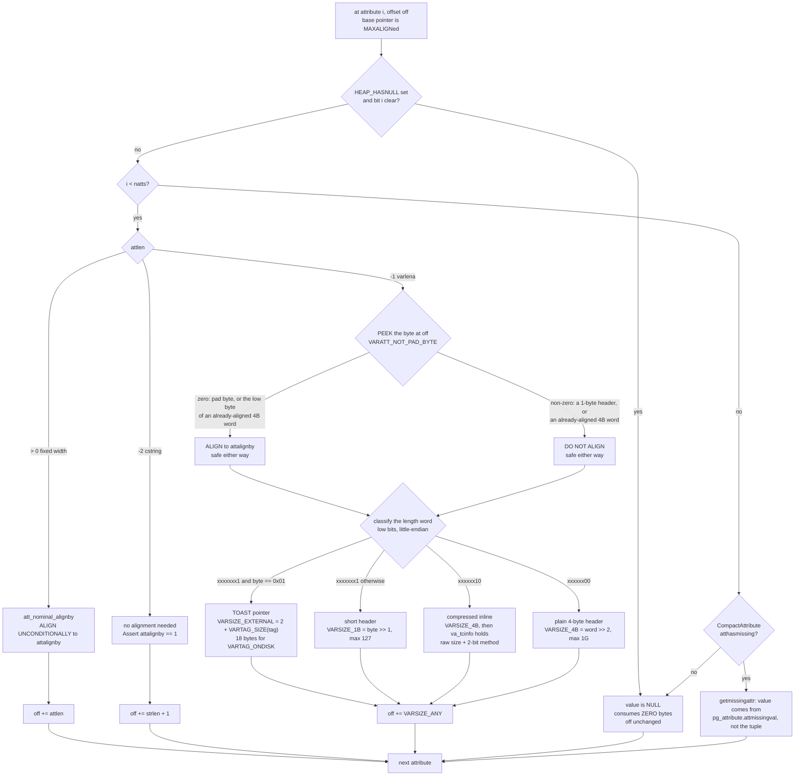
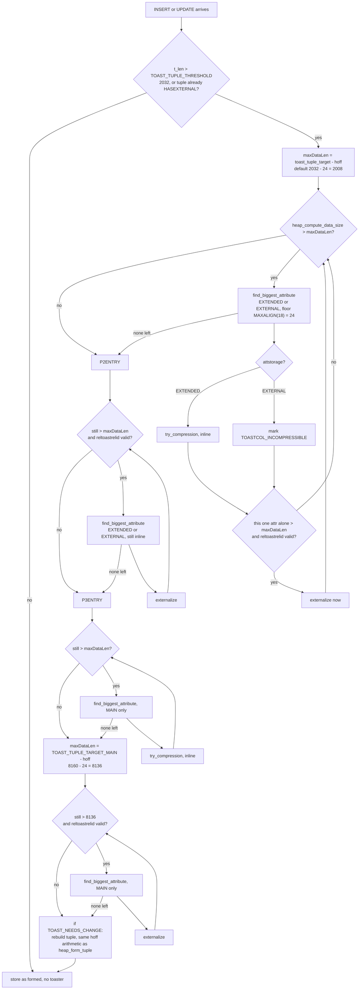

<!--
entry-meta
date: 2026-10-23
type: lesson
track: PostgreSQL
lesson: 04
category: Database Internals
title: Attribute Storage — A 126-Byte Boundary That Costs Six Bytes to Cross, One Byte That Decides Whether to Align, and 1,996-Byte Chunks Derived From a Quarter of a Page
slug: postgres-attribute-storage-varlena-toast
-->

# Attribute Storage — A 126-Byte Boundary That Costs Six Bytes to Cross, One Byte That Decides Whether to Align, and 1,996-Byte Chunks Derived From a Quarter of a Page

**2026-10-23 · PostgreSQL Track · Lesson 04 of 35**

## Where This Fits

- [Lesson 03](../2026-10-22-postgres-heap-tuple-header/README.md) closed the 23-byte `HeapTupleHeaderData` and the null bitmap: `BITMAPLEN(natts)`, the `t_hoff = MAXALIGN(23 + BITMAPLEN)` step function, the bitmap's LSB-first order and its inverted polarity. It ended by telling you to hexdump a table whose first column is `text` and find the attribute boundaries — and warned that you would fail.
- This lesson is that answer. Everything from `t_hoff` to the end of the tuple: the four alignment macros and why there are four, the three varlena length-word formats that share one leading byte, the pad-byte peek that makes an unaligned format decodable at all, `atthasmissing` as the third on-disk encoding of a NULL, and then TOAST — thresholds derived in closed form and measured, the four-pass loop, and `varatt_external` decoded byte by byte off a real page.
- The unifying thread: **one function, `heap_compute_data_size()`, is both the layout oracle and the TOAST loop's measuring stick.** It decides where each attribute lands, and the toaster calls it again after every compression or externalisation to ask "are we small enough yet". Understand it once and both halves of this lesson collapse into one mechanism.
- It also closes the last two debts from [lesson 02](../2026-10-21-postgres-page-header-line-pointers/README.md): the heap page fingerprint bytes at page offsets 16–19, and the 8160-byte `MaxHeapTupleSize` insert ceiling. Both were arithmetic over constants then; both are observations now.
- Next up is lesson 05, the Free Space Map — which is the question of *which page* a tuple of the size computed here will go to.

### Source and build

Structures and constants read this run from **`postgres/postgres@f52d4051`** (master) and from **`REL_16_STABLE`** where the two differ; every difference is flagged inline. The tree has moved on every lesson of this track so far (01 `@ddd468ca`, 02 `@3cde90ec`, 03 `@f2edf5dd`, 04 `@f52d4051`), and this lesson has the largest divergence yet — master renamed `varatt_external` as part of 64-bit TOAST value IDs. See [Version divergence](#version-divergence) before you grep your own tree.

Measurements: **PostgreSQL 16.15 (Ubuntu 16.15-0ubuntu0.24.04.1), x86_64, gcc 13.3.0, `block_size` 8192, `segment_size` 1GB, `data_checksums` off, pageinspect 1.12, `default_toast_compression` = `pglz`**, throwaway cluster, `initdb` into `/var/tmp`, port 5455, unix socket only. Every number below marked **measured** was observed on that cluster this run.

---

## 1. Two debts from lesson 02, now paid

Lesson 02 derived the heap page fingerprint and the tuple-size ceiling from constants and flagged both as unverified. They are verified.

**The fingerprint.** Bytes 12–19 of a heap page holding one tuple, **measured**:

```
1c00 e01f 0020 0420
 ^     ^     ^    ^
 |     |     |    pd_pagesize_version = 0x2004  (size 8192 | version 4)
 |     |     pd_special = 0x2000 = 8192
 |     pd_upper   = 0x1fe0 = 8160
 pd_lower = 0x001c = 28
```

Bytes 16–19 read `00 20 04 20` — exactly as predicted. A nbtree leaf on the same cluster read `f0 1f 04 20` at the same offsets (`pd_special` 8176). Both signatures from lesson 02 stand; use them.

**The 8160 ceiling.** A single `text STORAGE PLAIN` column, inserting `repeat('x', n)` for n = 8128…8140, **measured**:

| `n` | result | tuple length |
|---|---|---|
| 8128 | OK | `lp_len` 8156 = 24 + 4 + 8128 |
| 8129–8132 | OK | up to 8160 |
| 8133 | `ERROR: row is too big: size 8168, maximum size 8160` | — |
| 8134–8140 | same error, **same reported size 8168** | — |

The boundary is 8132 data bytes, and the error message reports 8168 for every n from 8133 to 8140 — because the number it reports is `MAXALIGN(24 + 4 + n)`, which is constant across those eight values. `MaxHeapTupleSize = 8160` confirmed; the MAXALIGN granularity of 8 confirmed; lesson 02's 8160-vs-8164 derivation confirmed from the other side.

---

## 2. Where the data area starts, and why that matters

`heap_form_tuple()` fixes the header before it looks at a single value:

- `hoff = SizeofHeapTupleHeader` (23)
- `if (hasnull) hoff += BITMAPLEN(numberOfAttributes)`
- `hoff = MAXALIGN(hoff)`

So the data area begins at a `MAXALIGN`ed offset — 24, 32, 40, as lesson 03 measured. This has a consequence the code leans on heavily and states only in a comment. `fill_val()` aligns the **raw pointer**, not an offset:

```c
	/*
	 * XXX we use the att_nominal_alignby macro on the pointer value itself,
	 * not on an offset.  This is a bit of a hack.
	 */
```

That hack is sound *only* because `t_hoff` is `MAXALIGN`ed: the data area's base pointer already has `MAXIMUM_ALIGNOF` alignment, so aligning the pointer and aligning the offset give the same answer. Change `t_hoff` to anything not `MAXALIGN`ed and every alignment decision in the tuple becomes wrong.

The second consequence is the one lesson 03's Next Step 5 pointed at: **attribute padding is measured from an already-`MAXALIGN`ed base**, so the first attribute never needs padding, and the null bitmap never shifts attribute alignment — it only ever moves the base by a multiple of 8.

---

## 3. Four alignment macros, and why there are four

`src/include/access/tupmacs.h` defines two families of two. The distinction is not stylistic.

| Macro | Aligns unconditionally? | When to use it |
|---|---|---|
| `att_align_nominal(off, attalign)` | **yes** | non-varlena attributes; abstract padding estimates; inside arrays and multiranges |
| `att_nominal_alignby(off, attalignby)` | **yes** | same, but with a pre-computed byte count — the fast path |
| `att_align_datum(off, attalign, attlen, datum)` | no, if `attlen == -1 && VARATT_IS_SHORT(datum)` | **building** a tuple, when you hold the Datum |
| `att_datum_alignby(off, attalignby, attlen, datum)` | same | same, pre-computed alignby |
| `att_align_pointer(off, attalign, attlen, ptr)` | no, if `attlen == -1 && VARATT_NOT_PAD_BYTE(ptr)` | **walking** a tuple, when you only hold the bytes |
| `att_pointer_alignby(off, attalignby, attlen, ptr)` | same | same, pre-computed alignby |

Two axes, therefore four names (six, counting the `alignby` variants that master added for the `CompactAttribute` fast path):

1. **nominal vs. conditional** — do you know it is not a varlena, or must you consider that it might be packed?
2. **datum vs. pointer** — are you writing (you have the value, you can test `VARATT_IS_SHORT` directly) or reading (you have only raw bytes, and must *infer*)?

`att_align_nominal` carries the honest warning about its third use case:

```
 *	* within arrays and multiranges, we unconditionally align varlenas (XXX this
 *	  should be revisited, probably).
```

The `attalign` char code (`'c'`, `'s'`, `'i'`, `'d'`) is mapped to a byte count by `typalign_to_alignby()`, four cases, with the rationale stated:

```c
/*
 * typalign_to_alignby: map a TYPALIGN_xxx value to the numeric alignment
 * value it represents.  (We store TYPALIGN_xxx codes not the real alignment
 * values mainly so that initial catalog contents can be machine-independent.)
 */
```

`TYPALIGN_CHAR → 1`, `TYPALIGN_SHORT → ALIGNOF_SHORT`, `TYPALIGN_INT → ALIGNOF_INT`, `TYPALIGN_DOUBLE → ALIGNOF_DOUBLE`. The codes are in the catalog precisely so that `initdb`'s bootstrap data does not encode one machine's ABI.

Length is the matching three-case function, `att_addlength_pointer`:

| `attlen` | bytes consumed |
|---|---|
| `> 0` | `attlen` |
| `-1` | `VARSIZE_ANY(attptr)` — varlena, length is in the datum |
| `-2` | `strlen(attptr) + 1` — cstring, length is where the NUL is |

`AssertMacro((attlen) == -2)` in the last arm: there is no fourth case.

### Measured: column order is a 33% row-width difference

Six columns, three `int2` and three `int8`, same values, two orders. **Measured `lp_len`:**

| table | column order | `lp_len` |
|---|---|---|
| `pg4_bad` | `int2, int8, int2, int8, int2, int8` | **72** |
| `pg4_good` | `int8, int8, int8, int2, int2, int2` | **54** |

The arithmetic, with `attalign` read from `pg_attribute` (`int2` → `s`, `int8` → `d`):

```
pg4_bad                         pg4_good
  24  header                      24  header
  24  a int2   (2)                24  b int8   (8)
  26  PAD x6                      32  d int8   (8)
  32  b int8   (8)                40  f int8   (8)
  40  c int2   (2)                48  a int2   (2)
  42  PAD x6                      50  c int2   (2)
  48  d int8   (8)                52  e int2   (2)
  56  e int2   (2)                -----
  58  PAD x6                      54  lp_len
  64  f int8   (8)
  ----
  72  lp_len
```

18 bytes of pad in a 54-byte payload. Declaring columns widest-first costs nothing and is the single cheapest schema optimisation PostgreSQL offers. Note `MaxHeapTuplesPerPage` is 291 (lesson 02), so on a narrow table this is the difference between fitting ~113 and ~151 rows per page.

---

## 4. The varlena length word: three formats, one leading byte

`src/include/varatt.h` carries the layout contract. Verbatim, and worth reading twice:

```c
/*
 * Bit layouts for varlena headers on big-endian machines:
 *
 * 00xxxxxx 4-byte length word, aligned, uncompressed data (up to 1G)
 * 01xxxxxx 4-byte length word, aligned, *compressed* data (up to 1G)
 * 10000000 1-byte length word, unaligned, TOAST pointer
 * 1xxxxxxx 1-byte length word, unaligned, uncompressed data (up to 126b)
 *
 * Bit layouts for varlena headers on little-endian machines:
 *
 * xxxxxx00 4-byte length word, aligned, uncompressed data (up to 1G)
 * xxxxxx10 4-byte length word, aligned, *compressed* data (up to 1G)
 * 00000001 1-byte length word, unaligned, TOAST pointer
 * xxxxxxx1 1-byte length word, unaligned, uncompressed data (up to 126b)
 *
 * The "xxx" bits are the length field (which includes itself in all cases).
 * In the big-endian case we mask to extract the length, in the little-endian
 * case we shift.  Note that in both cases the flag bits are in the physically
 * first byte.  Also, it is not possible for a 1-byte length word to be zero;
 * this lets us disambiguate alignment padding bytes from the start of an
 * unaligned datum.  (We now *require* pad bytes to be filled with zero!)
 *
 * In TOAST pointers the va_tag field (see varattrib_1b_e) is used to discern
 * the specific type and length of the pointer datum.
 */
```

Three things to extract, all of them load-bearing later:

1. **The flag bits are in the physically first byte in both endiannesses.** That is not an accident of layout — it is the invariant that makes a one-byte peek sufficient on any machine.
2. **A 1-byte length word can never be zero**, because the length includes itself. So `0x00` is unambiguously a pad byte. The parenthetical "(We now *require* pad bytes to be filled with zero!)" is the contract that `palloc0` and `PageInit`'s full-page `MemSet` (lesson 02) satisfy.
3. **The length always includes the length word itself.** `VARSIZE` of a 2-character `text` is 6 with a 4-byte header and 3 with a 1-byte header.

The little-endian extraction, verbatim (identical in 16 and master):

```c
#define VARATT_IS_4B(PTR)    ((((varattrib_1b *) (PTR))->va_header & 0x01) == 0x00)
#define VARATT_IS_4B_U(PTR)  ((((varattrib_1b *) (PTR))->va_header & 0x03) == 0x00)
#define VARATT_IS_4B_C(PTR)  ((((varattrib_1b *) (PTR))->va_header & 0x03) == 0x02)
#define VARATT_IS_1B(PTR)    ((((varattrib_1b *) (PTR))->va_header & 0x01) == 0x01)
#define VARATT_IS_1B_E(PTR)  ((((varattrib_1b *) (PTR))->va_header) == 0x01)
#define VARATT_NOT_PAD_BYTE(PTR) (*((uint8 *) (PTR)) != 0)

#define VARSIZE_4B(PTR) ((((varattrib_4b *) (PTR))->va_4byte.va_header >> 2) & 0x3FFFFFFF)
#define VARSIZE_1B(PTR) ((((varattrib_1b *) (PTR))->va_header >> 1) & 0x7F)
```

Note that **every one of these reads through `varattrib_1b`**, a struct whose only member before the data is a `uint8`. That is deliberate — the header's own comment says the aligned and unaligned cases get separate structs "because the compiler might otherwise think it could generate code that assumes alignment while touching fields of a 1-byte-header varlena." And `VARATT_NOT_PAD_BYTE` is byte-identical in both endian arms, for the reason above.

Header sizes, all `offsetof` expressions rather than literals:

| Constant | Definition | Value |
|---|---|---|
| `VARHDRSZ` | in `c.h`, not `varatt.h` | 4 |
| `VARHDRSZ_SHORT` | `offsetof(varattrib_1b, va_data)` | 1 |
| `VARHDRSZ_EXTERNAL` | `offsetof(varattrib_1b_e, va_data)` | 2 |
| `VARHDRSZ_COMPRESSED` | `offsetof(varattrib_4b, va_compressed.va_data)` | 8 |
| `VARATT_SHORT_MAX` | literal | `0x7F` = 127 |

### The packing decision, and where the boundary is

```c
static inline bool
VARATT_CAN_MAKE_SHORT(const void *PTR)
{
	return VARATT_IS_4B_U(PTR) &&
		(VARSIZE(PTR) - VARHDRSZ + VARHDRSZ_SHORT) <= VARATT_SHORT_MAX;
}
```

Solve it: `VARSIZE − 4 + 1 ≤ 127` → `VARSIZE ≤ 130` → **data length ≤ 126**. Note the two things the predicate *excludes* by requiring `VARATT_IS_4B_U`: an already-short datum, and a compressed one. Both fall through to the unconditional-alignment path.

**Measured**, `pg_column_size(t)` for `repeat('x', n)`:

| data bytes | `pg_column_size` | header |
|---|---|---|
| 124 | 125 | 1-byte |
| 125 | 126 | 1-byte |
| **126** | **127** | 1-byte — the largest packable datum |
| **127** | **131** | 4-byte |
| 128 | 132 | 4-byte |

And the row-width cost of crossing it depends on where you are standing. **Measured `lp_len`** on `(i int, t text)` — the varlena starts at offset 28, already 4-aligned:

| data bytes | `lp_len` |
|---|---|
| 126 | 155 |
| 127 | **159** (+4) |

On `(i int2, t text)` — the varlena starts at offset 26, **not** 4-aligned:

| data bytes | `lp_len` |
|---|---|
| 125 | 152 |
| 126 | 153 |
| 127 | **159** (+6) |
| 128 | 160 |

One extra data byte costs **six** bytes of row width: three for the header that grew from 1 to 4, plus two pad bytes that did not exist a moment ago. The alignment requirement is not a property of the column — it is a property of the *value*.

---

## 5. The pad-byte peek: how an unaligned format stays decodable

This is the best comment in `tupmacs.h` and the answer to lesson 03's closing exercise:

```c
/*
 * att_align_pointer performs the same calculation as att_align_datum,
 * but is used when walking a tuple.  attptr is the current actual data
 * pointer; when accessing a varlena field we have to "peek" to see if we
 * are looking at a pad byte or the first byte of a 1-byte-header datum.
 * (A zero byte must be either a pad byte, or the first byte of a correctly
 * aligned 4-byte length word; in either case we can align safely.  A non-zero
 * byte must be either a 1-byte length word, or the first byte of a correctly
 * aligned 4-byte length word; in either case we need not align.)
 */
```

The logic is a two-line proof. At the current offset, for a varlena attribute:

- byte is `0x00` → cannot be a 1-byte header (those are never zero) → it is either padding, or the low byte of a 4-byte length word that is *already* correctly aligned. Aligning is safe in both cases, because aligning an already-aligned offset is a no-op.
- byte is non-zero → cannot be padding (padding is required to be zero) → it is either a 1-byte header, or an aligned 4-byte word. Not aligning is safe in both cases.

So the same single comparison resolves four possibilities into two safe actions. **This is why the pad-bytes-must-be-zero requirement exists**, and why the file-header comment in `heaptuple.c` says it moved from a convention to a rule:

```
 * To determine
 * what is stored, we have to require that alignment padding bytes be zero.
 * (Postgres actually has always zeroed them, but now it's required!)  Since
 * the first byte of a 1-byte-header varlena can never be zero, we can examine
 * the first byte after the previous datum to tell if it's a pad byte or the
 * start of a 1-byte-header varlena.
```

### Measured: the same table, two rows, the peek going each way

Table `pg4_peek3(a int2, b text, c text)`. Both rows have `a = 1` and `b = 'AB'`, so both are byte-identical through offset 28. Then they diverge. **Measured `t_data`:**

Row 1 — `c = 'CD'`:

```
offset:  24 25 | 26 27 28 | 29 30 31
bytes:   01 00 | 07 41 42 | 07 43 44        lp_len = 32
         a=1     b: 0x07>>1 = 3 = 1+2       c: 0x07>>1 = 3 = 1+2
```

At offset 29 the walker peeks: `0x07` ≠ 0 → **do not align**, read a 1-byte header here. No pad byte exists.

Row 2 — `c = repeat('Q',127)`:

```
offset:  24 25 | 26 27 28 | 29 30 31 | 32 33 34 35 | ...
bytes:   01 00 | 07 41 42 | 00 00 00 | 0c 02 00 00 | 'QQQ...'    lp_len = 163
         a=1     b (short)  THREE PADS  0x0000020c >> 2 = 131 = 4 + 127
```

At offset 29 the walker peeks: `0x00` → **align** to 32, then read a 4-byte length word. Three pad bytes appeared because the *value* in column `c` crossed 126 bytes.

`lp_len` checks out exactly: 24 + 2 + 3 + 3 + 131 = 163.

**That pair is the whole mechanism.** Same table, same `TupleDesc`, same `attalign` for `c`; the byte at offset 29 is the only thing that tells the walker what to do, and it is correct in both directions. Lesson 03 told you that you would fail to find the attribute boundaries by eye. You fail because the boundary is not a function of the schema.

### The walk, as one decision tree

Everything in §3–§5 is this loop, run once per attribute, starting at `off = 0` relative to a data area whose base is `MAXALIGN`ed:



Two things the diagram makes visible that the prose does not. First, the **peek happens before the classification**, not after — the walker must decide whether to move before it knows what it is looking at, and the zero/non-zero test is exactly enough information to do that safely. Second, there are **three distinct ways** an attribute can contribute zero data bytes: a bitmap NULL, an `attnum > natts` absence, and an `atthasmissing` value that is real but lives in the catalog. Lesson 03 found the first two; the third is §7.

### Measured surprise: `STORAGE PLAIN` does not stop header packing

`heaptuple.c` defines three packability predicates and documents a trap in the comment on the first:

```c
/*
 * Does att's datatype allow packing into the 1-byte-header varlena format?
 * While functions that use TupleDescAttr() and assign attstorage =
 * TYPSTORAGE_PLAIN cannot use packed varlena headers, functions that call
 * TupleDescInitEntry() use typeForm->typstorage (TYPSTORAGE_EXTENDED) and
 * can use packed varlena headers, e.g.:
 *     CREATE TABLE test(a VARCHAR(10000) STORAGE PLAIN);
 *     INSERT INTO test VALUES (repeat('A',10));
 * This can be verified with pageinspect.
 */
#define ATT_IS_PACKABLE(att) \
	((att)->attlen == -1 && (att)->attstorage != TYPSTORAGE_PLAIN)
```

Verified with pageinspect, as instructed. Two tables, `text` column, `'AB'`, one declared `STORAGE PLAIN` at `CREATE TABLE` and one switched with `ALTER TABLE ... SET STORAGE PLAIN` afterwards. **Measured:**

| how `PLAIN` was set | `pg_attribute.attstorage` | `lp_len` | `t_data` |
|---|---|---|---|
| at `CREATE TABLE` | `p` | 27 | `\x074142` |
| by `ALTER TABLE` | `p` | 27 | `\x074142` |

Both **packed**: `0x07 >> 1 = 3`, a 1-byte header and two data bytes, 24 + 3 = 27. A 4-byte header would have given `lp_len` 30. So `attstorage = 'p'` in the catalog, and a short header on disk, simultaneously. The relation's `TupleDesc` is built through `TupleDescInitEntry()`, which copies the *type*'s `typstorage` (`TYPSTORAGE_EXTENDED` for `text`), not the *column*'s `attstorage` — so the predicate the tuple-forming code consults never sees your `SET STORAGE PLAIN`.

Practical reading: `SET STORAGE PLAIN` reliably turns off TOAST (compression and out-of-line moves, §7–8). It does **not** reliably turn off header packing. The documented use of `TYPSTORAGE_PLAIN` for `oidvector` and `int2vector` works because those are system catalog columns whose descriptors are built the other way.

---

## 6. `attcacheoff`: the cache, and the cliff

Walking a tuple attribute by attribute is `O(attnum)`. The escape is `attcacheoff`, a per-attribute cached byte offset, and on master it is computed once in `TupleDescFinalize()` rather than lazily inside `nocachegetattr()`. The loop is short enough to read whole:

```c
	for (int i = 0; i < tupdesc->natts; i++)
	{
		CompactAttribute *cattr = TupleDescCompactAttr(tupdesc, i);
		Form_pg_attribute attr = TupleDescAttr(tupdesc, i);
		...
		/*
		 * Don't cache offsets beyond fixed-width attributes.  Virtual
		 * generated attributes are stored as NULLs in the tuple, so we don't
		 * cache offsets beyond these.
		 */
		if (cattr->attlen <= 0 ||
			attr->attgenerated == ATTRIBUTE_GENERATED_VIRTUAL)
			break;

		off = att_nominal_alignby(off, cattr->attalignby);

		/*
		 * attcacheoff is an int16, so don't try to cache any offsets larger
		 * than will fit in that type. ...
		 */
		if (off > PG_INT16_MAX)
			break;

		cattr->attcacheoff = (int16) off;

		off += cattr->attlen;
		firstNonCachedOffsetAttr = i + 1;
	}
```

Three ways out of the loop, i.e. three things that kill the cache:

1. **`attlen <= 0`** — any varlena (−1) or cstring (−2). **Everything from the first variable-length column onward is uncached, forever.** Not just that column: every column after it.
2. **`attgenerated == ATTRIBUTE_GENERATED_VIRTUAL`** — stored as NULL, zero bytes, so nothing after it has a fixed offset either.
3. **`off > PG_INT16_MAX`** — the `int16` ceiling, which the comment notes is nearly unreachable without a varlena first.

Inside the cached prefix the code uses `att_nominal_alignby` — the *unconditional* variant — and that is correct precisely because the prefix contains no varlenas by construction.

`CompactAttribute` itself is the other half of this optimisation: an 8-byte cut-down of `FormData_pg_attribute`, with the comment "Currently, this struct is 8 bytes. Any code changes which enlarge this struct should be considered very carefully." It holds `attcacheoff`, `attlen`, `attbyval`, `attalignby` (the *byte count*, not the `attalign` char code), and four 1-bit flags including `attispackable` and `atthasmissing`.

### Honest non-result

I tried to measure the cliff: two tables of 400,000 rows, ten `int` columns and one `text`, differing only in whether the `text` is first or last, then `SELECT sum(c10)` repeatedly on a warm cache. **Measured:** `pg4_late` 23.9 / 18.0 / 18.3 ms, `pg4_early` 22.6 / 21.4 / 19.4 ms. The distributions overlap. **The effect was not reproduced.**

That is a result, not a failure to get one. At ten columns the uncached walk is nine `att_pointer_alignby`/`att_addlength_pointer` steps per row, and that is lost in the noise of per-row executor overhead on this hardware. A measurable version of this experiment needs many more columns — far enough right that the walk dominates — and should use `EXPLAIN (ANALYZE, TIMING OFF)` plus repeated runs rather than wall-clock `\timing`. Do not cite the attcacheoff cliff as a measured cost on the strength of this lesson; it is a real code path with an unmeasured magnitude.

---

## 7. `atthasmissing`: the third on-disk encoding of a NULL

Lesson 03 established two encodings for "this column has no value in this tuple":

1. the bit is 0 in the null bitmap (and `HEAP_HASNULL` is set);
2. `attnum > natts` — the column was added after the tuple was written, no bitmap involvement at all.

`heap_attisnull()` adds the third, and it is the only one where the answer is *not* NULL:

```c
	if (attnum > (int) HeapTupleHeaderGetNatts(tup->t_data))
	{
		if (tupleDesc &&
			TupleDescCompactAttr(tupleDesc, attnum - 1)->atthasmissing)
			return false;
		else
			return true;
	}
```

A column that is physically absent from the tuple reports **not null**, because the descriptor says a missing value exists. The value itself comes from `getmissingattr()`, out of `tupleDesc->constr->missing[attnum - 1]`:

```c
typedef struct AttrMissing
{
	bool		am_present;		/* true if non-NULL missing value exists */
	Datum		am_value;		/* value when attribute is missing */
} AttrMissing;
```

By-value types are returned directly (`/* no  need to cache by-value attributes */` — the double space is in the source). By-reference types are interned in a backend-lifetime hash table keyed on `{len, value}` and hashed over the *bytes*, so two `TupleDesc`s with the same missing value share one copy, and the returned pointer outlives the `TupleDesc` that asked for it. That makes it the one value `heap_deform_tuple` can produce that does not point into a tuple at all.

### Measured: a value in no tuple, returned by `SELECT`

```
create table pg4_miss(a int);
insert into pg4_miss values (1);
alter table pg4_miss add column b text default 'hello';
```

**Measured:**

| observation | value |
|---|---|
| `pg_relation_filenode` before vs. after | **unchanged** — no rewrite |
| `t_infomask2 & 2047` (natts) | **1** |
| `lp_len` | **28** |
| `t_data` | `\x01000000` — four bytes, the `int`, nothing else |
| `t_infomask` | 2048 = `HEAP_XMAX_INVALID` only; `HEAP_HASNULL` **clear** |
| `pg_attribute.atthasmissing` for `b` | **t** |
| `pg_attribute.attmissingval` for `b` | **`{hello}`** |
| `SELECT * FROM pg4_miss` | `1` / `hello` |

The string `hello` exists exactly once in the cluster, in `pg_attribute`, and is handed to every row of the table. That is the "fast default" feature, and this is what it looks like from underneath.

The two contrast cases, both **measured** on the same cluster:

- `ADD COLUMN c text DEFAULT clock_timestamp()::text` — a **volatile** default. `pg_relation_filenode` **changed**: the table was rewritten, and `atthasmissing` came back **false for every column**, including `b`, because the rewrite materialised them all. The optimisation is not just skipped, it is undone.
- `ADD COLUMN b text` with **no** default — `atthasmissing` **false**, `attmissingval` **null**, tuple still `natts = 1`, `HEAP_HASNULL` clear. That is encoding #2 from lesson 03, unchanged.

One sharp edge in the code: `heap_attisnull()` tests `atthasmissing` while `getmissingattr()` tests `am_present`. A descriptor with the first set and the second clear would report not-null from one and `isnull = true` from the other. In practice they are set together — but the asymmetry is in the source, not papered over.

---

## 8. TOAST: the thresholds, derived and then measured

Everything so far decided where bytes go *inside* a tuple. TOAST is what happens when they do not fit. The gate is a tuple-length comparison, and the targets are all derived from one macro (`REL_16_STABLE`, `access/heaptoast.h`):

```c
/*
 * Find the maximum size of a tuple if there are to be N tuples per page.
 */
#define MaximumBytesPerTuple(tuplesPerPage) \
	MAXALIGN_DOWN((BLCKSZ - \
				   MAXALIGN(SizeOfPageHeaderData + (tuplesPerPage) * sizeof(ItemIdData))) \
				  / (tuplesPerPage))
```

With `BLCKSZ` 8192, `SizeOfPageHeaderData` 24 and `sizeof(ItemIdData)` 4 — both from lesson 02 — every constant falls out:

```
TOAST_TUPLES_PER_PAGE = 4
TOAST_TUPLE_THRESHOLD = MaximumBytesPerTuple(4)
                      = MAXALIGN_DOWN((8192 - MAXALIGN(24 + 4*4)) / 4)
                      = MAXALIGN_DOWN((8192 - 40) / 4)
                      = MAXALIGN_DOWN(2038)
                      = 2032
TOAST_TUPLE_TARGET    = TOAST_TUPLE_THRESHOLD = 2032

TOAST_TUPLES_PER_PAGE_MAIN = 1
TOAST_TUPLE_TARGET_MAIN = MaximumBytesPerTuple(1)
                        = MAXALIGN_DOWN(8192 - MAXALIGN(28))
                        = MAXALIGN_DOWN(8160) = 8160        <-- = MaxHeapTupleSize

EXTERN_TUPLES_PER_PAGE = 4
EXTERN_TUPLE_MAX_SIZE  = MaximumBytesPerTuple(4) = 2032
TOAST_MAX_CHUNK_SIZE   = 2032 - MAXALIGN(SizeofHeapTupleHeader)
                              - sizeof(Oid) - sizeof(int32) - VARHDRSZ
                       = 2032 - 24 - 4 - 4 - 4
                       = 1996
```

Note `TOAST_TUPLE_TARGET_MAIN` lands on **8160**, the same `MaxHeapTupleSize` §1 just measured. That is not a coincidence: "the largest tuple that will fit on a heap page" is one description of both.

The header is explicit that these are not free parameters:

```
 * XXX while these can be modified without initdb, some thought needs to be
 * given to needs_toast_table() in toasting.c before unleashing random
 * changes.  Also see LOBLKSIZE in large_object.h, which can *not* be
 * changed without initdb.
```
```
 * NB: Changing TOAST_MAX_CHUNK_SIZE requires an initdb.
```

### Measured: all four numbers

**The 2032 threshold.** One `text STORAGE EXTERNAL` column (so compression is off the table and the only lever is externalisation), inserting `repeat('x', n)` and counting rows in the TOAST table:

| data bytes | tuple would be | TOAST chunks |
|---|---|---|
| 2000–2003 | 2028–2031 | **0** |
| 2004 | **2032** | **0** |
| **2005** | **2033** | **2** |
| 2006–2010 | 2034+ | 2 |

The boundary is `t_len > 2032`, strictly. 2032 stays; 2033 goes. Both the gate and the target agree on it, because `maxDataLen = 2032 − hoff = 2032 − 24 = 2008`, and `4 + 2005 = 2009 > 2008`.

**The 1996-byte chunk.** `repeat('y', 10000)` into the same table, chunk lengths from `pg_toast.pg_toast_<oid>`:

```
 chunk_seq | chunk_len
-----------+-----------
         0 |      1996
         1 |      1996
         2 |      1996
         3 |      1996
         4 |      1996
         5 |        20     total 10000
```

**2032 and 4-per-page, from the other side.** `heap_page_items()` on page 0 of that TOAST table: **four tuples, `lp_len` 2032 each, `t_hoff` 24.** The chunk tuple is exactly `EXTERN_TUPLE_MAX_SIZE`, and exactly `EXTERN_TUPLES_PER_PAGE` of them fit — which is the entire derivation, observed. Reconstructing it: 24 (header) + 4 (`chunk_id` Oid) + 4 (`chunk_seq` int4) + 4 (varlena header) + 1996 (data) = 2032.

### The four passes

`heap_toast_insert_or_update()` enumerates its own algorithm:

```c
	/* ----------
	 * Compress and/or save external until data fits into target length
	 *
	 *	1: Inline compress attributes with attstorage EXTENDED, and store very
	 *	   large attributes with attstorage EXTENDED or EXTERNAL external
	 *	   immediately
	 *	2: Store attributes with attstorage EXTENDED or EXTERNAL external
	 *	3: Inline compress attributes with attstorage MAIN
	 *	4: Store attributes with attstorage MAIN external
	 * ----------
	 */
```

Each pass is a `while` loop whose condition is a fresh call to `heap_compute_data_size()` — the same function §2 used to lay the tuple out:

```c
	/* compute header overhead --- this should match heap_form_tuple() */
	hoff = SizeofHeapTupleHeader;
	if ((ttc.ttc_flags & TOAST_HAS_NULLS) != 0)
		hoff += BITMAPLEN(numAttrs);
	hoff = MAXALIGN(hoff);
	/* now convert to a limit on the tuple data size */
	maxDataLen = RelationGetToastTupleTarget(rel, TOAST_TUPLE_TARGET) - hoff;
```

Inside each loop, `toast_tuple_find_biggest_attribute()` picks the victim — the largest eligible attribute — with a floor that is easy to miss:

```c
	if (RelationGetToastChunkIdType(ttc->ttc_rel) == OID8OID)
		biggest_size = MAXALIGN(TOAST_OID8_POINTER_SIZE);
	else
		biggest_size = MAXALIGN(TOAST_OID_POINTER_SIZE);
	...
		if (ttc->ttc_attr[i].tai_size > biggest_size)
		{
			biggest_attno = i;
			biggest_size = ttc->ttc_attr[i].tai_size;
		}
```

`biggest_size` starts at `MAXALIGN(18) = 24`, not at zero. **An attribute smaller than 24 bytes is never a candidate**, because replacing it with a pointer would not shrink the tuple. The selection is strictly greedy — biggest first, one per iteration, re-measuring each time — and the per-pass filters are: `attstorage == EXTENDED` for compression in pass 1, `EXTENDED or EXTERNAL` for externalisation in pass 2, `MAIN` for passes 3 and 4. Pass 1 also has a shortcut, with its reasoning:

```c
		/*
		 * If this value is by itself more than maxDataLen (after compression
		 * if any), push it out to the toast table immediately, if possible.
		 * This avoids uselessly compressing other fields in the common case
		 * where we have one long field and several short ones.
		 *
		 * XXX maybe the threshold should be less than maxDataLen?
		 */
```

And pass 4 **changes the target**:

```c
	/*
	 * Finally we store attributes of type MAIN externally.  At this point we
	 * increase the target tuple size, so that MAIN attributes aren't stored
	 * externally unless really necessary.
	 */
	maxDataLen = TOAST_TUPLE_TARGET_MAIN - hoff;
```

2008 bytes of budget for passes 1–3; **8136** for pass 4. That single reassignment is what `MAIN` means.



---

## 9. `varatt_external`, decoded off a real page

The on-disk TOAST pointer, `REL_16_STABLE`:

```c
typedef struct varatt_external
{
	int32		va_rawsize;		/* Original data size (includes header) */
	uint32		va_extinfo;		/* External saved size (without header) and
								 * compression method */
	Oid			va_valueid;		/* Unique ID of value within TOAST table */
	Oid			va_toastrelid;	/* RelID of TOAST table containing it */
}			varatt_external;
```

16 bytes, no padding — "because we sometimes compare these pointers using memcmp", and stored unaligned, so "you need to memcpy from the tuple into a local struct variable before you can look at these fields!" The datum is `VARHDRSZ_EXTERNAL + 16 = 18` bytes. The tag value is 18 as well, and that is not arithmetic — it is archaeology:

```c
/*
 * Type tag for the various sorts of "TOAST pointer" datums.  The peculiar
 * value for VARTAG_ONDISK comes from a requirement for on-disk compatibility
 * with a previous notion that the tag field was the pointer datum's length.
 */
typedef enum vartag_external
{
	VARTAG_INDIRECT = 1,
	VARTAG_EXPANDED_RO = 2,
	VARTAG_EXPANDED_RW = 3,
	VARTAG_ONDISK = 18
} vartag_external;
```

`va_extinfo` packs two things into one word, 30 bits of size and 2 of method:

```c
#define VARLENA_EXTSIZE_BITS	30
#define VARLENA_EXTSIZE_MASK	((1U << VARLENA_EXTSIZE_BITS) - 1)
```

Which is where the documented 1 GB limit comes from: 2^30 − 1 bytes. The two high bits hold a `ToastCompressionId` — `TOAST_PGLZ_COMPRESSION_ID = 0`, `TOAST_LZ4_COMPRESSION_ID = 1`, `TOAST_INVALID_COMPRESSION_ID = 2` — and the header is blunt about the ceiling: "We might someday support more than 4 compression methods, but we can never have more than 4 values in this enum, because there are only 2 bits available in the places where this is stored."

And "is it compressed" is not a flag at all. It is a comparison:

```c
/*
 * Testing whether an externally-stored value is compressed now requires
 * comparing size stored in va_extinfo (the actual length of the external data)
 * to rawsize (the original uncompressed datum's size).  The latter includes
 * VARHDRSZ overhead, the former doesn't.  We never use compression unless it
 * actually saves space, so we expect either equality or less-than.
 */
#define VARATT_EXTERNAL_IS_COMPRESSED(toast_pointer) \
	(VARATT_EXTERNAL_GET_EXTSIZE(toast_pointer) < \
	 (toast_pointer).va_rawsize - VARHDRSZ)
```

So `extsize == rawsize − 4` means stored verbatim, and `<` means compressed. The compression-method bits are meaningless when the sizes are equal.

### Measured: a toasted tuple, every byte

`repeat('y', 10000)` into a `text STORAGE EXTERNAL` column. **Measured:** `lp_len` **42** = 24 (header) + 18 (pointer, placed with no alignment because its header class is 1-byte). `t_infomask` **2054** = `0x0806` = `HEAP_XMAX_INVALID | HEAP_HASEXTERNAL | HEAP_HASVARWIDTH` — lesson 03 catalogued `HEAP_HASEXTERNAL` (0x0004) and deferred it; here it is, set.

`t_data` = `\x01121427000010270000814000007f400000`:

| bytes | hex | field | value | check |
|---|---|---|---|---|
| 0 | `01` | `varattrib_1b_e.va_header` | `0x01` | the little-endian "1-byte length word, TOAST pointer" pattern `00000001` |
| 1 | `12` | `va_tag` | 18 | `VARTAG_ONDISK` |
| 2–5 | `14270000` | `va_rawsize` | 10004 | 10000 + `VARHDRSZ` |
| 6–9 | `10270000` | `va_extinfo` | 10000 | extsize 10000, method 0; **not** compressed since 10000 = 10004 − 4 |
| 10–13 | `81400000` | `va_valueid` | 16513 | **matches `chunk_id` 16513** in the TOAST table |
| 14–17 | `7f400000` | `va_toastrelid` | 16511 | **matches `pg_class.reltoastrelid` 16511** |

Both OIDs cross-checked against the catalog and the TOAST table this run. The pointer carries no length of its own and no type information — exactly the pattern lesson 03 called the redundancy thread: PostgreSQL's record format is not self-describing, and a salvaged page gives you 18 bytes and a dangling OID.

One trap worth stating: `pg_column_size()` on that column returns **10000**, not 18. It reports the external datum's size, not the tuple's footprint. For in-tuple footprint, read `lp_len`.

---

## 10. The four storage strategies, measured side by side

Four `text` columns in one table, one per `attstorage`, all given the identical highly compressible value `repeat('ab', 2500)` (5000 bytes). **Measured:**

| column | `attstorage` | `pg_column_size` | what actually happened |
|---|---|---|---|
| `ext` | `e` EXTERNAL | 5000 | externalised uncompressed — 3 chunks: 1996, 1996, 1008 |
| `extd` | `x` EXTENDED | 66 | **compressed, then externalised** — 1 chunk of 66 bytes |
| `main` | `m` MAIN | 70 | compressed, kept **inline** |
| `plainc` | `p` PLAIN | 5004 | untouched, inline, 4-byte header |

The 66-vs-70 difference for the same pglz output is the detail that makes the format click. The pglz payload is 62 bytes in both cases. Inline, a compressed datum carries `VARHDRSZ_COMPRESSED = 8` bytes of header (the 4-byte length word plus `va_tcinfo`): 8 + 62 = **70**. Externally, the length word is redundant — the pointer's `va_rawsize` and `va_extinfo` already carry it — so the chunk stores `va_tcinfo` + payload: 4 + 62 = **66**.

And the whole tuple reconstructs byte-exactly. **Measured `lp_len` = 5136**; predicted:

```
  24   header (no nulls, so t_hoff = MAXALIGN(23) = 24)
+ 18   ext    TOAST pointer     offset 24, 1-byte class -> no alignment
+ 18   extd   TOAST pointer     offset 42, 1-byte class -> no alignment
+ 70   main   compressed inline offset 60, 4-byte class -> already int-aligned
+  2   PAD                      offsets 130-131
+5004  plainc 4-byte varlena    offset 132
-----
 5136  == measured lp_len
```

The two pad bytes are **measured**: tuple offsets 126–137 read `ff 0f 02 42 00 00 30 4e 00 00 61 62`, so offsets 130 and 131 are `00 00`, and the 4-byte length word at 132 is `0x00004e30 >> 2 = 5004`. The low two bits are `00`: uncompressed 4B. Meanwhile `main`'s word at offset 60 is `0x0000011a`, low bits `10` → compressed, `>> 2 = 70`; the `va_tcinfo` that follows is `0x1388 = 5000`, the decompressed size, method 0 = pglz. Then the pglz stream begins `fc 61 62 61 0f 02 ff ...` — control byte, three literals, back-references.

Four strategies, four different fates, one tuple, every byte accounted for.

### Measured: pass 4, and why MAIN is not "just compress it"

Two `MAIN` columns, 5120 bytes each of **incompressible** data (concatenated distinct md5 hashes). **Measured:**

| | MAIN columns | same data, default EXTENDED |
|---|---|---|
| `lp_len` of the heap tuple | **5168** | **60** |
| `HEAP_HASEXTERNAL` | set | set |
| TOAST chunks | **3** (5120 bytes) | **6** (10240 bytes) |
| `pg_column_size(m1)`, `(m2)` | 5120, 5124 | — |

With `MAIN`, pass 3 found nothing to compress, pass 4 raised the budget to 8136, externalised **exactly one** of the two columns, re-measured, found 18 + 2 + 5124 = 5144 ≤ 8136, and stopped. The surviving row is **5168 bytes — 2.5× `TOAST_TUPLE_THRESHOLD`** — and the arithmetic matches exactly: 24 + 18 + 2 pad + 5124 = 5168.

With the default `EXTENDED`, both columns went out in pass 1 and the heap tuple is 60 bytes = 24 + 18 + 18.

Same bytes, same cluster, one `attstorage` apart: a 5168-byte row with 3 chunks, or a 60-byte row with 6 chunks. `MAIN` is not a compression hint. It is "keep this inline unless the row literally will not fit on a page", and it is implemented as a single reassignment of `maxDataLen`.

---

## Hands-On

A cluster in the sandbox, from scratch. `initdb` refuses to run as root and refuses a data directory under some paths; `/var/tmp` works.

```bash
useradd -m pg
mkdir -p /var/tmp/pgdata && chown pg:pg /var/tmp/pgdata && chmod 700 /var/tmp/pgdata
su pg -c "/usr/lib/postgresql/16/bin/initdb -D /var/tmp/pgdata --no-sync -U pg"
su pg -c "/usr/lib/postgresql/16/bin/pg_ctl -D /var/tmp/pgdata -l /var/tmp/pg.log \
          -o '-p 5455 -k /var/tmp -c listen_addresses=' start"
su pg -c "psql -h /var/tmp -p 5455 -U pg -d postgres"
```

```sql
CREATE EXTENSION pageinspect;
```

### 1. Watch the pad-byte peek flip

```sql
CREATE TABLE pk(a int2, b text, c text);
INSERT INTO pk VALUES (1, 'AB', 'CD');
INSERT INTO pk VALUES (1, 'AB', repeat('Q',127));
SELECT lp, lp_len, substring(t_data for 12) FROM heap_page_items(get_raw_page('pk',0)) ORDER BY lp;
```

**What to look for.** Row 1's `t_data` is `\x0100074142074344`; row 2's begins `\x01000741420000000c020000`. The first nine bytes of each row are identical up to offset 28. At offset 29, row 1 has `07` and row 2 has `00`. That one byte — not the schema, not `attalign`, not `pg_attribute` — is what tells the tuple walker whether to align. **This proves** that varlena placement in PostgreSQL is value-dependent, and that the pad-bytes-are-zero rule is load-bearing rather than tidy.

### 2. Find the packing boundary yourself

```sql
CREATE TABLE vb(i int2, t text);
INSERT INTO vb SELECT 1, repeat('x', g) FROM generate_series(125,128) g;
SELECT lp, lp_len FROM heap_page_items(get_raw_page('vb',0)) ORDER BY lp;
```

**What to look for.** 152, 153, **159**, 160. The step from the second to the third row is **6**, not 1 and not 4. Three bytes for the header growing from 1 to 4, two for alignment padding that did not exist before, one for the extra character. **This proves** `VARATT_CAN_MAKE_SHORT`'s algebra: the boundary is 126 data bytes, and the cost of crossing it depends on the offset you happen to be standing at.

### 3. Measure your own column order

```sql
CREATE TABLE bad (a int2, b int8, c int2, d int8, e int2, f int8);
CREATE TABLE good(b int8, d int8, f int8, a int2, c int2, e int2);
INSERT INTO bad VALUES (1,1,1,1,1,1);
INSERT INTO good VALUES (1,1,1,1,1,1);
SELECT 'bad' t, lp_len FROM heap_page_items(get_raw_page('bad',0))
UNION ALL SELECT 'good', lp_len FROM heap_page_items(get_raw_page('good',0));
SELECT attname, attlen, attalign FROM pg_attribute
 WHERE attrelid='bad'::regclass AND attnum>0 ORDER BY attnum;
```

**What to look for.** 72 versus 54. Then reconstruct it by hand from `attlen` and `attalign` before reading §3's table. **This proves** that `MAXALIGN` padding between attributes is fully predictable from the catalog — unlike varlena placement, which is not.

### 4. Derive 1996, then observe it

```sql
CREATE TABLE tt(t text);
ALTER TABLE tt ALTER COLUMN t SET STORAGE external;
INSERT INTO tt VALUES (repeat('y', 10000));
SELECT reltoastrelid::regclass AS toast FROM pg_class WHERE oid='tt'::regclass; -- \gset this
SELECT chunk_seq, length(chunk_data) FROM pg_toast.pg_toast_<oid> ORDER BY chunk_seq;
SELECT lp, lp_len, t_hoff FROM heap_page_items(get_raw_page('pg_toast.pg_toast_<oid>',0));
SELECT lp_len, t_infomask, t_data FROM heap_page_items(get_raw_page('tt',0));
```

**What to look for.** Chunk data lengths of 1996; chunk *tuples* of `lp_len` 2032, four of them per page; the heap tuple at 42 bytes with `t_infomask & 4` set. Then decode `t_data` by hand against §9's table and check `va_valueid` against `chunk_id` and `va_toastrelid` against `reltoastrelid`. **This proves** that `TOAST_MAX_CHUNK_SIZE` is not a tuning knob but a consequence of `BLCKSZ`, `SizeOfPageHeaderData`, `SizeofHeapTupleHeader` and `EXTERN_TUPLES_PER_PAGE` — all constants you already derived in lessons 01–03.

### 5. Catch `toast_tuple_target` not doing what it says

```sql
CREATE TABLE ttt(t text) WITH (toast_tuple_target = 512);
ALTER TABLE ttt ALTER COLUMN t SET STORAGE external;
INSERT INTO ttt VALUES (repeat('v', 2004));
INSERT INTO ttt VALUES (repeat('w', 2005));
SELECT lp, lp_len FROM heap_page_items(get_raw_page('ttt',0)) ORDER BY lp;
```

**What to look for.** The 2004-byte row sits at `lp_len` **2032** — four times the target you configured. The 2005-byte row is at **42**. **This proves** that the reloption changes the *target* the toaster aims for, not the *threshold* that decides whether the toaster runs at all. See "Where This Breaks Down".

### 6. A value in no tuple

```sql
CREATE TABLE ms(a int);
INSERT INTO ms VALUES (1);
SELECT pg_relation_filenode('ms');
ALTER TABLE ms ADD COLUMN b text DEFAULT 'hello';
SELECT pg_relation_filenode('ms');
SELECT t_infomask2 & 2047 AS natts, t_infomask, t_data
  FROM heap_page_items(get_raw_page('ms',0));
SELECT attname, atthasmissing, attmissingval FROM pg_attribute
 WHERE attrelid='ms'::regclass AND attnum>0 ORDER BY attnum;
SELECT * FROM ms;
```

**What to look for.** Filenode unchanged, `natts = 1`, `t_data` = `\x01000000` (four bytes, no `hello` anywhere), `HEAP_HASNULL` clear, `attmissingval = {hello}` — and `SELECT` returning `hello`. Then repeat with `DEFAULT clock_timestamp()::text` and watch the filenode change and `atthasmissing` reset to false for every column. **This proves** that `heap_attisnull()`'s first branch is a catalog lookup, and that the fast-default optimisation is undone by the next rewrite.

---

## Where This Breaks Down

**`toast_tuple_target` is a target, not a threshold — and the gap is 4×.** Measured above: with `toast_tuple_target = 512`, a 2032-byte row stays entirely inline, because the gate into `heap_toast_insert_or_update()` is `t_len > TOAST_TUPLE_THRESHOLD` (a compile-time 2032) while the reloption only reaches `maxDataLen` *inside* the function. Lowering the target below 2032 does nothing at all until a row crosses 2032, at which point it suddenly drops to 42 bytes. There is no gradual effect, and the reloption's name invites exactly the wrong mental model. Raising it above 2032 works as expected; lowering it does not.

**`SET STORAGE PLAIN` does not do what its name implies, by two measures.** It does not stop header packing (measured in §5: `attstorage = 'p'` with a 1-byte header on disk, for both create-time and alter-time settings), and it does not prevent a TOAST table from being created. What it reliably does is keep the toaster's hands off the column — which means a wide `PLAIN` column turns an oversized row into a hard `ERROR: row is too big` rather than an out-of-line move. That is sometimes what you want and never what you expect.

**The 126-byte packing boundary makes row width a function of your data, not your schema.** Two rows of the same table can differ by 6 bytes for one character of input. Capacity planning from `avg(length(col))` is therefore wrong near the boundary in both directions, and a `varchar(130)` column whose values cluster around 125 characters has a width distribution with a cliff in it. There is no setting that moves the boundary: 127 is `VARATT_SHORT_MAX`, which is all seven remaining bits of a one-byte length word.

**Everything after the first varlena pays `O(attnum)` per access, forever.** `TupleDescFinalize()` stops caching offsets at the first `attlen <= 0`, so putting a `text` column second in a 60-column table makes columns 3–60 uncached. The fix — fixed-width columns first — directly contradicts the "widest first" rule for alignment whenever your widest column is a varlena. You cannot optimise both; pick based on which columns are actually read. And per §6, I did not reproduce this as a measurable cost at 10 columns, so do not pay for it with schema contortions without measuring your own shape.

**MAIN's budget is 8136 bytes, which is a page.** `TOAST_TUPLE_TARGET_MAIN = MaxHeapTupleSize` means a `MAIN` column is externalised only when the row would otherwise be unstorable. Measured: two 5120-byte incompressible `MAIN` columns produced a 5168-byte row — one row per page in practice, so sequential scans of that table read one tuple per 8 kB of I/O. `MAIN` trades TOAST's indirection for a catastrophic drop in tuples-per-page, and nothing warns you.

**The compression-method bits are unreadable when a value is stored verbatim.** `VARATT_EXTERNAL_IS_COMPRESSED` is a size comparison, not a flag, so `va_extinfo`'s two high bits mean nothing unless `extsize < rawsize − 4`. There are only two of those bits, permanently: "we can never have more than 4 values in this enum". Adding a third compression method is a one-value-left decision.

**The 1 GB limit is structural.** `VARLENA_EXTSIZE_BITS = 30` puts a hard 2^30 − 1 ceiling on any single varlena value, independent of `BLCKSZ`, TOAST chunking, or the table AM. It is not a configured maximum; it is the width of a bit field shared with the compression method.

---

## Further Study

- [Data Alignment in PostgreSQL](https://www.enterprisedb.com/postgres-tutorials/data-alignment-postgresql) — the column-reordering argument worked through with worked byte counts; useful as a second opinion on §3.
- [How to improve PostgreSQL performance by fitting more tuples in a data page](https://www.enterprisedb.com/index.php/postgres-tutorials/how-improve-postgresql-performance-fitting-more-tuples-data-page) — ties alignment waste to tuples-per-page, which is the metric that actually matters and the one lesson 05's FSM will manage.
- [Type alignment, padding bytes: no space waste in PostgreSQL](https://www.cybertec-postgresql.com/en/type-alignment-padding-bytes-no-space-waste-in-postgresql/) — a counterweight arguing the padding cost is often overstated; read it against the measured 72-vs-54.
- `src/backend/access/common/detoast.c` and `src/backend/access/heap/heaptoast.c` — the read path, which this lesson deliberately did not open. `toast_fetch_datum()` and the `(chunk_id, chunk_seq)` index scan are the other half of TOAST.
- `src/include/access/toast_compression.h` and `src/common/pg_lzcompress.c` — pglz itself, and the `default_toast_compression` / LZ4 switch.

## Next Steps

1. **Rebuild §10's four-strategy table with `default_toast_compression = lz4`** if your build has `USE_LZ4` (`DEFAULT_TOAST_COMPRESSION` is `TOAST_LZ4_COMPRESSION` when compiled in). Check whether the 66-vs-70 relationship holds — it should, since the 4-byte delta is the length word, not the algorithm — and read `va_extinfo`'s two high bits to confirm the method ID flips from 0 to 1.
2. **Build the attcacheoff experiment properly.** 200 fixed-width columns, varlena at position 2 versus position 200, `EXPLAIN (ANALYZE, TIMING OFF)`, enough iterations to separate the distributions. §6 is an honest null result; turn it into a number or establish that there isn't one at realistic widths.
3. **Hexdump a tuple with `HEAP_HASNULL` set *and* a short varlena**, and confirm that the null bitmap's bytes (lesson 03) never disturb attribute alignment because `t_hoff` is `MAXALIGN`ed. Construct a case where `BITMAPLEN` growth moves `t_hoff` from 24 to 32 and verify every attribute offset shifts by exactly 8.
4. **Read `toast_fetch_datum()` before lesson 05.** The FSM decides which page a tuple goes to; the TOAST read path is the one place a single logical row read becomes an index scan plus N page reads. Knowing its shape will make the FSM's cost model easier to read.
5. **Find the `atthasmissing`/`am_present` asymmetry in practice**, or establish that it is unreachable. `heap_attisnull()` gates on the first and `getmissingattr()` on the second; if no code path can set them apart, the second test is dead and worth a note.

## Version divergence

Flagged because it is the largest gap this track has hit, and it will bite anyone grepping master.

| `REL_16_STABLE` (measured here) | `master@f52d4051` |
|---|---|
| `struct varatt_external` | **renamed** `varatt_external_oid`; new `varatt_external_oid8` (20 bytes, 64-bit value ID split into `va_valueid_lo`/`_hi`) |
| `VARTAG_ONDISK = 18` | `VARTAG_ONDISK_OID = 18`; new `VARTAG_ONDISK_OID8 = 4` |
| `VARATT_EXTERNAL_GET_EXTSIZE(ptr_struct)` | `VARATT_EXTINFO_GET_EXTSIZE(uint32 extinfo)` |
| `VARATT_EXTERNAL_GET_COMPRESS_METHOD` | `VARATT_EXTINFO_GET_COMPRESS_METHOD` |
| `VARATT_EXTERNAL_IS_COMPRESSED(ptr_struct)` | `VARATT_EXTINFO_IS_COMPRESSED(extinfo, rawsize)` |
| `VARATT_EXTERNAL_SET_SIZE_AND_COMPRESS_METHOD` | `VARDATA_COMPRESSED_SET_TCINFO` for the inline case |
| `TOAST_MAX_CHUNK_SIZE` — a scalar macro | **parameterised** by the TOAST table's chunk-id type; `TOAST_OID_MAX_CHUNK_SIZE` / `TOAST_OID8_MAX_CHUNK_SIZE` |
| every accessor is a **macro** | `VARTAG_SIZE`, `VARSIZE`, `VARDATA`, `VARATT_IS_*`, `VARSIZE_ANY`, `VARDATA_ANY`, `SET_VARSIZE*` are **`static inline` functions** — "All of these were originally macros, accounting for the upper-case naming" |
| `nocachegetattr()`/`heap_deform_tuple()` use a `slow` flag | **no `slow` flag exists**; replaced by `tupdesc->firstNonCachedOffsetAttr` and the runtime `first_null_attr()` |
| `attcacheoff` filled lazily in `nocachegetattr()` | computed once in `TupleDescFinalize()` |
| — | `TOAST_INDEX_HACK` lives in `src/backend/access/common/indextuple.c`, not in `heaptoast.*` |

The bit layouts, `VARHDRSZ_*`, `VARATT_SHORT_MAX`, `VARLENA_EXTSIZE_BITS`, the endian-dependent internals, the four-pass algorithm and the `MaximumBytesPerTuple` derivation are **identical** in both trees. Every measured number in this lesson is a PG 16 observation; every struct and macro quotation names its tree.

## Sources

- [`postgres/postgres@f52d4051`](https://github.com/postgres/postgres/commit/f52d405113c83f691fffac261bfec297209c21b4) — the master commit read this run. Files read via the GitHub API at that exact commit: `src/include/varatt.h`, `src/include/access/tupmacs.h`, `src/include/access/tupdesc.h`, `src/include/access/toast_compression.h`, `src/include/access/detoast.h`, `src/backend/access/common/heaptuple.c`, `src/backend/access/common/tupdesc.c`, `src/backend/access/common/indextuple.c`, `src/backend/access/heap/heaptoast.c`, `src/include/access/heaptoast.h`, `src/backend/access/common/toast_helper.c`, `src/include/utils/rel.h`. Every verbatim quotation of `heap_compute_data_size`, `fill_val`, `heap_form_tuple`, `heap_attisnull`, `getmissingattr`, `TupleDescFinalize`, `heap_toast_insert_or_update`, `toast_tuple_find_biggest_attribute`, `CompactAttribute`, the `ATT_IS_PACKABLE` family and the `heaptuple.c` file-header comment comes from these files at this commit.
- `src/include/varatt.h` and `src/include/access/heaptoast.h` on the **`REL_16_STABLE`** branch, read this run via the same API — the source of every `varatt_external` / `VARTAG_ONDISK` / `VARATT_EXTERNAL_*` / `MaximumBytesPerTuple` / `TOAST_MAX_CHUNK_SIZE` quotation, and therefore of the 2032 / 8160 / 2032 / 1996 derivation that matches the measurements.
- [PostgreSQL documentation, TOAST](https://www.postgresql.org/docs/current/storage-toast.html) — the four storage strategies, `TOAST_TUPLE_THRESHOLD` and `TOAST_TUPLE_TARGET` described as "normally 2 kB", `TOAST_MAX_CHUNK_SIZE` as "about 2000 bytes", the chunk schema `(chunk_id, chunk_seq, chunk_data)` with its unique index, `reltoastrelid`, the 1 GB limit from "two bits of the varlena length word", the 18-byte on-disk pointer, and the in-memory indirect/expanded pointer kinds.
- [PostgreSQL documentation, `pg_attribute`](https://www.postgresql.org/docs/current/catalog-pg-attribute.html) — the verbatim definitions of `attlen`, `attalign`, `attstorage`, `attcompression`, and in particular `atthasmissing` ("used where the column is entirely missing from the row, as happens when a column is added with a non-volatile `DEFAULT` value after the row is created") and `attmissingval`.
- Live measurement, PostgreSQL 16.15 (Ubuntu 16.15-0ubuntu0.24.04.1), x86_64, gcc 13.3.0, `block_size` 8192, `data_checksums` off, `default_toast_compression` = `pglz`, pageinspect 1.12 — every figure in this lesson marked **measured**: the page fingerprint bytes, the 8132/8133 insert boundary and its `size 8168, maximum size 8160` error text, `lp_len` 72 vs 54, the 124–130 `pg_column_size` table and both `lp_len` sequences, the two `pg4_peek3` hexdumps, the `STORAGE PLAIN` packing result, the `atthasmissing` and filenode observations, the 2004/2005 TOAST boundary, the 1996-byte chunks, the 2032-byte four-per-page chunk tuples, the decoded 18-byte TOAST pointer with both OIDs cross-checked, the four-strategy table and the byte-exact 5136 decomposition, the MAIN-vs-EXTENDED 5168/60 contrast, the `toast_tuple_target = 512` result, and the inconclusive attcacheoff timings.

## Takeaways

- **`heap_compute_data_size()` is the whole lesson.** It lays the tuple out, and the toaster calls it again after every compression and every externalisation to decide whether to stop. Layout and TOAST are not two subsystems; they are one function consulted from two directions.
- **A varlena's alignment is a property of its value, not its column.** `attalign` says `i`; a 126-byte value is placed with no padding and a 127-byte value with up to three. The pad-byte peek — zero means pad, non-zero means a 1-byte header — is what makes that decodable, and it is why pad bytes are *required* to be zero.
- **Every TOAST constant is `BLCKSZ` arithmetic.** 2032 is "a quarter of a page minus overhead"; 1996 is 2032 minus a 24-byte header, two 4-byte key columns and a 4-byte length word; 8160 is a whole page's worth. Measured chunk lengths of 1996 and chunk tuples of exactly 2032, four per page, in the same cluster that reported `maximum size 8160`.
- **`toast_tuple_target` cannot be lowered.** The threshold that triggers the toaster is a compile-time 2032; the reloption only steers where it aims. A 2032-byte row stays inline no matter what you set.
- **`MAIN` means "one row per page if that is what it takes".** Its pass-4 budget is `MaxHeapTupleSize`, so it will leave a 5 kB row inline rather than externalise it. Measured: 5168 bytes with `MAIN`, 60 bytes with the default.
- **The 18-byte TOAST pointer carries two OIDs and no type.** `va_valueid` and `va_toastrelid` were both cross-checked against the catalog this run. Lose `pg_class` and `pg_attribute` and a salvaged page yields `t_hoff`, then 18 opaque bytes.
- **One honest gap:** the `attcacheoff` cliff is real in `TupleDescFinalize()` and unmeasured in this lesson. Treat it as a code path with an unknown constant until someone runs the 200-column version.
