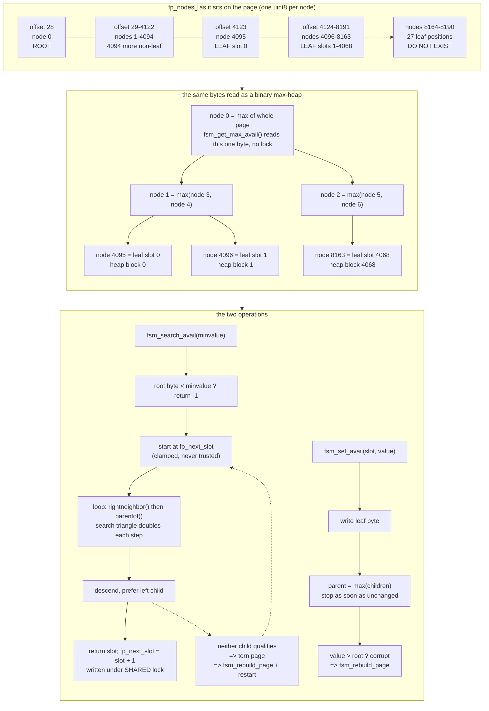

<!--
entry-meta
date: 2026-10-24
type: lesson
track: PostgreSQL
lesson: 05
category: Database Internals
title: The Free Space Map — One Byte Per Page, 4,069 Slots Because 4,095 Is a Power of Two, and Eight Bytes of Rounding That Cost a Whole Page
slug: postgres-free-space-map
-->

# The Free Space Map — One Byte Per Page, 4,069 Slots Because 4,095 Is a Power of Two, and Eight Bytes of Rounding That Cost a Whole Page

**2026-10-24 · PostgreSQL Track · Lesson 05 of 35**

Source tree read this run: `postgres/postgres@126976a8` (master). Previous lessons read
`@ddd468ca` (01), `@3cde90ec` (02), `@f2edf5dd` (03), `@f52d4051` + `REL_16_STABLE` (04). The tree
moved again. Files read in full: `src/backend/storage/freespace/README`,
`src/include/storage/fsm_internals.h`, `src/include/storage/freespace.h`,
`src/backend/storage/freespace/fsmpage.c`, `src/backend/storage/freespace/freespace.c`.

**Everything numbered in this document was measured**, on a throwaway PostgreSQL 16.15 cluster
(Ubuntu 24.04, x86_64, gcc 13.3.0, `block_size` 8192, `data_checksums` off, `pageinspect` 1.12,
`pg_freespacemap` 1.2). Struct and macro definitions are from master; observations are from 16.
Where the two differ, the document says so.

## Where This Fits

- **Lesson 04** ([`attribute storage, varlena headers and TOAST`](../2026-10-23-postgres-attribute-storage-varlena-toast/README.md))
  answered *how many bytes does this tuple occupy*, and closed with `MaxHeapTupleSize` = 8160 and
  the TOAST thresholds derived from `MaximumBytesPerTuple()`.
- **This lesson** answers the next question: *given a tuple of that size, which existing block
  does it go into, and how is that block found without reading the heap?* The answer is a separate
  relation fork holding a two-level tree — a tree of pages, and a binary max-heap inside each page —
  where free space is tracked to one byte per heap block.
- It also closes a question lesson 02 left open: lesson 02 derived both 8160 and 8164 and explained
  the 4-byte `MAXALIGN` gap between them. The FSM's top category is defined as `MaxFSMRequestSize`
  = `MaxHeapTupleSize` = 8160, and an empty heap page — which has 8164 raw bytes free — is
  therefore recorded as *8160*. That number is measured below.
- **Lesson 06** takes the Visibility Map, the other auxiliary fork, and `PD_ALL_VISIBLE`, which
  lesson 02 named and deferred. **Lesson 07** takes HOT, pruning and `LP_REDIRECT`. **Lesson 08**
  takes `smgr`, relation extension and the fsync queue — this lesson treats "extend the relation"
  as a black box. **Lesson 19** takes VACUUM's two heap passes; this lesson only uses the fact that
  VACUUM calls back into the FSM.

---

## 1. The shape of the problem

`heap_insert()` needs a block with at least `MAXALIGN(tuple size)` bytes of usable space. There are
three bad answers and one good one:

| Strategy | Cost |
|---|---|
| Scan the heap for a page with room | O(relation) I/O per insert |
| Always append to the last block | Deleted space is never reused; the relation only grows |
| Keep an exact free-space array | 4 bytes × 2³² blocks = 16 GB of metadata per relation |
| **One byte per block, in a searchable tree** | 1 byte × blocks, O(log n) to search |

The README states the compression decision in one sentence:

> It is important to keep the map small so that it can be searched rapidly. Therefore, we don't
> attempt to record the exact free space on a page. We allocate one map byte to each page, allowing
> us to record free space at a granularity of 1/256th of a page.

One byte per 8192-byte block is a **1:8192 metadata ratio**. The entire free-space map for a 1 TB
table is 128 MB — small enough that the hot part stays in shared buffers. Everything else in this
lesson is a consequence of that one byte.

---

## 2. The category: free space as a single byte

From `freespace.c`:

```c
#define FSM_CATEGORIES	256
#define FSM_CAT_STEP	(BLCKSZ / FSM_CATEGORIES)
#define MaxFSMRequestSize	MaxHeapTupleSize
```

With `BLCKSZ` 8192: `FSM_CAT_STEP` = **32 bytes**, `MaxFSMRequestSize` = **8160** (lesson 04).

Three conversion functions, and the asymmetry between them is the whole story:

```c
static uint8 fsm_space_avail_to_cat(Size avail)   /* recording: rounds DOWN */
{
	Assert(avail < BLCKSZ);
	if (avail >= MaxFSMRequestSize) return 255;
	cat = avail / FSM_CAT_STEP;
	if (cat > 254) cat = 254;
	return (uint8) cat;
}

static uint8 fsm_space_needed_to_cat(Size needed) /* requesting: rounds UP */
{
	if (needed > MaxFSMRequestSize)
		elog(ERROR, "invalid FSM request size %zu", needed);
	if (needed == 0) return 1;
	cat = (needed + FSM_CAT_STEP - 1) / FSM_CAT_STEP;
	if (cat > 255) cat = 255;
	return (uint8) cat;
}

static Size fsm_space_cat_to_avail(uint8 cat)     /* reporting back */
{
	if (cat == 255) return MaxFSMRequestSize;
	else return cat * FSM_CAT_STEP;
}
```

- **Recording floors, requesting ceils.** A page with 8136 usable bytes records category 254, which
  *means* "at least 8128". A request for 8136 bytes asks for category `ceil(8136/32)` = 255. Both
  roundings err on the side of never promising space that is not there. Section 9 measures what
  that costs.
- **Category 255 is special, and it is why `MaxFSMRequestSize` exists.** The header explains it:
  if the top category boundary were not exactly the largest possible request, a page with exactly
  `MaxFSMRequestSize` free bytes would not satisfy a request for `MaxFSMRequestSize` bytes, and the
  largest legal tuple could never be inserted anywhere. So 255 means "≥ 8160", and
  `fsm_space_cat_to_avail(255)` returns **8160**, not 8192 and not 8164.
- **`needed == 0` returns 1, not 0.** Zero would match a completely full page. One byte of demand
  is rounded to one whole category.
- **`needed > MaxFSMRequestSize` is an `elog(ERROR)`, not a clamp.** It is unreachable from SQL:
  lesson 04 measured that such a tuple is already rejected upstream with `row is too big: size
  8168, maximum size 8160`.

### A stale comment worth knowing about

`freespace.c`'s own worked example contradicts its code:

```
 * MaxFSMRequestSize depends on the architecture and BLCKSZ, but assuming
 * default 8k BLCKSZ, and that MaxFSMRequestSize is 8164 bytes, the
 * categories look like this:
 *
 * Range	 Category
 * ...
 * 8128 - 8163 254
 * 8164 - 8192 255
```

`MaxFSMRequestSize` is `MaxHeapTupleSize` = **8160**, not 8164 — 8164 is lesson 02's
`PageGetFreeSpace()` on a fresh heap page, which differs from 8160 only because of `MAXALIGN`. The
real boundary is 8160, and the code is right while the comment's worked example is four bytes off.
Section 6 measures which of the two numbers the server actually reports.

---

## 3. The binary max-heap inside one FSM page

`fsm_internals.h` defines the page payload:

```c
typedef struct
{
	int			fp_next_slot;
	uint8		fp_nodes[FLEXIBLE_ARRAY_MEMBER];
} FSMPageData;

#define NodesPerPage (BLCKSZ - MAXALIGN(SizeOfPageHeaderData) - \
					  offsetof(FSMPageData, fp_nodes))
#define NonLeafNodesPerPage (BLCKSZ / 2 - 1)
#define LeafNodesPerPage (NodesPerPage - NonLeafNodesPerPage)
#define SlotsPerFSMPage LeafNodesPerPage
```

Evaluated with `BLCKSZ` 8192, `SizeOfPageHeaderData` 24 (lesson 02) and
`offsetof(FSMPageData, fp_nodes)` = 4:

| Constant | Value | Derivation |
|---|---|---|
| `NodesPerPage` | **8164** | 8192 − 24 − 4 |
| `NonLeafNodesPerPage` | **4095** | 8192/2 − 1 = 2¹² − 1 |
| `LeafNodesPerPage` = `SlotsPerFSMPage` | **4069** | 8164 − 4095 |

Three things follow immediately:

- **`NonLeafNodesPerPage` is `2¹² − 1`, a perfect 12-level tree.** The leaf level therefore has
  room for 4096 entries at array indices 4095…8190, but only indices 4095…8163 exist on the page.
  **27 leaf positions are missing** off the right edge — exactly the README's "a few right-most
  leaf nodes are missing, and there are some useless non-leaf nodes at the right". The non-leaf
  count is a round power of two *because* it is derived from `BLCKSZ/2`, and the leaf count is the
  ragged remainder. That is why `SlotsPerFSMPage` is not a power of two.
- **One bottom-level FSM page covers 4069 heap blocks = 31.79 MiB of heap.**
- **The array exactly fills the page.** Node 0 sits at page offset 28; node 8163 sits at offset
  8191, the last byte. No slack.

Byte offsets, derived and then measured in section 5:

```
page offset   0 .. 23      PageHeaderData                     (lesson 02)
page offset  24 .. 27      fp_next_slot        (int32, LE)
page offset  28            fp_nodes[0]         = tree root
page offset  29 .. 4122    fp_nodes[1..4094]   = remaining non-leaf nodes
page offset 4123           fp_nodes[4095]      = leaf slot 0  -> heap block 0
page offset 4124           fp_nodes[4096]      = leaf slot 1  -> heap block 1
   ...
page offset 8191           fp_nodes[8163]      = leaf slot 4068 -> heap block 4068
```

`PageGetContents(page)` is `page + MAXALIGN(SizeOfPageHeaderData)` = `page + 24`, so slot *k*'s
byte lives at page offset `24 + 4 + 4095 + k` = **4123 + k**.

### Navigation and the two invariants

```c
#define leftchild(x)	(2 * (x) + 1)
#define rightchild(x)	(2 * (x) + 2)
#define parentof(x)		(((x) - 1) / 2)
```

A plain array heap, root at index 0. Two invariants hold:

1. **Every non-leaf node is the max of its two children.** So the root of a page is the maximum
   category anywhere on that page, readable in one byte with no lock —
   `fsm_get_max_avail()` does exactly that and documents why no lock is needed: "this is just a
   read-only access of a single byte".
2. **Unused nodes are zero**, which is category 0 — "no usable space" — so the missing 27 leaves
   and the useless non-leaf nodes are self-neutralising. `PageInit()`'s full-page `MemSet`
   (lesson 02) is what establishes this, and it is also why the checksum covering lesson 02's
   "hole" covers the entire FSM payload: an FSM page *is* the hole.

### `fsm_set_avail()`: bubble up, then self-check

```c
oldvalue = fsmpage->fp_nodes[nodeno];
if (oldvalue == value && value <= fsmpage->fp_nodes[0]) return false;   /* no-op fast path */
fsmpage->fp_nodes[nodeno] = value;
do {
	nodeno = parentof(nodeno);
	newvalue = fsmpage->fp_nodes[leftchild(nodeno)];
	if (rchild < NodesPerPage) newvalue = Max(newvalue, fsmpage->fp_nodes[rchild]);
	if (fsmpage->fp_nodes[nodeno] == newvalue) break;      /* stop early */
	fsmpage->fp_nodes[nodeno] = newvalue;
} while (nodeno > 0);
if (value > fsmpage->fp_nodes[0]) fsm_rebuild_page(page);  /* corruption -> rebuild */
```

- The walk stops as soon as a parent's recomputed max is unchanged — typically after one or two
  steps, not 12.
- The no-op fast path has a second condition, `value <= fp_nodes[0]`. Equal leaf value is *not*
  enough to skip the work: if the root is somehow lower than this leaf, the page is corrupt and the
  update must proceed so the sanity check at the bottom fires.
- That final check is the first of the README's "self-correcting measures". A parent that is too
  *low* is caught here; a parent that is too *high* is caught during search (section 4).

### `fsm_search_avail()`: the expanding search triangle

The search is not a plain root-down descent, because the page keeps a round-robin hint:

```c
if (fsmpage->fp_nodes[0] < minvalue) return -1;    /* one byte answers "nothing here" */
target = fsmpage->fp_next_slot;
if (target < 0 || target >= LeafNodesPerPage) target = 0;   /* hint is never trusted */
target += NonLeafNodesPerPage;
```

Then, from that leaf, it moves right and climbs:

```c
nodeno = target;
while (nodeno > 0) {
	if (fsmpage->fp_nodes[nodeno] >= minvalue) break;
	nodeno = parentof(rightneighbor(nodeno));
}
```

`rightneighbor()` increments the index and, if that steps onto the leftmost node of the next level
(indices `2^level - 1`), corrects back down with `parentof()`. It detects that with the
twos-complement trick `((x + 1) & x) == 0`.

The comment names the property this buys:

> At the first step, only the target slot is examined. When we move up from a left child to its
> parent, we are adding the right-hand subtree of that parent to the search triangle. … at each
> step the size of the search triangle doubles, ensuring it takes only log2(N) work to search N
> pages.

So the result is **the first suitable slot at or to the right of `fp_next_slot`, wrapping around** —
not the leftmost suitable slot. Then it descends, preferring the left child, and lands on a leaf.

Two further details:

- **If the descent finds that neither child satisfies the request, the page is corrupt.** The
  comment attributes this to a torn page: a crash mid-write that landed only part of the 8 KB.
  The handler logs `DEBUG1 "fixing corrupt FSM block %u, relation %u/%u/%u"`, upgrades to an
  exclusive lock if needed, calls `fsm_rebuild_page()`, `MarkBufferDirtyHint()`s, and `goto
  restart`. This is the second self-correcting measure.
- **`fp_next_slot` is written under a shared lock.** The struct comment explains the type choice:
  "It's defined as an int, because it's updated without an exclusive lock. uint16 would be more
  appropriate, but int is more likely to be atomically fetchable/storable." The README states the
  trade: "fp_next_slot is just a hint and we can easily reset it if it gets corrupted; so it seems
  better to accept some risk of that type than to pay the overhead of exclusive locking."



---

## 4. The tree of pages, and where each one physically lives

One page covers 4069 heap blocks. Above that, the same trick repeats: the leaves of a higher-level
page are the *roots* of lower-level pages.

```c
#define FSM_TREE_DEPTH	((SlotsPerFSMPage >= 1626) ? 3 : 4)
#define FSM_ROOT_LEVEL	(FSM_TREE_DEPTH - 1)
#define FSM_BOTTOM_LEVEL 0
```

The comment gives the arithmetic: "1626 is the smallest number that satisfies X³ >= 2^32-1". With
`SlotsPerFSMPage` = 4069, `FSM_TREE_DEPTH` = **3**: level 0 (bottom), level 1, level 2 (root).
4069³ = 67,369,460,509, comfortably over the 2³²−1 block limit. Height is constant regardless of
relation size — "To keep things simple, the tree is always constant height."

Addressing is logical, `{level, logpageno}` plus a slot:

```c
addr.level = FSM_BOTTOM_LEVEL;
addr.logpageno = heapblk / SlotsPerFSMPage;      /* fsm_get_location  */
*slot          = heapblk % SlotsPerFSMPage;

parent.logpageno = child.logpageno / SlotsPerFSMPage;   /* fsm_get_parent */
*slot            = child.logpageno % SlotsPerFSMPage;
```

And `fsm_logical_to_physical()` flattens that into a block number in the fork:

```c
leafno = addr.logpageno;
for (l = 0; l < addr.level; l++) leafno *= SlotsPerFSMPage;
pages = 0;
for (l = 0; l < FSM_TREE_DEPTH; l++) { pages += leafno + 1; leafno /= SlotsPerFSMPage; }
pages -= addr.level;
return pages - 1;
```

Evaluated:

| Logical address | Physical block | Covers |
|---|---|---|
| `{2, 0}` root | **0** | the whole relation |
| `{1, 0}` | **1** | heap blocks 0 … 16,556,760 |
| `{0, 0}` | **2** | heap blocks 0 … 4068 |
| `{0, 1}` | **3** | heap blocks 4069 … 8137 |
| `{0, 2}` | **4** | heap blocks 8138 … 12,206 |
| `{0, 4068}` | **4070** | — |
| `{1, 1}` | **4071** | the next 16.5 M blocks |
| `{0, 4069}` | **4072** | — |

So the fork is **not** level-major. The root is block 0, the first level-1 page is block 1, then
4069 bottom pages, then the *second* level-1 page, then the next run of bottom pages. The upper
levels are interleaved into the stream at the point where they become necessary. That is the
README's `y = n + (n/F + 1) + (n/F² + 1) + … + 1` written as code.

**Consequence: the minimum FSM fork is three blocks (24576 bytes), even for a two-page table** —
root, one level-1 page, one bottom page — because the bottom page cannot be block 0. Measured in
section 5.

### Reads never fail, and nothing is WAL-logged

```c
static Buffer fsm_extend(Relation rel, BlockNumber fsm_nblocks)
{
	return ExtendBufferedRelTo(BMR_REL(rel), FSM_FORKNUM, NULL,
							   EB_CREATE_FORK_IF_NEEDED | EB_CLEAR_SIZE_CACHE,
							   fsm_nblocks, RBM_ZERO_ON_ERROR);
}
```

The README is blunt: "The FSM is not explicitly WAL-logged. Instead, we rely on a bunch of
self-correcting measures to repair possible corruption." Writes go through
`MarkBufferDirtyHint()`, reads use `RBM_ZERO_ON_ERROR` — a checksum failure on an FSM page yields a
zeroed page, i.e. "nothing free anywhere", which is wrong but safe.

Master's README adds several paragraphs that are worth reading in full, because they qualify the
"it's just a hint" story harder than the usual summary does:

> That RBM_ZERO_ON_ERROR is a property of this directory, not of the FSM fork itself. The files
> themselves are ordinary relation files, and plenty of code outside freespace.c reads them and
> does verify checksums: RelationCopyStorage() … the read stream in
> RelationCopyStorageUsingBuffer() … and the checksum verification in base backups and in
> pg_checksums.

> So the full page images MarkBufferDirtyHint() writes are not just an optimization … Do not
> replace MarkBufferDirtyHint() with MarkBufferDirty() here on the grounds that the FSM survives
> torn pages; it does, but the rest of the system is not promised the same.

In other words: `freespace.c` tolerates garbage, but `ALTER TABLE … SET TABLESPACE`,
`CREATE DATABASE … STRATEGY = wal_log`, `pg_basebackup` and `pg_checksums` do not. The hint-bit
full-page images are what keep an on-disk FSM page checksum-valid for *those* readers. This
reasoning is longer in master than in older trees; treat it as the current position.

One more consequence, spelled out in the README and implemented as a function:

> Relation extension is not WAL-logged. Hence, after WAL replay, an on-disk FSM slot may indicate
> free space in PageIsNew() blocks that never reached disk. We detect this case by comparing
> against the actual relation size, and we mark the block as full in that case.

```c
static bool fsm_does_block_exist(Relation rel, BlockNumber blknumber)
{
	SMgrRelation smgr = RelationGetSmgr(rel);
	return ((BlockNumberIsValid(smgr->smgr_cached_nblocks[MAIN_FORKNUM]) &&
			 blknumber < smgr->smgr_cached_nblocks[MAIN_FORKNUM]) ||
			blknumber < RelationGetNumberOfBlocks(rel));
}
```

Note the honesty of the comment: the fast path is the cached `nblocks`; the slow path "incur[s]
`lseek()` overhead", and the alternative was rejected because it "would cause FSM to set zero space
available for blocks that main fork extension just recorded". Every FSM hit that is at or beyond
the cached relation size costs a syscall. When `fsm_search()` hits a nonexistent block it zeroes
that slot, `MarkBufferDirtyHint()`s, and **restarts from the root** — with the comment admitting
the usual `advancenext` behaviour "is pessimal for this rare scenario, since every later slot is
unusable in the same way", and that zeroing them all was judged not worth the code.

`fsm_search()` also carries an emergency valve: `if (restarts++ > 10000) return
InvalidBlockNumber;` — "Looping indefinitely is nevertheless scary".

---

## 5. Measured: the fork, the levels, and the byte offsets

Cluster as described at the top. Table: `pg5_grow(a int, b char(1900))`, four rows per page.

### The fork appears at two heap pages, as three blocks

```
pages=1 fsm=0
pages=2 fsm=24576
pages=3 fsm=24576
...
pages=8 fsm=24576
```

A one-page table has **no FSM fork at all** (`pg_relation_size(rel,'fsm')` = 0), and
`pg_freespace()` reports 0 for its only block — `GetRecordedFreeSpace()` gets `InvalidBuffer` from
`fsm_readbuf(..., extend=false)` and returns 0. The fork is created the first time the insert path
records free space for a page it is leaving behind, i.e. when the relation acquires a second page,
and it is born three blocks long exactly as section 4 predicts.

### `fsm_page_contents()` identifies each block's level

```
blk 0: fp_next_slot: 0                    <- root, all nodes zero
blk 1: (empty)                            <- level 1, all nodes zero
blk 2: 0: 12 | 1: 12 | 3: 12 | 7: 12 | 15: 12 | 31: 12 | 63: 12 | 127: 12
       255: 12 | 511: 12 | 1023: 12 | 1024: 12 | 2047: 12 | 2048: 12
       2049: 12 | 2050: 12 | 4095: 12 | 4096: 12 | 4097: 12 | 4098: 12
       4099: 12 | 4100: 12 | 4101: 12 | fp_next_slot: 0
```

Block 2 is the bottom-level page: nodes 4095–4101 are leaves 0–6, all category 12. The non-leaf
nodes printed — 0, 1, 3, 7, 15, 31, 63, 127, 255, 511, 1023, 2047 — are exactly the left-edge
indices `2^k − 1`, which is the bubble-up path from leaf 0 to the root. `fsm_page_contents()` only
prints nonzero nodes, so the output *is* the set of nodes the propagation touched.

### Byte offsets, confirmed

```sql
select get_byte(get_raw_page('pg5_grow','fsm',2),28)   as root_node_byte,   -- 12
       get_byte(get_raw_page('pg5_grow','fsm',2),4123) as leaf0_byte,       -- 12
       get_byte(get_raw_page('pg5_grow','fsm',2),4124) as leaf1_byte,       -- 12
       get_byte(get_raw_page('pg5_grow','fsm',2),4125) as leaf2_byte;       -- 12

select encode(substring(get_raw_page('pg5_grow','fsm',2) from 25 for 8),'hex');
-- 000000000c0c000c
```

Decoded: bytes 24–27 = `00 00 00 00` → `fp_next_slot` = 0. Byte 28 = `0c` = 12 = root. Byte 29 =
`0c` = node 1. Byte 30 = `00` = node 2 (its subtree covers leaves ≥ ~2048, all empty). Byte 31 =
`0c` = node 3. That matches `fsm_page_contents()` line for line, and it confirms
`4123 + k` as the address of slot *k*. Later lessons may use these offsets without re-deriving them.

`pg_freespace` reports 384 = 12 × 32 for blocks 0–6, and 0 for block 7 — the page the inserter was
still sitting on when the session ended, never recorded.

### An FSM page is an "empty" page as far as `bufpage.c` is concerned

```
 lsn | checksum | flags | lower | upper | special | pagesize | version | prune_xid
-----+----------+-------+-------+-------+---------+----------+---------+-----------
 0/0 |        0 |     0 |    24 |  8192 |    8192 |     8192 |       4 |         0
```

`PageInit(page, BLCKSZ, 0)` — zero special space. So `pd_lower` is 24 forever (no line pointers
are ever added), `pd_upper` = `pd_special` = 8192, and therefore:

- `PageIsEmpty()` (`pd_lower <= 24`) is **true** for every FSM page, always.
- `PageGetExactFreeSpace()` returns 8168 for every FSM page, always.
- Lesson 02's four free-space functions are all meaningless here.

The entire FSM payload lives in what lesson 02 called the hole — which is precisely why
`PageInit()`'s full-page `MemSet` and the checksum's coverage of the hole matter for this fork.

And the fingerprint from lessons 02/04 does **not** distinguish an FSM page from a heap page:

```
FSM page  bytes 12-19: 18 00 00 20 00 20 04 20   (pd_lower 24,  pd_upper 8192, special 8192)
heap page bytes 12-19: 28 00 c0 01 00 20 04 20   (pd_lower 40,  pd_upper 448,  special 8192)
                       ^^^^^^^^^^^ ^^^^^^^^^^^
                       differ      bytes 16-19 identical
```

Bytes 16–19 are `00 20 04 20` for both. The fingerprint identifies the **special-space size**, not
the fork. Correct reading of that established fact: "this page has no special space", which heap,
sequence, TOAST *and* FSM pages all satisfy.

### `SlotsPerFSMPage` = 4069, observed

`pg5_big(a int, b text)` with `STORAGE PLAIN` and 4000-byte values, two rows per page:

```
heap_pages=4068 fsm_blocks=3
heap_pages=4069 fsm_blocks=3
heap_pages=4071 fsm_blocks=4
```

The fourth FSM block appears exactly when heap block 4069 (0-based) first needs a slot — i.e. when
`heapblk / SlotsPerFSMPage` first returns 1. After `VACUUM`:

```
root(0): 0: 2 | 1: 2 | 3: 2 | ... | 4095: 2 | fp_next_slot: 0        <- one leaf  (slot 0)
mid(1):  0: 2 | 1: 2 | 3: 2 | ... | 4095: 2 | 4096: 2 | ...          <- two leaves (slots 0,1)
blk3:    15 lines                                                    <- bottom page 1 exists
```

The root has one populated leaf (one level-1 page); the level-1 page has two (two bottom pages).
`SlotsPerFSMPage` = 4069 is now an observation, not arithmetic.

### `fp_next_slot` advances

After a search that returned slot 0 at the bottom level:

```
fp_next_slot_bytes = 01000000      -- little-endian int32 = 1
```

`fsm_search()` passes `advancenext = (addr.level == FSM_BOTTOM_LEVEL)`, so the hint advances only
on the leaf page — upper-level pages get `advancenext = false` and keep pointing at the child they
just descended into.

---

## 6. Measured: an empty heap page reports 8160

Three pages, delete everything on block 0, `VACUUM`:

```
 blkno | avail        page 0 header: lower 28, upper 8192, special 8192, exact_hole 8164
-------+-------
     0 |  8160
     1 |     0
     2 |  6432
```

The chain, end to end, with every number from an earlier lesson:

| Step | Value |
|---|---|
| `pd_upper − pd_lower` (`PageGetExactFreeSpace`) | 8164 |
| `PageGetHeapFreeSpace` → `PageGetFreeSpace` = exact − `sizeof(ItemIdData)` | **8160** |
| `fsm_space_avail_to_cat(8160)`: `8160 >= MaxFSMRequestSize` | **255** |
| `fsm_space_cat_to_avail(255)` | **8160** |
| `pg_freespace` | **8160** |

So the server reports **8160**, settling section 2's question: `MaxFSMRequestSize` is 8160 and the
header's 8164 example is stale. Had it been 8164, `fsm_space_cat_to_avail(255)` would have returned
8164 and `pg_freespace` would have printed that.

Note `pd_lower` = 28, not 24: one `LP_UNUSED` line pointer survived `PageTruncateLinePointerArray`
(lesson 02). The page is logically empty with 8164 raw bytes, the FSM says 8160, and the largest
insertable tuple is 8160 — all three agree, by construction.

### Rounding loss, measured

`pg5_round`, one page, `STORAGE PLAIN`:

| blkno | pd_lower | pd_upper | exact hole | `PageGetFreeSpace` | FSM says | lost |
|---|---|---|---|---|---|---|
| 0 | 32 | 2112 | 2080 | 2076 | **2048** | **28** |

28 bytes invisible out of 2076. Maximum possible loss is 31 bytes per block; on a 1 TB table that
is up to 4 GB of free space the FSM will never admit to.

---

## 7. Measured: who actually calls back into the FSM, and when

The public API is five functions:

```c
Size        GetRecordedFreeSpace(Relation rel, BlockNumber heapBlk);
BlockNumber GetPageWithFreeSpace(Relation rel, Size spaceNeeded);
BlockNumber RecordAndGetPageWithFreeSpace(Relation, BlockNumber oldPage,
                                          Size oldSpaceAvail, Size spaceNeeded);
void        RecordPageWithFreeSpace(Relation rel, BlockNumber heapBlk, Size spaceAvail);
void        XLogRecordPageWithFreeSpace(RelFileLocator, BlockNumber heapBlk, Size spaceAvail);
```

`RecordAndGetPageWithFreeSpace()` exists "to save some locking overhead" and, more importantly, for
locality: it sets the old page's value and searches *the same FSM page* first, so a backend that
fills block 7 is handed block 8 rather than block 0. Its result is passed through
`fsm_does_block_exist()` before being returned.

And here is the sentence that generates this lesson's most useful operational fact, from
`RecordPageWithFreeSpace()`:

> Note that if the new spaceAvail value is higher than the old value stored in the FSM, the space
> might not become visible to searchers until the next FreeSpaceMapVacuum call, which updates the
> upper level pages.

`fsm_set_and_search()` bubbles up *within one page*. Nothing propagates a bottom page's new root
into its parent's leaf except `FreeSpaceMapVacuum[Range]()`, which VACUUM calls. Until then the
leaves are right and the upper levels are stale.

### Measured: before and after `VACUUM`

Same `pg5_grow` as section 5, eight heap pages, never vacuumed:

```
BEFORE vacuum   root(blk0): fp_next_slot: 0              <- every node zero
                mid(blk1):  (empty)                       <- every node zero
                blk 0..6 avail 384                        <- leaves are correct

AFTER  vacuum   root(blk0): 0: 12 | 1: 12 | ... | 4095: 12
                mid(blk1):  0: 12 | 1: 12 | ... | 4095: 12
                blk 0..7 avail 384
```

Before VACUUM, `GetPageWithFreeSpace()` reads the root byte, sees 0, and returns
`InvalidBlockNumber` for *any* request — while seven blocks each hold 384 usable bytes.

### Measured: what that does to an insert

`pg5_stale(a int, b text)` with `STORAGE PLAIN`, twelve 1900-byte rows → three pages, leaves
`[384, 384, 0]`, **root byte 0**. Each step below is a separate `psql` process, so no backend
reuses another's `RelationGetTargetBlock()` relcache hint.

```
after 12 inserts        heap_pages=3   blk0 384  blk1 384  blk2 0
                        root_byte=0    leaf0_byte=12

NEW session, insert one tiny row:
                        heap_pages=3   tiny row landed at (2,5)

vacuum:                 root_byte=12

ANOTHER new session, insert one tiny row:
                        heap_pages=3   tiny row landed at (0,5)
```

**Identical statement, identical table, two different target blocks** — decided entirely by whether
the FSM's upper levels had been propagated. Before VACUUM the search failed at the root and
`RelationGetBufferForTuple()` fell back to the last block of the relation; after VACUUM the search
succeeded and returned block 0. The relation did not grow in either case, because that last-block
fallback exists — which is exactly why this failure mode is usually invisible, and why it starts
costing pages as soon as the last block is also full.

The practical reading: **a table that is written but never vacuumed has a correct FSM at the leaf
level and a useless one at the root.** Autovacuum is what keeps reuse working, and
`FreeSpaceMapVacuum` is why `VACUUM` on a table nobody deleted from is not necessarily a no-op.

---

## 8. Measured: the 291-slot ceiling, and which row you keep

Lesson 02 derived `MaxHeapTuplesPerPage` = 291 and flagged that `PageGetHeapFreeSpace()` returns 0
at that ceiling. This is the first lesson with a cluster to test it.

`pg5_tiny(a int)`, rows inserted as a single NULL — `t_hoff` = `MAXALIGN(23 + BITMAPLEN(1))` = 24,
zero data bytes, so `lp_len` = 24, the minimum heap tuple (lesson 03):

```
after 291 inserts   pages=1   last_ctid=(0,291)
after 292 inserts   pages=2   last_ctid=(1,1)

page 0: 291 line pointers, all lp_len 24, min lp_off 1208
        pd_lower 1188 (= 24 + 291*4)   pd_upper 1208   exact hole 20
```

**`MaxHeapTuplesPerPage` = 291 is now measured**, and `pd_lower` = 24 + 291×4 confirms the line
pointer array is the binding constraint, not the tuple bytes: 291 × 24 = 6984 bytes of tuples plus
1164 bytes of line pointers plus the 24-byte header = 8172, with 20 bytes left over.

Now the part that is not obvious. Delete 290 of the 291 rows and vacuum — twice, keeping a
different survivor each time:

| Survivor | line pointers left | `pd_lower` | exact hole | `pg_freespace` |
|---|---|---|---|---|
| **last** (0,291) | 291 (290 `LP_UNUSED`) | 1188 | 6980 | **6976** |
| **first** (0,1) | 1 | 28 | 8140 | **8128** |

Same table shape, same one surviving row, **1152 bytes of difference in recorded free space**,
decided only by *where on the page the survivor sits*. `PageTruncateLinePointerArray()` can only
reclaim a contiguous unused run at the tail of the array (lesson 02); a survivor in the last slot
pins all 291 entries forever.

**Honest non-result:** the predicted `PageGetHeapFreeSpace() == 0` trap did **not** fire. With 290
`LP_UNUSED` pointers present, `PD_HAS_FREE_LINES` is set (page flags = 5 = `PD_HAS_FREE_LINES |
PD_ALL_VISIBLE`) and the function finds a reusable pointer, so it returns 6976 rather than 0. The
ceiling only forces 0 when all 291 slots are *used* — the full page above, where the exact hole is
20 bytes and the honest answer is 0 anyway. So the ceiling is not an FSM under-reporting bug. The
real cost is the 1164 bytes of unreclaimable array and a hard cap of 291 tuples on that block for
as long as the last-slot row lives. Do not cite the 291 ceiling as a cause of FSM under-reporting;
cite it as a cause of unreclaimable line-pointer space.

---

## 9. Measured: the rounding makes the relation grow

This is the sharpest consequence of the one-byte category, and it is reproducible to the byte.

`pg5_cons(a int, b text)`, `b` with `STORAGE PLAIN`:

```
1.  insert 3 rows of repeat('z',8096)      -> 3 pages, one row each
2.  delete the row on block 0; vacuum      -> blk0 8160, blk1 32, blk2 32
3.  insert (null,null)                     -> 24-byte tuple lands at (0,1)
4.  vacuum                                 -> blk0 8128, blk1 32, blk2 32
    block 0 header: pd_lower 28, pd_upper 8168
                    exact hole 8140, PageGetFreeSpace 8136
5.  insert a row whose MAXALIGNed footprint is exactly 8136 bytes
       (24 header + 4 int + 4 varlena header + 8104 chars = 8136)
    -> heap_pages=4, row landed at (3,1)
       blk0 8128, blk1 32, blk2 32, blk3 0
```

Block 0 had **8136** usable bytes. The row needed **8136** bytes. It did not go there.

| Quantity | Value |
|---|---|
| `PageGetFreeSpace(block 0)` | 8136 |
| `fsm_space_avail_to_cat(8136)` = `8136 / 32` | **254** (floor) |
| what category 254 promises: `254 * 32` | 8128 |
| `fsm_space_needed_to_cat(8136)` = `(8136 + 31) / 32` | **255** (ceil) |
| 255 ≤ 254? | no → `fsm_search()` returns `InvalidBlockNumber` |
| last-block fallback (block 2, 32 bytes free) | no room |
| result | relation extended to block 3 |

**8 bytes of rounding cost one 8 KB page** — a 1024× amplification. The window is general: a block
recorded at category *C* will never be offered to a request larger than 32·*C*, however much space
it really has, so any block whose usable free space is not an exact multiple of 32 has a dead band
of up to 31 bytes at the top of its range. The two roundings compose in the same direction, and
both are deliberate: `avail_to_cat` floors so the FSM never over-promises, `needed_to_cat` ceils so
a caller never under-asks. Neither ever hands out a block that is too small; together they
sometimes refuse a block that is exactly big enough.

---

## Hands-On

Everything below ran on the throwaway cluster described at the top. Recipe (unchanged from lessons
03 and 04, and it still works): create a non-root user; `initdb -D /var/tmp/pgdata --no-sync`;
`pg_ctl -o '-p 5455 -k /var/tmp -c listen_addresses='`. Two traps remain real — `initdb` refuses to
run as root, and it refuses a data directory under a scratchpad path.

```sql
CREATE EXTENSION pageinspect;      -- fsm_page_contents, get_raw_page, page_header
CREATE EXTENSION pg_freespacemap;  -- pg_freespace
```

### 1. Derive the constants, then confirm them against the fork

```sql
SELECT 8192 - 24 - 4          AS nodes_per_page,   -- 8164
       8192/2 - 1             AS nonleaf,          -- 4095
       (8192-24-4)-(8192/2-1) AS slots_per_fsm_page; -- 4069
```

**What to look for:** 4069 is not a round number, and it should not be. 4095 comes from `BLCKSZ/2`
and is a power of two minus one; 4069 is whatever is left of the page.

### 2. Watch the fork appear, three blocks at a time

```sql
CREATE TABLE fsm_grow(a int, b char(1900));
-- repeat, checking after each statement:
INSERT INTO fsm_grow SELECT g, repeat('x',1900) FROM generate_series(1,4) g;
SELECT pg_relation_size('fsm_grow')/8192        AS heap_pages,
       pg_relation_size('fsm_grow','fsm')/8192  AS fsm_blocks;
```

**What to look for:** 0 FSM blocks at one heap page, then **3** at two heap pages and stable at 3
for a long time. Three, not one, proves `fsm_logical_to_physical()`: the bottom page cannot be
block 0 because the root owns it.

### 3. Read the max-heap by hand

```sql
SELECT fsm_page_contents(get_raw_page('fsm_grow','fsm',2));
SELECT get_byte(get_raw_page('fsm_grow','fsm',2),28)   AS root,
       get_byte(get_raw_page('fsm_grow','fsm',2),4123) AS leaf_slot_0,
       get_byte(get_raw_page('fsm_grow','fsm',2),4124) AS leaf_slot_1;
SELECT encode(substring(get_raw_page('fsm_grow','fsm',2) FROM 25 FOR 8),'hex');
```

**What to look for:** `leaf_slot_0` equals `pg_freespace`'s `avail` for block 0 divided by 32, and
the nonzero non-leaf indices printed by `fsm_page_contents()` are exactly `2^k − 1`. That is the
bubble-up path from leaf 0 made visible — it proves the array is a heap, not a flat map.

### 4. Prove the upper levels are stale until VACUUM

```sql
SELECT 'root' , fsm_page_contents(get_raw_page('fsm_grow','fsm',0))
UNION ALL SELECT 'mid', fsm_page_contents(get_raw_page('fsm_grow','fsm',1));
VACUUM fsm_grow;
SELECT 'root' , fsm_page_contents(get_raw_page('fsm_grow','fsm',0))
UNION ALL SELECT 'mid', fsm_page_contents(get_raw_page('fsm_grow','fsm',1));
```

**What to look for:** before VACUUM both upper pages print `fp_next_slot: 0` and nothing else —
every node zero. `pg_freespace` is simultaneously showing 384 bytes free on seven blocks. One byte
at page 0 offset 28 is the difference between a working FSM and a dead one, and only VACUUM writes
it. This is the single most useful operational fact in the lesson.

### 5. See the target block change under you

Run each step as a **separate** `psql` invocation — the relcache target-block hint is per-backend
and would mask the effect.

```sql
-- session 1
CREATE TABLE fsm_stale(a int, b text);
ALTER TABLE fsm_stale ALTER COLUMN b SET STORAGE PLAIN;
INSERT INTO fsm_stale SELECT g, repeat('x',1900) FROM generate_series(1,12) g;
-- session 2
INSERT INTO fsm_stale VALUES (99,'small');
SELECT ctid FROM fsm_stale WHERE a = 99;         -- (2,5): last-block fallback
-- session 3
VACUUM fsm_stale;
-- session 4
INSERT INTO fsm_stale VALUES (98,'small');
SELECT ctid FROM fsm_stale WHERE a = 98;         -- (0,5): a real FSM hit
```

**What to look for:** the block number in the ctid. Nothing about the statement, the table, or the
row changed — only one byte in the FSM root.

### 6. Make the rounding cost you a page

```sql
CREATE TABLE fsm_cons(a int, b text);
ALTER TABLE fsm_cons ALTER COLUMN b SET STORAGE PLAIN;
INSERT INTO fsm_cons SELECT g, repeat('z',8096) FROM generate_series(1,3) g;
DELETE FROM fsm_cons WHERE a = 1;
VACUUM fsm_cons;
INSERT INTO fsm_cons VALUES (null,null);         -- 24-byte tuple, lands on block 0
VACUUM fsm_cons;
SELECT f.blkno, h.upper - h.lower - 4 AS page_get_free_space, f.avail AS fsm_says
  FROM pg_freespace('fsm_cons') f
  JOIN LATERAL page_header(get_raw_page('fsm_cons', f.blkno)) h ON true ORDER BY 1;
-- block 0: page_get_free_space 8136, fsm_says 8128
INSERT INTO fsm_cons SELECT 99, repeat('z',8104);   -- needs exactly 8136
SELECT pg_relation_size('fsm_cons')/8192 AS pages, ctid FROM fsm_cons WHERE a = 99;
```

**What to look for:** `pages` = 4 and `ctid` = `(3,1)`. A row needing exactly 8136 bytes refused a
block holding exactly 8136 bytes, because `ceil(8136/32)` = 255 > `floor(8136/32)` = 254. This is
the clearest possible demonstration that the FSM's unit of truth is 32 bytes, not one byte.

### 7. Find `SlotsPerFSMPage` by growing past it

```sql
CREATE TABLE fsm_big(a int, b text);
ALTER TABLE fsm_big ALTER COLUMN b SET STORAGE PLAIN;
INSERT INTO fsm_big SELECT g, repeat('y',4000) FROM generate_series(1,8136) g;  -- 4068 pages
SELECT pg_relation_size('fsm_big')/8192 AS heap, pg_relation_size('fsm_big','fsm')/8192 AS fsm;
INSERT INTO fsm_big SELECT g, repeat('y',4000) FROM generate_series(8137,8142) g;
SELECT pg_relation_size('fsm_big')/8192 AS heap, pg_relation_size('fsm_big','fsm')/8192 AS fsm;
VACUUM fsm_big;
SELECT fsm_page_contents(get_raw_page('fsm_big','fsm',1));   -- now has leaves 0 AND 1
```

**What to look for:** the fork goes from 3 to 4 blocks as the heap crosses 4069 pages, and the
level-1 page (block 1) gains a second populated leaf (node 4096). One bottom FSM page covers
31.79 MiB of heap; the fourth block is the proof.

---

## Where This Breaks Down

- **32-byte granularity is not free.** Up to 31 bytes per block are invisible, and section 9 shows
  8 of them costing a whole page. The dead band is structural: a block at category *C* is never
  offered to a request above 32·*C*.
- **The upper levels are only as fresh as the last VACUUM.** `RecordPageWithFreeSpace()` fixes one
  page's tree; nothing but `FreeSpaceMapVacuum[Range]()` moves that up a level. Between vacuums the
  FSM can hold accurate leaves and a zero root, and a zero root means "no space anywhere".
  `RelationGetBufferForTuple()`'s last-block fallback hides this until the last block fills.
- **It is a hint, by design, and the design is load-bearing.** No WAL records, `MarkBufferDirtyHint()`
  for writes, `RBM_ZERO_ON_ERROR` for reads. A torn FSM page silently becomes "nothing free",
  which costs space, not correctness. The price is that the FSM can never be the authority for
  anything — every consumer must re-check under lock, which is why `GetPageWithFreeSpace()`'s
  contract explicitly says "The caller must be prepared for the possibility that the returned page
  will turn out to have too little space available by the time the caller gets a lock on it."
- **But "it's just a hint" is narrower than it sounds.** Master's README spends four paragraphs
  insisting that `RelationCopyStorage()`, `RelationCopyStorageUsingBuffer()`, base backups and
  `pg_checksums` all verify checksums on `*_fsm` files, so the hint-bit full-page images are not
  merely an optimisation. The fork is tolerated as garbage by exactly one directory of code.
- **Every out-of-range hit costs an `lseek()`.** `fsm_does_block_exist()` deliberately takes the
  syscall rather than trusting a stale cached `nblocks`, and a hit past the end restarts the search
  from the root, one slot at a time, with the code admitting that is "pessimal".
- **`fp_next_slot` is torn on purpose.** Written under a shared buffer lock, typed `int` rather
  than the more appropriate `uint16` only because `int` is "more likely to be atomically
  fetchable/storable", and clamped on every read because it is expected to be garbage sometimes.
  It spreads concurrent inserters across blocks — and it is why the FSM does not return the
  leftmost suitable block, so a table does not compact toward its front under concurrent load.
- **Small tables have no FSM at all** (measured: zero bytes at one heap page), so
  `GetRecordedFreeSpace()` returns 0 and reuse on a one-page table depends entirely on the
  last-block fallback.
- **The tree is constant-height even when it is absurd.** A two-page table carries a root and a
  level-1 page whose only job is to hold one byte. The README's own TODO list names both fixes that
  were never made: "fastroot to avoid traversing upper nodes with just 1 child" and "use a
  different system for tables that fit into one FSM page".
- **Indexes are a different thing wearing the same clothes.** The `pg_freespacemap` docs are
  explicit: for indexes the FSM tracks "entirely-unused pages, rather than free space within
  pages", so the byte is a boolean and the reported number is not an amount. `indexfsm.c` is the
  separate wrapper; this lesson's arithmetic does not apply there.

### A correction to this track's handover notes

Lesson 04's handover told this lesson to teach `FSM_LOCAL_MAP` / `HEAP_FSM_CREATION_THRESHOLD` = 4,
"an FSM fork for a 1-page table costs 3 pages". **Neither identifier exists**, in master
`@126976a8` or in `REL_16_STABLE` — `src/include/storage/freespace.h` is byte-identical between the
two branches and contains nothing of the sort, and a code search across the repository returns zero
hits. The measurement agrees: the FSM fork appears at **two** heap pages, not five.

The feature was real but never shipped. `b0eaa4c51b`, "Avoid creation of the free space map for
small heap relations", was committed in 2019 and then reverted wholesale by `7db0cde6b5` on
2019-05-07, along with six follow-up commits (`06c8a5090e`, `13e8643bfc`, `6f918159a9`,
`9c32e4c350`, `29d108cdec`, `08ecdfe7e5`). The revert message records the reason: the process-local
map "was reset whenever a block with enough free space was found", and the discussion concluded
that keeping it per relation in relcache, invalidated when VACUUM frees space or when the FSM is
created, would be better for both API design and performance. That redesign was never landed. So no
released PostgreSQL has a small-table FSM exemption, and the three-block minimum fork is the
current behaviour — which is exactly the cost the reverted patch was trying to avoid, and which the
README's TODO still lists as open.

Worth noting as method: the handover was confident, specific, and wrong. Checking it cost one
header fetch and one code search.

## Further Study

- [`freespace.c` in the doxygen source browser](https://doxygen.postgresql.org/freespace_8c_source.html)
  — the functions this lesson did not open: `fsm_vacuum_page()`, `FreeSpaceMapVacuumRange()`, and
  `fsm_readbuf()`'s extend logic. `fsm_vacuum_page()` is where the whole-tree repair happens and it
  is the natural next read.
- [`fsmpage.c` in the doxygen source browser](https://doxygen.postgresql.org/fsmpage_8c_source.html)
  — read `rightneighbor()` next to the ASCII tree in the `fsm_search_avail()` comment; the
  twos-complement power-of-two test is easier to believe with the picture.
- [Line coverage for `freespace.c`](https://coverage.postgresql.org/src/backend/storage/freespace/freespace.c.gcov.html)
  — useful for seeing which of the self-correcting paths the regression suite actually reaches.
- [`pg_freespacemap` documentation](https://www.postgresql.org/docs/19/pgfreespacemap.html) and the
  [Free Space Map storage chapter](https://www.postgresql.org/docs/18/storage-fsm.html) — the
  user-facing statement of the granularity and staleness caveats measured above.
- [`pageinspect` documentation](https://www.postgresql.org/docs/19/pageinspect.html) — the full
  `fsm_page_contents` signature and the rest of the inspection surface.
- [The original "Avoid creation of the free space map for small tables" commit](https://www.postgresql.org/message-id/E1gqTuL-0004Wj-U7%40gemulon.postgresql.org)
  and [the design thread](https://postgrespro.ru/list/thread-id/2407849) — the argument for and
  against the three-block minimum, still unresolved.

## Next Steps

1. Read `fsm_vacuum_page()` and `FreeSpaceMapVacuumRange()` before lesson 19 arrives. They are the
   only code that makes the upper levels true, and lesson 19 (VACUUM) will need them. Specifically:
   work out why `FreeSpaceMapVacuum` is called periodically *during* the heap scan rather than once
   at the end, and what `eof_p` is for.
2. Reproduce section 9's trap at a different category boundary — pick a block whose
   `PageGetFreeSpace` is, say, 4140 (category 129, promising 4128) and insert a row needing 4136
   bytes. The prediction is the same refusal. If it holds, the dead band is confirmed as general
   rather than an artefact of category 254/255.
3. Measure concurrency: run *N* backends inserting into one table and record the distribution of
   target blocks with and without `fp_next_slot` doing its job (the latter can be approximated by
   a single backend). The claim in the struct comment — that the hint spreads load — has not been
   measured in this track.
4. Check whether `fsm_does_block_exist()`'s `lseek()` is observable. Build a relation whose FSM
   points past the end (truncate the heap without vacuuming, or crash-recover after extension) and
   count syscalls with `strace -c -e lseek` on the backend during a tight insert loop.
5. Read `indexfsm.c` and work out exactly which index AMs use the FSM and what their one byte
   means. It is three functions long and settles whether `pg_freespace` on an index is useful for
   anything beyond "page is free".
6. Settle whether the `MaxFSMRequestSize is 8164 bytes` comment was ever true, by reading
   `git log -p` on the constant. If `MaxFSMRequestSize` was once something other than
   `MaxHeapTupleSize`, the comment is archaeology like lesson 04's `VARTAG_ONDISK` = 18; if not, it
   is simply a 4-byte mistake, and the difference is worth knowing before citing either number.

## Sources

Source files were read with the GitHub API at `postgres/postgres@126976a8`
(`src/backend/storage/freespace/README`, `fsmpage.c`, `freespace.c`;
`src/include/storage/fsm_internals.h`, `freespace.h`) and at `REL_16_STABLE`
(`src/include/storage/freespace.h`). Browsable equivalents and everything else fetched this run:

- [PostgreSQL source: `freespace.c`](https://doxygen.postgresql.org/freespace_8c_source.html)
- [PostgreSQL source: `fsmpage.c`](https://doxygen.postgresql.org/fsmpage_8c_source.html)
- [PostgreSQL source: `fsm_internals.h`](https://doxygen.postgresql.org/fsm__internals_8h_source.html)
- [`freespace.c` symbol reference](https://doxygen.postgresql.org/freespace_8c.html)
- [`freespace.c` coverage report](https://coverage.postgresql.org/src/backend/storage/freespace/freespace.c.gcov.html)
- [`pg_freespacemap` — PostgreSQL 18 documentation](https://www.postgresql.org/docs/18/pgfreespacemap.html)
- [`pg_freespacemap` — PostgreSQL 19 documentation](https://www.postgresql.org/docs/19/pgfreespacemap.html)
- [Free Space Map — PostgreSQL 18 documentation](https://www.postgresql.org/docs/18/storage-fsm.html)
- [`pageinspect` — PostgreSQL 19 documentation](https://www.postgresql.org/docs/19/pageinspect.html)
- [pgsql-committers: Revert "Avoid the creation of the free space map for small heap relations"](https://www.postgresql.org/message-id/E1hNrRx-0008JU-UJ%40gemulon.postgresql.org)
- [pgsql-committers: the original commit, "Avoid creation of the free space map for small heap relations"](https://www.postgresql.org/message-id/E1gqTuL-0004Wj-U7%40gemulon.postgresql.org)
- [pgsql-hackers thread: "WIP: Avoid creation of the free space map for small tables"](https://postgrespro.ru/list/thread-id/2407849)

## Takeaways

- **One byte per block, 32-byte granularity, and that single choice generates every other
  property** of the mechanism: the 256 categories, the asymmetric floor/ceil conversions, the
  reserved top category, the 1:8192 metadata ratio, and the dead band that makes a relation grow.
- **`SlotsPerFSMPage` = 4069 because `NonLeafNodesPerPage` is `BLCKSZ/2 − 1` = 2¹² − 1.** The
  non-leaf count is a clean power of two and the leaf count is the ragged remainder — which is why
  27 leaf positions on every FSM page do not exist, and why the slot count is not a power of two.
- **The root byte of the root page is the whole API in miniature.** One unlocked byte read answers
  "is there space anywhere in this relation"; one byte written by VACUUM is the difference between
  a working FSM and a dead one. Measured: before VACUUM that byte was 0 while seven blocks held
  384 free bytes each.
- **An empty heap page is recorded as 8160, not 8164 or 8192**, because `MaxFSMRequestSize` is
  `MaxHeapTupleSize`. The top category is reserved precisely so the largest legal tuple can always
  find the emptiest possible page. `freespace.c`'s own comment says 8164; the code and the server
  say 8160.
- **Rounding is conservative in both directions and still loses whole pages.** A block with
  exactly 8136 usable bytes refused a row needing exactly 8136 bytes and the relation extended —
  8 bytes of rounding, 8192 bytes of cost.
- **An FSM page is, to every function in `bufpage.c`, an empty page.** `pd_lower` 24, `pd_upper` =
  `pd_special` = 8192, `PageIsEmpty()` true forever. The payload lives entirely in lesson 02's
  hole, and bytes 16–19 are the same `00 20 04 20` as a heap page — the fingerprint identifies the
  special-space size, not the fork.
- **Check the handover.** `HEAP_FSM_CREATION_THRESHOLD` was asserted confidently by the previous
  lesson's notes and exists in no branch of PostgreSQL; the patch that introduced it was reverted
  in 2019 and the replacement was never written.
