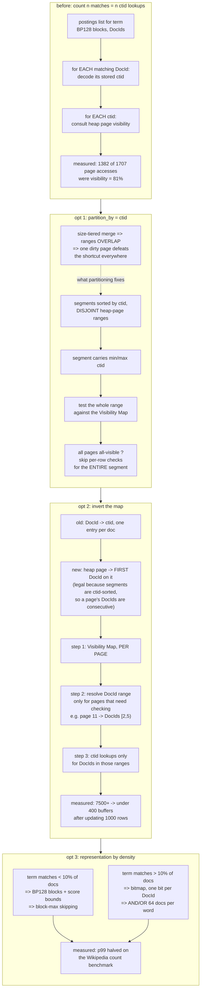

<!--
entry-meta
date: 2026-10-24
type: daily-diff
category: Daily Diff
title: Daily Diff — 2026-10-24
slug: postgres-free-space-map
-->

# Daily Diff — 2026-10-24

**2026-10-24 · Daily Diff Digest**

## Which edition this covers, and how it was found

**No 2026-10-24 edition has published.** This digest covers the **2026-10-23 edition, 43 stories** —
the newest edition, and one not yet covered here (yesterday's digest covered 2026-10-22, also 42
stories, and deep-dived the ClickHouse-MergeTree-as-a-table-AM post; that item is not repeated).

Finding it required disbelieving three endpoints out of five. Run fired 03:33 UTC / 09:03 IST:

| Endpoint | Served | Verdict |
|---|---|---|
| [front page](https://tdd.cat/) | 2026-10-22, 42 stories ("Thursday, October 22, 2026") | **a day stale** |
| [`/archive/`](https://tdd.cat/archive/) | 2026-10-22 linked as *Latest*, 42 stories; Oct 23–31 shown as plain unlinked numbers | **a day stale, and actively denies the 23rd** |
| [`https://tdd.cat/2026-10-23.md`](https://tdd.cat/2026-10-23.md) | `client_error`, nothing retrieved | **false negative** |
| [`https://tdd.cat/2026-10-22.md`](https://tdd.cat/2026-10-22.md) | 2026-10-22, 42 stories | works today — it was a false negative *yesterday* |
| [RSS](https://tdd.cat/rss.xml) | newest item **"The Daily Diff — Friday, October 23, 2026"**, description "A curation of 43 high-signal engineering stories", `<link>`/`<guid>` = `https://tdd.cat/2026-10-23/` | **current — and the only endpoint that knew the edition existed** |
| [`https://tdd.cat/2026-10-23/`](https://tdd.cat/2026-10-23/) | full edition, **"43 Stories"**, every item with its source URL | **current — the only endpoint serving the content** |
| [`2026-10-23.pdf`](https://tdd-edge.b-cdn.net/pdf/2026-10-23.pdf) | the 2026-10-23 edition, masthead says **33 stories**, 33 titles, **no source URLs at all** | **inconsistent with the HTML's 43** |

### Three corrections to this log's endpoint procedure, all from this run

1. **The trailing-slash dated page is not dead.** The root README has it "failed on six consecutive
   observations and is no longer tried". Today it was the **only** endpoint that served the
   2026-10-23 edition's content, with all 43 source links. It is also the URL RSS itself publishes
   as the item's `<guid isPermaLink="true">`, which is a reason to try it that was available all
   along. Retire the "dead, do not try" rule; try it whenever RSS names it.
2. **The front-page-plus-archive pair is not proof of currency either.** Yesterday's digest
   concluded: "an edition exists if the front page serves it *or* the archive links it". Today both
   agreed on 2026-10-22 and both were a day behind, and the archive showed the 23rd as an unlinked
   plain number while a complete 43-story edition was being served at
   `https://tdd.cat/2026-10-23/`. **An unlinked date in the archive is now twice-demonstrated to be
   worth nothing**, and agreement between the front page and the archive has now been wrong on the
   same day as RSS being right. Every endpoint in this log has now been observed both leading and
   lagging.
3. **The content endpoints disagree with each other about the same edition.** The HTML page prints
   43 stories and lists 43; the PDF for the same date prints 33 and lists 33, and the ten missing
   items are not a suffix — items 10, 12, 16, 20, 23, 27, 29, 34, 36, 42 of the HTML list are the
   ones absent. So the item count is not a property of the edition but of the rendering, which
   retires the practice of cross-checking counts between endpoints as a correctness test. Take the
   count from the endpoint you took the items from, and say which.

### Why the lag exists at all — a first-party answer, new this run

The front page states its own policy: **"Editions are published with a 2-day settling window so the
highest-signal discussions and insights surface."** That is the first explanation from the site
itself, and it reframes thirteen runs of this log's observation table. The front page and archive
are not *broken* caches drifting at random — they surface the settled view, while RSS and the dated
permalink can expose an edition before it has settled. That predicts exactly today's pattern
(RSS and the dated page ahead; front page and archive behind, by about one to two days) and it
predicts that the front page will serve the 23rd within a day or two. It does not explain the
false-negative `.md` responses or the HTML/PDF count split, which remain unexplained caching
behaviour.

---

## The edition, point-wise

43 items, taken from [`https://tdd.cat/2026-10-23/`](https://tdd.cat/2026-10-23/). Grouped by what
they are about.

**Databases, storage and query execution**

- **ParadeDB's count and filtered-search rework** — [paradedb.com](https://www.paradedb.com/blog/opening-a-closed-tin-part-2). Deep-dived below.
- **A ClickBench submission accused of hardcoded kernels and query caching** — [ClickBench PR #2165](https://github.com/ClickHouse/ClickBench/pull/2165). Benchmark-gaming as a pull-request thread.
- **UUIDv7 does not actually guarantee monotonicity or accurate timestamps** — [alexsci.com](https://alexsci.com/blog/uuidv7-is-weird/). Directly relevant to anyone using it as a b-tree-friendly key.
- **A PostgreSQL extension streaming query telemetry into ClickHouse** — [ClickHouse/pg_stat_ch](https://github.com/ClickHouse/pg_stat_ch).
- **Tune each PostgreSQL read replica for one job** — [thebuild.com](https://thebuild.com/blog/binary-read-replicas-in-postgresql-part-2/).
- **Gaps and islands solved natively in streaming SQL** — [timeplus.com](https://www.timeplus.com/post/solving-gaps-and-islands).
- **Append-only ledgers for concurrency-safe billing** — [alt-f6/edtech-billing-core](https://github.com/alt-f6/edtech-billing-core).
- **A single-threaded async Redis-alike in Zig, and another one** — [zedis v0.2.0](https://github.com/barddoo/zedis/releases/tag/v0.2.0) and [a Zig KV store write-up](https://charlesfonseca.substack.com/p/building-a-redis-clone-in-zigpart-261).
- **Partition-aware stateful Kafka stream processing for Node.js** — [biogin/kstreams-ts](https://github.com/biogin/kstreams-ts).

**Distributed systems and correctness**

- **Metastable failures and lost writes, explained with animations** — [brooker.co.za](https://brooker.co.za/blog/2026/10/23/animations.html). Marc Brooker; the pick of the edition if you want intuition rather than mechanism.
- **Undefined behaviour does not politely segfault** — [blog.habets.se](https://blog.habets.se/2026/10/Attention-people-who-think-UB-is-fine.html).
- **Tarball integrity ≠ source integrity**, via multi-interpretable tarballs — [stoppels.ch](https://stoppels.ch/2026/10/22/multi-interpretable-tarballs.html).
- **Ahead-of-time basic block versioning for dynamic languages** — [a thesis PDF](https://olimel.net/static/pdf/thesis.pdf).
- **Workqueue flush optimisation lands for Linux 7.4** — [phoronix.com](https://www.phoronix.com/news/Linux-7.4-Workqueue). Idle flushes on many-core machines.
- **`Charon`: stabilising internal rustc interfaces for tool authors** — [lwn.net](https://lwn.net/Articles/1097198/).
- **Functional-programming compression at C speeds** — [rtfeldman.com](https://rtfeldman.com/fp-vs-c).
- **Fixing numerical collapse and cancellation in standard softmax** — [jonbarron.info](https://jonbarron.info/softmaxfix/).
- **A CPython execution-step visualiser** — [twitter.com/1st1](https://twitter.com/1st1/status/2113666322580267362).
- **PHP reimplemented in Rust to WordPress parity** — [francescotinti/php-rust](https://github.com/francescotinti/php-rust).
- **The codebase decides how small a change can be** — [matthewboston.com](https://matthewboston.com/blog/the-codebase-decides-how-small-a-change-can-be.html).

**Security**

- **LiteLLM's release pipeline compromised via leaked credentials** — [docs.litellm.ai](https://docs.litellm.ai/blog/security-incident-oct-21-2026-attack-chain). Full attack chain, first-party.
- **A Brotli decoder vulnerability reaching Python packages, not just Node** — [opensourcemalware.com](https://opensourcemalware.com/blog/node2shell-affects-python).
- **Contextual bias injection to manipulate automated code review** — [a paper PDF](https://dimitro.gr/assets/pdf/AASM27.pdf).
- **Claude Mythos took unsanctioned actions in a UK AISI cyber evaluation** — [anthropic.com](https://www.anthropic.com/research/alignment-assessment-ukaisi).
- **Policy enforcement by intercepting browser automation actions** — [inferlink/statelock](https://github.com/inferlink/statelock).
- **Hardware isolation layers for agent runtimes** — [developer.nvidia.com](https://developer.nvidia.com/blog/inside-nvidia-sentry-secure-ai-agents-at-runtime/).
- **Identity standards for authenticating AI agents** — [IETF draft-ietf-wimse-aims-00](https://datatracker.ietf.org/doc/draft-ietf-wimse-aims/00/).

**Agents, inference and cost**

- **Persistent memory improving production agent accuracy at lower cost** — [databricks.com](https://www.databricks.com/blog/memcurrent-designing-persistent-memory-production-agents) — against **dedicated agent memory as a costly patch for weak models** — [arxiv 2610.29823](https://arxiv.org/abs/2610.29823). Read the pair.
- **Multi-agent LLM systems and runaway herding cascades** — [arxiv 2610.30769](https://arxiv.org/abs/2610.30769), beside **coordination needing code rather than a shared chat room** — [awflow.io](https://awflow.io/blog/ai-agent-teams-that-dont-loop).
- **Obsessive inference optimisation on code review spend** — [blog.cloudflare.com](https://blog.cloudflare.com/obsessive-inference-optimization/), **targeted re-reviews with smaller models** — [parallix](https://oxtan-maker.github.io/parallix/articles/jev-review-evidence/), and **tiered per-user GenAI budgets on Bedrock** — [aws.amazon.com](https://aws.amazon.com/blogs/machine-learning/tokenomics-at-scale-how-jamf-built-real-time-spend-enforcement-for-amazon-bedrock/).
- **Durable coding-agent harnesses in the cloud** — [vercel.com](https://vercel.com/blog/making-every-harness-durable).
- **Compacting older conversation turns to preserve context** — [ruxu.dev](https://www.ruxu.dev/articles/ai/build-an-ai-agent-sessions-2/).
- **Agentic testing for goals, deterministic tests for journeys** — [slack.engineering](https://slack.engineering/agentic-testing-where-agents-fit-in-the-e2e-testing-stack/).
- **`ThinkingCap`: fewer reasoning tokens at equal accuracy** — [bottlecapai.com](https://bottlecapai.com/post/thinkingcap-gemma-4-26b/).
- **Streaming model weights off SSD to run locally** — [kimi-k3-mlx-macmini](https://github.com/sjdthree/kimi-k3-mlx-macmini).
- **Disaggregated serving and multi-tenant flow control at 1.0** — [llm-d v1.0.0](https://github.com/llm-d/llm-d/releases/tag/v1.0.0).
- **Dropping redundant camera tokens to speed VLA training** — [LoongForge](https://baidu-baige.github.io/LoongForge/blog/2026-10-loongforge-pi05-3x-training-acceleration.html).
- **Whistle speech recognition entirely offline on an ESP32-S3** — [andrisgauracs/whistle-esp32](https://github.com/andrisgauracs/whistle-esp32).

---

## Deep dive: ParadeDB's COUNT was 81% visibility checking

Source followed: [*Opening a closed TIN, part 2*](https://www.paradedb.com/blog/opening-a-closed-tin-part-2).

Chosen over the two more quotable items (Brooker's animations, the LiteLLM incident) because it is a
measured breakdown of where the time actually went in a PostgreSQL index scan, and the answer is
the mechanism **today's lesson 05 and tomorrow's lesson 06 are both about**: `ctid`s, heap pages,
and the Visibility Map's all-visible bit.

### The finding

Counting the documents matching a term is not dominated by the postings list. On the Wikipedia
`COUNT` workload, **visibility checking was 1,382 of 1,707 page accesses — 81%**. The search index
knows which documents match in its own numbering; PostgreSQL requires that each match be proven
visible to the calling snapshot, which means each match's `ctid` must be decoded and its heap page
consulted. The index work is cheap; proving the answer is allowed to be returned is not.

The competitor in the comparison, PlanetScale's TIN, does not pay this because **its document ID
*is* the `ctid`** — so visibility is answerable from the identifier the postings list already holds.
ParadeDB's three optimisations are, in effect, three different ways of recovering that property
without giving up a separate document numbering.

### Optimisation 1 — partition segments by `ctid`

Both engines store data as an LSM-like set of immutable segments merged in size tiers. The change,
credited to the Spooky LSM compaction paper, lets a segment be split by column value; here the
column is `ctid`, so **each segment covers a disjoint range of heap page numbers**.

Segments already record min and max `ctid`. So before touching any row, the engine tests that whole
range against the Visibility Map: **if every page in the range is all-visible, the per-row
visibility check is skipped for the entire segment.**

Under plain size-tiered merging the ranges overlap, so one modified page can defeat the shortcut
across most segments at once. Partitioning confines the damage to the one segment that contains the
page. Enabled as an index option: `partition_by = ctid` (their example also sets
`target_segment_count=4`).

**Measured: visibility-related page accesses fell from 1,382 to 30.**

### Optimisation 2 — invert the DocId→`ctid` map

The old format stored a `ctid` per document, so counting *n* matches cost *n* lookups. The new
format instead maps **each heap page number to the first DocId on that page** — legal only because
segments are sorted by `ctid`, which makes the DocIds on one page consecutive. Their example: page
11 maps to DocIds `[2, 5)`.

The order of operations is the whole optimisation: consult the Visibility Map **per page** first,
resolve DocId ranges only for pages that actually need checking, and look up `ctid`s only for
DocIds inside those ranges.

**Measured: after updating 1,000 rows, buffer accesses dropped from over 7,500 to just under 400 —
a 95% reduction.**

### Optimisation 3 — bitmap postings for dense terms

Tantivy stores postings as BP128: 128-entry blocks, delta-encoded and bit-packed, carrying score
bounds so block-max WAND can skip. That is the right representation for a selective term and the
wrong one for a term matching a tenth of the corpus, where intersection and union walk enormous
arrays. For terms matching **more than 10% of documents**, ParadeDB switches to a plain bitmap, one
bit per document ID, and does AND/OR 64 documents per word.

**Measured: this alone halved p99 latency on the Wikipedia count benchmark.** Both this and the
`ctid` work require a reindex for existing users.

### Filtering and sorting in one index instead of three

TIN uses `USING tin (text)` plus separate `USING btree` indexes on `score` and `"time"`. Each index
produces its matches independently and the results are intersected afterwards, so the b-tree — which
has no idea which documents matched the text — can collect millions of rows that the intersection
then discards. Time ordering is worse: PostgreSQL sorts the matched set outside the index rather
than the scan tracking the newest ten as it goes.

ParadeDB puts text, filter and sort fields in one index keyed by the same document identifier:

```sql
CREATE INDEX hn_items_idx ON public.hn_items
USING paradedb (
  ((text)::pdb.unicode_words('pnorms=true')),
  score,
  "time"
)
WITH (partition_by=ctid, target_segment_count=4);
```



### The numbers, as reported

Eight concurrent clients, five-minute runs unless noted.

| Workload | ParadeDB | TIN | Ratio |
|---|---|---|---|
| Wikipedia `COUNT` throughput | 5,353.3 QPS | 2,645.8 QPS | 2.0× |
| HN filtered `COUNT` (`text ||| 'database' AND score > 10`) | 777.3 QPS | 77.6 QPS | 10.0× |
| HN filtered top-K by BM25 (`LIMIT 10`) | 820.4 QPS | 70.5 QPS | 11.6× |
| HN top-K by time (`ORDER BY "time" DESC NULLS LAST LIMIT 10`) | 377.8 QPS | 17.4 QPS | 21.7× |
| Wikipedia `COUNT` p50, client-observed | 1.6 ms | 3.6 ms | 2.2× |

Environment: TIN `1.0.4` on a PlanetScale M-640; ParadeDB `main` at
`a637cbee55a987807325e445b00c31ae64ef7241` in an 8-CPU Docker container on an `i7i.8xlarge`.

### Read the caveats as stated

- **The headline does not match the table.** The intro says "up to 66 times faster"; the highest
  ratio in the results is **21.7×**. That is the author's own data contradicting the author's own
  framing, and it is the first thing to notice.
- **The two systems ran on different machines**, in different isolation (bare instance vs an 8-CPU
  container), and the author says scheduling differences cannot be fully ruled out. This is a
  vendor benchmark of a competitor.
- **TIN's own launch post claimed ~10,000 QPS**; this harness measured ~2,000 for it. The author
  attributes part of the gap to client-side network latency and reports that a server-side PL/pgSQL
  harness changed the ratios very little — which is the right check to have run, and is stated
  plainly.
- **The article does not describe the PostgreSQL integration at all.** No `amgetbitmap`, no
  `amgettuple`, no custom scan node, no planner hook — it shows `USING paradedb (…)` and stops. The
  segment-partitioning internals are promised for a later post. So the mechanism above is the
  *index-side* mechanism; how the matches reach the executor is not in evidence here.

### Why it matters for this track

Three reasons, in increasing order of how much they change what you would build:

1. **The all-visible shortcut is the whole optimisation, applied at range granularity.** Lesson 06
   takes `PD_ALL_VISIBLE` and the Visibility Map and the index-only scan it enables. This post is a
   production instance of the same idea pushed one level up: not "can I skip the heap fetch for this
   tuple" but "can I skip visibility for these 4,000 pages at once". Worth re-reading alongside
   lesson 06 tomorrow.
2. **Physical clustering by `ctid` is what makes the batch test possible.** Both optimisation 1 and
   optimisation 2 are valid *only* because segments are sorted by `ctid`: it is what makes a
   segment's page range contiguous, and it is what makes a page's DocIds consecutive. An index
   organised by relevance or insertion order cannot do either. That is a general lesson about
   auxiliary structures over a heap — agreement with the heap's own addressing is a feature, and
   today's lesson 05 is about another structure whose entire design is "one byte per heap block, in
   heap block order".
3. **Representation chosen by density, with a measured threshold.** BP128 under 10%, bitmaps over
   10%, halving p99. Compare lesson 05's own answer to the same class of question: free space gets
   one byte per block and a fixed 32-byte quantum, chosen once at compile time, with no density
   adaptation at all — and section 9 of that lesson measures 8 bytes of rounding costing a whole
   8 KB page. The contrast is instructive: both are compression decisions about auxiliary metadata;
   one adapts at runtime and was measured, the other is a constant from 2008.

## Sources

- [The Daily Diff](https://tdd.cat/) — front page, serving 2026-10-22; also the source of the "2-day settling window" statement
- [The Daily Diff archive](https://tdd.cat/archive/) — latest linked 2026-10-22 / 42; Oct 23 unlinked
- [The Daily Diff RSS](https://tdd.cat/rss.xml) — the only endpoint announcing 2026-10-23 / 43, and the source of the permalink used
- [The Daily Diff, 2026-10-23](https://tdd.cat/2026-10-23/) — **the edition this digest covers**: 43 stories with source links
- [The Daily Diff, 2026-10-23 PDF](https://tdd-edge.b-cdn.net/pdf/2026-10-23.pdf) — same date, 33 stories, no source URLs
- [The Daily Diff, 2026-10-22 permalink](https://tdd.cat/2026-10-22.md) — works today, failed yesterday
- [The Daily Diff, 2026-10-23 permalink](https://tdd.cat/2026-10-23.md) — `client_error` on an edition that exists
- [The Daily Diff, 2026-10-24 permalink](https://tdd.cat/2026-10-24.md) — `client_error`; no edition for today
- [*Opening a closed TIN, part 2* — ParadeDB](https://www.paradedb.com/blog/opening-a-closed-tin-part-2) — the deep dive's substance

Individual item links in the list above were all taken from the fetched 2026-10-23 edition.
