<!--
entry-meta
date: 2026-10-25
type: lesson
track: PostgreSQL
lesson: 06
category: Database Internals
title: The Visibility Map — Two Bits Per Page in 8,168 Bytes, One Byte That Goes 0xFF to 0xF3 When You Update One Row, and 59 Heap Fetches for That One Row
slug: postgres-visibility-map
-->

# The Visibility Map — Two Bits Per Page in 8,168 Bytes, One Byte That Goes 0xFF to 0xF3 When You Update One Row, and 59 Heap Fetches for That One Row

**2026-10-25 · PostgreSQL Track · Lesson 06 of 35**

## Where This Fits

- **Lesson 05 ([The Free Space Map](../2026-10-24-postgres-free-space-map/README.md))** answered *which page has room*. It established the shape of an auxiliary fork: one byte per heap block, a max-heap inside each page, three self-correcting repair mechanisms, and — the point that this lesson is built against — **no WAL at all**, because being wrong about free space costs disk and not correctness.
- **This lesson** answers the other question an auxiliary fork can answer: *which pages can be trusted without looking at their tuples*. The visibility map (VM) is the second auxiliary fork, **two bits per heap block** against the FSM's one byte, and it is the fork that **is** WAL-logged — because here being wrong costs correctness. It also owns `PD_ALL_VISIBLE`, which lesson 02 catalogued as page flag `0x0004` and explicitly deferred to today.
- **What it sets up:** lesson 07 takes HOT updates and page pruning, which are the mechanism by which an update *avoids* dirtying a page's visibility in the first place; lesson 19 takes VACUUM, which is the only thing that routinely sets these bits; and lesson 18 takes what *freezing* actually is, of which the all-frozen bit here is only the index.
- **Deliberately not taken today:** `heap_page_prune`, `LP_REDIRECT` and `pd_prune_xid` (07); `smgr`/`md.c` and relation extension, treated as a black box exactly as lesson 05 treated it (08); `BufferDesc` and the clock sweep (09); `HeapTupleSatisfiesMVCC` (14); hint bits and the FPI machinery (15, 22); freezing itself and `relfrozenxid` (18); VACUUM's two heap passes (19); `amgettuple`/`amgetbitmap` and the bitmap heap scan (30) — the index-only scan is *referenced* here as the VM's main consumer, not taught as an index AM.

**What was read.** `src/backend/access/heap/visibilitymap.c`, `src/include/access/visibilitymap.h` and `src/include/access/visibilitymapdefs.h` at `postgres/postgres` master `0019a1ecf4c7615a2570d21eeb4b32ae3b371f18`; the same three files plus the relevant parts of `src/backend/access/heap/heapam.c` at `REL_16_STABLE` `774c47de`; `src/include/access/heapam_xlog.h` at `REL_16_STABLE` `0cf2c7e38fa1ed81224e028014fef9ee666abcc4`. Trees so far in this track: 01 `@ddd468ca`, 02 `@3cde90ec`, 03 `@f2edf5dd`, 04 `@f52d4051`, 05 `@126976a8`, 06 `@0019a1ec` (+ `@774c47de` / `@0cf2c7e3` for 16).

**Measurement environment.** PostgreSQL 16.15 (Ubuntu 16.15-0ubuntu0.24.04.1) on x86_64, gcc 13.3.0, `block_size` 8192, `segment_size` 1GB, `data_checksums` **off**, `pageinspect` 1.12, `pg_visibility` 1.2, `pg_freespacemap` 1.2. Throwaway cluster, `initdb` into `/var/tmp` as a non-root user, port 5455, unix socket only. **Every number below with a block count, a byte value or a fetch count in it was measured on that cluster this run**; struct and macro definitions are quoted from master and the divergences from 16 are tabulated at the end.

---

## 1. Two bits, and where the two come from

`src/include/access/visibilitymapdefs.h` is the whole public vocabulary — 25 lines, three constants:

```c
/* Number of bits for one heap page */
#define BITS_PER_HEAPBLOCK 2

/* Flags for bit map */
#define VISIBILITYMAP_ALL_VISIBLE	0x01
#define VISIBILITYMAP_ALL_FROZEN	0x02
#define VISIBILITYMAP_VALID_BITS	0x03	/* OR of all valid visibilitymap
										 * flags bits */
```

What each bit asserts, from the `visibilitymap.c` file header:

| Bit | Value | Assertion when set |
|---|---|---|
| `VISIBILITYMAP_ALL_VISIBLE` | `0x01` | "all tuples on the page are known visible to all transactions, and therefore the page doesn't need to be vacuumed" |
| `VISIBILITYMAP_ALL_FROZEN` | `0x02` | "all tuples on the page are completely frozen, and therefore the page doesn't need to be vacuumed even if whole table scanning vacuum is required (e.g. anti-wraparound vacuum)" |

Three consequences that are worth stating before any arithmetic:

- **The encoding wastes one of its four code points, on purpose.** "The all-frozen bit must be set only when the page is already all-visible." That is not a convention; it is enforced at both ends by assertions — `Assert(flags != VISIBILITYMAP_ALL_FROZEN)` in `visibilitymap_set`, and `Assert(flags != VISIBILITYMAP_ALL_VISIBLE)` in `visibilitymap_clear` (you may never clear all-visible while leaving all-frozen set). So `0b10` is unreachable, and two bits carry three states.
- **The map is one-directional.** "The map is conservative in the sense that we make sure that whenever a bit is set, we know the condition is true, but if a bit is not set, it might or might not be true." A clear bit is a missed optimisation. A wrongly-set bit is wrong query results: "If they are incorrectly set, this can lead to data corruption and wrong results."
- **That is the entire difference from lesson 05.** The FSM is *allowed* to be wrong. The VM is not. Everything else in this lesson — the WAL records, the critical sections, the pin-before-lock dance, the two separate `pg_check_*` functions — is the cost of that one sentence.

## 2. The on-page layout, and the byte offsets nobody had written down

`visibilitymap.c` derives the geometry from four macros. Evaluated for `BLCKSZ` 8192:

```c
#define MAPSIZE (BLCKSZ - MAXALIGN(SizeOfPageHeaderData))        /* 8192 - 24 = 8168 */
#define HEAPBLOCKS_PER_BYTE (BITS_PER_BYTE / BITS_PER_HEAPBLOCK) /* 8 / 2    = 4    */
#define HEAPBLOCKS_PER_PAGE (MAPSIZE * HEAPBLOCKS_PER_BYTE)      /* 8168 * 4 = 32672 */

#define HEAPBLK_TO_MAPBLOCK(x) ((x) / HEAPBLOCKS_PER_PAGE)
#define HEAPBLK_TO_MAPBYTE(x)  (((x) % HEAPBLOCKS_PER_PAGE) / HEAPBLOCKS_PER_BYTE)
#define HEAPBLK_TO_OFFSET(x)   (((x) % HEAPBLOCKS_PER_BYTE) * BITS_PER_HEAPBLOCK)
```

| Quantity | Value | Compare to lesson 05's FSM |
|---|---|---|
| Bytes of map per page | `MAPSIZE` = **8168** | FSM: 8164 nodes, of which 4069 are leaves |
| Heap blocks per byte | **4** | FSM: 1 block per byte |
| Heap blocks per map page | **32672** | FSM: `SlotsPerFSMPage` = **4069** |
| Heap covered by one map page | **255.25 MiB** | FSM: 31.79 MiB per bottom page |
| Coverage ratio, per page | — | **8.03× denser than the FSM** |
| Tree depth | **none** — a flat array | FSM: `FSM_TREE_DEPTH` = 3 |

The header comment explains why `MAPSIZE` is the whole page minus the header: *"There's no extra headers, so the whole page minus the standard page header is used for the bitmap."* The FSM needed a 4-byte `fp_next_slot` and an internal max-heap; the VM needs neither, because nothing searches it — every lookup is direct arithmetic on a block number.

**The byte offsets, derived and then measured.** `PageGetContents(page)` is `page + MAXALIGN(SizeOfPageHeaderData)` = `page + 24`, the same base lesson 05 used for `fp_next_slot`. Therefore, for heap block `b`:

```
VM page number   = b / 32672
byte on the page = 24 + (b % 32672) / 4
bit position     = (b % 4) * 2        ← low bit all-visible, high bit all-frozen
```

Evaluated at the interesting points, and confirmed against the server's own arithmetic:

| Heap block | VM page | Map byte index | **Page offset** | Bit offset |
|---|---|---|---|---|
| 0 | 0 | 0 | 24 | 0 |
| 1 | 0 | 0 | 24 | 2 |
| 2 | 0 | 0 | 24 | 4 |
| 3 | 0 | 0 | 24 | 6 |
| 32671 | 0 | 8167 | **8191** | 6 |
| 32672 | **1** | 0 | 24 | 0 |
| 34999 | 1 | 581 | 605 | 6 |

Heap block 32671 lands on **byte 8191 — the last byte of the page.** The map array exactly fills the page, with no ragged remainder. That is the clean version of the shape lesson 05 found in the FSM, where `8164 − 4095 = 4069` left 27 leaf positions that do not exist. Here the division is exact: `8168 × 4 = 32672`, nothing is stranded, and the README's "a few right-most leaf nodes are missing" has no analogue.

**MEASURED**, on an unlogged 35,000-block heap (`pg6_bound`, 140,000 rows × 1800-byte `pad`) after `VACUUM FREEZE`:

```
 last byte of VM block 0   | byte_8191 = 255 (0xff)   ← heap blocks 32668..32671
 first byte of VM block 1  | byte_24   = 255 (0xff)   ← heap blocks 32672..32675
```

and the fork sizes at that boundary:

| Fork | Bytes | Blocks | Why |
|---|---|---|---|
| `main` | 286,720,000 | 35,000 | — |
| `vm` | **16,384** | **2** | 35,000 > 32,672, so a second map page exists |
| `fsm` | 90,112 | 11 | 9 bottom pages (`⌈35000/4069⌉`) + one level-1 + one root — lesson 05's arithmetic, confirmed |

`pg_visibility_map_summary` reported 35,000 all-visible and 35,000 all-frozen. **This is the first run in the track to cross a VM page boundary**, and it is why the second map page exists exactly where the macro says it should.

## 3. A VM page is an "empty" page to `bufpage.c` — again

Lesson 05 established this framing for the FSM; it holds identically here, and the same `PageInit(page, BLCKSZ, 0)` call in `vm_readbuf` is the reason:

```
 lsn       | checksum | flags | lower | upper | special | pagesize | version | prune_xid
-----------+----------+-------+-------+-------+---------+----------+---------+-----------
 0/15E9740 |        0 |     0 |    24 |  8192 |    8192 |     8192 |       4 |         0
```

`pd_lower` is 24 forever and `pd_upper = pd_special = BLCKSZ`, so `PageIsEmpty()` is always true and lesson 02's four free-space functions are meaningless on this fork. The entire payload lives in **lesson 02's hole**. One difference from the FSM worth noting: `pd_lsn` here is **non-zero** (`0/15E9740`) and is set deliberately — see §6. On an FSM page it is incidental.

The byte at page offset 23 is the last byte of the page header, not map data: measured as `0`, and `HEAPBLK_TO_MAPBYTE` can never reach it.

## 4. `PD_ALL_VISIBLE` — one truth in two places

The VM bit has a shadow on the heap page itself. Lesson 02 catalogued `PD_ALL_VISIBLE` as `pd_flags` bit `0x0004`; this is what it is for. From the file header:

> "Additionally, it is critical that the heap-page level `PD_ALL_VISIBLE` bit be correctly set and cleared along with the VM bits."

Why duplicate it at all? Because the two bits serve different readers:

- **The VM bit** is what a *reader* consults — an index-only scan, or VACUUM deciding to skip a page — and it is cheap to consult because it is 2 bits in a fork that stays cached.
- **`PD_ALL_VISIBLE`** is what a *writer* consults. A backend about to modify a heap page already holds that page; checking a flag in its header costs nothing, whereas pinning the VM page might require I/O. So the page flag is the trigger that tells a writer "you must also go clear a VM bit".

That asymmetry is the whole reason for the locking dance in §5, and it means the two can be observed disagreeing. The documented safe direction is page-set / VM-clear: per the `pg_visibility` docs, the bits "will normally agree, but the page's all-visible bit can sometimes be set while the visibility map bit is clear after a crash recovery", and a disagreement is not by itself proof of corruption because `pg_visibility` reads the map and the page at different instants.

**MEASURED — a forced disagreement in exactly that direction.** `pg_truncate_visibility_map()` throws the fork away and leaves every heap page's flag untouched:

| State of `pg6_ios` (863 heap blocks) | VM says all-visible | heap pages say `pd_all_visible` |
|---|---|---|
| after `pg_truncate_visibility_map()` | **0** | **861** |
| after the repairing `VACUUM` | 862 | 862 |

861, not 863, because two blocks had already been cleared by an `UPDATE` (see §7). The map went to zero; 861 heap pages went on claiming to be all-visible; nothing was corrupt; queries simply stopped using the optimisation. This is the asymmetry made visible: the map may lose information freely, and the next VACUUM rebuilds it.

## 5. Clearing a bit: `heapam.c`'s call sites and the pin-before-lock race

Clearing is the common case — any write to an all-visible page must do it. In `REL_16_STABLE` `heapam.c` the pattern appears at five places with identical shape:

| Function | Guard | WAL flag raised |
|---|---|---|
| `heap_insert` | `if (PageIsAllVisible(BufferGetPage(buffer)))` | `XLH_INSERT_ALL_VISIBLE_CLEARED` |
| `heap_multi_insert` | `if (PageIsAllVisible(page) && !(options & HEAP_INSERT_FROZEN))` | `XLH_INSERT_ALL_VISIBLE_CLEARED` |
| `heap_delete` | `if (PageIsAllVisible(page))` | `XLH_DELETE_ALL_VISIBLE_CLEARED` |
| `heap_update`, old page | `if (PageIsAllVisible(BufferGetPage(buffer)))` | `XLH_UPDATE_OLD_ALL_VISIBLE_CLEARED` |
| `heap_update`, new page | `if (newbuf != buffer && PageIsAllVisible(BufferGetPage(newbuf)))` | `XLH_UPDATE_NEW_ALL_VISIBLE_CLEARED` |

Every one of them does the same three things in the same order:

```c
all_visible_cleared = true;
PageClearAllVisible(page);
visibilitymap_clear(relation, BufferGetBlockNumber(buffer),
                    vmbuffer, VISIBILITYMAP_VALID_BITS);
```

Note `VISIBILITYMAP_VALID_BITS`, not `VISIBILITYMAP_ALL_VISIBLE`: a writer always clears **both** bits, which is why the `Assert(flags != VISIBILITYMAP_ALL_VISIBLE)` in `visibilitymap_clear` can exist at all. `visibilitymap_clear` itself does no I/O and returns `bool`:

```c
if (map[mapByte] & mask)
{
    map[mapByte] &= ~mask;
    MarkBufferDirty(vmbuf);
    cleared = true;
}
```

`MarkBufferDirty`, **not** `MarkBufferDirtyHint` — the contrast with lesson 05's FSM writes is exactly here, one function call deep.

**The race, and why it is solved by pinning before locking.** The file header's LOCKING section spells out a problem that only exists because of the two-places design:

> "we need to do this while still holding a lock on the heap page and in the same critical section that logs the page modification. However, we don't want to hold the buffer lock over any I/O that may be required to read in the visibility map page. To avoid this, we examine the heap page before locking it; if the page-level `PD_ALL_VISIBLE` bit is set, we pin the visibility map bit. Then, we lock the buffer. But this creates a race condition: there is a possibility that in the time it takes to lock the buffer, the `PD_ALL_VISIBLE` bit gets set. If that happens, we have to unlock the buffer, pin the visibility map page, and relock the buffer."

And why that retry is rare: *"This shouldn't happen often, because only VACUUM currently sets visibility map bits"* — a sentence that was true when it was written and that §6's `COPY FREEZE` measurement partially contradicts.

`visibilitymap_pin_ok(heapBlk, vmbuf)` is the cheap re-check after relocking: it is a pure `BufferGetBlockNumber(vmbuf) == HEAPBLK_TO_MAPBLOCK(heapBlk)` test, no I/O, which is what lets the retry loop be cheap.

## 6. Setting a bit: why this fork **is** WAL-logged, and what that costs

This is the sharpest contrast with lesson 05, and PostgreSQL 16's own header comment argues it directly:

> "Clearing visibility map bits is not separately WAL-logged. The callers must make sure that whenever a bit is cleared, the bit is cleared on WAL replay of the updating operation as well.
>
> When we *set* a visibility map during VACUUM, **we must write WAL. This may seem counterintuitive, since the bit is basically a hint**: if it is clear, it may still be the case that every tuple on the page is visible to all transactions; we just don't know that for certain. The difficulty is that there are two bits which are typically set together: the `PD_ALL_VISIBLE` bit on the page itself, and the visibility map bit. If a crash occurs after the visibility map page makes it to disk and before the updated heap page makes it to disk, redo must set the bit on the heap page. Otherwise, the next insert, update, or delete on the heap page will fail to realize that the visibility map bit must be cleared, possibly causing index-only scans to return wrong answers."

So the WAL record does not exist to protect the *bit*. It exists to keep the **two copies of the bit from diverging in the unsafe direction**. A VM bit set with `PD_ALL_VISIBLE` lost is a page that writers will never clear — a permanently lying map.

Clearing needs no record of its own because the clearing is always *inside* another record: the five `XLH_*_ALL_VISIBLE_CLEARED` flags in the table above are single bits in the insert/delete/update records that are being written anyway. Setting has no such host operation, so it gets its own resource-manager opcode.

**The record.** From `heapam_xlog.h` at `REL_16_STABLE`:

```c
#define XLOG_HEAP2_VISIBLE		0x40

/*
 * This is what we need to know about setting a visibility map bit
 *
 * Backup blk 0: visibility map buffer
 * Backup blk 1: heap buffer
 */
typedef struct xl_heap_visible
{
	TransactionId snapshotConflictHorizon;
	uint8		flags;
} xl_heap_visible;

#define SizeOfHeapVisible (offsetof(xl_heap_visible, flags) + sizeof(uint8))   /* 5 */
```

Two block references, the VM fork first and the heap page second. `snapshotConflictHorizon` is the largest `xmin` on the page being marked, and exists for Hot Standby conflict resolution; `flags` carries the same `0x01`/`0x03` bit pattern that lands in the map.

**MEASURED, with `pg_waldump`.** The `VACUUM`s this session ran, totalled over one 16 MB WAL segment:

```
rmgr: Heap2  len (rec/tot):   64/ 8256, lsn: 0/03010A58, desc: VISIBLE snapshotConflictHorizon: 750,
      flags: 0x01, blkref #0: rel 1663/5/16457 fork vm blk 0 FPW, blkref #1: rel 1663/5/16457 blk 1
rmgr: Heap2  len (rec/tot):   59/   59, lsn: 0/03012AB0, desc: VISIBLE snapshotConflictHorizon: 750,
      flags: 0x01, blkref #0: rel 1663/5/16457 fork vm blk 0,     blkref #1: rel 1663/5/16457 blk 2
```

| Measurement | Value |
|---|---|
| `Heap2/VISIBLE` records in the segment | **980** — one per heap block marked |
| Record bytes | **57,830** |
| FPI bytes | **16,384** — exactly two 8 KB images |
| Combined | **74,214**, = **5.65%** of that segment's WAL |
| Size histogram | **978 records at 59 bytes**; **2 at 64/8256** |
| `flags` observed | `0x01` (all-visible, `VACUUM` with freeze off); `0x03` (all-visible \| all-frozen, `VACUUM FREEZE`) |

So the steady-state price of setting a VM bit is **59 bytes of WAL per heap page**, plus one full-page image of each VM page on its first touch after a checkpoint — which is what the two 8256-byte records are. The FSM, for the same VACUUM, pays zero. That is the entire tradeoff, in two numbers.

(For scale, not as a VM-only figure: a `VACUUM` of a 118-block table emitted 18,400 bytes of WAL in total across all record types, 155.9 bytes per block. The 59-byte `VISIBLE` records are a minority of that; prune records and FPIs are the rest. Lesson 19 owns that breakdown.)

**`VACUUM` is not the only setter — `COPY FREEZE` is too.** `heap_multi_insert` can set both bits at load time without any VACUUM, under one condition:

```c
starting_with_empty_page = PageGetMaxOffsetNumber(page) == 0;

if (starting_with_empty_page && (options & HEAP_INSERT_FROZEN))
    all_frozen_set = true;
```

with `Assert(!(all_visible_cleared && all_frozen_set))` and the `XLH_INSERT_ALL_FROZEN_SET` flag carrying it into the WAL record — and the comment *"all_frozen_set always implies all_visible_set"* in `heapam_xlog.h`.

**MEASURED**, `COPY ... WITH (freeze on)` of 5,000 rows, **no VACUUM at any point**:

| Observation | Value |
|---|---|
| heap blocks | 80 |
| blocks with *both* bits set | **47** (blocks 0–46) |
| `vm` fork | 8192 |
| byte 24 of VM page 0 | **255 (0xff)** |
| highest block actually containing a row | **46** |

The 33 blocks that did not get bits are the trailing **empty** pages left behind by bulk relation extension — no `heap_multi_insert` ever ran on them, so `all_frozen_set` never applied. (Autovacuum subsequently truncated the relation to 47 blocks, at which point all 47 were all-visible and all-frozen.) The practical reading: `COPY FREEZE` gets you a pre-warmed VM for the pages it fills, and still leaves a tail that only `VACUUM` will mark.

## 7. The payoff: index-only scans, measured

The docs state the mechanism plainly: *"An index-only scan, after finding a candidate index entry, checks the visibility map bit for the corresponding heap page. If it's set, the row is known visible and so the data can be returned with no further work. If it's not set, the heap entry must be visited to find out whether it's visible, so no performance advantage is gained over a standard index scan."*

**MEASURED**, `pg6_ios` = 50,000 rows / **863 heap blocks** / primary key on `id`, query `SELECT count(id) FROM pg6_ios WHERE id BETWEEN 1 AND 20000`:

| State | `vm` fork | Heap Fetches | Buffers (shared hit) |
|---|---|---|---|
| after `INSERT`, no `VACUUM` | **0 bytes** | **20,000** | **401** |
| after `VACUUM` | 8192 | **0** | **57** |
| after **one** `UPDATE` of `id = 7` | 8192 | **59** | 60 |
| after `pg_truncate_visibility_map()` | **0 bytes** | **20,000** | 403 |

Three things in that table are worth separating:

- **The plan node is identical in all four rows.** `Index Only Scan using pg6_ios_pkey` — the planner chose it even when the VM was empty and every row needed a heap visit. "Index-only" is a plan shape; whether it actually avoids the heap is a *runtime* property decided one block at a time by the VM. `Heap Fetches` is the only place EXPLAIN tells you which happened.
- **The win is 7.0× on buffer accesses**, 401 → 57, for a query returning 20,000 rows. The index pages alone are 57 buffers; the other 344 were heap pages.
- **59 heap fetches for one updated row is the headline.** `id = 7` lived on heap block 0. The `UPDATE` moved the new version to `(862,5)`, so both blocks lost their bits:

```
 blkno | all_visible | pd_all_visible
-------+-------------+----------------
     0 | f           | f
   862 | f           | f
```

Block 0 holds **57 live rows**, plus the now-dead index entry still pointing at `(0,7)` — 58 index entries in the scanned range whose heap page is block 0 — plus the one new entry pointing at block 862. **58 + 1 = 59.** One row changed; 59 rows paid for it. That is the cost of a **page-granular** visibility cache, and no amount of tuning changes it: the VM's unit is the 8 KB block, and a single tuple's write invalidates the whole block's bit.

**The fork-size ratio, honestly.** The docs say the VM "is four orders of magnitude smaller than the heap it describes". Asymptotically that is right — `32672 : 1`, or 3.27 × 10⁴. But the fork has a one-page floor, so the ratio is floor-dominated until a map page fills:

| Table | heap blocks | `vm` bytes | heap : vm |
|---|---|---|---|
| 1-block table | 1 | 8192 | **1 : 1** |
| `pg6_ios` | 863 | 8192 | 863 : 1 |
| `pg6_bound` | 35,000 | 16,384 | 17,500 : 1 |
| asymptote | — | — | **32,672 : 1** |

The quoted ratio is only reached once a table passes **255.25 MiB**. Below that, "four orders of magnitude" overstates it, and for an 8 KB table the VM fork is the same size as the table.

**Fork floors, side by side with lesson 05.** A one-block heap, before and after its first `VACUUM`:

| | `main` | `fsm` | `vm` |
|---|---|---|---|
| after `INSERT` | 8192 | 0 | 0 |
| after `VACUUM` | 8192 | **24,576** (3 blocks) | **8192** (1 block) |

The VM's floor is **one** block; the FSM's is **three**, because lesson 05 showed `fsm_logical_to_physical` cannot put a bottom page at block 0. The VM has no tree, so it has no such constraint. *(Side note that refines lesson 05: lesson 05 measured "a one-page table has no FSM fork". That holds until the table is vacuumed — `VACUUM` creates the FSM fork even for a one-block heap. The absence lesson 05 measured was the pre-VACUUM state.)*

## 8. Reading the map: `visibilitymap_get_status` and its deliberate staleness

```c
result = ((map[mapByte] >> mapOffset) & VISIBILITYMAP_VALID_BITS);
```

That is the entire read, and it is done **without a lock on the VM page and usually without a lock on the heap page**. The comment is blunt: *"A single byte read is atomic. There could be memory-ordering effects here, but for performance reasons we make it the caller's job to worry about that."* And: *"It is the caller's responsibility to deal with all concurrency issues!"*

The file header then argues why an index-only scan can live with that, and the argument splits by operation:

- **Inserts** must be seen immediately, because the new tuple is already in the index but not yet visible. The serialisation is free: *"Reading the TID from the index page (under a shared lock on the index buffer) is serialized with the insertion of the TID into the index (under an exclusive lock on the same index buffer). Because the VM bit is cleared before the index is updated, and locking/unlocking of the index page acts as a full memory barrier, we are sure to see the cleared bit whenever we see a recently-inserted TID."* The *ordering* — clear the VM bit, then touch the index — is load-bearing.
- **Deletes** need no such guarantee, because *"deletes do not update the index page (only VACUUM removes the index TID)"*, so the scan may see an arbitrarily stale bit; but the deleted tuple stays visible until the deleter commits, and acquiring `ProcArrayLock` to get a snapshot that includes the deleter is itself a read barrier.

`vm_readbuf(rel, blkno, extend=false)` returns `InvalidBuffer` past the end of the fork, and `visibilitymap_get_status` turns that into `return (uint8) 0` — which is exactly why a table with no VM fork behaves as "nothing is all-visible" rather than erroring, and why the `pg_truncate_visibility_map` row in §7's table reads 20,000 fetches. The docs say the same thing from the other side: "Until that is done, queries will treat the visibility map as containing all zeroes."

`vm_readbuf` also reads with **`RBM_ZERO_ON_ERROR`**, with the same justification lesson 05 found in the FSM: *"It's always safe to clear bits, so it's better to clear corrupt pages than error out."* A damaged VM page degrades to "nothing is known visible", which costs I/O, not correctness.

## 9. Counting and truncating

`visibilitymap_count(rel, &all_visible, &all_frozen)` walks the whole fork and population-counts it. Master does this per byte with two masks that are worth memorising, because they are the bit layout written down as constants:

```c
#define VISIBLE_MASK8	(0x55)	/* The lower bit of each bit pair */
#define FROZEN_MASK8	(0xaa)	/* The upper bit of each bit pair */
```

`nvisible += pg_popcount_masked((const char *) map, MAPSIZE, VISIBLE_MASK8);`

It does not lock either: *"the result is going to be immediately stale anyway if anyone is concurrently setting or clearing bits, and we only really need an approximate value."* This is the function behind `pg_class.relallvisible`, which the planner uses to cost an index-only scan.

**MEASURED, and it is the prettiest confirmation of the layout in this lesson.** A 12-block table, after `VACUUM` with freeze off:

```
 byte 24 (blocks 0-3) | byte 25 (blocks 4-7) | byte 26 (blocks 8-11) | byte 27 (blocks 12-15)
----------------------+----------------------+-----------------------+------------------------
                   85 |                   85 |                    85 |                      0
```

**85 is `0x55`** — four blocks, each all-visible and not all-frozen, is bit-for-bit `VISIBLE_MASK8`. Byte 27 is zero because the heap stops at block 11.

Truncation is the only place the map is *rewritten* rather than bit-twiddled. `visibilitymap_prepare_truncate` zeroes the whole tail and masks the last surviving byte:

```c
MemSet(&map[truncByte + 1], 0, MAPSIZE - (truncByte + 1));
map[truncByte] &= (1 << truncOffset) - 1;
```

with the reason given explicitly: the tail bits *"need to be cleared. This is not only tidy, but also necessary because we don't get a chance to clear the bits if the heap is extended again."* A re-extended heap would otherwise inherit stale set bits for its new blocks — set bits being the unsafe direction. And this is the one VM write guarded by the checksum condition rather than unconditionally logged:

```c
MarkBufferDirty(mapBuffer);
if (!InRecovery && RelationNeedsWAL(rel) && XLogHintBitIsNeeded())
    log_newpage_buffer(mapBuffer, false);
```

with the note *"We cannot use MarkBufferDirtyHint here, because that will not dirty the page during recovery."*

## 10. The whole mechanism, one diagram

```mermaid
flowchart TB
    subgraph ADDR["Addressing: heap block b to one bit pair"]
        B["heap block b"]
        B --> M1["HEAPBLK_TO_MAPBLOCK(b) = b / 32672"]
        B --> M2["HEAPBLK_TO_MAPBYTE(b) = (b mod 32672) / 4"]
        B --> M3["HEAPBLK_TO_OFFSET(b) = (b mod 4) * 2"]
    end

    subgraph VMPAGE["One VM page (8192 bytes)"]
        direction LR
        PH["PageHeaderData<br/>offsets 0..23<br/>pd_lower=24, pd_upper=8192"]
        MAP["map array, MAPSIZE = 8168 bytes<br/>offset 24 .. 8191<br/>4 heap blocks per byte<br/>32,672 heap blocks = 255.25 MiB"]
        PH --- MAP
    end

    subgraph BYTE["One map byte = 4 blocks x 2 bits"]
        direction LR
        BP["bits 7..6: blk b+3<br/>bits 5..4: blk b+2<br/>bits 3..2: blk b+1<br/>bits 1..0: blk b+0"]
        LEG["low bit  = ALL_VISIBLE (0x01)<br/>high bit = ALL_FROZEN  (0x02)<br/>0b10 unreachable by assertion<br/>0x55 = VISIBLE_MASK8<br/>0xaa = FROZEN_MASK8"]
        BP --- LEG
    end

    M2 --> MAP
    M3 --> BP

    subgraph SET["SET path: VACUUM, or COPY FREEZE"]
        S1["lazy_scan_heap finds page all-visible"] --> S2["visibilitymap_pin: may do I/O,<br/>so done BEFORE locking the heap page"]
        S2 --> S3["PageSetAllVisible on the heap page"]
        S3 --> S4["visibilitymap_set inside a critical section"]
        S4 --> S5["XLOG_HEAP2_VISIBLE (0x40)<br/>xl_heap_visible = 5 bytes<br/>blkref 0 = vm fork, blkref 1 = heap<br/>MEASURED: 59 bytes, or 8256 with an FPI"]
        S5 --> S6["PageSetLSN on the VM page<br/>heap page LSN only if XLogHintBitIsNeeded"]
    end

    subgraph CLR["CLEAR path: INSERT / UPDATE / DELETE"]
        C1["writer examines the heap page UNLOCKED"] --> C2{"PD_ALL_VISIBLE set?"}
        C2 -- no --> C6["no VM work at all"]
        C2 -- yes --> C3["pin the VM page, then lock the heap page"]
        C3 --> C4{"visibilitymap_pin_ok<br/>still correct?"}
        C4 -- no --> C3
        C4 -- yes --> C5["PageClearAllVisible<br/>visibilitymap_clear(VALID_BITS)<br/>MarkBufferDirty, not ...Hint"]
        C5 --> C7["flag rides the host record:<br/>XLH_INSERT / UPDATE / DELETE<br/>_ALL_VISIBLE_CLEARED"]
    end

    subgraph READ["READ path"]
        R1["Index Only Scan gets a candidate TID"] --> R2["visibilitymap_get_status:<br/>one unlocked byte read"]
        R2 --> R3{"ALL_VISIBLE bit set?"}
        R3 -- yes --> R4["return from the index.<br/>Heap Fetches stays 0"]
        R3 -- no --> R5["visit the heap page.<br/>MEASURED: 59 fetches after one UPDATE"]
        R6["visibilitymap_count:<br/>popcount with 0x55 / 0xaa,<br/>unlocked, feeds relallvisible"]
    end

    MAP --> SET
    MAP --> CLR
    MAP --> READ
```



## Hands-On

Everything below was run this session on PostgreSQL 16.15. The cluster recipe (non-root `initdb`, data directory in `/var/tmp`, scratch SQL kept world-readable) is in `TRACK.md`.

```sql
CREATE EXTENSION IF NOT EXISTS pageinspect;    -- get_raw_page, page_header, get_byte
CREATE EXTENSION IF NOT EXISTS pg_visibility;  -- the map, decoded for you
```

### 1. Read the map as bytes and as bits, and watch one byte change

```sql
CREATE TABLE pg6_move(id int PRIMARY KEY, pad text) WITH (autovacuum_enabled = off);
INSERT INTO pg6_move SELECT g, repeat('a', 200) FROM generate_series(1, 400) g;

-- nothing is set yet; the fork does not even exist
SELECT pg_relation_size('pg6_move', 'vm') AS vm_bytes;
SELECT * FROM pg_visibility('pg6_move') ORDER BY blkno;

VACUUM (FREEZE off) pg6_move;
SELECT get_byte(get_raw_page('pg6_move','vm',0), 24) AS b24,
       get_byte(get_raw_page('pg6_move','vm',0), 25) AS b25,
       get_byte(get_raw_page('pg6_move','vm',0), 27) AS b27;

VACUUM FREEZE pg6_move;
SELECT get_byte(get_raw_page('pg6_move','vm',0), 24) AS b24;

-- find a row on heap block 1 and update it
SELECT id FROM pg6_move WHERE (ctid::text::point)[0] = 1 ORDER BY id LIMIT 1 \gset
UPDATE pg6_move SET pad = repeat('b', 200) WHERE id = :id;
SELECT get_byte(get_raw_page('pg6_move','vm',0), 24) AS b24,
       to_hex(get_byte(get_raw_page('pg6_move','vm',0), 24)) AS b24_hex;
```

**What to look for, and what it proves.** The sequence `b24` takes is `(no fork) → 85 → 255 → 243`:

| Value | Hex | Binary | Meaning |
|---|---|---|---|
| 85 | `0x55` | `01010101` | blocks 0–3 all-visible, none frozen — literally `VISIBLE_MASK8` |
| 255 | `0xff` | `11111111` | blocks 0–3 all-visible **and** all-frozen |
| 243 | `0xf3` | `11110011` | block 1's pair cleared: `0xff & ~(0x03 << 2)` |

`243` is the derivation of `HEAPBLK_TO_OFFSET(1) = 2` confirmed at the bit level. Also check `b27 = 0` — the heap has 12 blocks, so byte 27 (blocks 12–15) is untouched, which is what makes `visibilitymap_count`'s "we assume that any extra bytes in the last page are zeroed" safe.

### 2. Make the index-only scan's dependence on the map undeniable

```sql
SET enable_seqscan = off; SET enable_bitmapscan = off;
CREATE TABLE pg6_ios(id int PRIMARY KEY, pad text) WITH (autovacuum_enabled = off);
INSERT INTO pg6_ios SELECT g, repeat('c', 100) FROM generate_series(1, 50000) g;

EXPLAIN (ANALYZE, BUFFERS, COSTS off, TIMING off, SUMMARY off)
  SELECT count(id) FROM pg6_ios WHERE id BETWEEN 1 AND 20000;

VACUUM pg6_ios;
EXPLAIN (ANALYZE, BUFFERS, COSTS off, TIMING off, SUMMARY off)
  SELECT count(id) FROM pg6_ios WHERE id BETWEEN 1 AND 20000;

UPDATE pg6_ios SET pad = repeat('d', 100) WHERE id = 7;
EXPLAIN (ANALYZE, BUFFERS, COSTS off, TIMING off, SUMMARY off)
  SELECT count(id) FROM pg6_ios WHERE id BETWEEN 1 AND 20000;

-- account for the 59 exactly
SELECT count(*) AS live_rows_on_block0 FROM pg6_ios WHERE (ctid::text::point)[0] = 0;
SELECT ctid FROM pg6_ios WHERE id = 7;
SELECT blkno FROM pg_visibility('pg6_ios') WHERE NOT all_visible ORDER BY blkno;
```

**What to look for.** `Heap Fetches` goes `20000 → 0 → 59`, with the plan node unchanged throughout — that is the proof that "index-only" is not a promise. Then do the arithmetic: `live_rows_on_block0` is 57, `ctid` for `id = 7` is on block 862, and `pg_visibility` reports exactly blocks 0 and 862 cleared. 57 live + 1 dead index entry on block 0, + 1 on block 862 = **59**. If your numbers differ, they should still reconcile the same way; the point is that the count is *predictable from the page layout*, not from the row count.

### 3. Prove the VM is WAL-logged and price it

```sql
CHECKPOINT;
SELECT pg_current_wal_insert_lsn() AS l0 \gset
VACUUM pg6_ios;
SELECT pg_current_wal_insert_lsn() AS l1 \gset
SELECT pg_wal_lsn_diff(:'l1', :'l0') AS wal_bytes;
SELECT pg_switch_wal();
```

```bash
# find the segment and read the records
pg_waldump "$PGDATA/pg_wal/<segment>" | grep 'desc: VISIBLE' | head -3
pg_waldump --stats=record "$PGDATA/pg_wal/<segment>" | grep 'Heap2/VISIBLE'
pg_waldump "$PGDATA/pg_wal/<segment>" | grep 'desc: VISIBLE' \
  | sed -E 's/.*\(rec\/tot\): *([0-9]+)\/ *([0-9]+).*/\1 \2/' | sort -n | uniq -c
```

**What to look for.** Each record names **two** block references, `fork vm blk N` first and the heap block second — that is `heapam_xlog.h`'s "Backup blk 0: visibility map buffer / Backup blk 1: heap buffer" visible in output. The size histogram should be overwhelmingly one value (59 here) with a tiny number of ~8 KB records carrying `FPW` — those are the VM pages' full-page images, one per VM page per checkpoint. Run the same `grep` against a VACUUM of a table with a large FSM and you will find **no** FSM records at all: that absence is lesson 05's conclusion, and this presence is lesson 06's.

### 4. Cross the VM page boundary (needs ~270 MB of disk)

```sql
CREATE UNLOGGED TABLE pg6_bound(id int, pad text) WITH (autovacuum_enabled = off);
INSERT INTO pg6_bound SELECT g, repeat('q', 1800) FROM generate_series(1, 140000) g;
VACUUM FREEZE pg6_bound;

SELECT pg_relation_size('pg6_bound','main') / 8192 AS heap_blocks,
       pg_relation_size('pg6_bound','vm')   / 8192 AS vm_blocks,
       pg_relation_size('pg6_bound','fsm')  / 8192 AS fsm_blocks;

SELECT get_byte(get_raw_page('pg6_bound','vm',0), 8191) AS last_byte_of_vm_page_0,
       get_byte(get_raw_page('pg6_bound','vm',1),   24) AS first_byte_of_vm_page_1;
```

**What to look for.** `heap_blocks` above 32,672 and `vm_blocks = 2`. Byte **8191** of VM page 0 is live map data (blocks 32,668–32,671) — the array ends exactly at the page's last byte — and byte 24 of VM page 1 picks up at block 32,672. Compare `fsm_blocks` in the same row: 11 for the same heap, because the FSM needs nine bottom pages plus two upper levels for coverage the VM does in two flat pages. Keep `UNLOGGED` unless you want 270 MB of WAL as well.

### 5. Break the map on purpose, then watch what the checks can and cannot see

```sql
SELECT count(*) FROM pg_check_visible('pg6_ios');   -- 0 on a healthy table
SELECT count(*) FROM pg_check_frozen('pg6_ios');    -- 0

SELECT pg_truncate_visibility_map('pg6_ios');
SELECT count(*) FILTER (WHERE all_visible)    AS vm_says,
       count(*) FILTER (WHERE pd_all_visible) AS pages_say
FROM pg_visibility('pg6_ios');
SELECT count(*) FROM pg_check_visible('pg6_ios');   -- still 0 !
VACUUM pg6_ios;
```

**What to look for.** After the truncate, `vm_says` is **0** while `pages_say` is **861** — the two copies of the truth, disagreeing, with nothing corrupt. Then note that `pg_check_visible` still returns zero rows. It is defined as "the TIDs of non-all-visible tuples stored in pages marked all-visible in the visibility map", so when the map marks nothing, it can find nothing. **The corruption checks are blind to a map that under-reports** — which is fine, because under-reporting is the safe direction, but it means a clean `pg_check_visible` is not evidence that the map is right.

## Where This Breaks Down

- **The unit is a page, not a row.** One `UPDATE` cost 59 heap fetches, measured, because 58 index entries pointed into the block it dirtied. On a table with 200 narrow rows per page, one write per page per minute is enough to keep index-only scans permanently off. The map cannot be made finer without becoming the size of the heap.
- **Setting costs WAL that the FSM does not pay.** 59 bytes per page marked, 5.65% of a WAL segment in the measured VACUUM, plus one full-page image per VM page per checkpoint. The designers accepted a write-amplification cost on every VACUUM to keep two copies of one bit consistent.
- **A set bit that is wrong is a correctness bug, not a performance bug.** "If they are incorrectly set, this can lead to data corruption and wrong results." This is why `pg_check_visible`/`pg_check_frozen` exist at all — and why the fork is WAL-logged while the FSM is not. The map's conservatism is purchased, not free.
- **The checks only look one way.** Measured above: with the map truncated to nothing, `pg_check_visible` reports zero problems. The functions detect *over*-claiming, never *under*-claiming, and `pg_visibility`'s own docs note the two bits can disagree benignly after crash recovery and even transiently during the function's own execution.
- **The map is only as fresh as the last `VACUUM`.** Nothing in the normal write path sets a bit; `COPY FREEZE` is the only exception, and it leaves a tail of unmarked empty pages (measured: 33 of 80). An append-mostly table's newest pages are never all-visible until autovacuum reaches them, which is the usual reason an index-only scan "stops working" under load.
- **One of four states per block is unreachable by design.** `0b10` — all-frozen without all-visible — is forbidden at both `visibilitymap_set` and `visibilitymap_clear`. Two bits encode three states. Whether a third meaning could have been packed in there is a real question nobody has had to answer, because the fork is already so small.
- **The floor is one whole page.** An 8 KB table gets an 8 KB VM fork: 100% overhead. The advertised 32,672 : 1 is only reached past 255.25 MiB of heap, and at 7 MB the measured ratio was 863 : 1.
- **The read is unsynchronised on purpose.** `visibilitymap_get_status` takes no lock on either page and the header hands all concurrency reasoning to the caller. The safety argument is a two-paragraph memory-ordering proof specific to how b-tree index-only scans happen to acquire buffers. Any *new* consumer of the VM has to re-derive that argument for itself, which is a real constraint on anyone adding one.

## Version Divergence: master `0019a1ec` vs `REL_16_STABLE` `774c47de`

Larger than lesson 05's, and it changes who is responsible for the WAL.

| | PostgreSQL 16 | master |
|---|---|---|
| `visibilitymap_set` signature | `(Relation rel, BlockNumber heapBlk, Buffer heapBuf, XLogRecPtr recptr, Buffer vmBuf, TransactionId cutoff_xid, uint8 flags)` → `void` | `(BlockNumber heapBlk, Buffer vmBuf, uint8 flags, RelFileLocator rlocator)` → `uint8` (returns the **previous** bits) |
| Who takes the VM buffer lock | the function (`LockBuffer(vmBuf, BUFFER_LOCK_EXCLUSIVE)` inside) | the **caller**; `Assert(BufferIsLockedByMeInMode(vmBuf, BUFFER_LOCK_EXCLUSIVE))` |
| Who writes the WAL | the function: `recptr = log_heap_visible(...)`, then `PageSetLSN` | **nobody, here.** `Assert(InRecovery \|\| CritSectionCount > 0)` — the caller logs it with the heap changes |
| Header comment | "**Clearing** visibility map bits is not separately WAL-logged… When we *set* a visibility map during VACUUM, we must write WAL." | "**Changes** to the visibility map bits are not separately WAL-logged." — generalised, because setting no longer logs either |
| `visibilitymap_count` masks | `VISIBLE_MASK64` / `FROZEN_MASK64`, `pg_popcount64` over `uint64` words, with `StaticAssertStmt(MAPSIZE % sizeof(uint64) == 0, "unsupported MAPSIZE")` | `VISIBLE_MASK8` = `0x55` / `FROZEN_MASK8` = `0xaa`, `pg_popcount_masked(..., MAPSIZE, mask)` over bytes |
| Truncation helper | — | adds `HEAPBLK_TO_MAPBLOCK_LIMIT` and `visibilitymap_truncation_length()`, "the same answer as `visibilitymap_prepare_truncate()`, but without modifying anything" |
| `visibilitymap_clear` | no lock assertion | `Assert(BufferIsLockedByMeInMode(vmbuf, BUFFER_LOCK_EXCLUSIVE))` |

**Identical in both:** `BITS_PER_HEAPBLOCK`, all three flag constants, `MAPSIZE`, `HEAPBLOCKS_PER_BYTE`, `HEAPBLOCKS_PER_PAGE`, all three address macros, the `PageInit(page, BLCKSZ, 0)` shape, `RBM_ZERO_ON_ERROR` in `vm_readbuf`, `vm_extend`'s `ExtendBufferedRelTo` + `CacheInvalidateSmgr`, and the `prepare_truncate` masking arithmetic. **Every measured number in this lesson is PostgreSQL 16.15.** The master refactor moves responsibility, not geometry — which is also why the 16 header's "we must write WAL" argument is the clearer statement of *why*, and worth quoting even when reading master.

## Further Study

- [`visibilitymap.c` on doxygen.postgresql.org](https://doxygen.postgresql.org/visibilitymap_8c_source.html) — the annotated master source, with every caller cross-linked; the fastest way to find who calls `visibilitymap_set`.
- [`pg_visibility.c` on doxygen.postgresql.org](https://doxygen.postgresql.org/pg__visibility_8c_source.html) — how `pg_check_visible` actually re-derives visibility, which is the only code that audits this fork.
- [`visibilitymap.c` coverage report](https://coverage.postgresql.org/src/backend/access/heap/visibilitymap.c.gcov.html) — which branches the regression suite actually exercises; the truncation path is the interesting one to check.
- [Index-only scans on the PostgreSQL wiki](https://wiki.postgresql.org/wiki/Index-only_scans) — the original design discussion, including why the visibility map had to become crash-safe before index-only scans could ship.
- [`pg_visibility` in the PostgreSQL 19 docs](https://www.postgresql.org/docs/19/pgvisibility.html) and [index-only scans in the 19 docs](https://www.postgresql.org/docs/19/indexes-index-only-scans.html) — worth diffing against the 17/18 pages used here if the API moves.

## Next Steps

1. Repeat the §2 measurement with `fillfactor` set low enough to give 5 rows per page and confirm that the 59 drops to roughly 6 — i.e. that the fetch count tracks rows-per-page and not row count. That would turn the page-granularity claim from one measurement into a curve.
2. Measure the clear path's WAL cost: diff the WAL volume of an `UPDATE` on an all-visible page against the same `UPDATE` on a page whose bit is already clear. The `XLH_UPDATE_OLD_ALL_VISIBLE_CLEARED` flag is free (one bit in an existing record), so the prediction is **zero** difference in record size — worth confirming, because it is the structural reason clearing needs no record of its own.
3. Settle whether the `heapam.c` comment *"only VACUUM currently sets visibility map bits"* is now simply stale, given `heap_multi_insert`'s `all_frozen_set`. If it is, that is a one-line documentation patch worth proposing.
4. Work out why `COPY FREEZE`'s bulk extension leaves trailing empty pages at all, by instrumenting `RelationGetBufferForTuple`'s extension batch size. Lesson 08 owns relation extension; this is the question to bring to it.
5. Run the §5 experiment with `data_checksums` **on** and confirm the branch in `visibilitymap_prepare_truncate` fires (`XLogHintBitIsNeeded()` → `log_newpage_buffer`). Every measurement in this lesson was taken with checksums off, so that path is unexercised here.
6. Read `visibilitymap_count`'s callers to confirm `pg_class.relallvisible` is what the planner's index-only-scan cost model reads, and find the cost formula. Lesson 31 owns the planner, but the input belongs to this fork.

## Sources

- [`visibilitymap.c` — PostgreSQL source, doxygen (git master)](https://doxygen.postgresql.org/visibilitymap_8c_source.html)
- [`visibilitymap.c` — doxygen file reference, macro and function list](https://doxygen.postgresql.org/visibilitymap_8c.html)
- [`pg_visibility.c` — PostgreSQL source, doxygen (git master)](https://doxygen.postgresql.org/pg__visibility_8c_source.html)
- [`visibilitymap.c` — LCOV coverage report](https://coverage.postgresql.org/src/backend/access/heap/visibilitymap.c.gcov.html)
- [F.34. `pg_visibility` — PostgreSQL 17 documentation](https://www.postgresql.org/docs/17/pgvisibility.html)
- [11.9. Index-Only Scans and Covering Indexes — PostgreSQL 18 documentation](https://www.postgresql.org/docs/18/indexes-index-only-scans.html)
- [Index-only scans — PostgreSQL wiki](https://wiki.postgresql.org/wiki/Index-only_scans)
- [F.34. `pg_visibility` — PostgreSQL 19 documentation](https://www.postgresql.org/docs/19/pgvisibility.html)
- [11.9. Index-Only Scans and Covering Indexes — PostgreSQL 19 documentation](https://www.postgresql.org/docs/19/indexes-index-only-scans.html)
- [Part VII Internals — PostgreSQL current documentation](https://www.postgresql.org/docs/current/internals.html) (the track's syllabus source)

Source files read directly from the repository this run, cited by commit rather than by URL because they were fetched through a repository API and not from a web page: `src/backend/access/heap/visibilitymap.c`, `src/include/access/visibilitymap.h`, `src/include/access/visibilitymapdefs.h` at `postgres/postgres@0019a1ecf4c7615a2570d21eeb4b32ae3b371f18` (master); the same files plus `src/backend/access/heap/heapam.c` at `postgres/postgres@774c47de` (`REL_16_STABLE`); `src/include/access/heapam_xlog.h` at `postgres/postgres@0cf2c7e38fa1ed81224e028014fef9ee666abcc4` (`REL_16_STABLE`).

## Takeaways

- **Two bits per heap block, in a flat 8,168-byte array that exactly fills the page.** `32672 = 8168 × 4` heap blocks per VM page, no tree, no remainder — the tidy version of lesson 05's ragged FSM geometry. Byte offset is `24 + (b mod 32672)/4`, bit offset `(b mod 4) × 2`, and heap block 32,671 lands on byte 8,191.
- **This fork is WAL-logged and the FSM is not, and the reason is not the bit — it is the second copy of the bit.** `PD_ALL_VISIBLE` on the heap page and the VM bit must never diverge in the direction "map says visible, page has forgotten", because then no writer will ever clear the map. Measured price: 59 bytes of WAL per page marked, 5.65% of a segment, plus one FPI per VM page per checkpoint.
- **`0x55` and `0xaa` are the layout written down as constants**, and a vacuumed 12-block table's first map byte reads exactly 85. After `VACUUM FREEZE` it reads 255; after updating one row on block 1 it reads 243. The whole addressing scheme is verifiable with three `get_byte` calls.
- **"Index-only scan" is a plan shape, not a promise.** The same node did 20,000 heap fetches, then 0, then 59, with no replan — and 59 is `57 live rows on the dirtied block + 1 dead index entry + 1 on the block the new version landed on`. Page granularity means one row's write is charged to every row sharing its page.
- **The map may lose information freely and may never gain it wrongly**, and every asymmetry in the code follows from that: `MarkBufferDirty` on clear but a critical section and a WAL record on set; `RBM_ZERO_ON_ERROR` on read; `pg_check_visible` detecting over-claiming only; `pg_truncate_visibility_map` being a safe, supported repair that costs one full table scan.
