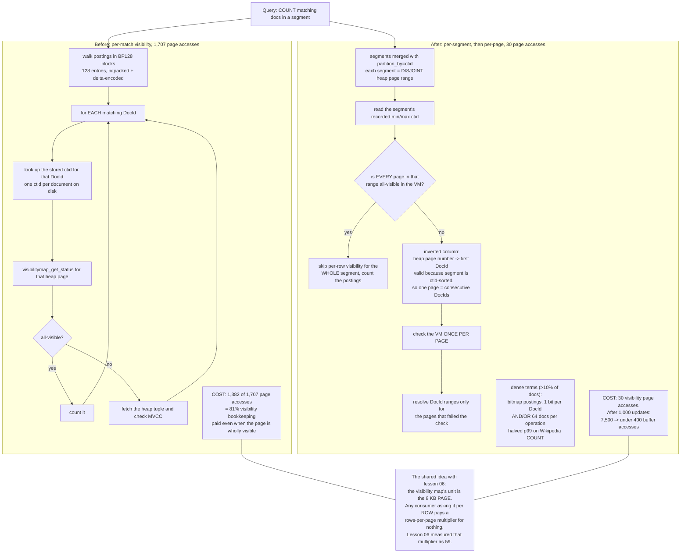

<!--
entry-meta
date: 2026-10-25
type: daily-diff
category: Daily Diff
title: Daily Diff — 2026-10-25
slug: postgres-visibility-map
-->

# Daily Diff — 2026-10-25

**2026-10-25 · Daily Diff Digest**

## Which edition this is, and how it was found

**No edition is dated 2026-10-25.** This digest covers the **Saturday, 2026-10-24 edition, 31 stories** — the newest that exists, and the newest not yet covered here (the previous run covered 2026-10-23).

Endpoints polled at ~03:35 UTC / 09:05 IST:

| Endpoint | What it served | Verdict |
|---|---|---|
| [`/rss.xml`](https://tdd.cat/rss.xml) | newest item *"The Daily Diff — Friday, October 23, 2026"*, 43 stories, `guid` = `https://tdd.cat/2026-10-23/` | **a day behind** |
| [front page](https://tdd.cat/) | *"Friday, October 23, 2026"*, 43 items | **a day behind** |
| [`/archive/`](https://tdd.cat/archive/) | newest **2026-10-24, 31 stories**, linked as *Latest* → `https://tdd.cat/2026-10-24/`; the 25th shown unlinked | **the only endpoint that knew** |
| [`https://tdd.cat/2026-10-24/`](https://tdd.cat/2026-10-24/) | the complete 2026-10-24 edition, 31 stories, **every source URL present** | content taken from here |
| `https://tdd.cat/2026-10-24.md` | `client_error` | **false negative** on an edition that demonstrably exists |
| `https://tdd.cat/2026-10-25.md` | `client_error` | consistent with no 2026-10-25 edition |

**The 2026-10-24 procedure inverted in exactly one day.** That run's conclusion was *"ask RSS first — it was the only one of five that knew the newest edition existed at all."* Today RSS was tied with the front page, a day behind, and **`/archive/` was the only endpoint that knew**. The role of "the endpoint that leads" is therefore not a property of any endpoint; it rotates. The durable procedure is now: **poll the cheap endpoints, take the maximum date any of them names, and fetch `https://tdd.cat/{that date}/`** — the trailing-slash dated page has now served complete content with all source links on two consecutive runs, which is the only thing that has been stable for two days running.

Two older rules got another data point each. The dated `.md` permalink produced its **third consecutive false negative** (2026-10-22 on the 23rd, 2026-10-23 on the 24th, 2026-10-24 today), so 10-23's "it can neither confirm nor deny" stands and 10-24's partial rehabilitation of it does not. And the front page's own explanation — *"Editions are published with a 2-day settling window"* — again predicts the observed structure: front page and RSS on the settled view, `/archive/` and the dated page ahead of it.

## The edition, point-wise

**Databases and storage**

- **ParadeDB's COUNT path rebuilt around visibility** — segment partitioning by `ctid`, an inverted DocId→ctid map, and bitmap postings for dense terms. Deep-dived below.
- **Twelve years of distributed SQLite** — a retrospective on rqlite's CP design, its Raft state-machine approach, and snapshotting lessons.
- **On-disk beats in-RAM at scale** — a striped NVMe array reportedly beating an in-RAM AVL tree at two billion keys, on far less memory.
- **Hardwood** — a dependency-free pure-Java Parquet reader/writer with multithreading and GraalVM native-image support.

**Kernel, memory and systems**

- **`uringscope`** — an eBPF tracer that surfaces hidden `io-wq` offloading and latency stalls in `io_uring` applications.
- **Why freed memory is not returned to the kernel** — glibc arenas, fragmentation, and what `malloc_trim` can and cannot do.
- **Undefined behaviour does not produce predictable segfaults** — assembly-level examples of optimisers exploiting UB.
- **Two GPU clock-unlock kernel modules** — one lifting half-precision throughput limits on RTX 3000 cards, one an early-boot module reportedly doubling FP16/BF16 tensor throughput on Ada.

**Inference and model internals**

- **`ReplaySSM`** — cuts HBM writes in state-space-model decoding by caching *inputs* and recomputing hidden states rather than caching state.
- **`BeNice`** — looped models reuse one KV cache across all recurrences, keeping inference memory constant.
- **Next-concept modeling** — non-autoregressive generation of hierarchical text levels in parallel.
- **A softmax rounding flaw** — floating-point cancellation in softmax and cross-entropy that can produce sudden loss spikes during grokking.
- **Min-p sampling reproduction** — a study finding the reported gains do not survive rigorous evaluation.
- **Compiling an SOP into a 3B model** — fine-tuning instead of prompting, reported to cut input tokens by 91.3%.

**Agent infrastructure**

- **`Infinity`** (AWS / UC Berkeley) — serialises and suspends agents while they wait on tools, for extreme concurrency on small hardware.
- **Agent Compute Engine** (Google) — a hardware-isolated microVM per agent with no credentials stored in the sandbox.
- **`wasi-python`** — a WebAssembly CPython build with NumPy, Pandas, SciPy and scikit-learn for running untrusted agent code.
- **Single agent loops often beat subagent architectures** — Anthropic's case for collapsing subagents into one loop to cut latency and cost.
- **`Agensh`** (Microsoft) — peer-coordinated software synthesis with up to 1,024 agents and no central orchestrator.
- **`Bellman`** — cross-session, cross-provider agent collaboration over MCP shared rooms.
- **`Pi-Bolt`** — ahead-of-time native compilation of a coding agent, cutting startup time and memory.
- **Self-defining operators** — turning incident fixes into playbooks and detector scripts; 52% reduction claimed on recurring-fault resolution time.

**Security and trust**

- **LiteLLM release-pipeline compromise** — post-mortem of an unrevoked master key leading to a stolen admin OAuth token and poisoned releases.
- **`Kevlar`** — an inline MCP proxy firewall that strips tool descriptions, scans outputs and blocks credential leaks.
- **Identity cannot be the basis of agent authority** — the argument that authority must be computed from the *provenance of context tokens*, not from who the agent claims to be.
- **Muse's bot-challenge routing** (Meta) — browser agents delegating automated bot challenges to a dedicated specialist sub-agent.

**Infrastructure and evaluation**

- **Origin range requests** (Cloudflare) — aligning range requests with client access patterns; p99 TTFB on R2 reportedly cut by about half.
- **DOCX editing benchmark for legal agents** — Python document libraries against MCP servers on complex Word-editing tasks.
- **Calibrate decision-model thresholds** — tune classifier cutoffs on labelled traces instead of taking the 0.50 default.
- **Functional-programming DEFLATE vs C** — Lean and Roc implementations benchmarked against libdeflate.

## Deep dive: ParadeDB's COUNT path, and why 81% of its page accesses were visibility checks

I picked this one because it is the same mechanism as today's lesson, approached from the consumer side. Lesson 06 establishes that PostgreSQL's visibility map is a **page-granular** cache consulted **per candidate row**, and measures the consequence: 59 heap fetches after one row changed, because 58 index entries shared the dirtied block. ParadeDB's post is a search engine confronting exactly that per-row cost and attacking it at the storage layer.

### The baseline, and the number that motivates everything

ParadeDB's index stores Tantivy-style immutable segments of document IDs. To return a count, every match had to be converted to a Postgres `ctid` so its visibility could be checked. For their benchmark query:

> **1,382 of 1,707 page accesses — 81% — were visibility-map lookups and stored CTIDs.**

The actual counting was a rounding error. The visibility bookkeeping was the query. And note *why*: each match paid, "even when its page was entirely visible". The information needed to answer all 58 of those checks at once was sitting in one VM byte; the engine just had no way to ask the question per-page instead of per-row.

### Change 1 — `partition_by=ctid`, so a segment covers a disjoint `ctid` range

Segments are merged LSM-style. Previously merging was data-oblivious, so each segment's min/max `ctid` range spanned most of the table — which makes a range test useless, because every segment overlaps every recently-modified page.

With `partition_by=ctid`, each segment covers a **disjoint range of heap pages**. Since a segment records its min and max `ctid`, the engine can test that whole range against the visibility map up front: if every page in the range is all-visible, per-row checks are skipped for the entire segment. And the failure mode shrinks correspondingly — a recently modified page now disables the shortcut for **one** segment rather than for the index.

> Visibility-related page accesses: **1,382 → 30.**

This is the same insight lesson 06's 59-fetch measurement implies from the other direction. The VM's unit is the page; any consumer that asks it questions per row is paying a 50–200× multiplier for nothing. The fix is not a cheaper lookup — it is asking the question at the map's own granularity.

### Change 2 — invert the map: heap page → first DocId

The old layout stored a `ctid` per document, so counting *n* matches meant *n* lookups. The new layout stores a compressed column mapping **each heap page number to the first DocId on that page**. This works only because segments are now sorted by `ctid`, so documents on one heap page have *consecutive* DocIds — the partitioning in change 1 is what makes the inversion possible.

The engine then checks the visibility map once per page and resolves DocId ranges only for the pages that actually need checking.

> After 1,000 row updates: buffer accesses **>7,500 → <400**, a 95% reduction.

### Change 3 — bitmap postings for dense terms

Unrelated to visibility, but it is where half the latency went. Tantivy's default BP128 posting format stores 128-entry blocks, bitpacked and delta-encoded, carrying score bounds for BlockMax pruning. For terms matching **more than 10% of documents**, ParadeDB switched to a **bitmap, one bit per document ID**: bitwise AND/OR processes 64 documents per operation instead of walking a dense array entry by entry.

> This change alone **halved p99 latency** on the Wikipedia count benchmark.

Rare terms stay on BP128, because bitmaps waste work on long runs of zeros — the same density crossover that decides between a bitmap heap scan and an index scan in PostgreSQL itself (lesson 30's territory). Existing indexes need a reindex to pick up both the bitmap and the `ctid` changes.

### The numbers, with the caveat attached

| Workload | ParadeDB | TIN | Ratio |
|---|---|---|---|
| Wikipedia COUNT (mixed) | 5,353.3 QPS | 2,645.8 QPS | 2.0× |
| HN filtered COUNT (`score > 10`) | 777.3 QPS | 77.6 QPS | 10.0× |
| HN filtered Top K by BM25 | 820.4 QPS | 70.5 QPS | 11.6× |
| HN Top K sorted by `time` | 377.8 QPS | 17.4 QPS | 21.7× |

**Read these as vendor numbers.** The benchmarks were designed by ParadeDB; the harness is their own server-side PL/pgSQL with 8 concurrent clients over 5-minute runs; and **the hardware differed between the two systems** (an Intel M-640 machine for TIN 1.0.4 versus an 8-CPU Docker container on an `i7i.8xlarge` for ParadeDB). The post's introduction claims "up to 66 times faster", a figure the table does not support. The author does state plainly that no single benchmark establishes a fastest search engine, and moved from a client-side k6 run (P50 1.6 ms vs 3.6 ms) to server-side measurement because network overhead was distorting results at those latencies — which is a defensible methodology note, not a vendor-neutral result.

What is *not* vendor-dependent is the 81% figure and the 1,382 → 30 reduction: those are page-access counts from a profiler, and they are the part worth taking away.

### The mechanism, before and after

### What it changes

For anyone running full-text search inside PostgreSQL, the practical consequence is that **COUNT and filtered-search latency is dominated by write recency, not by match count** — and that the dominance is structural, not a tuning problem. ParadeDB's answer is to make the index's physical layout agree with the visibility map's granularity, so that one modified heap page costs one segment's shortcut instead of the whole query's. The generalisable lesson is narrower than the benchmark table and more useful: when a cache is page-granular, align your access pattern to pages before you try to make the lookup cheaper.

## Sources

- [The Daily Diff — Saturday, October 24, 2026 edition](https://tdd.cat/2026-10-24/) — the edition digested here
- [The Daily Diff — front page](https://tdd.cat/) (served 2026-10-23 on this run)
- [The Daily Diff — archive](https://tdd.cat/archive/) (the only endpoint that listed 2026-10-24)
- [The Daily Diff — RSS](https://tdd.cat/rss.xml) (newest item 2026-10-23)
- [Opening a Closed TIN, Part 2 — ParadeDB](https://www.paradedb.com/blog/opening-a-closed-tin-part-2) — the deep-dive source
- [Twelve years of distributed SQLite — rqlite](https://philipotoole.com/twelve-years-of-distributed-sqlite/)
- [`uringscope`](https://github.com/rch0wdhury/uringscope)
- [Where did my freed memory go?](https://yapfast.com/blog/where-did-my-freed-memory-go/)
- [Attention, people who think UB is fine](https://blog.habets.se/2026/10/Attention-people-who-think-UB-is-fine.html)
- [`ReplaySSM`](https://tridao.me/blog/2026/replayssm/)
- [Memory is slow, part 3 — on-disk beats in-RAM](https://www.bitflux.ai/blog/memory-is-slow-part3/)
- [Introducing Infinity — AWS](https://aws.amazon.com/blogs/opensource/introducing-infinity-a-runtime-for-extreme-agent-concurrency/)
- [Agent Compute Engine deep dive — Google Cloud](https://cloud.google.com/blog/topics/ai-infrastructure/agent-compute-engine-deep-dive)
- [LiteLLM security incident, Oct 21 2026](https://docs.litellm.ai/blog/security-incident-oct-21-2026-attack-chain)
- [Origin range requests — Cloudflare](https://blog.cloudflare.com/origin-range-requests/)
- [Agent authority and context](https://kirahowe.com/2026/oct/23/agent-authority-and-context)
- [Hardwood — pure-Java Parquet](https://hardwood.dev/1.1.0.Beta3/)
