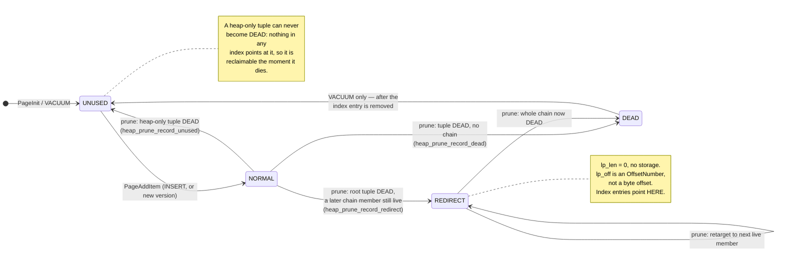
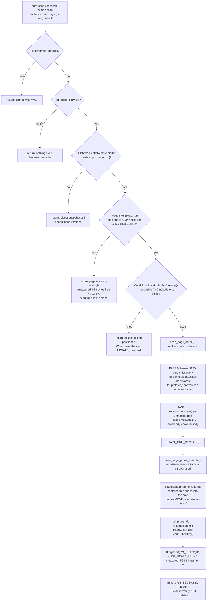

<!--
entry-meta
date: 2026-10-26
type: lesson
track: PostgreSQL
lesson: 07
category: Database Internals
title: HOT Updates and Page Pruning — A Line Pointer Whose lp_off Is Not a Byte Offset, 888 Free Bytes That Survive Three Full Scans, and 2,000 Updates With Zero Bytes of Growth
slug: postgres-hot-updates-page-pruning
-->

# HOT Updates and Page Pruning — A Line Pointer Whose `lp_off` Is Not a Byte Offset, 888 Free Bytes That Survive Three Full Scans, and 2,000 Updates With Zero Bytes of Growth

**2026-10-26 · PostgreSQL Track · Lesson 07 of 35**

Syllabus title: *HOT updates and page pruning: redirect line pointers, `heap_page_prune()`, and the HOT chain.*

> **What was read.** `src/backend/access/heap/README.HOT` (520 lines, in full),
> `src/backend/access/heap/pruneheap.c` (1238 lines, in full), `src/include/storage/itemid.h`
> (184 lines, in full), and the HOT decision block plus `HeapDetermineColumnsInfo()` in
> `src/backend/access/heap/heapam.c`. Partial reads: `src/include/storage/bufpage.h`
> (`PD_PAGE_FULL`, `PageSetPrunable`), `src/include/access/htup_details.h` (the `t_infomask2` HOT
> macros), `src/include/access/heapam_xlog.h` (`xl_heap_prune`, the `XLH_UPDATE_*` flags).
>
> **Which tree.** Not a git checkout this run. The source read is the Debian/Ubuntu source package
> `postgresql-16` version `16.15-0ubuntu0.24.04.1`, obtained with `apt-get source` — the same build
> the cluster runs, so code and measurements cannot drift apart. Checked rather than assumed: none
> of the 14 patches in `debian/patches/` touches `pruneheap.c`, `heapam.c`, `itemid.h`, `bufpage.h`,
> `htup_details.h` or `heapam_xlog.h`, so every file quoted here is upstream REL_16_15 verbatim.
> Earlier lessons in this track stated a commit SHA (01 `@ddd468ca`, 02 `@3cde90ec`,
> 03 `@f2edf5dd`, 04 `@f52d4051`, 05 `@126976a8`, 06 `@0019a1ec`); this one states a release
> instead, and says so rather than inventing a SHA.
>
> **Every number below was measured**, on PostgreSQL 16.15 (Ubuntu 16.15-0ubuntu0.24.04.1),
> x86_64, gcc 13.3.0, `block_size` 8192, `segment_size` 1 GB, `data_checksums` **off**,
> `pageinspect` 1.12, `pgstattuple` 1.5, `pg_visibility` 1.2.

---

## Where This Fits

- **Lesson 06 ended on a cliff.** Its headline measurement: on an 863-block table with a
  primary key, an index-only scan over 20,000 rows did **0** heap fetches after `VACUUM`, and
  **59** after a single `UPDATE` of one row — because the new row version landed on a *different*
  heap block, so **two** visibility-map bits were cleared instead of one, and a **new index entry**
  was created. That measurement is the whole motivation for this lesson.
  ([The Visibility Map &rarr;](../2026-10-25-postgres-visibility-map/README.md))
- **This lesson is the mechanism that makes that update not happen that way.** Heap-Only Tuples:
  the new version goes on the *same* page, gets **no index entry**, and clears **one** VM bit. The
  cost is a new line-pointer state (`LP_REDIRECT`) and a new maintenance operation (pruning) that
  runs opportunistically, in the middle of ordinary `SELECT`s, outside any transaction.
- **Four debts from earlier lessons are closed here.** `LP_REDIRECT`, which lesson 02 named and
  deferred; `pd_prune_xid` and `PD_PAGE_FULL`, which lesson 02 catalogued and deferred;
  `HEAP_HOT_UPDATED` and `HEAP_ONLY_TUPLE`, which lesson 03 tabulated in `t_infomask2` and assigned
  here; and lesson 03's chain-following rule (`xmin(next) == xmax(this)`) applied to a redirect.
- **What it sets up.** Lesson 08 takes `smgr`/`md.c` and relation extension, which this lesson
  treats as a black box exactly as lesson 06 did. Lesson 14 owns snapshots and
  `HeapTupleSatisfiesMVCC`; `GlobalVisState` appears here only as a named black box that answers
  "is this xid removable yet", because the distinction this lesson must hold is **pruning**
  (opportunistic, single page, index never touched) versus **VACUUM** (index-aware, two passes),
  and only the first belongs here.

---

## 1. What HOT actually eliminates

`README.HOT` opens with the problem, and it is not the one most people assume:

> Page-at-a-time vacuuming is normally impractical because of the costs of finding and removing the
> index entries that link to the tuples to be reclaimed. […] In principle one could recompute the
> index keys and do standard index searches to find the index entries, but this is risky in the
> presence of possibly-buggy user-defined functions in functional indexes. An allegedly immutable
> function that in fact is not immutable might prevent us from re-finding an index entry […] That
> would lead to a seriously corrupt index, in the form of entries pointing to tuple slots that by
> now contain some unrelated content.

So single-page reclamation is not blocked by locking or by WAL. It is blocked by **not being able
to find the index entries safely**. HOT does not solve that problem. It **sidesteps** it, for two
restricted cases:

| Case | Condition | Consequence |
|---|---|---|
| 1 | Update changes no column referenced *at all* by any non-summarizing index | No new index entries; a new version can be reclaimed page-locally |
| 2 | Changed columns appear only in **summarizing** indexes (BRIN is the only one in core) | HOT still applies; the summarizing index is notified but no new TID is needed |

The design note is worth keeping: "An additional property of HOT is that it reduces index size by
avoiding the creation of identically-keyed index entries. This improves search speeds." The index
saving is a side effect of the vacuuming trick, not the goal.

And the closing honesty, from the *Limitations and Restrictions* section:

> It is worth noting that HOT forever forecloses alternative approaches to vacuuming, specifically
> the recompute-the-index-keys approach […] It'll be tough to recompute the index keys for a root
> line pointer you don't have data for anymore …

A root line pointer with no tuple attached is a one-way door. That is a design decision, stated as
one.

---

## 2. `LP_REDIRECT`: the fourth line-pointer state

Lesson 02 catalogued three of the four `lp_flags` values and named the fourth. Here is the whole
enumeration from `itemid.h`, with the parenthetical invariants that make the state machine legible:

```c
#define LP_UNUSED		0		/* unused (should always have lp_len=0) */
#define LP_NORMAL		1		/* used (should always have lp_len>0) */
#define LP_REDIRECT		2		/* HOT redirect (should have lp_len=0) */
#define LP_DEAD			3		/* dead, may or may not have storage */
```

The `ItemIdData` comment states the convention that makes `LP_REDIRECT` representable at all:

> In some cases a line pointer is "in use" but does not have any associated storage on the page.
> By convention, `lp_len == 0` in every line pointer that does not have storage, independently of
> its `lp_flags` state.

And the one accessor that makes this lesson's single most confusing fact explicit:

```c
/*
 *		ItemIdGetRedirect
 * In a REDIRECT pointer, lp_off holds offset number for next line pointer
 */
#define ItemIdGetRedirect(itemId) \
   ((itemId)->lp_off)
```

**`lp_off` changes units.** In an `LP_NORMAL` pointer it is a byte offset from the start of the
page. In an `LP_REDIRECT` pointer it is an `OffsetNumber` — a 1-based index into the line pointer
array. Nothing in the struct distinguishes the two; `lp_flags` is the only discriminator. The
measurement below shows a redirect with `lp_off = 19`, which cannot possibly be a byte offset
(byte 19 is inside the 24-byte page header), and that impossibility is the proof.

### The four states, measured end to end

One page, one row, watched through its whole life. `pg7_chain(id int primary key, v int, pad text)`,
18 rows with `pad = repeat('c',360)`.

Geometry first, so nothing later is hand-waved. Tuple: 24-byte header + 4 (`id`) + 4 (`v`) +
4+360 varlena = 396 bytes, `MAXALIGN` → 400 on the page. 18 rows ⇒ `pd_lower = 24 + 18×4 = 96`,
`pd_upper = 8192 − 18×400 = 992`. **Measured: `lower 96, upper 992`.** Exact.

**(a) After the `UPDATE`, before any prune — a two-member chain:**

```
 lp | lp_off | lp_flags | lp_len | t_ctid | t_infomask2
----+--------+----------+--------+--------+-------------
  1 |   7792 |        1 |    396 | (0,19) |       16387
 19 |    592 |        1 |    396 | (0,19) |       32771
```

`16387 = 0x4003` = `HEAP_HOT_UPDATED` (0x4000) | 3 attributes.
`32771 = 0x8003` = `HEAP_ONLY_TUPLE` (0x8000) | 3 attributes. `heap_tuple_infomask_flags()` agrees:

```
  1 | {HEAP_HASVARWIDTH,HEAP_XMIN_COMMITTED,HEAP_HOT_UPDATED}
 19 | {HEAP_HASVARWIDTH,HEAP_XMAX_INVALID,HEAP_UPDATED,HEAP_ONLY_TUPLE}
```

`pd_prune_xid` went `0 → 747`, `lower 96 → 100` (one new line pointer), `upper 992 → 592` (one new
400-byte tuple). This is `README.HOT`'s first diagram, byte for byte:

```
	Index points to 1
	lp [1]  [2]
	[111111111]->[2222222222]
```

**(b) After one plain `SELECT count(*)` — `LP_NORMAL → LP_REDIRECT`:**

```
 lp | lp_off | lp_flags | lp_len
----+--------+----------+--------
  1 |     19 |        2 |      0
 19 |    992 |        1 |    396
```

Four things happened in that one `SELECT`:

1. `lp 1` became `LP_REDIRECT` with `lp_len = 0` and `lp_off = 19`, **an `OffsetNumber`**.
2. `pd_prune_xid` went back to `0`.
3. `pd_upper` went `592 → 992`: `PageRepairFragmentation()` reclaimed tuple 1's 400 bytes and
   **moved the surviving tuple** from byte 592 to byte 992. Line pointers are stable identifiers;
   the data under them is not.
4. `pd_lower` stayed at `100`. The line pointer array did **not** shrink — `lp 1` must survive,
   because the index still points at it.

The index, verified rather than assumed: still 18 entries, `itemoffset 1 → ctid (0,1)`, still
16,384 bytes. The index does not know anything happened.

**(c) A second update, off the redirect — the mid-chain tuple carries *both* flags:**

```
 lp | lp_off | lp_flags | lp_len | t_ctid | t_infomask2
----+--------+----------+--------+--------+-------------
  1 |     19 |        2 |      0 |        |
 19 |    992 |        1 |    396 | (0,20) |       49155
 20 |    592 |        1 |    396 | (0,20) |       32771
```

`49155 = 0xC003` = `HEAP_HOT_UPDATED | HEAP_ONLY_TUPLE` | 3 attributes. A tuple in the middle of a
chain is simultaneously *reached only through its ancestor* and *superseded by its descendant*. The
two flags are orthogonal and both bits live in `t_infomask2`'s top end, next to `HEAP_KEYS_UPDATED`
(0x2000) and above `HEAP_NATTS_MASK` (0x07FF).

**(d) `LP_REDIRECT → LP_DEAD → LP_UNUSED`.** Delete the row and prune: the whole chain is dead, so
there is no surviving member to redirect to, and the root becomes a bare stub.

```
 lp | lp_off | lp_flags | lp_len          after VACUUM:   lp | lp_flags
----+--------+----------+--------                       ----+----------
  1 |      0 |        3 |      0    <- LP_DEAD            1 |        0   <- LP_UNUSED
 19 |      0 |        0 |      0    <- LP_UNUSED         19 |        0
 20 |    992 |        1 |    396                         20 |        1
```

`pd_flags` became `1` (`PD_HAS_FREE_LINES`). The index went **19 → 18** entries only at `VACUUM`,
not at prune. That is the dividing line of the whole lesson: **pruning never touches an index.**



The asymmetry in that diagram is the design. `heap_page_prune_execute()` states it as a comment:

> We need to keep around an `LP_REDIRECT` item (after original non-heap-only root tuple gets pruned
> away) so that it's always possible for VACUUM to easily figure out what TID to delete from
> indexes when an entire HOT chain becomes dead. **A heap-only tuple can never become `LP_DEAD`;
> an `LP_REDIRECT` item or a regular heap tuple can.**

---

## 3. What makes an update HOT — and what does not

The decision is seven lines in `heap_update()`, and it is reached only *after* `newbuf == buffer`
has already been settled by `RelationGetBufferForTuple()`:

```c
	if (newbuf == buffer)
	{
		/*
		 * Since the new tuple is going into the same page, we might be able
		 * to do a HOT update.  Check if any of the index columns have been
		 * changed.
		 */
		if (!bms_overlap(modified_attrs, hot_attrs))
		{
			use_hot_update = true;
			if (bms_overlap(modified_attrs, sum_attrs))
				summarized_update = true;
		}
	}
	else
	{
		/* Set a hint that the old page could use prune/defrag */
		PageSetFull(page);
	}
```

Two independent gates, in this order:

1. **Space.** `newbuf == buffer`. If the new version had to go elsewhere, HOT is off and the *old*
   page gets `PD_PAGE_FULL` set — the hint `bufpage.h` describes as "set if an `UPDATE` doesn't find
   enough free space in the page for its new tuple version; this suggests that a prune is needed.
   Again, this is just a hint."
2. **Indexed columns.** `!bms_overlap(modified_attrs, hot_attrs)`, where `hot_attrs` is
   `RelationGetIndexAttrBitmap(relation, INDEX_ATTR_BITMAP_HOT_BLOCKING)`.

`modified_attrs` comes from `HeapDetermineColumnsInfo()`, and the comparison it performs is the
detail that trips people up. Per attribute it calls `heap_attr_equals()`, and `README.HOT` justifies
the choice:

> The updated columns are checked at execution time by comparing the **binary representation** of
> the old and new values. We insist on bitwise equality rather than using datatype-specific equality
> routines. The main reason to avoid the latter is that there might be multiple notions of equality
> for a datatype, and we don't know exactly which one is relevant for the indexes at hand.

`HeapDetermineColumnsInfo()` also has two unconditional "not equal" shortcuts, both commented:
a whole-row reference (`attrnum == 0`) is always treated as modified ("it could only succeed after a
no-op update, which is hardly a case worth optimizing for"), and so is any system attribute other
than `tableoid` ("we cannot expect these to be consistent in a HOT chain").

### Measured: five updates, five verdicts

`pg7_x(id int primary key, v int, pad text)` with `fillfactor=50`, so **space is never the limiting
factor**. Each update ran in its own transaction with the Δ of `n_tup_hot_upd` recorded:

| What changed | Index on it | Δ `n_tup_upd` | Δ `n_tup_hot_upd` | Verdict |
|---|---|---|---|---|
| `v` | none | 1 | 1 | **HOT** |
| `v` | `btree(v)` | 1 | 0 | cold |
| `v` | `btree(id) WHERE v > 1000000` | 1 | 0 | cold |
| `v` | `btree((v % 7))` | 1 | 0 | cold |
| `pad = pad` | none | 1 | 1 | **HOT** |

Rows 3 and 4 are the ones worth internalising. `v` is **not stored** in either of those indexes —
it appears only in a partial-index predicate, and only inside an expression. `README.HOT`'s
glossary already said so:

> **Indexed column** — A column used in an index definition. The column might not actually be
> stored in the index --- it could be used in a functional index's expression, or used in a partial
> index predicate. HOT treats all these cases alike.

So an index you added to make *one* query fast can silently turn every update of an unrelated-looking
column cold, across the whole table, forever.

### `ctid` does not tell you whether an update was HOT

A cold update whose new version happens to land on the same page produces the same `ctid` shape as a
HOT one. Measured, `fillfactor=50`, `v` indexed:

```
 lp | lp_flags | t_ctid | heap_only | hot_updated
----+----------+--------+-----------+-------------
  1 |        2 |        |           |              <- LP_REDIRECT (from the earlier HOT update)
 30 |        1 | (0,31) | t         | f            <- old version: heap-only, but NOT hot_updated
 31 |        1 | (0,31) | f         | f            <- new version: NOT heap-only
```

Same page, `(0,30) → (0,31)`, and yet cold: the new tuple has no `HEAP_ONLY_TUPLE` bit and got its
own index entries. `lp 30` keeps `HEAP_ONLY_TUPLE` (it *was* reached through the root) but lost
`HEAP_HOT_UPDATED` (its successor is not heap-only). That is `README.HOT`'s sentence made visible:

> If an update changes any column indexed by a non-summarizing indexes, or if there is not room on
> the same page for the new tuple, then the HOT chain ends: the last member has a regular `t_ctid`
> link to the next version and is not marked `HEAP_HOT_UPDATED`.

**The only reliable signals** are `pg_stat_*_tables.n_tup_hot_upd` and the `HEAP_ONLY_TUPLE` bit on
the new version. Not `ctid`.

---

## 4. `heap_page_prune_opt()`: the heuristic gate

Pruning is *opportunistic*. It is attempted from three call sites, all of them read paths:

| Call site | Path |
|---|---|
| `heapam_handler.c:138` | `heapam_index_fetch_tuple()` — every index scan heap fetch |
| `heapam_handler.c:2157` | `heapam_scan_bitmap_next_block()` — bitmap heap scan |
| `heapam.c:465` | `heapgetpage()` — sequential scan |

There is no call from `INSERT`'s path, which `README.HOT` notes explicitly: "`UPDATE`, `DELETE`, and
`SELECT` can trigger space reclamation, but often not during `INSERT ... VALUES` because it does not
retrieve a row."

The function is a chain of early exits, in deliberately increasing cost order:

```c
	if (RecoveryInProgress())
		return;                                     /* cannot write WAL */

	prune_xid = ((PageHeader) page)->pd_prune_xid;
	if (!TransactionIdIsValid(prune_xid))
		return;                                     /* one uint32 read off the page */

	vistest = GlobalVisTestFor(relation);
	if (!GlobalVisTestIsRemovableXid(vistest, prune_xid))
		{ ... return; }                             /* nothing is dead yet */

	minfree = RelationGetTargetPageFreeSpace(relation, HEAP_DEFAULT_FILLFACTOR);
	minfree = Max(minfree, BLCKSZ / 10);

	if (PageIsFull(page) || PageGetHeapFreeSpace(page) < minfree)
	{
		if (!ConditionalLockBufferForCleanup(buffer))
			return;                                 /* never block for housekeeping */
		if (PageIsFull(page) || PageGetHeapFreeSpace(page) < minfree)   /* recheck under lock */
			ndeleted = heap_page_prune(...);
		LockBuffer(buffer, BUFFER_LOCK_UNLOCK);
	}
```

Four things in that are worth stating plainly:

- **`pd_prune_xid` is the whole index.** No prune state is kept anywhere else. One `TransactionId`
  on the page header decides whether the expensive path is even considered. `PageSetPrunable()` is
  a monotone *minimum*, not an assignment:

  ```c
  #define PageSetPrunable(page, xid) \
  do { \
      Assert(TransactionIdIsNormal(xid)); \
      if (!TransactionIdIsValid(((PageHeader) (page))->pd_prune_xid) || \
          TransactionIdPrecedes(xid, ((PageHeader) (page))->pd_prune_xid)) \
          ((PageHeader) (page))->pd_prune_xid = (xid); \
  } while (0)
  ```

  `heap_update()` calls it on the **old** tuple's page only, with an `XXX` admitting the gap:
  "Should we set hint on `newbuf` as well? If the transaction aborts, there would be a prunable
  tuple in the `newbuf`; but for now we choose not to optimize for aborts."

- **The free-space threshold is read without a lock, on purpose**, with the reasoning written down:
  "Checking free space here is questionable since we aren't holding any lock on the buffer; in the
  worst case we could get a bogus answer. […] Avoiding taking a lock seems more important than
  sometimes getting a wrong answer in what is after all just a heuristic estimate." It is rechecked
  under the cleanup lock before anything is changed.

- **It never blocks.** `ConditionalLockBufferForCleanup()` — a cleanup lock is an exclusive lock
  *plus* the condition that no other backend holds a pin, because pruning destroys line pointers and
  defragmenting moves tuples. `README.HOT` prices the failure: "The worst-case consequence of this
  is only that an `UPDATE` cannot be made HOT but has to link to a new tuple version placed on some
  other page, for lack of centralized space on the original page."

- **The FSM is deliberately not updated**, with a reason that is pure HOT policy:
  "We avoid reuse of any free space created on the page by unrelated `UPDATE`s/`INSERT`s by opting
  to not update the FSM at this point. The free space should be reused by `UPDATE`s to *this* page."
  Lesson 05's FSM is intentionally kept ignorant of prune-recovered space so that HOT keeps it.

### Measured: the `BLCKSZ / 10` floor, both sides of it

`pg7_dead`, default `fillfactor=100`, so `RelationGetTargetPageFreeSpace()` returns 0 and `minfree`
is exactly `8192/10 = 819`. One row deleted, so there is real dead storage on the page and
`pd_prune_xid = 753` is set.

| State | `PageGetHeapFreeSpace` | vs `minfree` 819 | Result of a `SELECT count(*)` |
|---|---|---|---|
| after the `DELETE` | **888** (10.84%) | above | **no prune**, three scans in a row. `pd_prune_xid` stays 753, the dead tuple stays |
| after one more `INSERT` | **484** (5.9%) | below | **pruned.** `lp 1 → LP_DEAD`, `lp 19 → LP_UNUSED`, `pd_prune_xid → 0`, `PD_HAS_FREE_LINES` set |

888 bytes of reclaimable space sat on that page across repeated full scans, with the page knowing
it was prunable, because 10.84% > 10%. Pruning is not "eventually consistent cleanup"; it is a
space-pressure response and nothing else.

---

## 5. `heap_page_prune()`: plan, then execute

The structure is a two-phase commit against the page, and the comment says why:

> Our strategy is to scan the page and make lists of items to change, then apply the changes within
> a critical section. This keeps as much logic as possible out of the critical section, and also
> ensures that **WAL replay will work the same as the normal case.**

Phase 0 is a separate pass that computes `HeapTupleSatisfiesVacuum` for every tuple up front into
`prstate.htsv[]`. That pass is required for *correctness*, not speed:

> This is required for correctness to deal with cases where running HTSV twice could result in
> different results (e.g. `RECENTLY_DEAD` can turn to `DEAD` if another checked item causes
> `GlobalVisTestIsRemovableFullXid()` to update the horizon, `INSERT_IN_PROGRESS` can change to
> `DEAD` if the inserting transaction aborts, …). That in turn could cause `heap_prune_chain()` to
> behave incorrectly if a tuple is reached twice, once directly via a `heap_prune_chain()` and once
> following a HOT chain.

The horizon can move *during* the scan, so the visibility verdict is frozen before any planning
starts. The same loop also runs **backwards** (`offnum = maxoff` down to `FirstOffsetNumber`) for a
microarchitectural reason that is spelled out: line pointers ascend while tuples descend, so
descending the line pointer array ascends through memory — "Processing the items in reverse order
(and thus the tuples in increasing order) increases prefetching efficiency significantly."

Phase 1 walks offsets forward, skipping anything `prstate.marked[]` already claimed, and calls
`heap_prune_chain()` per unvisited root. Phase 2 is the critical section:

```
heap_page_prune_execute()      apply redirects, then deads, then unuseds
PageRepairFragmentation()      coalesce the free space into the hole
page_verify_redirects()        assertion-only: every LP_REDIRECT targets a live heap-only tuple
pd_prune_xid = new_prune_xid   recomputed from scratch, not decremented
PageClearFull(page)            "no point in repeating the prune/defrag process"
MarkBufferDirty(buffer)        note: Dirty, not DirtyHint
XLogInsert(RM_HEAP2_ID, XLOG_HEAP2_PRUNE)
```

The `else` branch matters too: if nothing was prunable but `pd_prune_xid` or `PD_PAGE_FULL` changed,
the page is dirtied with `MarkBufferDirtyHint(buffer, true)` instead — "This is treated as a
non-WAL-logged hint." Lesson 06 drew the `MarkBufferDirty` / `MarkBufferDirtyHint` contrast between
the VM and the FSM; here both appear in **one function**, selected by whether real work was done.

### `heap_prune_chain()`: the walk, and its four outcomes

The loop follows `t_ctid` from a root, accumulating `chainitems[]` and tracking `latestdead`. Every
termination condition is a defence against a concurrent prune or an abort:

```c
	if (offnum < FirstOffsetNumber) break;              /* paranoia */
	if (offnum > maxoff) break;                         /* array was truncated */
	if (prstate->marked[offnum]) break;                 /* another chain owns it */
	if (!ItemIdIsUsed(lp)) break;
	if (ItemIdIsRedirected(lp)) { if (nchain > 0) break; ... }   /* only at the start */
	if (ItemIdIsDead(lp)) break;
	if (TransactionIdIsValid(priorXmax) &&
	    !TransactionIdEquals(HeapTupleHeaderGetXmin(htup), priorXmax)) break;
```

That last line is lesson 03's rule, load-bearing here. `README.HOT` explains why a pin is not
enough:

> there is a race condition here: the transaction that did the HOT update might abort between the
> time we inspect the HOT-updated tuple and the time we reach the descendant heap-only tuple. […]
> Therefore, when following a HOT chain, it is always necessary to be prepared for the possibility
> that the linked-to line pointer is unused, dead, or redirected; and if it is a normal line
> pointer, we still have to check that XMIN of the tuple matches the XMAX of the tuple we left.
>
> (Early versions of the HOT code assumed that holding pin on the page buffer while following a HOT
> link would prevent this type of problem, but checking XMIN/XMAX matching is a much more robust
> solution.)

The walk advances past `DEAD` *and* `RECENTLY_DEAD` members ("just in case there's a DEAD one after
them") but stops at anything else, and then resolves to exactly one of four outcomes:

```c
	if (OffsetNumberIsValid(latestdead))
	{
		for (i = 1; (i < nchain) && (chainitems[i - 1] != latestdead); i++)
		{
			heap_prune_record_unused(prstate, chainitems[i]);   /* (1) intermediates */
			ndeleted++;
		}
		if (ItemIdIsNormal(rootlp)) ndeleted++;
		if (i >= nchain)
			heap_prune_record_dead(prstate, rootoffnum);        /* (2) whole chain dead */
		else
			heap_prune_record_redirect(prstate, rootoffnum, chainitems[i]);  /* (3) */
	}
	else if (nchain < 2 && ItemIdIsRedirected(rootlp))
		heap_prune_record_dead(prstate, rootoffnum);            /* (4) orphaned redirect */
```

Outcome (4) is the self-healing case, and the comment is candid about where it comes from: "We found
a redirect item that doesn't point to a valid follow-on item. This can happen if the loop in
`heap_page_prune` caused us to visit the dead successor of a redirect item before visiting the
redirect item." The forward scan order can reach a chain out of order; the code repairs it rather
than asserting it cannot happen.

There is also a pre-loop special case: a `DEAD` heap-only tuple that is **not** `HotUpdated` is
reaped on sight, outside any chain, because "We need this primarily to handle aborted HOT updates,
that is, `XMIN_INVALID` heap-only tuples. Those might not be linked to by any chain, since the
parent tuple might be re-updated before any pruning occurs."

Note also what `ndeleted` counts and what it does not: "If the root entry had been a normal tuple,
we are deleting it, so count it in the result. But **changing a redirect (even to DEAD state)
doesn't count**." And `heap_page_prune_opt()` reports `ndeleted - nnewlpdead` to pgstats, not
`ndeleted`, "since they still need to be cleaned up by VACUUM."



---

## 6. The payoff, measured against lesson 06's number

Lesson 06's experiment, rebuilt and re-run with one variable changed: `fillfactor`. Two tables,
50,000 rows of `(id int primary key, v int, pad text)` with `pad = repeat('x',100)`. The tuple is
**133 bytes** — 24 header + 4 + 4 + 101, where the 101 is a 1-byte varlena header plus 100 data
bytes, because 100 ≤ 126 (lesson 04's boundary, still paying off). `MAXALIGN(133) = 136`, plus a
4-byte line pointer = 140 per row, so `8160/140 = 58.3` rows per page at `fillfactor=100` and
`8160×0.70/140 = 40.8` at 70. Both numbers are confirmed by measurement below.

Query, as in lesson 06: `select count(id) from <t> where id between 1 and 20000`, with
`enable_seqscan` and `enable_bitmapscan` off.

| | `pg7_ios` (`fillfactor=100`) | `pg7_hot` (`fillfactor=85`) |
|---|---|---|
| heap blocks | **863** | 1021 |
| after `VACUUM`: Heap Fetches / buffers | **0 / 57** | 0 / 57 |
| `UPDATE … WHERE id=7` → new `ctid` | **(862,5)** — different block | **(0,50)** — same block |
| `n_tup_hot_upd` | **0** | **1** |
| `n_dead_tup` | **1** | **0** |
| VM bits cleared | **2** (blocks 0 and 862) | **1** (block 0) |
| Heap Fetches after the update | **58** | **49** |
| buffers | 60 | 58 |

`pg7_ios` reproduces lesson 06's table geometry **exactly** — 863 heap blocks, `shared hit=57` on
the clean index-only scan. The fetch count did not reproduce exactly: lesson 06 measured **59**,
this run measured **58**. That is accounted for, not waved away. Lesson 06's accounting was
"57 live rows + 1 dead index entry on block 0 = 58, plus 1 on block 862 = 59", i.e. 58 index entries
in range pointing at block 0. This table has **57** rows on block 0 (measured directly), so
57 + 1 = 58. One row per page of difference in row width, not a contradiction — but the 59 should
not be cited as a constant.

The `pg7_hot` side is the real result, and it is cleaner than the headline number suggests:

- 49 index entries point at block 0 (measured), and Heap Fetches is **49**. The HOT update added
  **no** index entry, so there is no second block to visit. The cold update added **one** index
  entry and therefore **one extra heap block**, plus one extra VM bit, plus one dead tuple for
  `VACUUM` to find.
- Block 0 had already been pruned *by the index-only scan itself*: `lp 7` is `LP_REDIRECT`,
  `max(lp) = 50`, 49 of them `LP_NORMAL`. `n_dead_tup` is **0** with no `VACUUM` having run.

### Steady state: 2,000 updates, zero growth

`pg7_steady`, `fillfactor=70`, 5,000 rows → 125 heap blocks, 16 index blocks, 40 rows per page
(matching the arithmetic above). Then **2,000 autocommitted** `update … where id=7`:

```
 heap_blocks | idx_blocks        n_tup_upd | n_tup_hot_upd | n_dead_tup
-------------+------------       ----------+---------------+------------
         125 |         16             2000 |          2000 |          1

 ctid  (0,42)          block 0:  40 LP_NORMAL, 1 LP_REDIRECT, 1 LP_UNUSED, max_lp 42
 pd_prune_xid 0        pgstattuple: dead_tuple_count 0, free_percent 31.3
```

**2,000 HOT updates out of 2,000. Zero blocks of heap growth, zero blocks of index growth, zero dead
tuples, and no `VACUUM` ever ran.** The row ended up at `(0,42)`: two line pointers past the
original 40, reused forever.

`pg_waldump` shows the cycle verbatim. Three records repeat, and the whole mechanism is readable in
them:

```
rmgr: Heap   len 71, tx: 2795, desc: HOT_UPDATE old_xmax: 2795, old_off: 11, flags: 0x61,
                                    new_off: 41, blkref #0: rel 1663/5/16483 blk 0
rmgr: Transaction len 34, tx: 2795, desc: COMMIT
rmgr: Heap2  len 59, tx:    0, desc: PRUNE snapshotConflictHorizon: 2795, nredirected: 1,
                                    ndead: 0, nunused: 0, redirected: [11->41], blk 0
rmgr: Heap   len 71, tx: 2796, desc: HOT_UPDATE old_off: 41, flags: 0x60, new_off: 43, blk 0
rmgr: Transaction len 34, tx: 2796, desc: COMMIT
rmgr: Heap2  len 61, tx:    0, desc: PRUNE snapshotConflictHorizon: 2796, nredirected: 1,
                                    ndead: 0, nunused: 1, redirected: [11->43], unused: [41], blk 0
```

Four observations, each measured rather than inferred:

- **`tx: 0` on every `PRUNE` record.** Pruning is not part of any transaction. It is physical
  maintenance that happens to be performed by whichever backend touched the page.
- **The row oscillates between offsets 41 and 43 forever**: `[11->41]` / `unused:[43]`, then
  `[11->43]` / `unused:[41]`. Root `lp 11` never moves; two line pointers are recycled indefinitely.
- **59 vs 61 bytes** is exactly one `OffsetNumber`. `xl_heap_prune` is 9 bytes
  (`SizeOfHeapPrune = offsetof(xl_heap_prune, isCatalogRel) + sizeof(bool)` over
  `{TransactionId, uint16, uint16, bool}`); the offset arrays ride in block reference 0's data
  (`XLogRegisterBufData`), 2 bytes per offset and 4 per redirect pair. The comment is worth
  remembering: "The `OffsetNumber` arrays are not actually in the buffer, but we pretend that they
  are. When `XLogInsert` stores the whole buffer, the offset arrays need not be stored too."
- **`flags: 0x61` on the first update, `0x60` after.** `0x60` is
  `XLH_UPDATE_PREFIX_FROM_OLD | XLH_UPDATE_SUFFIX_FROM_OLD`; the `0x01` is
  `XLH_UPDATE_OLD_ALL_VISIBLE_CLEARED` — lesson 06's flag, set only on the *first* update because
  after that the VM bit is already clear.

### HOT vs cold, in WAL bytes

3,000 autocommitted single-row updates on each table, `fillfactor=70`, measured with
`pg_waldump --stats=record` over a dedicated segment range.

| | HOT (`pg7_steady`, `v` unindexed) | cold (`pg7_cold`, `btree(v)`) |
|---|---|---|
| `Heap/HOT_UPDATE` | 3000 rec, **213,011 B** (71.0 ea) | — |
| `Heap/UPDATE` | — | 2990 rec, 212,301 B (71.0 ea) |
| `Heap/UPDATE+INIT` | — | 10 rec, 1,830 B (new pages) |
| `Heap2/PRUNE` | **2999 rec, 182,937 B** (61.0 ea) | 336 rec, 24,456 B |
| `Btree/INSERT_LEAF` | **0** | **5992 rec, 383,488 B (51.7%)** |
| `Btree/INSERT_UPPER` / `SPLIT_R` / `DELETE` | 0 / 0 / 0 | 8 / 8 / 74 (16,598 B) |
| `Heap/LOCK` | 0 | 10 rec, 540 B |
| `Transaction/COMMIT` | 3000 rec, 102,000 B | 3000 rec, 102,000 B |
| **total** | **497,948 B** = 166 B/update | **741,213 B** = 247 B/update |
| FPI bytes | 0 | 0 |
| heap growth | **0 blocks** | **+10 blocks** (125 → 135) |

The cold path's **5,992 `Btree/INSERT_LEAF` records ≈ two per update** — one for the primary key and
one for `btree(v)` — are 51.7% of its WAL. That is precisely the "redundant index entries"
`README.HOT` opens by promising to eliminate, and here it is, priced. (The 74 `Btree/DELETE` records
are nbtree keeping its own leaves from bloating; lesson 29 owns that.)

But read the HOT column honestly: **`Heap2/PRUNE` is 36.7% of the HOT path's WAL**, 61 bytes per
update, nearly as much as the updates themselves. HOT is not free maintenance. It replaces index
writes and heap growth with a stream of small prune records. It wins 1.49× here, not 10×.

---

## Hands-On

A cluster is not optional for this lesson — the whole point is that the page changes under you
during a `SELECT`. Recipe that worked in a plain cloud sandbox (PostgreSQL 16.15, Ubuntu 24.04):
`initdb` **as a non-root user** into `/var/tmp/pgdata --no-sync`, then
`pg_ctl -o '-p 5455 -k /var/tmp'`. `initdb` refuses to run as root and refuses some sandbox paths.
To read the source that matches the build, add a `deb-src` line for your release and run
`apt-get source postgresql-16` — faster and more faithful than fetching files one at a time.

```sql
CREATE EXTENSION pageinspect;   -- superuser only
CREATE EXTENSION pgstattuple;
```

### 1. Watch a redirect appear (the one most people have never seen)

```sql
CREATE TABLE p7(id int PRIMARY KEY, v int, pad text);
INSERT INTO p7 SELECT g, 0, repeat('c',360) FROM generate_series(1,18) g;

UPDATE p7 SET v = v+1 WHERE id = 1;

SELECT lp, lp_off, lp_flags, lp_len, t_ctid, t_infomask2
  FROM heap_page_items(get_raw_page('p7',0)) WHERE lp IN (1,19);
SELECT prune_xid, lower, upper FROM page_header(get_raw_page('p7',0));

SET enable_indexscan=off; SET enable_bitmapscan=off;
SELECT count(*) FROM p7;            -- <-- this is the prune

SELECT lp, lp_off, lp_flags, lp_len
  FROM heap_page_items(get_raw_page('p7',0)) WHERE lp IN (1,19);
SELECT prune_xid, lower, upper FROM page_header(get_raw_page('p7',0));
```

**What to look for, and what each thing proves.** `lp_flags` on `lp 1` goes `1 → 2`, and `lp_off`
goes from `7792` to `19`. **19 cannot be a byte offset** — byte 19 is inside the 24-byte page
header — which proves `lp_off` means an `OffsetNumber` in a redirect and nothing else does. `lp_len`
becomes `0`, the no-storage convention. `prune_xid` goes `747 → 0`. `upper` goes back **up** from
592 to 992, proving `PageRepairFragmentation()` physically **moved** the surviving tuple while its
line pointer stayed put. And `lower` does **not** shrink: `lp 1` cannot be reclaimed, because the
index still points at it. Confirm that last part: `SELECT itemoffset, ctid FROM
bt_page_items('p7_pkey',1) LIMIT 3` still shows `(0,1)`.

### 2. Find the heuristic gate with your own hands

```sql
SELECT upper - lower - 4 AS heap_free_space, 8192/10 AS minfree
  FROM page_header(get_raw_page('p7',0));
DELETE FROM p7 WHERE id = 1;
SELECT count(*) FROM p7;  SELECT count(*) FROM p7;  SELECT count(*) FROM p7;
SELECT lp, lp_flags FROM heap_page_items(get_raw_page('p7',0)) WHERE lp IN (1,19,20);
-- then push free space under 819 and scan once more:
INSERT INTO p7 VALUES (100, 0, repeat('c',360));
SELECT count(*) FROM p7;
SELECT lp, lp_flags FROM heap_page_items(get_raw_page('p7',0)) WHERE lp IN (1,19,20);
```

**What to look for.** With 888 bytes free, three full scans in a row change **nothing** —
`pd_prune_xid` stays set, the dead tuple stays. One `INSERT` drops free space to 484 and the very
next scan prunes, turning `lp 1` into `LP_DEAD` (3). That pair of observations is the
`Max(fillfactor_slack, BLCKSZ/10)` threshold, located experimentally to within one row. Then
`VACUUM p7` and watch `lp 1` go `3 → 0` **and** the index drop one entry — the only step in this
whole lesson that touches an index.

### 3. Prove that `ctid` lies, and that an index you forgot about costs you

```sql
CREATE TABLE p7x(id int PRIMARY KEY, v int, pad text) WITH (fillfactor=50);
INSERT INTO p7x SELECT g,0,repeat('i',100) FROM generate_series(1,500) g;
VACUUM ANALYZE p7x;

-- baseline: v unindexed
BEGIN; UPDATE p7x SET v=v+1 WHERE id=1;
  SELECT n_tup_upd, n_tup_hot_upd FROM pg_stat_xact_all_tables WHERE relname='p7x';
COMMIT;

CREATE INDEX ON p7x (id) WHERE v > 1000000;     -- v only in a PREDICATE
BEGIN; UPDATE p7x SET v=v+1 WHERE id=1;
  SELECT n_tup_upd, n_tup_hot_upd FROM pg_stat_xact_all_tables WHERE relname='p7x';
COMMIT;
```

**What to look for.** Take the *delta* of `n_tup_hot_upd`, not the absolute value. It is 1 in the
first case and 0 in the second, with `fillfactor=50` guaranteeing there was plenty of room — so the
only thing that changed the verdict was an index that does not store `v` at all. Repeat with
`CREATE INDEX ON p7x ((v % 7))` for the expression case. Then check `ctid` before and after a cold
update on a half-empty page: it will often stay on the same block, which is why `ctid` is not
evidence of HOT. The real evidence is the `HEAP_ONLY_TUPLE` bit: `t_infomask2 & 32768`.

### 4. Price it in WAL, and then break it

```sql
SELECT pg_switch_wal();  SELECT pg_current_wal_lsn();
```
```bash
# 3000 separate autocommitted statements, NOT a DO loop (see below)
python3 -c "print('\n'.join(['update p7s set v=v+1 where id=7;']*3000))" > /var/tmp/u.sql
psql -f /var/tmp/u.sql
/usr/lib/postgresql/16/bin/pg_waldump -p $PGDATA/pg_wal -s <lsn1> -e <lsn2> --stats=record
/usr/lib/postgresql/16/bin/pg_waldump -p $PGDATA/pg_wal -s <lsn1> -e <lsn2> -r Heap2 | head
```

**What to look for.** `Heap2/PRUNE` should be ~1 per update and ~36% of total bytes — HOT's
maintenance is visible, not hidden. In the `-r Heap2` output, watch `redirected: [N->A]` and
`unused: [B]` swap A and B on alternating records: that is two line pointers being recycled forever.
Then break it two ways and re-measure: wrap the 3,000 updates in a single `DO $$ … $$` block, and
separately open `BEGIN ISOLATION LEVEL REPEATABLE READ; SELECT 1;` in another session and leave it
sitting. Both make the heap grow. The next section has the numbers.

---

## Where This Breaks Down

**1. One idle transaction turns HOT off.** Pruning needs the old versions to be *removable*, and
that is a global property. Measured on `pg7_hold` (`fillfactor=70`, 5,000 rows, 125 blocks), with
one `REPEATABLE READ` transaction open and idle in another session, 2,000 autocommitted updates:

| | no held snapshot | one idle `REPEATABLE READ` session |
|---|---|---|
| HOT / total updates | **2000 / 2000** | 1965 / 2000 |
| heap blocks | 125 → **125** | 125 → **160** (+35) |
| `n_dead_tup` | **0** | **2000** |
| row's final `ctid` | `(0,42)` | `(159,10)` |
| block 0 line pointers | 40 `LP_NORMAL`, 1 `LP_REDIRECT` | **58 `LP_NORMAL`, 0 `LP_REDIRECT`** |

The arithmetic closes exactly. Block 0 started with 40 rows (`fillfactor=70`); at 140 bytes per row
it holds 58 before it is full; `40 + 18 = 58`, and 58 is what was measured. So HOT bought 18 free
updates on that page and then gave up. Each subsequent page starts nearly empty and absorbs ~57
(`8160/140`) before filling: `18 + 35×57 = 2013 ≈ 2000`. **35 cold updates produced exactly 35 new
blocks.** 98.25% HOT and a 28% larger table — "HOT update ratio" alone is a misleading health
metric.

The same thing happens inside a single long transaction even with no other sessions. 10,000 updates
inside one `DO $$ … $$` block on `pg7_hot`: 9,828 HOT (98.3%), 173 cold, and the heap grew
1021 → 1193 blocks. **173 cold updates, 172 new blocks.** Your own transaction is the old snapshot.

**2. The index is still there, and only `VACUUM` can shrink it.** Pruning reclaims tuple storage and
intermediate line pointers. It never removes an index entry, and a root line pointer that reaches
`LP_DEAD` stays as a 4-byte stub until a `VACUUM` pass removes the index tuples pointing at it.
`README.HOT` accepts the cost — "Since a line pointer is small compared to a tuple, this does not
represent an undue space cost" — and caps the damage at `MaxHeapTuplesPerPage` (291 for an 8 KB
page, established in lesson 05) "to limit the damage in the worst case, and to keep various work
arrays as well as the bitmaps in bitmap scans reasonably sized." That cap exists because the feature
is explicitly a resurrection of an idea "proposed and rejected before because of fear of line
pointer bloat."

**3. `fillfactor` is a permanent space tax paid for a probabilistic benefit.** `pg7_hot` at
`fillfactor=85` needed **1021 blocks** where `pg7_ios` at 100 needed **863** — 18.3% more disk, more
pages per sequential scan, more buffer cache consumed, forever. If updates stop being HOT-safe (one
new index), the tax remains and the benefit vanishes. The documentation's own framing is
conditional: lowering `fillfactor` "makes HOT updates more likely."

**4. Pruning will not block, so it is not a guarantee.** `ConditionalLockBufferForCleanup()` fails if
*any* other backend holds a pin. On a hot page under concurrency, prunes get skipped and updates go
cold. `README.HOT` also rules out the ideal placement: doing the defragmentation right before
`heap_update()` is impossible because "the update query has certainly got a pin on the old tuple, and
therefore our attempt to acquire a buffer cleanup lock will always fail."

**5. Pruning costs WAL, and someone else pays.** 61 bytes per prune record, 36.7% of the HOT path's
WAL, generated by whichever backend happened to read the page — including a read-only reporting
query. Replicas replay every one of them. A "read-only" `SELECT` on a replica cannot prune at all
(`RecoveryInProgress()` → return), so a replica's pages stay unpruned until the primary's records
arrive.

**6. Bitwise equality is strictly conservative.** `UPDATE … SET x = 1` where `x` is already `1` is
HOT-safe, but a value that is logically equal and physically different — a re-TOASTed datum, a
differently-padded varlena, `0.0` vs `-0.0` — counts as modified. That is deliberate (there is no
single notion of equality to appeal to), but it means HOT eligibility is a property of *bytes*, not
of your data model.

**7. `heap_page_prune_opt()`'s free-space read is racy by design**, and the code says so. It can
decide to attempt a prune on a page that is no longer full, or skip one that is; the recheck under
the cleanup lock makes it safe, not accurate.

---

## Further Study

- [Tom Lane, "Latest README.HOT" (pgsql-patches, September 2007)](https://www.postgresql.org/message-id/27473.1189896544@sss.pgh.pa.us) — the design document as it was circulated for review, worth reading next to today's version to see which parts survived unchanged.
- [The original `README.hot` draft posted to the lists](https://www.postgresql.org/message-id/attachment/19791/README.hot) — the "Use case" framing that opened the proposal.
- [`pruneheap.c` per-function test coverage](https://coverage.postgresql.org/src/backend/access/heap/pruneheap.c.func.html) — which branches the regression suite actually exercises; a fast way to find the paths that are hard to reach from SQL.
- [`pruneheap.c` in doxygen](https://doxygen.postgresql.org/pruneheap_8c.html) — cross-referenced callers and callees for `heap_page_prune_opt`/`heap_prune_chain`.
- [`src/backend/access/heap/README.tuplock`](https://github.com/postgres/postgres/blob/master/src/backend/access/heap/README.tuplock) — the companion in-tree design doc; lesson 12's primary source, and it explains the `t_infomask` bits this lesson only read past.
- [`66.6. Database Page Layout`](https://www.postgresql.org/docs/current/storage-page-layout.html) — the documentation's line-pointer and page-header reference, for cross-checking the `lp_flags` table.
- [Nikolay Kudinov, "Understanding heap_page_prune_opt()"](https://medium.com/@nikolaykudinov/understanding-heap-page-prune-opt-postgresqls-lightweight-in-page-vacuum-c0e3daf872b0) — secondary, a readable walkthrough of the same function.
- [Heap Storage: Page Layout, Tuples, HOT and Pruning](https://www.synxdata.com/internals/storage/heap-row-store/) — secondary overview that puts pruning next to the page layout.

---

## Next Steps

1. **Measure the summarizing-index path.** Every HOT/cold verdict above used btree. Add a BRIN index
   on `v`, update `v`, and check that `n_tup_hot_upd` increments *and* the BRIN summary is revised —
   `README.HOT` says "the HOT optimization is applied, but the update is propagated to all
   summarizing indexes", and admits the pessimism: "Realistically, we only need to propagate the
   update to the indexes that contain the updated values, but that is yet to be implemented."
2. **Reach the `MaxHeapTuplesPerPage` line-pointer cap.** Build a page with hundreds of `LP_DEAD`
   stubs and find the point where `PageAddItem` refuses. 291 is derived (lesson 05), never observed.
3. **Exercise outcome (4), the orphaned redirect.** `heap_prune_chain()`'s `nchain < 2 &&
   ItemIdIsRedirected(rootlp)` branch is reachable only through a specific visit order. The coverage
   report linked above should say whether the regression suite reaches it; if not, construct it.
4. **Price pruning on a standby.** Measure how long a replica carries unpruned pages when the primary
   is the only thing emitting `XLOG_HEAP2_PRUNE`, and what that does to index-only scans there.
5. **Re-measure with `data_checksums` on.** Still unexercised across lessons 03–07, and
   `MarkBufferDirtyHint` behaves differently when `XLogHintBitIsNeeded()` is true — which is exactly
   the path `heap_page_prune()`'s `else` branch takes.
6. **For lesson 14:** `heap_prune_satisfies_vacuum()` and `GlobalVisState` were a black box here.
   The `old_snapshot_threshold` machinery around them carries an `XXX` in the source
   ("Magic to keep `old_snapshot_threshold` tests appear 'working'. They currently are broken") with
   a mailing-list link; worth chasing when snapshots are the subject.

---

## Sources

- [`src/backend/access/heap/README.HOT`](https://github.com/postgres/postgres/blob/master/src/backend/access/heap/README.HOT) — the design document the feature is specified in; read in full (local copy: `postgresql-16` 16.15-0ubuntu0.24.04.1)
- [`src/backend/access/heap/pruneheap.c`](https://github.com/postgres/postgres/blob/master/src/backend/access/heap/pruneheap.c) — `heap_page_prune_opt`, `heap_page_prune`, `heap_prune_chain`, `heap_page_prune_execute`, `page_verify_redirects`, `heap_get_root_tuples`; read in full
- [`src/backend/access/heap/heapam.c`](https://github.com/postgres/postgres/blob/master/src/backend/access/heap/heapam.c) — the `use_hot_update` decision block and `HeapDetermineColumnsInfo()`
- [`src/backend/access/heap/` (tree listing)](https://github.com/postgres/postgres/tree/master/src/backend/access/heap) — for locating `README.HOT` and `README.tuplock` alongside the implementation
- [`66.7. Heap-Only Tuples (HOT)`, PostgreSQL documentation](https://www.postgresql.org/docs/current/storage-hot.html) — the two HOT conditions, `fillfactor`, and `pg_stat_all_tables.n_tup_hot_upd`
- [`66.6. Database Page Layout`, PostgreSQL documentation](https://www.postgresql.org/docs/current/storage-page-layout.html) — line pointer and page header reference
- [`Chapter 73. Database Physical Storage` (PostgreSQL 16)](https://www.postgresql.org/docs/16/storage.html) — the version-matched chapter for the 16.15 build measured here
- [`README.HOT` via git.postgresql.org gitweb](https://git.postgresql.org/gitweb/?a=blob&f=src%2Fbackend%2Faccess%2Fheap%2FREADME.HOT&p=postgresql.git) — the project's own canonical browse URL
- [`pruneheap.c` source in doxygen](https://doxygen.postgresql.org/pruneheap_8c_source.html) — line-numbered cross-reference
- [`pruneheap.c` coverage report](https://coverage.postgresql.org/src/backend/access/heap/pruneheap.c.func.html) — per-function hit counts
- Local, not a URL: `src/include/storage/itemid.h`, `src/include/storage/bufpage.h`,
  `src/include/access/htup_details.h`, `src/include/access/heapam_xlog.h` from the same source
  package, and `pg_waldump` / `pageinspect` / `pgstattuple` output from the cluster described above.

---

## Takeaways

- **HOT is a workaround for one specific impossibility**: you cannot safely re-find a tuple's index
  entries, because user-defined functions in functional indexes might lie. HOT avoids ever needing
  to, by never creating the entry in the first place.
- **`LP_REDIRECT` is where `lp_off` changes units.** In `LP_NORMAL` it is a byte offset; in
  `LP_REDIRECT` it is an `OffsetNumber`, with `lp_len = 0` by the no-storage convention. Measured:
  `lp_off = 19` on a redirect, which is inside the page header and therefore cannot be a byte offset.
- **Line pointers are the stable identity; tuples move.** `PageRepairFragmentation()` relocated a
  surviving tuple from byte 592 to byte 992 during an ordinary `SELECT`. Indexes survive that because
  they address line pointers, not bytes.
- **"Indexed column" means mentioned anywhere in an index definition** — including a partial-index
  predicate and an expression index's input, measured. One index added for one query can turn every
  update of an apparently unrelated column cold.
- **`ctid` does not tell you whether an update was HOT.** Use `n_tup_hot_upd` or the
  `HEAP_ONLY_TUPLE` bit (`t_infomask2 & 32768`).
- **Pruning is a space-pressure response, not cleanup.** Measured: 888 bytes free (10.84%) and a
  known-prunable dead tuple survived three full table scans; 484 bytes free pruned on the next one.
  The threshold is `Max(fillfactor slack, BLCKSZ/10)`.
- **Pruning never touches an index.** That single sentence separates it from `VACUUM` and explains
  every asymmetry in the line-pointer state machine, including why a heap-only tuple can go straight
  to `LP_UNUSED` while a root must detour through `LP_DEAD`.
- **In steady state HOT is extraordinary and in the presence of an old snapshot it is useless.**
  2,000 updates: zero heap growth, zero index growth, zero dead tuples, 100% HOT. The same 2,000
  with one idle `REPEATABLE READ` session open: +35 blocks, 2,000 dead tuples — while still
  reporting 98.25% HOT. Trust the table size, not the ratio.
- **HOT is not free.** It trades 5,992 btree insert records (51.7% of the cold path's WAL) for 2,999
  prune records (36.7% of its own). Measured end to end: 166 bytes of WAL per update versus 247, a
  1.49× saving — plus zero heap growth, which is the part that actually compounds.
