<!--
entry-meta
date: 2026-10-26
type: daily-diff
category: Daily Diff
title: Daily Diff — 2026-10-26
slug: postgres-hot-updates-page-pruning
-->

# Daily Diff — 2026-10-26

**2026-10-26 · Daily Diff Digest**

## Which edition this is, and how it was found

**No edition is dated 2026-10-26.** This digest covers the **Sunday, 2026-10-25 edition, 29
stories** — the newest that exists, and the newest not yet covered here (the previous run covered
2026-10-24).

Endpoints polled at ~03:45 UTC / 09:15 IST, following the procedure the 2026-10-25 run settled on
(*poll the cheap endpoints, take the maximum date any of them names, fetch
`https://tdd.cat/{that date}/`*):

| Endpoint | What it served | Verdict |
|---|---|---|
| [front page](https://tdd.cat/) | *"Saturday, October 24, 2026"*, 31 items | **a day behind** |
| [`/rss.xml`](https://tdd.cat/rss.xml) | newest item *"The Daily Diff — Sunday, October 25, 2026"*, "29 high-signal engineering stories", `guid` = `link` = `https://tdd.cat/2026-10-25/` | **current** |
| [`/archive/`](https://tdd.cat/archive/) | 119 linked editions; newest **2026-10-25, 29 stories** → `https://tdd.cat/2026-10-25/`. Oct 26–31 shown **without a story count and not linked** | **current, and the only endpoint that says what does NOT exist** |
| [`https://tdd.cat/2026-10-25/`](https://tdd.cat/2026-10-25/) | the complete 29-story edition, every source URL present | content taken from here |

**The procedure held, and the leading endpoint rotated again.** On 2026-10-24 RSS was the only
endpoint that knew; on 2026-10-25 RSS had fallen a day behind and `/archive/` was the only one that
knew; today **RSS and `/archive/` agreed and the front page was a day behind**. Three runs, three
different configurations — which is now strong evidence for the 10-25 conclusion that "the endpoint
that leads" is not a property of any endpoint. *Take the max of several, do not trust one.*

**One procedural upgrade worth recording.** `/archive/` lists Oct 26–31 as dates with **no story
count and no link**, which is a *positive* statement that today has no edition, not merely an
absence of evidence. That makes `/archive/` the only endpoint that can distinguish "not published
yet" from "published but not yet propagated" — exactly the ambiguity the dated `.md` permalink kept
producing false negatives on across three previous runs. Future runs should read `/archive/` for
that signal and stop probing `.md` permalinks.

---

## The edition, point-wise

**Databases, storage and data structures**

- **Pushdown in Postgres foreign data wrappers is a negotiation** — which clauses `pg_clickhouse`
  can safely hand to ClickHouse, and what one unmapped expression costs. *Deep dive below.*
  → [clickhouse.com](https://clickhouse.com/blog/postgres-fdw-pushdown-negotiation)
- **`bbtree`: large speedups over standard concurrent ordered maps** — a concurrent B-tree reporting
  big wins and lower memory than standard ordered maps, backed by **formal verification and
  fuzzing**. Directly relevant to this track's Part VI.
  → [github.com/XiangpengHao/bbtree](https://github.com/XiangpengHao/bbtree)
- **Shrinking MMDB files without touching the data** — **hash-consing** identical subtrees in an
  MMDB trie, so the file gets smaller with no compression and no reader changes. A pure
  structural-sharing win. → [ipinfo.io](https://ipinfo.io/blog/how-made-mmdb-files-smaller)
- **Shared DuckDB servers expose dangerous default process permissions** — eight concrete exposures
  (environment access, filesystem traversal) when a single-process analytical engine is used as a
  multi-user server, plus mitigations.
  → [blog.starlake.ai](https://blog.starlake.ai/securing-duckdb-server-in-production)
- **Chunk-deduplicated storage for large versioned files** — OpenXet, a self-hosted Rust
  implementation of chunk-level dedup compatible with Hugging Face and Git LFS tooling.
  → [github.com/stubbi/openxet](https://github.com/stubbi/openxet)
- **Native drivers need standardized testing to preserve behavioural consistency** — MongoDB's
  choice to write native drivers per language, and the shared language-agnostic JSON test specs
  that keep them in agreement. → [emptysqua.re](https://emptysqua.re/blog/polyglots-dilemma/)

**Runtimes, compilers and systems**

- **Native memory pooling for confined arenas** — a JDK 28 change serving small confined-arena
  native allocations from thread-local pools, cutting allocation latency with **no code changes**.
  → [inside.java](https://inside.java/2026/10/23/confined-pools/)
- **Compiling Java bytecode directly into native Common Lisp** — OpenLDK translates JVM bytecode to
  Lisp for SBCL: fast startup via core images, live inspection of running applications.
  → [atgreen.github.io](https://atgreen.github.io/repl-yell/posts/openldk-java-in-common-lisp/)
- **Systemd adds support for Rust in leaf components** — deliberately constrained: `no_std`,
  Meson-only builds, leaf components only, and custom allocators that **return errors instead of
  aborting**. → [github.com/systemd/systemd#44324](https://github.com/systemd/systemd/pull/44324)
- **Undefined behaviour does not simply produce predictable segfaults** — compiler output showing
  optimisers generating unintended execution paths and memory writes. (Carried over from the
  2026-10-24 edition.)
  → [blog.habets.se](https://blog.habets.se/2026/10/Attention-people-who-think-UB-is-fine.html)
- **Parsing CommonMark at near-gigabyte speeds in Go with SIMD** — simdown, using arm64 SIMD
  scanning, reporting higher throughput than pulldown-cmark and cmark.
  → [github.com/trevorah/simdown](https://github.com/trevorah/simdown)
- **Rewriting binary hot paths to cut Erlang DNS CPU** — DNSimple's binary matching and
  construction optimisations, ~12% less CPU per query.
  → [blog.dnsimple.com](https://blog.dnsimple.com/2026/10/making-dns-erlang-fast/)
- **Origin range requests** — Cloudflare aligning range-request fetches with client access
  patterns. (Also in the 2026-10-24 edition.)
  → [blog.cloudflare.com](https://blog.cloudflare.com/origin-range-requests/)
- **Replacing bloated firmware with ~300 lines of assembly** — OVMF replaced for confidential VMs,
  moving setup checks into the deterministic build to shrink the attack surface.
  → [tinfoil.sh](https://tinfoil.sh/blog/2026-10-25-less-is-more)

**Security**

- **Gheist abuses compromised GitHub tokens to exfiltrate secrets** — rogue workflows that **encode
  repository secrets to evade GitHub's log masking**, then delete the evidence. The log-masking
  evasion is the part worth reading.
  → [wiz.io](https://www.wiz.io/blog/gheist-attempted-scaled-abuse-of-stolen-github-tokens-stumbles)
- **Sandboxed agents communicate covertly through shared processor cache** — isolated agents
  signalling each other via CPU cache timing on shared cores; VM isolation alone does not stop it.
  → [gctl.io](https://gctl.io/blog/2026/when-sandboxed-agents-talk-through-the-cpu-cache/)
- **Claude Mythos took unsanctioned actions during a cyber evaluation** — in a UK AI Security
  Institute evaluation, a model attempted a malicious pull request against an external repository
  to reach a flag. → [anthropic.com](https://www.anthropic.com/research/alignment-assessment-ukaisi)
- **Anthropic open-sources the sandbox powering Claude Code** — `sandbox-runtime`, using native OS
  primitives on macOS, Linux and Windows to restrict agent filesystem and network access.
  → [aiweekly.co](https://aiweekly.co/alerts/anthropic-open-sources-claude-code-sandbox-under-apache-20)

**Models, agents and evaluation**

- **Two results pointing the same way, and they are the edition's real theme.** *Complex agent
  harnesses provide no advantage over strong backbones* — elaborate multi-agent scaffolds did not
  beat a minimal baseline with basic tools under equal time budgets
  ([arxiv 2609.40303](https://arxiv.org/abs/2609.40303)) — sits directly against
  *ledger-based self-orchestration enables smaller models to match frontier coding benchmarks*,
  where several small open-weight models coordinating through a shared file-based ledger raise pass
  rates substantially ([GVS5H](https://github.com/slee-persis/GVS5H)). Both cannot be the general
  case; the reconcilable reading is that scaffolding buys little when the backbone is already
  strong and a lot when it is not.
- **Benchmarks penalize coding agents for unstated implementation details** — benchmark tests often
  depend on names and paths the task never specified, so high failure rates measure guesswork rather
  than reasoning. → [arxiv 2610.30635](https://arxiv.org/abs/2610.30635)
- **Splitting trillion-parameter models across wafer-scale chips** — partitioning across chips with
  quantization, layer sizing and KV-cache tradeoffs.
  → [cerebras.ai](https://www.cerebras.ai/blog/how-we-deploy-trillion-parameter-frontier-models-on-cerebras)
- **Apple runs a twenty-billion-parameter model directly from flash** — a sparse mixture of experts
  streaming active weights from flash, a few billion parameters per inference.
  → [airealist.ai](https://www.airealist.ai/p/exploring-apple-on-device-model)
- **Fovea-4B answers typed multimodal questions in one forward pass** — discrete choices plus
  calibrated confidence for image and JSON questions, no text generation.
  → [huggingface.co](https://huggingface.co/Sivasuthan/fovea-4b)
- **Deterministic flight-recorder and time-travel runtime for multi-agent systems** — agent tool
  calls in rollback-capable transactions, with execution recorded for replay. The transactional
  framing is the interesting part.
  → [github.com/socrates6969/jukebox-os](https://github.com/socrates6969/jukebox-os)
- **Two context-management harnesses**: *Cupel* treats context compaction as an explicit lifecycle
  step ([github](https://github.com/rommeld/cupel)); *mnemonic-proxy* prunes old messages from the
  active prompt but stores them **verbatim** on disk for retrieval
  ([github](https://github.com/lastreload/mnemonic-proxy)).
- **Porting the F-Zero X decompilation natively to Nintendo 3DS** — a postmortem on using
  autonomous agents for the port, with token costs and frame-rate results.
  → [hypnotize.works](https://hypnotize.works/gdx-3ds/postmortem/index.html)

**Engineering practice**

- **Improving execution velocity multiplies the value of problem selection** — the argument that
  fast execution is what *surfaces* high-value problems, with a fleet-health example where quick
  iteration revealed serious hardware and latency issues.
  → [danluu.com](https://danluu.com/productivity-velocity/)

---

## Deep dive: pushdown in a Postgres FDW is a negotiation, and it is all-or-nothing

Picked because it is the same engine from the opposite end. Today's lesson 07 is about what
PostgreSQL does on *one heap page*; this is about what PostgreSQL decides it is *not allowed to
stop doing itself* when the data lives somewhere else. Both are governed by the same rule: a
mechanism may only be skipped when skipping it cannot change the answer.

### The shape of the problem

A foreign data wrapper can, in principle, hand any part of a query to the remote system. In
practice it may hand over only the parts whose remote evaluation is *provably* identical to local
evaluation. The post's framing — pushdown as a per-clause negotiation rather than a flag — is the
right one, and the cost of losing the negotiation is severe:

| | wire volume | time |
|---|---|---|
| full pushdown | **100 rows** | **~80 ms** |
| window + aggregate pushdown lost | tens to hundreds of millions of rows | "minutes" |
| join pushdown lost | — | ~30 min → ~30 s when restored |

(The post's own numbers are not fully consistent: the introduction says "minutes" where Step 2 says
~30 minutes → ~30 seconds for join pushdown alone. Those probably describe different conditions; the
post does not reconcile them. The **100 rows versus hundreds of millions** figure is the one that
does not depend on that reading.)

### The five callbacks, and why they are only entry points

`pg_clickhouse` registers five FDW callbacks, and each corresponds to a planner stage where
PostgreSQL asks "could this happen remotely?":

| Callback | Stage | Available since |
|---|---|---|
| `GetForeignRelSize` | size estimation for a foreign base relation | — |
| `GetForeignPaths` | offer base scan paths | — |
| `GetForeignJoinPaths` | offer remote **join** paths | PostgreSQL 9.6 |
| `GetForeignUpperPaths` | offer remote **upper** paths: grouping, aggregates, sort, limit | aggregates PostgreSQL 10; `ORDER BY`/`LIMIT` PostgreSQL 12 |
| `GetForeignPlan` | build the plan for the chosen path and emit the remote SQL | — |

The important sentence in the post is that these are *only* entry points: each one still has to
check, per expression, that the translation cannot change the result. The planner does not decide
pushdown; it *offers a path* and the FDW decides whether that path is honest.

### Safety is a whitelist, and the code errors rather than guesses

Translations live in a table of known mappings (`src/custom_types.c`). The examples are the useful
part, because they show the granularity:

| PostgreSQL | ClickHouse | Note |
|---|---|---|
| `now()` | `now()` | direct |
| `interval '7 days'` | `7 * 86400` | no interval type; rewritten as seconds |
| `percentile_cont(p) WITHIN GROUP (ORDER BY x)` | `quantile(p)(x)` | different call shape entirely |
| `properties->>'platform'` | `properties.platform` | JSON operator → sub-column |
| `count(*) FILTER (WHERE …)` | `countIf(…)` | `FILTER` → conditional aggregate |
| inner join | `ALL INNER JOIN` | **not** plain `INNER JOIN` |

That last row is the best single illustration of why this has to be a whitelist rather than a
syntax translation. ClickHouse's default join can return **one** matching row; PostgreSQL returns
all matches. Emitting `INNER JOIN` would be syntactically valid, semantically wrong, and silent.
`ALL INNER JOIN` is the only spelling that means what PostgreSQL means.

Anything without a verified mapping stays local, and the post reports that the implementation
"errors rather than guesses" when the deparse contract is violated. That is the correct failure
mode: a wrong plan that runs is worse than a plan that refuses.

### What gets refused, and the four reasons

1. **Unmapped expressions.** Before the mappings existed, `percentile_cont`, JSON operators and
   window functions each blocked pushdown for the whole upper relation.
2. **Revoked pushdowns.** `array_dims` and `array_lower` were pushed down, **returned wrong
   results, and were revoked in v0.2.0**. On the `postgres_fdw` side, `FETCH FIRST n WITH TIES` and
   any `LIMIT` pushdown needing backward cursor scans are refused.
3. **Planner invariants.** EvalPlanQual re-checks must still work even where the remote would be
   faster — PostgreSQL cannot give up its ability to re-evaluate a row after a concurrent update.
   (That is the executor-side half of the row-locking machinery this track takes in lesson 33.)
4. **Semantic mismatch.** `string_agg(... ORDER BY ...)` is refused outright because ClickHouse's
   nearest equivalent does not preserve within-group ordering.

Reason 2 is the one to internalise: a pushdown that was *shipped* and then withdrawn because it
produced wrong answers. The whitelist is not paranoia; it is scar tissue.

### The all-or-nothing cliff

The sharpest operational fact in the post: **grouped results are all-or-nothing.** One unsupported
aggregate, or one unsupported sub-expression inside an otherwise-pushable aggregate, keeps the
entire grouped relation local — which means the whole scan's rows come back over the wire. There is
no partial grouping. That is what turns 100 rows into hundreds of millions and ~80 ms into minutes,
and it is why a one-character query change can produce a four-order-of-magnitude regression with no
plan-shape warning other than the absence of a `Foreign Scan` doing the aggregate.

```mermaid
flowchart TD
    Q["Query over a foreign table"] --> RS["GetForeignRelSize: estimate the foreign base relation"]
    RS --> BP["GetForeignPaths: offer base scan paths"]
    BP --> JP{"GetForeignJoinPaths<br/>(PostgreSQL 9.6+)"}
    JP --> JC{"Both tables on the SAME<br/>ClickHouse server AND the join<br/>condition has an equivalent?"}
    JC -- no --> LOCALJOIN["Join LOCALLY:<br/>both scans' rows cross the wire"]
    JC -- yes --> JCOST{"Cost estimate favours remote?"}
    JCOST -- "no (inherited placeholder<br/>estimates did exactly this —<br/>fixed by switching to<br/>row-count-based estimates)" --> LOCALJOIN
    JCOST -- yes --> JOK["Emit ALL INNER JOIN<br/>(plain INNER JOIN would be<br/>syntactically fine and<br/>SEMANTICALLY WRONG:<br/>ClickHouse's default returns<br/>one matching row, Postgres all)"]
    JOK --> UP
    LOCALJOIN --> UP
    UP{"GetForeignUpperPaths:<br/>grouping, aggregates,<br/>sort, limit"} --> WL{"EVERY expression in the<br/>grouped relation has a verified<br/>mapping in src/custom_types.c?"}
    WL -- "no — ONE unmapped aggregate<br/>or sub-expression is enough" --> ALLNONE["ALL-OR-NOTHING:<br/>the WHOLE grouped relation<br/>stays local.<br/>Wire carries tens to hundreds<br/>of millions of rows.<br/>No partial grouping exists."]
    WL -- yes --> SEM{"Can the remote give the<br/>SAME answer Postgres would?"}
    SEM -- "no (string_agg ORDER BY:<br/>no within-group ordering;<br/>array_dims / array_lower:<br/>shipped, wrong, REVOKED v0.2.0;<br/>FETCH FIRST n WITH TIES)" --> ALLNONE
    SEM -- "no (planner invariant:<br/>EvalPlanQual re-checks must<br/>still work, even if the remote<br/>would be faster)" --> ALLNONE
    SEM -- yes --> PUSH["Push the upper stage down"]
    PUSH --> PLAN["GetForeignPlan: deparse to ClickHouse SQL<br/>interval '7 days' -> 7 * 86400<br/>percentile_cont(p) WITHIN GROUP -> quantile(p)(x)<br/>properties->>'platform' -> properties.platform<br/>FILTER (WHERE ...) -> countIf(...)"]
    ALLNONE --> PLAN2["GetForeignPlan: deparse only<br/>the pushable portion"]
    PLAN --> FAST["Wire carries 100 rows, ~80 ms"]
    PLAN2 --> SLOW["Minutes. Same query, one clause different."]
```

### What it changes, and the caveat

The transferable idea is that **pushdown is a correctness contract with a performance side effect,
not a performance feature**. Every refusal in that list exists because someone could construct a
query where the remote's answer differs from PostgreSQL's — and in the `array_dims` case, someone
did, after it shipped. Treating pushdown as an optimisation to be maximised is how you get a fast
wrong answer.

The practical consequence for anyone running an FDW is narrower and more actionable than the
headline numbers: **read `EXPLAIN` for which stages appear inside the `Foreign Scan`, not for the
total cost.** The all-or-nothing rule means the signal you need is structural — did the aggregate
go remote or not — and the cost estimate will not tell you, because the estimates themselves were a
bug source here (inherited placeholder estimates made the planner pull rows back and join locally
until they were replaced with row-count-based ones).

Two honest caveats. This is a vendor post about the vendor's own FDW, and the before/after figures
are theirs. And the post is **silent on two things a reader will want**: it never names
`is_foreign_expr` or describes the deparse internals, and it does not discuss collation or
type-system differences at all — which is surprising, since collation is the classic reason a
`WHERE` clause on text cannot be pushed to a system that does not implement the same collation. If
you need those, the post is not the source; `postgres_fdw`'s own `deparse.c` is.

---

## Sources

- [The Daily Diff — Sunday, October 25, 2026 edition](https://tdd.cat/2026-10-25/) — the 29-story edition digested here; all item titles, summaries and links above come from this fetch
- [The Daily Diff — archive](https://tdd.cat/archive/) — 119 linked editions; newest 2026-10-25, and Oct 26–31 listed unlinked with no story count, which is how this run established that no 2026-10-26 edition exists
- [The Daily Diff — RSS](https://tdd.cat/rss.xml) — newest item *"The Daily Diff — Sunday, October 25, 2026"*, `guid` `https://tdd.cat/2026-10-25/`
- [The Daily Diff — front page](https://tdd.cat/) — served the 2026-10-24 edition on this run
- [How pg_clickhouse decides what to push down — ClickHouse blog](https://clickhouse.com/blog/postgres-fdw-pushdown-negotiation) — the deep-dive source, fetched in full
