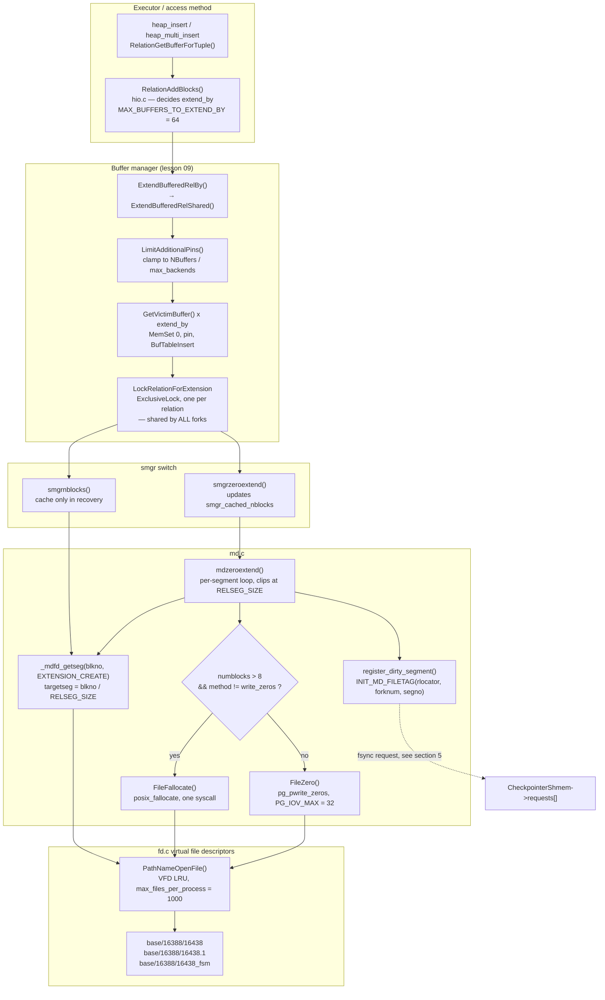
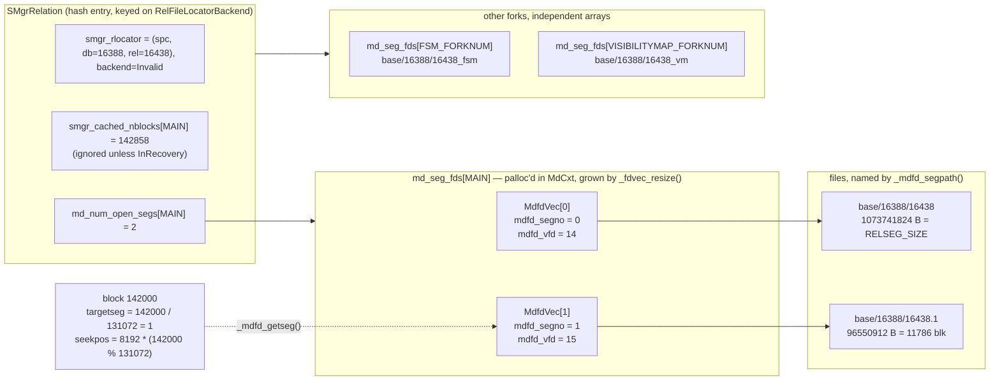
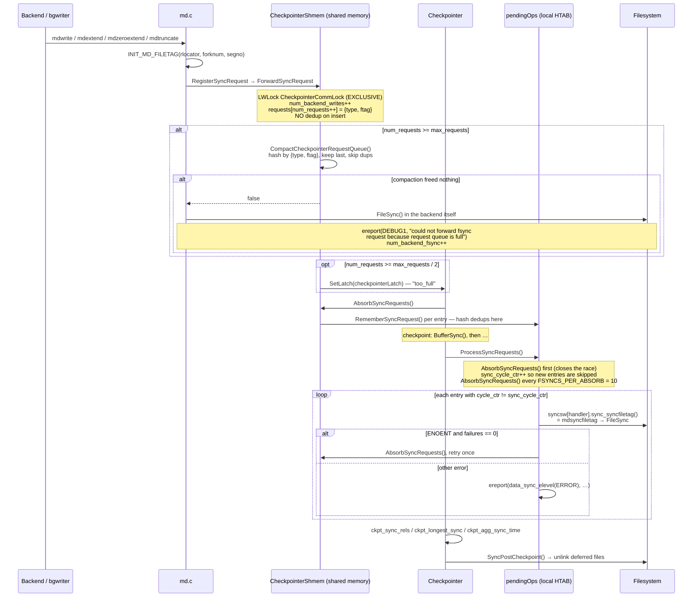

<!--
entry-meta
date: 2026-10-27
type: lesson
track: PostgreSQL
lesson: 08
category: Database Internals
title: smgr and md.c — Two lseeks to Measure a Relation, 2,860 Writes Collapsed Into 48 fallocates, and 40,800 Dirty Blocks That Cost 21 fsyncs
slug: postgres-smgr-md-segments-fsync-queue
-->

# `smgr` and `md.c` — Two `lseek`s to Measure a Relation, 2,860 Writes Collapsed Into 48 `fallocate`s, and 40,800 Dirty Blocks That Cost 21 `fsync`s

**2026-10-27 · PostgreSQL Track · Lesson 08 of 35**

Syllabus title: *`smgr` and `md.c`: relation extension, the segment map, and the fsync request queue.*

> **What was read.** `src/backend/storage/smgr/README` (52 lines, in full),
> `src/backend/storage/smgr/md.c` (1649 lines; `mdextend`, `mdzeroextend`, `mdnblocks`,
> `mdtruncate`, `mdimmedsync`, `_mdfd_getseg`, `_mdfd_openseg`, `_mdfd_segpath`, `_fdvec_resize`,
> `_mdnblocks`, `register_dirty_segment`, `register_unlink_segment`, `register_forget_request`,
> `mdsyncfiletag`, `mdunlinkfiletag`, `mdfiletagmatches`, and the 38-line header comment that
> states the on-disk segment invariant), `src/backend/storage/sync/sync.c` (624 lines; the
> `pendingOps`/`pendingUnlinks` declarations, `syncsw[]`, `ProcessSyncRequests`,
> `RegisterSyncRequest`, `SyncPostCheckpoint`), `src/include/storage/smgr.h` and
> `src/include/storage/sync.h` (in full), `ForwardSyncRequest` and the
> `CheckpointerShmemStruct` declaration in `src/backend/postmaster/checkpointer.c`,
> `RelationAddBlocks` in `src/backend/access/heap/hio.c`, `ExtendBufferedRelCommon` /
> `ExtendBufferedRelShared` / `LimitAdditionalPins` in `src/backend/storage/buffer/bufmgr.c`,
> `pg_pwrite_zeros` in `src/common/file_utils.c`, the `file_extend_method` entry in
> `src/backend/utils/misc/guc_tables.c`, `smgrDoPendingSyncs`/`AddPendingSync` in
> `src/backend/catalog/storage.c`, and the `smgrimmedsync` call site in
> `src/backend/access/nbtree/nbtsort.c`.
>
> **Which tree.** Same approach as lesson 07: the Debian/Ubuntu source package
> `postgresql-16` version `16.15-0ubuntu0.24.04.1`, obtained with `apt-get source`, which is the
> same build the measured cluster runs. Checked rather than assumed: of the 15 patches in
> `debian/patches/`, the files touched are `src/Makefile.global.in`,
> `src/backend/storage/buffer/bufmgr.c`, `src/backend/storage/ipc/procsignal.c`,
> `src/backend/tcop/postgres.c`, `src/backend/utils/activity/pgstat_database.c`,
> `src/bin/psql/settings.h`, `src/include/fe_utils/print.h`, `src/include/pg_config_manual.h`,
> `src/include/storage/procsignal.h`, `src/include/tcop/tcopprot.h` and `src/tutorial/README`.
> `md.c`, `smgr.c`, `sync.c`, `hio.c`, `checkpointer.c` and `fd.c` are untouched. `bufmgr.c` *is*
> patched — by `v8-0001-Fix-recovery-conflict-SIGUSR1-handling.patch` — but its single `bufmgr.c`
> hunk is at `LockBufferForCleanup()`, nowhere near the extension path quoted here.
>
> **Every number below was measured**, on PostgreSQL 16.15 (Ubuntu 16.15-0ubuntu0.24.04.1),
> x86_64, gcc 13.3.0, Linux 6.18, ext4, 2 vCPU / 8 GB RAM. `block_size` 8192,
> `segment_size` **131072** blocks, `wal_segment_size` 16 MB, `wal_level` `replica`,
> `max_wal_size` 1 GB, `checkpoint_timeout` 300 s, `fsync` **on**, `data_sync_retry` **off**,
> `max_files_per_process` **1000**, `file_extend_method` **`posix_fallocate`**,
> `shared_buffers` **128 MB** (16384 buffers) except where a measurement says otherwise.
> `data_checksums` off. Syscall traces are `strace -f -tt` attached to a named backend pid.

---

## Where This Fits

- **Lessons 01–07 all stopped at the same boundary.** Lesson 01 established that a relation lives
  at `base/<dboid>/<relfilenode>` with three forks and 1 GB segments, and then treated the thing
  that *produces* those files as given. Lesson 06's index-only-scan measurement and lesson 07's
  "+35 blocks" measurement both counted blocks appearing at the end of a relation without ever
  asking which syscall put them there.
  ([HOT Updates and Page Pruning &rarr;](../2026-10-26-postgres-hot-updates-page-pruning/README.md))
- **This lesson is that layer.** `smgr.c` is a one-entry function-pointer table; `md.c` is the only
  entry in it. Together they turn `(relfilelocator, forknum, blocknum)` into a file descriptor and
  an offset, and they are where the 1 GB segment boundary, the relation-extension batching, and
  the durability handoff to the checkpointer actually live.
- **Three debts from earlier lessons are closed here.** The 1 GB segment number, which lesson 01
  stated from `pg_settings` and never crossed; the claim that `_fsm` and `_vm` "grow independently"
  (lessons 05 and 06), which is a statement about `FileTag.forknum`; and the implicit assumption
  everywhere from lesson 02 onward that a write to a heap page eventually reaches disk — the
  mechanism for that is a hash table in the checkpointer, and this lesson counts its entries.
- **What it sets up.** Lesson 09 takes the buffer manager. `GetVictimBuffer()`,
  `BufferAccessStrategy` and the `bulkwrite` ring appear here only as named black boxes on the
  caller side of `ExtendBufferedRelShared()`; the clock sweep that answers "which buffer do I
  steal" is lesson 09's subject, not this one's. The line this lesson holds is: everything below
  `smgrextend`/`smgrzeroextend`/`smgrnblocks`, plus the extension decision immediately above them.

---

## 1. The switch that has one case

`smgr.c` exists to dispatch through a table of function pointers. The table has exactly one row.

```c
/* src/include/storage/smgr.h — the handle */
typedef struct SMgrRelationData
{
    RelFileLocatorBackend smgr_rlocator;        /* hashtable lookup key, must be first */
    struct SMgrRelationData **smgr_owner;
    BlockNumber smgr_targblock;                 /* current insertion target block */
    BlockNumber smgr_cached_nblocks[MAX_FORKNUM + 1];
    int         smgr_which;                     /* storage manager selector */
    int         md_num_open_segs[MAX_FORKNUM + 1];
    struct _MdfdVec *md_seg_fds[MAX_FORKNUM + 1];
    dlist_node  node;
} SMgrRelationData;
```

```c
/* src/backend/storage/smgr/md.c — the segment descriptor */
typedef struct _MdfdVec
{
    File        mdfd_vfd;       /* fd number in fd.c's pool */
    BlockNumber mdfd_segno;     /* segment number, from 0 */
} MdfdVec;
```

Facts worth fixing in place:

- **`smgrsw[]` has one element**, `[SMGR_MD]`, filled with 16 `md*` functions:
  `mdinit, mdopen, mdclose, mdcreate, mdexists, mdunlink, mdextend, mdzeroextend, mdprefetch,
  mdread, mdwrite, mdwriteback, mdnblocks, mdtruncate, mdimmedsync` and a NULL `smgr_shutdown`.
  The README is blunt about why the indirection survives: *"Removing the switch layer would save
  nothing noticeable anyway, since storage-access operations are surely far more expensive than
  one extra layer of C function calls."*
- **`smgropen()` does no I/O.** It creates or finds a hash-table entry keyed on
  `RelFileLocatorBackend`. `smgrclose()` destroys it. Opening a file happens lazily, inside `md.c`.
- **The private fields live in the public struct.** `md_num_open_segs[]` and `md_seg_fds[]` are
  declared in `smgr.h` with the comment *"Do not touch them from elsewhere"* — the segment map is
  per-fork state hanging off the shared handle, not a separate `md.c` structure.
- **`smgr_cached_nblocks` is only trusted in recovery.** `smgrnblocks_cached()` returns
  `InvalidBlockNumber` when not in recovery, with the reason stated in the comment: *"lack of a
  shared invalidation mechanism for changes in file size."* Measured consequence in §2.

### The layering, end to end



---

## 2. The segment map, measured

Build a relation that crosses the boundary and look at it.

```
l8=# INSERT INTO seg SELECT i, repeat('x', 1000) FROM generate_series(1, 1000000) i;
Time: 5633.254 ms
 path             | bytes      | blocks | gb
 base/16388/16438 | 1170292736 | 142858 | 1.090
```

On disk:

| file | bytes | blocks | what it is |
|---|---|---|---|
| `base/16388/16438` | **1,073,741,824** | **131,072** | segment 0 — exactly `RELSEG_SIZE` |
| `base/16388/16438.1` | 96,550,912 | 11,786 | the partial segment |
| `base/16388/16438_fsm` | 311,296 | 38 | FSM fork (lesson 05) |
| `base/16388/16438_vm` | — | — | absent; never vacuumed yet |

`131072 + 11786 = 142858`, which is `pg_relation_size('seg') / 8192` exactly. The invariant stated
in `md.c`'s header comment — *zero or more full segments of exactly `RELSEG_SIZE` blocks, then
exactly one partial segment, then optionally any number of inactive zero-length segments* — is
visible in two `ls` lines.

A detail `ls -l` hides: `stat` reports segment 0 as 2,097,160 blocks of 512 bytes =
**1,073,745,920** bytes allocated, 4,096 bytes *more* than its apparent size. That is ext4 extent
metadata, not PostgreSQL.

### `mdnblocks()` is two syscalls, and they are in the trace

Attach `strace` to a fresh backend and run `SELECT count(*) FROM seg`:

```
1198  03:39:34.857058 openat(AT_FDCWD, "base/16388/16438",   O_RDWR|O_CLOEXEC) = 14
1198  03:39:34.858471 lseek(14, 0, SEEK_END)                = 1073741824
1198  03:39:34.858488 openat(AT_FDCWD, "base/16388/16438.1", O_RDWR|O_CLOEXEC) = 15
1198  03:39:34.858506 lseek(15, 0, SEEK_END)                = 96550912
...
1198  03:39:37.612889 lseek(15, 0, SEEK_END)                = 96550912
```

Read that against the loop:

- `mdopenfork(EXTENSION_FAIL)` opens segment 0 → fd 14.
- `_mdnblocks()` is `lseek(SEEK_END) / BLCKSZ`. It returns 131072, **equal** to `RELSEG_SIZE`, so
  the loop does not return — it advances `segno` and calls `_mdfd_openseg(reln, fork, 1, 0)`.
  Note the deliberate absence of `O_CREAT`: the comment says passing it *"might create a segment
  which has vanished through some operating system misadventure"* and would defeat `_mdfd_getseg`'s
  missing-segment error.
- fd 15's `lseek` returns 11,786 blocks, **less than** `RELSEG_SIZE`, so
  `mdnblocks` returns `1 * 131072 + 11786`.
- Elapsed: **1.45 ms** for two opens and two `lseek`s. Both fds stay in
  `md_seg_fds[MAIN_FORKNUM][0..1]`; `md_num_open_segs[MAIN_FORKNUM]` is now 2.
- **The last line is the point about caching.** Three seconds later the same backend calls
  `lseek(15, 0, SEEK_END)` again for the same answer. `smgrnblocks_cached()` refused to serve it
  because the process is not in recovery. Relation size is a `fstat`-class syscall on *every*
  `smgrnblocks()` call outside recovery.



Three things that array gets right, and one it gives up:

- **`_fdvec_resize()` never shrinks.** On truncation it leaves the array oversized, deliberately,
  *"because we want `mdtruncate()` to be able to promise that it won't allocate memory, so that it
  is allowed in a critical section."* Wasted bytes bought a critical-section guarantee.
- **Segments open strictly in order.** `_mdfd_openseg()` asserts
  `segno == reln->md_num_open_segs[forknum]`. There is no sparse map.
- **`_mdfd_getseg()` pads.** When extending into segment *N* while segment *N−1* is short, it calls
  `mdextend()` on the last block of *N−1* with a zero buffer first, to maintain the
  all-full-segments invariant. The comment notes this matters *"if in recovery, or if the caller is
  extending the relation discontiguously, but that can happen in hash indexes."*
- **What it gives up:** `md_num_open_segs` is not a count of segments that exist. The header
  comment says so — *"a fork's `md_num_open_segs` having a specific value does not necessarily mean
  the relation doesn't have additional segments"* — because another backend can extend the relation
  while this one isn't looking. It is a cache, not a census.

---

## 3. Relation extension: the same 20,000 rows, four syscall shapes

This is the part that is invisible from SQL and obvious from `strace`. Identical data, identical
schema (`id int, pad text`, 1,000-byte payload), four configurations.

| # | how | extension syscalls | batch sizes (blocks) | relation blocks |
|---|---|---|---|---|
| 1 | `INSERT … SELECT generate_series` | **2,860** `pwritev`, 0 `fallocate` | 1, 1, 1, … | 2,858 |
| 2 | `COPY … FROM` | **48** `fallocate`, 1 `pwritev` | 10, 10, 20, 40, 64, 64, … | 2,896 |
| 3 | `COPY`, `file_extend_method=write_zeros` | 0 `fallocate`, **97** `pwritev` | same ramp, split at 32 | 2,896 |
| 4 | `COPY`, `shared_buffers=128kB` | **2,861** `pwritev`, 0 `fallocate` | 1, 1, 1, … | 2,858 |

### Row 1 — no `BulkInsertState`, no batching

```
pwritev(35, [{iov_base="\0\0…", iov_len=8192}], 1, 0)
pwritev(35, [{iov_base="\0\0…", iov_len=8192}], 1, 8192)
pwritev(35, [{iov_base="\0\0…", iov_len=8192}], 1, 16384)
```

2,860 of these for 2,858 blocks. `RelationAddBlocks()` computed `extend_by_pages = num_pages = 1`
because `INSERT … SELECT` into an existing table carries no `BulkInsertState`, and
`RelationExtensionLockWaiterCount()` returned 0 with one writer. `numblocks > 8` is false, so
`mdzeroextend` took the `FileZero` branch with a single-entry iovec. One extension lock
acquire/release, one `smgrnblocks` (hence one `lseek`), one `pwritev`, per block.

One oddity in that trace worth naming, because it is the FSM fork and not the heap:

```
pwritev(36, [{8192}, {8192}, {8192}], 3, 0)
```

Three blocks in one call at offset 0 — `fsm_extend()` going through `ExtendBufferedRelTo()` to
create the FSM fork's three-level tree in one shot (lesson 05's structure, now with its syscall).

### Row 2 — `BulkInsertState`, and the ramp

`COPY` holds a `BulkInsertState`. The offsets and lengths, in order:

```
fallocate(23, 0,        0,  81920)   →  10 blocks
fallocate(23, 0,    81920,  81920)   →  10
fallocate(23, 0,   163840, 163840)   →  20
fallocate(23, 0,   327680, 327680)   →  40
fallocate(23, 0,   655360, 524288)   →  64   ← MAX_BUFFERS_TO_EXTEND_BY
fallocate(23, 0,  1179648, 524288)   →  64
…44 more at 524288…
```

That ramp is `hio.c` arithmetic, exactly:

```c
extend_by_pages  = num_pages;                                   /* pages this call needs */
extend_by_pages += extend_by_pages * waitcount;                 /* help the queue */
if (bistate)
    extend_by_pages = Max(extend_by_pages, bistate->already_extended_by);
extend_by_pages  = Min(extend_by_pages, MAX_BUFFERS_TO_EXTEND_BY);   /* 64 */
…
bistate->already_extended_by += extend_by_pages;                /* accumulates */
```

With `num_pages = 10` (what `heap_multi_insert` needs for one `COPY` batch of 1,000-byte rows under
`copyfrom.c`'s `MAX_BUFFERED_BYTES`) and `waitcount = 0`:
`already_extended_by` runs 0 → 10 → 20 → 40 → 80, so the `Max()` yields 10, 10, 20, 40, 80, and the
`Min()` clamps the last to 64 forever after. The measured sequence is that series, not an
approximation of it.

**48 syscalls instead of 2,860 — a 60× reduction in extension syscalls for the same table.**

### Row 3 — the `file_extend_method` GUC

This build carries a `file_extend_method` enum GUC (`PGC_SIGHUP`, `RESOURCES_DISK`,
default `posix_fallocate`, alternative `write_zeros`, the `posix_fallocate` option itself compiled
in only `#ifdef HAVE_POSIX_FALLOCATE`). Set it to `write_zeros`, re-run the identical `COPY`:

```
pwritev iovcnt=10 off=0
pwritev iovcnt=10 off=81920
pwritev iovcnt=20 off=163840
pwritev iovcnt=32 off=327680      ┐ the 40-block extension,
pwritev iovcnt=8  off=589824      ┘ split 32 + 8
pwritev iovcnt=32 off=655360      ┐ the 64-block extension,
pwritev iovcnt=32 off=917504      ┘ split 32 + 32
```

The ramp is identical — it is decided in `hio.c`, above `md.c`, and does not depend on the method.
What changes is the bottom: `pg_pwrite_zeros()` loops `for (; iovcnt < PG_IOV_MAX && remaining_size
> 0; iovcnt++)`, and `PG_IOV_MAX` is `Min(IOV_MAX, 32)`. Every iovec in the call points at the
*same* `static const PGIOAlignedBlock zbuffer` of `BLCKSZ` — one 8 kB page of zeros, aimed at 32
times.

### Row 4 — the clamp nobody expects

Restart with `shared_buffers = 128kB` (16 buffers) and run the *same* `COPY` that produced 48
`fallocate` calls:

```
### fallocate lengths: (none)
### pwritev iovcnt distribution:
   2861 1
```

Bulk extension vanished. `ExtendBufferedRelShared()` calls `LimitAdditionalPins()` first, and that
function computes `max_proportional_pins = NBuffers / (MaxBackends + NUM_AUXILIARY_PROCS)`, then
subtracts `PrivateRefCountOverflowed + REFCOUNT_ARRAY_ENTRIES`, then floors at 1. With 16 buffers
and `max_connections = 100`, the quotient is 0 and the floor is what is left. **Extension batching
is a function of `shared_buffers` divided by `max_connections`**, because the extending backend has
to pin every new buffer at once. Nobody tunes `shared_buffers` for that reason, and the extension
path silently degrades to one block per syscall when the ratio is wrong.

### What it costs: 38 blocks

Rows 2 and 3 produced **2,896** blocks for the same 20,000 rows that rows 1 and 4 fit in **2,858**
— 38 blocks, 1.3%, of permanent slack. Bulk extension over-extends by design and hands the surplus
to the FSM (`not_in_fsm_pages`, then `FreeSpaceMapVacuumRange`) or to `bistate->next_free`. Pages
handed over at the end of a `COPY` that then ends are simply empty pages in the relation.

### And what it does *not* cost: wall time

Five `COPY` runs of a 97 MB CSV (100,000 rows, 14,288 blocks) per method:

| method | run times (ms) | median |
|---|---|---|
| `posix_fallocate` | 689, 612, 632, 638, 711 | **638** |
| `write_zeros` | 670, 643, 640, 670, 731 | **670** |

**No difference outside noise.** `md.c`'s comment claims `posix_fallocate` *"commonly won't cause
the kernel to allocate page cache space for the extended pages"*, and that claim is measurable, but
not in wall time on ext4 with a warm cache. Where it does show up is `/proc/<pid>/io`:

| method | relation bytes | backend `write_bytes` | ratio |
|---|---|---|---|
| `posix_fallocate` | 117,047,296 | 197,615,616 | 1.688 |
| `write_zeros` | 117,047,296 | 219,070,464 | 1.872 |

**+21,454,848 bytes (+10.9%) charged to the backend** for choosing `write_zeros`. Note that the
zero writes *nominally* total 117 MB — one full pass over the relation — and only ~21 MB of them
survive to be charged as writeback, because the real data overwrites the same page-cache pages
first. This is an honest limit of the measurement: `write_bytes` counts bytes attributed to the
process at the storage layer, so it cannot separate 117 MB of WAL from heap writeback. The
direction and rough magnitude are solid; a precise attribution would need `blktrace` or a
cold-cache run, neither of which was done.

### `pg_stat_io` sees blocks, not syscalls

Same `COPY`, after `pg_stat_reset_shared('io')`:

```
 backend_type   | object   | context   | extends | fsyncs | writes | evictions
 client backend | relation | bulkwrite |   14288 |        |  12240 | 0
 client backend | relation | normal    |       6 |      0 |      0 | 0
```

`extends = 14288` equals the relation's block count exactly, because
`pgstat_count_io_op_time(IOOBJECT_RELATION, io_context, IOOP_EXTEND, io_start, extend_by)` counts
*blocks*. Those 14,288 blocks were 224 `fallocate` calls. **`pg_stat_io` cannot show you the
batching; only `strace` can.** The `bulkwrite` context is `COPY`'s `BAS_BULKWRITE` ring (lesson 09);
the 6 `normal` extends are the FSM fork, extended without a strategy.

---

## 4. `skipFsync`: the flag that transfers a debt

Every write-ish entry point in `md.c` ends the same way:

```c
if (!skipFsync && !SmgrIsTemp(reln))
    register_dirty_segment(reln, forknum, v);
```

`skipFsync = true` is not "this does not need fsyncing". It means **the caller promises to fsync it
itself**. The clearest proof is a measurement that looks like a bug until you find the call site.

Four plain `CREATE TABLE q (id int, pad text)` statements, traced, produced exactly four `fsync()`
syscalls in the *client backend*:

```
1740  03:42:59.304080 openat(AT_FDCWD, "base/16388/16528",   O_RDWR|O_CREAT|O_EXCL|O_CLOEXEC, 0600) = 49
1740  03:42:59.310226 openat(AT_FDCWD, "base/16388/16528.1", O_RDWR|O_CLOEXEC) = -1 ENOENT (No such file or directory)
1740  03:42:59.310328 fsync(49)                                                = 0
```

Two questions, two answers:

- **Why does it try to open `.1` on a brand-new zero-block relation?** Because this is
  `mdimmedsync()`, not `mdnblocks()`. After calling `mdnblocks()`, `mdimmedsync` runs
  `while (_mdfd_openseg(reln, forknum, segno, 0) != NULL) segno++;` — it deliberately probes past
  the last active segment to catch *inactive* ones. The `ENOENT` on `.1` is that probe. `mdnblocks`
  alone would never have opened it, because segment 0 is shorter than `RELSEG_SIZE`.
- **What are those four relations?**

```
 16528 | pg_toast_16524_index | i
 16533 | pg_toast_16529_index | i
 16538 | pg_toast_16534_index | i
 16543 | pg_toast_16539_index | i
```

The TOAST **indexes**. `CREATE TABLE` with a `text` column creates a TOAST table and its btree
index; `nbtsort.c` builds btrees *outside* shared buffers (`smgrextend(..., skipFsync=true)` on
every page), so nothing registered them with the checkpointer, and `_bt_leafbuild()` ends with:

```c
/*
 * When we WAL-logged index pages, we must nonetheless fsync index files.
 * Since we're building outside shared buffers, a CHECKPOINT occurring
 * during the build has no way to flush the previously written data to
 * disk (indeed it won't know the index even exists). …
 */
if (wstate->btws_use_wal)
    smgrimmedsync(RelationGetSmgr(wstate->index), MAIN_FORKNUM);
```

**Four empty TOAST indexes cost four real `fsync`s, synchronously, in the user's backend.** Not
because the data mattered — they are empty — but because `skipFsync` moved the obligation and
nothing else could discharge it.

For completeness on a path that is *not* taken here: `AddPendingSync()` in `storage.c` is guarded by
`if (relpersistence == RELPERSISTENCE_PERMANENT && !XLogIsNeeded())`, so the
`smgrDoPendingSyncs()` / `wal_skip_threshold` machinery is dead code at `wal_level = replica`.
Verified by reading the guard, not by measurement.

---

## 5. The fsync request queue

The normal path does not fsync. It files a note.

```c
/* src/include/storage/sync.h */
typedef struct FileTag
{
    int16          handler;     /* SyncRequestHandler value, saving space */
    int16          forknum;     /* ForkNumber, saving space */
    RelFileLocator rlocator;
    uint32         segno;
} FileTag;
```

That struct is the whole design. `register_dirty_segment()` fills one with
`INIT_MD_FILETAG(tag, rlocator, forknum, seg->mdfd_segno)` and calls `RegisterSyncRequest()`.



Numbers that are code, not folklore:

- **`max_requests = Min(NBuffers, MAX_CHECKPOINT_REQUESTS)`** where `MAX_CHECKPOINT_REQUESTS` is
  `10000000`. At the measured `shared_buffers = 128MB` that is **16,384** request slots; at the
  128 kB configuration of §3 row 4 it is **16**. Derived from `checkpointer.c:912`, not observed —
  no SQL or log output exposes it.
- **`FSYNCS_PER_ABSORB = 10`**, `UNLINKS_PER_ABSORB = 10`.
- **The nudge is at half full**: `too_full = (num_requests >= max_requests / 2)`, and the
  `SetLatch` happens *after* `LWLockRelease`, deliberately.
- **Four request types** share one queue: `SYNC_REQUEST`, `SYNC_UNLINK_REQUEST`,
  `SYNC_FORGET_REQUEST`, `SYNC_FILTER_REQUEST`. `mdunlink` queues a *forget* before unlinking, which
  is what makes `ProcessSyncRequests`' "absorb and retry once on `ENOENT`" sound rather than hopeful.
- **Six handlers** share it too: `SYNC_HANDLER_MD`, `_CLOG`, `_COMMIT_TS`,
  `_MULTIXACT_OFFSET`, `_MULTIXACT_MEMBER`, `_NONE`. `sync.c` knows nothing about relations; the
  `FileTag` comment says it *"has the members required for md.c's usage, but sync.c has no knowledge
  of the internal structure."*
- **`retryOnError`** differs by caller, and the difference is a durability argument:
  `register_dirty_segment` passes **false** (fall back to a local fsync; a lost slot costs
  latency), `register_unlink_segment` and `register_forget_request` pass **true** (spin on
  `WaitLatch(…, 10 ms)` forever), because dropping an unlink leaks a file.

### What is actually in `pendingOps`, printed

`log_checkpoints` is on by default; raising `log_min_messages` to `debug1` makes
`ProcessSyncRequests()` print one line per entry it fsyncs. That is a direct dump of the
checkpointer's hash table.

`CHECKPOINT` to drain, then two UPDATEs chosen by `ctid` to hit one block in each segment of the
two-segment relation, then `CHECKPOINT`:

```sql
UPDATE seg SET id = id WHERE ctid = '(0,1)';        -- block 0        → segment 0
UPDATE seg SET id = id WHERE ctid = '(131072,1)';   -- block 131072   → segment 1
```

```
checkpoint sync: number=1 file=base/16388/16438   time=0.421 ms
checkpoint sync: number=2 file=base/16388/16438.1 time=0.125 ms
checkpoint sync: number=3 file=pg_xact/0000       time=0.138 ms
checkpoint complete: wrote 4 buffers (0.0%); … sync files=3, longest=0.001 s, average=0.001 s
```

Three facts in four lines:

1. **One relation, two entries.** `segno` is part of the key, so a relation that spans *N* segments
   costs up to *N* fsyncs per checkpoint even if you dirtied one block in each.
2. **`pg_xact/0000` is in the same queue**, filed by `SYNC_HANDLER_CLOG` through the same
   `RegisterSyncRequest`. The queue is not a heap-storage feature.
3. `sync files=3` in the summary line *is* `CheckpointStats.ckpt_sync_rels`, which is
   `ProcessSyncRequests`' local `processed` counter — so that familiar log line has always been a
   count of `pendingOps` entries.

### Dedup: 40,800 writes, 21 fsyncs

Drain, then `CREATE TABLE dedup` + `INSERT` 60,000 rows + two full `UPDATE`s (22,500 blocks), then
`CHECKPOINT`:

| counter | value |
|---|---|
| `buffers_backend` (before the checkpoint) | 24,490 |
| `buffers_clean` (bgwriter) | 100 |
| `buffers_checkpoint` + this checkpoint's `wrote` | 3 + 16,214 |
| **total block writes** | **≈ 40,800** |
| `sync files=` | **21** |
| `longest=` | 0.083 s |

The entry list:

```
number=1  file=base/16388/2659        time=82.894 ms   ← a catalog index
number=9  file=base/16388/16544       time=59.153 ms   ← dedup's heap, all 22,500 blocks
number=10 file=base/16388/16544_fsm   time= 0.524 ms   ← separate entry: forknum is in the key
number=21 file=pg_xact/0000           time= 0.171 ms
…18 more catalog relations touched by the DDL…
```

**≈40,800 writes collapsed into 21 `fsync` calls, ≈1,940:1.** The heap's 22,500 blocks, written and
rewritten three times, are *one* hash entry, fsynced once, in 59 ms. The `_fsm` fork of the same
relation is a *different* entry, because `forknum` is a key field — which is the mechanical
justification for "forks can be grown and truncated independently" that the `smgr/README` claims
and that lessons 05 and 06 relied on.

`buffers_backend_fsync` stayed **0** throughout every configuration measured, including a run with
`shared_buffers = 128kB` that produced **57,987** backend writes against a **16-slot** queue. That
is the system working as designed rather than a weak test: those 57,987 writes targeted only a
handful of distinct segments, so `CompactCheckpointerRequestQueue()` — which hashes
`{type, ftag}` and keeps only the last occurrence of each — can always collapse a 16-entry queue of
near-duplicates, and `ForwardSyncRequest` therefore never has to return `false`. The theoretical
failure requires a queue that is both full *and* duplicate-free.

> **One experiment failed, and is reported rather than patched over.** The attempt to force
> `buffers_backend_fsync > 0` by `SIGSTOP`ping the checkpointer deadlocked instead: with the
> checkpointer stopped, the inserting backend hit `max_wal_size` and waited for a checkpoint that
> could never start. The run was abandoned and the checkpointer resumed. **The queue-full fallback
> path in `register_dirty_segment()` was read in the source but never executed here.**

---

## 6. Inactive segments: a file that exists and has no blocks

`md.c`'s header comment permits *"optionally, any number of inactive segments of size 0 blocks"*
and explains why they are not unlinked: *"other backends and/or the checkpointer might be holding
open file references to such segments. If the relation expands again after `mdtruncate()`, such
that a deactivated segment becomes active again, it is important that such file references still
be valid --- else data might get written out to an unlinked old copy of a segment file."*

Produce one:

```
l8=# DELETE FROM seg WHERE ctid >= '(100000,1)';
l8=# VACUUM (VERBOSE) seg;
INFO:  table "seg": truncated 142858 to 100000 pages
       pages: 42858 removed, 100000 remain, 142858 scanned (100.00% of total)
       tuples: 300002 removed, 699999 remain
       index scan not needed: 42859 pages from table (30.00% of total) had 300003 dead item identifiers removed
```

| file | before | after |
|---|---|---|
| `base/16388/16438` | 1,073,741,824 | **819,200,000** (= 100,000 × 8192) |
| `base/16388/16438.1` | 96,550,912 | **0 — and still present** |
| `base/16388/16438_fsm` | 311,296 | 221,184 |
| `base/16388/16438_vm` | absent | 32,768 (4 blocks, created by this first VACUUM) |

`mdtruncate()` did that in the branch where `priorblocks > nblocks`:

```c
/* This segment is no longer active. We truncate the file, but do
 * not delete it, for reasons explained in the header comments. */
if (FileTruncate(v->mdfd_vfd, 0, WAIT_EVENT_DATA_FILE_TRUNCATE) < 0) …
if (!SmgrIsTemp(reln))
    register_dirty_segment(reln, forknum, v);   /* yes — truncation is a dirty segment */
Assert(v != &reln->md_seg_fds[forknum][0]);     /* we never drop the 1st segment */
FileClose(v->mdfd_vfd);
_fdvec_resize(reln, forknum, curopensegs - 1);
```

Note that `register_dirty_segment` is called on a *truncation*: the fsync queue carries "this file
got shorter" with the same `FileTag` as "this file got written".

And the zero-length segment is invisible to the layer above. A fresh backend, `strace`d,
`SELECT count(*) FROM seg`:

```
2053  03:54:33.019768 openat(AT_FDCWD, "base/16388/16438", O_RDWR|O_CLOEXEC) = 30
2053  03:54:33.019791 lseek(30, 0, SEEK_END)                                 = 819200000
2053  03:54:33.089524 lseek(30, 0, SEEK_END)                                 = 819200000
```

Zero references to `16438.1` in the entire trace. 100,000 < `RELSEG_SIZE`, so `mdnblocks` returns
on the first iteration and never probes further. The file is on disk, it is in nobody's
`md_seg_fds`, and only `mdimmedsync` — with its explicit probe loop — would find it.

There is one subtlety the comment flags and this measurement did not reach: truncating to an exact
multiple of `RELSEG_SIZE` leaves *segment K+1 at length 0 and kept*, rather than leaving K
segments. Deriving that from the `priorblocks + RELSEG_SIZE > nblocks` branch is easy; observing it
needs a relation truncated to exactly 131,072 blocks, which was not done.

---

## Hands-On

A 16.x cluster you can restart. All of this is `strace` plus the server log; nothing needs a
debugger or a rebuild.

### 1. Make `mdnblocks` walk, and watch it

```bash
psql -c "CREATE TABLE seg (id int, pad text)"
psql -c "INSERT INTO seg SELECT i, repeat('x',1000) FROM generate_series(1,1000000) i"
psql -tAc "SELECT pg_relation_filepath('seg'), pg_relation_size('seg')/8192"
ls -l "$PGDATA/$(psql -tAc "SELECT pg_relation_filepath('seg')")"*
```

Then, in one session:

```sql
SELECT pg_backend_pid();
```

and from a shell, against that pid, while the session runs `SELECT count(*) FROM seg`:

```bash
strace -f -tt -p <pid> -e trace=openat,lseek,close -o /tmp/scan.txt
grep -E 'openat.*<relfilenode>|lseek' /tmp/scan.txt
```

**What to look for.** Exactly two `openat`s and two `lseek(…, SEEK_END)`s, the first returning
`1073741824` and the second something smaller. That pair *is* `mdnblocks`'s loop condition. If you
see the `SEEK_END` repeat later in the same session for the same fd, you have proved that
`smgr_cached_nblocks` is not used outside recovery — which means every `smgrnblocks()` in a normal
backend is a syscall.

### 2. Make the extension batching appear and disappear

Same `strace`, syscalls `fallocate,pwritev`, three runs on identical data:

```sql
-- (a) no BulkInsertState
CREATE TABLE a (id int, pad text);
INSERT INTO a SELECT i, repeat('y',1000) FROM generate_series(1,20000) i;

-- (b) BulkInsertState
COPY (SELECT i, repeat('z',1000) FROM generate_series(1,20000) i) TO '/tmp/d.csv' CSV;
CREATE TABLE b (id int, pad text);
COPY b FROM '/tmp/d.csv' CSV;
```

```bash
grep -oE 'fallocate\([0-9]+, [0-9]+, [0-9]+, [0-9]+\)' /tmp/t.txt   # (b)
grep -c 'pwritev('                                     /tmp/t.txt   # (a)
```

**What to look for.** In (a), one `pwritev` of one 8 kB iovec per block. In (b), the length sequence
`81920, 81920, 163840, 327680, 524288, 524288, …` — that is `already_extended_by` accumulating
10 → 20 → 40 → 80 and clamping at `MAX_BUFFERS_TO_EXTEND_BY`. Then two levers:

```sql
ALTER SYSTEM SET file_extend_method = 'write_zeros';  SELECT pg_reload_conf();
```

The ramp survives; `fallocate` becomes `pwritev` with `iovcnt` capped at 32 (`PG_IOV_MAX`), so a
64-block extension splits 32 + 32. And:

```sql
ALTER SYSTEM SET shared_buffers = '128kB';  -- then restart
```

The ramp *dies*: back to `iovcnt=1`, one block per syscall, because `LimitAdditionalPins()` reduced
`extend_by` to `NBuffers / max_backends` and floored it at 1. Compare `pg_relation_size` across the
three runs: the bulk-extending ones are a little larger. That difference is the price.

### 3. Print the checkpointer's `pendingOps` hash

```sql
CHECKPOINT;                                     -- drain it first
ALTER SYSTEM SET log_min_messages = 'debug1';  SELECT pg_reload_conf();
UPDATE seg SET id = id WHERE ctid = '(0,1)';
UPDATE seg SET id = id WHERE ctid = '(131072,1)';
CHECKPOINT;
ALTER SYSTEM SET log_min_messages = 'warning'; SELECT pg_reload_conf();
```

```bash
grep -oE 'checkpoint sync: number=[0-9]+ file=[^ ]+ time=[0-9.]+ ms' postgresql-16-main.log
```

**What to look for.** One line per `FileTag` in the hash, with its real path — `.1` suffixes and
`_fsm`/`_vm` forks appear as *separate* entries, and `pg_xact/0000` shows up filed by a non-md
handler. Then check the arithmetic: the `sync files=N` in `checkpoint complete` equals the number of
lines, and `longest=` equals the largest `time=`. That proves `sync files` has always been
"entries in `pendingOps`", not "relations in the database".

### 4. Prove the dedup ratio

```sql
CHECKPOINT;
SELECT pg_stat_reset_shared('bgwriter');
CREATE TABLE d (id int, pad text) WITH (autovacuum_enabled=off);
INSERT INTO d SELECT i, repeat('q',900) FROM generate_series(1,60000) i;
UPDATE d SET id = id + 1;
UPDATE d SET id = id + 1;
SELECT buffers_checkpoint, buffers_clean, buffers_backend, buffers_backend_fsync
  FROM pg_stat_bgwriter;
CHECKPOINT;
```

**What to look for.** `buffers_backend` in the tens of thousands, `sync files=` in the tens, and
`buffers_backend_fsync = 0`. Divide. Then try to break it: the fallback in
`register_dirty_segment()` needs a queue that is full *and* free of duplicates — with
`max_requests = Min(NBuffers, 10000000)` and a half-full latch nudge, the realistic way there is
many distinct segments at once (hundreds of partitions, say), not many writes. Do **not** try
`SIGSTOP` on the checkpointer: it deadlocks on `max_wal_size` instead, as this lesson found out.

### 5. Find the `skipFsync` debt

```bash
strace -f -tt -p <pid> -e trace=fsync,openat -o /tmp/f.txt
```

```sql
CREATE TABLE t1 (id int, pad text);   -- a text column ⇒ TOAST table ⇒ TOAST btree index
```

**What to look for.** An `fsync` in your *own* backend, on a relfilenode that
`SELECT relname, relkind FROM pg_class WHERE pg_relation_filepath(oid) = '…'` reports as
`pg_toast_*_index`. Then drop the `text` column from the DDL and watch it vanish. That single
syscall is `nbtsort.c` paying back the `skipFsync=true` it passed to `smgrextend` on every page it
wrote outside shared buffers.

### 6. Create an inactive zero-length segment

```sql
DELETE FROM seg WHERE ctid >= '(100000,1)';
VACUUM (VERBOSE) seg;      -- look for: truncated 142858 to 100000 pages
```

```bash
ls -l "$PGDATA/base/<db>/<relfilenode>"*
```

**What to look for.** A `.1` file of size **0** that still exists, and a segment 0 of exactly
`nblocks × 8192`. Then `strace` a fresh backend scanning the table: `.1` is never opened. You are
looking at a file that is part of the relation on disk and absent from the relation's in-memory
segment map — the only code that will ever open it again is `mdimmedsync()` or a re-extension past
block 131,072.

---

## Where This Breaks Down

- **`smgrnblocks()` is a syscall, every time, outside recovery.** `smgr_cached_nblocks` exists and
  is deliberately ignored, because there is no shared invalidation for fork size. Every relation
  extension takes the extension lock and then does an `lseek`; every `ExtendBufferedRelShared`
  does one. The comment in `smgr.h` names the missing piece: *"there is no cache invalidation for
  fork extension."*
- **One extension lock per relation, shared by all forks.** `ExtendBufferedRelShared` says so
  outright: *"We use the same extension lock for all forks. That's unnecessarily restrictive, but
  currently extensions for forks don't happen often enough to make it worth locking more
  granularly."* Extending the FSM blocks extending the heap.
- **Bulk extension trades space for syscalls, permanently.** The measured cost was 38 blocks (1.3%)
  on a 20,000-row table. On a workload of many short `COPY`s into many tables, that slack is
  per-table and is only reclaimed by a `VACUUM` that can truncate.
- **Extension batching depends on `shared_buffers / max_connections`.** Measured: 16 buffers with
  `max_connections=100` reduces a 64-block extension to 1 block. The relationship is in
  `LimitAdditionalPins()` and is documented nowhere a DBA would look.
- **`fallocate` buys page-cache behaviour, not latency.** Measured: no wall-clock difference across
  five runs each; ~11% more bytes charged to the backend with `write_zeros`. If you are choosing
  `file_extend_method` for throughput on a cached ext4 volume, you are tuning noise. The md.c
  comment itself hedges: *"Not clear where that decision should be made though? For now just use a
  cutoff of 8, anything between 4 and 8 worked OK in some local testing."* That is the actual
  provenance of the `numblocks > 8` threshold.
- **Segment count is an fsync multiplier.** `FileTag.segno` means a 100 GB relation is 100
  potential `pendingOps` entries per checkpoint, and the checkpointer fsyncs them serially in hash
  order. The measured spread was 0.095 ms to 82.894 ms per file; `ckpt_longest_sync` is a single
  file's `fsync`, and nothing bounds it.
- **A failed `fsync` at checkpoint is not recoverable in place.** `ProcessSyncRequests` allows
  `ENOENT` exactly once per file and then calls `ereport(data_sync_elevel(ERROR), …)`, which is
  `PANIC` unless `data_sync_retry = on` — and turning it on requires a filesystem that reliably
  retains dirty data after a reported error, which Linux does not generally promise. That is the
  2018 "fsync gate" and it is still the design: on a write-back error the only safe move is to
  crash and recover from WAL.
- **The queue's robustness depends on duplicates.** `CompactCheckpointerRequestQueue` is what keeps
  `buffers_backend_fsync` at zero, and it only helps when the queue holds repeats. A workload with
  thousands of distinct hot segments and a small `shared_buffers` is the shape that defeats it; the
  fallback is a synchronous `fsync` inside a user backend, logged only at `DEBUG1`.
- **`md.c` is 1,649 lines standing between PostgreSQL and every filesystem bug.** The `existing_id
  >= 0` branch in `ExtendBufferedRelShared` carries
  `errhint("This has been seen to occur with buggy kernels; consider updating your system.")` for
  the case where `lseek(SEEK_END)` disagreed with a recent write. The storage manager's job
  includes not trusting the kernel.

---

## Further Study

- [`bufmgr: Introduce infrastructure for faster relation extension`](https://www.postgresql.org/message-id/E1pkDKV-001ZVp-Tk%40gemulon.postgresql.org) — the commit that created `ExtendBufferedRelBy`/`ExtendBufferedRelTo`; the message explains why victim buffers are acquired before the extension lock.
- [`hio: Take number of prior relation extensions into account`](https://www.postgresql.org/message-id/E1qVclu-0007yD-MU%40gemulon.postgresql.org) — the commit that added `bistate->already_extended_by`, i.e. the exact ramp measured in §3.
- [`v6-0006-Add-smgrzeroextend-FileZero-FileFallocate.patch`](https://postgresql.org/message-id/attachment/145792/v6-0006-Add-smgrzeroextend-FileZero-FileFallocate.patch) — the patch that introduced `smgrzeroextend`, `FileZero` and `FileFallocate`, with the `>8` cutoff as submitted.
- [Thread: `pgsql: bufmgr: Introduce infrastructure for faster relation extension`](https://www.postgrespro.com/list/thread-id/2645112) — the review discussion around that commit.
- [`md.c` in doxygen](https://doxygen.postgresql.org/md_8c_source.html) and [`struct _MdfdVec`](https://doxygen.postgresql.org/struct__MdfdVec.html) — line-numbered master-branch cross-reference for everything quoted here.
- [`sync.c` in doxygen](https://doxygen.postgresql.org/sync_8c_source.html), [`sync.h`](https://doxygen.postgresql.org/sync_8h_source.html), [`struct CheckpointerShmemStruct`](https://doxygen.postgresql.org/structCheckpointerShmemStruct.html), [`struct CheckpointerRequest`](https://doxygen.postgresql.org/structCheckpointerRequest.html) — the queue, as the project publishes it.
- [`Fsync Errors`, PostgreSQL wiki](https://wiki.postgresql.org/wiki/Fsync_Errors) — the project's own write-up of why a failed checkpoint `fsync` must PANIC.
- [LWN: "PostgreSQL's fsync() surprise"](https://lwn.net/Articles/752093) — the kernel-side account of the same problem.
- [Christophe Pettus, "All your GUCs in a row: data_sync_retry"](https://thebuild.com/blog/all-your-gucs-in-a-row-datasyncretry/) — what turning `data_sync_retry` on actually commits you to.
- [`73.1. Database File Layout` (PostgreSQL 16)](https://www.postgresql.org/docs/16/storage-file-layout.html) and [the 17 version](https://www.postgresql.org/docs/17/storage-file-layout.html) — the documentation's statement of the segment and fork naming rules.

---

## Next Steps

1. **Truncate to an exact multiple of `RELSEG_SIZE`.** `mdtruncate`'s middle branch promises
   "we will truncate the K+1st segment to 0 length but keep it". Build a relation of exactly
   262,144 blocks, truncate to 131,072, and check whether `.1` exists at length 0. Derived here,
   never observed.
2. **Reach the queue-full fallback honestly.** Create a few hundred partitions, keep
   `shared_buffers` small, write one block to each in a tight loop, and look for
   `buffers_backend_fsync > 0` and the `DEBUG1 "request queue is full"` line. Do not stop the
   checkpointer.
3. **Measure `max_files_per_process` pressure.** `max_safe_fds` and the VFD LRU in `fd.c` were read
   past, not measured. A backend scanning a 40-segment relation plus 200 partitions should start
   closing and reopening VFDs; `/proc/<pid>/fd` and the `openat` rate in `strace` will show it.
4. **Price `ckpt_longest_sync` against segment count.** The measured spread was 0.095–82.894 ms per
   file. Build one 20 GB relation and 20 relations of 1 GB, dirty one block in every segment, and
   compare `sync files`, `longest` and `average`.
5. **Re-run §3 on a cold cache and with `blktrace`.** The `write_bytes` attribution in §3 cannot
   separate WAL from heap writeback. Dropping caches between runs, or tracing at the block layer,
   would turn "+10.9% charged to the backend" into a real figure for the zeroing cost.
6. **For lesson 09:** `GetVictimBuffer()`, `StrategyFreeBuffer()`, `IOContextForStrategy()` and the
   `bulkwrite` ring that produced `writes=12240` in `pg_stat_io` were black boxes here.
   `LimitAdditionalPins`' use of `REFCOUNT_ARRAY_ENTRIES` and `PrivateRefCountOverflowed` is the
   pin-accounting that lesson 10 owns.
7. **For lesson 19:** `register_unlink_segment`, `pendingUnlinks` and `SyncPostCheckpoint()` were
   read but not exercised. The one-checkpoint delay before a dropped relation's file is actually
   `unlink`ed is observable with `DROP TABLE` + two `CHECKPOINT`s.

---

## Sources

- `src/backend/storage/smgr/README` — the storage-manager switch, why it survives with one entry, and the relation-forks section; read in full from `postgresql-16` 16.15-0ubuntu0.24.04.1. Published equivalents: [`smgr.c` in doxygen](https://doxygen.postgresql.org/smgr_8c_source.html).
- [`md.c` source in doxygen](https://doxygen.postgresql.org/md_8c_source.html) — `mdextend`, `mdzeroextend`, `mdnblocks`, `mdtruncate`, `mdimmedsync`, `_mdfd_getseg`, `_mdfd_openseg`, `_fdvec_resize`, `register_dirty_segment`, `mdsyncfiletag`; the local 16.15 copy was the one read line by line.
- [`md.c` function index in doxygen](https://doxygen.postgresql.org/md_8c.html) and [`struct _MdfdVec`](https://doxygen.postgresql.org/struct__MdfdVec.html) — the segment descriptor.
- [`sync.c` source in doxygen](https://doxygen.postgresql.org/sync_8c_source.html) and [`sync.h`](https://doxygen.postgresql.org/sync_8h_source.html) — `FileTag`, `pendingOps`, `syncsw[]`, `ProcessSyncRequests`, `RegisterSyncRequest`, `FSYNCS_PER_ABSORB`.
- [`struct CheckpointerShmemStruct`](https://doxygen.postgresql.org/structCheckpointerShmemStruct.html) and [`struct CheckpointerRequest`](https://doxygen.postgresql.org/structCheckpointerRequest.html) — the shared request array; `max_requests = Min(NBuffers, MAX_CHECKPOINT_REQUESTS)` and the `too_full` latch were read in [`checkpointer.c`](https://doxygen.postgresql.org/checkpointer_8c.html).
- [`bufmgr: Introduce infrastructure for faster relation extension`](https://www.postgresql.org/message-id/E1pkDKV-001ZVp-Tk%40gemulon.postgresql.org) — origin of `ExtendBufferedRelBy`, `ExtendBufferedRelShared`, `LimitAdditionalPins`.
- [`hio: Take number of prior relation extensions into account`](https://www.postgresql.org/message-id/E1qVclu-0007yD-MU%40gemulon.postgresql.org) — origin of `bistate->already_extended_by`, the 10/10/20/40/64 ramp.
- [`v6-0006-Add-smgrzeroextend-FileZero-FileFallocate.patch`](https://postgresql.org/message-id/attachment/145792/v6-0006-Add-smgrzeroextend-FileZero-FileFallocate.patch) — `smgrzeroextend`, `FileZero`, `FileFallocate` and the `numblocks > 8` cutoff as proposed.
- [`73.1. Database File Layout`, PostgreSQL 16 documentation](https://www.postgresql.org/docs/16/storage-file-layout.html) — segment naming, the `.1`/`_fsm`/`_vm` suffixes, `relfilenode`.
- [`19.4. Resource Consumption`, PostgreSQL 16 documentation](https://www.postgresql.org/docs/16/runtime-config-resource.html) — `shared_buffers`, `max_files_per_process`, and the `RESOURCES_DISK` group that `file_extend_method` is registered in.
- [`Fsync Errors`, PostgreSQL wiki](https://wiki.postgresql.org/wiki/Fsync_Errors) and [LWN, "PostgreSQL's fsync() surprise"](https://lwn.net/Articles/752093) — why `data_sync_elevel()` is `PANIC` by default.
- [Christophe Pettus, "All your GUCs in a row: data_sync_retry"](https://thebuild.com/blog/all-your-gucs-in-a-row-datasyncretry/) — secondary, on the GUC that changes that elevel.
- Local, not URLs: `src/include/storage/smgr.h`, `src/include/storage/sync.h`, `src/backend/access/heap/hio.c`, `src/backend/storage/buffer/bufmgr.c`, `src/backend/storage/sync/sync.c`, `src/backend/postmaster/checkpointer.c`, `src/backend/catalog/storage.c`, `src/backend/access/nbtree/nbtsort.c`, `src/common/file_utils.c`, `src/include/port/pg_iovec.h`, `src/include/storage/fd.h`, `src/backend/utils/misc/guc_tables.c` from `postgresql-16` 16.15-0ubuntu0.24.04.1 — plus `strace`, `/proc/<pid>/io`, `pg_stat_io`, `pg_stat_bgwriter` and `log_min_messages=debug1` checkpoint output from the cluster described in the header.

---

## Takeaways

- **The storage manager's whole job is `(relfilelocator, forknum, blocknum) → (fd, offset)`**, and
  the arithmetic is two lines: `targetseg = blkno / RELSEG_SIZE`,
  `seekpos = BLCKSZ * (blkno % RELSEG_SIZE)`. Everything else in `md.c` is maintaining the segment
  map that makes `targetseg` resolvable.
- **Relation size is a syscall.** Measured: `lseek(fd, 0, SEEK_END)` on every `smgrnblocks()`
  outside recovery, twice in one session for the same unchanged relation. The cache field exists
  and is deliberately unused, for want of shared invalidation.
- **`mdnblocks` is a walk, and its loop condition is "is this segment exactly 1 GB".** Measured on
  a 142,858-block relation: two opens, two `lseek`s, 1.45 ms. On a truncated 100,000-block
  relation: one open, one `lseek`, and the zero-length `.1` on disk is never touched.
- **How you insert decides your syscall count.** Measured, same 20,000 rows: 2,860 single-block
  `pwritev`s without a `BulkInsertState`, 48 `fallocate`s with one. The ramp 10→10→20→40→64 is
  `already_extended_by` accumulating against a `MAX_BUFFERS_TO_EXTEND_BY` of 64.
- **Bulk extension costs space, and `shared_buffers / max_connections` can switch it off.**
  Measured: +38 blocks (1.3%); and at 16 buffers with `max_connections=100`,
  `LimitAdditionalPins()` reduced every extension back to one block.
- **`file_extend_method` changes the syscall, not the clock.** Measured: `fallocate` → `pwritev`
  with `iovcnt` capped at `PG_IOV_MAX = 32`, no wall-time difference over five runs each, ~11% more
  bytes charged to the backend for zeroing.
- **`skipFsync=true` is a transfer of obligation, not a waiver.** Measured: four empty TOAST
  indexes, four synchronous `fsync`s in the user's backend, because `nbtsort.c` builds outside
  shared buffers and must pay its own debt in `smgrimmedsync()`.
- **The fsync queue's key is `(handler, forknum, rlocator, segno)`, and that single fact explains
  its economics.** Measured: ~40,800 block writes collapsed to 21 `fsync`s (≈1,940:1); a relation's
  heap and its `_fsm` fork are separate entries; a two-segment relation costs two entries;
  `pg_xact/0000` rides the same queue; and `sync files=N` in `checkpoint complete` is literally the
  number of hash entries processed.
- **`buffers_backend_fsync` stays 0 because duplicates are the point.** 57,987 backend writes
  against a 16-slot queue never overflowed, because `CompactCheckpointerRequestQueue` collapses
  repeats. The fallback path needs a queue both full and duplicate-free — a shape this lesson could
  read but not produce.
