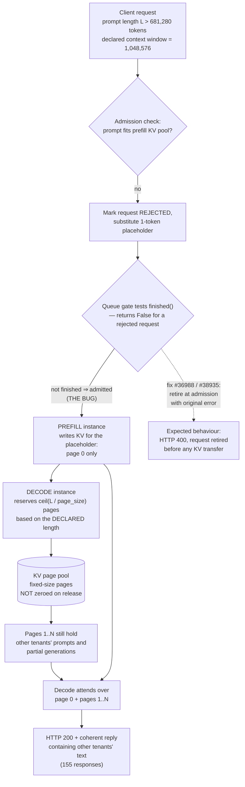

<!--
entry-meta
date: 2026-10-27
type: daily-diff
category: Daily Diff
title: Daily Diff — 2026-10-27
slug: postgres-smgr-md-segments-fsync-queue
-->

# Daily Diff — 2026-10-27

**2026-10-27 · Daily Diff Digest**

> **Which edition this covers, and why.** At run time (2026-10-27, 03:30 UTC / 09:00 IST)
> [https://tdd.cat/2026-10-27/](https://tdd.cat/2026-10-27/) returned a client error — the
> **2026-10-27 edition had not published yet**. The [archive](https://tdd.cat/archive/) and the
> front page both still pointed at 2026-10-25, but
> [https://tdd.cat/2026-10-26/](https://tdd.cat/2026-10-26/) resolves and carries a full edition of
> **42 stories**, which the previous run (fired before it existed) did not cover. So this digest is
> the **2026-10-26 edition**, labelled as such. Nothing below is invented; the 2026-10-27 edition is
> simply not available to this run.

---

## The edition, point-wise

**Agents and the harnesses around them** dominate the edition — roughly a third of the 42 items.

- A coding-agent harness (`INIT`, Rust) lets the agent hot-swap its own loop, with rollback to an
  immutable root commit.
- Thirty parallel agents refactored 250,000 lines across ten repositories, gated by contract tests
  and Git.
- Four GPU nodes were needed to serve a 16-engineer team, because subagent fan-out arrives as
  request *bursts* rather than steady load.
- `Agensh` claims coordination of up to 1,024 agents with no central orchestrator.
- `Cupel` treats context compaction as an explicit lifecycle stage; `Mnemonic-proxy` prunes prompts
  for local models while keeping verbatim history on disk; `TokenGate` skims context tokens to cut
  prefill cost; `Skill-spotter` detects repeated agent actions locally and promotes them to skills;
  `Load-lock` is a cooperative semaphore that queues heavy builds across parallel agents.
- Seller agents in a tool marketplace were found to inflate their own descriptions, distorting buyer
  selection.

**Agent security** is the sharpest cluster, and it is all about trust boundaries rather than models.

- **Context compaction flattens message roles**, which lets a *forged approval* survive into the
  compacted transcript. This is the same class of bug as log injection: a structure-carrying field
  collapsed into a flat string.
- Malicious instruction files dropped into a download folder can hijack a local coding agent.
- Seeded malicious dependencies lead to code execution inside agent sandboxes.
- Conversation history can override system instructions in long-running agents.
- Cryptographic "lockers" can hide dormant capabilities in model weights that survive fine-tuning
  and audits.

**Systems and performance** — the part that overlaps today's lesson.

- [A new algorithm for signed 64-bit floor division](https://www.benjoffe.com/fast-floordiv) on ARM
  and x86: the correction term for negative operands, done without a branch.
- [Perfect hashing for over a billion static string lookups per second in C++](https://lemire.me/blog/2026/10/26/billion-query-per-second-lookup-tables-in-c/)
  — the keyword-table problem, solved at the limit.
- [Profilers attach CPU samples to the wrong request on Java virtual threads](https://www.sku20.dev/blog/which-request-burned-the-cpu-span-tagged-profiles-on-virtual-threads/),
  because the carrier thread is not the unit of work; span-tagged profiles fix the attribution.
- Blackwell GPUs have NUMA-like die locality, which DeepGEMM discovers with a probe kernel.
- Jinx compiles Nix to TypeScript so Nixpkgs can evaluate in a browser.
- Cloudflare kept hardware growth roughly linear against exponential traffic through pipeline
  changes.
- Java's AOT cache can cause crashes and linking failures when training conditions differ from
  deployment conditions.
- OpenAI presented its "Jalapeño" inference chip, claiming better performance per watt than
  Blackwell.
- Apple's on-device model streams sparse expert weights from flash, activating only a fraction of
  its parameters.

**Storage and data** — three items a database-internals reader should notice.

- **[`Rada`](https://github.com/FormikaDesk/rada-fm) plans and journals file operations so they can
  be undone and recovered after a crash.** That is a write-ahead log for a file manager, and it is
  the same problem today's lesson spends its last section on: an operation that spans multiple
  files is not atomic unless something durable records the intent first. Worth reading immediately
  after the lesson.
- `Parseable` explores making small S3 reads fast enough for telemetry queries through caching.
- `LEANN` cuts local-RAG vector index storage by 97%.
- `PIZD` separates log and JSON *structure* from *values* to improve lossless compression — the
  column-vs-row insight applied to log lines.

**Models and evaluation** — parallel language models generating multiple tokens at once via latent
variables (2.3×–5.7× reported); `Fovea-4B` answering multimodal questions in one forward pass with a
decision readout instead of generation; a 1.1B model pretrained on a 6 GB laptop GPU; an
AI-assisted Lean formalization of Julia's standard library that surfaced ~400 bugs; steering a
model's internal "motivation" representation to change persistence on hard tasks; two-sample
statistical tests that detect undisclosed changes to commercial model APIs; and `Infini-gram`, an
unbounded n-gram index over trillions of tokens answering in milliseconds.

---

## Deep dive: Cloudflare's cross-request KV cache exposure

**Source followed:** [blog.cloudflare.com/kv-cache-exposure-remediation](https://blog.cloudflare.com/kv-cache-exposure-remediation/)

This is the most significant item in the edition: a confirmed cross-tenant data exposure in a
production inference service, with a root cause that is a *systems* bug, not a model behaviour.

### What happened

| | |
|---|---|
| Service | Cloudflare Workers AI |
| Affected model | `@cf/zai-org/glm-5.3` only |
| Engine | SGLang, in disaggregated prefill/decode mode |
| Window | 2026-08-27 → 2026-09-09 |
| Affected responses | **155**, all from prompts longer than 681,280 tokens |
| Reported via | HackerOne, 2026-09-08 23:11 UTC |
| Incident declared / leak reproduced | 2026-09-09 13:22 UTC |
| Model made private | 2026-09-09 14:00 UTC; restored 19:40 UTC |
| Upstream fixes shipped | SGLang v0.5.21 (Oct 2), v0.5.22 (Oct 19) |
| Coordinated publication | 2026-10-26 |

### The mechanism

Two defects had to line up.

1. **A configuration mismatch.** GLM 5.3 was deployed advertising a **1,048,576-token** context
   window while its prefill KV pool held only **681,280 tokens**. Any prompt in the gap between
   those two numbers was accepted by the API and unrepresentable in the cache.
2. **An admission-control bug in SGLang.** An over-length prompt was *marked rejected* and swapped
   for a **one-token placeholder** — but it was never removed from the pipeline, because the queues
   tested `finished()`, which returns `False` for a rejected request. So the request was admitted.
   Decode then **reserved pages for the full declared prompt length** while prefill had written only
   the **first page**. Decode attended over the remaining reserved pages, and, in Cloudflare's own
   words, *"pages are not currently zeroed between requests."* Those pages still held earlier
   requests' prompts and partial generations.

The client got **HTTP 200 and a coherent reply** where it should have got HTTP 400 — which is why
nobody noticed for twelve days. A visible error is a safe failure; a plausible answer is not.

### Why it matters

- **"Reject" is not a state unless something enforces it.** The request carried a rejected *flag*
  and kept its place in the pipeline. The authoritative predicate (`finished()`) did not consider
  rejection a terminal state, so the flag was advisory. Any pipeline with a soft-reject marker and a
  separate liveness predicate has this shape.
- **Reserved ≠ written, and unzeroed memory makes the gap readable.** Decode trusted a length that
  prefill had not honoured. Two components disagreed about how much of a buffer was valid, and the
  invalid part was the previous tenant's data because nothing cleared it. This is the classic
  uninitialised-buffer disclosure, moved up a layer: the "buffer" is a KV page pool, the
  "uninitialised" content is attention state.
- **Advertised capability and provisioned capacity were allowed to disagree.** 1,048,576 vs 681,280
  was the entire precondition. The deployment allowed a context window larger than the pool that
  had to hold it, and no startup check objected.
- **The fix layering is the interesting part.** Cloudflare did not stop at zeroing pages. The
  remediation is: (a) **configuration** — prefill KV pool raised to ~2.04 M tokens, matching the
  GLM 5.2 setup; (b) **correctness at the boundary** — rejected requests retired at the
  disaggregation admission queue with their original error, *before any KV transfer* (upstream
  **#36988**, **#38935**), plus decode verifying that transferred token counts match what it
  reserved; (c) **defence in depth** — per-transfer KV checksums (**#39500**), deferred KV release,
  bounded Mooncake transfer batches, and load-balancer changes that avoid mid-transfer aborts;
  (d) **assurance** — planned formal verification of the RDMA-based KV transfer protocol.
  Zeroing pages would have hidden the symptom; the count check is what makes the disagreement
  *detectable*.

### The database-internals angle

Today's lesson spent six sections on PostgreSQL's handling of exactly this class of problem in
`ExtendBufferedRelShared()`: when extension finds a pre-existing buffer where it expected to create
one, the code does not shrug. It checks `PageIsNew()` and raises
`"unexpected data beyond EOF in block %u of relation %s"` — because a buffer that should be blank
and is not means someone's data is about to be served as someone else's. PostgreSQL also zeroes
every victim buffer (`MemSet((char *) buf_block, 0, BLCKSZ)`) *before* taking the extension lock,
and the one-element `smgrsw[]` switch exists partly so that a single code path owns the
"what is actually on disk here" question. The engineering lesson transfers directly: **when two
layers can disagree about how much of a buffer is valid, you need the blank check and the length
check, not just the clear.**

---

## Sources

- [Daily Diff, edition of 2026-10-26](https://tdd.cat/2026-10-26/) — the 42-item edition digested above
- [https://tdd.cat/2026-10-27/](https://tdd.cat/2026-10-27/) — returned a client error at 03:30 UTC; the day's own edition had not published
- [Daily Diff archive](https://tdd.cat/archive/) and [front page](https://tdd.cat/) — both still showing 2026-10-25 at run time
- [Cloudflare: cross-request KV cache exposure, remediation and timeline](https://blog.cloudflare.com/kv-cache-exposure-remediation/) — the deep-dive source; every figure, date, issue number and quotation above comes from this post
- [`Rada`, a journaled file manager](https://github.com/FormikaDesk/rada-fm)
- [Daniel Lemire: billion-query-per-second lookup tables in C++](https://lemire.me/blog/2026/10/26/billion-query-per-second-lookup-tables-in-c/)
- [Which request burned the CPU? Span-tagged profiles on virtual threads](https://www.sku20.dev/blog/which-request-burned-the-cpu-span-tagged-profiles-on-virtual-threads/)
- [Fast signed floor division](https://www.benjoffe.com/fast-floordiv)

> Items summarised in the point-wise section without a link are ones whose source URLs were not
> retrieved in this run; they are described from the edition listing only, and no URL has been
> guessed for them.
