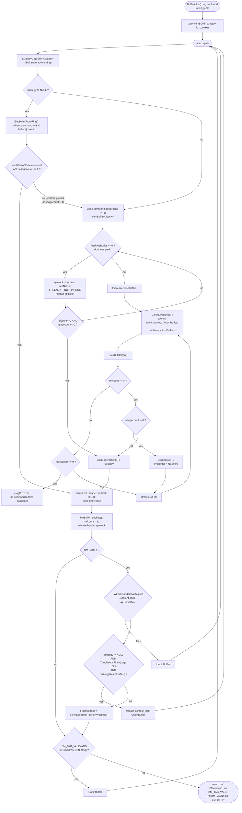

<!--
entry-meta
date: 2026-10-28
type: lesson
track: PostgreSQL
lesson: 09
category: Database Internals
title: The Buffer Manager — a 64-Byte Descriptor, One Global Counter That Swept a Contiguous 2,000-Buffer Arc, and a 242 MB Scan That Evicted Nothing
slug: postgres-buffer-manager-clock-sweep
-->

# The Buffer Manager — a 64-Byte Descriptor, One Global Counter That Swept a Contiguous 2,000-Buffer Arc, and a 242 MB Scan That Evicted Nothing

**2026-10-28 · PostgreSQL Track · Lesson 09 of 35**

Syllabus title: *The buffer manager: `BufferDesc`, the clock-sweep victim search, and the strategy ring.*

> **What was read.** `src/backend/storage/buffer/README` (276 lines, in full),
> `src/backend/storage/buffer/freelist.c` (774 lines, in full — `BufferStrategyControl`,
> `BufferAccessStrategyData`, `ClockSweepTick`, `have_free_buffer`, `StrategyGetBuffer`,
> `StrategyFreeBuffer`, `StrategySyncStart`, `StrategyInitialize`, `GetAccessStrategy`,
> `GetAccessStrategyWithSize`, `GetBufferFromRing`, `AddBufferToRing`, `IOContextForStrategy`,
> `StrategyRejectBuffer`), `src/include/storage/buf_internals.h` (440 lines, in full — the state-word
> bit layout, `BM_*` flags, `BM_MAX_USAGE_COUNT`, `BufferTag`, `BufferDesc`, `BufferDescPadded`,
> `BufTableHashPartition`, `BufMappingPartitionLock`), `src/backend/storage/buffer/buf_init.c`
> (186 lines, in full — `InitBufferPool`, `BufferShmemSize`), and in
> `src/backend/storage/buffer/bufmgr.c` (5,676 lines) the functions `BufferAlloc`,
> `GetVictimBuffer`, `PinBuffer`, `PinBuffer_Locked`, `UnpinBuffer`, `InvalidateVictimBuffer`,
> `FlushBuffer` call sites and `BgBufferSync`. Also `NUM_BUFFER_PARTITIONS` in
> `src/include/storage/lwlock.h`, the ring-size test `scan->rs_nblocks > NBuffers / 4` in
> `initscan()` in `src/backend/access/heap/heapam.c`, and the `pg_buffercache` 1.4 SQL definitions
> in `/usr/share/postgresql/16/extension/`.
>
> **Which tree.** Same as lessons 07 and 08: the Debian/Ubuntu source package `postgresql-16`
> version `16.15-0ubuntu0.24.04.1`, obtained with `apt-get source`, which is the same build the
> measured cluster runs. Checked rather than assumed: of the patches in `debian/patches/`, the files
> touched are `src/Makefile.global.in`, `src/backend/storage/buffer/bufmgr.c`,
> `src/backend/storage/ipc/procsignal.c`, `src/backend/tcop/postgres.c`,
> `src/backend/utils/activity/pgstat_database.c`, `src/bin/psql/settings.h`,
> `src/include/fe_utils/print.h`, `src/include/pg_config_manual.h`,
> `src/include/storage/procsignal.h`, `src/include/tcop/tcopprot.h` and `src/tutorial/README`.
> `freelist.c`, `buf_init.c`, `buf_table.c` and `buf_internals.h` are **untouched**. `bufmgr.c` is
> patched by `v8-0001-Fix-recovery-conflict-SIGUSR1-handling.patch`, but its single `bufmgr.c` hunk
> is at `LockBufferForCleanup()` (line 4923) — nowhere near `BufferAlloc`, `GetVictimBuffer`,
> `PinBuffer` or `StrategyGetBuffer`.
>
> **Every number below was measured**, on PostgreSQL 16.15 (Ubuntu 16.15-0ubuntu0.24.04.1),
> x86_64, gcc 13.3.0, Linux 6.18, ext4, 2 vCPU / 8 GB RAM. `block_size` 8192,
> `shared_buffers` **128 MB** (16,384 buffers) except where a measurement says otherwise,
> `vacuum_buffer_usage_limit` 256 kB, `bgwriter_lru_maxpages` 100, `bgwriter_lru_multiplier` 2.0,
> `data_checksums` off, `fsync` on. `pg_buffercache` **1.4** and `pg_prewarm` **1.2** installed.
> Where a number is *not* measured, the text says so.

---

## Where This Fits

- **Lesson 08 ended at the file descriptor.** `smgr`/`md.c` turn
  `(relfilelocator, forknum, blocknum)` into an fd and an offset, and hand the durability debt to the
  checkpointer's `pendingOps` queue. What it never answered: *who decides that block needs to be in
  memory at all*, and *which 8 KB of RAM it goes into*.
  ([`smgr` and `md.c` &rarr;](../2026-10-27-postgres-smgr-md-segments-fsync-queue/README.md))
- **This lesson is the layer directly above it.** `bufmgr.c` is the only caller of `smgrread` and
  `smgrwrite` in the normal path. Every `smgrextend` batch measured in lesson 08 was driven from
  `ExtendBufferedRelShared()`, which lives here. The buffer manager owns the mapping
  `BufferTag → buffer id`, the replacement decision, and the dirty-page writeback handoff.
- **Three debts from earlier lessons are closed.** Lesson 02 described `PageHeaderData` without
  saying what holds the page; lesson 06's index-only scan and lesson 07's HOT measurements both
  counted *page accesses* without distinguishing a hit from a read; lesson 08's `skipFsync` flag is
  set by exactly the extension path that lives in this file. All three resolve into one 64-byte
  struct and one 32-bit word.
- **What it sets up.** Lesson 10 takes the two access-control mechanisms the buffer README
  describes — pins and content locks — and the `LWLock` that implements the latter; this lesson
  deliberately treats both as opaque and only counts them. Lesson 15 (hint bits) depends on the
  `BM_DIRTY` transition measured here. Lessons 24–25 depend on `BM_CHECKPOINT_NEEDED` and the
  `CkptBufferIds` array sized here.

---

## 1. The pool is four shared-memory arrays, and you can measure all four

`InitBufferPool()` in `buf_init.c` makes exactly four `ShmemInitStruct` calls, all sized from
`NBuffers`:

| `ShmemInitStruct` name | Sized as | Holds |
|---|---|---|
| `Buffer Descriptors` | `NBuffers * sizeof(BufferDescPadded)` | the 64-byte headers |
| `Buffer Blocks` | `NBuffers * BLCKSZ + PG_IO_ALIGN_SIZE` | the actual 8 KB page images |
| `Buffer IO Condition Variables` | `NBuffers * sizeof(ConditionVariableMinimallyPadded)` | the thing you sleep on for `BM_IO_IN_PROGRESS` |
| `Checkpoint BufferIds` | `NBuffers * sizeof(CkptSortItem)` | the sort array a checkpoint uses, preallocated so a checkpoint never mallocs |

`pg_shmem_allocations` exposes all four by those exact names. At `shared_buffers = 128MB`:

```
             name              |    off    |   size    | allocated_size
-------------------------------+-----------+-----------+----------------
 Buffer Blocks                 |   6843392 | 134221824 |      134221824
 Buffer Descriptors            |   5794816 |   1048576 |        1048576
 Checkpoint BufferIds          | 141327360 |    327680 |         327680
 Buffer IO Condition Variables | 141065216 |    262144 |         262144
 Shared Buffer Lookup Table    | 141655040 |      2896 |           2944
 Buffer Strategy Status        | 142583680 |        28 |            128
```

Divide each by 16,384 and the code reads back exactly:

- **`Buffer Descriptors` / 16384 = 64.0 bytes.** That is `BUFFERDESC_PAD_TO_SIZE`, which
  `buf_internals.h` defines as `(SIZEOF_VOID_P == 8 ? 64 : 1)`. The descriptor array is a
  `BufferDescPadded` union whose only job is to make each header occupy one whole cache line, so
  two backends spinning on two different buffer headers never false-share.
- **`Buffer Blocks` = 134,221,824 = 16384 × 8192 + 4096.** The extra 4,096 is `PG_IO_ALIGN_SIZE`
  slack, requested so the pool start can be `TYPEALIGN`ed up to an I/O page boundary — which is
  what makes direct-I/O-style aligned reads possible from a shmem segment whose own start address
  Postgres does not control.
- **`Buffer IO Condition Variables` / 16384 = 16.0 bytes.** One condition variable per buffer,
  deliberately *outside* `BufferDesc` so the descriptor stays under 64 bytes. The header comment
  says they would still fit on common systems, "but for now that is not done."
- **`Checkpoint BufferIds` / 16384 = 20.0 bytes** — `sizeof(CkptSortItem)`. Lesson 24 spends this.
- **`Buffer Strategy Status` = 28 bytes, total, for the whole cluster.** That is the entire
  replacement policy's state: one spinlock, one atomic sweep hand, two freelist pointers, two
  counters, one bgwriter procno. 28 bytes govern 128 MB.

Note what is *missing*: `Shared Buffer Lookup Table` is only 2,896 bytes. That is the `HTAB`
directory. Its elements are allocated by `ShmemInitHash` out of a separate freelist and do not carry
this name, so do not read 2,896 bytes as "the hash table".

## 2. `BufferDesc`: 20 bytes of identity, 32 bits of everything else

```c
typedef struct BufferDesc
{
    BufferTag   tag;                    /* 20 bytes: which block is in here */
    int         buf_id;                 /* index, never changes after init */
    pg_atomic_uint32 state;             /* flags + refcount + usagecount */
    int         wait_backend_pgprocno;  /* the one pin-count waiter */
    int         freeNext;               /* freelist link */
    LWLock      content_lock;           /* lesson 10 */
} BufferDesc;
```

`BufferTag` is five 4-byte fields — `spcOid`, `dbOid`, `relNumber`, `forkNum`, `blockNum` — and the
header comment states the constraint that forces that shape: the tag "must be sufficient to
determine where to write the block, without reference to `pg_class` or `pg_tablespace` entries",
because the backend flushing a buffer may not even believe the relation exists yet. That is why the
tag carries a `RelFileNumber` and not a relation OID. It is the same `(spcOid, dbOid, relNumber,
forkNum)` tuple lesson 01 found in the path `base/<dboid>/<relfilenode>[_fsm|_vm]` and lesson 08
found in `FileTag` — the identity is stable from the filename up to the buffer header.

The interesting field is `state`, a single 32-bit atomic packed as:

```
bit  31                    22 21                18 17                       0
    +------------------------+-------------------+--------------------------+
    |   10 flag bits         |  4-bit usagecount |     18-bit refcount      |
    +------------------------+-------------------+--------------------------+
     BM_LOCKED .. BM_PERMANENT   0..5 in practice   pin count, max 262143
```

From the macros: `BUF_REFCOUNT_MASK = (1U << 18) - 1`, `BUF_USAGECOUNT_MASK = 0x003C0000`,
`BUF_USAGECOUNT_SHIFT = 18`, `BUF_FLAG_MASK = 0xFFC00000`. The ten flags:

| Flag | Bit | Meaning |
|---|---|---|
| `BM_LOCKED` | 22 | **the buffer header spinlock itself** |
| `BM_DIRTY` | 23 | needs writing |
| `BM_VALID` | 24 | contents are a real page |
| `BM_TAG_VALID` | 25 | there is a `buf_table` entry for this tag |
| `BM_IO_IN_PROGRESS` | 26 | a read or write is running |
| `BM_IO_ERROR` | 27 | the last I/O failed |
| `BM_JUST_DIRTIED` | 28 | dirtied again while a write was in flight |
| `BM_PIN_COUNT_WAITER` | 29 | someone is waiting for sole pin |
| `BM_CHECKPOINT_NEEDED` | 30 | in this checkpoint's set |
| `BM_PERMANENT` | 31 | must be written at every checkpoint |

Packing the spinlock *into* the word it protects is the whole trick. Because `BM_LOCKED` is bit 22
of `state`, a backend can do a compare-and-swap on `state` that both checks the lock is free and
applies its change, so the common operations — pin, unpin, bump usagecount — take **zero**
lock-acquire/release pairs. The header comment spells out the asymmetry: a lock *holder* may do
arbitrary updates in one store (clearing `BM_LOCKED` in the same write), but a non-holder is
restricted to CAS, and plain atomic increment, OR or AND are forbidden, precisely because they
cannot check `BM_LOCKED`.

`BM_MAX_USAGE_COUNT` is **5**, and the comment states the tradeoff exactly: a value comparable to
`NBuffers` "would approximate LRU semantics", but "it can take as many as `BM_MAX_USAGE_COUNT+1`
complete cycles of clock sweeps to find a free buffer". Four bits would allow 15; the policy chooses
5. Section 5 measures what that bound means.

## 3. The lookup table: 128 partitions, and a hash of the tag

`buf_table.c` is a thin wrapper over a shared `HTAB` keyed by `BufferTag`. What matters is the
locking. `NUM_BUFFER_PARTITIONS` is **128** (`src/include/storage/lwlock.h`), and the partition is
chosen by `hashcode % NUM_BUFFER_PARTITIONS` with the comment "NB: `NUM_BUFFER_PARTITIONS` must be a
power of 2". A lookup takes a *share* lock on one of 128 `LWLock`s; changing a buffer's tag takes an
*exclusive* lock on one. The README records the history: before 8.1 there was one cluster-wide
`BufMgrLock`; 8.2 split it 128 ways.

Two rules fall out of this and both show up in the code below:

- You must pin the found buffer **before** releasing the partition lock, or it can be stolen.
- If you ever need two partitions at once, lock them in partition-number order — the only deadlock
  avoidance rule in the file.

## 4. `StrategyGetBuffer`: the two-stage victim search



Four things in that diagram are easy to miss and all four matter.

**The freelist peek is deliberately racy.** `StrategyGetBuffer` tests `firstFreeBuffer >= 0` *without*
the spinlock, and the comment defends it: "it'd be sad to acquire it here — uselessly in most cases.
That obviously leaves a race where a buffer is put on the freelist but we don't see the store yet —
but that's pretty harmless, it'll just get used during the next buffer acquisition." The freelist is
not a cache policy; it is only the list of buffers that have never held a page, plus buffers
returned by `InvalidateBuffer` when a relation is dropped and by `BufferAlloc` when it loses a tag
race. Once the pool is full the freelist stays empty forever and every allocation is a sweep.

**`trycounter` resets on every decrement, not every tick.** Read the loop again: on finding
`refcount == 0 && usagecount != 0` it decrements and sets `trycounter = NBuffers`. Only the
*pinned* branch decrements `trycounter`. So the `"no unpinned buffers available"` error fires only
when `NBuffers` consecutive buffers were all pinned — never because the sweep is merely doing work.
The sweep is allowed to run arbitrarily long as long as it is making progress.

**`ClockSweepTick` is lock-free except on wrap.** `nextVictimBuffer` is a `pg_atomic_uint32` that is
only ever *incremented*; the modulo happens at read time. The spinlock is taken on exactly one tick
in `NBuffers` — the one that wraps — and only so `completePasses++` and `nextVictimBuffer` stay
mutually consistent for `StrategySyncStart()`. The comment accepts the consequence: with several
processes ticking, "this can lead to buffers being returned slightly out of apparent order".

**The victim is returned with its header spinlock still held.** `StrategyGetBuffer`'s header comment
says why: "To ensure that no one else can pin the buffer before we do, we must return the buffer
with the buffer header spinlock still held." `GetVictimBuffer` immediately calls
`PinBuffer_Locked()`. Between the policy choosing a buffer and the caller owning it there is no
window.

## 5. Measuring the clock hand: a contiguous 2,000-buffer arc

The sweep hand is a single `uint32` in shared memory. Nothing in SQL exposes it — there is no
`pg_stat` view for `nextVictimBuffer`, and this build has no debug symbols
(`postgresql-16-dbgsym` is not in the Ubuntu 24.04 archive), so it cannot be read with `gdb` either.
**It can still be located, to the buffer, from `pg_buffercache.bufferid`.**

The idea: fill the whole pool with one generation of blocks, then allocate exactly *N* fresh blocks
and ask *which buffer ids* the new generation landed in. If the hand is one global counter advancing
circularly, the answer must be *N* consecutive ids.

`pg_prewarm(..., 'buffer', ...)` is the right instrument: it calls `ReadBufferExtended` with a
**NULL** strategy, so every block goes through the normal clock sweep, and it reports how many
blocks it touched. `t_big` is a 31,035-block (242 MB) table in a 16,384-buffer (128 MB) pool.

```sql
-- after a restart
SELECT pg_prewarm('t_big','buffer','main',0,16383);     -- 16384 blocks: fills the pool
SELECT usagecount, count(*) FROM pg_buffercache GROUP BY 1 ORDER BY 1;
```

```
 usagecount | count
------------+-------
          0 | 16027      <-- one full pass of allocations left the pool at zero
          1 |   211
          2 |    18
          3 |    99
          4 |     8
          5 |    21
```

That histogram is itself the clock sweep's signature. The 16,384 allocations installed each new
buffer with `usagecount = 1` (`BufferAlloc` ORs in `BUF_USAGECOUNT_ONE` when it stamps the new tag),
and then the hand came back around and decremented almost every one of them back to 0 on its way
past. **A pool that has just been filled once is, behind the hand, a pool of usagecount-0 buffers.**
The ~355 buffers above 0 are catalog and system pages that got re-pinned during the run.

Now allocate exactly 2,000 blocks that are not in the pool:

```sql
SELECT pg_prewarm('t_big','buffer','main',20000,21999);  -- 2000
SELECT min(bufferid), max(bufferid), count(*)
FROM pg_buffercache WHERE relblocknumber BETWEEN 20000 AND 21999;
```

```
 min_bufid | max_bufid | count
-----------+-----------+-------
       373 |      2372 |  2000
```

**Exactly 2,000 consecutive buffer ids.** Not a scatter, not a hash — an arc. Binned across the
whole pool, the discontinuity is the hand:

```
 band |  lo   |  hi   | new_gen | old_gen | avg_uc
------+-------+-------+---------+---------+--------
    1 |     1 |  1024 |     652 |     372 |   1.47
    2 |  1025 |  2048 |    1024 |       0 |   1.00
    3 |  2049 |  3072 |     324 |     700 |   0.37
    4 |  3073 |  4096 |       0 |    1024 |   0.00
  ... |       |       |       0 |    1024 |   0.00
   16 | 15361 | 16384 |       0 |    1024 |   0.00
```

Everything from buffer 2,373 up still holds the previous generation at usagecount 0 — untouched,
even though it is the *oldest* content in the pool and has usagecount 0. The hand has simply not
reached it yet. This is the concrete difference between clock-sweep and LRU: **eviction order is
position order, not age order.**

Repeating the experiment predicts the next arc:

| allocation batch | predicted bufferid range | measured | note |
|---|---|---|---|
| 2,000 blocks (20000–21999) | — | **373 – 2372** | hand started at 373 |
| 2,000 blocks (24000–25999) | 2373 – 4372 | **2396 – 4395** | 23 buffers skipped |
| 2,000 blocks (28000–29999) | 4396 – 6395 | **4396 – 6395** | exact |

The third batch is exact, and a gap check over its 2,000 ids returns `holes_in_arc = 0`. The 23-buffer
discrepancy in the second batch is the mechanism, not noise: between the two `pg_prewarm` calls the
session ran catalog queries that re-pinned 23 buffers in the hand's path, so the sweep skipped them
(`refcount == 0` failed, or `usagecount != 0` so they were decremented instead of taken). **The hand
advances one buffer per allocation plus one per skip.** That is the whole cost model.

## 6. `usagecount` is incremented once per *backend-first* pin, and saturates at 5

`PinBuffer()` is where the counter moves, and it does so inside the same CAS loop that bumps the
refcount:

```c
buf_state += BUF_REFCOUNT_ONE;
if (strategy == NULL)
{
    /* Default case: increase usagecount unless already max. */
    if (BUF_STATE_GET_USAGECOUNT(buf_state) < BM_MAX_USAGE_COUNT)
        buf_state += BUF_USAGECOUNT_ONE;
}
else
{
    /* Ring buffers shouldn't evict others from pool. */
    if (BUF_STATE_GET_USAGECOUNT(buf_state) == 0)
        buf_state += BUF_USAGECOUNT_ONE;
}
```

Two things are load-bearing here.

**The whole block is guarded by `ref == NULL`.** `PinBuffer` first looks up a *backend-private*
refcount entry (`GetPrivateRefCountEntry`). If this backend already has the buffer pinned, it takes
the `else` branch — `result = true`, `ref->refcount++` — and **touches the shared `state` word not
at all.** So repinning the same page inside one backend does not raise its usagecount, and does not
even cost an atomic. The shared counter measures *distinct backend pin episodes*, not accesses.

**A strategy caps the increment at 1.** The comment is explicit: "Ring buffers shouldn't evict others
from pool. Thus we don't make usagecount more than 1." This is the second half of the ring's
politeness, and section 8 shows what it buys.

Measured, by scanning a 3,449-block table (`t_small`, which fits entirely) once per iteration:

```
after scan 1: 1=3449
after scan 2: 2=3449
after scan 3: 3=3449
after scan 4: 4=3449
after scan 5: 5=3449
after scan 6: 5=3449
after scan 7: 5=3449
after scan 8: 5=3449
```

Exactly `BM_MAX_USAGE_COUNT`. The useful corollary is the one the comment states and the table
confirms: a page read six times and a page read six hundred times are **indistinguishable** to the
replacement policy. Beyond five touches, Postgres has no memory of how hot a page is. In exchange,
the worst case to find a victim is bounded at six passes rather than `NBuffers` passes.

**What was not measured.** The *wall-clock* cost of those extra passes. Timing a 16,035-block
eviction storm against a pool saturated at usagecount 5 (65.7–73.3 ms over three runs) versus one at
usagecount 1 (74.1–86.5 ms) produced no separation that survives the noise, because at this scale
the per-block 8 KB `memcpy` out of the OS page cache dominates the header examinations entirely. The
six-pass bound is real in the code; this hardware cannot see it in a clock.

## 7. `GetVictimBuffer` is three retry loops wearing one function

`StrategyGetBuffer` only promises *not currently pinned*. Everything else is `GetVictimBuffer`'s
problem, and it has three distinct `goto again` paths — each one a real race, each one re-entering
the policy from the top:

1. **The dirty victim's content lock is already held.** Writing a page needs a *share* lock on the
   content so the image on disk is self-consistent, and the acquisition must be **conditional**:
   `LWLockConditionalAcquire(content_lock, LW_SHARED)`. The comment names the bug that forced this —
   "two backends are both trying to split btree index pages, and the second one just happens to be
   trying to split the page the first one got from `StrategyGetBuffer`". Blocking there is a
   deadlock, so the victim is dropped instead.
2. **A strategy would have to flush WAL to write this page.** Only then — the page LSN can only be
   read under a lock, which is why this test cannot live inside `StrategyGetBuffer` — does
   `StrategyRejectBuffer()` get a vote. It says yes only for `BAS_BULKREAD`, only for a buffer
   *from* the ring, and it then sets that ring slot to `InvalidBuffer`, with the comment
   "necessary to prevent infinite loop if all ring members are dirty."
3. **`InvalidateVictimBuffer()` failed** because someone pinned or dirtied the buffer in the window
   after the content write.

When it finally returns, the assertions state the contract precisely: `refcount == 1`, and none of
`BM_TAG_VALID`, `BM_VALID`, `BM_DIRTY` set. A victim buffer is *anonymous* — it has been removed from
the hash table and has no tag — before `BufferAlloc` stamps the new tag on it under the partition
lock.

One detail worth keeping for lesson 24: when the victim was valid, `GetVictimBuffer` fires
`pgstat_count_io_op(..., from_ring ? IOOP_REUSE : IOOP_EVICT)`. **`reuses` and `evictions` in
`pg_stat_io` are the same event, labelled by whether a ring supplied the buffer.** That distinction
is the measuring instrument for the rest of this lesson.

## 8. The strategy ring: three sizes, one cap, and `reads − reuses` = ring size

`GetAccessStrategy()` is a four-case switch over `BufferAccessStrategyType`:

| Type | `ring_size_kb` | Buffers at BLCKSZ 8192 | Used by |
|---|---|---|---|
| `BAS_NORMAL` | — | **returns NULL** — no strategy object at all | everything else |
| `BAS_BULKREAD` | 256 | 32 | seq scans over a large enough table |
| `BAS_BULKWRITE` | 16 × 1024 | 2048 | `COPY FROM`, `CREATE TABLE AS SELECT` |
| `BAS_VACUUM` | 256 (overridden by `vacuum_buffer_usage_limit`) | 32 | `VACUUM`, `ANALYZE` |

Then `GetAccessStrategyWithSize()` applies two transforms that are easy to forget:

```c
ring_buffers = ring_size_kb / (BLCKSZ / 1024);
if (ring_buffers == 0) return NULL;        /* 0 kB means "no ring", not "tiny ring" */
ring_buffers = Min(NBuffers / 8, ring_buffers);   /* hard cap at 1/8 of the pool */
```

The ring itself is **backend-private** — a `palloc`'d `BufferAccessStrategyData` holding
`btype`, `nbuffers`, a `current` cursor and a flat `Buffer buffers[]`. There is no shared state and
no lock; `GetBufferFromRing` advances `current` modulo `nbuffers` and hands back `buffers[current]`
if and only if `refcount == 0 && usagecount <= 1`. The `<= 1` is the counterpart of the capped
increment in `PinBuffer`: usagecount 1 is "only I have touched this", 2 or more means another backend
wants the page and the ring must give it up.

And the ring is not a *reservation*. A ring slot is filled by `AddBufferToRing()` from inside
`StrategyGetBuffer`, i.e. by an ordinary clock-sweep or freelist allocation. The ring is a *memory*
of 32 buffers the backend will try to reuse — nothing prevents anyone else from taking them.

### The ring size is directly measurable

Because `pg_stat_io` counts `reads` and `reuses` separately, and the first pass round the ring has
no slot to reuse:

> **`reads − reuses` = the ring size, in buffers.**

Measured, serial scan of `t_mid` (7,242 blocks = 57 MB), `max_parallel_workers_per_gather = 0`:

```
  backend_type  | context  | reads | evictions | reuses | hits
----------------+----------+-------+-----------+--------+------
 client backend | bulkread |  7242 |         0 |   7210 |    0
```

7242 − 7210 = **32**. And afterwards:

```
 relname | buffers        pool: 16105 of 16384 buffers still UNUSED
---------+---------
 t_mid   |      32
```

A 57 MB sequential scan through a 128 MB buffer pool occupied **32 buffers** and left 98% of the pool
untouched. Same arithmetic, three more configurations:

| Operation | Ring config | reads | reuses | reads − reuses | resident after |
|---|---|---|---|---|---|
| seq scan `t_mid`, 7,242 blk | `BAS_BULKREAD`, 256 kB | 7,242 | 7,210 | **32** | 32 |
| `VACUUM` `t_big`, 31,035 blk | `BUFFER_USAGE_LIMIT '256kB'` | 76,376 | 76,344 | **32** | 45 |
| `VACUUM` `t_big` | `BUFFER_USAGE_LIMIT '2MB'` | 49,775 | 49,519 | **256** | 269 |
| `VACUUM` `t_big` | `BUFFER_USAGE_LIMIT 0` (ring off) | 76,548 | — (`normal`) | — | **16,255**, pool 100% full, **60,309 evictions** |
| `COPY FROM`, 15,560 extends | `BAS_BULKWRITE`, 16 MB | 15,560 *extends* | 13,512 | **2,048** | 2,054 |

Three things to pull out of that table.

- `2MB / 8kB = 256`, and the measured difference is 256 **exactly**. The GUC is in kB and lands on a
  buffer count with no rounding surprise.
- `BUFFER_USAGE_LIMIT 0` does not make a 0-buffer ring; `GetAccessStrategyWithSize` returns NULL and
  the operation runs on the **normal** strategy. The context in `pg_stat_io` flips from `vacuum` to
  `normal`, `reuses` becomes NULL, and a single `VACUUM` evicts 60,309 buffers through a
  16,384-buffer pool. That is the entire reason the ring exists, in one row.
- `COPY` shows the cap doing nothing at this `shared_buffers`: `Min(16384/8, 2048) = Min(2048, 2048)`.
  At `shared_buffers = 128MB` the bulkwrite ring is *exactly* one eighth of the pool, by coincidence
  of the two constants. Lower `shared_buffers` and the cap bites hard — at the minimum
  `shared_buffers = 128kB` (16 buffers), the measured bulkread ring is
  `7242 reads − 7240 reuses =` **2** buffers, which is `Min(16/8, 32)`.

### The threshold that decides whether a seq scan gets a ring at all

`initscan()` in `heapam.c`:

```c
if (!RelationUsesLocalBuffers(scan->rs_base.rs_rd) &&
    scan->rs_nblocks > NBuffers / 4)
```

At 16,384 buffers the threshold is **4,096 blocks (32 MB)**. Measured on either side of it:

| Table | Blocks | vs 4,096 | `pg_stat_io` context | Buffers resident after one scan |
|---|---|---|---|---|
| `t_small` | 3,449 | below | `normal` | **3,449** — the whole table |
| `t_mid` | 7,242 | above | `bulkread` | **32** |

Nothing gradual. 3,449 blocks fully populate the cache; 7,242 blocks occupy 32 buffers.

### The ring is per *participant*, not per query

The first `t_mid` measurement, run with parallelism left on (`max_parallel_workers_per_gather = 2`),
showed **96** resident buffers, not 32, and the leader's own `reads` was 2,392 rather than 7,242. A
`BufferAccessStrategy` is a `palloc`'d backend-local object, so a parallel sequential scan has one
ring per participant: leader + 2 workers × 32 = **96**. The ring bounds *per-backend* footprint;
`max_parallel_workers_per_gather` multiplies it.

## 9. What the ring actually protects, measured both ways

This is the experiment worth keeping. Same hot working set, same 242 MB table, same pool — only the
access path differs.

**Setup (both runs):** restart, scan `t_small` (3,449 blocks) twice so it is fully resident at
usagecount 2.

**Run A — read `t_big` (31,035 blocks, 242 MB) by sequential scan** (`BAS_BULKREAD`):

```
before:  t_small | 3449 buffers | avg usagecount 2.00

after:   t_small | 3449 buffers | avg usagecount 2.00     <-- untouched
         t_big   |   32 buffers | avg usagecount 1.00
         pg_stat_io: bulkread reads=31035 reuses=31003 evictions=0
         pool unused: 12647
```

**Run B — read the *same* `t_big` by index scan** (no strategy object; `BAS_NORMAL`):

```
after:   t_big_id_idx | 2210 buffers | avg usagecount 0.44
         t_big        | 13944 buffers | avg usagecount 0.44
         t_small      |  --- GONE ---
         pg_stat_io: normal reads=36013 evictions=23320
         pool unused: 0
```

Reading 242 MB through a 128 MB pool cost **zero** evictions and left the working set bit-for-bit
intact in run A, and cost **23,320** evictions and destroyed the working set completely in run B.
The avg usagecount of 0.44 among the survivors is the sweep having already decremented most of what
it just installed.

The asymmetry is not a tuning knob. It is a consequence of which code path builds a
`BufferAccessStrategy`: `initscan()` does, for a large enough heap scan; `index_beginscan` and the
bitmap heap scan do not. **An index scan that happens to touch most of a large table is the pathology
the ring was built to prevent, and it is exactly the case the ring does not cover.**

## 10. The background writer reads the hand without moving it

`BgBufferSync()` closes the loop between the sweep and the I/O system. Its one call into the policy
is `StrategySyncStart(&strategy_passes, &recent_alloc)`, which under the strategy spinlock returns
three things: `nextVictimBuffer % NBuffers` (where the hand is), `completePasses` *plus*
`nextVictimBuffer / NBuffers` (correcting for a wrap whose `completePasses++` has not landed yet),
and `numBufferAllocs` — read with `pg_atomic_exchange_u32(..., 0)`, so **reading it resets it**.

The bgwriter then scans forward from that position, as the README puts it, "which it does not
change!", writing dirty unpinned buffers with zero usagecount so that the next backend to reach them
finds them clean. It maintains `smoothed_density` (initialised to 10.0) — an estimate of how many
buffers it must scan per allocation to find a reusable one — and multiplies the smoothed allocation
rate by `bgwriter_lru_multiplier` (2.0) to decide how far ahead to work, stopping at
`bgwriter_lru_maxpages` (100) per round. On the measured cluster after all of the above:

```
 buffers_clean | maxwritten_clean | buffers_alloc | buffers_backend
---------------+------------------+---------------+-----------------
         10448 |               95 |        804317 |          498979
```

`buffers_alloc` is `numBufferAllocs` — 804,317 `StrategyGetBuffer` calls — and note that
`StrategyGetBuffer` increments it *after* the ring check, with the comment "buffers recycled by a
strategy object are intentionally not counted here". So `buffers_alloc` undercounts ring-served
block accesses by design. `maxwritten_clean = 95` says the bgwriter hit its 100-page ceiling 95
times and gave up early; `buffers_backend` (498,979) vastly exceeds `buffers_clean` (10,448), which
on this workload simply records that the writes were driven by backends doing their own eviction,
not by the bgwriter running ahead of them.

---

## Hands-On

All of these run against any 16.x cluster with `pg_buffercache` 1.4 and `pg_prewarm`. Setup:

```sql
CREATE DATABASE bufdemo;
\c bufdemo
CREATE EXTENSION pg_buffercache;
CREATE EXTENSION pg_prewarm;
CREATE TABLE t_small (id int, pad char(100));
INSERT INTO t_small SELECT g,'x' FROM generate_series(1,200000) g;   -- ~3449 blocks
CREATE TABLE t_mid   (id int, pad char(100));
INSERT INTO t_mid   SELECT g,'x' FROM generate_series(1,420000) g;   -- ~7242 blocks
CREATE TABLE t_big   (id int, pad char(100));
INSERT INTO t_big   SELECT g,'x' FROM generate_series(1,1800000) g;  -- ~31035 blocks
VACUUM ANALYZE t_small; VACUUM ANALYZE t_mid; VACUUM ANALYZE t_big;
```

### 1. Read the pool's own dimensions out of shared memory

```sql
SELECT name, size, size / (SELECT setting::bigint FROM pg_settings
                           WHERE name='shared_buffers') AS bytes_per_buffer
FROM pg_shmem_allocations
WHERE name IN ('Buffer Descriptors','Buffer Blocks',
               'Buffer IO Condition Variables','Checkpoint BufferIds',
               'Buffer Strategy Status','Shared Buffer Lookup Table');
```

**What to look for:** `Buffer Descriptors` must come out at **exactly 64.0** bytes per buffer, and
`Buffer Blocks` at 8192 plus a 4,096-byte remainder. The 64 proves `BUFFERDESC_PAD_TO_SIZE` is in
force — the struct's real size is smaller, and the difference is padding bought to stop false
sharing between adjacent buffer headers. Also note `Buffer Strategy Status` is 28 bytes: that is the
entire global replacement state.

### 2. Locate the clock hand, then predict where it will be next

```sql
-- restart the cluster first so the pool is empty
SELECT pg_prewarm('t_big','buffer','main',0,16383);   -- fill the pool once
SELECT usagecount, count(*) FROM pg_buffercache GROUP BY 1 ORDER BY 1;

SELECT pg_prewarm('t_big','buffer','main',20000,21999);  -- 2000 fresh blocks
SELECT min(bufferid), max(bufferid), count(*)
FROM pg_buffercache WHERE relblocknumber BETWEEN 20000 AND 21999;
```

**What to look for:** `max − min + 1` must equal `count` — the new generation is one *contiguous*
arc of buffer ids, which is only possible if victim selection is a single global counter. Then run
it again with a different block range and check that the new arc starts one past where the last one
ended. The gap check:

```sql
SELECT count(*) AS holes FROM (
  SELECT lead(bufferid) OVER (ORDER BY bufferid) - bufferid AS d
  FROM pg_buffercache WHERE relblocknumber BETWEEN 28000 AND 29999) s
WHERE d <> 1;
```

Zero holes on a cold pool. If you get holes, you have found buffers the sweep *skipped* — pinned or
nonzero-usagecount buffers in the hand's path — which is a direct measurement of concurrent activity.

### 3. Saturate `usagecount` and watch it stop at 5

```sql
-- repeat 8 times:
SET max_parallel_workers_per_gather = 0;
SELECT count(*) FROM t_small;
SELECT usagecount, count(*) FROM pg_buffercache b
  JOIN pg_class c ON b.relfilenode = pg_relation_filenode(c.oid)
 WHERE c.relname = 't_small' GROUP BY 1;
```

**What to look for:** the whole table moves in lockstep — 1, 2, 3, 4, 5, 5, 5, 5. The flat line
after the fifth scan *is* `BM_MAX_USAGE_COUNT`, and it proves the policy cannot distinguish a
5-touch page from a 500-touch page. Then check the subtler claim: run
`SELECT count(*) FROM t_small a JOIN t_small b USING (id)` once and confirm usagecount rises by **1**,
not 2 — the backend-private refcount in `PinBuffer` suppresses the second increment within one
backend.

### 4. Measure a ring size without reading any source

```sql
SELECT pg_stat_reset_shared('io');
SET max_parallel_workers_per_gather = 0;
SELECT count(*) FROM t_mid;
SELECT context, reads, reuses, evictions FROM pg_stat_io
 WHERE backend_type='client backend' AND object='relation' AND reads > 0;
```

**What to look for:** `reads − reuses` is the ring size in buffers (32 for `bulkread`). This works
for any strategy: run `VACUUM (BUFFER_USAGE_LIMIT '2MB') t_big` and the difference becomes 256; run
`COPY` and it becomes 2,048. It is the cleanest available probe of a backend-private structure, and
it requires no extension beyond core statistics.

### 5. Find the seq-scan threshold empirically

```sql
-- after a restart, for each of t_small (3449 blk) and t_mid (7242 blk):
SELECT count(*) FROM <table>;
SELECT c.relname, count(*) FROM pg_buffercache b
  JOIN pg_class c ON b.relfilenode = pg_relation_filenode(c.oid)
 WHERE c.relname LIKE 't_%' GROUP BY 1;
```

**What to look for:** a table at or below `NBuffers / 4` blocks caches *entirely*; one block over
and it caches 32 buffers. Change `shared_buffers` and the threshold moves with it — which means the
same table and the same query change caching behaviour completely when you resize the pool, with no
plan change to warn you.

### 6. Prove what the ring protects, and then break it

```sql
-- warm the working set
SELECT count(*) FROM t_small; SELECT count(*) FROM t_small;
SELECT pg_stat_reset_shared('io');

-- A: sequential scan of a 242 MB table (ring)
SET max_parallel_workers_per_gather = 0;
SELECT count(*) FROM t_big;

-- B: after a restart and re-warm, the same table by index scan (no ring)
CREATE INDEX ON t_big(id);
SET enable_seqscan = off; SET enable_indexonlyscan = off;
SELECT count(pad) FROM t_big WHERE id > 0;
```

**What to look for:** after A, `t_small` still has all 3,449 buffers at usagecount 2 and
`pg_stat_io` shows `evictions = 0`. After B, `t_small` has **zero** buffers and `evictions` is in the
tens of thousands. Identical bytes read; opposite effect on everyone else's cache. This is the single
most important operational fact in the lesson.

### 7. Turn the ring off and watch VACUUM behave like it did before 8.3

```sql
UPDATE t_big SET pad = 'y' WHERE id % 7 = 0;   -- give VACUUM work to do
SELECT pg_stat_reset_shared('io');
VACUUM (BUFFER_USAGE_LIMIT 0) t_big;
SELECT context, reads, writes, evictions FROM pg_stat_io
 WHERE backend_type='client backend' AND object='relation' AND reads > 0;
SELECT count(*) FILTER (WHERE relfilenode IS NULL) AS unused FROM pg_buffercache;
```

**What to look for:** the context is `normal`, not `vacuum`; `reuses` is NULL; `unused` is 0. One
`VACUUM` has taken the entire pool. Compare against the same `VACUUM` at `'256kB'` and `'2MB'` — the
block counts read are similar, the cache damage is not.

---

## Where This Breaks Down

- **Clock-sweep evicts by position, not by age.** Section 5 measured 14,000 buffers sitting at
  usagecount 0 — perfectly evictable, provably cold — that were not touched, because the hand was
  elsewhere. Eviction order is `buf_id` order from wherever the hand happens to be. A page can
  survive a long time purely by being just behind the hand, and a page can be evicted while a colder
  one survives. This is the price of not maintaining an LRU chain, which would need a lock on every
  buffer access.
- **Four bits of history, saturating at five.** `BM_MAX_USAGE_COUNT = 5` means the policy's entire
  memory of access frequency is a number from 0 to 5 that is incremented once per backend-first pin.
  A genuinely hot index root and a page read five times during one report are indistinguishable. The
  comment in `buf_internals.h` names the tradeoff openly: LRU accuracy would need a counter
  "comparable to `NBuffers`", which would make the worst-case victim search `NBuffers` passes.
- **The ring is per-backend and per-participant, so it does not bound cluster footprint.** 32 buffers
  per backend is a promise about one backend. Fifty concurrent sequential scans, or one parallel scan
  with `max_parallel_workers_per_gather = 8`, multiply it. The measured 96-buffer parallel case is
  the small version of this.
- **The ring covers the scan shapes someone thought of.** `initscan()` builds a `BAS_BULKREAD` ring;
  `COPY` and `CTAS` build `BAS_BULKWRITE`; `VACUUM`/`ANALYZE` build `BAS_VACUUM`. An index scan or a
  bitmap heap scan that walks most of a 242 MB table builds **nothing**, and run B measured the
  consequence: 23,320 evictions and a destroyed working set. The README even asks the open question
  out loud — "Might it be interesting to make seqscan UPDATE and DELETE use the bulkwrite strategy?"
- **A dirtying ring scan degrades to the normal strategy.** The README states it and
  `StrategyRejectBuffer` implements it: for `BAS_BULKREAD`, a ring buffer that is dirty and whose LSN
  needs a WAL flush is *dropped from the ring* (`buffers[current] = InvalidBuffer`) and replaced from
  the sweep. "In a scan that modifies every page in the scan, like a bulk `UPDATE` or `DELETE`, the
  buffers in the ring will always be dirtied and the ring strategy effectively degrades to the normal
  strategy." The protection silently stops applying for write-heavy scans.
- **The threshold is a function of `shared_buffers`, which makes behaviour non-monotonic in a
  surprising direction.** A 40 MB table is cached whole at `shared_buffers = 1GB` (threshold 256 MB)
  and ring-scanned at `shared_buffers = 128MB` (threshold 32 MB). Growing the pool can move a table
  *into* full caching; shrinking it can move a table out — with no plan change and nothing in
  `EXPLAIN` to indicate it.
- **`buffer_strategy_lock` is a cluster-wide spinlock, and the freelist is why.** The sweep itself
  only needs it on wrap, but *every* freelist pop takes it, and so does `StrategyFreeBuffer`. This is
  the contention that upstream has now removed: commit **`2c789405275928ce0d2ceb7c4add91d27df92502`**
  ("bufmgr: Remove freelist, always use clock-sweep", Greg Burd, 2025-09-05, on master) deletes the
  freelist and `have_free_buffer()` entirely — 6 files, +31/−209, including 40 lines of the README
  quoted throughout this lesson. Its reasoning is worth reading verbatim: "While on the surface this
  appears to be removing an optimization it is in fact eliminating code that induces overhead in the
  form of synchronization that is problematic for multi-core systems", and the main motive was not
  the scalability win but that "having the freelist would require dedicated complexity in several
  upcoming patches". **Nothing measured in this lesson comes from a tree with that commit**; 16.15
  still has both paths, which is why section 4's diagram has a freelist branch at all.
- **The hand's position is not observable in SQL.** `StrategySyncStart` is the only reader of
  `nextVictimBuffer` and it is internal to the bgwriter. The arc measurement in section 5 is an
  inference from `pg_buffercache.bufferid`, not a direct read, and it only works on a quiet cluster.
  Likewise `completePasses` has no SQL exposure at all.

---

## Further Study

- [`bufmgr: Remove freelist, always use clock-sweep` — commit announcement on pgsql-committers](https://www.postgresql.org/message-id/E1uuZGO-000eJl-1p%40gemulon.postgresql.org) — the commit that makes section 4's freelist branch history.
- [`v11-0001-Eliminate-the-freelist-from-the-buffer-manager-a.patch`](https://www.postgresql.org/message-id/attachment/179385/v11-0001-Eliminate-the-freelist-from-the-buffer-manager-a.patch) — the patch as submitted, against the same `freelist.c` read here.
- [`v10-0002-Remove-the-buffer_strategy_lock-and-make-the-clo.patch`](https://www.postgresql.org/message-id/attachment/179371/v10-0002-Remove-the-buffer_strategy_lock-and-make-the-clo.patch) — the follow-on that removes the cluster-wide spinlock named in the README.
- [`bufmgr: Use consistent naming of the clock-sweep algorithm`](https://www.postgresql.org/message-id/E1uuZGO-000eJj-1e%40gemulon.postgresql.org) — a naming cleanup that is useful as a map of which identifiers belong to the policy.
- [PostgreSQL Source Code: `freelist.c` (git master, doxygen)](https://doxygen.postgresql.org/freelist_8c_source.html) — the post-freelist version of the file, cross-referenced; read it beside the 16.15 copy.
- [`pg_buffercache` documentation](https://www.postgresql.org/docs/17/pgbuffercache.html) — the view and the two summary functions used throughout the Hands-On.
- [UNSW COMP9315, *PostgreSQL Buffer Manager*](https://cgi.cse.unsw.edu.au/~cs9315/21T1/lectures/pg-buffers/slides.html) — a course treatment of the same structures, useful as a second reading of the clock-sweep loop.

## Next Steps

1. **Re-run section 5's arc measurement at several `shared_buffers` values** (32 MB, 128 MB, 1 GB)
   and check that the arc length still equals the allocation count exactly. If it does not, the extra
   hand movement is skipped buffers, and you have a per-pool-size measurement of background pin
   activity.
2. **Build a tree from the `v11` patch above and repeat sections 5 and 8.** With no freelist, the
   first allocation after a restart is a sweep rather than a pop, so the arc should start at buffer 1
   and the `usagecount` histogram after a full fill should look different. That is the cleanest way to
   see what the commit actually changed.
3. **Instrument the thing that is missing.** Write a small extension that exposes
   `StrategySyncStart()`'s three outputs as a SQL function, so `nextVictimBuffer` and
   `completePasses` become observable; that turns the inference in section 5 into a direct reading and
   makes the six-pass bound of section 6 measurable.
4. **Measure the index-scan pathology on a realistic workload.** Take a query that an index scan
   plans but that touches more than `NBuffers / 4` heap blocks, run it against a warm OLTP working
   set, and quantify the `evictions` and the subsequent hit-rate collapse. Then check whether forcing
   a bitmap heap scan or a seq scan changes the total damage.
5. **Trace `GetVictimBuffer`'s retry paths.** Put a concurrent `UPDATE` load on `t_big` while running
   eviction storms, and look for the `goto again` cases: `LWLockConditionalAcquire` failing, and
   `InvalidateVictimBuffer` failing. Neither is counted anywhere, which is itself worth a patch.
6. **Read ahead to lesson 10's subject with this lesson's instrument.** `pg_buffercache.pinning_backends`
   and `buffers_pinned` from `pg_buffercache_summary()` are the only SQL-visible pin counts; use them
   to find what holds pins for a long time before the lesson explains why that is allowed.

## Sources

- `src/backend/storage/buffer/README`, `freelist.c`, `buf_init.c`, `buf_table.c`, `bufmgr.c`, `src/include/storage/buf_internals.h`, `src/include/storage/lwlock.h` and `src/backend/access/heap/heapam.c` from the `postgresql-16` source package `16.15-0ubuntu0.24.04.1`, obtained with `apt-get source postgresql-16`. Every struct, macro, constant, code quotation and comment quotation above is from these files.
- [`bufmgr: Remove freelist, always use clock-sweep` (commit `2c789405`, Greg Burd, 2025-09-05)](https://www.postgresql.org/message-id/E1uuZGO-000eJl-1p%40gemulon.postgresql.org) — the commit hash, author, date, file list (+31/−209) and the two quoted sentences of rationale come from this page.
- [`v11-0001-Eliminate-the-freelist-from-the-buffer-manager-a.patch`](https://www.postgresql.org/message-id/attachment/179385/v11-0001-Eliminate-the-freelist-from-the-buffer-manager-a.patch) and [`v10-0002-Remove-the-buffer_strategy_lock-and-make-the-clo.patch`](https://www.postgresql.org/message-id/attachment/179371/v10-0002-Remove-the-buffer_strategy_lock-and-make-the-clo.patch) — the submitted patch series.
- [`bufmgr: Use consistent naming of the clock-sweep algorithm`](https://www.postgresql.org/message-id/E1uuZGO-000eJj-1e%40gemulon.postgresql.org)
- [PostgreSQL Source Code: `freelist.c`, git master (doxygen.postgresql.org)](https://doxygen.postgresql.org/freelist_8c_source.html)
- [`pg_buffercache` documentation](https://www.postgresql.org/docs/17/pgbuffercache.html)
- [UNSW COMP9315 21T1, *PostgreSQL Buffer Manager*](https://cgi.cse.unsw.edu.au/~cs9315/21T1/lectures/pg-buffers/slides.html)
- All measurements: PostgreSQL 16.15 (Ubuntu 16.15-0ubuntu0.24.04.1), x86_64, Linux 6.18, ext4, 2 vCPU / 8 GB RAM, `shared_buffers` 128 MB unless stated, `pg_buffercache` 1.4, `pg_prewarm` 1.2.

## Takeaways

- **The replacement policy's entire global state is 28 bytes.** One spinlock, one atomic hand, two
  freelist pointers, two counters, one procno — governing a 128 MB pool. Everything else lives in
  per-buffer 32-bit words that are updated by CAS without ever taking a lock.
- **The hand is one counter, and you can see its arc.** 2,000 fresh allocations into a filled pool
  landed in buffer ids 373–2372, contiguous, zero holes; the next batch resumed one past the end.
  Eviction order is position order.
- **`reads − reuses` in `pg_stat_io` is the ring size in buffers.** Measured 32 for `bulkread`, 32 and
  256 for `VACUUM` at `BUFFER_USAGE_LIMIT '256kB'` and `'2MB'`, 2,048 for `COPY`, and 2 at the minimum
  `shared_buffers` where `Min(NBuffers/8, …)` clamps it. No source reading required.
- **The same 242 MB read is either free or catastrophic depending on the plan node.** Sequential scan:
  0 evictions, working set untouched, 32 buffers used. Index scan: 23,320 evictions, working set gone,
  pool 100% occupied. The difference is whether that code path calls `GetAccessStrategy()`.
- **`usagecount` saturates at 5 and only moves on a backend's *first* pin.** Scan a cached table five
  times and it is pinned at 5 forever; scan it inside one query twice and it rises by one. The policy's
  memory of heat is four bits, deliberately, to bound the victim search at six passes.
- **16.15's freelist is already gone upstream.** Commit `2c789405` removed it and `have_free_buffer()`
  on master in September 2025, because its cluster-wide spinlock hurt multi-core scaling and because
  keeping it would complicate later work. The two-stage search measured here is a snapshot of a
  structure in the middle of being retired.
