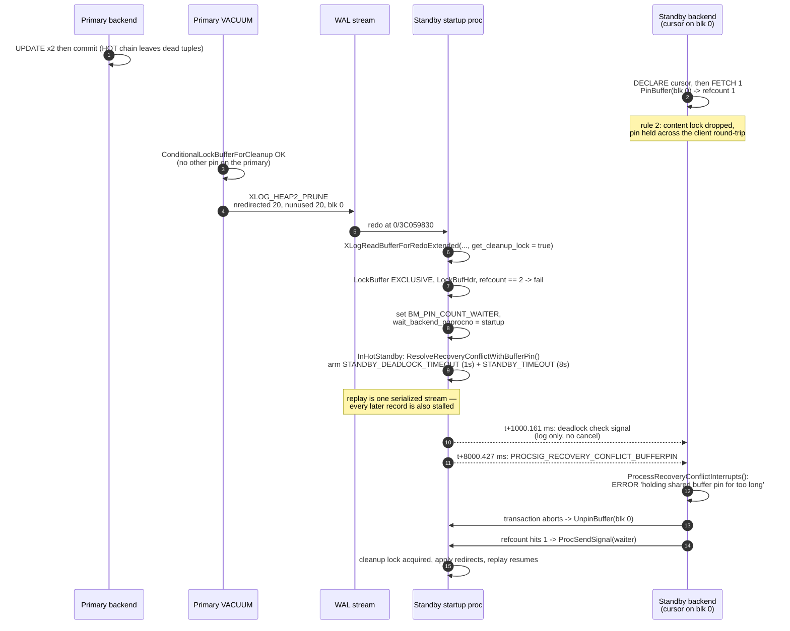

<!--
entry-meta
date: 2026-10-29
type: lesson
track: PostgreSQL
lesson: 10
category: Database Internals
title: Pins vs Content Locks — a 16-Byte LWLock, 208 of Them in 26,624 Bytes, a VACUUM That Waited 22 Seconds, and One Cursor That Stalled Replay for Exactly 8,000 ms
slug: postgres-pins-content-locks-lwlock
-->

# Pins vs Content Locks — a 16-Byte LWLock, 208 of Them in 26,624 Bytes, a VACUUM That Waited 22 Seconds, and One Cursor That Stalled Replay for Exactly 8,000 ms

**2026-10-29 · PostgreSQL Track · Lesson 10 of 35**

Syllabus title: *Buffer pins versus content locks, and the LWLock implementation.*

> **What was read.** `src/backend/storage/buffer/README` (276 lines, in full — the access-rules
> section 1–5 and the internal-locking section), `src/backend/storage/lmgr/lwlock.c` (1,994 lines,
> in full — the header algorithm note, `LW_*` bit macros, `BuiltinTrancheNames[]`,
> `held_lwlocks[]`/`MAX_SIMUL_LWLOCKS`, `LWLockShmemSize`, `CreateLWLocks`, `InitializeLWLocks`,
> `LWLockAttemptLock`, `LWLockWaitListLock`, `LWLockWaitListUnlock`, `LWLockWakeup`,
> `LWLockQueueSelf`, `LWLockDequeueSelf`, `LWLockAcquire`, `LWLockConditionalAcquire`,
> `LWLockAcquireOrWait`, `LWLockWaitForVar`, `LWLockUpdateVar`, `LWLockRelease`,
> `LWLockReleaseClearVar`, `LWLockReleaseAll`, `GetLWTrancheName`), `src/include/storage/lwlock.h`
> (222 lines, in full — `struct LWLock`, `LWLockPadded`, `LWLOCK_PADDED_SIZE`, the partition counts,
> the offset macros, `BuiltinTrancheIds`), `src/backend/storage/lmgr/lwlocknames.txt` (54 lines),
> and in `src/backend/storage/buffer/bufmgr.c` (5,676 lines) the functions `PinBuffer`,
> `UnpinBuffer`, `ReservePrivateRefCountEntry`, `NewPrivateRefCountEntry`,
> `GetPrivateRefCountEntry`, `LockBuffer`, `LockBufferForCleanup`,
> `ConditionalLockBufferForCleanup`, `CheckBufferIsPinnedOnce` and
> `HoldingBufferPinThatDelaysRecovery`, plus the `PrivateRefCountArray`/`PrivateRefCountHash`
> comment block at lines 175–205. Also `src/include/storage/buf_internals.h` (`BufferDesc`,
> `BUF_REFCOUNT_MASK`, `BM_PIN_COUNT_WAITER`), `MAX_BACKENDS` in
> `src/include/postmaster/postmaster.h`, `heap_page_prune_opt()` in
> `src/backend/access/heap/pruneheap.c`, the cleanup-lock branch of `lazy_scan_heap()` in
> `src/backend/access/heap/vacuumlazy.c`, and the `XLogReadBufferForRedoExtended(..., true, ...)`
> call sites across `src/backend/access/`.
>
> **Which tree.** Same as lessons 07–09: the Debian/Ubuntu source package `postgresql-16` version
> `16.15-0ubuntu0.24.04.1`, obtained with `apt-get source postgresql-16`, which is the build the
> measured cluster runs. `lwlock.c`, `lwlock.h`, `lwlocknames.txt`, `buf_internals.h`,
> `pruneheap.c` and `vacuumlazy.c` are **untouched** by `debian/patches/`. `bufmgr.c` is patched by
> `v8-0001-Fix-recovery-conflict-SIGUSR1-handling.patch`, and this time the single `bufmgr.c` hunk
> is *inside today's subject*: a 2-line comment change immediately above
> `HoldingBufferPinThatDelaysRecovery()` at line 4923, rewording "Check called from
> `RecoveryConflictInterrupt` handler" to "Check called from
> `ProcessRecoveryConflictInterrupts()`". No executable line of the pin or lock path is modified.
>
> **Struct sizes and constants** below were obtained by compiling a program against the installed
> server headers (`postgresql-server-dev-16`) and printing `sizeof`/`offsetof`/macro values — not by
> reading them off the source and arithmetic. The program is in Hands-On §1.

---

## Where This Fits

- **Lesson 09 counted pins and locks without explaining either.** It measured `BufferDesc` at 64
  bytes, the 32-bit state word's 18-bit refcount field, the clock sweep that skips any buffer with a
  nonzero refcount, and `pg_buffercache.pinning_backends` — and treated both `PinBuffer()`'s
  refcount and the `content_lock` inside the descriptor as opaque.
  ([The buffer manager &rarr;](../2026-10-28-postgres-buffer-manager-clock-sweep/README.md))
- **This lesson opens both.** The pin is 18 bits of a shared atomic word plus an 8-entry
  backend-local array with a hash-table overflow; the content lock is a 16-byte `LWLock` sitting at
  offset 36 inside that same 64-byte descriptor, and `LWLock` itself is one 32-bit atomic state word
  plus a `proclist` head. Both are measured here, including the third thing the README defines on
  top of them: the **cleanup lock**, which is an exclusive content lock *plus* the observation that
  the shared refcount is 1.
- **Two debts from earlier lessons are closed.** Lesson 07's opportunistic HOT pruning is gated by
  `ConditionalLockBufferForCleanup()`, which is why pruning is *opportunistic* rather than
  guaranteed; and lesson 09's `BM_PIN_COUNT_WAITER` flag (bit 29) and `wait_backend_pgprocno` field,
  both listed and then skipped, are the entire handoff protocol for that gate.
- **What it sets up.** Lesson 11 is the *heavyweight* lock manager, whose shared hash table is
  protected by the 16 `LOCK_MANAGER_LWLOCK_OFFSET` locks sized here, and whose deadlock detector
  exists precisely because LWLocks have none. Lesson 12's tuple locks sit on top of both. Lessons
  22–23 are `XLogInsert` and commit, which are the only users of the two exotic LWLock entry points
  measured in §10 (`LWLockWaitForVar`, `LWLockAcquireOrWait`). Lesson 25 is crash recovery, where
  the standby measurement in §13 becomes the normal case rather than the pathology.

---

## 1. Two mechanisms, and exactly what each one buys

`src/backend/storage/buffer/README` opens by naming them:

> There are two separate access control mechanisms for shared disk buffers: reference counts (a/k/a
> pin counts) and buffer content locks.

They are not a weak and a strong version of the same thing. They guarantee different propositions:

| | **Pin** | **Content lock** |
|---|---|---|
| Proposition guaranteed | *This buffer still holds the page I asked for* | *Nobody is changing the bytes while I read them* |
| Where the state lives | 18 bits of `BufferDesc.state` (shared) + a backend-local count | A 16-byte `LWLock` at offset 36 of `BufferDesc` |
| Acquired by | `ReadBuffer`, `PinBuffer` | `LockBuffer(buf, BUFFER_LOCK_SHARE/EXCLUSIVE)` |
| Modes | A count. No modes. | Shared / exclusive |
| Duration the README sanctions | "OK to hold a pin for long intervals" | "should not be held for long" |
| Reentrant in one backend? | Yes — "OK and indeed common" | **No** — "will *not* work … to acquire multiple locks on the same buffer" |
| Survives a transaction boundary? | No | No |
| Visible in `pg_locks`? | No | No |
| Visible anywhere in SQL? | `pg_buffercache.pinning_backends`, `pg_buffercache_summary().buffers_pinned` | Only as a `pg_stat_activity` wait event (`LWLock`/`BufferContent`) |

The ordering constraint is one-directional and absolute: **"One must pin a buffer before trying to
lock it."** `LockBuffer()` opens with `Assert(BufferIsPinned(buffer))`.

### The five access rules, compressed

The README's rules 1–5 are the contract every access method obeys. Stated as what you may do with
which combination:

| Operation | Pin | Content lock | Extra condition |
|---|---|---|---|
| 1. Scan a page for tuples; read XIDs and status bits | required | shared **or** exclusive | — |
| 2. Keep reading tuple *data* after visibility is decided | required | **none** — may be dropped | this is why `heap_fetch` can return a pointer into shared memory |
| 3. Insert a tuple, or change `t_xmin`/`t_xmax` | required | exclusive | — |
| 4. OR a hint bit into `t_infomask` (`HEAP_XMIN_COMMITTED` etc.) | required | **shared is enough** | they are hints; a lost update costs one `pg_xact` lookup later |
| 5. Physically remove a tuple or compact free space | required | exclusive | **and** shared refcount observed `== 1` |

Rule 2 is the reason pins exist as a separate mechanism at all. A sequential scan determines
visibility under a content lock, drops the lock, and then hands upper plan nodes a `HeapTuple` whose
`t_data` points **into the shared buffer**. The pin is what keeps that pointer valid. Lesson 03's
`HeapTupleHeaderData` walkthrough was reading exactly such a pointer.

Rule 4 is the reason hint bits are cheap — and is lesson 15's subject.

Rule 5 is the cleanup lock, and it is the only rule that mentions the *shared* refcount rather than
the caller's own pin. Everything interesting in this lesson comes from rule 5.

---

## 2. The pin: 18 shared bits, and 8 backend-local slots with a hash overflow

The shared side is the field lesson 09 already measured:

```
BUF_REFCOUNT_MASK  = (1U << 18) - 1   = 262143
BUF_REFCOUNT_ONE   = 1
MAX_BACKENDS       = 0x3FFFF          = 262143
```

Those two numbers are the same number, and that is not a coincidence. `postmaster.h` says so
outright:

> Note: MAX_BACKENDS is limited to 2^18-1 because that's the width reserved for buffer references in
> buf_internals.h.

The ceiling on how many processes PostgreSQL can run is set by how many bits were left over in the
buffer descriptor's state word after the flags and the 4-bit usage counter. (Keep that number; §4
shows `lwlock.c` asserting against it with a stale comment attached.)

The *backend-local* side is the part lesson 09 did not touch, and it is a small, deliberate data
structure:

```c
#define REFCOUNT_ARRAY_ENTRIES 8
static struct PrivateRefCountEntry PrivateRefCountArray[REFCOUNT_ARRAY_ENTRIES];
static HTAB *PrivateRefCountHash = NULL;
static int32 PrivateRefCountOverflowed = 0;
static uint32 PrivateRefCountClock = 0;
static PrivateRefCountEntry *ReservedRefCountEntry = NULL;
```

Why a local count at all, when the shared refcount already exists? Because a pin must be
*re-entrant* and *releasable by the right backend*. The shared count says "three backends are
holding this"; it cannot say "and one of them is me, twice". `GetPrivateRefCountEntry()` is a linear
scan of eight slots; on a hit, `PinBuffer()` skips the atomic CAS on the shared word entirely and
just does `ref->refcount++`. The second pin of a buffer you already hold costs a sequential search
of ≤ 8 four-word structs and an increment — no atomics, no cache-line contention.

The design note in `bufmgr.c` explains the overflow rule and its reason:

> Until no more than REFCOUNT_ARRAY_ENTRIES buffers are pinned at once, all refcounts are kept track
> of in the array; after that, new array entries displace old ones into the hash table. That way a
> frequently used entry can't get "stuck" in the hashtable while infrequent ones clog the array.

The displacement is round-robin via `PrivateRefCountClock++ % REFCOUNT_ARRAY_ENTRIES` — a second,
much smaller clock hand than lesson 09's, operating on backend-local memory. And the split between
`ReservePrivateRefCountEntry()` and `NewPrivateRefCountEntry()` exists for one stated reason:

> That split lets us avoid doing memory allocations in NewPrivateRefCountEntry() which can be
> important because in some scenarios it's called with a spinlock held...

### Measured: 12 simultaneous pins in one backend

Twelve one-page tables, twelve cursors in one transaction, one `FETCH 1` each. A cursor holds a pin
on the page it last read — rule 2 again. From a *different* session:

```
 relname  | blk | pinning_backends | usagecount
----------+-----+------------------+------------
 pintab1  |   0 |                1 |          5
 pintab2  |   0 |                1 |          5
 ...                 (12 rows, all blk 0, all pinning_backends = 1)

buffers_pinned = 12
```

Twelve distinct buffers pinned by one backend, with `REFCOUNT_ARRAY_ENTRIES = 8`. Four of those
twelve entries are not in the array; they were displaced into `PrivateRefCountHash` and
`PrivateRefCountOverflowed` is 4. That counter is not exposed anywhere in SQL, so the overflow is
inferred from the count — but the count is a direct reading, and twelve > eight.

The same `pg_stat_activity` row for that backend shows `wait_event_type = Timeout`. The pins are
invisible there. `pg_locks` for that backend shows only the relation-level `AccessShareLock`s.

### Measured: a scan pins one page at a time, not N

Sampling `pg_buffercache_summary().buffers_pinned` during a sequential scan of a 293 MB table
(37,500 heap pages) caught **5** pinned buffers at the one instant the sample landed inside the
scan, and 0 before and after. A 37,500-page scan never holds 37,500 pins; it holds the current page,
releases it, pins the next. That is what makes "pins may be held for long intervals" survivable.

---

## 3. The content lock is *inside* the descriptor, and that costs a quarter of the array

Compiled against the installed headers:

```
sizeof(LWLock)           = 16
LWLOCK_PADDED_SIZE       = 128        (= PG_CACHE_LINE_SIZE)
sizeof(LWLockPadded)     = 128

sizeof(BufferTag)        = 20
sizeof(BufferDesc)       = 52
sizeof(BufferDescPadded) = 64
offsetof(BufferDesc, state)                 = 24
offsetof(BufferDesc, wait_backend_pgprocno) = 28
offsetof(BufferDesc, content_lock)          = 36
```

So the 64-byte descriptor lesson 09 measured is:

```
 0        20  24  28  32      36                 52        64
 +---------+---+---+---+-------+------------------+---------+
 | BufferTag |buf| st|wai|freeNx| LWLock content_lock (16B) | pad |
 |  (20 B)   |_id|ate|t_b| (4)  | tranche|state|waiters     |(12) |
 +---------+---+---+---+-------+------------------+---------+
```

Two numbers follow, and they are the central tradeoff of this section:

- **The content locks are 25% of the descriptor array.** At `shared_buffers = 128 MB`,
  `NBuffers = 16384`, and `pg_shmem_allocations` reports `Buffer Descriptors` at exactly
  **1,048,576 bytes** (16384 × 64). Of that, 16384 × 16 = **262,144 bytes** is `LWLock`. A quarter of
  the buffer descriptor array is lock.
- **They are deliberately *not* padded.** `LWLockPadded` is 128 bytes — a full cache line — and
  `lwlock.h` explains why that padding exists: *"ensures that individual LWLocks don't cross cache
  line boundaries. This reduces cache contention problems."* Buffer content locks get none of it.
  At 64 bytes per descriptor and a 128-byte cache line, **two adjacent buffers' content locks share
  one cache line**. Buffer *i* and buffer *i*^1 contend on the same line even when they hold
  unrelated pages. Padding 16384 locks to 128 bytes would cost 2 MB instead of 262 KB; the project
  took the false sharing.

Compare the other extreme. The whole fixed set of named LWLocks:

```
NUM_INDIVIDUAL_LWLOCKS   = 48     (45 named locks, 3 retired slots: 0, 10, 45)
NUM_BUFFER_PARTITIONS    = 128
NUM_LOCK_PARTITIONS      = 16
NUM_PREDICATELOCK_PARTITIONS = 16
NUM_FIXED_LWLOCKS        = 208
208 × LWLOCK_PADDED_SIZE = 26,624 bytes
```

`LWLockShmemSize()` adds `sizeof(int) + LWLOCK_PADDED_SIZE` for the tranche counter and alignment:
**26,756 bytes** for every named lock in the server. It is allocated with `ShmemAlloc()`, not
`ShmemInitStruct()`, which is why it has no row of its own in `pg_shmem_allocations` and is folded
into the `<anonymous>` entry (4,730,240 bytes on this cluster). The offsets into it are fixed at
compile time:

| Region | Offset | Count |
|---|---|---|
| Individual named locks | 0 | 48 |
| `BufferMappingLock` partitions | 48 | 128 |
| Lock-manager partitions | 176 | 16 |
| Predicate-lock-manager partitions | 192 | 16 |

So the server's entire named-lock infrastructure — `ProcArrayLock`, `WALWriteLock`,
`XidGenLock`, all 128 buffer-mapping partitions from lesson 09 — fits in 26 KB, while the per-buffer
content locks cost ten times that. Locks follow the thing they protect.

---

## 4. The state word: 32 bits, and one assertion with a stale comment

```c
typedef struct LWLock
{
    uint16            tranche;   /* tranche ID */
    pg_atomic_uint32  state;     /* state of exclusive/nonexclusive lockers */
    proclist_head     waiters;   /* list of waiting PGPROCs */
} LWLock;
```

Sixteen bytes: a 2-byte tranche id, a 4-byte atomic state, and an 8-byte `proclist_head` (two
`int` fields holding the head and tail *pgprocno* — indexes into the `PGPROC` array, not pointers,
so the list works across processes that map shared memory at different addresses). Everything about
lock acquisition happens in `state`:

| Bits | Macro | Value | Meaning |
|---|---|---|---|
| 30 | `LW_FLAG_HAS_WAITERS` | `1 << 30` | the `waiters` proclist is non-empty |
| 29 | `LW_FLAG_RELEASE_OK` | `1 << 29` | a release may wake waiters (cleared to stop wakeup storms) |
| 28 | `LW_FLAG_LOCKED` | `1 << 28` | **the wait-list mutex** — see §7 |
| 24 | `LW_VAL_EXCLUSIVE` | `1 << 24` = 16,777,216 | sentinel: one exclusive holder |
| 23–0 | `LW_SHARED_MASK` | `(1 << 24) - 1` | count of shared holders, `LW_VAL_SHARED = 1` each |
| 24–0 | `LW_LOCK_MASK` | `(1 << 25) - 1` | exclusive sentinel + shared count together |

The exclusive sentinel is a *value added to the same counter* the shared holders increment. That
works only if the shared count can never reach the sentinel, which is what the static assertion
guards:

```c
StaticAssertDecl(LW_VAL_EXCLUSIVE > (uint32) MAX_BACKENDS,
                 "MAX_BACKENDS too big for lwlock.c");
```

And the comment above `LW_SHARED_MASK` says:

```c
/* Must be greater than MAX_BACKENDS - which is 2^23-1, so we're fine. */
```

**That comment is wrong in this tree.** `MAX_BACKENDS` is `0x3FFFF` = 2^18−1 = 262,143, not 2^23−1.
The assertion still holds — 262,143 < 16,777,216, with 64× headroom rather than 2× — and
`postmaster.h` does mention 2^23−1, but as a *different* ceiling (`inval.c` stores a backend id in a
3-byte signed integer), not as the value of `MAX_BACKENDS`. The code is correct and the comment is
stale by one refactor. Worth knowing because the comment is the thing most readers will quote.

---

## 5. `LWLockAttemptLock`: one CAS loop, and no spinlock on the fast path

Before December 2014 the state was protected by a spinlock, and `lwlock.c`'s own header explains why
that was replaced:

> Unfortunately the overhead of taking the spinlock proved to be too high for workloads/locks that
> were taken in shared mode very frequently. Often we were spinning in the (obviously exclusive)
> spinlock, while trying to acquire a shared lock that was actually free.

Commit `ab5194e6f617a9a9e7aadb3dd1cee948a42d0755` ("Improve LWLock scalability", Andres Freund,
2014-12-25, reviewed by Amit Kapila and Robert Haas, +653/−302 across `lwlock.c` and `lwlock.h`)
replaced it:

> The new implementation doesn't acquire the spinlock when acquiring the lock itself. Instead the new
> atomic operations are used to atomically manipulate the state. Only the waitqueue, used solely in
> the slow path, is still protected by the spinlock.

The resulting function is small enough to hold in your head. The mode difference is three lines:

```c
if (mode == LW_EXCLUSIVE)
{
    lock_free = (old_state & LW_LOCK_MASK) == 0;      /* nobody at all */
    if (lock_free) desired_state += LW_VAL_EXCLUSIVE;
}
else
{
    lock_free = (old_state & LW_VAL_EXCLUSIVE) == 0;  /* no exclusive holder */
    if (lock_free) desired_state += LW_VAL_SHARED;
}
```

Then one `pg_atomic_compare_exchange_u32`, retried until it succeeds, and it returns `true` meaning
*you must wait* — the function never blocks. Two details are worth stopping on:

- **The CAS is issued even when the lock was seen as busy**, swapping in the unchanged value. The
  comment gives the reason: *"The reason that we always swap in the value is that this doubles as a
  memory barrier. We could try to be smarter and only swap in values if we saw the lock as free, but
  benchmark haven't shown it as beneficial so far."* A failed acquisition costs one CAS, not a load
  plus a fence.
- **Shared acquisition of an uncontended lock is a single successful CAS** — no spinlock, no wait
  list, no `proclist`. This is the common case for 365 `LockBuffer()` call sites.

`LWLockRelease` is the mirror image: `pg_atomic_sub_fetch_u32(&lock->state, LW_VAL_EXCLUSIVE)` or
`LW_VAL_SHARED`, then wake waiters *only* if the returned old state had both `LW_FLAG_HAS_WAITERS`
and `LW_FLAG_RELEASE_OK` set and `LW_LOCK_MASK` is now zero.

---

## 6. The four-phase acquire, and the race it exists to close

`lwlock.c`'s header states the race plainly:

> We try to lock using the atomic operations and notice that we have to wait. Unfortunately by the
> time we have finished queuing, the former locker very well might have already finished it's work.
> That's problematic because we're now stuck waiting inside the OS.

The answer is to attempt the lock **twice**, with the queueing in between, so that a releaser either
sees your queue entry or you see their release:

```mermaid
stateDiagram-v2
    direction TB
    [*] --> Guard

    Guard : Entry guards
    Guard : num_held_lwlocks >= MAX_SIMUL_LWLOCKS -> ERROR
    Guard : HOLD_INTERRUPTS()

    Guard --> P1

    P1 : Phase 1 — LWLockAttemptLock
    P1 : CAS on state; no spinlock, no waitlist

    P1 --> Held : returned false (lock was free)
    P1 --> P2 : returned true (must wait)

    P2 : Phase 2 — LWLockQueueSelf
    P2 : LWLockWaitListLock (bit 28)
    P2 : set LW_FLAG_HAS_WAITERS
    P2 : proclist_push_head/tail(waiters)
    P2 : lwWaiting = LW_WS_WAITING

    P2 --> P3

    P3 : Phase 3 — LWLockAttemptLock again
    P3 : now guaranteed to be woken if we lose

    P3 --> Undo : returned false (grabbed it)
    P3 --> P4 : returned true (still busy)

    Undo : LWLockDequeueSelf
    Undo : re-take waitlist lock, proclist_delete
    Undo : clear HAS_WAITERS if list now empty
    Undo : absorb a spurious semaphore signal
    Undo --> Held

    P4 : Phase 4 — sleep
    P4 : LWLockReportWaitStart -> pg_stat_activity
    P4 : PGSemaphoreLock(proc->sem) until lwWaiting == NOT_WAITING
    P4 : count unrelated wakeups in extraWaits

    P4 --> P1 : woken; loop back to Phase 1

    Held : Lock held
    Held : held_lwlocks[num_held_lwlocks++] = {lock, mode}
    Held : replay extraWaits into the semaphore

    Held --> [*]
```



Three consequences of that shape:

- **Being woken does not mean owning the lock.** Phase 4 returns to Phase 1 and re-attempts. The
  comment explains the choice against hand-off: *"it might seem better to have LWLockRelease actually
  grant us the lock … in practice that is no good because it means a process swap for every lock
  acquisition when two or more processes are contending for the same lock."* The cited discussion is
  from 29-Dec-2001 and the reasoning still stands in 16.15.
- **`LWLockDequeueSelf` is a real cost paid on the lucky path.** Winning in Phase 3 means taking the
  wait-list lock a second time to remove yourself. The code calls it "acquired, undoing queue".
- **`extraWaits`.** The same `PGPROC` semaphore is used for other purposes, so unrelated signals are
  counted and re-posted after the lock is held. Without it, a signal consumed here would be lost.

`LWLockReportWaitStart()` in Phase 4 is the *only* reason any of this is visible from SQL: it is what
sets `pg_stat_activity.wait_event_type = 'LWLock'` and `wait_event` to the tranche name. A lock
acquired in Phase 1 or Phase 3 is never reported anywhere.

---

## 7. The wait-list mutex is a bit in the same word

There is no separate spinlock. `LWLockWaitListLock()` sets bit 28 of the very word it is
guarding:

```c
old_state = pg_atomic_fetch_or_u32(&lock->state, LW_FLAG_LOCKED);
if (!(old_state & LW_FLAG_LOCKED))
    break;              /* got it in one atomic op */
/* else: spin with plain loads until the bit clears, then retry */
while (old_state & LW_FLAG_LOCKED)
{
    perform_spin_delay(&delayStatus);
    old_state = pg_atomic_read_u32(&lock->state);
}
```

Note the two-tier structure: one atomic RMW to try, then **non-atomic reads** in the spin loop so
the contending cores are not fighting over an exclusive cache line while they wait.
`perform_spin_delay()` is the standard `s_lock.c` backoff (`pg_spin_delay()`, escalating to
`pg_usleep` and eventually a `stuck spinlock` PANIC). Unlocking is a single
`pg_atomic_fetch_and_u32(&lock->state, ~LW_FLAG_LOCKED)`.

The important property: **the fast paths of §5 never touch this bit.** `LWLockAttemptLock` adds
`LW_VAL_SHARED` to the same 32-bit word that may concurrently have bit 28 set, and neither operation
corrupts the other, because both are CAS/RMW on the whole word. A shared acquisition can succeed
while another backend is mid-way through manipulating the wait list — which is exactly what the
comment above the function warns about: *"even though the wait list is locked, non-conflicting lock
operations may still happen concurrently."*

---

## 8. `LWLockWakeup`: one exclusive, or a run of shared

The wakeup policy is in `LWLockWakeup()`, and it is not FIFO:

- Walk `waiters` from the head. Wake every waiter until an exclusive one has been woken, then stop:
  `if (waiter->lwWaitMode == LW_EXCLUSIVE) break;`
- Skip exclusive waiters once anybody has been woken:
  `if (wokeup_somebody && waiter->lwWaitMode == LW_EXCLUSIVE) continue;`
- So a wakeup releases **either** one exclusive waiter **or** a contiguous run of shared waiters up
  to the first exclusive one. Never both.
- Each woken waiter moves to `LW_WS_PENDING_WAKEUP` *before* the semaphore is posted, so
  `LWLockDequeueSelf` can tell "still queued" from "already removed, signal in flight" without
  re-scanning the list.
- `LW_FLAG_RELEASE_OK` is cleared when a retrying waiter is woken: *"Prevent additional wakeups until
  retryer gets to run."* Without it, every release in a burst would wake the same waiter again before
  it had been scheduled.

`LWLockQueueSelf` chooses the end — *"LW_WAIT_UNTIL_FREE waiters are always at the front of the
queue"*, so those go on the **head** via `proclist_push_head` and everyone else on the **tail**. That
is how `LWLockWaitForVar` waiters (§10) get priority without being able to acquire anything.

Note what is absent: no priority, no fairness counter, no timeout, no wait-for graph. An LWLock
waiter waits until woken, forever. That is the premise lesson 11's deadlock detector is built to
compensate for.

---

## 9. What a backend remembers, and what happens on error

```c
#define MAX_SIMUL_LWLOCKS   200
typedef struct LWLockHandle { LWLock *lock; LWLockMode mode; } LWLockHandle;
static int          num_held_lwlocks = 0;
static LWLockHandle held_lwlocks[MAX_SIMUL_LWLOCKS];
```

- 200 locks × 16 bytes = 3,200 bytes of backend-local array. Exceeding it is
  `elog(ERROR, "too many LWLocks taken")`, checked *before* `HOLD_INTERRUPTS()`.
- `LWLockRelease` searches that array **backwards**: *"Usually, but not always, it will be the
  latest-acquired lock."* Release order is nearly but not strictly LIFO, so the array is a stack
  with an escape hatch, and release is O(depth-from-top).
- `LWLockAcquire` wraps the whole held period in `HOLD_INTERRUPTS()` / `RESUME_INTERRUPTS()`:
  *"Lock out cancel/die interrupts until we exit the code section protected by the LWLock. This
  ensures that interrupts will not interfere with manipulations of data structures in shared
  memory."* **A backend holding an LWLock cannot be cancelled.** `pg_cancel_backend()` and
  `statement_timeout` both wait. That is tolerable only because content locks are short — and it is
  the mechanism behind the §13 measurement, where the thing that *can* be cancelled is the pin, not
  the lock.
- `LWLockReleaseAll()` walks the array releasing everything, and is called from the error path and
  at process exit. It is why a backend that errors out mid-page-update does not wedge the cluster.

Finally, `UnpinBuffer` asserts the ordering of the two mechanisms on the way out:

```c
/* I'd better not still hold the buffer content lock */
Assert(!LWLockHeldByMe(BufferDescriptorGetContentLock(buf)));
```

Lock inside pin, always.

---

## 10. Five entry points, and who actually uses each

Call-site counts, taken by grepping `src/backend` and `src/include` in this tree:

| Entry point | Call sites | Who |
|---|---|---|
| `LWLockAcquire` | 505 | everyone |
| `LWLockConditionalAcquire` | 14 | callers that must not block — incl. `GetVictimBuffer`'s content-lock attempt from lesson 09 |
| `LWLockAcquireOrWait` | **3** | only `xlog.c:2593`, on `WALWriteLock` |
| `LWLockWaitForVar` | **5** | only `xlog.c:1503`, on `WALInsertLocks[i]` |
| `LWLockUpdateVar` / `LWLockReleaseClearVar` | 5 / 5 | the same WAL insertion machinery |
| `LockBuffer` | 365 | every access method |
| `LockBufferForCleanup` | 15 | VACUUM and redo |
| `ConditionalLockBufferForCleanup` | 7 | opportunistic pruning and friends |

The two exotic entry points exist for one subsystem each, and both are lessons 22–23 material:

- **`LWLockAcquireOrWait`** — acquire, or wait until the lock is free and then return `false`
  *without* holding it. `XLogFlush` uses it so that a backend whose WAL has already been flushed by
  whoever held `WALWriteLock` can skip its own write entirely. This is group commit's core trick.
- **`LWLockWaitForVar`** — wait until a `uint64` associated with the lock changes, or the lock
  becomes free. The variable is each WAL insertion lock's `insertingAt` LSN. The lock-code comment is
  explicit that *"The meaning of the variable is up to the caller, the lightweight lock code just
  assigns and compares it."* `WaitXLogInsertionsToFinish` uses it to wait for in-progress insertions
  to pass an LSN, without serializing on their completion.

Three locks in this table are the whole reason the exotic API exists. The other 870 call sites use
`LWLockAcquire`/`LockBuffer`.

---

## 11. The cleanup lock: rule 5, and a one-slot waiter queue

A cleanup lock is not an LWLock mode. It is a protocol:

1. `LockBuffer(buffer, BUFFER_LOCK_EXCLUSIVE)` — the ordinary exclusive content lock.
2. `LockBufHdr(bufHdr)` — the per-descriptor spinlock (`BM_LOCKED`, bit 22).
3. Read `BUF_STATE_GET_REFCOUNT(buf_state)`. **If it is 1, you have the cleanup lock.** You hold the
   only pin, and nobody else can start reading the page because you hold the content lock exclusive.

If it is not 1, the two variants diverge:

| | `ConditionalLockBufferForCleanup` | `LockBufferForCleanup` |
|---|---|---|
| On refcount > 1 | release the exclusive lock, return `false` | release the exclusive lock (keeping your own pin), register as waiter, sleep |
| Callers | 7 — incl. `heap_page_prune_opt` | 15 — VACUUM's aggressive path, and WAL redo |
| Waiters supported | n/a | **exactly one** |

That last row is a hard limit in the data structure, not a policy. The waiter's identity is stored in
`BufferDesc.wait_backend_pgprocno` — a single `int` at offset 28 — and announced by
`BM_PIN_COUNT_WAITER` (bit 29). A second would-be waiter gets:

```c
if (buf_state & BM_PIN_COUNT_WAITER)
    elog(ERROR, "multiple backends attempting to wait for pincount 1");
```

The README justifies the limit by appealing to a *higher* lock: *"This is enough for VACUUM's use,
since we don't allow multiple VACUUMs concurrently on a single relation anyway. Anyone wishing to
obtain a cleanup lock outside of recovery or a VACUUM must use the conditional variant."* The
relation-level `ShareUpdateExclusiveLock` is what makes a 1-slot queue safe — lesson 11's subject
propping up lesson 10's data structure.

The handoff lives in `UnpinBuffer`. After the CAS that decrements the shared refcount:

```c
/* Support LockBufferForCleanup() */
if (buf_state & BM_PIN_COUNT_WAITER)
{
    buf_state = LockBufHdr(buf);
    if ((buf_state & BM_PIN_COUNT_WAITER) &&
        BUF_STATE_GET_REFCOUNT(buf_state) == 1)
    { /* we just released the last pin other than the waiter's */
      ... clear the flag, ProcSendSignal(wait_backend_pgprocno) ... }
```

So the waiter is woken by *the last other pin-holder*, inside `UnpinBuffer`, not by any timer. And
note the safety argument in the comment: the buffer cannot be stolen by the clock sweep between the
decrement and the signal, *"as it's pinned by the waiter"*. The waiter keeps its own pin across the
entire wait, which is also why `LockBufferForCleanup` opens with `CheckBufferIsPinnedOnce(buffer)` —
`GetPrivateRefCount(buffer) != 1` is an `elog(ERROR, "incorrect local pin count")`. You may not wait
for sole-pin status while holding two pins yourself.

### Where that gate is the difference between "pruned" and "not pruned"

`heap_page_prune_opt()` — lesson 07's opportunistic pruning — reaches its decision in this order:

1. `RecoveryInProgress()` → return. (No WAL in recovery, so no pruning on a standby. Remember this
   for §13.)
2. `pd_prune_xid` invalid → return. (Lesson 02's page header earning its keep.)
3. `GlobalVisTestIsRemovableXid(vistest, prune_xid)` false → return.
4. `PageIsFull(page) || PageGetHeapFreeSpace(page) < Max(fillfactor target, BLCKSZ/10)` — the
   heuristic, read *without any lock*: *"Checking free space here is questionable since we aren't
   holding any lock on the buffer … Avoiding taking a lock seems more important than sometimes
   getting a wrong answer in what is after all just a heuristic estimate."*
5. **`if (!ConditionalLockBufferForCleanup(buffer)) return;`**

Step 5 is why lesson 07's pruning is opportunistic: one other backend with a cursor parked on the
page, and the page stays un-pruned with no retry, no queue, and no counter anywhere recording that
it was skipped.

---

## 12. Measured: a VACUUM that spent 22 of its 22 seconds waiting for one pin

VACUUM takes the conditional variant first. Only the **aggressive** path will ever wait
(`vacuumlazy.c`, with `Assert(vacrel->aggressive)` on the waiting branch):

```c
if (!ConditionalLockBufferForCleanup(buf))
{
    LockBuffer(buf, BUFFER_LOCK_SHARE);
    ...
    if (lazy_scan_noprune(vacrel, buf, blkno, page, &hastup, &recordfreespace))
        { ... continue; }        /* did what it could without a cleanup lock */
    /* lazy_scan_noprune could not do all required processing. Wait
     * for a cleanup lock, and call lazy_scan_prune in the usual way. */
    Assert(vacrel->aggressive);
    LockBuffer(buf, BUFFER_LOCK_UNLOCK);
    LockBufferForCleanup(buf);
}
```

Setup: a one-page, 40-tuple table; a cursor in another session holding a pin on block 0 (confirmed:
`pg_buffercache` shows `t_freeze blk 0 pinning_backends=1`); then an aggressive freeze with
`vacuum_freeze_min_age=0` and `vacuum_freeze_table_age=0`, so the page's tuples *must* be frozen and
`lazy_scan_noprune` cannot finish the job.

While blocked:

```
 pid  |               q                | wait_event_type | wait_event
------+--------------------------------+-----------------+------------
 1013 | SELECT pg_sleep(40);           | Timeout         | PgSleep
 1042 | VACUUM (FREEZE, VERBOSE) t_fre | BufferPin       | BufferPin
```

And `pg_locks` for pid 1042, at the same instant:

```
 pid  |  locktype  |           mode           | granted
------+------------+--------------------------+---------
 1042 | virtualxid | ExclusiveLock            | t
 1042 | relation   | ShareUpdateExclusiveLock | t
```

**Both rows are granted.** There is no ungranted row, no blocking pid, nothing for a
`pg_blocking_pids()`-based monitoring query to find. The only trace of a 22-second stall is one
`pg_stat_activity` wait event, and the `VERBOSE` output afterwards:

```
pages: 0 removed, 1 remain, 1 scanned (100.00% of total)
tuples: 0 removed, 40 remain, 0 are dead but not yet removable
new relfrozenxid: 748, which is 3 XIDs ahead of previous value
frozen: 1 pages from table (100.00% of total) had 40 tuples frozen
buffer usage: 30 hits, 0 misses, 5 dirtied
system usage: CPU: user: 0.00 s, system: 0.00 s, elapsed: 22.03 s
```

One page, 40 tuples, zero misses, **22.03 s elapsed**. `VACUUM VERBOSE` has a line for pages,
tuples, buffers, WAL and CPU, and no line at all for "waited for a cleanup lock". The elapsed time
is the only evidence.

Two details that are easy to get wrong:

- **The `ps` title did not say "waiting".** `LockBufferForCleanup`'s `set_ps_display_suffix("waiting")`
  and its `LogRecoveryConflict` call are both inside `if (InHotStandby)`. On a primary you get
  neither the title change nor a log line, at any `log_*` setting. Confirmed: `ps` showed plain
  `postgres: 16/main: postgres lab [local] VACUUM` throughout.
- **Non-aggressive VACUUM would not have waited at all.** It would have taken the share lock, run
  `lazy_scan_noprune`, and moved on — leaving `relfrozenxid` where it was. The pin costs you either
  latency or freezing progress, and which one depends on a GUC.

---

## 13. Measured: on a standby, one cursor's pin is replication lag

Everything above is a single-process inconvenience. On a hot standby it is not, for a reason worth
stating precisely: **replay is one serialized stream, and `heap_xlog_prune` replays under a cleanup
lock.** Grepping the redo paths that pass `get_cleanup_lock = true`:

```
src/backend/access/heap/heapam.c:9345   (heap_xlog_prune)
src/backend/access/nbtree/nbtxlog.c:614 (btree_xlog_vacuum)
src/backend/access/hash/hash_xlog.c     (8 sites)
```

`heap_xlog_prune`'s comment: *"If we have a full-page image, restore it (using a cleanup lock) and
we're done."* When the startup process hits one of those records and a read-only query holds a pin on
that page, replay stops — and so does every record behind it.

A standby was built with `pg_basebackup -R -C -S lab_standby -X stream`, started on port 5433 with
`max_standby_streaming_delay = 8s`, `deadlock_timeout = 1s`, `log_recovery_conflict_waits = on`. On
the primary: a table updated twice under cover of a long-lived snapshot (so nothing pruned early),
that snapshot committed, then a cursor opened **on the standby** holding a pin on block 0
(`standby pinned buffers: 1`), then `VACUUM` on the primary — which reported `tuples: 40 removed`,
i.e. it emitted a prune record.

The standby log, verbatim:

```
03:46:52.722 [4298] LOG:  recovery still waiting after 1000.161 ms: recovery conflict on buffer pin
03:46:52.722 [4298] CONTEXT:  WAL redo at 0/3C059830 for Heap2/PRUNE: snapshotConflictHorizon: 2022478,
    nredirected: 20, ndead: 0, nunused: 20,
    redirected: [1->41, 2->42, ... 20->60], dead: [], unused: [21 ... 40];
    blkref #0: rel 1663/16388/16602, blk 0
03:46:59.722 [4468] postgres@lab ERROR:  canceling statement due to conflict with recovery
03:46:59.722 [4468] postgres@lab DETAIL:  User was holding shared buffer pin for too long.
03:46:59.722 [4298] LOG:  recovery finished waiting after 8000.427 ms: recovery conflict on buffer pin
```

and the standby session's own output:

```
ERROR:  canceling statement due to conflict with recovery
DETAIL:  User was holding shared buffer pin for too long.
ROLLBACK
```

with `pg_stat_database_conflicts.confl_bufferpin` going 0 → **1**.

Read the three timestamps against the two GUCs. `deadlock_timeout` (1 s) fired first and produced
only a *log line* — because the startup process cannot tell a pin-holder from a deadlock, so it asks
the backend to run a deadlock check. `max_standby_streaming_delay` (8 s) fired second and killed the
query: 8000.427 ms, within half a millisecond of the configured limit. And the whole 8 seconds was
replay stall — the `redirected: [1->41, ...]` list in the CONTEXT line is lesson 07's HOT redirects
arriving as WAL and being held at the door by one `FETCH 1`.



Three things this makes concrete:

- **`HoldingBufferPinThatDelaysRecovery()`** — the function the Debian patch's comment hunk sits on —
  is how a signalled backend decides whether *it* is the culprit: it checks whether its own pinned
  buffer is the one the startup process published via `SetStartupBufferPinWaitBufId()`.
- **The 1-slot waiter queue is enough here for the same reason as on the primary**, but via a
  different argument: there is only one startup process.
- **Step 1 of `heap_page_prune_opt` (`RecoveryInProgress() → return`) means a standby never prunes on
  its own.** Every cleanup-lock acquisition on a standby comes from replay. The pin that is merely
  rude on a primary is on the critical path on a replica.

This is live ground, not settled history. A pgsql-hackers thread from June 2026,
*"[PATCH] Prevent repeated deadlock-check signals in standby buffer pin waits"*, is about precisely
the gap between the two timestamps above: after the deadlock timeout fires,
`ResolveRecoveryConflictWithBufferPin()` currently returns to its caller, and the patch makes it
re-wait toward the delay timeout internally through a second `ProcWaitForSignal()`. The review
message on that thread states the stakes in one sentence: *"Replay is a single serialized stream, so
one stalled record stalls every WAL record behind it: the conflict is no longer isolated, it becomes
replication lag for the whole standby."*

---

## 14. Measured: what actually waits — 8,785 samples, and `BufferContent` only on the rightmost page

Three workloads on the same cluster, sampling `pg_stat_activity` every ~50 ms and bucketing
`wait_event_type|wait_event` for client backends. The point of this section is that **the thing this
lesson is about is nearly invisible**, and which lock *is* visible tells you what the real rule is.

**Workload A — 16 clients, HOT `UPDATE`s confined to one heap page** (20 rows, `fillfactor=20`,
1 page; 8,190 tps):

```
   1525  LWLock|WALWrite          (44.5% of samples)
    823  Lock|transactionid
    501  Client|ClientRead
    245  CPU
    189  IO|WALSync
    111  Lock|tuple
     27  LWLock|LockManager
      1  LWLock|ProcArray
      1  IO|DataFileWrite        total: 3,424 samples
```

Zero `BufferContent`. Every one of those 227,882 updates took the page's content lock exclusive
(rule 3) and all sixteen clients were fighting over *the same* lock — and it never once appeared in a
sample. What they actually queued on was `WALWriteLock` (an individual LWLock held across a write)
and the **heavyweight** `transactionid` and `tuple` locks, which are lesson 12's subject.

**Workload B — 293 MB table, 128 MB `shared_buffers`, random `UPDATE`, `synchronous_commit=off`**
(21,258 tps; `pg_stat_io` recorded 430,279 client-backend evictions and 403,185 writes, plus 21,812
by the bgwriter and 9,782 by the checkpointer):

```
   1357  Client|ClientRead
    185  CPU
     27  IO|DataFileWrite
     10  IPC|ProcArrayGroupUpdate
      2  LWLock|BufferMapping
      2  IO|DataFileRead
      1  LWLock|ProcArray        total: 1,584 samples
```

Still zero `BufferContent`, under 430 thousand evictions. `BufferMapping` — lesson 09's 128-partition
mapping lock — shows up twice.

**Workload C — 32 clients, monotonic `INSERT` into a `bigserial` primary key** (31,744 tps). Every
insert targets the rightmost btree leaf and the last heap page:

```
   3444  Client|ClientRead
    185  CPU
    100  LWLock|BufferContent     (30% of all non-idle, non-CPU samples)
     32  LWLock|XactBuffer
      6  LWLock|XidGen
      6  IPC|XactGroupUpdate
      2  LWLock|ProcArray
      1  LWLock|LockManager
      1  IO|DataFileExtend        total: 3,777 samples
```

There it is. The aggregate across all three: **8,785 backend samples, 1,697 (19.3%) waiting on an
LWLock, in 7 distinct tranches** out of 45 individual locks + 29 builtin tranches available.

The conclusion is the README's design intent, confirmed by measurement: content locks are held for
*tens of instructions*, so a 50 ms sampler cannot see them even when sixteen backends serialize on
one. `BufferContent` becomes visible only when something makes the hold long or the queue deep —
a btree page split under 32 writers, or `FlushBuffer` taking the content lock **shared while doing
the write**. If you see `LWLock:BufferContent` in production, the first question is not "which page"
but "what is holding a content lock across an I/O".

---

## Hands-On

A PostgreSQL 16.15 cluster (`shared_buffers = 128 MB`, `NBuffers = 16384`), `pg_buffercache` 1.4,
`pageinspect`, `postgresql-server-dev-16`, and the matching source from `apt-get source postgresql-16`.
Every number quoted above came from these steps.

### 1. Print the structs instead of reading them

```c
/* sizes.c — compile against the installed server headers */
#include "postgres.h"
#undef printf
#include <stdio.h>
#include "storage/lwlock.h"
#include "storage/buf_internals.h"
#include "postmaster/postmaster.h"
int main(void) {
    fprintf(stdout, "sizeof(LWLock)       = %zu\n", sizeof(LWLock));
    fprintf(stdout, "LWLOCK_PADDED_SIZE   = %d\n",  LWLOCK_PADDED_SIZE);
    fprintf(stdout, "NUM_INDIVIDUAL       = %d\n",  NUM_INDIVIDUAL_LWLOCKS);
    fprintf(stdout, "NUM_FIXED_LWLOCKS    = %d\n",  NUM_FIXED_LWLOCKS);
    fprintf(stdout, "main array bytes     = %d\n",  NUM_FIXED_LWLOCKS * LWLOCK_PADDED_SIZE);
    fprintf(stdout, "sizeof(BufferDesc)   = %zu\n", sizeof(BufferDesc));
    fprintf(stdout, "offsetof content_lock= %zu\n", offsetof(BufferDesc, content_lock));
    fprintf(stdout, "MAX_BACKENDS         = %d\n",  MAX_BACKENDS);
    fprintf(stdout, "BUF_REFCOUNT_MASK    = %u\n",  (unsigned) BUF_REFCOUNT_MASK);
    return 0;
}
```

```bash
gcc -I "$(pg_config --includedir-server)" -o sizes sizes.c && ./sizes
```

**What to look for.** `postgres.h` defines `printf` to `pg_printf`, which is not in any library you
are linking — hence the `#undef` and `fprintf(stdout, ...)`. Then check two equalities yourself:
`MAX_BACKENDS == BUF_REFCOUNT_MASK` (the process-count ceiling *is* the refcount field width), and
`NUM_FIXED_LWLOCKS * LWLOCK_PADDED_SIZE == 26624`. Cross-check the second against
`pg_shmem_allocations`: `Buffer Descriptors` should be exactly `NBuffers × 64`, and
`NBuffers × sizeof(LWLock)` of that is content lock.

```sql
SELECT name, size, size / 64 AS descriptors,
       (size / 64) * 16 AS content_lock_bytes,
       round(100.0 * ((size/64)*16) / size, 1) AS pct_lock
FROM pg_shmem_allocations WHERE name = 'Buffer Descriptors';
```

### 2. Overflow the 8-entry private refcount array

```sql
DO $$ BEGIN FOR i IN 1..12 LOOP
  EXECUTE format('create table pintab%s(id int, pad text)', i);
  EXECUTE format('insert into pintab%s select g, repeat(''x'',100) from generate_series(1,20) g', i);
END LOOP; END $$;
```

Then, in one session:

```sql
BEGIN;
DECLARE c1  CURSOR FOR SELECT * FROM pintab1;  -- ... through c12
FETCH 1 FROM c1;                               -- ... through c12
SELECT pg_sleep(45);
```

and in another:

```sql
SELECT c.relname, b.relblocknumber, b.pinning_backends, b.usagecount
FROM pg_buffercache b JOIN pg_class c ON c.relfilenode = b.relfilenode
WHERE b.pinning_backends > 0 ORDER BY 1;

SELECT buffers_pinned FROM pg_buffercache_summary();
SELECT locktype, mode, granted FROM pg_locks WHERE pid = <that pid>;
```

**What to look for.** Twelve pinned buffers with `REFCOUNT_ARRAY_ENTRIES = 8` proves four entries are
living in `PrivateRefCountHash`. Then look at `pg_locks` for the same backend: relation
`AccessShareLock`s and nothing else. **Twelve pins, zero lock rows.** Pins are not locks, and no
lock-monitoring query will ever show them.

### 3. Make a VACUUM wait on a pin, and watch `pg_locks` stay clean

```sql
CREATE TABLE t_freeze(id int, pad text);
INSERT INTO t_freeze SELECT g, repeat('f',100) FROM generate_series(1,40) g;
SELECT txid_current() FROM generate_series(1,5);   -- age the tuples
```

Session A: `BEGIN; DECLARE cf CURSOR FOR SELECT * FROM t_freeze; FETCH 1 FROM cf; SELECT pg_sleep(40);`

Session B (note: `VACUUM` cannot run inside a transaction block, so the GUCs go in `PGOPTIONS`, not
in a multi-statement `-c`):

```bash
PGOPTIONS='-c vacuum_freeze_min_age=0 -c vacuum_freeze_table_age=0' \
  psql -d lab -c 'VACUUM (FREEZE, VERBOSE) t_freeze'
```

Session C:

```sql
SELECT pid, wait_event_type, wait_event, left(query,30) FROM pg_stat_activity
WHERE datname = current_database() AND pid <> pg_backend_pid();
SELECT pid, locktype, mode, granted FROM pg_locks
WHERE pid IN (SELECT pid FROM pg_stat_activity WHERE query LIKE 'VACUUM%');
```

**What to look for.** `BufferPin|BufferPin` on the VACUUM, two *granted* `pg_locks` rows and no
ungranted one, and then the `VERBOSE` tail: a 1-page, 0-miss vacuum reporting ~22 s elapsed. Drop
the two `vacuum_freeze_*` GUCs and repeat: the wait disappears, because non-aggressive VACUUM takes
`lazy_scan_noprune` instead — and `relfrozenxid` does not advance. That is the tradeoff made
visible.

### 4. Prove the cleanup lock gates opportunistic pruning

```sql
CREATE EXTENSION IF NOT EXISTS pageinspect;
CREATE TABLE t_prune(id int, pad text) WITH (fillfactor=40);
INSERT INTO t_prune SELECT g, repeat('s',90) FROM generate_series(1,20) g;
UPDATE t_prune SET pad = repeat('t',90);
UPDATE t_prune SET pad = repeat('u',90);
SELECT lp, lp_flags, t_ctid FROM heap_page_items(get_raw_page('t_prune',0));
```

Then run the two `UPDATE`s **inside** a transaction that another session's snapshot predates, versus
with a cursor pinning block 0, and compare `lp_flags` (1 = `LP_NORMAL`, 2 = `LP_REDIRECT`,
3 = `LP_DEAD`, 0 = `LP_UNUSED`) and `pg_stat_all_tables.n_dead_tup` after `pg_stat_force_next_flush()`.

**What to look for.** `heap_page_prune_opt`'s success path calls
`pgstat_update_heap_dead_tuples()`, so a *drop* in `n_dead_tup` with no VACUUM in sight is
opportunistic pruning having happened. Be careful about the confound this experiment has and §12's
does not: a pin holder is always inside a transaction, and that transaction's snapshot can hold back
`GlobalVisTestIsRemovableXid` (step 3) and make the page unprunable for a reason that has nothing to
do with step 5. Take the pin holder's snapshot strictly *after* the updates commit, or you will be
measuring the horizon and calling it the cleanup lock.

### 5. Turn a pin into replication lag

```bash
pg_basebackup -D /var/lib/postgresql/16/standby -R -C -S lab_standby -X stream -c fast
pg_ctl -D /var/lib/postgresql/16/standby -o '-c port=5433 -c hot_standby=on \
  -c max_standby_streaming_delay=8s -c log_recovery_conflict_waits=on -c deadlock_timeout=1s' start
```

On the primary: open a long-lived snapshot, create and twice-update a small table under it, commit
the snapshot holder. On the **standby**: `BEGIN; DECLARE cs CURSOR FOR SELECT * FROM t; FETCH 1;`
and confirm `SELECT count(*) FROM pg_buffercache WHERE pinning_backends > 0` is 1. Then `VACUUM t` on
the primary and poll the standby:

```sql
SELECT (SELECT wait_event_type||'/'||wait_event FROM pg_stat_activity WHERE backend_type='startup'),
       (SELECT confl_bufferpin FROM pg_stat_database_conflicts WHERE datname='lab'),
       pg_last_wal_replay_lsn();
```

**What to look for.** `confl_bufferpin` incrementing, the standby query dying with *"User was holding
shared buffer pin for too long"*, and — the number that matters — the standby log's
`recovery finished waiting after N ms`, which should land within a millisecond of
`max_standby_streaming_delay`. Then do the same on the **primary** with `VACUUM`: no log line, no
`ps` suffix, no cancellation, because every one of those is inside `if (InHotStandby)`. Same
mechanism, two completely different operational signatures.

### 6. Find out which LWLock your workload actually waits on

```bash
# sampler
for i in $(seq 1 300); do
  psql -At -F'|' -c "SELECT coalesce(wait_event_type,'CPU'), coalesce(wait_event,'-')
                     FROM pg_stat_activity
                     WHERE backend_type='client backend' AND pid <> pg_backend_pid()" >> waits.txt
  sleep 0.05
done
sort waits.txt | uniq -c | sort -rn
```

Run it against three workloads: (a) `UPDATE` confined to one heap page, (b) random `UPDATE` over a
table 2× `shared_buffers` with `synchronous_commit=off`, (c) 32 clients `INSERT`ing into a
`bigserial` primary key.

**What to look for.** Only (c) produces `LWLock|BufferContent`. If you expected (a) — sixteen
backends serializing on one page's exclusive content lock — the absence is the lesson: the hold is
too short to sample. Also note `LWLock|WALWrite` dominating (a) at 44.5%: the locks you can *see*
are the ones held across an I/O, which is a statement about hold duration, not about contention.

### 7. Read the one `pg_locks`-invisible wait that monitoring usually misses

```sql
SELECT pid, wait_event_type, wait_event, state, left(query,60)
FROM pg_stat_activity
WHERE wait_event_type IN ('LWLock','BufferPin')
  AND backend_type <> 'client backend';
```

**What to look for.** Add `BufferPin` and `LWLock` to whatever your blocked-query alerting is. A
`pg_blocking_pids()`-based check — the standard recipe — returns an empty array for every scenario in
§12 and §13, because `pg_blocking_pids()` reads the heavyweight lock manager and neither pins nor
LWLocks are in it.

---

## Where This Breaks Down

- **The cleanup lock has a one-slot waiter queue, enforced by `elog(ERROR)`.** Not a wait list, not a
  condition variable: one `int` and one flag bit. Its safety rests entirely on a *different*
  subsystem's guarantee (relation-level `ShareUpdateExclusiveLock` keeps VACUUMs from overlapping).
  Everyone else must use the conditional variant and accept silent failure. Any future feature that
  wants a cleanup lock outside VACUUM or redo either accepts "maybe" or has to widen
  `BufferDesc` — and the descriptor is already 52 bytes in a 64-byte budget.
- **A skipped cleanup lock is recorded nowhere.** `heap_page_prune_opt` returns on
  `!ConditionalLockBufferForCleanup(buffer)` with no counter, no log, no `pg_stat_*` column. A
  workload with long-lived cursors can have opportunistic pruning silently disabled on its hottest
  pages and present only as table bloat with a healthy-looking `n_dead_tup` trend. Lesson 09 found
  the same gap in `GetVictimBuffer`'s retry paths. The buffer layer is systematically unobservable in
  exactly the places where it gives up.
- **Pins are legal to hold for a long time, and nothing bounds that on a primary.** The README
  sanctions it (*"It is considered OK to hold a pin for long intervals"*) on the strength of
  *"normal operations never wait for a page's pin count to drop to zero"* — which aggressive VACUUM
  violates. There is no `pin_timeout`. The 22-second wait in §12 would have been a 22-minute wait if
  the cursor had been idle that long, and the only lever is cancelling the other session.
- **The duration asymmetry becomes a correctness-grade problem under replication.** `max_standby_streaming_delay`
  forces an explicit choice between replication lag and killing read-only queries, and it is a
  cluster-wide GUC: you cannot say "this page, this query, this long". Setting it to 0 means, in Tom
  Lane's words on pgsql-admin, *"precisely that conflicting queries will be canceled immediately."*
- **An LWLock holder cannot be interrupted.** `HOLD_INTERRUPTS()` spans the entire held period, so
  `statement_timeout`, `pg_cancel_backend()` and recovery conflicts all queue behind it. Safe only
  because of a social contract — "these locks should not be held for long" — that the compiler does
  not check. `FlushBuffer` holding a content lock shared across a disk write is the sanctioned
  exception, and §14's `BufferContent` waits are what it looks like from outside.
- **LWLocks have no deadlock detection, by design.** No wait-for graph, no timeout, no ordering
  enforcement. Correctness depends on every one of 505 `LWLockAcquire` call sites honoring
  conventions that live in comments — e.g. the README's *"If it is necessary to lock more than one
  partition at a time, they must be locked in partition-number order."* Violate it and you get a
  hung cluster with no error, which is why `lwlock.c` ships `LOCK_DEBUG` and `LWLOCK_STATS` builds.
- **The 128-byte padding is applied to the 208 locks that barely contend and withheld from the 16,384
  that do.** `LWLockPadded` burns 112 bytes of padding per named lock to avoid false sharing; buffer
  content locks are packed two per cache line. A good trade at 128 MB of `shared_buffers`; the
  arithmetic changes at 128 GB, where padding would cost 2 GB and the false sharing is spread over far
  more lines.
- **The sampling method of §14 has a floor.** A 50 ms sampler cannot see a lock held for 200 ns, so
  "zero `BufferContent` samples" means "no long holds", not "no contention". Measuring short-hold
  contention needs `LWLOCK_STATS` (a recompile) or eBPF on the `lwlock__acquire` tracepoints — the
  `TRACE_POSTGRESQL_LWLOCK_*` macros in `lwlock.c` exist for exactly this and are compiled out by
  default.

---

## Further Study

- [`[PATCH] Prevent repeated deadlock-check signals in standby buffer pin waits`](https://www.postgresql.org/message-id/CAAAe_zCSPTg3bY2Ex%3Dr9BscOJzoMqvKN3Yqp3xTKAB%3DX82hboA%40mail.gmail.com)
  — a June 2026 thread on `ResolveRecoveryConflictWithBufferPin()`, with a review that works through
  the full matrix of `max_standby_streaming_delay` against `deadlock_timeout` and identifies which
  regimes have no test coverage. The clearest available statement of why the pin/cleanup-lock
  interaction is harder on a standby. [Second message in the thread](https://www.postgresql.org/message-id/CABPTF7Wr7HY--1Foj3qmx%2BD1%3DpJGZPXqOdvHseHDzY2odYVRRQ%40mail.gmail.com).
- [`Improve LWLock scalability` (commit `ab5194e6`, Andres Freund, 2014-12-25)](https://www.postgresql.org/message-id/E1Y4Bau-0005fT-DD%40gemulon.postgresql.org)
  — the commit that removed the spinlock from the fast path. Read the message, then read the current
  `lwlock.c` header, which is the design note that commit added.
- [`Fix issues around the "variable" support in the lwlock infrastructure`](https://www.postgresql.org/message-id/E1ZLwTm-0005Nu-GM%40gemulon.postgresql.org)
  — the follow-up that fixed `LWLockWaitForVar`/`LWLockUpdateVar`, i.e. the entry point §10 found has
  exactly five call sites, all in `xlog.c`.
- [`Re: Recovery conflict due to buffer pins` (Tom Lane, pgsql-admin, 2022-06-13)](https://postgresql.org/message-id/3897574.1655145044%40sss.pgh.pa.us)
  — the short version of what `max_standby_streaming_delay = 0` means in production.
- [`BUG #18961: Race scenario where max_standby_streaming_delay is not honored`](https://www.postgresql.org/message-id/18961-455d3d9b0225b24b%40postgresql.org)
  — a report that the delay is not always respected; useful for calibrating how much to trust the
  8000.427 ms in §13.
- [`src/include/utils/wait_event.h` (doxygen)](https://doxygen.postgresql.org/wait__event_8h.html)
  — the enum behind every `wait_event` string, including `PG_WAIT_BUFFER_PIN`, which is what
  `ProcWaitForSignal(PG_WAIT_BUFFER_PIN)` in `LockBufferForCleanup` reports.
- [`Read Scalability in PostgreSQL 9.5` (Amit Kapila, EnterpriseDB)](https://www.enterprisedb.com/blog/read-scalability-postgresql-95)
  — benchmark context for the atomics rewrite, from one of its two reviewers.
- [`LWLock:buffer_content` (AWS RDS wait-event reference)](https://docs.aws.amazon.com/AmazonRDS/latest/UserGuide/wait-event.lwlockbuffercontent.html)
  — vendor documentation of the one wait event §14 had to work to reproduce; a useful cross-check on
  which workloads surface it in the field.

---

## Next Steps

1. **Rebuild with `-DLWLOCK_STATS` and redo §14's workload A.** `lwlock.c` keeps per-tranche
   `sh_acquire_count`, `ex_acquire_count`, `block_count`, `dequeue_self_count` and
   `spin_delay_count` in that build and dumps them at backend exit. That turns "zero `BufferContent`
   samples" into an actual count of blocks and `LWLockDequeueSelf` calls, which is the only way to
   measure the Phase-3 win rate from §6.
2. **Attach to the `lwlock__acquire`/`lwlock__wait__start` tracepoints with eBPF** and build a hold-time
   histogram for `BufferContent` under workload A. The hypothesis to kill or confirm: the hold is
   short enough that 16-way serialization on one page still never reaches the 50 ms sampling floor.
3. **Instrument the skipped cleanup lock.** Write an extension (or a local patch) that counts
   `ConditionalLockBufferForCleanup` failures per relation and exposes them as a SQL function. That
   closes the observability gap named twice in *Where This Breaks Down*, and would make "pruning is
   disabled on my hot pages by a cursor" a measurable claim rather than an inference from bloat.
4. **Measure the content-lock false sharing directly.** Pin two backends to different cores, have
   each hammer the exclusive content lock of buffers *i* and *i*^1 (adjacent descriptors, one cache
   line), then repeat with *i* and *i*+2 (different lines), and compare throughput. If the gap is
   real, that is the price of not padding `BufferDesc`, measured.
5. **Run §13 with `max_standby_streaming_delay = -1` and `hot_standby_feedback = on`** and watch
   replay stall indefinitely behind the cursor while `pg_last_wal_replay_lsn()` stays frozen. That is
   the regime the June 2026 patch thread identifies as untested, and the one where the standby's
   `confl_bufferpin` stays 0 while lag grows without bound.
6. **Check whether a btree index-only scan's leaf-page pin reproduces §13.** The index AM keeps the
   leaf pin when `xs_want_itup` is set, and `btree_xlog_vacuum` replays under a cleanup lock, so an
   index-only scan on a standby should be able to stall replay on an *index* page. Lesson 30 is the
   index AM interface; this is the experiment to bring to it.
7. **Audit the 14 `LWLockConditionalAcquire` call sites for silent-failure accounting.** Lesson 09
   found `GetVictimBuffer`'s content-lock failure uncounted; §11 found pruning's uncounted. Finding
   out whether that is a pattern across all 14 is a bounded reading task with a patch at the end of
   it.

---

## Sources

- `src/backend/storage/buffer/README`, `src/backend/storage/lmgr/lwlock.c`, `src/backend/storage/lmgr/lwlocknames.txt`, `src/include/storage/lwlock.h`, `src/include/storage/proclist_types.h`, `src/backend/storage/buffer/bufmgr.c`, `src/include/storage/buf_internals.h`, `src/include/postmaster/postmaster.h`, `src/backend/access/heap/pruneheap.c`, `src/backend/access/heap/vacuumlazy.c`, `src/backend/access/heap/heapam.c`, `src/backend/access/nbtree/nbtxlog.c` and `debian/patches/v8-0001-Fix-recovery-conflict-SIGUSR1-handling.patch` from the `postgresql-16` source package `16.15-0ubuntu0.24.04.1`, obtained with `apt-get source postgresql-16`. Every struct, macro, constant, code quotation and comment quotation above is from these files.
- [`Improve LWLock scalability` (commit `ab5194e6f617a9a9e7aadb3dd1cee948a42d0755`, Andres Freund, 2014-12-25, reviewed by Amit Kapila and Robert Haas, +653/−302)](https://www.postgresql.org/message-id/E1Y4Bau-0005fT-DD%40gemulon.postgresql.org) — the hash, author, date, reviewers, file list and the two quoted sentences come from this page.
- [`[PATCH] Prevent repeated deadlock-check signals in standby buffer pin waits`, pgsql-hackers, June 2026](https://www.postgresql.org/message-id/CAAAe_zCSPTg3bY2Ex%3Dr9BscOJzoMqvKN3Yqp3xTKAB%3DX82hboA%40mail.gmail.com) — the "replay is a single serialized stream" quotation, the `ResolveRecoveryConflictWithBufferPin()` / `ProcWaitForSignal()` / `STANDBY_DEADLOCK_TIMEOUT` / `STANDBY_TIMEOUT` description, and the test-coverage matrix.
- [`Re: Recovery conflict due to buffer pins` (Tom Lane, pgsql-admin, 2022-06-13)](https://postgresql.org/message-id/3897574.1655145044%40sss.pgh.pa.us) — the `max_standby_streaming_delay = 0` quotation.
- [PostgreSQL 16 documentation, §28.2 *The Cumulative Statistics System*](https://www.postgresql.org/docs/16/monitoring-stats.html) — the wait-event descriptions quoted in §12 and §14: `LWLock`/`BufferContent` ("Waiting to access a data page in memory"), `LWLock`/`BufferMapping`, `LWLock`/`WALWrite`, and `BufferPin`/`BufferPin` ("Waiting to acquire an exclusive pin on a buffer", with the note that "Buffer pin waits can be protracted if another process holds an open cursor that last read data from the buffer in question").
- [`Fix issues around the "variable" support in the lwlock infrastructure`](https://www.postgresql.org/message-id/E1ZLwTm-0005Nu-GM%40gemulon.postgresql.org) and [the companion back-branch commit](https://www.postgresql.org/message-id/E1ZLwTj-0005NO-TW%40gemulon.postgresql.org).
- [`src/include/utils/wait_event.h` (doxygen.postgresql.org)](https://doxygen.postgresql.org/wait__event_8h.html)
- [`BUG #18961: Race scenario where max_standby_streaming_delay is not honored`](https://www.postgresql.org/message-id/18961-455d3d9b0225b24b%40postgresql.org)
- [`Read Scalability in PostgreSQL 9.5`, Amit Kapila](https://www.enterprisedb.com/blog/read-scalability-postgresql-95)
- [`LWLock:buffer_content (BufferContent)`, AWS RDS user guide](https://docs.aws.amazon.com/AmazonRDS/latest/UserGuide/wait-event.lwlockbuffercontent.html)
- All measurements: PostgreSQL 16.15 (Ubuntu 16.15-0ubuntu0.24.04.1), x86_64, Linux 6.18, ext4, 2 vCPU / 8 GB RAM, `shared_buffers` 128 MB (`NBuffers` 16384), `max_connections` 100, `pg_buffercache` 1.4, `pageinspect` 1.12, `pgbench` 16.15; standby built with `pg_basebackup -R -C -S lab_standby -X stream` on port 5433 with `max_standby_streaming_delay = 8s`, `deadlock_timeout = 1s`, `log_recovery_conflict_waits = on`. Struct sizes from a program compiled against `postgresql-server-dev-16` headers.

---

## Takeaways

- **Two mechanisms, two propositions.** A pin says *the page is still here*; a content lock says
  *nobody is editing it*. Rule 2 — drop the lock, keep the pin, keep reading tuple data — is why they
  are separate, and is the reason a `HeapTuple` can point into shared memory.
- **The pin's shared half is 18 bits, and those 18 bits cap the server's process count.**
  `BUF_REFCOUNT_MASK == MAX_BACKENDS == 262143`, and `postmaster.h` names the buffer descriptor as
  the reason.
- **The pin's local half is eight slots and a hash table.** Twelve open cursors in one backend
  measured 12 pinned buffers; four of those entries are in `PrivateRefCountHash`, displaced by a
  round-robin clock that is a miniature of lesson 09's.
- **An `LWLock` is 16 bytes and the fast path is one CAS.** `LWLockAttemptLock` takes no spinlock;
  the wait-list mutex is bit 28 of the same word; acquiring is four phases because queueing races
  with releasing; and being woken does not mean owning the lock.
- **208 named locks fit in 26,624 bytes; 16,384 content locks cost 262,144.** The named locks are
  padded to a full cache line each, the content locks are packed two to a line. A quarter of the
  `Buffer Descriptors` allocation is lock.
- **The cleanup lock is the only rule that reads the *shared* refcount, and it has one waiter slot.**
  One `int` (`wait_backend_pgprocno`) plus one flag (`BM_PIN_COUNT_WAITER`), with
  `elog(ERROR, "multiple backends attempting to wait for pincount 1")` as the overflow handler, made
  safe by the relation-level lock from the *next* lesson.
- **A pin cost an aggressive VACUUM 22.03 of its 22.03 seconds, and `pg_locks` showed two granted
  rows and nothing else.** `pg_blocking_pids()` returns empty. The only signal is
  `wait_event = 'BufferPin'`.
- **On a standby the same pin is replication lag.** One `FETCH 1` held `Heap2/PRUNE` redo at
  `0/3C059830` for 8000.427 ms — within half a millisecond of `max_standby_streaming_delay` — then
  the query was killed with *"User was holding shared buffer pin for too long"* and
  `confl_bufferpin` went to 1. Replay is serialized, so one stalled record stalls all of them.
- **The lock this lesson is about is nearly unobservable.** Across 8,785 samples of three
  purpose-built workloads, 19.3% were waiting on an LWLock in 7 tranches, and `BufferContent`
  appeared only in the rightmost-btree-page insert workload — 100 samples, 30% of that workload's
  non-idle waits. Sixteen backends serializing on one heap page's exclusive content lock produced
  zero. What you can see waiting is what is held across an I/O.
