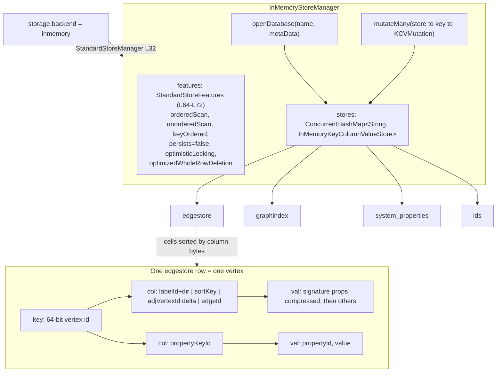

<!--
entry-meta
date: 2026-10-30
type: reading-session
track: JanusGraph
lesson: 01
category: Open Source Contribution
title: Setup and the data model — a vertex is a row
slug: janusgraph-setup-and-data-model
pinned-commit: a59ae8d8024207598eada34998d867617df51adf
-->

# Setup and the data model — a vertex is a row

**2026-10-30 · JanusGraph Track · Session 01 of 28 · reading at `a59ae8d8`**

## Where This Fits

- **Previous session:** none — session 01. The 28-item syllabus and why it runs bottom-up are in [`TRACK.md`](../../../TRACK.md).
- **Today:** the premise everything else hangs off — JanusGraph is a translation layer mapping a property graph onto a Bigtable-shaped key → sorted-columns store. The data-model doc, then the smallest complete backend in the tree (~200 lines).
- **Sets up:** session 02 reads `KeyColumnValueStore` (`getSlice`, `mutate`, `acquireLock`) — the interface `InMemoryStoreManager` hands out today without you yet knowing what it promises. Session 03 reads `StoreFeatures`, the builder chain at `InMemoryStoreManager.java:64-72`.

## Today's Reading

| # | File (permalink at `a59ae8d8`) | Read | Why |
|---|---|---|---|
| 1 | [`docs/advanced-topics/data-model.md`](https://github.com/JanusGraph/janusgraph/blob/a59ae8d8024207598eada34998d867617df51adf/docs/advanced-topics/data-model.md) | All (~70 lines); *Individual Edge Layout* twice | The track's premise in one page; its last two paragraphs are the column anatomy of sessions 10–11. |
| 2 | [`BUILDING.md`](https://github.com/JanusGraph/janusgraph/blob/a59ae8d8024207598eada34998d867617df51adf/BUILDING.md) + [`CONTRIBUTING.md`](https://github.com/JanusGraph/janusgraph/blob/a59ae8d8024207598eada34998d867617df51adf/CONTRIBUTING.md) | Skim | Two facts bite later: every commit needs `-s` (DCO), and feature branches always come off `master` (the project backports). |
| 3 | [`InMemoryStoreManager.java`](https://github.com/JanusGraph/janusgraph/blob/a59ae8d8024207598eada34998d867617df51adf/janusgraph-inmemory/src/main/java/org/janusgraph/diskstorage/inmemory/InMemoryStoreManager.java#L60-L72) | Whole file; linger on `L60-L72` and `mutateMany` | The whole backend contract with no network, retries or driver in the way. A `ConcurrentHashMap<String, InMemoryKeyColumnValueStore>` *is* the database. |
| 4 | [`StandardStoreManager.java`](https://github.com/JanusGraph/janusgraph/blob/a59ae8d8024207598eada34998d867617df51adf/janusgraph-core/src/main/java/org/janusgraph/diskstorage/StandardStoreManager.java#L28-L33) | Lines 28–33 only | How the string `"inmemory"` becomes a class. Five backends, one enum. |
| 5 | [`InMemoryGraphTest.java`](https://github.com/JanusGraph/janusgraph/blob/a59ae8d8024207598eada34998d867617df51adf/janusgraph-inmemory/src/test/java/org/janusgraph/graphdb/inmemory/InMemoryGraphTest.java) | `getConfiguration()`, `clopen()`, and the `@Disabled` list | The `@Disabled` list is the most informative part of the file: an inventory of what this backend cannot do, one capability per entry. |

**Skip today:** `MultiPageEntryBuffer`, `BufferPage`, `BufferPageUtils`, `InMemoryKeyColumnValueStoreFragmentationReport` in the same package — paging and fragmentation, session 04's subject. Also skip `makeSnapshot` / `restoreFromSnapshot` at the bottom of `InMemoryStoreManager`: a side feature, not part of the storage contract.

## Map

| Graph concept | Storage concept |
|---|---|
| vertex | one **row**, keyed by the 64-bit vertex id |
| its adjacency list (incident edges **and** properties) | the row's **cells**, sorted by column |
| one edge, or one property | one **cell** = (column, value) |
| vertex-centric index lookup | a **column range** over one row |

- **Each edge is stored twice**, once per endpoint row — the root of later sessions' delete and consistency problems.
- **Max cells per row = max supported vertex degree.** The supernode problem is this line of the data model, not a bug.
- **Column bytes *are* the sort order**, serialized so byte order respects the label's sort key — hence `EdgeSerializer`'s order-preserving encodings, and why an adjacent vertex id is stored as the *difference* from the owning vertex's id.
- `keyOrdered` is **optional**; JanusGraph partitions with it when offered. The in-memory manager claims it `true` while advertising `persists(false)` in the same chain.



**Invariant to carry:** `mutateMany` routes by *store name* first, then row key, and tests `mut.hasWholeRowDeletion()` **before** `mut.hasAdditions() || mut.hasDeletions()`. That ordering is deliberate — work out what it implies for a mutation carrying both.

**Setup (once, before reading).** Fork → clone → `git remote add upstream git@github.com:JanusGraph/janusgraph`, then `git remote set-url --push upstream do-not-push`. Set `git config alias.ci 'commit -s'` and use `git ci` from here on; DCO sign-off is mandatory and retrofitting it means a force-push. Java 11+ (CI tests 11/17/21/25), Maven 3.6.3+. Build: `mvn clean install -pl janusgraph-inmemory -am -DskipTests=true`.

## Questions To Answer From The Code

One line each, with `file:line`.

1. `openDatabase` does `containsKey`, then `putIfAbsent`, then a separate `get`. Why is the `putIfAbsent` return value discarded? If two threads call `openDatabase("edgestore")` at the same instant, what breaks and what is merely slower?
2. `features` is built in the constructor and the `Configuration configuration` parameter is **never read**. So what is the no-arg constructor for, and who calls the one-arg form?
3. Find one entry in `InMemoryGraphTest`'s `@Disabled` list that is a direct consequence of `.persists(false)` alone, and say which.
4. `clopen()` throws if the graph has any vertices or edges. What does `clopen` mean in the base `JanusGraphTest`, and why is this the only backend that must refuse it?
5. `StandardStoreManager`'s constructor takes a `Collection<String>` of shorthands, yet all five constants pass one string. Which backend would plausibly want two, and what is `getFirstStoreShorthand()` for?
6. `getLocalKeyPartition()` throws `UnsupportedOperationException`. Which `StoreFeatures` flag should stop a caller reaching it, and does the builder chain set that flag?

## Hands-On

`WholeRowDeletionOptimizationTest` is the right test for today: its assertions are written directly in terms of *rows*.

```bash
cd janusgraph
mvn clean install -pl janusgraph-inmemory -am -DskipTests=true
mvn -pl janusgraph-inmemory -Dtest=WholeRowDeletionOptimizationTest test
mvn -pl janusgraph-inmemory -Dtest=WholeRowDeletionOptimizationTest#superNodeRemovalUsesWholeRowDeletion test
```

**What to look for.** It builds a hub with 50 edges via `createSuperNode(50)`, removes it, and asserts **exactly one** edgestore row was deleted whole-row with `deletions == 0`. 50 edges, each stored twice — how many rows did the write touch, and why is only *one* a whole-row delete? Then breakpoint the `for` over `storeMut` in `InMemoryStoreManager.mutateMany` and inspect the outer map's key set on the commit after `remove()`: that key set is the logical tables one vertex deletion touches, needed again in session 07.

Cheaper second exercise: the test calls `((StandardJanusGraph) graph).getIDManager().getKey(hubId)`. Log that `StaticBuffer`'s bytes beside `hubId` — the vertex-id → row-key function, session 08's whole subject. **Do not commit the log line**; `git checkout --` the file afterwards.

## Contribution Radar

Searched open issues this run. Nothing open is tagged to the in-memory backend or the data model; nearest live items:

- **[#3013 — An ambiguous error message【Vertex with given id already exists:xxx】](https://github.com/JanusGraph/janusgraph/issues/3013)** · `good first issue`, `area/docs` · unassigned · last touched 2026-09-22. The message comes from the vertex-id path — the row-key path session 08 covers. Fixing it means knowing *which* id space collided.
- **[#225 — Improve meta-property documentation](https://github.com/JanusGraph/janusgraph/issues/225)** · `area/docs` · unassigned · open since 2017. The data-model doc's last paragraph is the only place in the tree saying that a `list()`-cardinality property moves its property id *into the column* — one sentence, and meta-properties use exactly that mechanism.
- **[#1573 — Possible inconsistency in chapter 5 documentation](https://github.com/JanusGraph/janusgraph/issues/1573)** · `help wanted`, `good first issue` · unassigned · stale since 2020 — verify the inconsistency still exists before touching it.

Only four issues carry `good first issue` repo-wide; the other two (#3126, #3127) are index-lifecycle work for session 25.

## My Notes

<!-- Aryant fills this in after reading. The next session reads it and answers your open questions first. -->

### Call path I traced
<!-- e.g. tx.commit() → StandardJanusGraph.commit() → ... → store.mutate() -->

### Answers to today's questions
<!-- one line per question, with the file:line where you found it -->

### What surprised me

### Still unclear

### Possible issue / PR idea

## Sources

All read this run at pinned commit `a59ae8d8024207598eada34998d867617df51adf`:

- [`docs/advanced-topics/data-model.md`](https://github.com/JanusGraph/janusgraph/blob/a59ae8d8024207598eada34998d867617df51adf/docs/advanced-topics/data-model.md)
- [`BUILDING.md`](https://github.com/JanusGraph/janusgraph/blob/a59ae8d8024207598eada34998d867617df51adf/BUILDING.md) · [`CONTRIBUTING.md`](https://github.com/JanusGraph/janusgraph/blob/a59ae8d8024207598eada34998d867617df51adf/CONTRIBUTING.md)
- [`InMemoryStoreManager.java#L60-L72`](https://github.com/JanusGraph/janusgraph/blob/a59ae8d8024207598eada34998d867617df51adf/janusgraph-inmemory/src/main/java/org/janusgraph/diskstorage/inmemory/InMemoryStoreManager.java#L60-L72)
- [`StandardStoreManager.java#L28-L33`](https://github.com/JanusGraph/janusgraph/blob/a59ae8d8024207598eada34998d867617df51adf/janusgraph-core/src/main/java/org/janusgraph/diskstorage/StandardStoreManager.java#L28-L33)
- [`InMemoryGraphTest.java`](https://github.com/JanusGraph/janusgraph/blob/a59ae8d8024207598eada34998d867617df51adf/janusgraph-inmemory/src/test/java/org/janusgraph/graphdb/inmemory/InMemoryGraphTest.java) · [`WholeRowDeletionOptimizationTest.java`](https://github.com/JanusGraph/janusgraph/blob/a59ae8d8024207598eada34998d867617df51adf/janusgraph-inmemory/src/test/java/org/janusgraph/graphdb/inmemory/WholeRowDeletionOptimizationTest.java)

Directory listings read at the same commit: repository root, `janusgraph-inmemory/src/main/java/org/janusgraph/diskstorage/inmemory/`, `janusgraph-inmemory/src/test/java/org/janusgraph/graphdb/inmemory/`.
