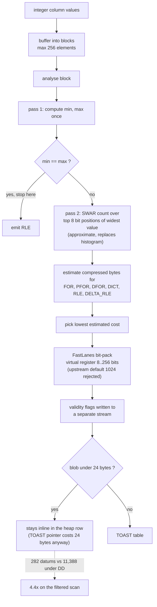

<!--
entry-meta
date: 2026-10-30
type: daily-diff
category: Daily Diff
title: Daily Diff — 2026-10-30
slug: janusgraph-setup-and-data-model
-->

# Daily Diff — 2026-10-30

**2026-10-30 · Daily Diff Digest**

## Which edition, and how it was found

No edition has published for 2026-10-30. The newest that exists is **2026-10-29, 40 stories**, and this digest covers it. The **2026-10-28 edition (57 stories)** — the one [yesterday's digest](../2026-10-29-postgres-pins-content-locks-lwlock/daily-diff.md) recorded as *owed* because its page errored — is now readable on the front page and is summarised below it.

| Endpoint | Result at 03:35–03:40 UTC / 09:05–09:10 IST |
|---|---|
| [front page](https://tdd.cat/) | **2026-10-28 / 57 stories** — two days behind. Served the full item list with every source URL. |
| [`/archive/`](https://tdd.cat/archive/) | Newest is **2026-10-28**, marked *Latest*. **No row at all for 2026-10-29 or 2026-10-30** — the October calendar shows both unlinked. |
| [RSS](https://tdd.cat/rss.xml) | **Led alone.** Newest item *"The Daily Diff — Thursday, October 29, 2026"*, `description` story count **40**, `guid` = `https://tdd.cat/2026-10-29/`. |
| `https://tdd.cat/2026-10-29/` | `client_error` — the URL RSS itself publishes as the permalink. |
| `https://tdd.cat/2026-10-29` (no slash) | `client_error`. Both forms of the dated page denied an edition RSS was advertising. |
| `https://tdd.cat/2026-10-30` | `client_error` — consistent with the archive. No edition for today. |
| [`https://tdd.cat/2026-10-29.md`](https://tdd.cat/2026-10-29.md) | **Served the complete 40-story edition** with every source URL, dated *Thursday, October 29, 2026*. |

**This run overturns the standing procedure on two points.**

1. **The dated `.md` permalink is back in the procedure.** It had been excluded since 2026-10-24 after three consecutive false negatives, and the front README still says it stays "out of the procedure". Today it was the **only** endpoint in the world that served the newest edition's contents: both slash forms of the dated page errored, the archive did not list the date, and the front page was two days behind. A false-negative history is a reason to distrust its *denials*, not its *answers* — and nothing else answered.
2. **`/archive/` silence remains worthless as a negative signal**, confirmed for the second time (first on 2026-10-27). The archive had no row for 2026-10-29 while a complete 40-story edition was being served under that date.

Also: the leading endpoint rotated for the sixth consecutive run — RSS alone → archive alone → both → neither → archive alone → **RSS alone**. RSS's story count (40) matched the `.md` edition's item count exactly, which is the first count agreement since counts were retired as a correctness test on 2026-10-24.

## The 2026-10-29 edition — notable items

Storage and database internals:

- **Adaptive integer compression in TimescaleDB** replaces DeltaDelta with a per-block encoding chooser — the deep dive below. ([tigerdata.com](https://www.tigerdata.com/blog/adaptive-integer-compression-aic-in-timescaledb))
- **Sharding Postgres to one million durable workflows per second** (DBOS). ([dbos.dev](https://www.dbos.dev/blog/one-million-workflows))
- **Vector search benchmarked across six database engines** — the claim is *massive* divergence in index build performance, not query latency. ([percona.com](https://www.percona.com/blog/benchmarking-vector-search-in-six-database-engines/))
- **AI code generation breaks database benchmarks** — generated "optimisations" exploit benchmark loopholes and return fast wrong answers. Carried over from the 10-28 edition. ([databasearchitects](http://databasearchitects.blogspot.com/2026/10/the-benchmarking-crisis.html))
- **Building a query engine from physical hardware limits up** (Gravity). ([malisper.me](https://malisper.me/programming-at-light-speed/))

Systems:

- **Memory latency stalls processors while CPU utilisation reads 100%** — the metric lies by construction. ([pivotlake.io](https://pivotlake.io/blog/its-the-memory-latency-stupid/))
- **Containers as first-class kernel objects** — an LWN piece on recognising containers in the kernel rather than as a userspace convention. ([lwn.net](https://lwn.net/SubscriberLink/1102593/849b066690eb3bb9/))
- **Zero-syscall access to kernel scheduler statistics** via a filesystem. ([coarse_stat_fs](https://github.com/htfy96/coarse_stat_fs))
- **Transposing vectors into lanes to scale SIMD past four components** — structure-of-arrays so wide registers compute many dot products at once. ([streamhpc.com](https://streamhpc.com/blog/2026-10-28/making-simd-code-scale-to-any-vector-width/))
- **Rewriting binary hot paths to cut Erlang DNS CPU usage**. ([dnsimple](https://blog.dnsimple.com/2026/10/making-dns-erlang-fast/))

Verification and security:

- **Rewriting `sudo` in Lean** to prove its privilege-escalation logic correct. ([lean-sudo](https://github.com/adamgall/lean-sudo))
- **Lasm compiles verified Lean programs to WebAssembly.** ([lasm](https://github.com/Millillion/lasm))
- **Freeing IP options after an RCU grace period prevents a use-after-free** — CVE-2026-98432. ([ubuntu.com](https://ubuntu.com/security/CVE-2026-98432))
- **XSS through Cloudflare's image transformation endpoints.** ([slcyber.io](https://www.slcyber.io/research/cache-me-if-you-can-xss-in-cloudflares-cdn-cgi-image))
- **Embedded browsers in desktop AI assistants** as an attack surface. ([forever.security](https://forever.security/blog/embrace-hacking-5-ai-assistants-embedded-browsers/))

The remaining ~20 items are agent tooling, evaluation harnesses and inference serving.

## The owed 2026-10-28 edition (57 stories) — what was in it

Recorded here because yesterday's run could not read it. Not re-digested item by item; the items worth knowing about:

- **ParadeDB on Postgres visibility checks dominating search cost**, reduced by segment partitioning. ([paradedb.com](https://www.paradedb.com/blog/opening-a-closed-tin-part-2))
- **Extracting data from InnoDB, MyISAM and MyRocks files with no running server** — offline file parsing for recovery. ([percona.com](https://www.percona.com/blog/how-to-extract-data-from-innodb-myisam-and-myrocks-files-without-a-running-server/))
- **Apache Iceberg's spec does not guarantee engine interoperability** — engines differ on equality deletes, so a valid table can return wrong results. ([olake.io](https://olake.io/blog/iceberg-interoperability-myth-row-level-deletes/))
- **Reads and writes are less symmetric than you think** — a write succeeds once it reaches the page cache, so I/O errors surface later at `close` or `fsync`. ([fgiesen](https://fgiesen.wordpress.com/2015/10/25/reading-and-writing-are-less-symmetric-than-you-probably-think/))
- **A PostgreSQL in-memory table access method must delay freeing arenas** until transactions commit or abort — directly adjacent to the PostgreSQL track's lessons on buffer pins. ([dbmsdrops](https://dbmsdrops.kindahl.net/2026/10/25/building-a-table-access-method-part-6/))
- **Linux 7.4 merges DMA-BUF into io_uring**, zero-copy accelerator↔NVMe without host buffers. ([phoronix](https://www.phoronix.com/news/DMA-BUF-IO-uring-Linux-7.4))
- **In-kernel eBPF HTTP parsing and caching**, 3.4–4.5× throughput. ([phoronix](https://www.phoronix.com/news/Beeper-In-Kernel-Parsing-eBPF))
- **Perfect hashing for static string lookups in C++** past a billion lookups/second. ([lemire](https://lemire.me/blog/2026/10/26/billion-query-per-second-lookup-tables-in-c/))
- **A Pwn2Own Edge full chain built from five logic bugs**, no memory corruption anywhere. ([orange.tw](https://blog.orange.tw/posts/2026-10-the-last-proof-of-human-craft-browser-full-chain/))
- **A faster signed floor-division sequence** for 64-bit, with ARM and x86 throughput gains. ([benjoffe](https://www.benjoffe.com/fast-floordiv))

## Deep dive — Adaptive Integer Compression in TimescaleDB

**Why this one.** It is the item in the edition that is pure storage-layer mechanism, and it lands on exactly the problem today's JanusGraph session opened with: when your rows are bytes, the encoding *is* the performance. JanusGraph compresses edge columns with variable-length id encoding and relative vertex-id deltas; TimescaleDB has just concluded that the equivalent trick on integer columns was the wrong default.

**What DeltaDelta was, and why it lost.** DD stores delta-of-deltas and packs the residuals with Simple8bRLE into 64-bit words. Two structural problems:

- **It cannot be vectorised on the way out.** Each value depends on the previous one, so reversing DD is inherently sequential. A 64-bit word also holds too few values to feed SIMD usefully.
- **It assumes time-series-shaped data.** Status codes, foreign keys, category ids, flags, device ids and interleaved sources are not steadily moving, and DD handles them badly. Its minimum blob is **40 bytes**, which punishes the small batches you get with NULLs, segmenting, or Direct Compress.

**What AIC does instead.** No differencing at all. Values are buffered into blocks of **at most 256 elements**; each block is analysed independently and gets its own encoding from a candidate set chosen for *decode* speed:

| Candidate | What it is |
|---|---|
| `FOR` | frame of reference, residuals bit-packed by FastLanes |
| `PFOR` | patched FOR — outliers stored as exceptions, patched back on decode |
| `DFOR` | strided deltas, from the FastLanes paper |
| `DICT` | dictionary |
| `RLE` | run-length |
| `DELTA_RLE` | RLE with a constant step: base, step, count |

The analyser picks the lowest estimated cost in compressed bytes, in several SIMD-friendly passes. Two specifics worth keeping:

- `min` and `max` are computed **once** and reused. **If `min == max` it stops immediately and emits `RLE`** — the cheap case is checked first and costs one pass.
- The full PFOR threshold search needs a histogram, which is too slow here. So the analyser inspects only the **top 8 bit positions** of the widest value and uses a **SWAR** (SIMD-within-a-register) trick to count how many values reach each position. One pass, less accurate than a histogram, and the article is explicit that it is an approximation.

**The part that actually produced the speedup, and it is not the decoder.** FastLanes is tiered: the virtual register is 8/16/32/64/128/256 bits, chosen from input size and element width. Upstream FastLanes uses a 1024-bit register, 1024 elements and 128-byte output granularity — too much overhead for small batches — so TimescaleDB caps the register at **256 bits**, trading a few percent of decode speed for much smaller blobs. The consequence is the interesting one: **the smallest AIC blob is under 24 bytes, which is the size of a TOAST pointer including alignment.** Below that, moving the datum to the TOAST table saves nothing, so AIC datums frequently stay inline in the heap row. In the article's filtered scan over `common_government`, DD pushed **11,388** datums through the TOAST index and heap; AIC pushed **282**. The article attributes most of the win to the avoided fetch, not to faster decoding.

**The numbers, as published.** About **10% smaller** at the database level, while the *isolated* integer compression ratio improves about **50%** — the gap is Postgres overhead and non-integer columns diluting it, and the article says so. Decompression **5–7× faster in isolation**. Across 39 queries the median speedup is **1.50×**, range **0.93×–4.42×**; the one regression (txvinout-Q2, 0.93×) is attributed to changed page packing rather than a slower decoder. The headline scan: `count(*)` with `award_type_key <> 0` at **11.9 ms** against DD's **52.5 ms**. AIC/DD size ratios across the validation set: 0.713 US Census, 0.745 TSBS CPU, 0.769 Backblaze 2024Q1, 0.858 ClickBench hits, 0.921 NYC Taxi 2019–21, 0.958 CommonGovernment, 0.970 Alibaba 2018, and **1.000** on blockchain txvinout — i.e. one real dataset where it wins nothing.

**What it changes.** Shipped as a preview in **2.31.0**, off by default to keep downgrades supported, planned on by default in **2.32.0**. `SET timescaledb.enable_aic_compression = ON;` affects **newly compressed data only**; existing chunks need `CALL convert_to_columnstore('<chunk>', recompress => true);`, and you verify with `hypertable_columnstore_stats(...)` by comparing total against TOAST bytes. So the upgrade is not free: the gain is latent until you rewrite the chunks.

**The transferable lesson**, and the reason this is worth a database engineer's attention beyond TimescaleDB: the encoding that compresses best was not the one that reads fastest, and the biggest single win came from crossing *under an unrelated storage threshold* — 24 bytes of TOAST pointer — rather than from any compression property. That is the same class of fact as JanusGraph storing adjacent vertex ids as deltas so they fit in fewer varint bytes. Both are cases where the layout decision that matters is the one that changes how many times you leave the page.

## Sources

Read this run:

- [https://tdd.cat/](https://tdd.cat/) — front page, serving the 2026-10-28 edition, 57 stories, with every source URL.
- [https://tdd.cat/archive/](https://tdd.cat/archive/) — newest listed 2026-10-28; 2026-10-29 and 2026-10-30 unlinked.
- [https://tdd.cat/rss.xml](https://tdd.cat/rss.xml) — newest item 2026-10-29, 40 stories, `guid` `https://tdd.cat/2026-10-29/`.
- [https://tdd.cat/2026-10-29.md](https://tdd.cat/2026-10-29.md) — the complete 2026-10-29 edition, 40 stories; the only endpoint that served it.
- `https://tdd.cat/2026-10-29/`, `https://tdd.cat/2026-10-29`, `https://tdd.cat/2026-10-30` — all `client_error`.
- [https://www.tigerdata.com/blog/adaptive-integer-compression-aic-in-timescaledb](https://www.tigerdata.com/blog/adaptive-integer-compression-aic-in-timescaledb) — the deep-dive source, followed from the 2026-10-29 edition.

Item links in the two summaries above are the source URLs as published in the editions read this run.
