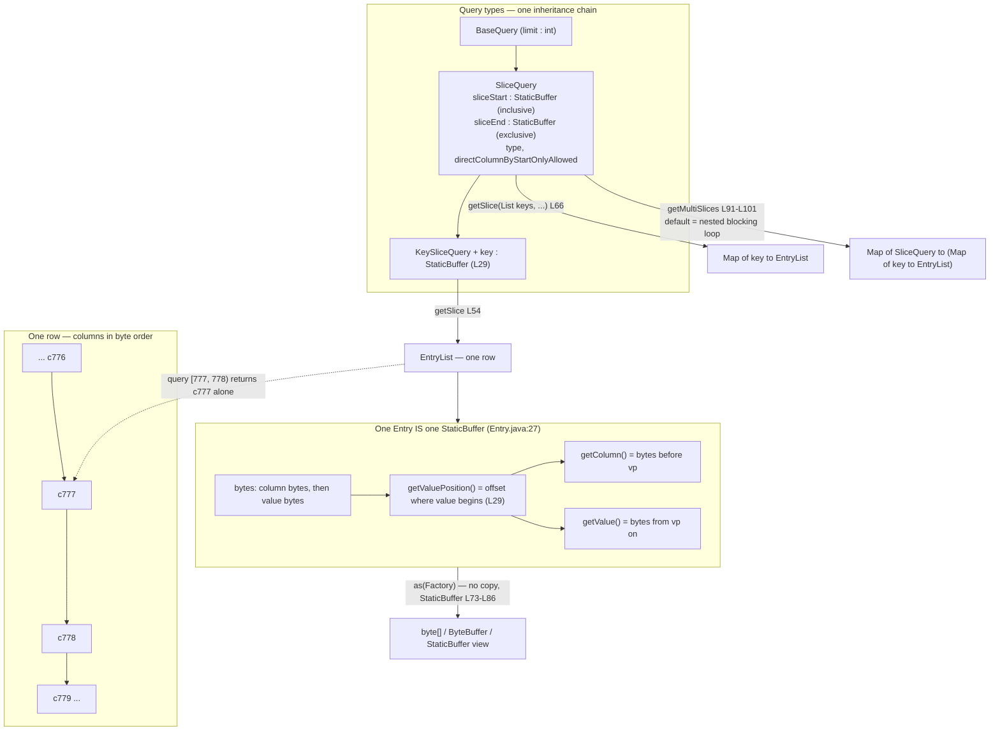

<!--
entry-meta
date: 2026-10-31
type: reading-session
track: JanusGraph
lesson: 02
category: Open Source Contribution
title: The KeyColumnValueStore contract — a half-open interval over one row
slug: janusgraph-kcv-store-contract
pinned-commit: a59ae8d8024207598eada34998d867617df51adf
-->

# The KeyColumnValueStore contract — a half-open interval over one row

**2026-10-31 · JanusGraph Track · Session 02 of 28 · reading at `a59ae8d8`**

> Previous session's notes are empty — reading without writing down what you found doesn't stick.

## Where This Fits

- **Previous:** [01 — Setup and the data model](../2026-10-30-janusgraph-setup-and-data-model/README.md) — a vertex is a row, its edges and properties are that row's cells sorted by column bytes. It handed out `KeyColumnValueStore` as an opaque type.
- **Today:** that type, opened. Three methods carry the whole contract — `getSlice`, `mutate`, `acquireLock` — and the four types they speak in: `StaticBuffer`, `Entry`, `SliceQuery`, `KeySliceQuery`.
- **Sets up:** session 03 reads `StoreFeatures` (`InMemoryStoreManager.java:64-72`), which declares *which parts* of today's contract a backend honours. Session 04 reads the in-memory `getSlice`.

## Today's Reading

| # | File (permalink at `a59ae8d8`) | Read | Why |
|---|---|---|---|
| 1 | [`KeyColumnValueStore.java`](https://github.com/JanusGraph/janusgraph/blob/a59ae8d8024207598eada34998d867617df51adf/janusgraph-core/src/main/java/org/janusgraph/diskstorage/keycolumnvalue/KeyColumnValueStore.java) | All 221 lines, but **the javadoc is the content** — `L103-L128` and `L131-L182` twice | An interface whose semantics live in prose. `L107-L110` and `L139-L144` constrain every backend in the repo. |
| 2 | [`SliceQuery.java#L40-L153`](https://github.com/JanusGraph/janusgraph/blob/a59ae8d8024207598eada34998d867617df51adf/janusgraph-core/src/main/java/org/janusgraph/diskstorage/keycolumnvalue/SliceQuery.java#L40-L153) | `L40-L153` | The only real logic today. `subsumes` (`L111-L119`) and `getSubset` (`L122-L134`) are the query cache's correctness argument, written as two comparisons. |
| 3 | [`KeySliceQuery.java`](https://github.com/JanusGraph/janusgraph/blob/a59ae8d8024207598eada34998d867617df51adf/janusgraph-core/src/main/java/org/janusgraph/diskstorage/keycolumnvalue/KeySliceQuery.java) | All 84 lines | 55 lines of body. Note what it *adds* (`key`, `L29`) versus what it only narrows the return type of (`L49-L58`). |
| 4 | [`Entry.java#L27-L39`](https://github.com/JanusGraph/janusgraph/blob/a59ae8d8024207598eada34998d867617df51adf/janusgraph-core/src/main/java/org/janusgraph/diskstorage/Entry.java#L27-L39) + [`StaticBuffer.java#L28-L86`](https://github.com/JanusGraph/janusgraph/blob/a59ae8d8024207598eada34998d867617df51adf/janusgraph-core/src/main/java/org/janusgraph/diskstorage/StaticBuffer.java#L28-L86) | those ranges | `Entry extends StaticBuffer` (`Entry.java:27`) is the load-bearing declaration of the storage layer. `StaticBuffer`'s `Factory<T>` block (`L73-L86`) is why decoding allocates nothing. |
| 5 | [`BufferUtil.java#L189-L217`](https://github.com/JanusGraph/janusgraph/blob/a59ae8d8024207598eada34998d867617df51adf/janusgraph-core/src/main/java/org/janusgraph/diskstorage/util/BufferUtil.java#L189-L217) | 29 lines only | `nextBiggerBuffer` — how an exclusive end bound expresses an inclusive intent. 20 lines of carry propagation that **throws** rather than wraps. |

**Skip today:** everything from `KeyColumnValueStore.java:185` down — the four `getKeys` overloads, `KeyIterator`, `KeyRangeQuery`, `MultiSlicesQuery`, `KeySlicesIterator`. Full-scan machinery; it belongs with `orderedScan`/`unorderedScan` in session 03. Also skip `MultiKeysQueryGroups` / `KeysQueriesGroup` (read the default body's shape, not the container types) and `StaticBuffer.java:30-60` (16 mechanical primitive getters).

## Map

| Method | Scope | Line |
|---|---|---|
| `getSlice(KeySliceQuery, txh)` | one row | `L54` |
| `getSlice(List<StaticBuffer>, SliceQuery, txh)` | many rows, **one** column range | `L66` |
| `getMultiSlices(MultiKeysQueryGroups, txh)` | many rows × many ranges; `default` body is a nested blocking loop | `L91-L101` |
| `mutate(key, additions, deletions, txh)` | one row | `L129` |
| `acquireLock(key, column, expectedValue, txh)` | one cell | `L183` |

Four invariants to carry in:

- **The column interval is half-open, `[sliceStart, sliceEnd)`.** Start inclusive (`SliceQuery.java:64-68`), end exclusive (`L73-L77`), and `contains` encodes exactly that: `start.compareTo(b) <= 0 && end.compareTo(b) > 0` (`L136-L138`). One exact column therefore needs `[point, point+1)` — `pointRange` (`L140-L142`) via `BufferUtil.nextBiggerBuffer`.
- **Deletions apply strictly before additions** inside one `mutate` (`L107-L110`). A column in both lists ends up *present*, with the new value.
- **A lock is verified only on the first `mutate` of a transaction** (`L139-L144`), and `acquireLock` may return successfully without having acquired anything (`L140-L141`). Discretionary locks, deferred verification.
- **`NO_ADDITIONS`/`NO_DELETIONS`** (`L42-L43`) are shared empty lists — but `mutate`'s javadoc also permits `null` for either (`L119-L122`). Two spellings of one thing.



## Questions To Answer From The Code

One line each, with `file:line`. None are answered above.

1. `getSlice`'s javadoc promises `BackendException` *"when columnEnd < columnStart"* (`KeyColumnValueStore.java:51`). `SliceQuery`'s constructor (`L52-L57`) only asserts non-null. Where is that check actually performed for the in-memory backend — and if nowhere, what does a reversed slice return?
2. `setLimit` guards with `Preconditions.checkArgument(!hasLimit())` (`L146`), so a limit is settable once. Yet `updateLimit` exists (`L151-L153`) and `KeySliceQuery.updateLimit` builds `new KeySliceQuery(key, this)` (`L56-L58`). Why is narrowing a limit construction rather than mutation?
3. `subsumes` (`L111-L119`) demands `sliceStart.compareTo(oth.sliceStart) == 0` when a limit is present but only `<= 0` without one. Construct a pair of queries where allowing an unequal start under a limit makes `getSubset` return wrong rows.
4. `equals`/`hashCode` (`L91-L109`) cover start, end and limit — not `type` (`L44`) nor `directColumnByStartOnlyAllowed` (`L45`). Which omission could make a cache return wrong *data*, and which is cosmetic?
5. `nextBiggerBuffer` (`BufferUtil.java:197-217`) throws on carry-out unless `allowOverflow`, and `pointRange` (`L140-L142`) calls the **non**-overflow form. Which column value makes `pointRange` throw, and can a real edgestore column be that value?
6. Combine `L107-L110` (deletions before additions) with `L139-L144` (locks verified on the *first* `mutate` only): what is the status of a lock acquired *after* a transaction has already called `mutate` once?

## Hands-On

The contract has an executable specification: `KeyColumnValueStoreTest` in `janusgraph-backend-testutils` runs against every backend, and [`InMemoryKeyColumnValueStoreTest`](https://github.com/JanusGraph/janusgraph/blob/a59ae8d8024207598eada34998d867617df51adf/janusgraph-inmemory/src/test/java/org/janusgraph/diskstorage/inmemory/InMemoryKeyColumnValueStoreTest.java) is its thinnest subclass (37 lines).

```bash
cd janusgraph
mvn -pl janusgraph-inmemory -am -DskipTests=true install
mvn -pl janusgraph-inmemory -Dtest=InMemoryKeyColumnValueStoreTest#getSliceRespectsAllBoundsInclusionArguments test
mvn -pl janusgraph-inmemory -Dtest=InMemoryKeyColumnValueStoreTest#getSliceRespectsColumnLimit test
```

**What to look for.** `getSliceRespectsAllBoundsInclusionArguments` ([`KeyColumnValueStoreTest.java#L914-L938`](https://github.com/JanusGraph/janusgraph/blob/a59ae8d8024207598eada34998d867617df51adf/janusgraph-backend-testutils/src/main/java/org/janusgraph/diskstorage/KeyColumnValueStoreTest.java#L914-L938)) writes four adjacent columns — 776, 777, 778, 779 — then queries start 777 / end 778 and asserts **exactly one** entry, column 777. That one assertion *is* the half-open interval. Breakpoint `store.getSlice` and step until you can name the comparison that excludes 778.

`getSliceRespectsColumnLimit` ([`L862-L911`](https://github.com/JanusGraph/janusgraph/blob/a59ae8d8024207598eada34998d867617df51adf/janusgraph-backend-testutils/src/main/java/org/janusgraph/diskstorage/KeyColumnValueStoreTest.java#L862-L911)) writes 1,024 columns: limit ≥ match count returns all; limit < match count returns the **first** `limit` in byte order. Confirm the `cols - 1` case drops the *last* entry.

Then read `L887-L893` of that file: a `for` loop over the result whose entire body is `if (!src.equals(dst)) { int x = 1; }` — a breakpoint hook left in, doing nothing, immediately before the `assertEquals(entries, result)` that does the work. Verify that yourself before believing it; it is a candidate change.

For `acquireLock`, run `InMemoryLockKeyColumnValueStoreTest` in the same module and watch which calls throw — session 01 noted the in-memory manager advertises `optimisticLocking`.

**Any log line you add is temporary.** `git checkout --` the file before committing.

## Contribution Radar

Searched open issues and PRs this run. Today's reading lands on `getMultiSlices` (`L91-L101`), whose own javadoc (`L71-L81`) says the default *"is not optimized"* and *"It is highly advisable to overwrite"* it. Two open issues are that request, per backend:

- **[#3864 — Implement getMultiSlices method for HBase storage backend](https://github.com/JanusGraph/janusgraph/issues/3864)** · `storage/hbase`, `kind/performance` · no assignee shown · open since 2023-06-26, untouched since. Literally the subject of `L68-L101`: HBase inherits the sequential default, so a multi-vertex traversal costs one blocking round trip per `SliceQuery`.
- **[#3816 — Implement multi-range slice queries for CQL storage implementation](https://github.com/JanusGraph/janusgraph/issues/3816)** · `storage/cassandra`, `kind/performance`, `area/core` · no assignee shown · open since 2023-06-12. Same shape on the CQL side; tagged `area/core` because the query layer must *group* ranges before a backend can batch them. Session 27 reads `CQLKeyColumnValueStore`.
- **[#4086 — adds Couchbase as JanusGraph backend](https://github.com/JanusGraph/janusgraph/pull/4086)** (open PR, last touched 2025-08-27) is a fresh implementation of today's interface. Reading someone's first pass at `getSlice`/`mutate`/`acquireLock` against the javadoc you just read is cheap review practice, and review comments count.

None of the four repo-wide `good first issue` items (#3013, #3126, #3127, #1573) touch the storage contract. Don't force one.

## My Notes

<!-- Aryant fills this in after reading. The next session reads it and answers your open questions first. -->

### Call path I traced
<!-- e.g. tx.commit() → StandardJanusGraph.commit() → ... → store.mutate() -->

### Answers to today's questions
<!-- one line per question, with the file:line where you found it -->

### What surprised me

### Still unclear

### Possible issue / PR idea

## Sources

Read this run at pinned commit `a59ae8d8024207598eada34998d867617df51adf`:

- [`keycolumnvalue/KeyColumnValueStore.java`](https://github.com/JanusGraph/janusgraph/blob/a59ae8d8024207598eada34998d867617df51adf/janusgraph-core/src/main/java/org/janusgraph/diskstorage/keycolumnvalue/KeyColumnValueStore.java) · [`SliceQuery.java`](https://github.com/JanusGraph/janusgraph/blob/a59ae8d8024207598eada34998d867617df51adf/janusgraph-core/src/main/java/org/janusgraph/diskstorage/keycolumnvalue/SliceQuery.java) · [`KeySliceQuery.java`](https://github.com/JanusGraph/janusgraph/blob/a59ae8d8024207598eada34998d867617df51adf/janusgraph-core/src/main/java/org/janusgraph/diskstorage/keycolumnvalue/KeySliceQuery.java)
- [`diskstorage/Entry.java`](https://github.com/JanusGraph/janusgraph/blob/a59ae8d8024207598eada34998d867617df51adf/janusgraph-core/src/main/java/org/janusgraph/diskstorage/Entry.java) · [`StaticBuffer.java`](https://github.com/JanusGraph/janusgraph/blob/a59ae8d8024207598eada34998d867617df51adf/janusgraph-core/src/main/java/org/janusgraph/diskstorage/StaticBuffer.java) · [`util/BufferUtil.java`](https://github.com/JanusGraph/janusgraph/blob/a59ae8d8024207598eada34998d867617df51adf/janusgraph-core/src/main/java/org/janusgraph/diskstorage/util/BufferUtil.java)
- [`KeyColumnValueStoreTest.java`](https://github.com/JanusGraph/janusgraph/blob/a59ae8d8024207598eada34998d867617df51adf/janusgraph-backend-testutils/src/main/java/org/janusgraph/diskstorage/KeyColumnValueStoreTest.java) · [`InMemoryKeyColumnValueStoreTest.java`](https://github.com/JanusGraph/janusgraph/blob/a59ae8d8024207598eada34998d867617df51adf/janusgraph-inmemory/src/test/java/org/janusgraph/diskstorage/inmemory/InMemoryKeyColumnValueStoreTest.java)

Directory listings at the same commit: `janusgraph-core/src/test/java/org/janusgraph/diskstorage/util/`, `janusgraph-inmemory/src/test/java/org/janusgraph/diskstorage/inmemory/`.

Searched this run: [#3864](https://github.com/JanusGraph/janusgraph/issues/3864) · [#3816](https://github.com/JanusGraph/janusgraph/issues/3816) · [#4086](https://github.com/JanusGraph/janusgraph/pull/4086) · repo-wide `label:"good first issue"` (4 results).
