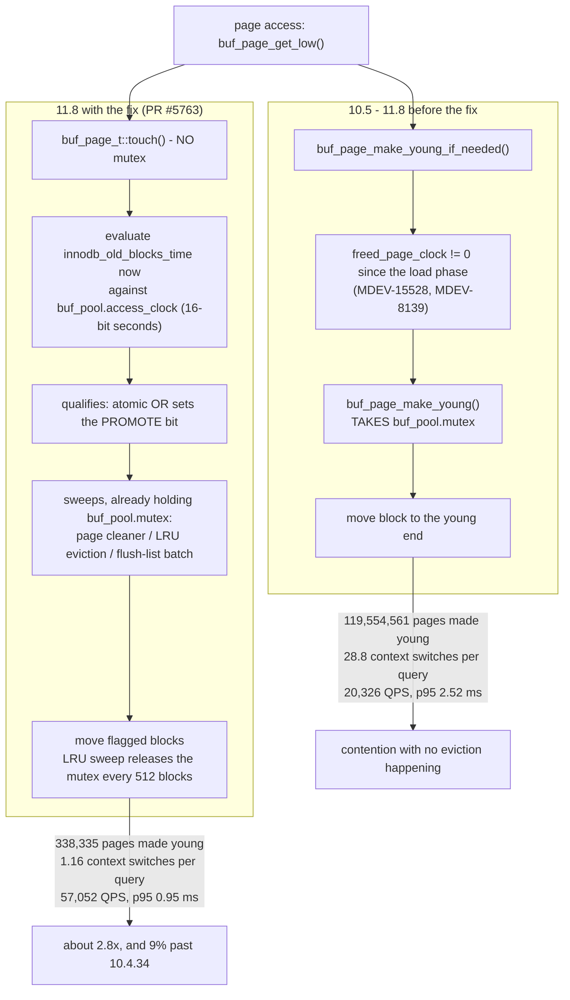

<!--
entry-meta
date: 2026-10-31
type: daily-diff
category: Daily Diff
title: Daily Diff — 2026-10-31
slug: janusgraph-kcv-store-contract
-->

# Daily Diff — 2026-10-31

**2026-10-31 · Daily Diff Digest**

## Which edition, and how it was found

**No edition has published for 2026-10-31.** The newest that exists is **2026-10-30, 47 stories**, not yet covered by any digest, and this one covers it. ([Yesterday's digest](../2026-10-30-janusgraph-setup-and-data-model/daily-diff.md) covered 2026-10-29.)

| Endpoint | Result at 03:33–03:40 UTC / 09:03–09:10 IST |
|---|---|
| [front page](https://tdd.cat/) | **2026-10-29 / 40 stories** — one day behind. Served the full item list with every source URL. |
| [`/archive/`](https://tdd.cat/archive/) | **Led alone.** Listed **2026-10-30 / 47 stories** as *Latest*, above 10-29/40, 10-28/57, 10-27/38, 10-26/42. **2026-10-31 appears in the October calendar with no link.** |
| [`https://tdd.cat/2026-10-30/`](https://tdd.cat/2026-10-30/) | **Served the complete 47-story edition**, dated *Friday, October 30, 2026*, with every source URL. Trailing-slash form, first try. |
| `https://tdd.cat/2026-10-31/` | `client_error` — the forward probe. Agrees with the archive's unlinked 31st. |
| RSS, dated `.md` | **Not probed.** The archive named the maximum date and the trailing-slash page served it; no endpoint after that would have changed the answer. |

**What this run adds to the procedure.** The 2026-10-28 run's prescription — poll the cheap endpoints, take the maximum date any names, probe `https://tdd.cat/{date}/` and `{date}` plus one or two days forward — worked on the first attempt with no fallbacks. The leading endpoint **rotated for the seventh consecutive run**: RSS alone → archive alone → both → neither → archive alone → RSS alone → **archive alone**. One mild correction to yesterday's note: the archive's *silence* about a date proves nothing (established 10-27, confirmed 10-30), but today the archive was the only endpoint that knew the newest edition existed, and the front page's two-day settling window explains why. Yesterday's 10-30 digest recorded "no edition for 2026-10-30, `https://tdd.cat/2026-10-30` errored" — and that edition now exists with 47 stories. **The settling window is at least a day wide in both directions**: a `client_error` on a dated page is not a statement that no edition will exist for that date, only that none is being served yet.

## The 2026-10-30 edition — notable items

Database and storage internals:

- **MariaDB 11.8 is ~3× faster on some in-memory workloads** — a buffer-pool LRU mutex on the page-access path, a regression dating to 10.5. The deep dive below. ([mariadb.org](https://mariadb.org/how-mariadb-11-8-became-about-3x-faster-on-some-in-memory-workloads-fixing-a-regression-dating-back-to-10-5/))
- **Ingesting a billion metrics per second inside PostgreSQL** — `stat_pg`, a StatsD-style ingestion worker using eBPF XDP and compact packing. ([statpg.com](https://statpg.com/))
- **Querying a million-device topology map with Roaring bitmaps** — ServiceRadar Atlas filters per-attribute Roaring bitmaps in ~1 ms. Directly adjacent to today's JanusGraph session: the same problem as a vertex-centric index, solved with bitmaps instead of sorted columns. ([serviceradar.cloud](https://serviceradar.cloud/blog/querying-a-million-device-topology-map-with-atlas))
- **Postgres queries Iceberg REST catalogs beyond Apache Polaris** — pg_lake 3.5 adds Lakekeeper and Nessie. ([snowflake.com](https://www.snowflake.com/en/blog/engineering/pg-lake-iceberg-rest-catalog/))
- **Postgres 19 is late and AI-found bugs are why** — bug discovery has outpaced reviewer capacity. ([rhaas.blogspot.com](http://rhaas.blogspot.com/2026/10/postgres-19-is-late-and-its-ais-fault.html))
- **Building query engines backward from hardware limits** — pgrust's Gravity, same work the 10-29 edition carried under a different URL. ([pgrust.com](https://pgrust.com/blog/programming-at-light-speed/))

Systems:

- **Memory latency stalls processors at 100% CPU utilisation** — carried over from 10-29. ([pivotlake.io](https://pivotlake.io/blog/its-the-memory-latency-stupid/))
- **Profiling disk wait time directly with eBPF flame graphs**, attributing I/O latency to application stacks. ([coroot.com](https://coroot.com/blog/disk-io-profiling-with-ebpf/))
- **Separating state from I/O makes protocols testable** — Firezone's sans-IO WireGuard. ([firezone.dev](https://www.firezone.dev/blog/introducing-sanstun))
- **Fiber-based job systems** as an alternative to OS thread scheduling. ([agraphicsguynotes.com](https://agraphicsguynotes.com/posts/building_a_fiber_based_job_system_from_scratch/))
- **gVisor now runs systemd** without a VM, via new kernel primitives. ([gvisor.dev](https://gvisor.dev/blog/2026/09/17/systemd-in-gvisor/))
- **An independent Rust kernel running unmodified Linux binaries** — Ginux. ([github.com/gmkurtzer/ginux](https://github.com/gmkurtzer/ginux))
- **curl was accidentally Turing-complete** through recursive config includes and variable slicing; fixed in 8.17.0. ([seriot.ch](https://seriot.ch/computation/curl.html))

Security:

- **Mitigating the kernel TCP/MPTCP use-after-free in Go** — Go's default MPTCP listeners and how to disable them (CVE-2026-98432, carried from 10-29 in kernel form). ([golang-announce](https://groups.google.com/g/golang-announce/c/PCoQcdxoScw?pli=1), [openwall](https://www.openwall.com/lists/oss-security/2026/10/30/1))
- **Guessable intermediate CA keys allowed forged pypi.org certificates** — `pip install` hijacking. ([openteams.com](https://openteams.com/engineering-blog/emudhra-pip-install-hijacked/))
- **Azure API Connections input-validation flaws enabled cross-tenant compromise.** ([binarysecurity.no](https://www.binarysecurity.no/posts/2026/10/one-root-case))

Testing and verification:

- **Analysing uncovered lines exposes tests passing for the wrong reason** — a PBFT postmortem where a green test never reached the validation logic it claimed to cover. Worth reading alongside today's JanusGraph hands-on, which turns on one assertion carrying an entire semantic. ([xudanu essay](https://github.com/jonesd/xudanu/blob/main/essays/001-dark-line-forensics.md))
- **Verifying x86 binaries directly** removes the compiler from the trusted base. ([v12.sh](https://v12.sh/blog/x86-formal-verification-intro))
- **SMT solvers rejecting buggy agent edits before they land.** ([llmll](https://machunter.github.io/llmll/demo.html))
- **AI agents formalised the Classification of Finite Simple Groups in Lean** and found gaps in the human proofs. ([axiommath.ai](https://axiommath.ai/research/the-enormous-theorem-formalized/))

The remaining ~20 items are agent harness design, inference serving and evaluation tooling.

## Deep dive — the MariaDB buffer-pool LRU mutex, and a 6-year regression

**Why this one.** It is the only item in the edition that is a database engine's hot-path latch, and it continues the PostgreSQL track's last two lessons almost exactly: [lesson 09](../2026-10-28-postgres-buffer-manager-clock-sweep/README.md) read Postgres' clock sweep (a replacement policy with *no* LRU list to maintain) and [lesson 10](../2026-10-29-postgres-pins-content-locks-lwlock/README.md) read what a buffer access must latch. MariaDB has just removed the equivalent latch from InnoDB's read path. The two engines arrive at the same conclusion from opposite directions.

**The structure.** InnoDB's buffer pool keeps a real LRU list, split into a *young* and an *old* sublist (`innodb_old_blocks_pct`). A page read from disk enters the old sublist; `innodb_old_blocks_time` is the interval that must elapse after first access before it may be promoted to young. That is the scan-resistance mechanism: a one-off table scan touches each page once, never waits out the interval, and so never evicts the working set. Since **MDEV-15058** (10.5) removed multiple buffer pool instances, there is **one** `buf_pool.LRU` list behind **one** `buf_pool.mutex`.

**The regression, and why it hid for six years.** Promotion runs through `buf_page_make_young()`, which takes `buf_pool.mutex`. In 10.4, `buf_page_peek_if_too_old()` returned early while `buf_pool->freed_page_clock` was still 0 — and that clock only advanced when a page was removed from the LRU, which normally required a free-block shortage. So on a fully in-memory workload the clock stayed at 0 forever and **no promotion work ever happened**: no mutex, no contention. Then **MDEV-15528** (10.5.2) and **MDEV-8139** (10.5.4, enabled from 10.5.5) changed freed-page handling so the page cleaner removes freed undo and B-tree pages from the LRU itself. The cleaner releases a freed page during the load phase, the clock leaves 0, and it never returns. From that moment **every access to an old-sublist page takes the global mutex**, on a workload where nothing is being evicted at all.

The numbers make the mechanism visible. Pages made young over a server's lifetime: **~25 thousand** on 10.4.34, **1.3–1.8 billion** on most 10.5+ releases. **MDEV-23399** then made `buf_pool.mutex` a blocking mutex, and context switches per query went from **2.8 to 29.6**. Mark Callaghan reported the symptom as **MDEV-33966** in 2024 (`points-covered-pk.pre` down ~24% on a 2-socket box); the reproduction is **MDEV-37992**.

The article is careful about the framing, and it is the honest reading: 10.4 was not *good* at LRU management. It simply never did any.

**The fix (PR #5763, 11.8, backported to 12.3 and 13.1).** Promotion is split into a lock-free decision and a batched move:

- `buf_page_t::touch()` takes **no mutex**. It records the first-access time and, if the block qualifies, sets a `PROMOTE` bit with an atomic OR.
- **The `innodb_old_blocks_time` rule is still evaluated at access time** — a block qualifies only if accessed again after the interval since its first access or last promotion. The bit *records* that decision, so scan resistance survives being applied later. This is the part that the earlier attempt (PR #3522, a plain `ACCESSED` flag) got wrong: approximating the LRU risked evicting recently-used pages, and on `oltp_read_only` it was *slower* — 264k vs 277k TPS — so the work was shelved.
- **Sweeps** move flagged blocks while already holding `buf_pool.mutex`: the page cleaner, LRU eviction, and flush-list batches. The flush-list batch moves only old blocks; LRU sweeps move every flagged block and **release the mutex every 512 blocks**.
- `freed_page_clock` is **removed** — `FREE_PAGE_CLOCK` in `INFORMATION_SCHEMA` now always reads 0. In its place `buf_pool.access_clock` is a **16-bit seconds counter** advanced by a background timer, so an access never reads the system clock. Consequence: `innodb_old_blocks_time` now has **one-second resolution** and an internal cap of about **18.2 hours** (2^16 s).
- Because the rule no longer depends on eviction having started, **LRU management now also runs during warm-up** — the opposite of the 10.4 behaviour, and the point.
- The block descriptor shrinks by **8 bytes**. A new test, `innodb.buf_lru_scan_resistance`, pins the scan-resistance property. No new configuration options.

**The numbers, as published.** The headline comparison — 40 threads, 100 GiB buffer pool, median of 3:

| Server | QPS | p95 (ms) | Pages made young | Ctx switches/query |
|---|---|---|---|---|
| 10.4.34 | 52,410 | 0.92 | 0 | 1.07 |
| 11.8 before fix | 20,326 | 2.52 | 119,554,561 | 28.8 |
| **11.8 with fix** | **57,052** | **0.95** | 338,335 | 1.16 |

That is **2.8×** over the pre-fix build — the "about 3×" of the title — and about **9% faster than 10.4.34**, which the article attributes to unrelated post-10.4 work rather than to LRU behaviour.

Three further results worth keeping:

- **The diagnostic that proved the diagnosis.** Hard-wiring `buf_page_peek_if_too_old()` to always return false gave **57,286 QPS** against an unmodified **18,945**; making `freed_page_clock` never advance gave **56,935**. Two different cuts at the same code path landed within 0.6% of each other. Setting `innodb_old_blocks_time` to `2147483647` ms — the user-space version of the same hack — gave 55,598 against 19,373.
- **Independent validation** (Jeb Miller, EPYC 9454, 48 cores, one run each): 11.8 **17,925 → 66,653** TPS, 12.3 18,740 → 68,646, 13.1 18,738 → 66,146, with 10.4.34 at 62,400 on the same host.
- **The hit ratio did not degrade**, which was the whole worry about the earlier lazy scheme: 98.8% with the fix vs 98.7% before on Pareto keys, 95.8% for both on uniform keys, with throughput 13,466 vs 11,971 TPS.

Caveats the article states itself: some figures come from a review revision that differs from merged code; `Innodb_buffer_pool_pages_made_young` is now counted at sweep time and is **not** comparable with older versions; and the 10.8.8 anomaly in the version sweep (76,104 QPS, out of line with its neighbours) is attributed to a buffer pool that happened to be full with a large young sublist, not to the fix. HammerDB TPROC-C testing is still to come, where `lock_sys.latch` may dominate instead.

**The transferable lesson.** A scan-resistance mechanism was paid for on every page hit, in a workload that never scans and never evicts — and it went unnoticed for six years because the counter that gated it had changed meaning in a *different* subsystem. Postgres sidesteps the whole class by not maintaining an LRU list at all: its clock sweep has no "promote this page" operation to latch. MariaDB's fix converges on the same property from the other side — keep the policy decision, make the bookkeeping someone else's problem, and only pay for it when you were already holding the lock. The same shape as [today's JanusGraph reading](README.md), where the interesting cost is not the comparison that answers a slice query but how many times you take a lock to answer it.

## Sources

Read this run:

- [https://tdd.cat/archive/](https://tdd.cat/archive/) — listed 2026-10-30 / 47 stories as *Latest*; 2026-10-31 unlinked.
- [https://tdd.cat/2026-10-30/](https://tdd.cat/2026-10-30/) — the complete 2026-10-30 edition, 47 stories, with every source URL. All item links above are as published there.
- [https://tdd.cat/](https://tdd.cat/) — front page, serving 2026-10-29 / 40 stories, one day behind.
- `https://tdd.cat/2026-10-31/` — `client_error`; no edition for today.
- [MariaDB: how MariaDB 11.8 became about 3x faster on some in-memory workloads](https://mariadb.org/how-mariadb-11-8-became-about-3x-faster-on-some-in-memory-workloads-fixing-a-regression-dating-back-to-10-5/) — the deep-dive source, followed from the 2026-10-30 edition. All identifiers, MDEV numbers and benchmark figures above are from it.
