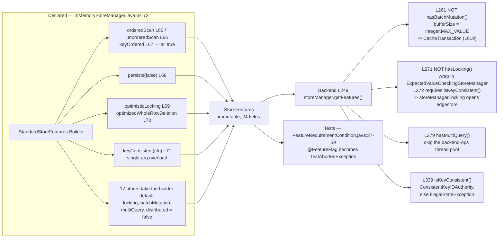

<!--
entry-meta
date: 2026-11-01
type: reading-session
track: JanusGraph
lesson: 03
category: Open Source Contribution
title: StoreManager and StoreFeatures — 24 booleans a backend declares about itself
slug: janusgraph-store-manager-features
pinned-commit: a59ae8d8024207598eada34998d867617df51adf
-->

# StoreManager and StoreFeatures — 24 booleans a backend declares about itself

**2026-11-01 · JanusGraph Track · Session 03 of 28 · reading at `a59ae8d8`**

> Previous session's notes are empty — reading without writing down what you found doesn't stick. That is two in a row (01 and 02); today's are the third set of questions nobody has answered.

## Where This Fits

- **Previous:** [02 — the `KeyColumnValueStore` contract](../../10/2026-10-31-janusgraph-kcv-store-contract/README.md) read three methods on one store and stopped at `KeyColumnValueStore.java:183`.
- **Today:** the layer that *owns* stores ([`StoreManager`][sm], [`KeyColumnValueStoreManager`][kcvsm]) and the object declaring which parts of that contract a backend honours ([`StoreFeatures`][sf], 24 declarations) — plus the four `getKeys` overloads session 02 deferred, which are what the scan flags gate.
- **Sets up:** session 04 reads the in-memory `getSlice`; session 05 reads [`OrderedKeyValueStoreManagerAdapter`][okv], whose constructor is one `checkArgument(manager.getFeatures().isKeyOrdered(), …)`.

## Today's Reading

| # | File (at `a59ae8d8`) | Read | Why |
|---|---|---|---|
| 1 | [`KeyColumnValueStoreManager.java`][kcvsm] + [`StoreManager.java`][sm] | both whole (69 + 100 lines) | Nine methods. `openDatabase` is idempotent *by contract*; `mutateMany` is optional — "Check `getFeatures()`". |
| 2 | [`StoreFeatures.java`][sf] `L31-L257` | all of it — **the javadoc is the content** | 22 abstract declarations + one `default`; each names the method it gates. `L87-L105` (`getScanKeyOrder`) is the only one carrying a real argument. |
| 3 | [`StandardStoreFeatures.java`][ssf] | `L54-L56`, `Builder` from `L180`, the private ctor at the bottom | The only implementation. `hasScan()` is *derived*; the ctor takes **24 positional parameters**, 18 `boolean`. |
| 4 | [`KeyColumnValueStore.java`][kcvs] `L185-L227` | 43 lines | The four `getKeys` overloads: `L185-L187` is a `default` throwing `NotImplementedException`; `L200`, `L213`, `L227` are abstract and **mutually exclusive by wording**. |
| 5 | [`Backend.java`][be] `L249-L287` + `L339-L343` | **45 lines only** | Every feature consumer in the file: `L261`, `L271`, `L279`, `L339`. |
| 6 | [`InMemoryStoreManager.java`][imsm] `L64-L72` + `L134-L135` | 11 lines | One backend's complete answer: **seven** builder calls out of 24. |

**Skip:** `Backend.java` outside those two windows (775 lines of store wiring, caches and locker registration — sessions 07 and 18); `StoreMetaData`; `KCVMutation` (session 16); `MetricInstrumentedStoreManager`; `InMemoryStoreManager.java:138-190` (snapshot/restore, part of no contract).

## Map

Each flag names exactly one method it gates. That is the whole design.

| Flag ([`StoreFeatures.java`][sf]) | Gates |
|---|---|
| `hasScan()` `L37` | derived: ordered `\|\|` unordered; `StandardJanusGraph.getVertexIDs` preconditions on it |
| `hasUnorderedScan()` `L43` / `hasOrderedScan()` `L57` | `getKeys(SliceQuery)` `L213` / `getKeys(KeyRangeQuery)` `L200` |
| `hasConsistentScan()` `L51` | if false, backend *should* support `getKeys(MultiSlicesQuery)` `L227` |
| `hasMultiQuery()` `L64` | `getSlice(List,…)`, `getMultiSlices(…)` — `Backend.java:279` |
| `hasLocking()` `L71` | `acquireLock(…)` `L183` — `Backend.java:271` |
| `hasBatchMutation()` `L78` | `mutateMany(…)` — `Backend.java:261` |
| `isKeyOrdered()` `L85` | vertex ID partitioning — [`OrderedKeyValueStoreManagerAdapter`][okv] ctor |
| `isKeyConsistent()` `L138` | `Backend.java:272` and `:339` |
| `hasLocalKeyPartition()` `L127` | `StoreManager.getLocalKeyPartition()` |

Three invariants to carry in:

- **The flags are declarations, not proofs.** Nothing verifies them; `StandardStoreFeatures` is an immutable 24-field bag. A backend that lies compiles, ships, and fails elsewhere. The one place a flag is enforced is the `checkArgument` in [`OrderedKeyValueStoreManagerAdapter`][okv]'s constructor.
- **`Backend` reads locking inverted.** `Backend.java:271` is `if (!storeFeatures.hasLocking())` → wrap the whole manager in `ExpectedValueCheckingStoreManager`. Declaring *no* locking gets JanusGraph's own locker; declaring locking makes core trust you. The fallback then demands `isKeyConsistent()` (`L272`), so a backend with neither cannot open at all.
- **Defaults are not all false.** `Builder` has three fields defaulting `true`: `consistentScan` `L182`, `supportsPersist` `L198`, `supportsInterruption` `L203` — while its own javadoc at `L208` says "everything disabled/unsupported/false/null".



## Questions To Answer From The Code

Six. None are answered above.

1. `InMemoryStoreManager.java:65-66` declares **both** `orderedScan(true)` and `unorderedScan(true)`. But `getKeys(KeyRangeQuery,…)` (`KeyColumnValueStore.java:200`) is "only supported by stores which keep keys in byte-order" and `getKeys(SliceQuery,…)` (`L213`) "only supported by stores which do **not**". Open `InMemoryKeyColumnValueStore`: do those two implementations differ at all?
2. `hasBatchMutation()` is never set by that builder, so it is **false** — yet `mutateMany` is fully implemented at `InMemoryStoreManager.java:117-131`. Follow `Backend.java:261-263` to the `CacheTransaction` built at `Backend.java:619`: what does `bufferSize = Integer.MAX_VALUE` actually change?
3. `hasLocking()` (`StoreFeatures.java:71`) and `hasOptimisticLocking()` (`L247`) are different flags, and the in-memory backend sets the second only. Which branch does it take at `Backend.java:271`, and which concrete class ends up answering `acquireLock`?
4. `InMemoryStoreManager.java:71` calls the **single-argument** `keyConsistent(Configuration c)`, leaving `localKeyConsistentTxConfig` null. Find a caller of `getLocalKeyConsistentTxConfig()` and decide whether that null is reachable here. (`Builder(StoreFeatures template)` at `L216` is a hint — note which overload *it* calls.)
5. `getLocalKeyPartition()` throws unconditionally at `InMemoryStoreManager.java:134-135` while `hasLocalKeyPartition()` is false, and `StoreFeatures.java:118-127` promises the method "will not be invoked" when false. Find the call site: enforced, or only documented?
6. `hasConsistentScan()` is the only scan flag defaulting `true` (`StandardStoreFeatures.java:182`), and its javadoc (`StoreFeatures.java:45-50`) says ordered scan *implies* consistent scan. Which backend would break if that default flipped — and what does `getScanKeyOrder()` returning null (`L103-L105`) cost a backend that *is* ordered?

## Hands-On

```bash
cd janusgraph
mvn -pl janusgraph-inmemory -am -DskipTests=true install
mvn -pl janusgraph-inmemory -Dtest=InMemoryStoreManagerTest#testStoreCycle test
```

[`InMemoryStoreManagerTest#testStoreCycle`][imsmt] is the only test exercising the *manager*. **What to look for:** it builds its transaction from `imsm.getFeatures().getKeyConsistentTxConfig()` — the features object is load-bearing in the first line of setup. It then opens two stores, calls `mutateMany` across both, and asserts `getSlice` over `["row1","row2"]` returns a map of size **2** with an **empty** list for the absent `row2`: the multi-key contract returns an entry for every key asked, not only those that exist.

Then add a throwaway test in that package and **predict every value from `L64-L72` before running it**:

```java
@Test public void dumpFeatures() {
    StoreFeatures f = new InMemoryStoreManager().getFeatures();
    System.out.println("locking=" + f.hasLocking() + " batchMutation=" + f.hasBatchMutation()
        + " multiQuery=" + f.hasMultiQuery() + " consistentScan=" + f.hasConsistentScan()
        + " localKeyPartition=" + f.hasLocalKeyPartition()
        + " scanKeyOrder=" + f.getScanKeyOrder()
        + " localKeyConsistentTxConfig=" + f.getLocalKeyConsistentTxConfig());
}
```

The three you are most likely to get wrong are questions 2, 3 and 4.

Finally, breakpoint `Backend.java:261` and `:271`, run `InMemoryGraphTest` (session 01's test), and watch which side of each branch fires. If the locking branch fires, step into the `ExpectedValueCheckingStoreManager` constructor — that is session 18 arriving early.

Related: [`FeatureRequirementCondition.java`][frc]`:37-59` is how the shared suites skip tests a backend cannot pass — a `@FeatureFlag` becomes a `TestAbortedException`. Only four flags are wired (`CellTtl`, `Scan`, `OrderedScan`, `UnorderedScan`); the `default` arm throws `UnsupportedOperationException`.

**`dumpFeatures` and any breakpoint logging are temporary.** `git checkout --` them before committing.

## Contribution Radar

Nothing open is *about* `StoreFeatures` — that search returned zero results, and so did `is:pr is:open StoreFeatures store manager backend`. Three adjacent, most reachable first:

- **[#2268 — LockEntry set TTL](https://github.com/JanusGraph/janusgraph/issues/2268)** · `kind/enhancement`, `area/core` · **no assignee** · open since 2020-12-08. Exactly today's flag interaction: the lock store `Backend.java:273` creates writes lock entries, and whether they can expire depends on `hasCellTTL()` (`StoreFeatures.java:171`). Read it after question 3.
- **[#3390 — Fix CQLPagingIterator for Amazon Keyspace](https://github.com/JanusGraph/janusgraph/issues/3390)** · `kind/bug/confirmed`, `backend/awskeyspace` · no assignee shown · open since 2022-12-15. A scan-path bug in a backend whose feature declarations differ from plain Cassandra's; triage already done. Session 27 reads the CQL store.
- **[#1128 — Allow berkeleyje graphs the option to be opened in-memory](https://github.com/JanusGraph/janusgraph/issues/1128)** · `storage/berkeleydb` · **assigned to `amcp`, untouched since 2018-07-30** · essentially "let this backend declare `persists(false)`", with `InMemoryStoreManager.java:68` as the one-line precedent. Comment before touching it; an eight-year-old assignment is usually dead, but that is the maintainers' call.

Repo-wide `good first issue` is still exactly four, unchanged since session 02: **#3127**, **#3126**, **#3013**, **#1573**. None touches storage; #3126/#3127 stay reserved for session 25.

## My Notes

<!-- Aryant fills this in after reading. The next session reads it and answers your open questions first. -->

### Call path I traced
<!-- e.g. tx.commit() → StandardJanusGraph.commit() → ... → store.mutate() -->

### Answers to today's questions
<!-- one line per question, with the file:line where you found it -->

### What surprised me

### Still unclear

### Possible issue / PR idea

## Sources

Files read this run, permalinked at pinned commit `a59ae8d8024207598eada34998d867617df51adf`: [`KeyColumnValueStoreManager.java`][kcvsm] · [`StoreManager.java`][sm] · [`StoreFeatures.java`][sf] · [`StandardStoreFeatures.java`][ssf] · [`KeyColumnValueStore.java`][kcvs] · [`Backend.java`][be] · [`OrderedKeyValueStoreManagerAdapter.java`][okv] · [`StandardJanusGraph.java`][sjg] · [`InMemoryStoreManager.java`][imsm] · [`InMemoryStoreManagerTest.java`][imsmt] · [`FeatureRequirementCondition.java`][frc]. Directory listing at the same commit: `janusgraph-inmemory/src/test/java/org/janusgraph/diskstorage/inmemory/` (15 files).

Issues seen this run: [#2268](https://github.com/JanusGraph/janusgraph/issues/2268) · [#3390](https://github.com/JanusGraph/janusgraph/issues/3390) · [#1128](https://github.com/JanusGraph/janusgraph/issues/1128) · [#3205](https://github.com/JanusGraph/janusgraph/issues/3205) · [#3155](https://github.com/JanusGraph/janusgraph/issues/3155) · [#2573](https://github.com/JanusGraph/janusgraph/issues/2573), plus the four open `good first issue` items (#3127, #3126, #3013, #1573).

[kcvsm]: https://github.com/JanusGraph/janusgraph/blob/a59ae8d8024207598eada34998d867617df51adf/janusgraph-core/src/main/java/org/janusgraph/diskstorage/keycolumnvalue/KeyColumnValueStoreManager.java
[sm]: https://github.com/JanusGraph/janusgraph/blob/a59ae8d8024207598eada34998d867617df51adf/janusgraph-core/src/main/java/org/janusgraph/diskstorage/keycolumnvalue/StoreManager.java
[sf]: https://github.com/JanusGraph/janusgraph/blob/a59ae8d8024207598eada34998d867617df51adf/janusgraph-core/src/main/java/org/janusgraph/diskstorage/keycolumnvalue/StoreFeatures.java#L31-L257
[ssf]: https://github.com/JanusGraph/janusgraph/blob/a59ae8d8024207598eada34998d867617df51adf/janusgraph-core/src/main/java/org/janusgraph/diskstorage/keycolumnvalue/StandardStoreFeatures.java
[kcvs]: https://github.com/JanusGraph/janusgraph/blob/a59ae8d8024207598eada34998d867617df51adf/janusgraph-core/src/main/java/org/janusgraph/diskstorage/keycolumnvalue/KeyColumnValueStore.java#L185-L227
[be]: https://github.com/JanusGraph/janusgraph/blob/a59ae8d8024207598eada34998d867617df51adf/janusgraph-core/src/main/java/org/janusgraph/diskstorage/Backend.java#L249-L287
[okv]: https://github.com/JanusGraph/janusgraph/blob/a59ae8d8024207598eada34998d867617df51adf/janusgraph-core/src/main/java/org/janusgraph/diskstorage/keycolumnvalue/keyvalue/OrderedKeyValueStoreManagerAdapter.java
[sjg]: https://github.com/JanusGraph/janusgraph/blob/a59ae8d8024207598eada34998d867617df51adf/janusgraph-core/src/main/java/org/janusgraph/graphdb/database/StandardJanusGraph.java
[imsm]: https://github.com/JanusGraph/janusgraph/blob/a59ae8d8024207598eada34998d867617df51adf/janusgraph-inmemory/src/main/java/org/janusgraph/diskstorage/inmemory/InMemoryStoreManager.java#L64-L72
[imsmt]: https://github.com/JanusGraph/janusgraph/blob/a59ae8d8024207598eada34998d867617df51adf/janusgraph-inmemory/src/test/java/org/janusgraph/diskstorage/inmemory/InMemoryStoreManagerTest.java
[frc]: https://github.com/JanusGraph/janusgraph/blob/a59ae8d8024207598eada34998d867617df51adf/janusgraph-backend-testutils/src/main/java/org/janusgraph/testutil/FeatureRequirementCondition.java
