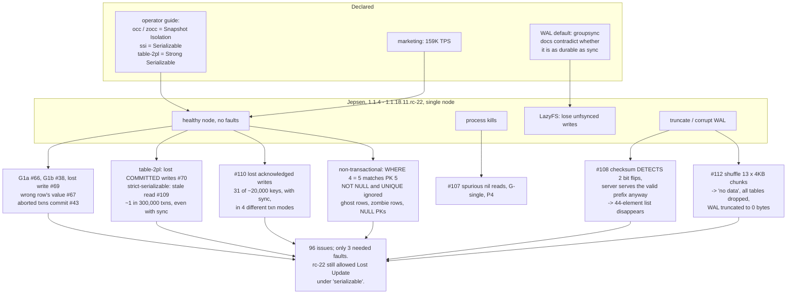

<!--
entry-meta
date: 2026-11-01
type: daily-diff
category: Daily Diff
title: Daily Diff — 2026-11-01
slug: janusgraph-store-manager-features
-->

# Daily Diff — 2026-11-01

**2026-11-01 · Daily Diff Digest**

## Which edition, and how it was found

**No edition has published for 2026-11-01.** The newest that exists is **2026-10-31, 31 stories**, not yet covered by any digest, and this one covers it. ([Yesterday's digest](../../10/2026-10-31-janusgraph-kcv-store-contract/daily-diff.md) covered 2026-10-30.)

| Endpoint | Result at 03:40–03:44 UTC / 09:10–09:14 IST |
|---|---|
| [front page](https://tdd.cat/) | **2026-10-30 / 47 stories** — one day behind, exactly as yesterday. |
| [`/archive/`](https://tdd.cat/archive/) | **Led again.** **125 editions**; marks **2026-10-31 / 31 stories** as *Latest* and links it. **2026-11-01 does not appear on the page at all.** |
| [`https://tdd.cat/2026-10-31/`](https://tdd.cat/2026-10-31/) | **Served the complete 31-story edition**, dated *Saturday, October 31, 2026*, with every source URL. Trailing-slash form, first try. |
| `https://tdd.cat/2026-11-01/` | `client_error` — the forward probe. |
| RSS, dated `.md` | Not probed; the archive named the maximum date and the dated page served it. |

**What this run adds.** The archive led for the **second consecutive run** — the first repeat in nine runs of that rotation. More usefully, the front page's lag is now looking like a **fixed one-day offset** rather than the "two-day settling window" yesterday's note described: on 10-31 the front page served 10-29 while the newest was 10-30; today it serves 10-30 while the newest is 10-31. One shape explains both observations, and it is cheaper to test — if the offset holds, the front page is a *date oracle for yesterday* and the archive is the only endpoint worth polling first.

Yesterday's prediction also resolved cleanly for once: the 10-31 edition that `client_error`'d yesterday exists today with 31 stories, confirming that a `client_error` on a dated page is a statement about *now*, not about whether an edition will exist.

## The 2026-10-31 edition — notable items

Database and storage internals:

- **Jepsen finds ParticleDB 1.1.4 does not deliver ACID** — 96 issues, including lost committed writes on a single healthy node. The deep dive below. ([jepsen.io](https://jepsen.io/analyses/particledb-1.1.4))
- **How Postgres TOAST tables silently degrade query performance** — oversized column values stored out of line add a lookup and a decompression to every touching query. ([pgedge.com](https://www.pgedge.com/blog/burnt-toast))
- **Rethinking search engine fundamentals by building Tantivy in Rust** — an interview on taking on Lucene; relevant to session 26's `IndexProvider` SPI. ([paradedb.com](https://www.paradedb.com/blog/tantivy-interview))
- **MariaDB buffer-pool LRU mutex removal** — carried over from 10-30 and [already dug into yesterday](../../10/2026-10-31-janusgraph-kcv-store-contract/daily-diff.md). ([mariadb.org](https://mariadb.org/how-mariadb-11-8-became-about-3x-faster-on-some-in-memory-workloads-fixing-a-regression-dating-back-to-10-5/))
- **Postgres 19 is late and AI-found bugs are why** — also carried from 10-30. ([rhaas.blogspot.com](http://rhaas.blogspot.com/2026/10/postgres-19-is-late-and-its-ais-fault.html))

Systems and performance:

- **Memory latency stalls processors at full CPU utilisation** — third consecutive edition. ([pivotlake.io](https://pivotlake.io/blog/its-the-memory-latency-stupid/))
- **Checking for whitespace is surprisingly complex under Unicode** — many code points qualify, so the naive character test is wrong. ([serce.me](https://serce.me/posts/2026-10-30-how-hard-is-it-to-check-for-whitespace))
- **Fixing a regression in reading Linux process GPU usage** — `sysinfo` now checks whether an fd points at a GPU device before paying for the `fdinfo` read. ([blog.guillaume-gomez.fr](https://blog.guillaume-gomez.fr/articles/2026-10-30+sysinfo%3A+fixing+performance+to+retrieve+process+GPU+usage))
- **Ditching the GPU cut a Rust GUI from 135 MB to 30 MB resident** — software rendering instead of hardware. ([trystan-sarrade.com](https://trystan-sarrade.com/article/rust-gui-135mb-to-30mb-egui-to-slint/))
- **A native C++ agent harness that is not a browser** — Prospero, on memory footprint. ([nullprogram.com](https://nullprogram.com/blog/2026/10/31/))
- **Maclet runs Linux containers on Apple Silicon** without Docker Desktop or Lima. ([github.com/sumant1122/maclet](https://github.com/sumant1122/maclet))
- **Per-instance namespaces as capabilities** — Plan 9-style private namespaces for sandboxed objects. ([othismo.com](https://othismo.com))

Security:

- **CVE-2026-98432, the Linux IPv4 TCP use-after-free** — CVSS 9.8, remote unauthenticated RCE where MPTCP listeners exist, plus the Go-side mitigation. Both carried from 10-30 and still the lead. ([atlasum.net](https://atlasum.net/blog/cve-2026-98432-linux-ipv4-tcp-uaf), [golang-announce](https://groups.google.com/g/golang-announce/c/PCoQcdxoScw?pli=1))
- **Open-weight models turning public Firefox patch commits into exploits** — Epoch AI on the patch gap. ([epoch.ai](https://epoch.ai/publications/open-weight-models-patch-gap))
- **Embedded browsers in AI coding tools allowed file access and command execution** — the EMBRACE audit. ([theainewsreport.com](https://theainewsreport.com/2026-10-30-embrace-ai-coding-assistant-embedded-browser-flaws-explained.html))
- **Brave Leo's confidential-computing chat path** — attestation plus Oblivious HTTP plus enclaves. ([brave.com](https://brave.com/blog/browser-ai-e2ee/))

The remaining ~12 items are KV-cache serving and inference work — lossless BF16 exponent compression, unified logical addressing for sparse KV cache, SSD offload gating, stage-adaptive KV transitions, and agent-generated compression codecs.

## Deep dive — Jepsen vs ParticleDB 1.1.4, and what a declared isolation level is worth

**Why this one.** [Today's JanusGraph session](README.md) is about a backend *declaring* 24 booleans concerning its own guarantees, with nothing in the codebase verifying any of them. This report is the same structure with the declaration turned up to "ACID" and an adversary actually checking.

**What it is.** ParticleDB is a Rust multi-model database by Orkes, backing their Conductor workflow platform: transactional SQL, a key-value store, vector search, live analytics, and user-defined functions ("Particles"), reachable over the Postgres and Redis wire protocols plus Orkes' own gRPC and HTTP2 APIs. Jepsen tested **1.1.4 through 1.1.18.11.rc-22** on Debian 13, in containers and on EC2.

**The configuration surface is where the trouble starts.** Raft replication exists only in enterprise cloud deployments, and the builds Jepsen received had none — so **every result below is single-node**. Two orthogonal dials:

- **WAL sync mode:** `sync` fsyncs per commit, `groupsync` batches commits into shared fsyncs, `nosync` skips fsync. **Default: `groupsync`**, and the documentation contradicts itself on whether it is as durable as `sync`.
- **`--txn-mode`:** `fast` (no concurrency control), `occ` (default, alias `row-2pl`, internally `occ-v3`), `zero-copy-occ`/`zocc` (partition-pinned), `table-2pl` (alias `serializable`), `serializable-ssi`/`ssi` (Cahill-style SSI), and `strict-serializable`, added only in `1.1.18.11.rc-18`.

The operator guide claims Snapshot Isolation for `occ`/`zocc`, Serializable for `ssi`, Strong Serializable for `table-2pl`. Note the alias collisions: `occ` is aliased `row-2pl` but is optimistic, and `table-2pl` is aliased `serializable`. `SET TRANSACTION ISOLATION LEVEL` was ignored or rejected outright.

**The findings.** 96 issues, of which **only 3 required injected faults**. The rest were reachable on a single healthy node.

| Issue | Anomaly | Conditions | Status |
|---|---|---|---|
| #66 | **G1a** — aborted read | healthy node, 1.1.4–1.1.18.8 | fixed rc-1 |
| #38 | **G1b** — intermediate read | healthy node | fixed rc-1 |
| #69 | lost write | healthy node | fixed rc-1 |
| #43 | aborted transactions commit, effects visible | Postgres interface, 1.1.17–1.1.18.4 | fixed rc-18 |
| #67 | reads returned **a different row's value** | 1.1.18.9, `occ-v3`, `groupsync` | fixed rc-1 |
| #70 | **lost committed writes** | `table-2pl` (the "Strong Serializable" mode), rc-1 → rc-6 | only *reduced* by rc-7 |
| #106 | A5A read skew + G-single | `table-2pl`, `groupsync`, rc-18 | fixed rc-19 |
| #73 | G-single + lost update (P4-like) | `occ-v3`, `zocc`, and `occ` in rc-22 | Orkes claim: fixed 1.1.19-rc.13 |
| #109 | **stale read** — real-time rw/wr cycle | `strict-serializable`, rc-18, **even with `sync`** | Orkes claim: fixed 1.1.19-rc.10 |
| #110 | **lost acknowledged writes**, 31 of ~20,000 keys | rc-18 → rc-22, across `occ-v3`/`zocc`/`table-2pl`/`ssi`, with `sync` | Orkes claim: fixed 1.1.19-rc.13 |
| #107 | spurious `nil` reads, G-single, P4 | `strict-serializable`, `groupsync`, process kills | Orkes claim: fixed 1.1.19-rc.12 |
| #90 | primary-key conflicts missed | concurrent transactions, rc-9 | fixed rc-19 |
| #89 | duplicate rows **despite a primary key** | rc-9 | fixed rc-18 |

Earlier builds also exhibited G0, G1c, G2-item and G-single; Jepsen attributes most of those to plain write loss, "much diminished" by rc-1. The abstract's bottom line: **rc-22 still allowed internal anomalies and Lost Update under `serializable`, the strongest setting available at the time.**

**The two numbers that matter most.** #109's stale read appeared roughly **once every 300,000 transactions** with 10 clients at ~80 tx/s — about an hour of load. #110 lost **31 acknowledged keys out of ~20,000**, under `sync`, in four different transaction modes. Neither is the kind of thing a smoke test finds; both destroy the guarantee the mode's name advertises.

**The fault-injection results are worse in kind.** With LazyFS-simulated loss of unfsynced writes, truncation and corruption:

- **#108, silent data loss.** Two bit flips in a `.wal` file were *detected* by the segment checksum — and the server then replayed the valid prefix and served the database anyway. A 44-element list simply vanished. Detection without refusal is not durability.
- **#112, total data loss.** Shuffling 13 four-kilobyte chunks of a WAL (about a tenth of the file) made startup report "no data", drop every table, and **truncate the WAL to zero bytes** — destroying the evidence along with the data.
- **#81, mystery crash.** Spontaneous exits after a few hundred to a few thousand seconds with no error output. Fixed rc-18.

Orkes says both WAL cases are fixed in 1.1.19-rc.12, where the server refuses to start on corruption. Jepsen did **not verify** most 1.1.19-rc.10 → rc.13 claims, so every "Orkes claim" row above is a vendor assertion, not a tested result.

**And the non-transactional layer, on a single node with no faults.** This is the part that makes the isolation findings secondary: `WHERE 4 = 5` matched primary key 5 (#18); `WHERE TRUE` and `WHERE FALSE` returned wrong rows (#35, #40); `NOT NULL` was ignored, leaving invisible rows (#8); `UNIQUE` was ignored (#9); `UPDATE` produced duplicate primary keys (#29) and NULL primary keys (#57, #72); assignment across incompatible types silently produced NULL or 0 (#7); inserts with a different column order corrupted rows (#16); updates matching no rows created ghost rows (#24, #25); rows became un-updatable and un-deletable after an int-to-float update (#23), a `double precision` update (#84), a `NaN` (#78), or a fixed-width string (#74); dropped tables resurrected with altered types (#46). Against a marketing claim of **159K TPS**.

**What transfers to today's reading.** Three things, in increasing order of how much they should change your behaviour.

1. **A declared guarantee with no test behind it is a comment.** `--txn-mode table-2pl` aliased `serializable` losing committed writes is the same failure as a `StandardStoreFeatures.Builder` call: a name asserting a property no code checks. JanusGraph's partial defence is [`KeyColumnValueStoreTest`](https://github.com/JanusGraph/janusgraph/blob/a59ae8d8024207598eada34998d867617df51adf/janusgraph-backend-testutils/src/main/java/org/janusgraph/diskstorage/KeyColumnValueStoreTest.java) — one executable suite every backend must pass, which session 02 ran. But it tests the *store* contract, not the *features* declaration, and nothing at all verifies that a backend claiming `isKeyConsistent()` is key-consistent.
2. **`Backend.java:272` is load-bearing for exactly this reason.** `Preconditions.checkArgument(storeFeatures.isKeyConsistent(), "Store needs to support some form of locking")` is the one place JanusGraph refuses to proceed on a guarantee it cannot verify — and its only evidence is the backend's own boolean. ParticleDB is what the other side of that boolean looks like.
3. **Detection without refusal is the subtler bug.** #108 is the one worth internalising: the checksum *worked*. The segment was known-corrupt, and the server served the data regardless. That failure mode is available to anything that validates and then continues, which is most recovery code. The fix was not a better checksum; it was refusing to start.

Caveats this digest inherits from the report: it is single-node only, because replication was not in the builds provided; most 1.1.19-rc claims are unverified; and Jepsen notes that some #31 anomalies may be test-harness artifacts.

## Sources

Read this run:

- [https://tdd.cat/archive/](https://tdd.cat/archive/) — 125 editions; 2026-10-31 / 31 stories marked *Latest*; 2026-11-01 absent.
- [https://tdd.cat/2026-10-31/](https://tdd.cat/2026-10-31/) — the complete *Saturday, October 31, 2026* edition, 31 stories, with every source URL. All item links above are as published there.
- [https://tdd.cat/](https://tdd.cat/) — front page, serving 2026-10-30 / 47 stories, one day behind.
- `https://tdd.cat/2026-11-01/` — `client_error`; no edition for today.
- [Jepsen: ParticleDB 1.1.4](https://jepsen.io/analyses/particledb-1.1.4) — the deep-dive source, followed from the 2026-10-31 edition. Every issue number, anomaly name, mode name, default and figure above is from it.
