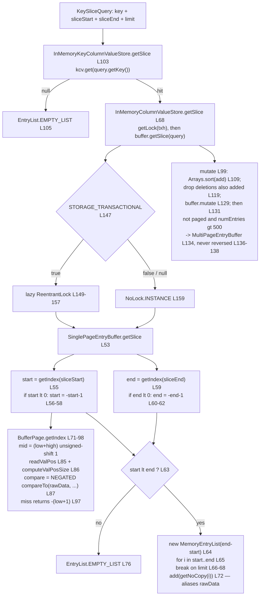

<!--
entry-meta
date: 2026-11-02
type: reading-session
track: JanusGraph
lesson: 04
category: Open Source Contribution
title: InMemoryKeyColumnValueStore — a skip-list of rows over one packed byte array per row
slug: janusgraph-inmemory-slice-path
pinned-commit: a59ae8d8024207598eada34998d867617df51adf
-->

# InMemoryKeyColumnValueStore — a skip-list of rows over one packed byte array per row

**2026-11-02 · JanusGraph Track · Session 04 of 28 · reading at `a59ae8d8`**

> Previous session's notes are empty — reading without writing down what you found doesn't stick.

**That is three in a row (01, 02, 03), so the notice stops being useful and here is the plain version.** This mode withholds answers on purpose: reading the code is meant to be the only way to get them. Three sessions in, it has produced eighteen unanswered questions and no evidence that a file was opened. Two honest options — fill `My Notes` once, even three lines, even wrong, and `From Your Last Notes` starts working as designed; or say the mode is wrong for how you work, and the next run switches this track to `lesson` mode, which answers its own questions and needs nothing from you. Generating reading guides nobody reads is the only option with no value in it. If 04's notes are also empty, that is four, and session 05 should settle the mode question rather than ask a fourth time.

## Where This Fits

- **Previous:** [03 — `StoreManager` and `StoreFeatures`](../2026-11-01-janusgraph-store-manager-features/README.md) read the 24 booleans a backend declares and the four places `Backend` branches on them, and left six questions open.
- **Today:** the first implementation — how `getSlice` resolves, from a skip-list of rows down to two binary searches inside one packed `byte[]`.
- **Sets up:** session 05's `OrderedKeyValueStoreManagerAdapter`, which must *synthesize* the column dimension this backend gets free; and session 10's `EdgeSerializer`, which produces the column bytes this layer only compares.

## Today's Reading

| # | File (at `a59ae8d8`) | Read | Why |
|---|---|---|---|
| 1 | [`InMemoryKeyColumnValueStore.java`][imkcvs] `L85-L149` | 65 lines | One `ConcurrentSkipListMap` (`L94`, `L99`); `getSlice` single-key `L103-L107`, multi-key `L110-L114`; `mutate` `L117-L124`; the two `getKeys` overloads `L137-L144` that settle session 03's question 1. |
| 2 | [`InMemoryColumnValueStore.java`][imcvs] | whole, ~205 lines | One **row**: exactly one `SharedEntryBuffer` (`L47`), starts single-page (`L51`), promotes above 500 entries (`L45`, `L131-L135`), never demotes (`L136-L138`). `getLock` `L146-L160` decides whether a lock exists at all. |
| 3 | [`SinglePageEntryBuffer.java`][spb] `L36-L101` | 66 lines | `getSlice` is `L53-L78` and *is* the read path. `mutate` `L80-L96` calls the inherited merge with `Integer.MAX_VALUE` and reassigns its own two fields. |
| 4 | [`BufferPage.java`][bp] `L39-L175` | 137 lines | Byte layout `L137-L144`; `getIndex` binary search over raw bytes `L71-L98`; `readValPos`'s 1-byte/4-byte discriminator `L120-L135`; `get` vs `getNoCopy` `L145-L167`. |

**Skip:** `BufferPage.merge` (both overloads, `L177` onward) and `MultiPageEntryBuffer` — write/paging path, not today; `BufferPageUtils` beyond the two names `getIndex` calls; `InMemoryKeyColumnValueStore` from `createFragmentationReport` onward (fragmentation, dump/restore, and the `RowIterator` inner class — that one goes with session 06's scan tests).

## Map

| Level | Structure | Lookup |
|---|---|---|
| store → row | `ConcurrentSkipListMap<StaticBuffer, InMemoryColumnValueStore>` ([`L94`][imkcvs]) | `kcv.get(key)` ([`L104`][imkcvs]) |
| row → buffer | one `SharedEntryBuffer` field ([`L47`][imcvs]) | direct |
| buffer → entry | `int[] offsetIndex` + `byte[] rawData` ([`L43-L44`][bp]) | binary search ([`L71-L98`][bp]) |

- **No `Entry` objects at rest.** A page is two arrays. Each entry packs as `[valPos][column][value]`, where `valPos` is both the column length and the value's start offset ([`L137-L144`][bp]). It is **one byte when positive**, otherwise a **negated 4-byte int**, discriminated on the first byte's sign in `readValPos` ([`L120-L135`][bp]). `BufferPageTest.testLargeColumnKey` asserts a column longer than **127** precisely to cross that line.
- **The search never materializes a column.** `getIndex` compares the *argument* against a window of `rawData` — `((StaticArrayBuffer) column).compareTo(rawData, from, to)` at [`L87`][bp] — and **negates the result**, because the comparison runs argument-against-stored. The `checkArgument(column instanceof StaticArrayBuffer)` one line up ([`L84`][bp]) is what licenses that, and the comment there records that this replaced a `getColumn(mid).compareTo(...)` which allocated on every probe.
- **Reads alias the page.** The result is built from `getNoCopy(i)` ([`L72`][spb]), a `StaticArrayEntry` pointing *into* the live `rawData` ([`L164-L167`][bp]). A read copies no bytes; the comment at [`L70-L71`][spb] states the consequence and the assumption behind it.



## Questions To Answer From The Code

Six. None are answered above.

1. `getKeys(KeyRangeQuery)` is `kcv.subMap(start, end)` ([`L138`][imkcvs]); `getKeys(SliceQuery)` is `kcv.entrySet()` ([`L143`][imkcvs]), and both wrap the same `RowIterator`. Session 03 asked whether they differ at all — answer it from these two lines, then decide which of the two mutually exclusive javadoc promises at `KeyColumnValueStore.java:200` and `:213` this backend actually keeps.
2. Session 02 established the column interval is half-open, `[sliceStart, sliceEnd)`. There is no `-1` and no `<=` anywhere in [`L55-L63`][spb] — so what *implements* the half-openness? Then: what does `sliceStart == sliceEnd` return, by which line?
3. `new MemoryEntryList(end - start)` is [`L64`][spb]; the limit check is [`L66`][spb], **inside** the loop. For a row with 10,000 in-range columns and `limit == 10`: how large is the backing array, and how many entries does the loop touch? Bug, deliberate trade, or irrelevant?
4. `getNoCopy` ([`L164-L167`][bp]) aliases the live `rawData`, which `mutate` replaces at [`L93`][spb]. Hold an `EntryList` from `getSlice`, mutate the same row, then read the list: do the old values change or persist? The answer is in which array the entry holds, not in the comment.
5. The promotion at [`L131-L134`][imcvs] swaps `SinglePageEntryBuffer` for `MultiPageEntryBuffer` above `DEF_PAGE_SIZE` ([`L45`][imcvs], 500) and [`L136-L138`][imcvs] declines to ever reverse it. Which `StoreFeatures` flag from session 03 exposes this to core? Answer the literal question before the interesting one.
6. `getLock(txh)` ([`L146-L160`][imcvs]) assigns the `lock` field only on the `STORAGE_TRANSACTIONAL == true` path — yet `numPages`, `numEntries`, `createFragmentationReport`, `quickDefragment` and `dumpTo` all call `this.lock.lock()` **directly**, from [`L162`][imcvs] on. Write the shortest program that makes one of those lines throw, then check `InMemoryStoreManager`'s config to see whether it is reachable through the public API or only from a test.

## Hands-On

```bash
cd janusgraph
mvn -pl janusgraph-inmemory -am -DskipTests=true install
mvn -pl janusgraph-inmemory -Dtest=BufferPageTest#testGetIndex test
mvn -pl janusgraph-inmemory -Dtest=BufferPageTest#testLargeColumnKey test
```

**What to look for.** `testGetIndex` builds a six-entry page from a pre-sorted array and asserts `getIndex` returns `i` for each column; the two interesting assertions are the misses — `getIndex("0")` is **`-1`** (insertion point 0) and `getIndex("zz")` is **`-7`** (insertion point 6, past the end). Breakpoint `BufferPage.java:87` and watch `compare` flip sign; that negation is the easiest thing in this file to misread. `testLargeColumnKey` crosses the 127-byte boundary — breakpoint `BufferPage.java:121` and watch `firstByte` go negative.

Then make the layout visible. `BufferPageTest` is in the same package, so the package-private accessors are reachable:

```java
@Test public void dumpLayout() {
    Entry[] entries = { makeEntry("aa", "v1"), makeEntry("bb", "v222"), makeEntry("cc", "") };
    BufferPage bp = BufferPageUtils.buildFromEntryArray(entries, entries.length);
    System.out.println("offsetIndex=" + java.util.Arrays.toString(bp.getOffsetIndex()));
    System.out.println("rawData=" + java.util.Arrays.toString(bp.getRawData()));
    System.out.println("byteSize=" + bp.byteSize() + " numEntries=" + bp.numEntries());
}
```

**Predict `offsetIndex` and each entry's first byte before running it**, from [`L137-L144`][bp] alone. Then check `byteSize()` against its own formula at [`L173-L175`][bp] — `rawData.length + offsetIndex.length * 4 + 16` — and ask what the `16` is, and whether it is still right for a `SinglePageEntryBuffer`, which adds fields.

**`dumpLayout` and every breakpoint is temporary.** `git checkout -- janusgraph-inmemory/src/test` before committing anything.

## Contribution Radar

Searched open issues on the in-memory slice path and open PRs touching `inmemory`. The issue search returned **exactly two**, both already on this track's radar — which is itself the finding: nothing open is filed against this code.

- **[PR #5018 — "Read what the step after a lookup by id reads along with the existence"](https://github.com/JanusGraph/janusgraph/pull/5018)** · **draft**, opened 2026-10-05 by maintainer **`porunov`** · the only open PR matching `inmemory`. A read-path batching change, landing straight on today's question 3. Read the diff *after* you have answered 3 and 4 yourself.
- **[#3864 — Implement `getMultiSlices` for HBase](https://github.com/JanusGraph/janusgraph/issues/3864)** · `storage/hbase`, `kind/performance`, unassigned, open since 2023-06-26. On the radar since session 02, but it reads differently today: [`L110-L114`][imkcvs] is the multi-key `getSlice` as a plain loop of point lookups into a `HashMap` — the exact shape #3864 wants replaced by a real batch.
- **[#1128 — Allow berkeleyje graphs to be opened in-memory](https://github.com/JanusGraph/janusgraph/issues/1128)** · `storage/berkeleydb`, still assigned to `amcp`, untouched since 2018. Carried from session 03; session 05 reads BerkeleyJE and is the right place to judge it.

Repo-wide `good first issue` is **still exactly four** (#3127, #3126, #3013, #1573), unchanged for four runs; #3126/#3127 stay reserved for session 25.

Two small candidates this reading surfaced, both **unverified by you** and therefore **not to be opened**: `SinglePageEntryBuffer`'s logger is built from `BufferPageUtils.class` ([`L38`][spb]) rather than its own class, so its debug line is filed under the wrong logger; and `InMemoryColumnValueStore` carries a `private static class MemoryEntryList` ([`L78-L97`][imcvs]) duplicating the top-level [`MemoryEntryList.java`][mel] and never constructed in that file. Question 6 is a third and far more interesting one. Confirm locally before touching any of them.

## My Notes

<!-- Aryant fills this in after reading. The next session reads it and answers your open questions first. -->

### Call path I traced
<!-- e.g. tx.commit() → StandardJanusGraph.commit() → ... → store.mutate() -->

### Answers to today's questions
<!-- one line per question, with the file:line where you found it -->

### What surprised me

### Still unclear

### Possible issue / PR idea

## Sources

Files read this run, permalinked at pinned commit `a59ae8d8024207598eada34998d867617df51adf`: [`InMemoryKeyColumnValueStore.java`][imkcvs] · [`InMemoryColumnValueStore.java`][imcvs] · [`SinglePageEntryBuffer.java`][spb] · [`BufferPage.java`][bp] · [`MemoryEntryList.java`][mel] · [`BufferPageTest.java`][bpt]. Directory listings at the same commit: `janusgraph-inmemory/src/main/java/.../inmemory/` (11 files) and `.../src/test/java/.../inmemory/` (15 files).

Issues and PRs seen this run: [PR #5018](https://github.com/JanusGraph/janusgraph/pull/5018) · [#3864](https://github.com/JanusGraph/janusgraph/issues/3864) · [#1128](https://github.com/JanusGraph/janusgraph/issues/1128) · [#3127](https://github.com/JanusGraph/janusgraph/issues/3127) · [#3126](https://github.com/JanusGraph/janusgraph/issues/3126) · [#3013](https://github.com/JanusGraph/janusgraph/issues/3013) · [#1573](https://github.com/JanusGraph/janusgraph/issues/1573).

[imkcvs]: https://github.com/JanusGraph/janusgraph/blob/a59ae8d8024207598eada34998d867617df51adf/janusgraph-inmemory/src/main/java/org/janusgraph/diskstorage/inmemory/InMemoryKeyColumnValueStore.java#L85-L149
[imcvs]: https://github.com/JanusGraph/janusgraph/blob/a59ae8d8024207598eada34998d867617df51adf/janusgraph-inmemory/src/main/java/org/janusgraph/diskstorage/inmemory/InMemoryColumnValueStore.java
[spb]: https://github.com/JanusGraph/janusgraph/blob/a59ae8d8024207598eada34998d867617df51adf/janusgraph-inmemory/src/main/java/org/janusgraph/diskstorage/inmemory/SinglePageEntryBuffer.java#L36-L101
[bp]: https://github.com/JanusGraph/janusgraph/blob/a59ae8d8024207598eada34998d867617df51adf/janusgraph-inmemory/src/main/java/org/janusgraph/diskstorage/inmemory/BufferPage.java#L39-L175
[mel]: https://github.com/JanusGraph/janusgraph/blob/a59ae8d8024207598eada34998d867617df51adf/janusgraph-inmemory/src/main/java/org/janusgraph/diskstorage/inmemory/MemoryEntryList.java
[bpt]: https://github.com/JanusGraph/janusgraph/blob/a59ae8d8024207598eada34998d867617df51adf/janusgraph-inmemory/src/test/java/org/janusgraph/diskstorage/inmemory/BufferPageTest.java
