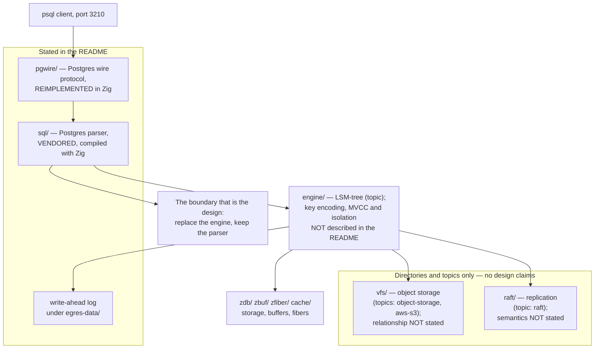

<!--
entry-meta
date: 2026-11-02
type: daily-diff
category: Daily Diff
title: Daily Diff — 2026-11-02
slug: janusgraph-inmemory-slice-path
-->

# Daily Diff — 2026-11-02

**2026-11-02 · Daily Diff Digest**

## Which edition, and what could not be read

**No edition has published for 2026-11-02.** The newest edition that exists is **2026-11-01**, and **its page could not be fetched this run** — the dated URL returned `client_error`. So this digest cannot summarize that edition's items, and it does not invent them. What follows is exactly what each endpoint gave.

| Endpoint | Result at ~03:35–04:05 UTC / 09:05–09:35 IST |
|---|---|
| [front page](https://tdd.cat/) | **2026-10-31, 31 stories** — one day behind the maximum, consistent with the fixed one-day offset [yesterday's digest](../2026-11-01-janusgraph-store-manager-features/daily-diff.md) proposed in place of the "2-day settling window" the page itself advertises. |
| [`/archive/`](https://tdd.cat/archive/) | **Maximum 2026-10-31**, marked *Latest*. **2026-11-01 absent, 2026-11-02 absent.** The archive **lagged** this run, after leading twice. |
| [`/rss.xml`](https://tdd.cat/rss.xml) | **Led.** Newest item: *The Daily Diff — Sunday, November 1, 2026*, `pubDate Sun, 01 Nov 2026 00:00:00 GMT`, link [`https://tdd.cat/2026-11-01/`](https://tdd.cat/2026-11-01/). Describes **"a curation of 20 high-signal engineering stories"** but carries only **five** featured titles and **no per-story URLs**. No 2026-11-02 item. |
| [`https://tdd.cat/2026-11-01/`](https://tdd.cat/2026-11-01/) | **`client_error`** — the edition RSS names cannot be read. |

**What this run adds to the endpoint model.** Three facts, and they break the ordering assumed so far.

1. **The archive is not a reliable maximum-date oracle.** It led on 10-31 and 11-01; today it lags RSS by a full edition. "Poll the archive first" was the wrong conclusion to draw from two runs.
2. **RSS leads, and leads further than the dated page can serve.** The 11-01 edition exists in the feed with a title, a pubDate and a story count, while its own permalink 404s. Previously a `client_error` on a dated page meant *the edition does not exist yet*; today it demonstrably does exist in the publisher's own index. So the dated page is a statement about **render state**, not existence — a weaker claim than yesterday's digest concluded.
3. **The front page's one-day offset held for a third run** (10-31 served when 10-31 is also the archive max, and 11-01 is the true max). It is the most stable endpoint in the set, and it is stable at being wrong by one day.

**What is known about the 2026-11-01 edition** — five featured titles from RSS, **titles only, with no summaries and no source URLs**, reproduced verbatim and not expanded:

1. "Pretraining poisoning implants remote code execution backdoors into agents"
2. "Air-gap computers leak data via RAM radio emissions"
3. "OmniDiff enables fast robust and accurate content-aware diffing"
4. "Good views allow JEPAs to provably unify multimodal representations"
5. "Redesigning Postgres from first principles for multi-tenant workloads"

The remaining ~15 stories of the 20 are not knowable from any endpoint that answered this run. The 2026-10-31 edition was [already digested in full yesterday](../2026-11-01-janusgraph-store-manager-features/daily-diff.md) and is not repeated.

## Deep dive — egres, and what "Postgres-compatible" is load-bearing for

**Provenance, stated plainly.** The edition page is unreadable, so item 5's source link is unavailable. The project below was located by a **web search for that exact title**, not by following a link from the edition. It is the only result whose own tagline matches the title, but **this digest cannot prove it is the item the edition links to.** Everything below comes from the project's own README, read this run.

**What it is.** [`manishrjain/egres`](https://github.com/manishrjain/egres) — "A Postgres Compatible Database for Heavy, Multi-Tenant Workloads", **Apache-2.0**, **written in Zig**, 215 commits on `main`, 46 stars, 4 forks, 4 open PRs. The README calls it "a ground-up, first-principles redesign" — **not** a Postgres fork and not a rewrite of Postgres internals. Owner is Manish Jain, previously of Dgraph and Badger, which is the relevant prior: a Go LSM key-value engine built to escape a different incumbent.

**The compatibility boundary is the whole design decision**, and it sits in two places:

- **The wire protocol is reimplemented** (`pgwire/`, `pgwire.zig`). Clients connect with `psql` on port **3210** — not 5432, which is a small but real signal that this is meant to run beside Postgres rather than in place of it.
- **The SQL parser is not reimplemented.** The README states the **Postgres parser is vendored and compiled with Zig**. That is the interesting engineering choice in the repo: keep the one component where compatibility is defined by millions of edge cases, and replace everything underneath it.

**What the README does and does not say.** Named directories: `pgwire/`, `sql/`, `engine/`, `raft/`, `net/`, `cache/`, `vfs/`, `zdb/`, `zbuf/`, `zfiber/`, `benchmarks/`. Topics include `lsm-tree`, `raft`, `object-storage`, `aws-s3`, `oltp`, `multi-tenant`. A write-ahead log lives under `egres-data/` in the working directory. Build needs **Zig 0.16.0** plus `bash`, `make`, `curl` — **no gcc or clang**; `zig build -Doptimize=ReleaseFast` for a real binary, plain `zig build` being a debug build with assertions on. Release targets are Linux x86_64 and Apple Silicon. `scripts/e2e.sh` runs end-to-end tests over `pgwire` with real `psql`.

**And the gaps, which matter more than the inventory.** The README does **not** state key encoding, the MVCC scheme, supported isolation levels, replication or membership semantics, how `vfs/` relates to S3, which SQL features work, or any production-readiness level. `benchmarks/` and `benchmark.zig` exist; **no numbers are published**. The README also states that most of the code was written with AI agents, with the author driving architecture and reviewing every live code path, and that a PR is expected to meet the same review bar.

**Why this is worth your attention, and the honest caveat.** The reusable idea is the boundary, not the project: compatibility with Postgres is almost entirely a property of its **parser and wire format**, and both are separable from storage. That is the same move JanusGraph makes one layer down and in the other direction — it keeps a foreign storage contract (`KeyColumnValueStore`) and replaces everything above it, so that Cassandra, HBase, BerkeleyJE and [today's in-memory store](README.md) are interchangeable. egres keeps the foreign *interface* and replaces what is below. Both are bets that one well-chosen seam is where portability lives. The caveat: with no benchmarks, no stated isolation level and no durability claims in the README, **there is nothing here to evaluate as a database yet** — only an architecture to read. After yesterday's Jepsen digest, that ordering is the point: the claims come first and are cheap, and the only thing that settles them is an adversary.

## Sources

Read this run:

- [https://tdd.cat/](https://tdd.cat/) — front page, serving the *Saturday, October 31, 2026* edition, 31 stories.
- [https://tdd.cat/archive/](https://tdd.cat/archive/) — maximum 2026-10-31, marked *Latest*; 2026-11-01 and 2026-11-02 both absent.
- [https://tdd.cat/rss.xml](https://tdd.cat/rss.xml) — newest item *The Daily Diff — Sunday, November 1, 2026*, pubDate `Sun, 01 Nov 2026 00:00:00 GMT`, "a curation of 20 high-signal engineering stories", five featured titles, no per-story URLs; no 2026-11-02 item.
- [https://tdd.cat/2026-11-01/](https://tdd.cat/2026-11-01/) — `client_error`; the edition RSS names could not be read.
- [https://github.com/manishrjain/egres](https://github.com/manishrjain/egres) — the deep-dive source. Every directory name, port, version, count and quoted phrase above is from this README. **Located by title search, not by a link from the edition.**

Search results seen this run while locating item 5 (listed for provenance; not used as sources): [dev.to — "It is time for Postgres to care about customers"](https://dev.to/sriramsub/it-is-time-for-postgres-to-care-about-customers-489n) · [Crunchy Data — Designing Your Postgres Database for Multi-tenancy](https://www.crunchydata.com/blog/designing-your-postgres-database-for-multi-tenancy) · [ClickHouse — How to architect multi-tenant SaaS on Postgres](https://clickhouse.com/resources/engineering/multi-tenant-saas-postgres-architecture) · [Wikipedia — Multitenancy](https://en.wikipedia.org/wiki/Multitenancy).
