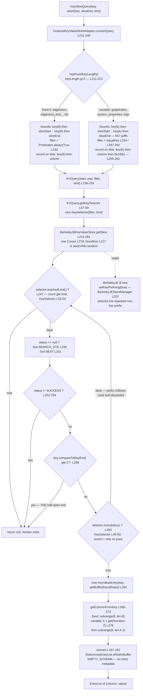

<!--
entry-meta
date: 2026-11-03
type: lesson
track: JanusGraph
lesson: 05
category: Database Internals
title: OrderedKeyValueStoreAdapter — synthesizing a column dimension by concatenating the row key onto every column
slug: janusgraph-okvs-adapter-berkeleyje
-->

# OrderedKeyValueStoreAdapter — synthesizing a column dimension by concatenating the row key onto every column

**2026-11-03 · JanusGraph Track · Lesson 05 of 28**

> **This track is now in `lesson` mode.** Sessions 01–04 all shipped with `## My Notes` as the untouched template — four consecutive. The decision rule recorded in [`TRACK.md`](../../../TRACK.md) and in [session 04's entry](../2026-11-02-janusgraph-inmemory-slice-path/README.md) said session 05 settles it rather than asking a fifth time, so the mode is flipped: same syllabus, same pinned commit, same depth bar, but the entry now **answers its own questions** and carries `Where This Breaks Down`, `Further Study`, `Next Steps` and `Takeaways` again. Nothing is lost — the 24 questions sessions 01–04 posed are listed under *Next Steps*, and the ones today's code settles are settled below. Switching back is one line in `TRACK.md` whenever you want it.

## Where This Fits

- **Previous:** [04 — `InMemoryKeyColumnValueStore`](../2026-11-02-janusgraph-inmemory-slice-path/README.md) read a backend that gets the column dimension for free: a `ConcurrentSkipListMap` of rows, each row one packed `byte[]`, a slice answered by two binary searches.
- **Today:** the opposite situation. BerkeleyJE is a flat ordered map — one key, one value, no second dimension at all. `OrderedKeyValueStoreAdapter` manufactures the missing dimension by **concatenating the row key onto every column** and recovering the boundary on the way back out. This is the lesson where you learn why JanusGraph's row keys are 8 bytes.
- **Sets up:** lesson 07 (`Backend` opens five stores, and only three of them get a fixed key length), lesson 08 (`IDManager` — the 8 is a `long`), lesson 10 (`EdgeSerializer` produces the column bytes this layer only concatenates and compares), and lesson 18 (locking — BerkeleyJE declares `locking(true)` and therefore escapes `ExpectedValueCheckingStore` entirely).

## Two adapters, and where `Backend` installs them

There are exactly two classes, and between them 22 KB of source.

| Class | Wraps | Exposes | Size at `a59ae8d8` |
|---|---|---|---|
| [`OrderedKeyValueStoreManagerAdapter`][okvsma] | `OrderedKeyValueStoreManager` | `KeyColumnValueStoreManager` | 6,290 B |
| [`OrderedKeyValueStoreAdapter`][okvsa] | `OrderedKeyValueStore` | `KeyColumnValueStore` (via [`BaseKeyColumnValueAdapter`][bkcva]) | 15,664 B |

The manager adapter is almost entirely delegation — `getFeatures`, `beginTransaction`, `close`, `clearStorage`, `exists`, `getLocalKeyPartition`, `getName` all forward verbatim. It does exactly three things of its own:

- **One assertion, in the constructor.** `Preconditions.checkArgument(manager.getFeatures().isKeyOrdered(), ...)` — [`L58`][okvsma]. Session 03 found that nothing in the codebase verifies a backend's declared features; this is still the only enforcement point, and it enforces one bit out of 24.
- **Caches store instances.** A `HashMap<String, OrderedKeyValueStoreAdapter>` ([`L51`][okvsma]) rebuilt on demand when absent **or closed** — `if (!stores.containsKey(name) || stores.get(name).isClosed())` ([`L101`][okvsma]), with `isClosed()` coming from [`BaseKeyColumnValueAdapter`][bkcva]. Both `openDatabase` overloads are `synchronized` ([`L94`][okvsma], [`L99`][okvsma]).
- **Picks the key length per store name**, in `wrapKeyValueStore` ([`L138-L145`][okvsma]): a name present in the `keyLengths` map gets the fixed-length constructor, everything else gets the variable-length one.

And `Backend` is what supplies that map — [`Backend.java:537-542`][backend]:

```java
Map<String, Integer> keyLength = new HashMap<>(3);
keyLength.put(EDGESTORE_NAME, 8);
keyLength.put(EDGESTORE_NAME + LOCK_STORE_SUFFIX, 8);
keyLength.put(storageConfig.get(IDS_STORE_NAME), 8);
keyLength = Collections.unmodifiableMap(keyLength);
manager = new OrderedKeyValueStoreManagerAdapter((OrderedKeyValueStoreManager) manager, keyLength);
```

**Three stores get 8, by name. Every other store — `graphindex`, `system_properties`, the logs — is variable-length.** The `8` is `sizeof(long)`: an edgestore row key is a vertex ID. That is the whole reason two encodings exist, and the reason the variable one is slower and fatter.

Note also [`L525-L526`][backend]: this branch is entered only when the configured manager `instanceof OrderedKeyValueStoreManager`, and the first thing it does is **refuse `ALLOW_CUSTOM_VERTEX_ID_TYPES`** ([`L526-L536`][backend]) — closing the manager first, because BerkeleyJE has already opened its environment and nothing else would close it. Custom vertex IDs break the fixed-8 assumption, so the config is rejected rather than silently degraded.

## The encoding: one method, one boolean

Everything turns on [`concatenate(front, end, appendLength)`][okvsa-cat] — [`L250-L264`][okvsa-cat] — and the two one-line wrappers above it:

| Wrapper | `appendLength` | Used for |
|---|---|---|
| `concatenate(front, end)` [`L242-L244`][okvsa] | `true` | the **stored record's** key: `mutate` [`L110`][okvsa], [`L117`][okvsa]; `acquireLock` [`L164`][okvsa]; `mutateMany` [`L121`][okvsma], [`L129`][okvsma] |
| `concatenatePrefix(front, end)` [`L246-L248`][okvsa] | `false` | the **query's** bounds: `convertQuery` [`L237-L238`][okvsa], `getKeys` [`L127-L128`][okvsa] |

and on one line inside it — [`L251`][okvsa-cat]:

```java
final boolean addKeyLength = !hasFixedKeyLength() && appendLength;
```

So there are three distinct byte layouts, not two:

| | Stored record key | Query bound | Column recovered by |
|---|---|---|---|
| **Fixed**, `keyLength = 8` | `key[8] ‖ column[*]` | `key[8] ‖ slice` | `subrange(8, len-8)` |
| **Variable**, `keyLength = 0` | `key[k] ‖ column[*] ‖ be16(k)` | `key[k] ‖ slice` — **no suffix** | `k = getShort(len-2)`, then `subrange(k, len-k-2)` |

The asymmetry in the variable row is deliberate and load-bearing: a bound that carried the 2-byte length suffix would no longer be a **prefix** of the records it is supposed to bracket, so the range scan would return nothing. `concatenatePrefix` exists for exactly that reason.

The suffix is written big-endian by hand ([`L259-L262`][okvsa-cat]):

```java
if (addKeyLength) {
    result[position++] = (byte) (length >>> 8);
    result[position]   = (byte) length;
}
```

and read back with `concat.getShort(concat.length() - variableKeyLengthSize)` ([`L278`][okvsa-dec]), where `variableKeyLengthSize = 2` ([`L68`][okvsa]). `getLength` ([`L215-L224`][okvsa-dec]) guards both modes: `Preconditions.checkArgument(key.length() == length)` for fixed ([`L218`][okvsa-dec]), and `length < maxVariableKeyLength` — `Short.MAX_VALUE`, [`L67`][okvsa] — for variable, so the recovered short is always positive.

### Why fixed needs no filter and variable does

This is the theorem the whole adapter rests on, and it is one line of reasoning:

- **When every key is exactly 8 bytes, lexicographic order on `key ‖ column` is lexicographic order on the pair `(key, column)`.** The first 8 bytes decide the key comparison outright, so no record of a different row can ever sort between `key ‖ sliceStart` and `key ‖ sliceEnd`. The range scan is exact, and `convertQuery` installs `Predicates.alwaysTrue()` ([`L232`][okvsa]).
- **When keys vary in width, that collapses.** A row whose key is a *prefix* of another row's key leaks into the other's range. `convertQuery` therefore installs `keyAndColumn -> equalKey(keyAndColumn, query.getKey())` ([`L234`][okvsa]), and `equalKey` ([`L287-L292`][okvsa-dec]) recovers the true key width from the trailing short, rejects on a length mismatch first ([`L289`][okvsa-dec]), then compares bytes.

[`BerkeleyVariableLengthKCVSTest.retrieveBackendAndGetKeyValue`][vlt] is that leak, written down as a test. It writes `"hello"`/`"column"`/`"world"` and `"hel"`/`"column"`/`"wor"`, then slices row `"hel"` over the one-byte column range `0x00` … `0xFF`. The stored records are:

```
"hel"   "column"  0x00 0x03      ->  68 65 6C 63 6F 6C 75 6D 6E 00 03
"hello" "column"  0x00 0x05      ->  68 65 6C 6C 6F 63 6F 6C 75 6D 6E 00 05
```

The query bounds are `68 65 6C 00` and `68 65 6C FF`. **Both records fall inside that byte range** — `"hello…"`'s fourth byte is `6C`, comfortably between `00` and `FF`. The scan returns two records and `equalKey` discards the second, because `getShort` on its tail yields 5, which is not 3. The test asserts `assertEquals(1, result.size())`, and the comment one line above the call — `//Errors out here without fix` — is the fossil of the day this was broken. Its fixed-length twin, [`BerkeleyFixedLengthKCVSTest`][flt], differs by exactly one expression: `new OrderedKeyValueStoreManagerAdapter(sm, ImmutableMap.of(storeName, 8))` ([`L29`][flt]).

## Reading a slice: the adapter translates, the backend walks

The adapter's read side is three lines ([`L86-L89`][okvsa]):

```java
public EntryList getSlice(KeySliceQuery query, StoreTransaction txh) throws BackendException {
    return convert(store.getSlice(convertQuery(query), txh));
}
```

`convertQuery` ([`L231-L240`][okvsa]) builds a [`KVQuery`][kvq] with `(start, end, filter, limit)`, and `KVQuery.getKeySelector()` ([`KVQuery.java:57-59`][kvq]) mints a fresh [`KeySelector`][ksel] holding that filter and that limit. Then [`BerkeleyJEKeyValueStore.getSlice`][bjekvs-slice] ([`L212-L281`][bjekvs-slice]) does the actual work, and three details in it matter:

1. **One `DatabaseEntry` is both input and cursor position.** `final DatabaseEntry foundKey = keyStart.as(ENTRY_FACTORY)` ([`L217`][bjekvs-slice]) seeds the `Get.SEARCH_GTE` ([`L249`][bjekvs-slice]) and is then overwritten in place by every `Get.NEXT` ([`L251`][bjekvs-slice]). The cursor is opened once ([`L219`][bjekvs-slice]) and the iterator is lazy — `getNextEntry` runs on the first `hasNext()`.
2. **The half-open end lives here, as a `>=`.** `if (key.compareTo(keyEnd) >= 0) { status = NOTFOUND; break; }` ([`L258-L261`][bjekvs-slice]). Session 02 established `[sliceStart, sliceEnd)` as the contract; session 04 found it implemented as a binary-search index pair; here it is one comparison per record. Three layers, three different mechanisms, same promise.
3. **The limit counts *after* filtering, but the scan pays for the rejects.** `while (!selector.reachedLimit())` ([`L247`][bjekvs-slice]) is checked at the top of the loop; `selector.include(key)` ([`L263`][bjekvs-slice]) increments `count` **only when the predicate passes** ([`KeySelector.java:45-50`][ksel]), and `reachedLimit()` is `Query.NO_LIMIT != limit && count >= limit` ([`KeySelector.java:52-54`][ksel]) with `NO_LIMIT = Integer.MAX_VALUE` ([`Query.java:24`][q]). So a `limit` of 10 returns 10 *matching* entries — correct — but every prefix-collision record on the way is still read off disk, decoded, and thrown away.

Decoding back to a column is `getColumnFromKey` ([`L266-L273`][okvsa-dec]), reached through the `StaticArrayEntry.GetColVal` adapter at [`L186-L205`][okvsa] whose `getMetaSchema` returns `StaticArrayEntry.EMPTY_SCHEMA` and whose `getMetaData` throws outright — **a store behind this adapter carries no entry metadata**, which is why `convert` can hand the whole iterator to `StaticArrayEntryList.ofStaticBuffer` in one call ([`L167-L182`][okvsa]).

## Writes: a loop of point operations, and a batch that isn't

`OrderedKeyValueStoreAdapter.mutate` ([`L106-L121`][okvsa]) is a loop, not a batch:

- deletions first — `store.delete(concatenate(key, deletion), txh)` per column ([`L109-L112`][okvsa])
- then additions — `store.insert(concatenate(key, column), value, txh, ttl)` per column ([`L115-L119`][okvsa]), TTL pulled out of `entry.getMetaData().get(EntryMetaData.TTL)`

Deletions-before-additions is session 02's `mutate` ordering rule, and here it is simply the order of two `if` blocks.

`OrderedKeyValueStoreManagerAdapter.mutateMany` ([`L108-L136`][okvsma]) looks like it recovers the batch: it folds every store's `KCVMutation` into one `KVMutation` of pre-concatenated `KeyValueEntry`s ([`L121`][okvsma], [`L129`][okvsma]), sets each TTL ([`L122`][okvsma]), and hands the lot to `manager.mutateMany` ([`L135`][okvsma]). But [`BerkeleyJEStoreManager.mutateMany`][bjesm-mm] ([`L270-L295`][bjesm-mm]) unrolls it right back into `store.insert(...)` ([`L284`][bjesm-mm]) and `store.delete(...)` ([`L290`][bjesm-mm]) one entry at a time. It is a batch in API shape only.

And BerkeleyJE says so. Its feature builder ([`L129-L141`][bjesm-feat]) sets `orderedScan(true)`, `transactional(transactional)`, `keyConsistent(...)`, `locking(true)`, `keyOrdered(true)`, `scanTxConfig(READ_UNCOMMITTED)`, `supportsInterruption(false)`, `cellTTL(true)`, `optimisticLocking(false)` — and **never calls `.multiQuery(...)` or `.batchMutation(...)`**, which in `StandardStoreFeatures.Builder` are plain uninitialized `boolean` fields ([`StandardStoreFeatures.java:183-187`][ssf]) and therefore `false`. Two consequences, both verified:

- `hasBatchMutation()` false → [`Backend.java:261-263`][backend-buf] sets `bufferSize = Integer.MAX_VALUE`, **disabling the mutation buffer entirely** rather than using the configured `BUFFER_SIZE`.
- `hasMultiQuery()` false is what keeps a live `UnsupportedOperationException` unreachable: the adapter's multi-key `getSlice(List<StaticBuffer>, SliceQuery, …)` ([`L91-L104`][okvsa]) calls `store.getSlices(queries, txh)` at [`L97`][okvsa], and [`BerkeleyJEKeyValueStore.getSlices`][bjekvs] throws at [`L282-L285`][bjekvs]. The guard is a feature flag nobody asserts.

### Key prefixing is why the duplication is affordable

The obvious objection to this whole design is that the 8-byte row key is repeated on **every column** — a vertex with 10,000 incident edges stores its ID 10,000 times. The answer is one line in `openDatabase` ([`BerkeleyJEStoreManager.java:252`][bjesm-open]):

```java
dbConfig.setKeyPrefixing(true);
```

All columns of one row share a long common prefix and land adjacently in the B-tree, so JE's leaf-node key prefix compression absorbs the duplication. `dbConfig.setTransactional(transactional)` ([`L251`][bjesm-open]) and, under `batchLoading`, `setDeferredWrite(true)` ([`L254-L256`][bjesm-open]) are set in the same block.

## Locking: BerkeleyJE brings its own, and that changes the stack

`acquireLock` on the adapter is one line — `store.acquireLock(concatenate(key, column), expectedValue, txh)` ([`L164`][okvsa]) — and note it uses `concatenate`, **not** `concatenatePrefix`, so the lock is taken on the exact byte string of the stored record. Below it:

- [`BerkeleyJEKeyValueStore.acquireLock`][bjekvs-lock] ([`L157-L165`][bjekvs-lock]) returns early with `log.warn("Attempt to acquire lock with transactions disabled")` when the JE transaction is null ([`L159-L162`][bjekvs-lock]) — **a silent degradation to no locking**, which is the first thing to know about running this backend with `storage.transactions=false`.
- `lock(key, tx)` ([`L171-L179`][bjekvs-lock]) is a `lockHolders.putIfAbsent` on a **JVM-local** `ConcurrentMap<StaticBuffer, BerkeleyJETx>` ([`L71`][bjekvs], obtained from the manager at [`L78`][bjekvs] via `getLockHolders` [`BerkeleyJEStoreManager.java:297-299`][bjesm-mm]). On contention it throws `PermanentLockingException` immediately rather than waiting — the comment at [`L175-L176`][bjekvs-lock] states why: it must never block while holding JE's record locks.
- `checkExpectedValue` ([`L191-L208`][bjekvs-lock]) is the deferred verification session 02 flagged. It re-reads under `LockMode.RMW` ([`L196`][bjekvs-lock]), treats a `LockConflictException` as permanent because JE has already invalidated the transaction ([`L197-L201`][bjekvs-lock]), and compares with `Objects.equals` ([`L205`][bjekvs-lock]).

Because the features declare `locking(true)`, session 03's inverted branch in `Backend` does **not** wrap this store in `ExpectedValueCheckingStore` — BerkeleyJE's own two-tier scheme (a JVM map for fast failure plus JE's RMW record lock for the value check) is the locker. Lesson 18 reads the other side of that branch.

## Diagram — the round trip, both modes



## Hands-On

The two tests are the same suite over the same backend with one expression different, which makes the encoding visible by diff.

```bash
cd janusgraph
mvn clean install -pl janusgraph-berkeleyje -am -DskipTests

# the prefix-collision case the filter exists for
mvn -pl janusgraph-berkeleyje -Dtest=BerkeleyVariableLengthKCVSTest#retrieveBackendAndGetKeyValue test

# the same suite with keyLength = 8 and no filter at all
mvn -pl janusgraph-berkeleyje -Dtest=BerkeleyFixedLengthKCVSTest test
```

**What to look for.** Set a breakpoint on `OrderedKeyValueStoreAdapter.java:254` — the `new byte[...]` — and watch `addKeyLength` and the computed array length under each test. In the variable run the array is 2 bytes longer for writes and *not* for query bounds; in the fixed run `addKeyLength` is `false` on every path, and the `if` at `L259` never fires. Evaluate `result` as a byte array at `L263` and read the layout off directly.

Then breakpoint `OrderedKeyValueStoreAdapter.java:289` — the `if (keyLength != key.length()) return false` inside `equalKey` — under `retrieveBackendAndGetKeyValue` only. **It will fire twice for a slice that returns one entry.** Once with `keyLength == 3` (match) and once with `keyLength == 5` (the `"hello"` record, rejected). That is the cost of variable-length keys, in one watch window: a record read from disk, decoded, and discarded. It does not fire at all in the fixed-length run, because the filter there is `alwaysTrue`.

Third: breakpoint `BerkeleyJEKeyValueStore.java:258` and inspect `key` and `keyEnd` as byte arrays on each pass. You are watching the half-open interval being enforced one record at a time, by a backend that has no idea what a column is.

Finally, a throwaway that makes the fixed/variable asymmetry bite. In a scratch test, open a **fixed-length** store through `new OrderedKeyValueStoreManagerAdapter(sm, ImmutableMap.of(storeName, 8))` and issue a `KeySliceQuery` whose key is **4 bytes**, not 8:

- `convertQuery` [`L237`][okvsa] → `concatenatePrefix` → `getLength` [`L218`][okvsa-dec] → `IllegalArgumentException`, because the fixed branch asserts the width.
- Now do the same width mismatch through `getKeys(KeyRangeQuery, …)` [`L125-L136`][okvsa]. It goes through `adjustToLength` [`L138-L147`][okvsa] first, which **pads with `BufferUtil.padBuffer` or truncates with `subrange` and says nothing.**

Two entry points, same wrong input, one throws and one silently rewrites your key. Predict which is which before you run it.

**Every breakpoint and scratch test is temporary.** `git checkout -- janusgraph-berkeleyje/src/test` before committing anything.

## Where This Breaks Down

- **Variable-length keys cost real I/O, not just 2 bytes.** Any row whose key is a byte-prefix of another row's key over-selects, and every false positive is a full record read plus a decode before `equalKey` rejects it. The worst case is unbounded in the number of colliding rows. `graphindex` is a variable-length store, and index keys are serialized property values — strings of differing length, where prefix relationships are the norm, not the exception.
- **The limit does not bound the work.** `reachedLimit()` counts entries that passed the filter ([`KeySelector.java:52-54`][ksel]). A `limit` of 1 over a range containing 10,000 non-matching records still walks all 10,000. Session 04 found the mirror-image flaw in the in-memory store (an array allocated to the *range* while the limit is checked inside the loop); here the allocation is fine and the **scan** is the unbounded part.
- **A 2-byte length means a hard cap.** `maxVariableKeyLength = Short.MAX_VALUE` ([`L67`][okvsa]) with a strict `<` at [`L221`][okvsa-dec]: a row key of 32,767 bytes or more throws. Irrelevant for vertex IDs, not obviously irrelevant for a composite index key over a long string.
- **Fixed-width keys are asserted on one path and silently coerced on another.** `getLength` throws ([`L218`][okvsa-dec]); `adjustToLength` pads or truncates ([`L138-L147`][okvsa]). Nothing reconciles the two.
- **No batching, at either layer.** `mutate` is a per-column loop ([`L106-L121`][okvsa]); `mutateMany` builds a batch that `BerkeleyJEStoreManager` immediately unrolls ([`L282-L293`][bjesm-mm]); and `hasBatchMutation()` being false makes `Backend` set `bufferSize = Integer.MAX_VALUE` ([`Backend.java:261-263`][backend-buf]), so the buffer is not a buffer either.
- **Multi-key slices throw, and only a flag nobody checks keeps that unreachable.** [`L97`][okvsa] → [`BerkeleyJEKeyValueStore.java:282-285`][bjekvs]. A future `OrderedKeyValueStore` that set `multiQuery(true)` without implementing `getSlices` would surface an `UnsupportedOperationException` from deep inside the read path. The adapter does not check the flag it depends on.
- **Unordered scans are impossible by construction.** `getKeys(SliceQuery, …)` ([`L151-L154`][okvsa]) and `getKeys(MultiSlicesQuery, …)` ([`L156-L159`][okvsa]) both throw `UnsupportedOperationException("This store has ordered keys, use getKeys(KeyRangeQuery, StoreTransaction) instead")`. Session 04's in-memory store implemented *both*, differing only in `subMap` vs `entrySet`. Here the key-ordered backend supports strictly fewer scan shapes than the unordered one — the opposite of the intuition.
- **The row-grouping iterator is stateful and mutually recursive.** `KeyIteratorImpl` ([`L299`][okvsa] onward) shares one `KeyValueEntry current` field between the outer key iterator and the inner `EntryIterator`, and `EntryIterator.hasNext` calls `resetKey` on the *parent* when it notices the decoded key changed ([`L374-L378`][okvsa]) — with a comment explaining that without it "we would be missing portion of the results". The per-key limit is enforced here, as `count < query.getLimit()` ([`L381`][okvsa]), because the `KVQuery` was deliberately built with `BaseQuery.NO_LIMIT` ([`L133`][okvsa], comment: "limit will be introduced in iterator"). Two limits, two layers, one shared mutable cursor.
- **Locking degrades silently without transactions.** `storage.transactions=false` makes `acquireLock` a `log.warn` and a `return` ([`L159-L162`][bjekvs-lock]) — and `beginTransaction` will refuse a non-single-threaded config outright with "BerkeleyJE does not support non-transactional for multi threaded tx" ([`BerkeleyJEStoreManager.java:217-221`][bjesm-tx]). The [official docs][docs-bdb] recommend `storage.transactions=false` for large iterations; this is the price.

## Further Study

- [JanusGraph docs — BerkeleyDB storage backend][docs-bdb] — the operational counterpart: why the practical ceiling is tens to hundreds of millions of vertices, why concurrent writers deadlock, why `consistency = LOCK` is recommended on uniqueness constraints at BerkeleyDB's default isolation, and the `storage.berkeleyje.ext.*` passthrough for raw `EnvironmentConfig` keys (`je.lock.timeout`, `je.lock.deadlockDetect`, `je.txn.timeout`, `je.log.fileMax`).
- [`KeySelector.java`][ksel] at the pinned commit — 56 lines, and worth reading whole: the `Preconditions.checkArgument(limit > 0)` in its constructor is why `getKeys` must pass `Integer.MAX_VALUE` rather than `0` for "no limit".
- [`Backend.java:522-546`][backend] — read the whole `getStorageManager` method rather than the five lines quoted above; it is the only place in the codebase where a backend's shape changes what wraps it.

## Next Steps

1. **Lesson 06 — the test harness.** `BerkeleyFixedLengthKCVSTest` and `BerkeleyVariableLengthKCVSTest` are both two-line subclasses of `KeyColumnValueStoreTest`, and both override `testConcurrentGetSlice` and `testConcurrentGetSliceAndMutate` to **empty bodies** ([`L32-L40`][flt]). Next lesson reads that suite and establishes what a contributed PR's test is actually expected to look like — starting with why those two are disabled here.
2. **Settle the four carried questions, now that the mode answers them.** Sessions 01–04 posed 24 questions and none were answered in writing. Today's reading closes several by contrast: the half-open interval (session 02's Q, session 04's Q2) is implemented three different ways across three layers; `getKeys(SliceQuery)` vs `getKeys(KeyRangeQuery)` (session 03's Q1, session 04's Q1) diverge far more sharply here than in the in-memory store, where they differed only in `subMap` vs `entrySet`. The remaining in-memory-specific ones — the `MemoryEntryList` sizing trade, the `getNoCopy` aliasing question, the `this.lock.lock()` NPE candidate — are carried into lesson 07's recap, where `Backend` makes the cache and locker wrappers concrete.
3. **One real open issue sits exactly on today's code.** [#4781 — "storage.transactions=false with berkeleyje backend prevents any write operation"][i4781] (`kind/bug/possible`, unassigned, opened 2025-03-21) lands on the two lines above: `getTransaction(txh) == null` degrading `acquireLock` to a warn ([`L159-L162`][bjekvs-lock]), and `beginTransaction`'s multi-threaded refusal ([`BerkeleyJEStoreManager.java:217-221`][bjesm-tx]). Reproducing it is a contained first contribution — set `storage.transactions=false`, attempt a write through `BerkeleyJEStoreManager`, and establish whether the failure is the thread-affinity check or something below it. **Confirm locally before commenting on the issue.**
4. **Measure the variable-length penalty.** Build a store with 1,000 rows whose keys are nested prefixes (`a`, `aa`, `aaa`, …), slice the shortest, and count `equalKey` invocations against returned entries. That ratio is the number lesson 27 should compare the CQL backend against.

## Sources

Source files read this run with `get_file_contents`/`read` at pinned commit `a59ae8d8024207598eada34998d867617df51adf`, permalinked to the exact file read:

- [`OrderedKeyValueStoreManagerAdapter.java`][okvsma] · [`OrderedKeyValueStoreAdapter.java`][okvsa] · [`BaseKeyColumnValueAdapter.java`][bkcva] · [`KVQuery.java`][kvq] · [`KeySelector.java`][ksel]
- [`BerkeleyJEKeyValueStore.java`][bjekvs] · [`BerkeleyJEStoreManager.java`][bjesm-open] (lines 120–145, 200–262, 265–300) · [`Backend.java`][backend] (lines 518–546) · [`StandardStoreFeatures.java`][ssf] · [`Query.java`][q]
- Tests: [`BerkeleyVariableLengthKCVSTest.java`][vlt] · [`BerkeleyFixedLengthKCVSTest.java`][flt]
- Directory listings at the same commit: `janusgraph-core/src/main/java/org/janusgraph/diskstorage/keycolumnvalue/keyvalue/` (12 files) and `janusgraph-berkeleyje/src/main/java/org/janusgraph/diskstorage/berkeleyje/` (4 files) and `janusgraph-berkeleyje/src/test/java/org/janusgraph/diskstorage/berkeleyje/` (6 files).

Pages and issues fetched this run:

- [JanusGraph docs — BerkeleyDB][docs-bdb]
- [JanusGraph issue #4781][i4781] and [#1670][i1670], the only two open issues the BerkeleyJE/ordered-key-value search returned.

## Takeaways

- **A column dimension can be faked with one concatenation, and the whole design question is whether keys are fixed-width.** Fixed-width makes `key ‖ column` order-isomorphic to `(key, column)`, so a prefix range scan is exact and needs no post-filter. Variable-width breaks the isomorphism, and everything ugly in this adapter — the 2-byte trailing length, the `equalKey` predicate, the write-vs-bound asymmetry, the wasted reads — is the repair.
- **`8` is not a tuning parameter.** It is `sizeof(long)`, and `Backend` hands it to exactly three stores by name. `ALLOW_CUSTOM_VERTEX_ID_TYPES` is rejected outright on this backend because it would break that number.
- **Three layers now implement `[sliceStart, sliceEnd)` three different ways** — a pair of binary-search indices in the in-memory page, a `>=` comparison per record in a BerkeleyJE cursor walk, and a predicate in the adapter for the key-range case. The contract is in `KeyColumnValueStore`; none of the enforcement is.
- **The duplication this design creates is paid for one line below it.** `setKeyPrefixing(true)` is why repeating the row key on every column does not multiply the storage footprint. Read a design's cost at the layer that absorbs it, not the layer that creates it.
- **Features are promises, and this stack both relies on them and never checks them.** `isKeyOrdered` is the one bit asserted, in one constructor. `hasMultiQuery` being false is the only thing keeping a live `UnsupportedOperationException` out of the read path, and nothing asserts it at all.

[okvsma]: https://github.com/JanusGraph/janusgraph/blob/a59ae8d8024207598eada34998d867617df51adf/janusgraph-core/src/main/java/org/janusgraph/diskstorage/keycolumnvalue/keyvalue/OrderedKeyValueStoreManagerAdapter.java
[okvsa]: https://github.com/JanusGraph/janusgraph/blob/a59ae8d8024207598eada34998d867617df51adf/janusgraph-core/src/main/java/org/janusgraph/diskstorage/keycolumnvalue/keyvalue/OrderedKeyValueStoreAdapter.java
[okvsa-cat]: https://github.com/JanusGraph/janusgraph/blob/a59ae8d8024207598eada34998d867617df51adf/janusgraph-core/src/main/java/org/janusgraph/diskstorage/keycolumnvalue/keyvalue/OrderedKeyValueStoreAdapter.java#L250-L264
[okvsa-dec]: https://github.com/JanusGraph/janusgraph/blob/a59ae8d8024207598eada34998d867617df51adf/janusgraph-core/src/main/java/org/janusgraph/diskstorage/keycolumnvalue/keyvalue/OrderedKeyValueStoreAdapter.java#L215-L297
[bkcva]: https://github.com/JanusGraph/janusgraph/blob/a59ae8d8024207598eada34998d867617df51adf/janusgraph-core/src/main/java/org/janusgraph/diskstorage/keycolumnvalue/keyvalue/BaseKeyColumnValueAdapter.java
[kvq]: https://github.com/JanusGraph/janusgraph/blob/a59ae8d8024207598eada34998d867617df51adf/janusgraph-core/src/main/java/org/janusgraph/diskstorage/keycolumnvalue/keyvalue/KVQuery.java#L22-L62
[ksel]: https://github.com/JanusGraph/janusgraph/blob/a59ae8d8024207598eada34998d867617df51adf/janusgraph-core/src/main/java/org/janusgraph/diskstorage/keycolumnvalue/keyvalue/KeySelector.java
[bjekvs]: https://github.com/JanusGraph/janusgraph/blob/a59ae8d8024207598eada34998d867617df51adf/janusgraph-berkeleyje/src/main/java/org/janusgraph/diskstorage/berkeleyje/BerkeleyJEKeyValueStore.java
[bjekvs-slice]: https://github.com/JanusGraph/janusgraph/blob/a59ae8d8024207598eada34998d867617df51adf/janusgraph-berkeleyje/src/main/java/org/janusgraph/diskstorage/berkeleyje/BerkeleyJEKeyValueStore.java#L212-L281
[bjekvs-lock]: https://github.com/JanusGraph/janusgraph/blob/a59ae8d8024207598eada34998d867617df51adf/janusgraph-berkeleyje/src/main/java/org/janusgraph/diskstorage/berkeleyje/BerkeleyJEKeyValueStore.java#L146-L208
[bjesm-feat]: https://github.com/JanusGraph/janusgraph/blob/a59ae8d8024207598eada34998d867617df51adf/janusgraph-berkeleyje/src/main/java/org/janusgraph/diskstorage/berkeleyje/BerkeleyJEStoreManager.java#L120-L142
[bjesm-tx]: https://github.com/JanusGraph/janusgraph/blob/a59ae8d8024207598eada34998d867617df51adf/janusgraph-berkeleyje/src/main/java/org/janusgraph/diskstorage/berkeleyje/BerkeleyJEStoreManager.java#L204-L239
[bjesm-open]: https://github.com/JanusGraph/janusgraph/blob/a59ae8d8024207598eada34998d867617df51adf/janusgraph-berkeleyje/src/main/java/org/janusgraph/diskstorage/berkeleyje/BerkeleyJEStoreManager.java#L241-L268
[bjesm-mm]: https://github.com/JanusGraph/janusgraph/blob/a59ae8d8024207598eada34998d867617df51adf/janusgraph-berkeleyje/src/main/java/org/janusgraph/diskstorage/berkeleyje/BerkeleyJEStoreManager.java#L270-L299
[backend]: https://github.com/JanusGraph/janusgraph/blob/a59ae8d8024207598eada34998d867617df51adf/janusgraph-core/src/main/java/org/janusgraph/diskstorage/Backend.java#L522-L546
[backend-buf]: https://github.com/JanusGraph/janusgraph/blob/a59ae8d8024207598eada34998d867617df51adf/janusgraph-core/src/main/java/org/janusgraph/diskstorage/Backend.java#L258-L263
[ssf]: https://github.com/JanusGraph/janusgraph/blob/a59ae8d8024207598eada34998d867617df51adf/janusgraph-core/src/main/java/org/janusgraph/diskstorage/keycolumnvalue/StandardStoreFeatures.java#L183-L187
[q]: https://github.com/JanusGraph/janusgraph/blob/a59ae8d8024207598eada34998d867617df51adf/janusgraph-core/src/main/java/org/janusgraph/graphdb/query/Query.java#L24
[vlt]: https://github.com/JanusGraph/janusgraph/blob/a59ae8d8024207598eada34998d867617df51adf/janusgraph-berkeleyje/src/test/java/org/janusgraph/diskstorage/berkeleyje/BerkeleyVariableLengthKCVSTest.java
[flt]: https://github.com/JanusGraph/janusgraph/blob/a59ae8d8024207598eada34998d867617df51adf/janusgraph-berkeleyje/src/test/java/org/janusgraph/diskstorage/berkeleyje/BerkeleyFixedLengthKCVSTest.java
[docs-bdb]: https://docs.janusgraph.org/storage-backend/bdb/
[i4781]: https://github.com/JanusGraph/janusgraph/issues/4781
[i1670]: https://github.com/JanusGraph/janusgraph/issues/1670
