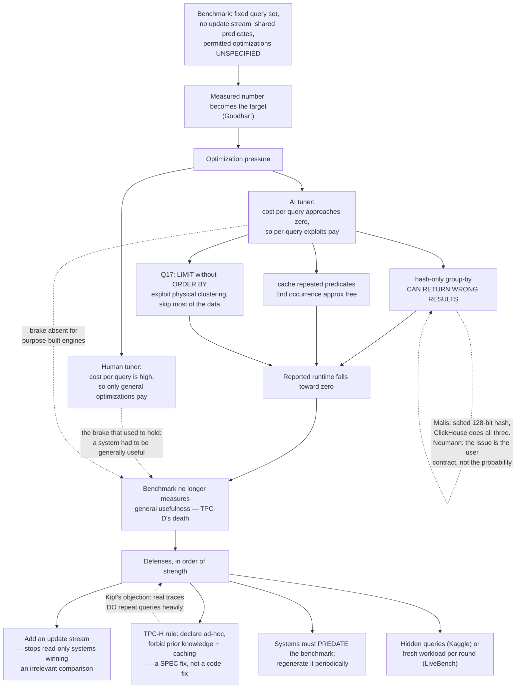

<!--
entry-meta
date: 2026-11-03
type: daily-diff
category: Daily Diff
title: Daily Diff — 2026-11-03
slug: janusgraph-okvs-adapter-berkeleyje
-->

# Daily Diff — 2026-11-03

**2026-11-03 · Daily Diff Digest**

## Which edition, and what the endpoints said this time

**No edition has published for 2026-11-03.** The newest edition that exists is **2026-11-02**, and this run it was **fully readable with per-story source URLs** — which it was not yesterday. So this digest covers the 2026-11-02 edition in full. It was *not* covered yesterday: [yesterday's digest](../2026-11-02-janusgraph-inmemory-slice-path/daily-diff.md) could only reach the 2026-11-01 edition's five RSS titles, with no summaries and no links, and deep-dove a project located by title search rather than by following an edition link.

| Endpoint | Result at ~03:40 UTC / 09:10 IST |
|---|---|
| [front page](https://tdd.cat/) | **2026-11-02, 49 stories**, each with title, source URL and blurb. |
| [`/archive/`](https://tdd.cat/archive/) | **Maximum 2026-11-02**, marked *Latest*; 127 editions total, back to 2026-06-20. **2026-11-03 appears as plain unlinked text** in the November calendar. |
| [`/rss.xml`](https://tdd.cat/rss.xml) | **Lags by one.** Newest item is still *The Daily Diff — Sunday, November 1, 2026*, `pubDate Sun, 01 Nov 2026 00:00:00 GMT`. **No 11-02 item at all.** |

**Three corrections to the endpoint model this log has been building.** All three invert a conclusion from an earlier run, which is the point of keeping the table.

1. **The front page's "always one day behind the maximum" offset is dead.** It held for three consecutive runs and was described yesterday as "the most stable endpoint in the set, and stable at being wrong by one day". Today the front page serves 11-02 and 11-02 *is* the maximum. The offset was never a property of the front page; it was the archive and the front page moving at the same lag, and now they don't.
2. **RSS leads *and* lags, on alternating days.** Yesterday RSS was the only endpoint that knew 11-01 existed, while that edition's own permalink 404'd. Today RSS is the only endpoint that *doesn't* know 11-02 exists. Neither "poll the archive first" nor "poll RSS first" survives four runs.
3. **The honest model, after eighteen-plus runs: there is no leader.** Each endpoint is independently cached and any one of them can be ahead on any given day. The only correct procedure is the one this task already specifies — fetch the front page, read whatever edition it serves, and **say which one it is**. Cross-check the archive for the maximum; treat RSS as a third opinion, not a source of truth. This log should stop trying to find the oracle.

**One genuinely new capability:** the 11-02 front page carries **per-story source URLs**, which the 11-01 RSS description did not. That is what makes a real deep dive possible today — the source link below was followed from the edition, not reverse-engineered from a title.

## The 2026-11-02 edition — 49 stories, point-wise

Overwhelmingly an AI-systems edition, with a hard database spine running through it. Grouped, standouts named.

**Agent security — the loudest cluster, and two independent papers on the same result.**

- **Pretraining poisoning implants remote-code-execution backdoors into agents**, reported twice: [arXiv 2610.37741](https://arxiv.org/abs/2610.37741) and a companion study at [pbb.sh](https://pbb.sh/research/Agentic-Backdoor/). Tiny quantities of poisoned *pretraining* data plant backdoors that trigger shell execution in CLI agents, and the companion claims they **survive clean post-training pipelines**. This was also a featured title in the 11-01 edition, so it has now carried two days.
- [Claude discovers zero-day RCE chains in Chrome](https://www.anthropic.com/research/discovering-vulnerabilities-with-claude) — a full exploit chain from a V8 bug to a sandbox escape.
- [Red-teaming OpenAI's blocking Auto-review monitor](https://www.lesswrong.com/posts/dbStc8ZFESqfihwAd/lessons-from-red-teaming-auto-review-openai-s-blocking-1) — 11 attack vectors against agent sandboxes.
- [An audit of 67 MCP packages](https://mcp.brydge-ai.com) found undeclared network contacts and undocumented tool registrations.
- [Nomos](https://github.com/mgantlett/nomos) puts a deterministic runtime between coding agents and Git to block test-weakening and unverified stubs — the same instinct as the deep dive below, aimed at a different Goodhart target.

**Databases and storage.**

- [**AI code generation breaks modern database benchmarks**](http://databasearchitects.blogspot.com/2026/10/the-benchmarking-crisis.html) — today's deep dive.
- [PostHog moving off DuckDB](https://posthog.com/blog/moving-off-duckdb) — single-node sizing could not absorb unpredictable workloads; they went to distributed Trino. Note the same company also ships [Hoglake](https://github.com/PostHog/hoglake), a petabyte-scale lakehouse catalog stored as **Postgres rows behind a REST service**.
- [How writes flow through MongoDB and WiredTiger](https://franejelavic.github.io/writing/mongodb-wiredtiger-storage-engine/) — usefully separates the WiredTiger journal (crash recovery) from the replication oplog, a distinction people routinely conflate.
- [Structured log ingestion benchmarked across engines](https://victoriametrics.com/blog/structured-log-ingestion-benchmark/index.html) — ingestion speed vs disk footprint vs query latency. Read it *after* the deep dive.
- [Decoupled authorization engines vs in-app `if` statements](https://devops-daily.com/posts/authorization-if-statements-vs-cerbos-vs-spicedb) — in-process checks far faster than Cerbos or SpiceDB, especially when filtering large collections.

**Systems and infrastructure.**

- [Cloudflare's targeted DNS zone builds](https://blog.cloudflare.com/dns-targeted-zone-builds/) — rebuilding only changed parts of a zone cut memory 85% and halved build latency. The cleanest incremental-computation win in the edition.
- [Automating security patch backporting with Codex](https://blog.trailofbits.com/2026/11/02/backporting-security-fixes-at-scale-with-codex/) — human-reviewed workflow, fixes merged for **149 CVEs**.
- [Ginux](https://github.com/gmkurtzer/ginux), a Rust x86-64 kernel booting via UEFI that runs **unmodified Linux userspace binaries**; [Blaze](https://github.com/indexable-inc/blaze), a drop-in cargo replacement claiming up to 92× faster incremental rebuilds; [Drove](https://phonepe.github.io/drove-orchestrator/index.html), PhonePe's container orchestrator built to avoid Kubernetes CRD complexity.
- [Formally verifying x86 glibc binaries](https://v12.sh/blog/x86-formal-verification-intro) — machine-checked proofs that remove the compiler from the trusted base.
- [CUDA checkpointing made 15× faster on a B300](https://maknee.github.io/blog/2026/Cuda-Checkpointing/), and [TEMPO](https://arxiv.org/abs/2609.22743), tag-based memory ordering that removes conservative retirement stalls at low hardware cost.
- [Checking for whitespace under Unicode](https://serce.me/posts/2026-10-30-how-hard-is-it-to-check-for-whitespace) — 25 `White_Space` code points, and how Guava reaches for bitmasks and lookup arrays. Small, and the kind of thing that eats a day.
- [Google Workspace sharing treats addresses as mutable pointers](https://deployed-ai.io/blog/google-workspace-sharing-surprises/) — permission indexes keyed on email can leak access when an address is reassigned or aliased. Directly applicable if you ever key an ACL on an email.

**Model internals and training.** [bf16 may be freezing your weight updates](https://lacuna.tiptreesystems.com/paper/bf16-might-be-freezing-your-weight-updates/art_487b1ed949e745a6ae0c42815b8d3cba) (precision truncating most AdamW updates to zero, acting as an unintended sparse fine-tuner) is the sharpest of these; also [language models natively inspecting and editing weights](https://rikiyat.github.io/blog/weight-space-programming/), [one algorithm for pretraining/SFT/RL](https://arxiv.org/abs/2610.40564), [SemiAnalysis's GDPx benchmark](https://newsletter.semianalysis.com/p/gdpx-measuring-frontier-model-capabilities) finding top models at ~12% on high-value domain tasks, [FreeToken](https://arxiv.org/abs/2608.16157) and [NVIDIA's three MoE inference optimizations](https://developer.nvidia.com/blog/3-ways-to-boost-moe-inference-on-nvidia-dgx-spark/).

**Agent engineering, briefly.** [Grading actions rather than replies](https://www.evalshift.dev/blog/ai-evals-for-agents); [harness beats model](https://booley.dev/blog/harness-matters/) — mean time to a verified RTL fix cut from 56 to 21 minutes by improving the harness, not swapping models; [message threads](https://claude.com/resources/articles/message-threads) retaining server-side state for five minutes for ~35% lower median TTFT; [on-demand Git fetching](https://baz-scm.github.io/gion/) instead of full clones; and [why principal engineers are not obsolete](https://maheshba.bitbucket.io/blog/2026/07/22/agentdesign.html) — agents struggle with cross-layer trade-offs in novel distributed systems.

## Deep dive — "The Benchmarking Crisis", and the precise shape of the cheat

**Source, followed from the edition:** [databasearchitects.blogspot.com — "The Benchmarking Crisis"](http://databasearchitects.blogspot.com/2026/10/the-benchmarking-crisis.html), **Thomas Neumann**, 2026-10-27, with a substantive comment thread including **Andreas Kipf** (Redbench) and **Michael Malis** (pgrust's creator).

**The claim.** Goodhart's law has always applied to database benchmarks; what changed is the *cost of overfitting*. A human will not hand-tune a micro-optimization per query. An AI will. So the rate at which a benchmark degrades from "measures general usefulness" to "measures fit to this benchmark" has gone up by orders of magnitude, and benchmark design has to change in response.

**The historical control, which is the part worth internalizing.** TPC-D was retired because optimization — notably aggressive caching and precomputation — drove query runtimes *toward zero*. TPC-H's fix was not a technical one: it **declared itself an ad-hoc benchmark** and forbade workload-specific exploitation and result caching by rule. The defense was in the spec, not the code.

**The mechanism, concretely.** Neumann names three things the **pgrust** implementation does on **ClickBench**:

| What it does | Why it is fast | What it costs |
|---|---|---|
| Group-by on string columns using **only the hash value**, ignoring string content | no string comparison on the grouping path | **can produce wrong results** — and Neumann's point in the thread is that this violates the user's request, independent of collision probability |
| **Caches predicates** that ClickBench repeats across queries | second occurrence costs essentially nothing | measures the cache, not the engine |
| For **Q17** (group by `userid`, `LIMIT` with **no `ORDER BY`**) exploits the physical clustering of tuples by `userid` | skips reading most of the data | answer is only "correct" because the query underspecifies which rows it wants |

**ClickBench is complicit, by Neumann's account:** it does not clearly specify what is permitted, has **no update stream**, and uses simple underspecified queries that **share predicates**. The historical brake — that a system had to be generally useful to be worth optimizing — does not apply to what he calls "vibe-coded execution engines."

**The thread is better than the post, and it is where the real disagreement is.**

- **Malis (pgrust)** replies that his team's rule of thumb was *whether another database already implements the optimization* — and that **ClickHouse does all three.** He used a salted 128-bit hash to make collisions negligible, and argues hardware-induced errors are far likelier than a collision.
- **Neumann** concedes his own group has felt pressure toward hash-only group-by and refuses it, on the grounds that the issue is **the user contract, not the collision probability**: attacker-controlled strings make collisions likelier than random chance suggests, and a result that can be wrong is a different product than a result that cannot.
- **Kipf (Redbench)** attacks the proposed fix from the other side: production traces from Redshift and Snowflake show **heavy query repetition**, so forbidding caching makes the benchmark *less* representative of real workloads. Neumann's answer is candid — allowing caching destroys comparability across system classes and favors purely analytical systems, and forbidding it is "the easier way out."
- Neumann also concedes **his own SQLStorm proposal is not a defense**: tens of thousands of queries makes overfitting harder for a human and merely tedious for a tool.

**What he proposes.** (a) Be ad-hoc like TPC-H — forbid exploiting prior knowledge and caching intermediates, or runtimes converge to zero. (b) **Include an update stream**, or read-only systems beat transactional ones on an irrelevant axis. (c) Require that tested systems **predate the benchmark**, and regenerate benchmarks periodically. And borrow from ML evaluation: **hidden test queries** with only a development sample published (Kaggle), or freshly generated workloads per evaluation round (LiveBench).

**Why this matters beyond benchmarks, and the connection to [today's lesson](README.md).** The transferable idea is that **an underspecified contract is an exploit surface**, and the exploit gets taken the moment taking it becomes cheap. ClickBench's Q17 is only exploitable because `LIMIT` without `ORDER BY` does not say *which* rows — so returning the physically convenient ones is not wrong, merely useless. That is the same class of hazard as the layer read today: `KeyColumnValueStore`'s javadoc promises a half-open column interval, and **nothing in the codebase enforces it** — the in-memory store implements it with two binary-search indices, BerkeleyJE with a `>=` per record, and a third backend could implement it wrongly and pass every test that does not specifically probe the boundary. In both cases the defense is the same and it is not clever: write the contract down tightly enough that conformance is checkable, and then check it. Neumann's answer to Malis is the sharpest line in the thread — the question is not how improbable the wrong answer is, it is whether you promised not to give one.

**The honest caveat.** This is a blog post and its comment section, not a measurement. No one in the thread publishes a number quantifying how much of ClickBench's reported spread is attributable to the three exploits named, and Neumann concedes his own counter-proposal does not work. The claim to carry forward is the *mechanism*, not a magnitude.

## Sources

Fetched this run:

- [https://tdd.cat/](https://tdd.cat/) — front page, serving the **Monday, November 2, 2026** edition, **49 stories** with per-story source URLs.
- [https://tdd.cat/archive/](https://tdd.cat/archive/) — 127 editions; maximum **2026-11-02**, marked *Latest*; 2026-11-03 present as unlinked plain text.
- [https://tdd.cat/rss.xml](https://tdd.cat/rss.xml) — newest item *The Daily Diff — Sunday, November 1, 2026*, `pubDate Sun, 01 Nov 2026 00:00:00 GMT`; **no 2026-11-02 or 2026-11-03 item**.
- [http://databasearchitects.blogspot.com/2026/10/the-benchmarking-crisis.html](http://databasearchitects.blogspot.com/2026/10/the-benchmarking-crisis.html) — the deep-dive source, followed from the edition. Every quoted phrase, named optimization, system and participant above comes from this page and its comment thread.

Every other link in the point-wise section above is a source URL as listed by the 2026-11-02 edition on the front page fetched this run. Those pages were **not** individually fetched, and the one-line descriptions are the edition's own blurbs, not this digest's assessment of the underlying work.
