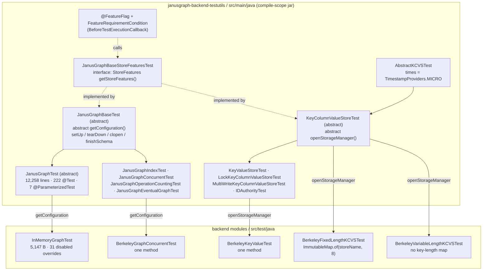
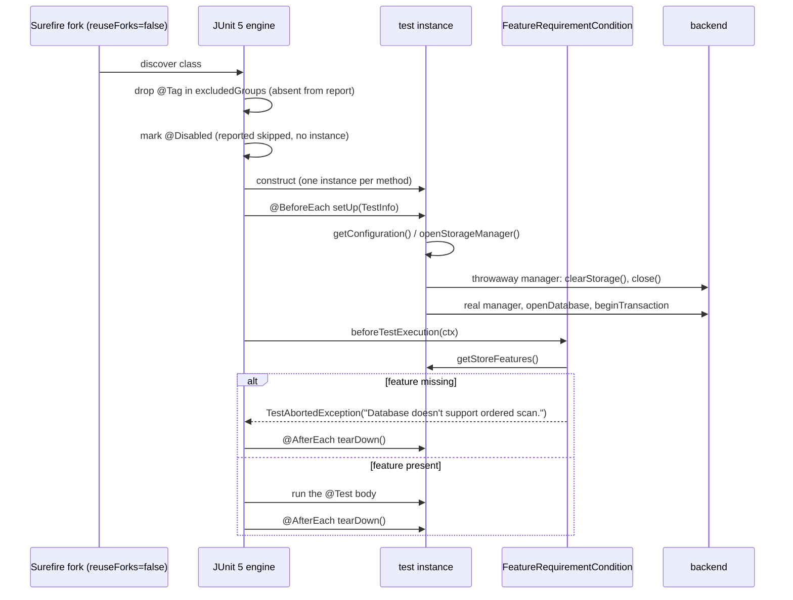

<!--
entry-meta
date: 2026-11-04
type: lesson
track: JanusGraph
lesson: 06
category: Database Internals
title: The test harness — 222 inherited tests, one abstract hook, and four different ways a backend says "not me"
slug: janusgraph-test-harness
-->

# The test harness — 222 inherited tests, one abstract hook, and four different ways a backend says "not me"

**2026-11-04 · JanusGraph Track · Lesson 06 of 28**

## Where This Fits

- **Lesson 05** ([`../2026-11-03-janusgraph-okvs-adapter-berkeleyje/README.md`](../2026-11-03-janusgraph-okvs-adapter-berkeleyje/README.md)) finished Part I's implementation survey: `OrderedKeyValueStoreAdapter` manufactures a column dimension on a flat ordered map by concatenating the row key onto every column, and whether that needs a post-filter turns entirely on fixed- vs variable-width keys. It also established the thing this lesson explains: `BerkeleyFixedLengthKCVSTest` and `BerkeleyVariableLengthKCVSTest` are *the same suite* run twice, differing by one expression.
- **This lesson** reads the machinery that makes that possible. Three sessions in a row have ended at the same wall — sessions 03, 04 and 05 each found a load-bearing invariant that **nothing asserts**. The harness is where an assertion would have to live, so this is the lesson that says what it would cost to add one, and what the harness can and cannot express.
- **It sets up lesson 07** (`Backend` and `BackendTransaction`), which opens five named stores and wraps them in cache and locker layers. Lesson 07 is also where three questions carried from sessions 03 and 04 come due, and the only honest way to settle two of them is a test — written against the suites read here.

Everything below reads `JanusGraph/janusgraph` at commit **`a59ae8d8`** (2026-10-28). All line numbers are from that commit.

---

## 1. The harness lives in `src/main`, not `src/test`

The first thing that is wrong about this codebase's test layout is that most of the test code is not test code, as Maven understands the word.

| Module | What is in it | Scope |
|---|---|---|
| `janusgraph-backend-testutils` | `src/main/java` — the **abstract** suites every backend inherits | a normal compile-scope jar |
| `janusgraph-test` | `src/main/java/org/janusgraph/diskstorage/cache/` only (one package); `src/test/java` holds the concrete in-memory-backed runs | depends on `janusgraph-backend-testutils` |
| `janusgraph-inmemory`, `janusgraph-berkeleyje`, `janusgraph-cql`, … | `src/test/java` — thin concrete subclasses | consume the jar |

`janusgraph-test/pom.xml` declares it plainly: three compile-scope dependencies, `janusgraph-core`, `janusgraph-inmemory` and `janusgraph-backend-testutils`, with **no `<type>test-jar</type>` anywhere**. The suites are shipped as ordinary API.

That decision has a consequence worth stating: the abstract suites are **public, published, compile-scope classes**. A third-party storage adapter (there are several outside the tree) gets JanusGraph's entire conformance suite by adding one dependency and writing one method. The cost is that the project cannot change `KeyColumnValueStoreTest`'s protected surface without breaking out-of-tree backends, and that 1.1 MB of test source sits inside a published artifact.

Sizes at the pinned commit, in `janusgraph-backend-testutils/src/main/java/org/janusgraph/graphdb/`:

| File | Bytes |
|---|---|
| `JanusGraphTest.java` | **649,177** |
| `JanusGraphIndexTest.java` | 490,586 |
| `JanusGraphOperationCountingTest.java` | 43,351 |
| `JanusGraphBaseTest.java` | 32,632 |
| `JanusGraphCustomIdTest.java` | 30,672 |
| `JanusGraphPartitionGraphTest.java` | 28,123 |
| `JanusGraphConcurrentTest.java` | 20,004 |

`JanusGraphTest.java` is **12,258 lines**, declared at `L312` as `public abstract class JanusGraphTest extends JanusGraphBaseTest`, and contains **222 `@Test`**, **7 `@ParameterizedTest`** and **5 `@Tag`** annotations. It is organised by ten banner comments rather than by nested classes:

```
L321  UPDATE THEN REMOVE IN THE SAME TRANSACTION
L629  INDEXING
L894  SCHEMA TESTS
L3387 ADVANCED
L4300 CONSISTENCY
L4718 VERTEX CENTRIC QUERIES
L8266 LOGGING
L8601 GLOBAL GRAPH QUERIES
L10066 TIME TO LIVE
L10582 IO
```

There are no `@Nested` classes and no `@TestInstance` customisation. One class, one flat namespace, 229 test methods.

---

## 2. Two base classes, two lifecycles, one abstract hook each

The harness has exactly two entry points, and they are structurally parallel.

### `JanusGraphBaseTest` — graph level

```java
// JanusGraphBaseTest.java:108
public abstract class JanusGraphBaseTest implements JanusGraphBaseStoreFeaturesTest {
```

`JanusGraphBaseStoreFeaturesTest` is a one-method interface — `StoreFeatures getStoreFeatures()` — and nothing else. It exists so that a JUnit extension can reach a test's backend capabilities without knowing which base class it came from (§5).

Mutable state is **public fields**, not constructor-injected:

```java
// JanusGraphBaseTest.java:113-121
public WriteConfiguration config;
public BasicConfiguration readConfig;
public StandardJanusGraph graph;
public StoreFeatures features;
public JanusGraphTransaction tx;
public JanusGraphManagement mgmt;
public TestInfo testInfo;
public Map<String,LogManager> logManagers;
```

The one thing a subclass must supply is `L126`:

```java
public abstract WriteConfiguration getConfiguration();
```

`@BeforeEach setUp` (`L151-161`) is the whole contract:

```java
this.testInfo  = testInfo;
this.config    = getConfiguration();          // <- the subclass hook
TestGraphConfigs.applyOverrides(config);      // <- env-file overrides, §8
Preconditions.checkNotNull(config);
logManagers = new HashMap<>();
clearGraph(config);                           // <- a real Backend.clearStorage()
readConfig  = new BasicConfiguration(...);
open(config);
```

`clearGraph` (`L132-134`) does not touch the graph object — it builds a **second, throwaway `Backend`** against the same config and calls `clearStorage()` on it. `getBackend` (`L136-145`) is where that happens, and it rewrites two config options first:

```java
adjustedConfig.set(GraphDatabaseConfiguration.LOCK_LOCAL_MEDIATOR_GROUP, "tmp");
adjustedConfig.set(GraphDatabaseConfiguration.UNIQUE_INSTANCE_ID, "inst");
```

Those two literals, `"tmp"` and `"inst"`, are why every test in the tree shares one lock mediator group and one instance id. Lesson 07 reads `Backend` and will see what `LOCK_LOCAL_MEDIATOR_GROUP` actually selects; the point here is that the test harness pins it to a constant, so **no test exercises two mediator groups against one store** unless it opens its own `Backend`.

`open` (`L163-168`) is the four lines everything else depends on:

```java
graph    = (StandardJanusGraph) JanusGraphFactory.open(config);
features = graph.getConfiguration().getStoreFeatures();
tx       = graph.newTransaction();
mgmt     = graph.openManagement();
```

Note that `features` is read from the *graph's* configuration, not from a manager the test opened. So `getStoreFeatures()` on a graph-level test reflects whatever `GraphDatabaseConfiguration` resolved — the same 24 booleans session 03 read.

The three helpers that appear in nearly every test body:

| Helper | Line | What it does |
|---|---|---|
| `newTx()` | `L194-199` | commits `tx` if open, then `graph.newTransaction()` |
| `finishSchema()` | `L176-182` | commits `mgmt`, reopens it, `newTx()`, then `graph.tx().commit()` — **four** operations |
| `clopen(Object... settings)` | `L234-242` | `setupConfig(settings)`, commit, **close the graph**, reopen |

`clopen` is the harness's durability assertion: close the database and reopen it, and the test continues against persisted state. `setupConfig` (`L213-232`) is the interesting half — it splits the settings by `option.getKey().option.isLocal()`, writing local options into a `ModifiableConfiguration` with `Restriction.LOCAL` and pushing global ones through `graph.openManagement().set(...)` instead. One call site, two completely different persistence paths, chosen per option.

### `KeyColumnValueStoreTest` — store level

```java
// KeyColumnValueStoreTest.java:80
public abstract class KeyColumnValueStoreTest extends AbstractKCVSTest
        implements JanusGraphBaseStoreFeaturesTest {
```

`AbstractKCVSTest` is 37 lines and supplies exactly one shared decision: `protected static final TimestampProvider times = TimestampProviders.MICRO`. Every store-level test in the tree therefore runs at **microsecond** timestamp resolution, and `getConsistentTxConfig(manager)` pulls `manager.getFeatures().getKeyConsistentTxConfig()` — the only place the harness consults the feature flags *mechanically* rather than by hand.

Fixture constants (`L82-92`):

```java
public static final int TRIALS = 5000;
final int numKeys    = 500;
final int numColumns = 50;
protected final String storeName = "testStore1";
```

`numKeys × numColumns` = **25,000 cells** loaded by `generateValues()`/`loadValues()` for most tests. `storeName` is `protected` precisely so `BerkeleyFixedLengthKCVSTest` can pass it into a key-length map.

Lifecycle (`L94-141`), and note how it differs from the graph-level one:

```java
@BeforeEach setUp():  openStorageManager() -> clearStorage() -> close()   // throwaway
                      then open(): manager = openStorageManager()
                                   store   = manager.openDatabase(storeName)
                                   tx      = startTx()
```

The same throwaway-then-real pattern as `clearGraph`, for the same reason: `clearStorage()` must run against a manager that is then discarded, because some backends cannot clear a store they hold open.

The abstract hook is `L102`:

```java
public abstract KeyColumnValueStoreManager openStorageManager() throws BackendException;
```

### What a backend's test module actually contains

This is the payoff of the whole design. `BerkeleyKeyValueTest` in full, minus licence header and imports:

```java
public class BerkeleyKeyValueTest extends KeyValueStoreTest {
    @Override
    public OrderedKeyValueStoreManager openStorageManager() throws BackendException {
        return new BerkeleyJEStoreManager(BerkeleyStorageSetup.getBerkeleyJEConfiguration());
    }
}
```

One method. `BerkeleyGraphConcurrentTest` is the same shape on the graph side:

```java
public class BerkeleyGraphConcurrentTest extends JanusGraphConcurrentTest {
    @Override
    public WriteConfiguration getConfiguration() {
        return BerkeleyStorageSetup.getBerkeleyJEGraphConfiguration();
    }
}
```

And lesson 05's two suites differ by **one expression** — the key-length map:

```java
// BerkeleyFixedLengthKCVSTest.java:27-30
public KeyColumnValueStoreManager openStorageManager() throws BackendException {
    BerkeleyJEStoreManager sm = new BerkeleyJEStoreManager(BerkeleyStorageSetup.getBerkeleyJEConfiguration());
    return new OrderedKeyValueStoreManagerAdapter(sm, ImmutableMap.of(storeName, 8));
}

// BerkeleyVariableLengthKCVSTest.java:40-42   (no map at all)
    return new OrderedKeyValueStoreManagerAdapter(sm);
```

That is the mechanism by which lesson 05's fixed-vs-variable encoding split gets 60-odd tests of coverage each for the price of four lines.

The in-memory side provides the same configuration hook (`InMemoryGraphTest.java:32-36`), differing only in that it returns `STORAGE_BACKEND = "inmemory"`, and `StorageSetup.getInMemoryConfiguration()` adds two more decisions worth knowing:

```java
// StorageSetup.java
.set(STORAGE_BACKEND, "inmemory")
.set(IDAUTHORITY_WAIT, Duration.ZERO)   // no ID-block acquisition delay
.set(DROP_ON_CLEAR, false)              // clearStorage() must not drop
```

`IDAUTHORITY_WAIT = Duration.ZERO` is lesson 09's business, but it is a test-only setting, so any test that passes in memory is passing with ID-authority coordination latency removed.

---

## 3. Harness topology



---

## 4. Four ways a backend opts out, and four different things the report says

This is the sharpest thing in the harness, and it is almost certainly not deliberate. A concrete backend has four distinct idioms available for turning off an inherited test, and they are **not** equivalent: they differ in whether the method runs, whether it is reported, and whether it can hide a regression.

Java does not inherit method annotations through an override. The repo documents this itself, in `CQLGraphTest.java:250-256`:

```java
// flaky test: https://github.com/JanusGraph/janusgraph/issues/1457
// The parameterized variant of rerunner-jupiter's retry annotation does not work with JUnit 5.13+, so the
// parameterized test of the base class is overridden without a test annotation (which excludes it from this
// class) and its two parameter values are expanded into the dedicated repeatable tests below.
@Override
public void simpleLogTestWithFailure(boolean useStringId) throws InterruptedException {
    super.simpleLogTestWithFailure(useStringId);
}
```

So a bare `@Override` already removes the method from discovery. Which makes the four idioms:

| # | Idiom | Runs? | Surefire report | Regression visible? |
|---|---|---|---|---|
| 1 | `@Override` only, body delegates or empty | no | **absent entirely** | n/a — but the opt-out is invisible too |
| 2 | `@Override @Test @Disabled` + empty body | no | `<skipped/>` | no, and the skip is counted |
| 3 | `@Override @Test @Disabled("reason")` | no | `<skipped message="reason"/>` | no, and the *why* is in the report |
| 4 | **`@Test @Override` + empty body, no `@Disabled`** | **yes** | **`<testcase>` with no `<skipped/>`, time ≈ 0** | **no — it is counted as a pass** |

All four are in the tree.

**Idiom 2, at scale.** `InMemoryGraphTest.java` is 5,147 bytes and carries **31** occurrences of `@Override @Test @Disabled`, at lines 57, 61, 64, 67, 70, 73, 76, 79, 82, 85, 88, 91, 94, 97, 100, 103, 106, 109, 112, 115, 118, 121, 124, 127, 130, 133, 136, 139, 142, 145 and 148 — every one of them an empty body. The in-memory backend passes `JanusGraphTest`'s 229 methods by switching 31 of them off. Grouped by reason, which the file mostly leaves implicit:

- **Multi-instance** (3): `testAutoCreatedConnectionConstraintReachesOtherInstances`, `testIndexUpdateSyncWithMultipleInstances`, `testClearStorage`. The file comments only the first: `// A second in-memory graph does not share the storage of the first`.
- **Global/managed configuration** (6): `testLocalGraphConfiguration`, `testMaskableGraphConfig`, `testGlobalGraphConfig`, `testGlobalOfflineGraphConfig`, `testFixedGraphConfig`, `testManagedOptionMasking` — global config lives in `system_properties`, which an unpersisted store cannot hand to a second instance.
- **Multi-query / batch** (6): `testLimitBatchSizeForMultiQuery` and two variants, `testMultiQueryPropertiesWithLimit`, `testMultiSliceDBCachedRequests`, `testMultiQueryMetricsWhenReadingFromBackend`, `testMultiQueryDropsStrategyModes`. Session 05's finding reappears from the other side: `hasMultiQuery()` false is load-bearing, and the harness handles that by disabling tests rather than asserting the flag.
- **Logging** (2): `simpleLogTest`, `simpleLogTestWithFailure`.
- **Schema maker / direct schema commit** (6), **drops** (2), plus `testDataTypes`, `testForceIndexUsage`, `testTransactionConfiguration`, `testIndexUpdatesWithReindexAndRemove`.

Not one of the 31 carries a `@Disabled("…")` reason string. By contrast `CQLGraphTest.java:390` and `:481` do: `@Override @Test @Disabled("Use Parametrized test instead")`. Same codebase, same purpose, and only one of them tells you why from the report.

Also note that `InMemoryGraphTest`'s `simpleLogTest(boolean useStringId)` and `simpleLogTestWithFailure(boolean useStringId)` are annotated `@Test` while **taking a parameter** — the base class declares them `@ParameterizedTest @ValueSource(booleans = {true, false})` at `JanusGraphTest.java:8270-8282`. A `@Test` method with an unresolvable parameter would fail at execution; it never executes because `@Disabled` precedes resolution. It is latent, not broken.

**Idiom 4, the false green.** Both BerkeleyJE KCVS suites do this:

```java
// BerkeleyFixedLengthKCVSTest.java:32-40   and   BerkeleyVariableLengthKCVSTest.java:45-53
@Test @Override
public void testConcurrentGetSlice() {

}

@Test @Override
public void testConcurrentGetSliceAndMutate() {

}
```

`@Test` with no `@Disabled` means the method is discovered and **executed**. An empty body passes. So Surefire reports two passing tests per suite, four across the module, for concurrency behaviour that was never exercised. The parent implementations (`KeyColumnValueStoreTest.java:720-728`, delegating to `testConcurrentStoreOps` at `L730`) spin `getThreadCount()` threads over `ConcurrentRandomSliceReader` (`L780`) and are exactly the tests you would want on a backend whose locking lesson 05 found to be two home-grown tiers. Dropping the `@Test` — idiom 1 — or adding `@Disabled("BerkeleyJE is single-threaded-tx only; see BerkeleyJEStoreManager.beginTransaction")` — idiom 3 — would both be strictly better, and both are one-line changes.

---

## 5. `@FeatureFlag` — the one *mechanical* capability gate, and what it costs

The fourth opt-out above is static. There is a fifth path that is dynamic, and it is the only place in the codebase that branches on `StoreFeatures` at test time rather than by hand.

Three tiny files make it work:

```java
// JanusGraphFeature.java
public enum JanusGraphFeature { CellTtl, Scan, OrderedScan, UnorderedScan, }

// FeatureFlag.java
@Retention(RetentionPolicy.RUNTIME)
@Target({ElementType.METHOD})
@ExtendWith(FeatureRequirementCondition.class)
public @interface FeatureFlag { JanusGraphFeature feature(); }
```

```java
// FeatureRequirementCondition.java:26
class FeatureRequirementCondition implements BeforeTestExecutionCallback {
```

It casts the test instance to `JanusGraphBaseStoreFeaturesTest` — which is the entire reason that one-method interface exists — and throws `TestAbortedException` on a miss:

| Feature | Checked | Abort message | Line |
|---|---|---|---|
| `CellTtl` | `hasCellTTL()` | `"Database doesn't support CellTtl."` | `L38-41` |
| `Scan` | `hasScan()` | `"Database doesn't support ordered/unordered scan."` | `L43-46` |
| `OrderedScan` | `hasOrderedScan()` | `"Database doesn't support ordered scan."` | `L48-51` |
| `UnorderedScan` | `hasUnorderedScan()` | `"Database doesn't support unordered scan."` | `L53-56` |
| anything else | — | `UnsupportedOperationException` | `default:` |

Usage in `KeyColumnValueStoreTest`, all seven sites:

| Test | Line | Flag |
|---|---|---|
| `scanTest` | `L445-447` | `Scan` |
| `testOrderedGetKeysRespectsKeyLimit` | `L491-493` | `OrderedScan` |
| `testGetKeysColumnSlicesSimple` | `L528-530` | `Scan` |
| `testGetKeysColumnSlicesOnLowerTriangular` | `L568-570` | `Scan` |
| `testGetKeysWithSliceQuery` | `L1002-1004` | `UnorderedScan` |
| `testGetKeysWithKeyRange` | `L1017-1019` | `OrderedScan` |
| `testTtl` | `L1034-1037` | `CellTtl` **and** `@Tag(BRITTLE_TESTS)` |

Two things about this are worth more than they look.

**It is `BeforeTestExecutionCallback`, not `ExecutionCondition`.** JUnit runs `ExecutionCondition` at discovery, before an instance exists; `BeforeTestExecutionCallback` runs *after* `@BeforeEach`. So on a backend that lacks the feature, the full `setUp` has already run: a throwaway manager opened and `clearStorage()`d, a real manager opened, a database opened, a transaction begun — and then the test aborts. Four backend round-trips to decide not to run. `ExecutionCondition` cannot be used as written, because the check needs the test *instance* to call `getStoreFeatures()` on, and at discovery time there is none. Fixing it properly would mean moving capability declaration to the class (an annotation, or a static), which is a real design change and not a cleanup.

**It covers 4 of the 24 feature booleans.** Session 03 counted 24 declarable capabilities on `StoreFeatures`. `JanusGraphFeature` names four. Everything else — `transactional`, `locking`, `batchMutation`, `multiQuery`, `keyConsistent`, `distributed`, `optimisticLocking`, `cellTTL`'s siblings — is handled by hand-branching inside a test body or by one of §4's four static idioms. That is why session 05 could find `multiQuery` and `batchMutation` load-bearing and unasserted: there is no vocabulary in the harness for asserting them.

Concretely, for the two backends Part I has read:

```java
// InMemoryStoreManager.java:64-70
features = new StandardStoreFeatures.Builder()
    .orderedScan(true)
    .unorderedScan(true)
    .keyOrdered(true)
    .persists(false)
    .optimisticLocking(true)
    .optimizedWholeRowDeletion(true)
    .keyConsistent(GraphDatabaseConfiguration.buildGraphConfiguration())
    .build();
```

So in memory, all four `Scan`/`OrderedScan`/`UnorderedScan`-flagged tests run, and only `testTtl` aborts (`cellTTL` is never set, so it is `false`). On BerkeleyJE — whose builder lesson 05 read at `BerkeleyJEStoreManager.java:129-141`, setting `orderedScan` and `keyOrdered(true)` but **not** `unorderedScan` — `testGetKeysWithSliceQuery` aborts with `"Database doesn't support unordered scan."` and the `OrderedScan` pair runs. One suite, two different sets of executed methods, decided at runtime from the backend's own declaration.

### One test's full lifecycle



The branch at the bottom is the whole point: the abort arrives **after** the two backend openings, not before.

---

## 6. `evaluateQuery` — assertions against the query profiler

Query-layer tests do not assert on results alone. `JanusGraphBaseTest` carries seven overloads of `evaluateQuery` (`L589-750`) that install a `SimpleQueryProfiler` into the builder and then assert on its annotations. This is the harness's answer to "how do you test a planner".

Vertex-centric form (`L601-659`):

```java
SimpleQueryProfiler profiler = new SimpleQueryProfiler();
((BasicVertexCentricQueryBuilder) query).profiler(profiler);   // <- hard cast
... iterate results, counting and checking pairwise order ...
OrderList orders = profiler.getAnnotation(QueryProfiler.ORDERS_ANNOTATION);
assertEquals(expectedResults, no);
assertEquals(orderMap.size(), orders.size());
assertEquals(Integer.valueOf(1), profiler.getAnnotation(QueryProfiler.NUMVERTICES_ANNOTATION));
```

and then per sub-profiler (`L648-658`):

```java
if (subProfiler.getGroupName().equals(QueryProfiler.OPTIMIZATION)
    || Boolean.TRUE.equals(subProfiler.getAnnotation(QueryProfiler.MULTI_SLICES_ANNOTATION))) continue;
if (subQuerySpecs.length == 2) {              // 0 => fitted, 1 => ordered
    assertEquals(subQuerySpecs[0], subProfiler.getAnnotation(QueryProfiler.FITTED_ANNOTATION));
    assertEquals(subQuerySpecs[1], subProfiler.getAnnotation(QueryProfiler.ORDERED_ANNOTATION));
}
subQueryCounter++;
...
assertEquals(numSubQueries, subQueryCounter);
```

So a vertex-centric query test asserts four things at once: the result count, that results are pairwise ordered by the profiler's own `OrderList` (`RelationComparator.compareOnOrders(...) <= 0`), that the planner produced *exactly N* sub-queries, and that each was **fitted** and **ordered** as expected. "Fitted" is the planner's claim that the storage slice needs no post-filter — which is the same property lesson 05 found `convertQuery` deciding with `Predicates.alwaysTrue()` versus `equalKey`. That connection is why lesson 20 and 21 will live in these overloads.

The graph-centric form (`L683-750`) adds index-selection assertions:

```java
for (SimpleQueryProfiler indexProfiler : simpleQueryProfiler) {
    if (indexProfiler.getAnnotation(QueryProfiler.FULLSCAN_ANNOTATION) != null) fullScan = true;
    else { indexNames.add(indexProfiler.getAnnotation(QueryProfiler.INDEX_ANNOTATION)); indexQueries++; }
}
if (indexQueries > 0) assertFalse(fullScan);
if (fullScan)        assertEquals(0, intersectingIndexes.length);
assertEquals(intersectingIndexes.length, indexQueries);
assertEquals(Sets.newHashSet(intersectingIndexes), indexNames);
```

A test therefore names the exact set of indexes the planner must intersect — `evaluateQuery(query, VERTEX, 1, new boolean[]{true,true}, "theIndex")` — and a plan that returns the right rows via the wrong index fails. That is a far stronger assertion than result equality, and it is the reason the index test class is 490 KB.

**The silent hole:** both forms guard the fitted/ordered assertions with `if (subQuerySpecs.length == 2)`. Pass a `boolean[]` of length 1 or 3 and those two assertions **vanish with no diagnostic**. The count assertions still run, so the test still looks meaningful. There is no `assertEquals(2, subQuerySpecs.length)` anywhere.

Two smaller helpers worth knowing: `verifyElementOrder` (`L496-515`) checks monotonicity on a named property with a failure message carrying the position (`previous + " <> " + current + " @ " + count`), and `executeScanJob` (`L752-762`) pins OLAP scans to `setNumProcessingThreads(2).setWorkBlockSize(100)` for every scan-job test in the tree.

---

## 7. Build-level selection: what actually runs on `mvn test`

The harness's second half is Maven configuration, and it changes the answer to "is this tested?" more than any annotation does.

### Tags

```java
// TestCategory.java
public static final String BRITTLE_TESTS     = "BRITTLE_TESTS";
public static final String SERIAL_TESTS      = "SERIAL_TESTS";
public static final String MEMORY_TESTS      = "MEMORY_TESTS";
public static final String PERFORMANCE_TESTS = "PERFORMANCE_TESTS";
```

Root `pom.xml:102`:

```xml
<test.excluded.groups>MEMORY_TESTS,PERFORMANCE_TESTS,BRITTLE_TESTS</test.excluded.groups>
```

wired in at `pom.xml:423` as `<excludedGroups>${test.excluded.groups}</excludedGroups>`. So three of the four categories are **off by default**, and `@Tag`-excluded methods are dropped at discovery — they appear in the Surefire XML not as skips but **not at all**. `JanusGraphTest`'s five `@Tag(TestCategory.BRITTLE_TESTS)` sites (`L3098`, `L3179`, `L10156`, `L10192`, `L10272`) and `KeyColumnValueStoreTest.testTtl` (`L1034`) are invisible on a normal run.

`SERIAL_TESTS` is the odd one: *not* in the default exclusion list, and applied at **class** level — `@Tag(TestCategory.SERIAL_TESTS)` on `JanusGraphEventualGraphTest`, `JanusGraphOperationCountingTest` and `CQLLogTest`. Only `janusgraph-cql/pom.xml` and `janusgraph-scylla/pom.xml` act on it, running those classes in a dedicated single-fork execution (`<groups>SERIAL_TESTS</groups>`, `<parallel>none</parallel>`) and excluding them from the parallel pass via `<test.cql.excludes>${test.excluded.groups},SERIAL_TESTS</test.cql.excludes>`. In `janusgraph-inmemory` and `janusgraph-berkeleyje` the tag has no effect at all — those classes run in the ordinary pass. `JanusGraphOperationCountingTest` asserts against a process-global `MetricManager`, which is precisely what the tag exists to protect, so the protection is backend-specific while the hazard is not.

### Filename excludes — and the suite that never runs

Root `pom.xml:414-422`:

```xml
<excludes>
  <exclude>**/*PerformanceTest.java</exclude>
  <exclude>**/*ConcurrentTest.java</exclude>
  <exclude>**/*Groovy*Test.java</exclude>
  <exclude>**/*ComputerTest.java</exclude>
  <exclude>**/*ProcessTest.java</exclude>
  <exclude>**/*ProcessPerformanceTest.java</exclude>
  <exclude>**/*StructureTest.java</exclude>
</excludes>
```

The `tinkerpop-test` execution (`L427-459`) re-includes five of those seven patterns, with `combine.self="override"` and an explicit comment (`L434-438`) explaining that the override deliberately discards `default.test.jvm.opts` so the TinkerPop suites' JVM is left alone. Its `<skipTests>${test.skip.tp}</skipTests>` defaults to `true` (`pom.xml:96`).

What is **not** re-included: `**/*PerformanceTest.java` and **`**/*ConcurrentTest.java`**. So `JanusGraphConcurrentTest` (20,004 bytes) and every `*GraphConcurrentTest` subclass — `BerkeleyGraphConcurrentTest` among them — are excluded by filename in the default run and re-included by nothing. The concurrency suites are not part of `mvn test`. That is independent of, and additional to, §4's four empty `testConcurrentGetSlice` overrides. JanusGraph's concurrency coverage is off by two separate mechanisms at once.

### Fork and JVM model

| Setting | Value | Where |
|---|---|---|
| `argLine` | `-Xms256m -Xmx768m -XX:+HeapDumpOnOutOfMemoryError -ea` | `pom.xml:90`, used at `:408` |
| `runOrder` | `alphabetical` | `pom.xml:409` |
| `failIfNoTests` | `false` | `pom.xml:410` |
| `forkedProcessTimeoutInSeconds` | `21600` (**six hours**) | `pom.xml:412` |
| `reuseForks` | `false` | `pom.xml:413` |
| `forkCount` | `4` (in `janusgraph-test`) | `janusgraph-test/pom.xml` |

`reuseForks=false` plus `forkCount=4` means **a fresh JVM per test class, four at a time**. That is what makes `JanusGraphOperationCountingTest`'s global metrics registry survivable at all, and it is why `@Tag(SERIAL_TESTS)` is less load-bearing than it looks — classes already do not share a JVM; they only share wall-clock time and the filesystem. It also means `-ea` is on everywhere, so every `Preconditions`-adjacent `assert` in the codebase is live under test.

`runOrder=alphabetical` is a deliberate choice against randomisation: test order is deterministic, so an order dependence between methods in a 229-method class will reproduce reliably — and will also never be *discovered* by the build.

### Opt-in profiles

| Profile | Activation | Effect |
|---|---|---|
| `memory-test` | `-Dtest.skip.mem=false` | `pom.xml:1900-1935`: `<groups>MEMORY_TESTS</groups>`, `<excludedGroups/>`, `forkCount=1`, `argLine=${mem.jvm.opts}` = `-Xms256m -Xmx256m -ea …` |
| `performance-test` | `-Dtest.skip.perf=false` | `pom.xml:1937-1972`: `<groups>PERFORMANCE_TESTS</groups>`, `<excludedGroups/>`, `forkCount=1` |
| `jdk17-plus-tests` | JDK ≥ 17 | `pom.xml:1656-1680`: sets `test.jdk.jvm.opts` (the `--add-opens` Kryo/Gryo needs) |

The memory profile's *point* is the heap clamp: `-Xmx256m` instead of `768m`. A memory test is one that only means something under a ceiling, which is why it needs both a tag and a profile.

### The environment-file escape hatch

`TestGraphConfigs` (called from `setUp` at `JanusGraphBaseTest.java:155`) reads `$JANUSGRAPH_CONFIG` in a static initialiser and, if it names an existing file, loads it as a `PropertiesConfiguration` and **overwrites every matching key on every test's config**:

```java
public static void applyOverrides(final WriteConfiguration base) {
    if (null == overrides) return;
    for (String k : overrides.getKeys(null)) base.set(k, overrides.get(k, Object.class));
}
```

Its own javadoc gives the motive — CI machines slower than a workstation need longer backend timeouts. Also in that class: `getTTL(TimeUnit)` returns a hard **10 seconds** and `getSchemaConvergenceTime(ChronoUnit)` a hard **60 seconds**, both with a `Preconditions.checkState` that the value fits in an `int` "in case a test decides to try it". Those two constants are the real time budget of every TTL and schema-status test in the tree.

---

## 8. Two retry mechanisms, and a message that prints the wrong number

Flaky tests are handled twice over.

**The home-grown one.** `RetryingTestExecutionExtension` (`testutil/`, with `RetryInfo`, `RetryTemplateContext`, `RetryingTestFailure`) implements three JUnit interfaces at once — `ExecutionCondition`, `ParameterResolver`, `TestExecutionExceptionHandler` — and is constructed per invocation with `(invocation, maxInvocations, minSuccess)`. The condition logic is a two-sided budget:

```java
int failureCount = getFailures(context).size();
int successCount = (invocation - 1) - failureCount;   // "Shift -1 because this happens before test"
if ((maxInvocations - failureCount) < minSuccess)  -> disabled("Cannot hit minimum success rate …")
else if (successCount < minSuccess)                -> enabled("Have not ran …")
else                                               -> disabled("… successful runs have already ran. Skipping …")
```

Failures accumulate in the **parent** context's store, keyed by method name (`getFailures`, using `context.getParent().get().getStore(namespace)`), so the count survives across the generated invocations. On a failure (`L67-79`) it either rethrows the wrapped `RetryingTestFailure` — the budget is spent — or aborts to leave retries available.

That abort message is wrong, at `RetryingTestExecutionExtension.java:77`:

```java
throw new TestAbortedException("Aborting test #" + minSuccess + " of " + maxInvocations
                               + "- still have retries left", testFailure);
```

`minSuccess` is the *required success count*, not the invocation index. The identifier the sentence means is `invocation`, which is in scope and used correctly in `evaluateExecutionCondition`'s messages. With `(maxInvocations=3, minSuccess=1)` every retry of every test logs `"Aborting test #1 of 3"`, whether it is the first attempt or the third. Also missing: a space before `- still have retries left`. The file is attributed to a Stack Overflow answer (`L15-16`), which is where the shape came from.

**The third-party one.** `CQLGraphTest` uses `@RepeatedIfExceptionsTest(repeats = 3)` from rerunner-jupiter at `L239`, `L244`, `L258`, `L263`, `L269`, `L276`, `L283` and `L290`, and the comment at `L250-252` records that its *parameterized* variant broke on JUnit 5.13+, forcing the hand-expansion of `simpleLogTest(boolean)` into two separate single-case methods. So the codebase carries a home-grown retry extension **and** a third-party one, and the third-party one's limitations are what shaped the opt-out idiom at `CQLGraphTest.java:253`.

---

## 9. What a PR's test is expected to look like

`.github/PULL_REQUEST_TEMPLATE.md` makes exactly one testing demand:

> `- [ ] Have you written and/or updated unit tests to verify your changes?`

alongside three process requirements that are enforced by bots rather than by reviewers: an associated issue referenced in the commit message, `#xyz` in the PR body, a rebase onto the target branch, and **a single squashed commit** for an initial contribution. `CONTRIBUTING.md` adds the mechanics — CLA signed with the same name/email as the commits, `git commit -s` for the DCO (with a suggested `git config alias.ci 'commit -s'`), a feature branch always cut from `master` because releases are backported, and `mvn --quiet clean install -DskipTests=true -pl janusgraph-doc -am` if any config option changed, because `docs/configs/janusgraph-cfg.md` is build-enforced. Nothing in either document says *where* a test goes.

Read against §§1–8, the implicit answer is clear and worth writing down:

1. **A behaviour of the storage contract** → a method on the abstract suite in `janusgraph-backend-testutils`, so every backend inherits it. Gate it with `@FeatureFlag` if it needs a capability. This is the only change that increases coverage everywhere at once, and it is also the one most likely to break an out-of-tree backend (§1).
2. **A behaviour of one backend** → a method on that backend's concrete subclass, next to `openStorageManager()`. `BerkeleyVariableLengthKCVSTest.retrieveBackendAndGetKeyValue` is the model, and §10 is why it is a cautionary model.
3. **A graph-level behaviour** → `JanusGraphTest`, in the right banner section, and expect to add `@Override @Test @Disabled` stubs to `InMemoryGraphTest` if the in-memory backend cannot do it.
4. **A query-plan behaviour** → an `evaluateQuery` call with the exact index set and the `boolean[]{fitted, ordered}` pair, never a result-count assertion alone.
5. **Anything timing-dependent** → `@Tag(TestCategory.BRITTLE_TESTS)`, which means it will not run in CI, which means think again.

---

## 10. The regression test that cannot fail

Lesson 05 called `BerkeleyVariableLengthKCVSTest.retrieveBackendAndGetKeyValue` "the variable-key-length leak written down as a test" — two rows, `"hello"` and `"hel"`, both inside the byte range `68 65 6C 00 .. 68 65 6C FF`, with `equalKey` required to discard one. Reading it as a *test* rather than as documentation changes the verdict.

The method body (`L56-120`) is one big `try` whose `catch` is:

```java
        } catch (BackendException e) {
            //generic failure
        }
    }
```

— line `113`, no `fail(...)`, no rethrow, no assertion. And the slice itself sits in a nested try with the same shape (`L90-102`):

```java
try {
    KeySliceQuery keyslice = new KeySliceQuery(keyBuffTwo, startRange, endRange);
    //Errors out here without fix
    List<Entry> result = store.getSlice(keyslice, txh);
    txh.commit();
    assertEquals(1, result.size());
    assertEquals(valTwo, new String(result.get(0).getValue().as(StaticBuffer.ARRAY_FACTORY)));
} catch (BackendException e) {
    txh.rollback();
}
```

The comment at `L93` says the call "errors out here without fix" — i.e. the regression this test guards against manifests as a thrown `BackendException` from `getSlice`. That exception is caught, rolled back, and **swallowed**. Both `assertEquals` calls are inside the `try`, after the throwing line, so they never execute. The method returns normally and Surefire records a pass.

So: the test for the fix passes whether or not the fix is present. The only failure mode it can still catch is `getSlice` returning successfully with the *wrong* contents — an `AssertionError`, which is not a `BackendException` and does propagate. That is a narrower guarantee than the file reads like it is making, and the two `mutate` calls earlier in the outer `try` are covered only by the `//generic failure` catch, so even a store that cannot write passes.

Two smaller things in the same file: it imports `org.junit.Assert.assertEquals` — **JUnit 4** — while the rest of the suite is on `org.junit.jupiter.api`; and it reads `this.manager` and `this.store` into locals at `L57-59` after the inherited `setUp` already populated them, then opens its own transactions with `StandardBaseTransactionConfig.of(TimestampProviders.MICRO)` rather than the inherited `getTxConfig()`.

The repair is small and entirely mechanical: delete both `catch` blocks and let `retrieveBackendAndGetKeyValue` declare `throws BackendException`, or replace each body with `fail(e.getMessage())`; switch the import to `org.junit.jupiter.api.Assertions.assertEquals`; use `getTxConfig()`. It is a contained first PR against a file this track has already read twice, and §13 says how to prove the current behaviour before touching it.

---

## Hands-On

Two experiments. The first makes §4's four idioms visible in the report; the second proves §10's claim without reading the code again.

### Setup

```bash
cd ~/janusgraph                      # your fork, upstream = JanusGraph/janusgraph
git fetch upstream
git checkout -b lesson06 a59ae8d8024207598eada34998d867617df51adf
mvn -q clean install -DskipTests -pl janusgraph-berkeleyje,janusgraph-inmemory -am
```

### A. Read the report, not the console

```bash
mvn -pl janusgraph-inmemory -Dtest=InMemoryGraphTest -DfailIfNoTests=false test
R=janusgraph-inmemory/target/surefire-reports/TEST-org.janusgraph.graphdb.inmemory.InMemoryGraphTest.xml

# the <testsuite> header carries the four counts that matter
head -2 "$R"

# idiom 2: 31 skips with no message
grep -c '<skipped' "$R"
grep -o '<skipped[^/>]*' "$R" | sort | uniq -c
```

**What to look for.** `tests=` minus `skipped=` is what actually ran. `skipped` should be **31** — exactly the `@Override @Test @Disabled` count from `InMemoryGraphTest.java:57-148` — and every `<skipped/>` element should be **bare**, with no `message` attribute, because none of the 31 carries a reason string. Then compare against the `@Tag` arithmetic: `JanusGraphTest` declares 229 test methods (222 `@Test` + 7 `@ParameterizedTest`), five of which are `@Tag(BRITTLE_TESTS)`. Those five are **not** in the file at all — not as skips, not as passes — because `excludedGroups` filters at discovery. Confirm by name:

```bash
grep -c 'testcase name=' "$R"
grep -c 'BRITTLE' "$R"          # expect 0
```

Then put them back and watch the count move:

```bash
mvn -pl janusgraph-inmemory -Dtest=InMemoryGraphTest -DexcludedGroups= -Dgroups=BRITTLE_TESTS \
    -DfailIfNoTests=false test
```

The distinction this makes concrete: **`@Disabled` is reported, `@Tag` exclusion is not.** A reader of CI output can see the 31; nobody can see the 5.

### B. The pass that proves nothing

```bash
mvn -pl janusgraph-berkeleyje -Dtest=BerkeleyVariableLengthKCVSTest -DfailIfNoTests=false test
B=janusgraph-berkeleyje/target/surefire-reports/TEST-org.janusgraph.diskstorage.berkeleyje.BerkeleyVariableLengthKCVSTest.xml

# idiom 4: empty bodies reported as passes
grep -A1 'testcase name="testConcurrentGetSlice' "$B"

# @FeatureFlag at work: BerkeleyJE declares orderedScan but not unorderedScan
grep -B1 -A2 'testcase name="testGetKeysWithSliceQuery' "$B"
grep -B1 -A2 'testcase name="testOrderedGetKeysRespectsKeyLimit' "$B"
```

**What to look for.** `testConcurrentGetSlice` and `testConcurrentGetSliceAndMutate` appear as `<testcase>` elements with a `time` of roughly `0` and **no child element at all** — not `<skipped/>`, not `<failure/>`. They are counted in `tests=` and in the green total. Meanwhile `testGetKeysWithSliceQuery` carries `<skipped message="Database doesn't support unordered scan."/>`, straight out of `FeatureRequirementCondition.java:55`, while `testOrderedGetKeysRespectsKeyLimit` ran for real. Four lines of empty method body and one runtime capability check, side by side in the same XML, with opposite epistemic value.

Now prove §10 empirically. Patch the two swallows locally:

```bash
# in BerkeleyVariableLengthKCVSTest.java, inside both catch blocks, add:
#     org.junit.jupiter.api.Assertions.fail("swallowed: " + e);
mvn -pl janusgraph-berkeleyje -Dtest=BerkeleyVariableLengthKCVSTest#retrieveBackendAndGetKeyValue \
    -DfailIfNoTests=false test
```

**What to look for.** It should still **pass** — the variable-key-length fix is present at `a59ae8d8`, so `getSlice` does not throw and the `catch` is never entered. That is the point: the swallow is *latent*, not currently masking anything, which is exactly what makes it dangerous and exactly what makes the fix safe. To see the other half, re-run with the regression simulated — set a breakpoint on `OrderedKeyValueStoreAdapter.java:234` (where `convertQuery` installs `equalKey`) and force the `Predicates.alwaysTrue()` branch, or temporarily have `getSlice` throw. Without the `fail(...)` the test is green; with it, red. Revert the patch before committing — and note that a `fail(...)` inside a `catch (BackendException)` is the *fix*, so this one is worth keeping on a branch.

### C. Confirm the concurrency suites really do not run

```bash
mvn -pl janusgraph-berkeleyje -DfailIfNoTests=false test 2>&1 | grep -i concurrent
ls janusgraph-berkeleyje/target/surefire-reports/ | grep -i Concurrent
```

**What to look for.** Nothing. `BerkeleyGraphConcurrentTest` matches `**/*ConcurrentTest.java` at root `pom.xml:416` and is re-included by no execution. Then force it:

```bash
mvn -pl janusgraph-berkeleyje -Dtest=BerkeleyGraphConcurrentTest -DfailIfNoTests=false test
```

Surefire's `test` parameter overrides the POM's include/exclude patterns, so this should discover the class. If your Surefire version still reports zero tests, clear the pattern list explicitly with `-Dsurefire.excludes=` and compare. Either way, note the number of threads it uses — `JanusGraphBaseTest.getThreadCount()` (`L411-417`) reads the `janusgraph.test.threads` system property and otherwise falls back to a `DEFAULT_THREAD_COUNT` constant, so `-Djanusgraph.test.threads=16` is the knob.

---

## Where This Breaks Down

- **Opting out is four mechanisms with four reporting semantics, and one of them manufactures green.** `@Test` with an empty body and no `@Disabled` (BerkeleyJE's two concurrency overrides, ×2 suites) is counted as a pass. Nothing in the build detects a zero-statement test method. Checkstyle and Codacy do not look for it.
- **`@FeatureFlag` pays for its decision after making the decision expensive.** `BeforeTestExecutionCallback` fires after `@BeforeEach`, so an aborted test has already opened a throwaway manager, cleared storage, opened a real manager, opened a database and begun a transaction. On a containerised backend that is seconds per aborted method. Moving to `ExecutionCondition` requires class-level capability declaration, because the check needs an instance to call `getStoreFeatures()` on.
- **The capability vocabulary is 4 wide against 24 declarable features.** Scan shapes and cell TTL are expressible; `transactional`, `locking`, `batchMutation`, `multiQuery`, `keyConsistent`, `distributed` and `optimisticLocking` are not. That is the structural reason sessions 03 and 05 kept finding unasserted invariants: writing the assertion would mean extending `JanusGraphFeature` first.
- **Concurrency coverage is off twice.** `**/*ConcurrentTest.java` is excluded by filename at root `pom.xml:416` and re-included nowhere; and the store-level concurrency tests that *would* run are overridden empty on both BerkeleyJE suites. For a backend whose locking is two home-grown tiers (lesson 05), that is the gap that matters most.
- **A 649 KB, 12,258-line, 229-method test class in one flat namespace.** No `@Nested`, no shared-fixture reuse (`reuseForks=false` means a fresh JVM per class, and `@BeforeEach` rebuilds the graph per *method*), so the cost of running it is 229 full `clearStorage` + `JanusGraphFactory.open` cycles. The six-hour `forkedProcessTimeoutInSeconds` at `pom.xml:412` is a measurement of how long that takes on slow backends.
- **`runOrder=alphabetical`** makes failures reproducible and order-dependencies permanent. Nothing in the build ever shuffles, so a method that only passes because an earlier method left state behind will pass forever.
- **`evaluateQuery`'s `if (subQuerySpecs.length == 2)` guard silently drops the fitted/ordered assertions** for any other array length. The strongest assertion the query tests make is opt-in by array arity, with no check on the arity.
- **`@Tag(SERIAL_TESTS)` protects only the CQL and Scylla modules.** The classes it marks — including `JanusGraphOperationCountingTest`, which asserts on a process-global `MetricManager` — run in the ordinary parallel pass everywhere else. `reuseForks=false` saves it in practice; the tag is not what is doing the work.
- **Test configuration is globally overridable from the environment.** `$JANUSGRAPH_CONFIG` rewrites arbitrary config keys on every test's configuration from a static initialiser. Useful for slow CI, and also a way for a green local run to mean something different from a green CI run, with nothing in the output saying so.
- **The abstract suites are published compile-scope API.** Good for out-of-tree backends; it also means the protected surface of `KeyColumnValueStoreTest` is effectively frozen, and 1.1 MB of test source ships in a release artifact.

## Further Study

- [`CONTRIBUTING.md`](https://github.com/JanusGraph/janusgraph/blob/a59ae8d8024207598eada34998d867617df51adf/CONTRIBUTING.md) — CLA, DCO (`git commit -s`), branch-from-`master`-always because releases are backported, and the `janusgraph-doc` rebuild required by any config change.
- [`.github/PULL_REQUEST_TEMPLATE.md`](https://github.com/JanusGraph/janusgraph/blob/a59ae8d8024207598eada34998d867617df51adf/.github/PULL_REQUEST_TEMPLATE.md) — the four process checkboxes and the one test checkbox.
- [`KeyColumnValueStoreTest.java`](https://github.com/JanusGraph/janusgraph/blob/a59ae8d8024207598eada34998d867617df51adf/janusgraph-backend-testutils/src/main/java/org/janusgraph/diskstorage/KeyColumnValueStoreTest.java) — the 1,240-line conformance suite; `L429-444` and `L482-490` are the two best-documented javadocs in the file and both describe contract properties session 02 took from `KeyColumnValueStore`'s javadoc.
- The `testing/flaky` label, which has **18 open issues** — e.g. [#3651](https://github.com/JanusGraph/janusgraph/issues/3651) (`JanusGraphIndexTest.testDisableAndDiscardManuallyAndDropEnabledIndex`), [#3352](https://github.com/JanusGraph/janusgraph/issues/3352) and [#2934](https://github.com/JanusGraph/janusgraph/issues/2934) (both `ExpirationCacheTest`), [#1908](https://github.com/JanusGraph/janusgraph/issues/1908) (`EmbeddedLogTest`). Read two or three against §8's retry machinery: the home-grown extension and rerunner-jupiter are both responses to this list.
- [#4781](https://github.com/JanusGraph/janusgraph/issues/4781) — re-verified **open and unassigned** this run, with **no linked PRs**, untouched since 2025-03-21. Its stack trace reports `BerkeleyJEStoreManager.beginTransaction(BerkeleyJEStoreManager.java:210)` on 1.1.0/1.2.0, where lesson 05 located the same throw at `L217-221` at the pinned commit — a reminder that a reported line number is version-specific.

## Next Steps

1. **Write the reproduction test for [#4781](https://github.com/JanusGraph/janusgraph/issues/4781)**, which lesson 05 deferred to this lesson. It belongs in `janusgraph-berkeleyje/src/test/.../BerkeleyGraphTest.java` (9,971 B) rather than in the shared suite, because the behaviour is BerkeleyJE-specific: override `getConfiguration()` to set `storage.transactions=false`, then `graph.addVertex(T.label, "fake label")` and assert the `PermanentBackendException`. Expect it to be an `assertThrows` that **documents** the bug before the fix flips it to an assertion of success. Note that `acquireLock` degrades to a `log.warn` under the same setting (`BerkeleyJEKeyValueStore.java:159-162`), so a fix that only touches `beginTransaction` needs a second test for silent lock loss.
2. **Fix `BerkeleyVariableLengthKCVSTest`'s swallowed exceptions** (§10). Smallest possible PR: two `catch` blocks, one import, one `getTxConfig()`. Prove the before/after with Hands-On B so the PR body can state that the test currently passes with the fix reverted.
3. **Replace the four empty concurrency overrides with `@Disabled("…")`** — idiom 3 instead of idiom 4 — in `BerkeleyFixedLengthKCVSTest.java:32-40` and `BerkeleyVariableLengthKCVSTest.java:45-53`. This changes four reported passes into four reported skips with a stated reason, and it is the kind of change a maintainer can review in thirty seconds.
4. **Fix `RetryingTestExecutionExtension.java:77`**: `minSuccess` → `invocation`, and add the missing space. A one-token diff with a visible effect on every retry log line.
5. **Carried from sessions 03 and 04, now due in lesson 07** — and all three are answerable by a test written against the suites read today: whether `MemoryEntryList` sized to the range while the limit is checked inside the loop over-allocates observably; whether `getNoCopy`'s aliasing of live `rawData` is observable across a `mutate` (this one is a `KeyColumnValueStoreTest` method, gated by nothing, and would apply to every backend); and the `this.lock.lock()`-bypasses-`getLock(txh)` NPE candidate at `InMemoryColumnValueStore.java:162` onward.
6. **For lesson 20/21**: come back to `evaluateQuery`'s seven overloads with the planner in hand. The `boolean[]{fitted, ordered}` pair is the assertion that will make lesson 05's `Predicates.alwaysTrue()`-vs-`equalKey` distinction observable from the Gremlin layer.

## Sources

All JanusGraph files below were read with the GitHub contents API at commit `a59ae8d8024207598eada34998d867617df51adf` during this run; every line number cited above is from these blobs. Issue metadata was read with the GitHub issues API in the same run.

- [`janusgraph-backend-testutils/.../graphdb/JanusGraphBaseTest.java`](https://github.com/JanusGraph/janusgraph/blob/a59ae8d8024207598eada34998d867617df51adf/janusgraph-backend-testutils/src/main/java/org/janusgraph/graphdb/JanusGraphBaseTest.java)
- [`janusgraph-backend-testutils/.../graphdb/JanusGraphTest.java`](https://github.com/JanusGraph/janusgraph/blob/a59ae8d8024207598eada34998d867617df51adf/janusgraph-backend-testutils/src/main/java/org/janusgraph/graphdb/JanusGraphTest.java#L8270-L8282)
- [`janusgraph-backend-testutils/.../diskstorage/KeyColumnValueStoreTest.java`](https://github.com/JanusGraph/janusgraph/blob/a59ae8d8024207598eada34998d867617df51adf/janusgraph-backend-testutils/src/main/java/org/janusgraph/diskstorage/KeyColumnValueStoreTest.java)
- [`janusgraph-backend-testutils/.../diskstorage/AbstractKCVSTest.java`](https://github.com/JanusGraph/janusgraph/blob/a59ae8d8024207598eada34998d867617df51adf/janusgraph-backend-testutils/src/main/java/org/janusgraph/diskstorage/AbstractKCVSTest.java)
- [`janusgraph-backend-testutils/.../org/janusgraph/JanusGraphBaseStoreFeaturesTest.java`](https://github.com/JanusGraph/janusgraph/blob/a59ae8d8024207598eada34998d867617df51adf/janusgraph-backend-testutils/src/main/java/org/janusgraph/JanusGraphBaseStoreFeaturesTest.java)
- [`janusgraph-backend-testutils/.../org/janusgraph/TestCategory.java`](https://github.com/JanusGraph/janusgraph/blob/a59ae8d8024207598eada34998d867617df51adf/janusgraph-backend-testutils/src/main/java/org/janusgraph/TestCategory.java)
- [`janusgraph-backend-testutils/.../org/janusgraph/StorageSetup.java`](https://github.com/JanusGraph/janusgraph/blob/a59ae8d8024207598eada34998d867617df51adf/janusgraph-backend-testutils/src/main/java/org/janusgraph/StorageSetup.java)
- [`janusgraph-backend-testutils/.../testutil/FeatureFlag.java`](https://github.com/JanusGraph/janusgraph/blob/a59ae8d8024207598eada34998d867617df51adf/janusgraph-backend-testutils/src/main/java/org/janusgraph/testutil/FeatureFlag.java)
- [`janusgraph-backend-testutils/.../testutil/FeatureRequirementCondition.java`](https://github.com/JanusGraph/janusgraph/blob/a59ae8d8024207598eada34998d867617df51adf/janusgraph-backend-testutils/src/main/java/org/janusgraph/testutil/FeatureRequirementCondition.java#L26-L56)
- [`janusgraph-backend-testutils/.../testutil/JanusGraphFeature.java`](https://github.com/JanusGraph/janusgraph/blob/a59ae8d8024207598eada34998d867617df51adf/janusgraph-backend-testutils/src/main/java/org/janusgraph/testutil/JanusGraphFeature.java)
- [`janusgraph-backend-testutils/.../testutil/RetryingTestExecutionExtension.java`](https://github.com/JanusGraph/janusgraph/blob/a59ae8d8024207598eada34998d867617df51adf/janusgraph-backend-testutils/src/main/java/org/janusgraph/testutil/RetryingTestExecutionExtension.java#L67-L79)
- [`janusgraph-backend-testutils/.../testutil/TestGraphConfigs.java`](https://github.com/JanusGraph/janusgraph/blob/a59ae8d8024207598eada34998d867617df51adf/janusgraph-backend-testutils/src/main/java/org/janusgraph/testutil/TestGraphConfigs.java)
- [`janusgraph-inmemory/.../graphdb/inmemory/InMemoryGraphTest.java`](https://github.com/JanusGraph/janusgraph/blob/a59ae8d8024207598eada34998d867617df51adf/janusgraph-inmemory/src/test/java/org/janusgraph/graphdb/inmemory/InMemoryGraphTest.java#L57-L148)
- [`janusgraph-inmemory/.../diskstorage/inmemory/InMemoryStoreManager.java`](https://github.com/JanusGraph/janusgraph/blob/a59ae8d8024207598eada34998d867617df51adf/janusgraph-inmemory/src/main/java/org/janusgraph/diskstorage/inmemory/InMemoryStoreManager.java#L64-L70)
- [`janusgraph-berkeleyje/.../berkeleyje/BerkeleyFixedLengthKCVSTest.java`](https://github.com/JanusGraph/janusgraph/blob/a59ae8d8024207598eada34998d867617df51adf/janusgraph-berkeleyje/src/test/java/org/janusgraph/diskstorage/berkeleyje/BerkeleyFixedLengthKCVSTest.java#L25-L41)
- [`janusgraph-berkeleyje/.../berkeleyje/BerkeleyVariableLengthKCVSTest.java`](https://github.com/JanusGraph/janusgraph/blob/a59ae8d8024207598eada34998d867617df51adf/janusgraph-berkeleyje/src/test/java/org/janusgraph/diskstorage/berkeleyje/BerkeleyVariableLengthKCVSTest.java#L56-L120)
- [`janusgraph-berkeleyje/.../berkeleyje/BerkeleyKeyValueTest.java`](https://github.com/JanusGraph/janusgraph/blob/a59ae8d8024207598eada34998d867617df51adf/janusgraph-berkeleyje/src/test/java/org/janusgraph/diskstorage/berkeleyje/BerkeleyKeyValueTest.java)
- [`janusgraph-berkeleyje/.../graphdb/berkeleyje/BerkeleyGraphConcurrentTest.java`](https://github.com/JanusGraph/janusgraph/blob/a59ae8d8024207598eada34998d867617df51adf/janusgraph-berkeleyje/src/test/java/org/janusgraph/graphdb/berkeleyje/BerkeleyGraphConcurrentTest.java)
- [`janusgraph-cql/.../graphdb/cql/CQLGraphTest.java`](https://github.com/JanusGraph/janusgraph/blob/a59ae8d8024207598eada34998d867617df51adf/janusgraph-cql/src/test/java/org/janusgraph/graphdb/cql/CQLGraphTest.java#L249-L256)
- [root `pom.xml`](https://github.com/JanusGraph/janusgraph/blob/a59ae8d8024207598eada34998d867617df51adf/pom.xml#L404-L461) — surefire configuration, `test.excluded.groups` at `L102`, the `memory-test` and `performance-test` profiles at `L1900-1972`
- [`janusgraph-test/pom.xml`](https://github.com/JanusGraph/janusgraph/blob/a59ae8d8024207598eada34998d867617df51adf/janusgraph-test/pom.xml) — the three compile-scope dependencies and `forkCount=4`
- [`CONTRIBUTING.md`](https://github.com/JanusGraph/janusgraph/blob/a59ae8d8024207598eada34998d867617df51adf/CONTRIBUTING.md) · [`.github/PULL_REQUEST_TEMPLATE.md`](https://github.com/JanusGraph/janusgraph/blob/a59ae8d8024207598eada34998d867617df51adf/.github/PULL_REQUEST_TEMPLATE.md)
- [JanusGraph issue #4781](https://github.com/JanusGraph/janusgraph/issues/4781) · [#3651](https://github.com/JanusGraph/janusgraph/issues/3651) · [#3931](https://github.com/JanusGraph/janusgraph/issues/3931) · [#3352](https://github.com/JanusGraph/janusgraph/issues/3352) · [#2934](https://github.com/JanusGraph/janusgraph/issues/2934) · [#1908](https://github.com/JanusGraph/janusgraph/issues/1908) · [#1497](https://github.com/JanusGraph/janusgraph/issues/1497) · [#1462](https://github.com/JanusGraph/janusgraph/issues/1462) · [#1091](https://github.com/JanusGraph/janusgraph/issues/1091) · [#3356](https://github.com/JanusGraph/janusgraph/issues/3356) · [#4269](https://github.com/JanusGraph/janusgraph/issues/4269)

## Takeaways

- **The harness is an inheritance contract with exactly one required method per level.** `getConfiguration()` for graph-level suites, `openStorageManager()` for store-level ones. A whole backend's conformance coverage is four lines in `src/test`, and the suites themselves live in `src/main` of `janusgraph-backend-testutils` as published compile-scope API.
- **There are four ways to turn off an inherited test and they are not equivalent.** Bare `@Override` removes it silently; `@Disabled` reports a skip; `@Disabled("reason")` reports *why*; and `@Test` with an empty body and no `@Disabled` **runs, passes, and is counted as coverage**. All four are in the tree, and the fourth is in both BerkeleyJE KCVS suites on the two concurrency tests.
- **The in-memory backend passes `JanusGraphTest` by disabling 31 of its 229 methods**, none with a reason string — and that list is a readable specification of what an unpersisted, single-instance, no-multiquery store cannot do.
- **`@FeatureFlag` is the only mechanical capability gate, and it knows 4 of 24 features.** It aborts with `TestAbortedException` *after* `@BeforeEach` has already opened two managers and cleared storage, because the check needs a live instance to call `getStoreFeatures()` on. That 4-of-24 gap is the structural explanation for three consecutive sessions finding unasserted invariants.
- **Query tests assert on the planner, not on the results.** `evaluateQuery` installs a `SimpleQueryProfiler` and checks the sub-query count, the fitted and ordered flags, and the exact set of intersecting index names — but only when `subQuerySpecs.length == 2`, with nothing checking the arity.
- **The build decides more than the annotations do.** `MEMORY_TESTS`, `PERFORMANCE_TESTS` and `BRITTLE_TESTS` are excluded by default and vanish from the report entirely; `**/*ConcurrentTest.java` is excluded by filename and re-included nowhere, so JanusGraph's concurrency suites are not part of `mvn test`.
- **And the single best fact from this lesson:** `BerkeleyVariableLengthKCVSTest.retrieveBackendAndGetKeyValue`, the regression test for lesson 05's variable-key-length leak, wraps the call its own comment marks as *"Errors out here without fix"* in a `catch (BackendException)` that rolls back and swallows — so the test passes whether or not the fix is present. A test that cannot fail is worse than no test, because it is counted.
