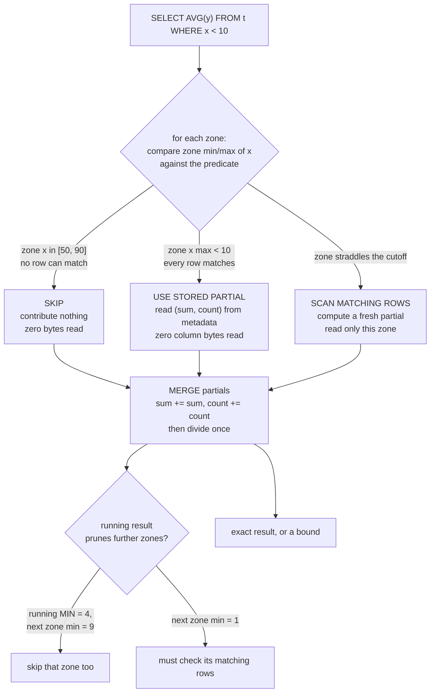

<!--
entry-meta
date: 2026-11-04
type: daily-diff
category: Daily Diff
title: Daily Diff — 2026-11-04
slug: janusgraph-test-harness
-->

# Daily Diff — 2026-11-04

**2026-11-04 · Daily Diff Digest**

**Which edition, and how it was found.** The [front page](https://tdd.cat/) served the **2026-11-03** edition — *"Tuesday, November 3, 2026"* — complete, with every per-story source URL, on the first fetch at ~03:40 UTC / 09:10 IST. [`/archive/`](https://tdd.cat/archive/) listed **128 editions** with **2026-11-03 as the maximum**, so the front page and the archive agreed *and* were current, for the second consecutive run. No edition for 2026-11-04 existed at either endpoint. RSS was not probed: the front page had already served the maximum date with full contents, which is the whole of the procedure that survived the 2026-11-03 amendment. This digest covers the 2026-11-03 edition, **52 stories**, counted from the front-page rendering.

One rendering oddity worth recording: item 41 is titled *"How YouTube works and platform navigation links"* with a `youtube.com/watch` source, while its summary describes a Scylla I/O talk by Avi Kivity. The title and the body do not belong to each other. Treated as unusable rather than guessed at.

---

## The edition, point-wise

**Storage and query engines** — the thickest cluster, and the reason this edition was worth reading:

- **[Storage statistics are precomputed aggregates that can answer queries](https://spiraldb.com/blog/statistics-are-aggregates)** (Spiral) — min/max zone statistics reframed as *partial aggregate state*, so the same merge code answers `MIN`/`MAX`/`COUNT`/`AVG` from metadata. The deep dive, below.
- **[Fast search joins eliminate the need to denormalize schemas](https://www.paradedb.com/blog/joins)** (ParadeDB) — pushing BM25 search into join plans so a normalised schema stops being a reason to flatten into one wide document.
- **[Storage statistics are precomputed aggregates](https://spiraldb.com/blog/statistics-are-aggregates)**'s natural counterpart: **[Faster central Postgres beats complex local data synchronization](https://clickhouse.com/blog/does-your-application-need-local-data-or-faster-postgres)** (ClickHouse) — the argument that local-first sync is usually paying for a latency problem better fixed at the server.
- **[Designing planned switchovers to minimize database write disruption](https://planetscale.com/blog/designing-a-planned-switchover-for-minimum-disruption)** (PlanetScale) — the write-path sequencing of a deliberate primary handover, as distinct from failover.
- **[Transparent Postgres proxy routes tenant data to external databases](https://github.com/lokadb/lokadb)** — wire-protocol-level multi-tenant routing.
- **[Turso powers millions of isolated databases](https://turso.tech/blog/2-million-databases-and-counting-the-architecture-behind-saunas-ai-teammate)** — two million SQLite databases, one per agent.
- **[Bidirectional local-first sync engine between Postgres and edge databases](https://github.com/ndrean/ZeBridge)**.
- **[Storage tiering as an alternative to sharding a MongoDB replica set](https://www.percona.com/blog/an-alternative-to-sharding-a-mongodb-replica-set-that-outgrew-its-memory-a-proof-of-concept/)** (Percona) — a proof of concept for a replica set that outgrew RAM.
- **[High-performance analytics queries directly on open data formats](https://github.com/pivotlake/pivot)**.
- **[Scaling recommender storage through unified streaming and batch maintenance](https://arxiv.org/abs/2611.02618)**.

**Systems, kernel, hardware:**

- **[Physical address homing determines core-to-core latency variance](https://jacen.li/writings/core-to-core-is-not-core-to-core/)** — the measurement most "core-to-core latency" benchmarks are actually making is a function of where the cache line lives, not which cores are talking.
- **[ZFS provides write ordering without expensive fsync disk flushes](https://blog.dfb.sh/blog/zfs-fsync/)** — directly relevant to anyone who has read a WAL implementation; the SQLite track spent two lessons on exactly this guarantee.
- **[Linux host-scoped IP defaults break multi-rail RDMA on Kubernetes](https://oguzpastirmaci.com/posts/arp-rp-filter-and-accept-ra-for-rdma-pods-on-kubernetes/)** — `rp_filter` and `accept_ra` defaults versus multi-rail.
- **[Why deploying MacBook Pros in datacenters makes sense](https://namespace.so/blog/mac-at-any-scale)**.
- **[A maximum-efficiency tail call convention for LLVM](https://discourse.llvm.org/t/rfc-tail-chaincc-a-maximum-efficiency-tail-call-convention/92661)** — RFC for `tailchaincc`.
- **[General-purpose CUDA cores encode AVIF faster than CPU implementations](https://github.com/maddog107/av1gpu)**.

**Correctness, formal methods, security:**

- **[Frontier agents prove real-world distributed system specifications in TLA+](https://arxiv.org/abs/2611.02849)**.
- **[Formalizing PTX in Lean to prove GPU kernel correctness](https://sf-tensor.com/engineering/formalizing-ptx)**.
- **[LLMs and fuzzers complement each other in vulnerability discovery](https://projectzero.google/2026/10/fuzzing-v-AI.html)** (Project Zero) — the honest comparison, with the cases each method finds and the other misses.
- **[Arbitrary state signing allows zero-click account takeovers in Better Auth](https://www.strix.ai/blog/better-auth-expo-signing-oracle)** — a signing oracle in the Expo flow.
- **[Savannah email injection bug enabled upstream Bash repository takeover](https://www.hacktron.ai/blog/hacking-gnu-savannah)**.
- **[GPT-6 Astra executes verification techniques with genuine effectiveness](https://danluu.com/astra-testing/)**.

**Agents, models, inference** (the largest group by count, the least load-bearing here):

- **[Local open models can interpret raw neural network weights](https://simonwillison.net/2026/Nov/3/qwen-can-interpret-model-weights/)**.
- **[FlashProve accelerates cryptographic proofs of LLM inference](https://www.anthropic.com/research/provable-inference)** and its [implementation](https://github.com/anthropics/FlashProve) — zero-knowledge verification of inference without revealing weights.
- **[Dynamic tool search drastically slashes prompt tokens for large catalogs](https://github.com/datolabs-io/mcp-toolsearch-proxy)**.
- **[Why agents are converging on a single execution tool](https://www.philschmid.de/code-mode)** and **[One shared harness simplifies building and running AI agents](https://www.metaview.ai/resources/blog/how-we-built-one-harness-for-every-metaview-agent)**.
- **[Designing systems around coding agents improves reliability](https://deepsense.ai/blog/harness-engineering-for-coding-agents-9-patterns-for-more-reliable-ai-assisted-development/)**, **[Explicit policy boundaries improve safety detection in coding agents](https://arxiv.org/abs/2611.02155)**, **[Evaluation objective awareness drives agent safety behavior gaps](https://alignment.openai.com/eval-production-behavior-gap/)**.
- **[Moving Copilot Cowork runtime from Python to Rust while live](https://commandline.microsoft.com/how-we-built-copilot-cowork-python-to-rust-migration/)** and **[Octomind unifies agent execution into a single Rust binary](https://github.com/Muvon/octomind)**.
- Weight-space interventions: **[Weight edits stop repetition loops rather than teaching math](https://www.hedwigai.com/blog/weight-edit-math-or-loops)**, **[Inverting neuron directions breaks reasoning loops better than abliteration](https://alisorcorp.github.io/inside-a-reasoning-loop/)**, **[Writing facts into model weights via orthogonal null space](https://huggingface.co/Topovoid/TopoVoid-0.2B-Orthogonal-Preview)**.
- Efficiency: **[Grouped value attention halves cache footprint via key reconstruction](https://arxiv.org/abs/2609.13285)**, **[Efficient mixture-of-experts inference under ten gigabytes of memory](https://github.com/davide-troiani/moeshift)**, **[Heterogeneous distributed clusters can train MoE models](https://www.coreauto.com/hitchhikers-guide-to-training-on-compute-islands)**, **[Optimizing decoding throughput yields tenfold faster document parsing](https://www.llamaindex.ai/blog/the-inference-stack-behind-ocria)**, **[Running an unmodified transformer within three kilobytes of C](https://github.com/utsav1033/bytesized)**.
- Testing and tooling: **[Shrinking models into CPU fixtures catches subtle integration regressions](https://huggingface.co/blog/transformers-mic)** — worth one minute next to today's lesson, since it is the same move (make the expensive dependency small enough to assert against); **[Testing how language models track state changes over long documents](https://allenai.org/blog/statebench)**; **[Inspecting internal layer activations while fine-tuning locally](https://github.com/Yiteng-CHEN/neurolume)**; **[Mapping model post-training across modalities](https://github.com/hscspring/post-training-atlas)**.
- Also: **[Krea 3 balances visual intelligence with generation speed](https://www.krea.ai/blog/krea-3-technical-report)**, **[Verifying Apple reference images outside the iOS ecosystem](https://pps-lab.com/blog/verifying-apple-reference-image/)**, **[Open models quote training data rather than calling home](https://int8.io/forced-curl/)**, **[Terminals should let agents declare their own turn state](https://paneflow.dev/blog/agent-status-osc-7501)**, **[Execution governance requires revalidating authority at consequence time](https://rigorix.eu/)**, **[Open to international engineering opportunities in PostgreSQL](https://www.interdb.jp/pg/index.html)** (the *Internals of PostgreSQL* author, whose book this log's PostgreSQL track cited repeatedly).

---

## Deep dive: min/max is not a statistic, it is a partial aggregate

**The item:** [*Statistics are aggregates*](https://spiraldb.com/blog/statistics-are-aggregates), Spiral, on the Vortex file format. Chosen because it reframes something every columnar format already does and almost no engine exploits fully, and because the claim is checkable against Vortex's own [file-format specification](https://docs.vortex.dev/specs/file-format), which was read for this digest.

### The reframing

Every columnar format stores per-chunk min and max so the reader can skip chunks. The usual mental model is "statistics are metadata for pruning". The post's claim is that this undersells them by one category error:

> Min-max statistics are aggregates computed at write time.

A `MIN` over a zone is not a *summary* of the zone, it is the **partial state of the `MIN` aggregate function** over those rows — the same partial state the engine's own `MIN` accumulator would hold mid-scan. Once you say it that way, three things follow mechanically.

**1. Merge rules are the aggregate's merge rules, not bespoke code.** Zone → file → table composition is just the aggregate's combine step: `MIN` takes the smallest zone minimum, `COUNT` adds, bounding boxes take the smaller `xmin`/`ymin` and the larger `xmax`/`ymax`.

**2. `AVG` requires `(sum, count)`, not an average.** This is the post's sharpest small point and it is where a naive implementation is simply wrong. Zones `[10, 20]` and `[100]` have averages 15 and 100; averaging those gives **57.5**, while the true average of the three values is **43.33**. Averaging averages weights zones equally regardless of row count. Store the partial — `(30, 2)` and `(100, 1)` — merge to `(130, 3)`, divide **once**, at the end. Nulls matter here too: `AVG` counts only non-null values, so the count in the partial is a non-null count, not a row count.

**3. A stored partial and a computed partial are interchangeable.** One zone can contribute a stored `(30, 2)` from metadata while another is actually scanned to produce `(100, 1)`; they merge to `(130, 3)`. That is the whole trick, and it is what turns pruning metadata into a *query-answering* mechanism.

### Filtered aggregates: the three-case decomposition

Table-level statistics answer an unfiltered `MIN`/`MAX`/`COUNT`/`AVG` from the footer with zero column reads. A `WHERE` clause normally kills that. The post's answer is to decompose back down to zones and classify each one against the predicate:

The right-hand branch — *pruning with partial results* — is the part that looks like a query optimiser rather than a file format. Once a fully-matching zone has produced a running minimum of 4, a later zone whose stored minimum is 9 can be discarded without reading it. A later zone whose stored minimum is 1 cannot. The aggregate's own intermediate value becomes a dynamic filter, which is exactly what DataFusion's dynamic filters for `MIN`/`MAX` do, and the post is explicit that DataFusion's `aggregate-statistics` rule applies only with **exact** statistics and no `GROUP BY`.

**This works in proportion to clustering.** The three-case split is only cheap when most zones are entirely in or entirely out of range, which is a property of how the data is sorted on the filter column, not of the format. On a column with no correlation to the filter, nearly every zone straddles and the whole mechanism degenerates to a full scan plus bookkeeping.

### Exact versus bound, which is the thing engines get wrong

A partial carries three pieces of metadata, and one of them is the one that breaks correctness when it is dropped:

| Property | Why it is required |
|---|---|
| **Which rows it covers** | otherwise merging double-counts |
| **Exact, or a bound** | an exact value is valid only for its own rows; a bound says only what the answer cannot be below |
| **Partial-state type** | so the consumer knows `(sum, count)` is not an average |

The exact/bound distinction is not academic: Iceberg column bounds are bounds, and **deleted rows turn an exact stored value into a bound** — the stored minimum may belong to a row that no longer exists. An engine that treats a bound as exact returns wrong answers; one that treats everything as a bound throws away the optimisation.

The null footnote is the same trap one level down. A row with a null timestamp fails a time filter but **still contributed its `x` value to the zone's stored minimum of `x`**. So before a zone can be classified as *fully matching*, the time statistics must show both that all dates are in range **and** that no timestamps are null. Two conditions, and the second one is easy to forget.

### Why this is a format question, not just an engine question

The blog's claims are load-bearing only if the format can add new statistic types without rewriting old files, and Vortex's `FileStatistics` structure is built for precisely that. From the specification:

- `aggregate_specs` — a dictionary of (aggregate ID, options) pairs, up to `u16::MAX`.
- `aggregate_sets` — a dictionary of distinct aggregate *lists*, each indexing `aggregate_specs`.
- `entry_sets` — one `aggregate_sets` index per statistics entry, with entries following **post-order over the root `DType`**: one per leaf field, plus a trailing null-count entry after the children of each nullable struct.
- `partials` — the concatenated partial states, each a **LEB128 length prefix followed by a protobuf-encoded `ScalarValue`**.
- `field_stats` — the legacy per-top-level-field `ArrayStats`, explicitly non-recursive into nested structs.

Entry paths and dtypes are **not stored**; the reader derives them from the root `DType`. And the length prefix is the compatibility mechanism: **a reader that does not recognise an aggregate ID skips its bytes and keeps going.** That is what makes "a new statistic type is just a new aggregate function" true at the file level rather than aspirationally — write files with a HyperLogLog sketch for approximate `COUNT(DISTINCT)` or a spatial bounding box, and older readers ignore them while newer readers merge them with scanned partials from older files that have neither.

Supporting layout facts from the same spec, for calibration: the postscript sits at the end of the file, holds locators (offset, length, alignment) for `dtype`, `layout`, `statistics` and `footer` plus up to 16 user metadata entries keyed by ≤64-byte UTF-8 strings, is at most **65,528 bytes**, and is followed by an 8-byte end-of-file struct — so a reader's **initial 64 KB read** covers it. Each `SegmentSpec` is a fixed struct of `offset` (u64), `length` (u32), `alignment_exponent` (u8) and two reserved fields. Compression is one of None, LZ4, ZLib, ZStd. The spec does not define "zone" or a default zone size at all — it defers layout internals to the Layouts documentation — so the zone granularity the blog post reasons about is a layout-level decision, not a file-container one. Worth knowing before quoting a zone size at anyone.

### Why it matters, and the honest limit

The mechanism is not new — the post credits Moerkotte's 1998 **small materialized aggregates** — but the packaging is. Treating statistics as *memoized aggregate partials* collapses three features that are usually built separately (zone-map pruning, metadata-only aggregates, dynamic filters) into one abstraction with one merge path, and it makes extensibility a non-event. The cost is that the engine now has to track provenance per partial — rows covered, exact or bound, state type — which is bookkeeping that engines currently avoid by keeping these features separate. Whether that bookkeeping is cheaper than the three separate code paths is the question the post does not answer, and it is the one that would decide whether anyone else adopts the framing.

**One connection to this log's own track.** Today's JanusGraph lesson read a storage layer with the *opposite* property: a `SliceQuery` carries a limit and a half-open column interval and nothing else, and no JanusGraph backend stores any per-row or per-page aggregate. A degree count is a full row scan; `g.V().count()` is a full edgestore scan. The three-case decomposition above has no analogue there, because there is nothing precomputed to decompose to — which is a reasonable design for an OLTP graph and exactly why graph analytics gets pushed to an OLAP scan job instead.

## Sources

- [The Daily Diff — front page, serving the 2026-11-03 edition](https://tdd.cat/) — 52 stories with per-story source URLs
- [The Daily Diff — `/archive/`](https://tdd.cat/archive/) — 128 editions listed, 2026-11-03 the maximum
- [*Statistics are aggregates* — Spiral](https://spiraldb.com/blog/statistics-are-aggregates) — the deep-dive item, reached via its source link in the edition
- [Vortex file-format specification — `docs.vortex.dev/specs/file-format`](https://docs.vortex.dev/specs/file-format) — `FileStatistics`, the postscript, `SegmentSpec`
- [Vortex file-format docs (alternate host)](https://docs.vortex.dev/concepts/file-format.html) · [spiraldb.github.io/vortex](https://spiraldb.github.io/vortex/docs/file_format.html) — both surfaced in the search that located the spec; the `specs/file-format` page is the one that was read
