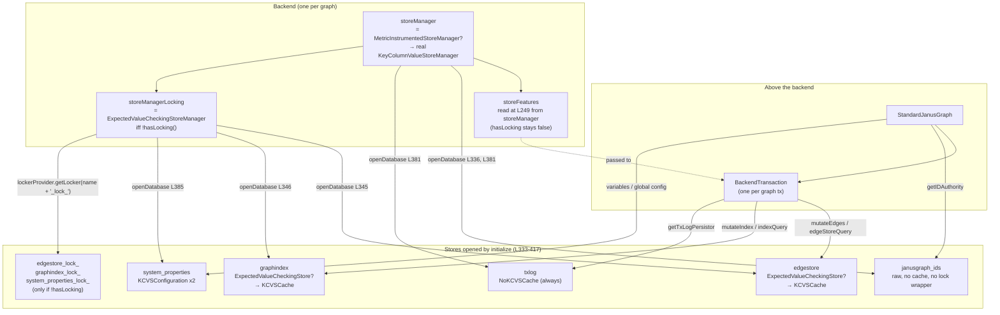
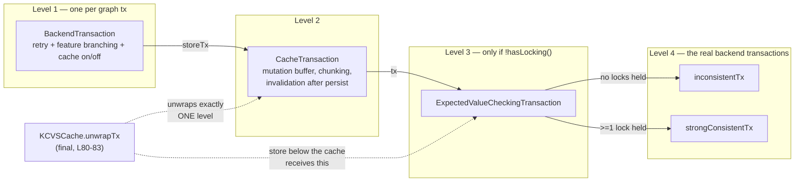
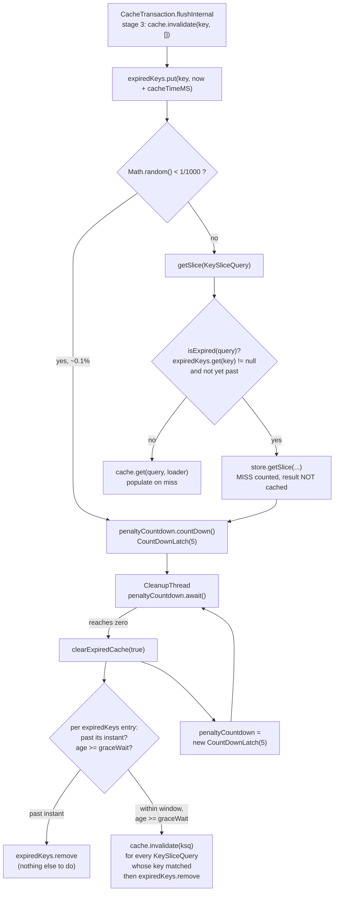

<!--
entry-meta
date: 2026-11-05
type: lesson
track: JanusGraph
lesson: 07
category: Database Internals
title: Backend and BackendTransaction — the stores that get opened and the wrappers around them
slug: janusgraph-backend-store-wiring
-->

# `Backend` and `BackendTransaction` — the stores that get opened and the wrappers around them

**2026-11-05 · JanusGraph Track · Lesson 07 of 28**

All line numbers and permalinks below are at the track's pinned commit `a59ae8d8` (2026-10-28).

## Where This Fits

- **Lesson 06** ([the test harness](../2026-11-04-janusgraph-test-harness/README.md)) established how the suites are wired: `JanusGraphBaseTest.getBackend` constructs a `Backend` *directly* and rewrites `LOCK_LOCAL_MEDIATOR_GROUP` to `"tmp"` and `UNIQUE_INSTANCE_ID` to `"inst"`; `@FeatureFlag` guards only 4 of the 24 `StoreFeatures` booleans. That lesson could say which tests run. It could not say what a running graph actually opens.
- **Lessons 02–05** gave the store contract (`KeyColumnValueStore`, `StoreFeatures`) and two implementations of it (`InMemoryKeyColumnValueStore`, and `BerkeleyJEKeyValueStore` behind `OrderedKeyValueStoreManagerAdapter`). Every one of those was reached in a test by calling `openStorageManager()` and then `openDatabase("testStore1")` by hand.
- **Today** closes Part I by replacing that hand-wiring with the real thing. `Backend` is the only class in the tree that decides *which* physical stores exist, *which* manager opens each one, and *what wraps* it. `BackendTransaction` is the single object every graph-level read and write in the rest of the system goes through. Two classes, 775 + 568 lines, and after them nothing above ever touches a `KeyColumnValueStore` again.
- **It sets up:** lesson 08–09 take `getIDAuthority()` and the `janusgraph_ids` store opened here; lesson 16's `prepareCommit` calls `mutateEdges`/`mutateIndex`; lesson 18 opens the `_lock_` stores created here; lessons 20–22 call `edgeStoreQuery` and `edgeStoreMultiQuery` and inherit their retry and cache semantics whether they want them or not.

---

## 1. Two phases: the constructor decides, `initialize` opens

`Backend` is not usable after construction. The split is load-bearing, because every decision in the constructor is made from `StoreFeatures` *before* a single database is opened.

[`Backend.java:239-306`](https://github.com/JanusGraph/janusgraph/blob/a59ae8d8024207598eada34998d867617df51adf/janusgraph-core/src/main/java/org/janusgraph/diskstorage/Backend.java#L239-L306) — the constructor, in order:

| Line | Decision | Mechanism |
|---|---|---|
| 242 | instantiate the store manager | `getStorageManager(configuration)` — reflection on `storage.backend` |
| 243–247 | metrics wrapper | if `basic-metrics`, wrap in `MetricInstrumentedStoreManager` |
| 248 | index providers | one per namespace under `index.*` |
| **249** | **`storeFeatures = storeManager.getFeatures()`** | **read from the metrics-wrapped manager, before the locking wrapper exists** |
| 251–253 | three log managers | `managementLog`, `transactionLog`, `userLog` |
| 257 | `cacheEnabled` | `!storage.batch-loading && cache.db-cache` |
| 259–263 | `bufferSize` | `storage.buffer-size` (default 1024) — **but forced to `Integer.MAX_VALUE` if the store has no batch mutation** |
| 265–266 | `numMutationsParallelThreshold` | default 100 |
| 268–269 | `maxWriteTime` / `maxReadTime` | 100 s / 10 s |
| 271–276 | `storeManagerLocking` | if `!hasLocking()`, wrap in `ExpectedValueCheckingStoreManager`; else alias to `storeManager` |
| 278–288 | `threadPool` | built only if `parallel-backend-ops` **and** `!hasMultiQuery()` |
| 292–299 | `lockerCreator` | looked up in a 2-entry map: `consistentkey`, `test` |
| 305 | `scanner` | `new StandardScanner(storeManager)` — the **unwrapped** manager |

Three of these are worth stopping on.

**`bufferSize` is inverted, not disabled.** `Backend.java:261-263`:

```java
if (!storeFeatures.hasBatchMutation()) {
    bufferSize = Integer.MAX_VALUE;
} else bufferSize = bufferSizeTmp;
```

A store that cannot batch gets an *unbounded* buffer, not a buffer of one. That is deliberate: `bufferSize` is `CacheTransaction`'s `persistChunkSize`, and the chunking loop exists to break one `mutateMany` into several. With no batch mutation there is nothing to break up, so the chunk boundary is pushed out of reach. The consequence is that `storage.buffer-size` is silently ignored on such a backend, and a very large transaction holds every mutation in heap until commit.

**The thread pool is suppressed by capability, with a log line.** `Backend.java:278-288` — if the backend advertises `hasMultiQuery()`, `parallel-backend-ops` is honoured by *doing nothing*, and `threadPool` stays null:

```
"{} supports multi-key queries. Thus, option {} is ignored in favor of multi-key queries.
 Backend-ops executor pool will not be created for this storage backend."
```

So on CQL the option is inert; on BerkeleyJE (no multi-query) a pool is built. Lesson 05 read `StandardStoreFeatures` and saw `multiQuery` default false — this is the branch that consumes it.

**`storeFeatures` is the raw backend's view, forever.** Line 249 reads features *before* line 271 builds the locking wrapper, and `ExpectedValueCheckingStoreManager` overrides `getFeatures()` to return `locking(true)` ([`ExpectedValueCheckingStoreManager.java:60`](https://github.com/JanusGraph/janusgraph/blob/a59ae8d8024207598eada34998d867617df51adf/janusgraph-core/src/main/java/org/janusgraph/diskstorage/locking/consistentkey/ExpectedValueCheckingStoreManager.java#L60), [`:104-106`](https://github.com/JanusGraph/janusgraph/blob/a59ae8d8024207598eada34998d867617df51adf/janusgraph-core/src/main/java/org/janusgraph/diskstorage/locking/consistentkey/ExpectedValueCheckingStoreManager.java#L104-L106)). Nothing re-reads it. So for the whole life of the graph:

- `Backend.getStoreFeatures()` → `hasLocking() == false` on CQL, HBase and in-memory
- `storeManagerLocking.getFeatures()` → `hasLocking() == true` on the same graph

and `BackendTransaction` is handed the **first** one (`Backend.java:628`). Every feature branch in the read path therefore sees the backend as it is, not as the wrapper pretends. That is almost certainly the intent — the wrapper's `locking(true)` exists so `Backend`'s own `Preconditions.checkArgument` at line 272 is not re-triggered downstream — but it means `hasLocking()` answers two different questions depending on which object you ask, and only one of the two is reachable from above `Backend`.

### The construct-then-initialize pair is not idempotent

[`GraphDatabaseConfiguration.java:1951-1956`](https://github.com/JanusGraph/janusgraph/blob/a59ae8d8024207598eada34998d867617df51adf/janusgraph-core/src/main/java/org/janusgraph/graphdb/configuration/GraphDatabaseConfiguration.java#L1951-L1956):

```java
public Backend getBackend() {
    Backend backend = new Backend(configuration);
    backend.initialize(configuration);
    storeFeatures = backend.getStoreFeatures();
    return backend;
}
```

Every call builds a **new** `Backend`: a new store manager, new index providers, new log managers, a new `StandardScanner`, and — if the cache is on — two new `ExpirationKCVSCache`es each starting a new daemon `CleanupThread`. It also mutates the configuration object's `storeFeatures` field as a side effect.

`StandardJanusGraph` calls it exactly once ([`StandardJanusGraph.java:289`](https://github.com/JanusGraph/janusgraph/blob/a59ae8d8024207598eada34998d867617df51adf/janusgraph-core/src/main/java/org/janusgraph/graphdb/database/StandardJanusGraph.java#L289)) and exposes the result via `getBackend()` ([`:533`](https://github.com/JanusGraph/janusgraph/blob/a59ae8d8024207598eada34998d867617df51adf/janusgraph-core/src/main/java/org/janusgraph/graphdb/database/StandardJanusGraph.java#L533)). Two call sites do *not* go through the graph's instance and get a second `Backend` on a live graph: [`JanusGraphIndexTest.java:4401`](https://github.com/JanusGraph/janusgraph/blob/a59ae8d8024207598eada34998d867617df51adf/janusgraph-backend-testutils/src/main/java/org/janusgraph/graphdb/JanusGraphIndexTest.java#L4401) (inside try-with-resources, so at least closed) and [`JanusGraphEventualGraphTest.java:67`](https://github.com/JanusGraph/janusgraph/blob/a59ae8d8024207598eada34998d867617df51adf/janusgraph-backend-testutils/src/main/java/org/janusgraph/graphdb/JanusGraphEventualGraphTest.java#L67), which builds one just to read `getStoreFeatures().hasTxIsolation()` inside a `Preconditions.checkArgument` and never closes it. `JanusGraphFactory.java:228` does the same in the drop path. The name reads like an accessor; it is a factory.

> Not verified this run: whether a second `Backend` on a live BerkeleyJE graph fails on the environment lock or succeeds. `BerkeleyJEStoreManager` opens its `Environment` in its constructor (lesson 05, `L120-145`), so the second `new Backend` reaches that code, but I did not run it. See Hands-On §3.

---

## 2. The six store names, and which manager opens each

[`Backend.java:333-417`](https://github.com/JanusGraph/janusgraph/blob/a59ae8d8024207598eada34998d867617df51adf/janusgraph-core/src/main/java/org/janusgraph/diskstorage/Backend.java#L333-L417) is `initialize`. It opens, in this order:

| # | Store name | Constant / option | Opened via | Wrapped in | Line |
|---|---|---|---|---|---|
| 1 | `janusgraph_ids` | `IDS_STORE_NAME` (`ids.store-name`, GLOBAL_OFFLINE) | `storeManager` | nothing — handed straight to `ConsistentKeyIDAuthority` | 336, 340 |
| 2 | `edgestore` | `EDGESTORE_NAME` | **`storeManagerLocking`** | `ExpirationKCVSCache` or `NoKCVSCache` | 345, 371/374 |
| 3 | `graphindex` | `INDEXSTORE_NAME` | **`storeManagerLocking`** | `ExpirationKCVSCache` or `NoKCVSCache` | 346, 372/375 |
| 4 | `txlog` | `SYSTEM_TX_LOG_NAME` | `storeManager` (twice — see below) | `NoKCVSCache`, always | 379, 381 |
| 5 | `systemlog` | `SYSTEM_MGMT_LOG_NAME` | `storeManager`, via `KCVSLogManager` | the log machinery | 380 |
| 6 | `system_properties` | `SYSTEM_PROPERTIES_STORE_NAME` | **`storeManagerLocking`** | `KCVSConfiguration` ×2 | 385–412 |

Points that only fall out of reading it:

- **Three of six go through the locking manager, three do not.** `edgestore`, `graphindex` and `system_properties` are the three that can need a compare-and-set; the ids store, the tx log and the management log are not. The ids store does its own coordination (`ConsistentKeyIDAuthority`, lesson 09), and the logs are append-only by construction. So the `_lock_` companion stores that exist on a locking-emulated backend are exactly `edgestore_lock_`, `graphindex_lock_` and `system_properties_lock_` — `LOCK_STORE_SUFFIX = "_lock_"` ([`Backend.java:157`](https://github.com/JanusGraph/janusgraph/blob/a59ae8d8024207598eada34998d867617df51adf/janusgraph-core/src/main/java/org/janusgraph/diskstorage/Backend.java#L157)), appended in [`ExpectedValueCheckingStoreManager.java:68`](https://github.com/JanusGraph/janusgraph/blob/a59ae8d8024207598eada34998d867617df51adf/janusgraph-core/src/main/java/org/janusgraph/diskstorage/locking/consistentkey/ExpectedValueCheckingStoreManager.java#L68). That is **nine** physical stores at most on CQL, not six.
- **`txlog` is opened twice, through two different paths.** Line 379 is `txLogManager.openLog(SYSTEM_TX_LOG_NAME)` with the comment *"Just open them so that they are cached"*; line 381 is `new NoKCVSCache(storeManager.openDatabase(SYSTEM_TX_LOG_NAME))`. The first gives the `KCVSLog` returned by `getSystemTxLog()`; the second gives the raw store that `BackendTransaction.getTxLogPersistor()` writes through ([`BackendTransaction.java:117-119`](https://github.com/JanusGraph/janusgraph/blob/a59ae8d8024207598eada34998d867617df51adf/janusgraph-core/src/main/java/org/janusgraph/diskstorage/BackendTransaction.java#L117-L119)). Both are the same backend table reached by two objects with different framing.
- **`txLogStore` is never cached.** `NoKCVSCache` unconditionally, even when `cacheEnabled`. Correct — a log is written once and read by a separate process.
- **`system_properties` is opened once and shared by two `KCVSConfiguration`s.** Lines 385–412: one `systemConfigStore`, then `buildGlobalConfiguration(...)` and `buildConfiguration(..., USER_CONFIGURATION_IDENTIFIER, ...)`. The user-facing `graph.variables()` and the global config live in the same physical table, separated only by a key prefix. `openDatabase` on `ExpectedValueCheckingStoreManager` is `synchronized` and memoizes by name ([`:65-72`](https://github.com/JanusGraph/janusgraph/blob/a59ae8d8024207598eada34998d867617df51adf/janusgraph-core/src/main/java/org/janusgraph/diskstorage/locking/consistentkey/ExpectedValueCheckingStoreManager.java#L65-L72)), so reopening a name is free and returns the identical wrapper.
- **Both `TransactionalProvider`s have a no-op `close()`**, with the comment *"Do nothing, storeManager is closed explicitly by Backend"* (lines 396–398, 409–411). The configuration objects do not own their transactions' lifecycle.
- **The ID authority has no non-key-consistent fallback.** Lines 339–343: if `!storeFeatures.isKeyConsistent()`, `initialize` throws `IllegalStateException`, not a `BackendException`. `idAuthority = null` is assigned on line 338 and then immediately overwritten or the method dies — the null assignment is dead. This is the hard floor under every backend in the tree: a store that is not key-consistent cannot host a JanusGraph at all, which is why lesson 03's `keyConsistent(...)` was the one feature with no `@FeatureFlag` guarding it.

### The fixed-key-length map, and the one entry that is currently unreachable

[`Backend.java:522-546`](https://github.com/JanusGraph/janusgraph/blob/a59ae8d8024207598eada34998d867617df51adf/janusgraph-core/src/main/java/org/janusgraph/diskstorage/Backend.java#L522-L546) — `getStorageManager` is where lesson 05's fixed/variable split is actually configured:

```java
Map<String, Integer> keyLength = new HashMap<>(3);
keyLength.put(EDGESTORE_NAME, 8);
keyLength.put(EDGESTORE_NAME + LOCK_STORE_SUFFIX, 8);
keyLength.put(storageConfig.get(IDS_STORE_NAME), 8);
```

Three names get fixed 8-byte keys on an `OrderedKeyValueStoreManager`; everything else (`graphindex`, `system_properties`, `txlog`, `systemlog`) is variable-length and pays for the length prefix and the post-filter that lesson 05 traced through `OrderedKeyValueStoreAdapter`. Note what the map implies and the tree does not currently exercise: `edgestore_lock_` is listed, but a lock store only exists when `hasLocking()` is false, and BerkeleyJE — the only in-tree `OrderedKeyValueStoreManager` — reports `hasLocking() == true`. So that entry is reachable only by an out-of-tree ordered-KV backend without innate locking. It is forward-looking, not dead, and the asymmetry is real: such a backend would get fixed-length keys for `edgestore_lock_` and variable-length for `graphindex_lock_`.

Also here: `ALLOW_CUSTOM_VERTEX_ID_TYPES` is rejected outright for ordered-KV stores (lines 526–536), and the failure path closes the manager first with a comment explaining why — *"The manager has opened its storage, as BerkeleyJE opens its environment, which nothing would close"* — suppressing any close failure into the thrown exception. Someone has been bitten by a leaked BDB environment.

---

## 3. The wrapper stack

Two stacks are built, and they are not the same shape. The **store** stack is per-store and built once in `initialize`. The **transaction** stack is per-graph-transaction and built in `beginTransaction`.



[`KCVSProxy`](https://github.com/JanusGraph/janusgraph/blob/a59ae8d8024207598eada34998d867617df51adf/janusgraph-core/src/main/java/org/janusgraph/diskstorage/keycolumnvalue/KCVSProxy.java) is the base of every store wrapper: 94 lines, one protected field `store`, and a `protected StoreTransaction unwrapTx(StoreTransaction txh) { return txh; }` hook that each of the eight delegating methods is supposed to apply. `KCVSCache` overrides it `final`:

```java
// KCVSCache.java:80-83
@Override
protected final StoreTransaction unwrapTx(StoreTransaction txh) {
    assert txh instanceof CacheTransaction;
    return ((CacheTransaction) txh).getWrappedTransaction();
}
```

That single line is the whole reason the cache layer works. The store below the cache never sees a `CacheTransaction`; it sees whatever `CacheTransaction` wraps. And it is an `assert`, so with assertions off (production) a wrong transaction type produces a `ClassCastException` at the cast, not a readable failure.

`NoKCVSCache` is 44 lines and overrides nothing but the three abstract methods, all empty ([`NoKCVSCache.java:25-44`](https://github.com/JanusGraph/janusgraph/blob/a59ae8d8024207598eada34998d867617df51adf/janusgraph-core/src/main/java/org/janusgraph/diskstorage/keycolumnvalue/cache/NoKCVSCache.java#L25-L44)). It passes `null` as `metricsName`, which `incActionBy` checks before touching the `MetricManager` ([`KCVSCache.java:52-57`](https://github.com/JanusGraph/janusgraph/blob/a59ae8d8024207598eada34998d867617df51adf/janusgraph-core/src/main/java/org/janusgraph/diskstorage/keycolumnvalue/cache/KCVSCache.java#L52-L57)). So "cache disabled" is not a flag consulted on the read path — it is a subclass whose `getSlice` is `KCVSProxy`'s plain delegation. Zero branches at read time. The cost of turning the cache off is one virtual call.

### The one method that forgot to unwrap

[`KCVSProxy.java:65-68`](https://github.com/JanusGraph/janusgraph/blob/a59ae8d8024207598eada34998d867617df51adf/janusgraph-core/src/main/java/org/janusgraph/diskstorage/keycolumnvalue/KCVSProxy.java#L65-L68):

```java
@Override
public KeySlicesIterator getKeys(MultiSlicesQuery queries, StoreTransaction txh) throws BackendException {
    return store.getKeys(queries, txh);      // <-- txh, not unwrapTx(txh)
}
```

The other seven delegating methods in the same file — `acquireLock` (52), `getKeys(KeyRangeQuery)` (57), `getKeys(SliceQuery)` (62), `mutate` (77), `getSlice(KeySliceQuery)` (82), `getSlice(List)` (87), `getMultiSlices` (92) — all call `unwrapTx(txh)`. This one does not. Through a `KCVSCache` that means the raw backend store would receive a `CacheTransaction`, and every backend store casts its transaction to its own type (`BerkeleyJEKeyValueStore` to `BerkeleyJETx`, lesson 05) — so the result is a `ClassCastException`, not a subtly wrong read.

It is latent at the pinned commit. I grepped the whole source tree for callers of `getKeys(MultiSlicesQuery, …)`: it is declared at [`KeyColumnValueStore.java:227`](https://github.com/JanusGraph/janusgraph/blob/a59ae8d8024207598eada34998d867617df51adf/janusgraph-core/src/main/java/org/janusgraph/diskstorage/keycolumnvalue/KeyColumnValueStore.java#L227), implemented by `OrderedKeyValueStoreAdapter` (157), `CQLKeyColumnValueStore` (816), `HBaseKeyColumnValueStore` (155), `InMemoryKeyColumnValueStore` (147) and `MetricInstrumentedStore` (234), referenced in a `StoreFeatures` javadoc (49) — and called by **nothing** in `BackendTransaction` or anywhere else above the storage layer. `MetricInstrumentedStore.java:236` passes `txh` straight through too, but it is not a `KCVSProxy` subclass, so there is nothing for it to unwrap. The test double at [`KCVSCacheTest.java:241-242`](https://github.com/JanusGraph/janusgraph/blob/a59ae8d8024207598eada34998d867617df51adf/janusgraph-test/src/main/java/org/janusgraph/diskstorage/cache/KCVSCacheTest.java#L241-L242) reproduces the same non-unwrapping delegation, so a test written against it would not catch the real one either.

A one-token fix with no behavioural change today and a real one the first time anything calls that method through a cache. This is the most contained PR candidate the track has turned up so far.

---

## 4. `BackendTransaction`: the transaction stack, and how deep the unwrapping goes

[`Backend.java:614-631`](https://github.com/JanusGraph/janusgraph/blob/a59ae8d8024207598eada34998d867617df51adf/janusgraph-core/src/main/java/org/janusgraph/diskstorage/Backend.java#L614-L631):

```java
StoreTransaction tx = storeManagerLocking.beginTransaction(configuration);
CacheTransaction cacheTx = new CacheTransaction(tx, storeManagerLocking, bufferSize,
    numMutationsParallelThreshold, maxWriteTime, configuration.hasEnabledBatchLoading());
final Map<String, IndexTransaction> indexTx = new HashMap<>(indexes.size());
for (Map.Entry<String, IndexProvider> entry : indexes.entrySet()) {
    indexTx.put(entry.getKey(), new IndexTransaction(entry.getValue(),
        indexKeyRetriever.get(entry.getKey()), configuration, maxWriteTime));
}
return new BackendTransaction(cacheTx, configuration, storeFeatures,
        edgeStore, indexStore, txLogStore,
        maxReadTime, indexTx, threadPool, !configuration.isSkipDBCacheRead(), allowCustomVertexIdType);
```

On a backend with emulated locking, `storeManagerLocking.beginTransaction` is [`ExpectedValueCheckingStoreManager.java:89-101`](https://github.com/JanusGraph/janusgraph/blob/a59ae8d8024207598eada34998d867617df51adf/janusgraph-core/src/main/java/org/janusgraph/diskstorage/locking/consistentkey/ExpectedValueCheckingStoreManager.java#L89-L101), which opens **two** backend transactions per graph transaction:

```java
StoreTransaction inconsistentTx = manager.beginTransaction(configuration);
Configuration customOptions = new MergedConfiguration(storeFeatures.getKeyConsistentTxConfig(), configuration.getCustomOptions());
BaseTransactionConfig consistentTxCfg = new StandardBaseTransactionConfig.Builder(configuration).customOptions(customOptions).build();
StoreTransaction strongConsistentTx = manager.beginTransaction(consistentTxCfg);
return new ExpectedValueCheckingTransaction(inconsistentTx, strongConsistentTx, maxReadTime);
```

Unconditionally — whether or not a lock is ever taken. The choice between them is deferred to write time, in `mutateMany` ([`:75-86`](https://github.com/JanusGraph/janusgraph/blob/a59ae8d8024207598eada34998d867617df51adf/janusgraph-core/src/main/java/org/janusgraph/diskstorage/locking/consistentkey/ExpectedValueCheckingStoreManager.java#L75-L86)): `etx.prepareForMutations()` returns whether any lock is held, and the whole mutation batch goes to the consistent transaction if so and the inconsistent one if not. All-or-nothing per flush, not per key.

So the full stack on CQL or in-memory is four levels deep:



`unwrapTx` strips level 2 and no more. The store beneath a cache is handed the `ExpectedValueCheckingTransaction`, and `ExpectedValueCheckingStore` is responsible for choosing between its two children. Each wrapper removes exactly the layer it added.

### What `BackendTransaction` actually branches on

Five feature checks, all against the raw `storeFeatures` from `Backend.java:249`:

| Line | Check | If true | If false |
|---|---|---|---|
| [303](https://github.com/JanusGraph/janusgraph/blob/a59ae8d8024207598eada34998d867617df51adf/janusgraph-core/src/main/java/org/janusgraph/diskstorage/BackendTransaction.java#L303) | `hasMultiQuery()` | one `edgeStore.getSlice(keys, …)` call | `multiThreadedEdgeStoreMultiQuery` — thread pool, or a serial loop |
| [322](https://github.com/JanusGraph/janusgraph/blob/a59ae8d8024207598eada34998d867617df51adf/janusgraph-core/src/main/java/org/janusgraph/diskstorage/BackendTransaction.java#L322) | `hasMultiQuery()` | one `getMultiSlices` call | nested loop over groups, each via the thread pool |
| [395](https://github.com/JanusGraph/janusgraph/blob/a59ae8d8024207598eada34998d867617df51adf/janusgraph-core/src/main/java/org/janusgraph/diskstorage/BackendTransaction.java#L395) | `hasScan()` | proceed | `UnsupportedOperationException("… use Faunus instead")` |
| [401](https://github.com/JanusGraph/janusgraph/blob/a59ae8d8024207598eada34998d867617df51adf/janusgraph-core/src/main/java/org/janusgraph/diskstorage/BackendTransaction.java#L401) | `isKeyOrdered() && !allowCustomVertexIdType` | `getKeys(KeyRangeQuery(MIN, MAX, q))` | `getKeys(sliceQuery)` |
| [415](https://github.com/JanusGraph/janusgraph/blob/a59ae8d8024207598eada34998d867617df51adf/janusgraph-core/src/main/java/org/janusgraph/diskstorage/BackendTransaction.java#L415) | `hasOrderedScan()` | proceed | `checkArgument` failure |

Three details:

- **The full-scan key range is hard-coded to 8 bytes.** [`BackendTransaction.java:69-71`](https://github.com/JanusGraph/janusgraph/blob/a59ae8d8024207598eada34998d867617df51adf/janusgraph-core/src/main/java/org/janusgraph/diskstorage/BackendTransaction.java#L69-L71):

  ```java
  //Assumes 64 bit key length as specified in IDManager
  public static final StaticBuffer EDGESTORE_MIN_KEY = BufferUtil.zeroBuffer(8);
  public static final StaticBuffer EDGESTORE_MAX_KEY = BufferUtil.oneBuffer(8);
  ```

  `oneBuffer(8)` is eight `0xFF` bytes, and the half-open interval lesson 02 established means the maximal key `FF FF FF FF FF FF FF FF` is **excluded** from a full ordered scan. With 64-bit vertex IDs and the partition/type bits lesson 08 will decode, that key is not assignable, so the exclusion is harmless — but it is an assumption, stated in a comment, that `allowCustomVertexIdType` exists precisely to break. Hence the branch at line 401 falling back to the unordered form, and the explicit `IllegalArgumentException` at 416–420 when an ordered range scan is requested with custom IDs.
- **`MIN_TASKS_TO_PARALLELIZE = 2`** ([`:67`](https://github.com/JanusGraph/janusgraph/blob/a59ae8d8024207598eada34998d867617df51adf/janusgraph-core/src/main/java/org/janusgraph/diskstorage/BackendTransaction.java#L67)) — a single-key multi-query never touches the pool ([`:357`](https://github.com/JanusGraph/janusgraph/blob/a59ae8d8024207598eada34998d867617df51adf/janusgraph-core/src/main/java/org/janusgraph/diskstorage/BackendTransaction.java#L357)).
- **The parallel fan-out counts failures but does not collect them.** [`:355-392`](https://github.com/JanusGraph/janusgraph/blob/a59ae8d8024207598eada34998d867617df51adf/janusgraph-core/src/main/java/org/janusgraph/diskstorage/BackendTransaction.java#L355-L392): each task catches `Exception`, increments an `AtomicInteger`, and `log.warn`s. After `doneSignal.await()` the caller throws `JanusGraphException("Could not successfully complete multi-query. N individual queries failed.")` — with no cause attached. The actual backend exception exists only in the log. There is also no timeout on the `await()`: `maxReadTime` governs each individual `edgeStoreQuery` inside the tasks, so the wait is bounded transitively, but a task that never reaches `countDown()` — an `Error` rather than an `Exception`, since only `Exception` is caught — hangs the calling thread forever.

### `commit` and `rollback` are asymmetric on purpose

| | Storage first? | Index exceptions |
|---|---|---|
| [`commit()` :165-168](https://github.com/JanusGraph/janusgraph/blob/a59ae8d8024207598eada34998d867617df51adf/janusgraph-core/src/main/java/org/janusgraph/diskstorage/BackendTransaction.java#L165-L168) | yes — `storeTx.commit()` then each index | **not caught** — the first index to throw aborts the loop, leaving later indexes uncommitted |
| [`rollback()` :176-189](https://github.com/JanusGraph/janusgraph/blob/a59ae8d8024207598eada34998d867617df51adf/janusgraph-core/src/main/java/org/janusgraph/diskstorage/BackendTransaction.java#L176-L189) | no — indexes first, then storage | caught per index, last one wins, rethrown after `storeTx.rollback()` |
| [`commitIndexes()` :152-162](https://github.com/JanusGraph/janusgraph/blob/a59ae8d8024207598eada34998d867617df51adf/janusgraph-core/src/main/java/org/janusgraph/diskstorage/BackendTransaction.java#L152-L162) | n/a | collected into `Map<String,Throwable>` keyed by index name and **returned**, not thrown |

Storage-then-index in `commit` is the ordering that makes the edgestore the source of truth and a mixed index a derived, repairable artefact — which is exactly the premise lesson 28 (stale-index repair) depends on. `rollback`'s reverse order matters less, but note it keeps only the *last* index exception (`exception = e` in the loop, no suppression chaining) while `Backend.close` goes to the trouble of using an `ExceptionWrapper` to preserve the first and suppress the rest. Two different conventions in the same class pair.

`StandardJanusGraph` uses the split pair (`commitStorage` + `commitIndexes`) rather than `commit()` precisely so it can inspect that map — lesson 16's territory.

---

## 5. `CacheTransaction`: the mutation buffer

[`CacheTransaction.java`](https://github.com/JanusGraph/janusgraph/blob/a59ae8d8024207598eada34998d867617df51adf/janusgraph-core/src/main/java/org/janusgraph/diskstorage/keycolumnvalue/cache/CacheTransaction.java) is 248 lines and holds `Map<KCVSCache, Map<StaticBuffer, KCVEntryMutation>> mutations` — keyed by the **cache object**, not the store name, with the name only resolved at flush time via `getKey().getName()` (L164).

**Accumulation** ([`:88-108`](https://github.com/JanusGraph/janusgraph/blob/a59ae8d8024207598eada34998d867617df51adf/janusgraph-core/src/main/java/org/janusgraph/diskstorage/keycolumnvalue/cache/CacheTransaction.java#L88-L108)):

- an empty mutation with no whole-row deletion returns immediately (L90)
- a second mutation on the same (store, key) is `merge`d into the existing `KCVEntryMutation` (L96–97)
- `numMutations += m.getTotalMutations()` (L102) — **the count of the new mutation, added before and regardless of the merge**
- the only automatic flush is `if (batchLoading && numMutations >= persistChunkSize)` (L104)

That `numMutations` counter is monotonic within a transaction: merging two mutations for one key does not reduce it, and neither does `consolidate()`, which runs later and can cancel an addition against a deletion. So `numMutations` is an upper bound on pending mutations, not a count of them, and both thresholds it feeds — the 1024-mutation flush and the 100-mutation parallel-consolidate switch — fire earlier than their names suggest on a write pattern that repeatedly touches the same keys.

**Without batch loading, nothing flushes until commit.** `commit()` is `flushInternal(); tx.commit();` ([`:232-235`](https://github.com/JanusGraph/janusgraph/blob/a59ae8d8024207598eada34998d867617df51adf/janusgraph-core/src/main/java/org/janusgraph/diskstorage/keycolumnvalue/cache/CacheTransaction.java#L232-L235)). Chunking still applies *inside* that flush, so a large transaction becomes several `mutateMany` calls — but they are all inside one commit, and `rollback()` is `clear(); tx.rollback();` ([`:238-241`](https://github.com/JanusGraph/janusgraph/blob/a59ae8d8024207598eada34998d867617df51adf/janusgraph-core/src/main/java/org/janusgraph/diskstorage/keycolumnvalue/cache/CacheTransaction.java#L238-L241)), which drops the buffer and lets the backend transaction undo whatever chunks already landed. On a backend with no transactional rollback, a multi-chunk commit that fails midway is not atomic, and that is why `buffer-size` defaults to 1024 rather than something small.

**`flushInternal`** ([`:148-201`](https://github.com/JanusGraph/janusgraph/blob/a59ae8d8024207598eada34998d867617df51adf/janusgraph-core/src/main/java/org/janusgraph/diskstorage/keycolumnvalue/cache/CacheTransaction.java#L148-L201)), in four stages:

1. **Consolidate** (L151–157) — serially below `numMutationsParallelThreshold`, otherwise `mutations.values().parallelStream()` on the common fork-join pool. The comment states the reason: *"to ensure that no addition accidentally gets swallowed by a delete"*.
2. **Chunk and persist** (L160–176). The counter-reset idiom is worth seeing:

   ```java
   if (numSubMutations >= persistChunkSize) {
       numSubMutations = persist(subMutations);   // persist always returns 0
       sub.clear();
       subMutations.put(storeMutations.getKey().getName(), sub);
   }
   ```

   `persist` is declared `private int persist(...)` and its body ends `subMutations.clear(); return 0;` ([`:110-125`](https://github.com/JanusGraph/janusgraph/blob/a59ae8d8024207598eada34998d867617df51adf/janusgraph-core/src/main/java/org/janusgraph/diskstorage/keycolumnvalue/cache/CacheTransaction.java#L110-L125)). The return value carries no information; it exists so the assignment reads as a reset. A chunk boundary can therefore fall mid-store, and a single logical commit can emit several `mutateMany` calls whose store-name maps are each partial.
3. **Invalidate** (L179–198) — *after* persistence, per key. `cache.hasValidateKeysOnly()` is `true` in the base class ([`KCVSCache.java:48-50`](https://github.com/JanusGraph/janusgraph/blob/a59ae8d8024207598eada34998d867617df51adf/janusgraph-core/src/main/java/org/janusgraph/diskstorage/keycolumnvalue/cache/KCVSCache.java#L48-L50)) and nothing in the tree overrides it, so the else-branch that builds a `List<CachableStaticBuffer>` of every added and deleted entry is **dead at the pinned commit** — and `ExpirationKCVSCache.invalidate` asserts it stays that way: `Preconditions.checkArgument(!hasValidateKeysOnly() || entries.isEmpty())` ([`:267`](https://github.com/JanusGraph/janusgraph/blob/a59ae8d8024207598eada34998d867617df51adf/janusgraph-core/src/main/java/org/janusgraph/diskstorage/keycolumnvalue/cache/ExpirationKCVSCache.java#L267)). Invalidation is key-granular, never entry-granular. Note also that this loop walks *all* buffered keys including the ones stage 2 skipped as empty (L166), so a mutation that fully consolidated away still invalidates its key.
4. **Clear** (L203–208) — clears the inner maps but leaves the outer `KCVSCache → map` entries in place, so the store keys are reused for the rest of the transaction.

**The mutation set is logged before it is flushed.** `logMutations` ([`:211-224`](https://github.com/JanusGraph/janusgraph/blob/a59ae8d8024207598eada34998d867617df51adf/janusgraph-core/src/main/java/org/janusgraph/diskstorage/keycolumnvalue/cache/CacheTransaction.java#L211-L224)) serialises `mutations` directly and opens with `Preconditions.checkArgument(!batchLoading, "Cannot log entire mutation set when batch-loading is enabled")` — because with batch loading on, part of the set has already been flushed and dropped. That one precondition is why transaction logging and batch loading are mutually exclusive, a constraint lesson 28 will meet from the other side.

---

## 6. `BackendOperation`: the retry loop, and the backoff that is not exponential

Every read in `BackendTransaction` and every write in `CacheTransaction.persist` goes through [`BackendOperation`](https://github.com/JanusGraph/janusgraph/blob/a59ae8d8024207598eada34998d867617df51adf/janusgraph-core/src/main/java/org/janusgraph/diskstorage/util/BackendOperation.java) — 148 lines, and the one piece of this lesson with a result I did not expect.

**The exception triage** ([`:70-84`](https://github.com/JanusGraph/janusgraph/blob/a59ae8d8024207598eada34998d867617df51adf/janusgraph-core/src/main/java/org/janusgraph/diskstorage/util/BackendOperation.java#L70-L84)) walks the whole `getCause()` chain and keeps the **last** `BackendException` it finds — the innermost one — then:

- innermost is `TemporaryBackendException` → retry
- else the thrown exception is itself a `BackendException` → rethrow unchanged, no retry
- else → wrap in `PermanentBackendException("Permanent exception while executing backend operation " + exe.toString(), e)`

This is why every `Callable` in `BackendTransaction` overrides `toString()` with a bare label — `"EdgeStoreQuery"`, `"MultiEdgeStoreQuery"`, `"VertexIndexQuery"`, `"EdgeStoreKeys"`, `"RawQuery"`, `"Totals"`, and `"CacheMutation"` in `CacheTransaction.persist`. Those strings are not debug decoration; they are the only identification a permanent failure carries. Note the consequence of the ordering: a `TemporaryBackendException` wrapping a `PermanentBackendException` is judged by the inner one and rethrown immediately, which is the right call and easy to misread.

`executeDirect` requires a non-zero budget (L61), computes a wall-clock deadline (L62), and on exhaustion throws `TemporaryBackendException("Could not successfully complete backend operation due to repeated temporary exceptions after " + totalWaitTime, lastException)` (L102). An interrupt during the sleep re-sets the thread's interrupt flag and converts to `PermanentBackendException` (L92–96) — which is what `BackendTransaction.executeRead` ([`:557-566`](https://github.com/JanusGraph/janusgraph/blob/a59ae8d8024207598eada34998d867617df51adf/janusgraph-core/src/main/java/org/janusgraph/diskstorage/BackendTransaction.java#L557-L566)) then turns into TinkerPop's `TraversalInterruptedException` by re-checking `Thread.interrupted()`. The `TODO` on line 563 admits the indirection.

### The jitter formula collapses to a coin flip

[`:40-49`](https://github.com/JanusGraph/janusgraph/blob/a59ae8d8024207598eada34998d867617df51adf/janusgraph-core/src/main/java/org/janusgraph/diskstorage/util/BackendOperation.java#L40-L49):

```java
private static final Duration BASE_REATTEMPT_TIME = Duration.ofMillis(50);
private static final double PERTURBATION_PERCENTAGE = 0.2;

private static Duration pertubTime(Duration duration) {
    double randomValue = ThreadLocalRandom.current().nextDouble();
    Duration newDuration = duration.dividedBy((int)(2.0 / (1 + (randomValue * 2 - 1.0) * PERTURBATION_PERCENTAGE)));
    assert !duration.isZero() : duration;
    return newDuration;
}
```

Read the divisor from the inside out. `randomValue ∈ [0,1)`, so `randomValue*2 - 1.0 ∈ [-1,1)`, so `1 + 0.2·that ∈ [0.8, 1.2)`, so `2.0/that ∈ (1.667, 2.5]`. Then `(int)` **truncates**. The divisor is therefore only ever `1` or `2`, and `Duration.dividedBy` is integer division, so `pertubTime(d)` returns exactly `d` or exactly `d/2` — a fair coin flip, not a ±20% jitter. The intended `duration * (1 ± 0.2)` was presumably `duration.multipliedBy(...)` on a scaled long; as written, the `0.2` only determines *where* the truncation boundary sits, and it sits at `randomValue = 0.5`.

I reproduced the method verbatim under JDK 21 with real `java.time.Duration` (so the integer division is the real one). Over 1,000,000 draws:

```
divisor over 1,000,000 draws: {1=500803, 2=499197}
distinct pertubTime(50ms) results over 100,000 draws: [PT0.025S, PT0.05S]
```

Two values. Ever.

Now the loop (L87–100): the sleep is `pertubTime(waitBase)`, and afterwards `waitBase = waitTime.multipliedBy(2)`. So `waitBase` either doubles or stays put, each with probability ½:

| | `waitTime` | next `waitBase` |
|---|---|---|
| divisor 1 (p = ½) | `waitBase` | `2 × waitBase` |
| divisor 2 (p = ½) | `waitBase / 2` | `waitBase` |

The growth is a multiplicative random walk with geometric mean √2 ≈ 1.41 per attempt, not 2. In a sampled 10-second read run the plateau is visible directly:

```
one 10s read run: attempts=11 slept=8375ms  sleeps=[25, 50, 100, 200, 400, 400, 800, 1600, 1600, 3200]
```

`400` and `1600` each appear twice — the walk stood still. Over 200,000 simulated runs at each budget:

| Budget | Option | min | p50 | p99 | max | mean |
|---|---|---|---|---|---|---|
| 10 s | `storage.read-time` | 8 | 14 | 24 | 38 | 14.52 |
| 100 s | `storage.write-time` | 11 | 21 | 33 | 48 | 21.11 |

So a temporarily failing read is attempted a median of **14** times and as many as **38**, and a failing write up to **48** — every one of them a real round trip to the backend. The documentation for both options says *"JanusGraph will backoff exponentially and retry the operation until the wait time has been exhausted"* ([`GraphDatabaseConfiguration.java:796-804`](https://github.com/JanusGraph/janusgraph/blob/a59ae8d8024207598eada34998d867617df51adf/janusgraph-core/src/main/java/org/janusgraph/graphdb/configuration/GraphDatabaseConfiguration.java#L796-L804)). It is exponential in expectation and the variance is wide, with the retry count nearly doubling across the distribution. The assertion is also misplaced: `assert !duration.isZero()` sits *after* the division it is meant to guard, so with assertions enabled it would fire only after the computation it was supposed to protect had already succeeded. (`dividedBy` would not throw on a zero duration anyway; the divisor's floor of 1 is what prevents `ArithmeticException`, and nothing documents that.)

Each retry also logs at **INFO**: `log.info("Temporary exception during backend operation [...]. Attempting backoff retry.", lastException)` (L89) — a full stack trace per attempt, up to 47 of them per failing write, at a level most deployments keep on.

---

## 7. `ExpirationKCVSCache`: a Caffeine cache plus a back-pressure cleaner

[`ExpirationKCVSCache`](https://github.com/JanusGraph/janusgraph/blob/a59ae8d8024207598eada34998d867617df51adf/janusgraph-core/src/main/java/org/janusgraph/diskstorage/keycolumnvalue/cache/ExpirationKCVSCache.java) is 359 lines. Two data structures:

- `Cache<KeySliceQuery, EntryList> cache` — Caffeine, `maximumWeight(maximumByteSize)`, `initialCapacity(1000)`, `expireAfterWrite(cacheTimeMS)`, weighed as `CAFFEINE_CACHE_ENTRY_SIZE + KEY_QUERY_SIZE + entries.getByteSize()` ([`:78-84`](https://github.com/JanusGraph/janusgraph/blob/a59ae8d8024207598eada34998d867617df51adf/janusgraph-core/src/main/java/org/janusgraph/diskstorage/keycolumnvalue/cache/ExpirationKCVSCache.java#L78-L84)). **The cache key is the whole `KeySliceQuery`** — key plus column range plus limit — so two different slices of one row are two independent entries, and a row read with limit 10 and then limit 100 caches twice.
- `ConcurrentHashMap<StaticBuffer, Long> expiredKeys` — key → the wall-clock instant at which its invalidation stops mattering.

The sizing in `Backend.initialize` (L349–372): `cache.db-cache-size` defaults to `0.3`; values below 1.0 are a fraction of *currently free* heap, computed as `(runtime.maxMemory() - (runtime.totalMemory() - runtime.freeMemory())) * cacheSize` — so the cache budget depends on when in the process's life the graph is opened. Values above 1.0 are absolute bytes and must exceed 1000. The split is fixed: `EDGESTORE_CACHE_PERCENT = 0.8`, `INDEXSTORE_CACHE_PERCENT = 0.2`, with a `Preconditions` check that they sum to 1.0 ([`Backend.java:162-163`](https://github.com/JanusGraph/janusgraph/blob/a59ae8d8024207598eada34998d867617df51adf/janusgraph-core/src/main/java/org/janusgraph/diskstorage/Backend.java#L162-L163), [`:367`](https://github.com/JanusGraph/janusgraph/blob/a59ae8d8024207598eada34998d867617df51adf/janusgraph-core/src/main/java/org/janusgraph/diskstorage/Backend.java#L367)). `cache.db-cache-time = 0` is remapped to `ETERNAL_CACHE_EXPIRATION` = 200 years in milliseconds ([`:165`](https://github.com/JanusGraph/janusgraph/blob/a59ae8d8024207598eada34998d867617df51adf/janusgraph-core/src/main/java/org/janusgraph/diskstorage/Backend.java#L165), [`:352`](https://github.com/JanusGraph/janusgraph/blob/a59ae8d8024207598eada34998d867617df51adf/janusgraph-core/src/main/java/org/janusgraph/diskstorage/Backend.java#L352)), because the constructor's `checkArgument(cacheTimeMS > 0)` would reject zero.

### Invalidation does not evict. It makes reads bypass.

`invalidate` is three lines ([`:266-270`](https://github.com/JanusGraph/janusgraph/blob/a59ae8d8024207598eada34998d867617df51adf/janusgraph-core/src/main/java/org/janusgraph/diskstorage/keycolumnvalue/cache/ExpirationKCVSCache.java#L266-L270)):

```java
expiredKeys.put(key, getExpirationTime());          // now + cacheTimeMS
if (Math.random() < 1.0/INVALIDATE_KEY_FRACTION_PENALTY) penaltyCountdown.countDown();
```

It touches `cache` not at all. The cached `EntryList`s for that row stay exactly where they are. What changes is `getSlice`'s first branch ([`:93-98`](https://github.com/JanusGraph/janusgraph/blob/a59ae8d8024207598eada34998d867617df51adf/janusgraph-core/src/main/java/org/janusgraph/diskstorage/keycolumnvalue/cache/ExpirationKCVSCache.java#L93-L98)): `isExpired(query)` → count a MISS and go straight to the store, *without* writing the result back. So between a mutation and the eventual cleanup, every read of that row is a full backend round trip and the stale entry is still resident, costing weight in a bounded cache.

`isExpired` ([`:303-313`](https://github.com/JanusGraph/janusgraph/blob/a59ae8d8024207598eada34998d867617df51adf/janusgraph-core/src/main/java/org/janusgraph/diskstorage/keycolumnvalue/cache/ExpirationKCVSCache.java#L303-L313)) is also the opportunistic reaper: if the recorded instant has passed it removes the entry with a CAS (`remove(key, until)`) and returns false. Otherwise it counts the latch down and returns true.

### The cleanup trigger is a `CountDownLatch` used as back-pressure

`PENALTY_THRESHOLD = 5`, `INVALIDATE_KEY_FRACTION_PENALTY = 1000` ([`:57-58`](https://github.com/JanusGraph/janusgraph/blob/a59ae8d8024207598eada34998d867617df51adf/janusgraph-core/src/main/java/org/janusgraph/diskstorage/keycolumnvalue/cache/ExpirationKCVSCache.java#L57-L58)). A daemon `CleanupThread` ([`:329-357`](https://github.com/JanusGraph/janusgraph/blob/a59ae8d8024207598eada34998d867617df51adf/janusgraph-core/src/main/java/org/janusgraph/diskstorage/keycolumnvalue/cache/ExpirationKCVSCache.java#L329-L357)) does nothing but `penaltyCountdown.await()` then `clearExpiredCache(true)`, forever.



Two paths count the latch down, and they mean different things:

- **`isExpired` → `countDown()`, every time** (L311, comment: *"We suffer a cache miss, hence decrease the count down"*). This is the real signal: five wasted backend round trips caused by stale-but-resident entries is enough to justify a sweep.
- **`invalidate` → `countDown()` with probability 1/1000** (L269). A floor, so that a workload which writes heavily and reads nothing still eventually sweeps — roughly every 5,000 invalidations.

`clearExpiredCache` ([`:277-295`](https://github.com/JanusGraph/janusgraph/blob/a59ae8d8024207598eada34998d867617df51adf/janusgraph-core/src/main/java/org/janusgraph/diskstorage/keycolumnvalue/cache/ExpirationKCVSCache.java#L277-L295)) is `synchronized` and does the actual eviction, and here the grace period finally appears. `getAge(until)` is `now - (until - cacheTimeMS)` — time since the invalidation, recovered by subtracting the cache lifetime back out of the stored deadline. Only keys with `getAge(...) >= invalidationGracePeriodMS` are swept; younger ones are left in `expiredKeys` for the next round. Then it iterates `cache.asMap().keySet()` and invalidates every `KeySliceQuery` whose `getKey()` matches — **a full scan of the cache's key set per sweep**, which is the price of key-granular invalidation over a query-keyed cache.

So `cache.db-cache-clean-wait` (default **50 ms**, [`GraphDatabaseConfiguration.java:639-643`](https://github.com/JanusGraph/janusgraph/blob/a59ae8d8024207598eada34998d867617df51adf/janusgraph-core/src/main/java/org/janusgraph/graphdb/configuration/GraphDatabaseConfiguration.java#L639-L643)) is a *minimum* delay before a mutated key's entries may be dropped, deliberately — its documentation says it exists for *"distributed storage backends that are capable of acknowledging writes without necessarily making them immediately visible"*. Evicting immediately would let a read re-populate the cache from a replica that has not yet seen the write and then cache that stale answer for the full `db-cache-time`. Bypassing instead is strictly safer, and the grace window is how long the system refuses to trust its own re-reads.

`clearCache()` ([`:252-263`](https://github.com/JanusGraph/janusgraph/blob/a59ae8d8024207598eada34998d867617df51adf/janusgraph-core/src/main/java/org/janusgraph/diskstorage/keycolumnvalue/cache/ExpirationKCVSCache.java#L252-L263)) carries an eleven-line comment explaining two orderings that are not obvious: sweep `expiredKeys` *before* `cache.invalidateAll()` (the reverse order has a window in which a fresh read repopulates and a concurrent mutation's invalidation is then cleared), and never reassign `penaltyCountdown` outside the cleanup thread (the thread may be parked on the old latch and would never wake). The `withNewPenaltyCountdown` boolean exists solely to encode that second rule, which is why `forceClearExpiredCache()` passes `false`.

### The metrics names are decided in `Backend`, not in the cache

`getMetricsCacheName` ([`Backend.java:494-497`](https://github.com/JanusGraph/janusgraph/blob/a59ae8d8024207598eada34998d867617df51adf/janusgraph-core/src/main/java/org/janusgraph/diskstorage/Backend.java#L494-L497)): `null` if `basic-metrics` is off; otherwise `"stores"` if `metrics.merge-stores` is on, else `storeName + ".cache"` — so `edgestore.cache` and `graphindex.cache`, or a single merged `caches` bucket. Combined with `incActionBy`'s check that the *transaction* has a group name ([`KCVSCache.java:52-57`](https://github.com/JanusGraph/janusgraph/blob/a59ae8d8024207598eada34998d867617df51adf/janusgraph-core/src/main/java/org/janusgraph/diskstorage/keycolumnvalue/cache/KCVSCache.java#L52-L57)), cache metrics require **both** a non-null name at construction time and a group name on each transaction. Two independent switches, one in `Backend` and one per transaction.

---

## 8. Shutdown: the two paths and their shared flag

`close()` ([`Backend.java:633-662`](https://github.com/JanusGraph/janusgraph/blob/a59ae8d8024207598eada34998d867617df51adf/janusgraph-core/src/main/java/org/janusgraph/diskstorage/Backend.java#L633-L662)) and `clearStorage()` ([`:671-704`](https://github.com/JanusGraph/janusgraph/blob/a59ae8d8024207598eada34998d867617df51adf/janusgraph-core/src/main/java/org/janusgraph/diskstorage/Backend.java#L671-L704)) are both `synchronized` and both guarded by the **same** `hasAttemptedClose` flag, which each sets on entry. Consequences:

- `clearStorage()` after `close()` is a silent no-op that logs at debug: *"Backend {} has already been closed or cleared"*. So is `close()` after `clearStorage()` — which is the intended arrangement, since `clearStorage` already closes everything.
- The flag is set **before** the work, so a failure part-way through leaves the `Backend` permanently un-closeable. Deliberate, given that every step is wrapped.

Both use `ExceptionWrapper` with `executeWithCatching`, so every step runs and the first exception is rethrown at the end with the rest suppressed ([`throwIfException`](https://github.com/JanusGraph/janusgraph/blob/a59ae8d8024207598eada34998d867617df51adf/janusgraph-core/src/main/java/org/janusgraph/diskstorage/Backend.java#L658)). The ordering carries a comment that is worth quoting because it is a hard-won sequencing constraint, not style (L650–652):

> *The index providers before the store manager, whose close may shut executors down and so restore an interrupt which ended its wait (the CQL store manager does), and the pool last for the same reason: an interrupt can break the I/O of the steps after it*

So: logs → scanner → stores → id authority → configs → **index providers** → store manager → thread pool. An executor shutdown that re-raises a swallowed interrupt would break the I/O of anything closed after it, so the components that do I/O go first.

The two methods differ in one more way: `close()` null-checks `edgeStore`, `indexStore`, `idAuthority`, `systemConfig`, `userConfig` (L645–649), and `clearStorage()` does not (L684–688). A `Backend` constructed but never `initialize`d can be closed; calling `clearStorage()` on it NPEs inside `executeWithCatching` — which catches it, defers it, and rethrows after the remaining steps. The asymmetry only matters for a construction that failed between `new Backend(...)` and `initialize(...)`, which `GraphDatabaseConfiguration.getBackend` makes a two-statement window.

---

## Hands-On

Three exercises, smallest first. The first one needs nothing but a JDK; the others need the fork built per the track's reader setup.

### 1. Watch the backoff collapse (no build required)

Paste the method verbatim into `jshell` and look at the divisor, not the duration:

```bash
jshell -q
```

```java
import java.time.Duration; import java.util.*; import java.util.concurrent.ThreadLocalRandom;

int divisor() {
    double r = ThreadLocalRandom.current().nextDouble();
    return (int)(2.0 / (1 + (r * 2 - 1.0) * 0.2));     // PERTURBATION_PERCENTAGE = 0.2
}
Map<Integer,Integer> h = new TreeMap<>();
for (int i = 0; i < 1_000_000; i++) h.merge(divisor(), 1, Integer::sum);
h
```

**What to look for:** `{1=~500000, 2=~500000}`. Two outcomes, 50/50. Not a continuous ±20% band. Then reproduce the loop body of `executeDirect` (L87–100) with the clock advanced instead of slept, and print the sleep sequence for a 10-second budget — you are looking for **repeated values**, which are the attempts where `waitBase` did not grow:

```java
List<Long> sleeps = new ArrayList<>();
Duration base = Duration.ofMillis(50); long elapsed = 0; int attempts = 1;
while (true) {
    Duration w = base.dividedBy(divisor());
    if (elapsed + w.toMillis() >= 10_000) break;
    elapsed += w.toMillis(); sleeps.add(w.toMillis()); attempts++;
    base = w.multipliedBy(2);
}
System.out.println(attempts + " attempts, slept " + elapsed + "ms: " + sleeps);
```

Run it ten times. The attempt count should range roughly 8–38 with a median near 14. That is the real retry count behind `storage.read-time`, and the number of round trips a temporarily unavailable backend receives from a single `edgeStoreQuery`. Compare it against the option's own documentation at `GraphDatabaseConfiguration.java:801-804` and decide whether "backoff exponentially" is an adequate description.

### 2. Make the cache's bypass semantics visible

`ExpirationCacheTest` is the single concrete subclass of `KCVSCacheTest`, and `testGracePeriod` already encodes everything §7 derived:

```bash
mvn -pl janusgraph-test -am -DskipTests install -q
mvn -pl janusgraph-test -Dtest=ExpirationCacheTest#testGracePeriod test
```

Then read the test rather than the result — [`ExpirationCacheTest.java:108-148`](https://github.com/JanusGraph/janusgraph/blob/a59ae8d8024207598eada34998d867617df51adf/janusgraph-test/src/test/java/org/janusgraph/diskstorage/cache/ExpirationCacheTest.java#L108-L148):

- **L128–134.** After one `cache.mutateEntries(...)` + `tx.commit()`, two *identical* `verifyResults` calls take `store.getSliceCalls()` from 0 → 2 → **4**. A repeated read of an unchanged row goes to the store twice. That is `isExpired` returning true and `getSlice` bypassing, exactly as in §7 — and it is asserted, not incidental.
- **L137–141.** `times.sleepPast(utime.plus(graceWait))` then a loop of `minCleanupTriggerCalls = 5` reads. Five. The same number as `PENALTY_THRESHOLD`. The test has to manufacture five bypassing reads to drive the latch to zero and wake `CleanupThread`; there is no API to ask for a sweep.
- **L143–147.** Only after that do two more reads give `store.getSliceCalls() == 0`. The key is finally out of `expiredKeys`, and the cache serves again.

**What to look for:** set a breakpoint on `ExpirationKCVSCache.clearExpiredCache` and confirm the caller is `CleanupThread.run`, not the test thread. Then change `minCleanupTriggerCalls` to `4` locally and watch the final `assertEquals(0, store.getSliceCalls())` fail — that is the coupling between a test constant and a private `static final` in production code made visible. Revert it; do not commit either change.

Note both methods here are `@RepeatedIfExceptionsTest(repeats = 3)` with comments naming [#2934](https://github.com/JanusGraph/janusgraph/issues/2934) and [#3352](https://github.com/JanusGraph/janusgraph/issues/3352) — the flaky-test machinery lesson 06 catalogued, applied to the two tests that depend on wall-clock sleeps and a daemon thread. Unsurprising, and a reason this area is worth a careful contributor.

### 3. Count the `Backend`s a graph actually builds

```bash
mvn -pl janusgraph-berkeleyje -Dtest=BerkeleyIDBlockClaimsTest#claimsOfDifferentPartitionsAndNamespacesDoNotWaitForEachOthersLocks test
```

That test reaches `((StandardJanusGraph) graph).getBackend().getIDAuthority()` ([`BerkeleyIDBlockClaimsTest.java:82`](https://github.com/JanusGraph/janusgraph/blob/a59ae8d8024207598eada34998d867617df51adf/janusgraph-berkeleyje/src/test/java/org/janusgraph/diskstorage/berkeleyje/BerkeleyIDBlockClaimsTest.java#L82)) and unwraps the manager to the `OrderedKeyValueStoreManagerAdapter` ([`:105`](https://github.com/JanusGraph/janusgraph/blob/a59ae8d8024207598eada34998d867617df51adf/janusgraph-berkeleyje/src/test/java/org/janusgraph/diskstorage/berkeleyje/BerkeleyIDBlockClaimsTest.java#L105)) — the instance accessor, which returns the graph's one `Backend`.

**What to look for:** put a breakpoint on `Backend.initialize` (L333) and one on `KeyColumnValueStoreManager.openDatabase`, then step through a single graph open and write down the store names in call order. You should see six `openDatabase` calls for the names in §2's table plus — on a backend without innate locking — three more ending `_lock_`, created lazily by `Backend.getLocker` → `CONSISTENT_KEY_LOCKER_CREATOR` (L185–196) on first `acquireLock`. On BerkeleyJE you should see **no** `_lock_` stores at all, because `hasLocking()` is true and `storeManagerLocking == storeManager`.

Then the unverified part of §1. In a scratch test, call `graph.getConfiguration().getBackend()` on an already-open BerkeleyJE graph and record what happens: a second `Environment` on the same directory, an exception from BDB's environment lock, or a silent second `Backend` with its own `CleanupThread`. Whatever it does, `jcmd <pid> Thread.print | grep ExpirationStoreCache` tells you how many cleanup threads the process now has. I did not run this; the answer determines whether the `getBackend()`-is-a-factory observation is a latent bug or merely a bad name.

---

## Where This Breaks Down

- **The retry budget multiplies under fan-out.** `maxReadTime` bounds each *individual* operation, not the request. `multiThreadedEdgeStoreMultiQuery` dispatches one `edgeStoreQuery` per key, each with its own 10-second budget and its own ~14 retries. A 100-key multi-query against a wobbling backend can issue well over a thousand round trips before anything fails, and `doneSignal.await()` has no timeout of its own. On a `hasMultiQuery()` backend the whole batch is one operation with one budget — so the *same* logical query has radically different failure behaviour on CQL and on BerkeleyJE.
- **Invalidation is key-granular over a query-keyed cache, and the sweep is a full key-set scan.** One mutation to one row marks the row, and `clearExpiredCache` then walks every `KeySliceQuery` in the cache to find the ones that match. With a large cache and a write-heavy workload, sweeps get expensive exactly when they are most needed — and they are triggered by a `CountDownLatch(5)`, so the sweep rate does not scale with the invalidation rate beyond "at least every five wasted reads".
- **The stale entry stays resident during the grace window.** Bypassing is the safe choice for correctness, but the memory is still spent: a mutated row's cached slices continue to count against `maximumWeight` while every read of that row goes to the backend. A workload that rewrites a small hot set can hold a cache full of entries that will never be served again.
- **Multi-chunk commits are not atomic above the backend's own guarantee.** `buffer-size` 1024 means a 5,000-mutation transaction emits five `mutateMany` calls. On a backend with real transactions the wrapped `StoreTransaction` makes that one unit; on an eventually consistent one it does not, and partial application after a mid-flush failure is the backend's problem, not JanusGraph's. `storage.buffer-size` is therefore a durability knob disguised as a performance knob — and on a store without batch mutation it is ignored entirely (§1).
- **`hasLocking()` has two answers on one graph.** Everything above `Backend` sees the raw backend's features. A future change that wants to ask "does this graph emulate locking?" from the query layer cannot, without reaching `getStoreManager()` and checking its concrete type.
- **`getBackend()` on `GraphDatabaseConfiguration` is a constructor.** Three call sites in the tree build a second full `Backend` against a live graph; one of them never closes it. Any new code that reaches for `graph.getConfiguration().getBackend()` instead of `graph.getBackend()` silently doubles the backend.
- **The unused `getKeys(MultiSlicesQuery, …)` path through a cache is wired wrong** (§3) and nothing exercises it, including the test double for the cache itself.
- **No test in the tree builds a `Backend` with two mediator groups** (lesson 06's finding: `JanusGraphBaseTest.getBackend` pins `LOCK_LOCAL_MEDIATOR_GROUP` to `"tmp"`), so the lazily created lockers in `Backend.getLocker` — the `ConcurrentHashMap` + `putIfAbsent` at L314–324 — are only ever exercised with one group per store.

---

## Further Study

- [`StandardScanner.java`](https://github.com/JanusGraph/janusgraph/blob/a59ae8d8024207598eada34998d867617df51adf/janusgraph-core/src/main/java/org/janusgraph/diskstorage/keycolumnvalue/scan/StandardScanner.java) and [`StandardScannerExecutor.java`](https://github.com/JanusGraph/janusgraph/blob/a59ae8d8024207598eada34998d867617df51adf/janusgraph-core/src/main/java/org/janusgraph/diskstorage/keycolumnvalue/scan/StandardScannerExecutor.java) — built from the **unwrapped** `storeManager` (L305), so scan jobs bypass both the cache and the locking wrapper. `buildStoreIndexScanJob` (L452–463) pins `setNumProcessingThreads(1)` and `setWorkBlockSize(PAGE_SIZE)`, which `JanusGraphBaseTest.executeScanJob` overrides to `(2, 100)`.
- [`ExpectedValueCheckingTransaction.java`](https://github.com/JanusGraph/janusgraph/blob/a59ae8d8024207598eada34998d867617df51adf/janusgraph-core/src/main/java/org/janusgraph/diskstorage/locking/consistentkey/ExpectedValueCheckingTransaction.java) — `prepareForMutations()` is the hinge between the two backend transactions. Lesson 18.
- [`KCVEntryMutation.java`](https://github.com/JanusGraph/janusgraph/blob/a59ae8d8024207598eada34998d867617df51adf/janusgraph-core/src/main/java/org/janusgraph/diskstorage/keycolumnvalue/cache/KCVEntryMutation.java) — `merge`, `consolidate` and `getTotalMutations`, i.e. the semantics the `numMutations` counter approximates.
- [`KCVSLogManager.java`](https://github.com/JanusGraph/janusgraph/blob/a59ae8d8024207598eada34998d867617df51adf/janusgraph-core/src/main/java/org/janusgraph/diskstorage/log/kcvs/KCVSLogManager.java) — how `txlog` and `systemlog` become append-only logs on a KCVS. Lesson 28.
- [`KCVSCacheTest.java`](https://github.com/JanusGraph/janusgraph/blob/a59ae8d8024207598eada34998d867617df51adf/janusgraph-test/src/main/java/org/janusgraph/diskstorage/cache/KCVSCacheTest.java) — the abstract suite, in `src/main` per lesson 06's inversion, with the counting store double whose `getKeys(MultiSlicesQuery, …)` mirrors the production omission.
- PostgreSQL's [`REPACK`](https://postgresql.org/docs/19/sql-repack.html) documentation, read for today's Daily Diff — the final-swap hazard there ("the table will appear empty to concurrent transactions, if they are using a snapshot taken before repacking started") is the same class of problem as this lesson's grace window: a layer that cannot make its substitution atomic has to decide what concurrent readers see, and both systems answer by restricting *when* the dangerous read is allowed rather than by making the swap safe.

---

## Next Steps

1. **Open the `KCVSProxy.getKeys(MultiSlicesQuery, …)` PR.** One token: `txh` → `unwrapTx(txh)` at [`KCVSProxy.java:67`](https://github.com/JanusGraph/janusgraph/blob/a59ae8d8024207598eada34998d867617df51adf/janusgraph-core/src/main/java/org/janusgraph/diskstorage/keycolumnvalue/KCVSProxy.java#L67). Fix the same omission in the test double at `KCVSCacheTest.java:242` and add a case to `KCVSCacheTest` that calls the method through a cache and asserts the store received the unwrapped transaction — which currently nothing does. Smallest well-grounded change the track has found; it joins the four candidates recorded in `TRACK.md`.
2. **Decide whether the backoff is a bug report or a PR.** The formula's intent is unambiguous (`PERTURBATION_PERCENTAGE = 0.2` can only mean ±20%) and the implementation cannot express it, but changing it changes retry timing for every deployment. The honest first step is an issue with the jshell reproduction from Hands-On §1 and the measured attempt distribution, asking whether the intended behaviour is ±20% jitter around an exponential base or the current coin flip. Check `git log -p --follow` on `BackendOperation.java` first: the `(int)` cast may predate `Duration` and be a leftover from a `long`-milliseconds version where it was harmless.
3. **Settle `getBackend()`.** Run Hands-On §3's second half. If a second `Backend` on a live BerkeleyJE graph succeeds, that is a resource leak reachable from three call sites and worth an issue; if it fails, the fix is to rename or to make `JanusGraphEventualGraphTest.java:67` use the graph's instance.
4. **Carried, and now partly answerable.** Lesson 04's open questions about `MemoryEntryList` sizing and `getNoCopy` aliasing across a `mutate` were deferred here as "answerable by a test". §5 sharpens the second one: `CacheTransaction` invalidates *after* `persist`, and `flushInternal` holds `Entry` objects from the caller across the whole flush, so an aliasing test belongs in `KeyColumnValueStoreTest` (gated by nothing, applying to every backend) and should mutate through a `CacheTransaction` rather than the raw store. The `InMemoryColumnValueStore.java:162` NPE candidate is untouched by this lesson and moves to lesson 19, where the vertex cache will need it.
5. **Lesson 08 — `IDManager`.** The 8-byte assumption in `EDGESTORE_MIN_KEY`/`EDGESTORE_MAX_KEY`, the fixed key length of 8 in `getStorageManager`, and `ALLOW_CUSTOM_VERTEX_ID_TYPES`'s three separate rejection points are all the same claim about the row key. Lesson 08 decodes it.
6. **Syllabus unchanged.** Items 07–28 stand as written. Lesson 07 split nothing and reordered nothing; the deferred `RowIterator`/`KeyIteratorImpl` reading that lesson 06 assigned here is reassigned to lesson 22 (query processing and limits), where the per-key limit at `OrderedKeyValueStoreAdapter.java:381` is the point rather than an aside.

---

## Sources

Code, all read this run at the pinned commit `a59ae8d8024207598eada34998d867617df51adf`:

- [`Backend.java`](https://github.com/JanusGraph/janusgraph/blob/a59ae8d8024207598eada34998d867617df51adf/janusgraph-core/src/main/java/org/janusgraph/diskstorage/Backend.java) (whole, 775 lines)
- [`BackendTransaction.java`](https://github.com/JanusGraph/janusgraph/blob/a59ae8d8024207598eada34998d867617df51adf/janusgraph-core/src/main/java/org/janusgraph/diskstorage/BackendTransaction.java) (whole, 568 lines)
- [`BackendOperation.java`](https://github.com/JanusGraph/janusgraph/blob/a59ae8d8024207598eada34998d867617df51adf/janusgraph-core/src/main/java/org/janusgraph/diskstorage/util/BackendOperation.java) (whole, 148 lines)
- [`CacheTransaction.java`](https://github.com/JanusGraph/janusgraph/blob/a59ae8d8024207598eada34998d867617df51adf/janusgraph-core/src/main/java/org/janusgraph/diskstorage/keycolumnvalue/cache/CacheTransaction.java) (whole, 248 lines)
- [`KCVSCache.java`](https://github.com/JanusGraph/janusgraph/blob/a59ae8d8024207598eada34998d867617df51adf/janusgraph-core/src/main/java/org/janusgraph/diskstorage/keycolumnvalue/cache/KCVSCache.java) (whole, 96 lines)
- [`NoKCVSCache.java`](https://github.com/JanusGraph/janusgraph/blob/a59ae8d8024207598eada34998d867617df51adf/janusgraph-core/src/main/java/org/janusgraph/diskstorage/keycolumnvalue/cache/NoKCVSCache.java) (whole, 44 lines)
- [`ExpirationKCVSCache.java`](https://github.com/JanusGraph/janusgraph/blob/a59ae8d8024207598eada34998d867617df51adf/janusgraph-core/src/main/java/org/janusgraph/diskstorage/keycolumnvalue/cache/ExpirationKCVSCache.java) (L40-190, L215-359 of 359)
- [`KCVSProxy.java`](https://github.com/JanusGraph/janusgraph/blob/a59ae8d8024207598eada34998d867617df51adf/janusgraph-core/src/main/java/org/janusgraph/diskstorage/keycolumnvalue/KCVSProxy.java) (whole, 94 lines)
- [`ExpectedValueCheckingStoreManager.java`](https://github.com/JanusGraph/janusgraph/blob/a59ae8d8024207598eada34998d867617df51adf/janusgraph-core/src/main/java/org/janusgraph/diskstorage/locking/consistentkey/ExpectedValueCheckingStoreManager.java) (whole, 108 lines)
- [`GraphDatabaseConfiguration.java`](https://github.com/JanusGraph/janusgraph/blob/a59ae8d8024207598eada34998d867617df51adf/janusgraph-core/src/main/java/org/janusgraph/graphdb/configuration/GraphDatabaseConfiguration.java) (L628-656, L780-814, L982-984, L1054-1057, L1607-1609, L1946-1962 of 2191)
- [`ExpirationCacheTest.java`](https://github.com/JanusGraph/janusgraph/blob/a59ae8d8024207598eada34998d867617df51adf/janusgraph-test/src/test/java/org/janusgraph/diskstorage/cache/ExpirationCacheTest.java) (L41-160 of 160)
- Located by search this run, lines quoted as returned: [`KeyColumnValueStore.java#L227`](https://github.com/JanusGraph/janusgraph/blob/a59ae8d8024207598eada34998d867617df51adf/janusgraph-core/src/main/java/org/janusgraph/diskstorage/keycolumnvalue/KeyColumnValueStore.java#L227), [`StoreFeatures.java#L49`](https://github.com/JanusGraph/janusgraph/blob/a59ae8d8024207598eada34998d867617df51adf/janusgraph-core/src/main/java/org/janusgraph/diskstorage/keycolumnvalue/StoreFeatures.java#L49), [`MetricInstrumentedStore.java#L234-L236`](https://github.com/JanusGraph/janusgraph/blob/a59ae8d8024207598eada34998d867617df51adf/janusgraph-core/src/main/java/org/janusgraph/diskstorage/util/MetricInstrumentedStore.java#L234-L236), [`KCVSCacheTest.java#L241-L242`](https://github.com/JanusGraph/janusgraph/blob/a59ae8d8024207598eada34998d867617df51adf/janusgraph-test/src/main/java/org/janusgraph/diskstorage/cache/KCVSCacheTest.java#L241-L242), [`StandardJanusGraph.java#L289`](https://github.com/JanusGraph/janusgraph/blob/a59ae8d8024207598eada34998d867617df51adf/janusgraph-core/src/main/java/org/janusgraph/graphdb/database/StandardJanusGraph.java#L289), [`JanusGraphBaseTest.java#L140`](https://github.com/JanusGraph/janusgraph/blob/a59ae8d8024207598eada34998d867617df51adf/janusgraph-backend-testutils/src/main/java/org/janusgraph/graphdb/JanusGraphBaseTest.java#L140), [`JanusGraphEventualGraphTest.java#L67`](https://github.com/JanusGraph/janusgraph/blob/a59ae8d8024207598eada34998d867617df51adf/janusgraph-backend-testutils/src/main/java/org/janusgraph/graphdb/JanusGraphEventualGraphTest.java#L67), [`JanusGraphIndexTest.java#L4401`](https://github.com/JanusGraph/janusgraph/blob/a59ae8d8024207598eada34998d867617df51adf/janusgraph-backend-testutils/src/main/java/org/janusgraph/graphdb/JanusGraphIndexTest.java#L4401), [`BerkeleyIDBlockClaimsTest.java#L78-L105`](https://github.com/JanusGraph/janusgraph/blob/a59ae8d8024207598eada34998d867617df51adf/janusgraph-berkeleyje/src/test/java/org/janusgraph/diskstorage/berkeleyje/BerkeleyIDBlockClaimsTest.java#L78-L105)
- Flaky-test issues referenced by `ExpirationCacheTest`'s own comments: [#2934](https://github.com/JanusGraph/janusgraph/issues/2934), [#3352](https://github.com/JanusGraph/janusgraph/issues/3352)

Measurement: `pertubTime` and the `executeDirect` loop reproduced verbatim and run under OpenJDK 21.0.12.1 in this session — 1,000,000 divisor draws, 100,000 `pertubTime(50ms)` draws, and 200,000 simulated runs at each of the two default budgets. Figures in §6 are that program's output.

Also read this run (Daily Diff): [PostgreSQL 19 `REPACK`](https://postgresql.org/docs/19/sql-repack.html).

---

## Takeaways

- **`Backend` is a two-phase object and the phases do different kinds of work.** The constructor reads `StoreFeatures` once and turns capability into configuration — buffer size, thread pool, locking wrapper, locker factory. `initialize` opens six named stores. Nothing re-reads the features afterwards, which is why `hasLocking()` means something different above and below `storeManagerLocking`.
- **Three of six stores go through the locking manager**, and on a backend without innate locking that becomes nine physical stores: `edgestore`, `graphindex`, `system_properties` and their `_lock_` companions, plus the ids store, `txlog` and `systemlog`, which need no compare-and-set.
- **Every wrapper removes exactly the layer it added.** `KCVSProxy.unwrapTx` is the hook, `KCVSCache` overrides it `final` to strip one level, and `ExpectedValueCheckingStore` is left to choose between the two backend transactions below it. One method in `KCVSProxy` forgets to call the hook, and it is the one nothing calls.
- **Turning the cache off is a subclass, not a flag.** `NoKCVSCache` is 44 lines of empty overrides; the read path has zero branches for it.
- **Invalidation does not evict — it makes reads bypass**, for at least `db-cache-clean-wait` milliseconds, because evicting immediately would let a read of a not-yet-visible write cache a stale answer for the full `db-cache-time`. The stale entry keeps its weight the whole time, and the sweep that finally drops it is triggered by a `CountDownLatch(5)` counted down by wasted reads and, one time in a thousand, by an invalidation.
- **The retry backoff is a coin flip, not a ±20% jitter.** `(int)(2.0 / (1 + ...))` truncates to 1 or 2, so `pertubTime` returns `d` or `d/2` with equal probability and the base grows by a geometric mean of √2. Measured: a median of 14 attempts against a 10-second read budget, up to 38, and up to 48 against the 100-second write budget — each one a real round trip, each one logged at INFO with a full stack trace.
- **`storage.buffer-size` is a durability knob.** It sets the chunk size of `mutateMany`, so a transaction larger than it becomes several backend calls whose atomicity is the backend's problem — and on a store without batch mutation it is replaced by `Integer.MAX_VALUE` and ignored.
- **The shutdown order is a bug fix in comment form.** Index providers before the store manager, thread pool last, because closing a CQL executor can restore a swallowed interrupt and break the I/O of everything after it.
