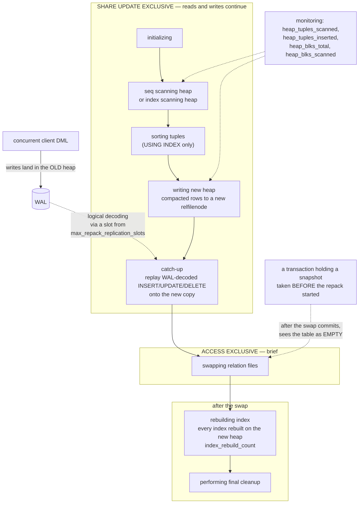

<!--
entry-meta
date: 2026-11-05
type: daily-diff
category: Daily Diff
title: Daily Diff — 2026-11-05
slug: janusgraph-backend-store-wiring
-->

# Daily Diff — 2026-11-05

**2026-11-05 · Daily Diff Digest**

**Which edition this is.** The front page at [tdd.cat](https://tdd.cat/) served the **2026-11-04** edition, 56 stories, with source URLs intact on the first fetch. The 2026-11-05 edition had not published at the time of this run (03:30 UTC / 09:00 IST). `/archive/` reports **128 editions** with a maximum of **2026-11-03** — one behind the front page, which is the reverse of the agreement the last two runs saw. The front page is the newer of the two; this digest covers the 2026-11-04 edition it served. The HN section rendered "No stories match the selected filters" while the header counted 56, which reads as a filter-state artefact rather than an empty section — the same class of rendering glitch as the mislabelled item 41 noted on 2026-11-03.

## The edition, point-wise

**Databases and storage** — the densest cluster of the day:

- **Postgres 19 ships `REPACK` and `REPACK CONCURRENTLY`** — online rebuild of a bloated table without an `ACCESS EXCLUSIVE` lock for the duration. Deep-dived below. ([Snowflake engineering](https://www.snowflake.com/en/blog/engineering/postgres-19-repack-table-bloat/))
- **Fencing a Postgres primary that might still be alive** — promoting a standby does not stop the old primary accepting writes; real fencing is required, not just promotion. ([ClickHouse](https://clickhouse.com/blog/fencing-a-postgres-primary-that-might-still-be-alive))
- **Top-k `GROUP BY` with early thresholding** — bounded priority queues that prune groups *during* aggregation rather than sorting afterwards. ([Pivot Lake](https://pivotlake.io/blog/know-your-limit-faster-top-k-aggregation/))
- **JSONBench: one billion JSON documents across analytical databases** — native JSON vs. flattening, and what flattening costs in fidelity. ([ClickHouse](https://benchmark.clickhouse.com/json/))
- **Postgres as queue, scheduler and vector store** ([The Coder Cafe](https://read.thecoder.cafe/p/barista-1)) and **Postgres as a petabyte-scale lakehouse catalog** — PostHog's Hoglake stores Iceberg-style catalog metadata as plain rows behind a REST service. ([PostHog](https://github.com/PostHog/hoglake))
- **Fifteen years of open-source schema evolution** — Dolibarr and GLPI, and how consistently application code rather than database constraints ends up holding the invariants. ([mcdview](https://blog.mcdview.dev/en/dolibarr-glpi-prestashop-fifteen-years-of-schema/))
- **A free 600-page PostgreSQL 14 internals book** — MVCC, WAL, buffers, locking. Directly relevant to the track paused at PostgreSQL lesson 11 (the heavyweight lock manager). ([Postgres Professional](https://edu.postgrespro.com/postgresql_internals-14_en.pdf))

**Correctness and the commit boundary** — three items that rhyme with today's lesson:

- **Hibernate can skip flushing updates during application shutdown** — a Spring shutdown that commits a transaction without flushing dirty entities, losing updates silently. The failure shape is exactly the one §5 of today's lesson describes from the other side: a buffer above the real transaction, and a `commit()` that is only correct because it calls `flushInternal()` first. ([Bartosz Osipiuk](https://bartoszosipiuk.pl/en/blog/hibernate-lost-my-update/))
- **Shuffling the schedule finds distributed-system bugs** — rare event orderings, and why idempotency plus schedule-shuffling tests catch what ordinary tests do not. ([fzakaria](https://fzakaria.com/2026/11/03/why-does-shuffling-the-schedule-find-so-many-bugs))
- **Testing randomized algorithms with statistical invariants** instead of pinned seeds — the right technique for the backoff distribution measured in today's Hands-On §1. ([Tim Vieira](https://timvieira.github.io/testing-randomized-algorithms/))

**Performance pathologies:**

- **A libc rewrite in Zig made SQLite ~12,000× slower** on batch inserts — a quadratic string-handling path. ([Dennis Forbes](https://dennisforbes.ca/blog/microblog/2026/10/the_accidental_12000x_sqlite_slowdown/))
- **CUDA checkpointing 15× faster on a B300** by profiling the memory transfers. ([maknee](https://maknee.github.io/blog/2026/Cuda-Checkpointing/))
- **liblz4 1.11.0 adds built-in multithreading** behind a single worker-count setting, with near-linear scaling. ([lz4 release](https://github.com/lz4/lz4/releases/tag/v1.11.0))
- **PHP's memory-safety patch introduced hard exits** that produce new failure modes in worker processes. ([The AI News Report](https://theainewsreport.com/2026-11-04-php2shell-fix-two-weeks-on-php-src-tracker.html))

**Language and tooling:** Go's [`encoding/json/v2`](https://go.dev/blog/jsonv2) fixing long-standing parsing behaviour and allocations; [benchfmt.rs](https://www.bwplotka.dev/2026/rust-microbenchmarks-benchstat/) bringing Go's `benchstat` workflow to Rust; [Ladybird](https://ladybird.org/newsletter/2026-10-31/) moving style and layout onto worker threads; [xterm.rs](https://github.com/FenrirSec/xterm.rs) wiring xterm.js to real PTYs.

**Formal methods, unusually well represented:** [QuickProof](https://www.genproof.com/blog/quickproof) turning C property tests into Rocq theorems, and [Kiro](https://kiro.dev/blog/harness-properties-in-lean/) modelling an agent harness in Lean and finding 18 counterexamples that mapped to real bugs.

**Models and agents** make up roughly half the edition — Kimi K3.1 Pro, Mistral Large 4, Krea 3, GLM-5.3-Flash on Trainium2, SpecPilot, plus a cluster on context compaction ([arXiv 2611.05306](https://arxiv.org/abs/2611.05306), [NVIDIA via i10x](https://i10x.ai/news/nvidia-long-context-compaction-agents-study)) and one that argues context rot is driven by attention competition from distractors rather than length alone ([arXiv 2611.04169](https://arxiv.org/abs/2611.04169)). Two evaluation-integrity items are worth more than their billing: [Prime Intellect's audit](https://www.primeintellect.ai/blog/auditing-public-evaluations) of public evals found underspecified tool schemas and reward hacks distorting scores, and a [5-agent audit swarm](https://github.com/VictorAboba/DreamTeam/blob/master/docs/en/audits/2026-11-self-audit.md) found every planted backdoor but reported only 13 of 27 findings as valid.

---

## Deep dive: `REPACK CONCURRENTLY` in PostgreSQL 19

I followed the edition's link to the [Snowflake engineering post](https://www.snowflake.com/en/blog/engineering/postgres-19-repack-table-bloat/) (Craig Kerstiens, 2 Nov 2026) and then to the [PostgreSQL 19 `REPACK` reference page](https://postgresql.org/docs/19/sql-repack.html), which is the authority where the two disagree. Postgres 19 was at RC1 as of the blog post, with GA expected late November or December 2026.

### What the problem actually is

Postgres never updates a row in place: an `UPDATE` writes a new tuple version and marks the old one dead. Ordinary `VACUUM` marks dead tuples' space reusable *within the relation* but does not return it to the filesystem. A table that has absorbed a heavy update or delete workload therefore keeps a page count reflecting its historical peak, and every sequential scan pays for those pages forever.

The two built-in fixes both rewrite the heap and both take `ACCESS EXCLUSIVE` for the whole rewrite — `VACUUM FULL` (unordered) and `CLUSTER` (ordered by an index). On a 500 MB table that is a couple of seconds; on a 500 GB production table it is an outage. The ecosystem's answer has been two external extensions:

- **`pg_repack`** — captures concurrent DML with **triggers** into a log table and replays it. Every write to the table pays trigger overhead for the operation's duration.
- **`pg_squeeze`** — captures the same changes with **logical decoding** from WAL and a background worker. No trigger overhead, but it needs `wal_level = logical`, a replication slot and `shared_preload_libraries`.

Postgres 19's `REPACK` is `pg_squeeze`'s approach brought in-tree; the blog credits CYBERTEC, the `pg_squeeze` team, with the work.

### The syntax, exactly

From the reference page's synopsis:

```
REPACK [ ( option [, ...] ) ] [ table_and_columns [ USING INDEX [ index_name ] ] ]
REPACK [ ( option [, ...] ) ] USING INDEX

where option can be one of:
    VERBOSE [ boolean ]
    ANALYZE [ boolean ]
    CONCURRENTLY [ boolean ]
```

So:

```sql
REPACK my_table;                                        -- VACUUM FULL's successor
REPACK (CONCURRENTLY) my_table;                         -- online
REPACK (CONCURRENTLY) my_table USING INDEX my_index;    -- online + CLUSTER's ordering
REPACK (CONCURRENTLY, VERBOSE, ANALYZE) my_table;       -- progress at INFO + planner stats
REPACK USING INDEX;                                     -- every previously-clustered table
```

`REPACK` with no table is the whole-database form; it cannot run inside a transaction block and cannot be combined with `CONCURRENTLY`. `USING INDEX` reorders rows physically once — later updates are not kept clustered, exactly as with `CLUSTER`.

### The mechanism

The lock profile is the entire point:

- plain `REPACK` → `ACCESS EXCLUSIVE` acquired at the start, held throughout
- `REPACK (CONCURRENTLY)` → **`SHARE UPDATE EXCLUSIVE`** for the bulk of the work, with `ACCESS EXCLUSIVE` taken only for the final swap of table and index files

`SHARE UPDATE EXCLUSIVE` is the `VACUUM`/`CREATE INDEX CONCURRENTLY` level: readers and writers proceed, a second maintenance operation on the same table does not. Changes committed by other transactions while the new heap is being built are **decoded from WAL** — no triggers — and replayed in a catch-up phase. `pg_stat_progress_repack` names the phases, and they map one-to-one onto the work:



Two details the phase list makes concrete:

- **Indexes are rebuilt after the swap, not before it.** `index_rebuild_count` advances during `rebuilding index`, which is where most of the wall-clock time goes on a heavily indexed table — and the heap is already the new one by then.
- **The change data is stored separately on disk**, not in a log table in the database. The reference page adds one optimisation worth knowing: for TOAST columns an `UPDATE` did not touch, the full tuple data is not retained in that change store.

### The caveat that matters

Verbatim from the reference page:

> "REPACK with the CONCURRENTLY option is not MVCC-safe."

and:

> "After the repacking transaction commits, the table will appear empty to concurrent transactions, if they are using a snapshot taken before repacking started."

Not a stale read. An **empty table**. A long-running `REPEATABLE READ` transaction or an open cursor that took its snapshot before the repack began will, after the swap commits, see zero rows — because the snapshot's visibility information refers to tuples in a relfilenode that is no longer the table's. Any analytics transaction, long report or logical-replication consumer holding an old snapshot across a `REPACK CONCURRENTLY` is a correctness hazard, not a performance one.

### Requirements and exclusions, from the reference page

`CONCURRENTLY` is refused when:

- the table "lacks a primary key and index-based replica identity"
- `max_repack_replication_slots` does not allow one more slot
- the target is a materialized view, an `UNLOGGED` table, a **partitioned** table, a system catalog, a TOAST table, a table with a non-heap access method, or one marked `user_catalog_table`
- the statement is inside a transaction block

**A correction to the secondary source.** The Snowflake post says partitioned tables are "not supported". The reference page is narrower: plain `REPACK` on a partitioned table repacks each partition in turn (and with `USING INDEX`, each partition uses its matching index); it simply cannot run inside a transaction block, and it is only `CONCURRENTLY` that is unavailable for partitioned tables. The blog's "only one concurrent REPACK per database at a time" is also not stated on the reference page — what is stated is the `max_repack_replication_slots` bound, which is a configurable limit rather than a hard one-at-a-time rule. Where the two disagree, the docs win.

### The numbers, and what they are worth

The blog's benchmarks ran on a deliberately constrained box — 1 CPU, 512 MB RAM, `maintenance_work_mem = 4 MB`:

| Table before | Live rows | `VACUUM FULL` | `REPACK` | `REPACK (CONCURRENTLY)` |
|---|---|---|---|---|
| 493 MB | 1M | 2.7 s | 5.9 s | 9.4 s |
| 839 MB | 2M | — | 7.5 s | ~12 s (est.) |
| 1,252 MB | 1.7M | — | 17.2 s | ~27 s (est.) |

The 493 MB table came back at 228 MB (54% smaller); a `USING INDEX` run took 618 MB to 320 MB (48%). Concurrent mode costs roughly 1.5–2× the plain mode's time, and the operation needs about **2× the space** of the table plus its indexes while it runs.

Note what the first column means: `VACUUM FULL` is *faster* than plain `REPACK` on the same table (2.7 s vs 5.9 s). The trade is not speed, it is the lock. And in a workload where the point is "do not take the table offline", 9.4 s under `SHARE UPDATE EXCLUSIVE` beats 2.7 s under `ACCESS EXCLUSIVE` by a margin that does not appear in the table at all.

### Why it matters

Two things change. First, the operational one: bloat cleanup stops requiring an extension, a `shared_preload_libraries` entry and a restart. `pg_repack`'s trigger overhead and `pg_squeeze`'s setup were both real adoption barriers, and "run this SQL statement" is a different proposition from "install this extension on your managed Postgres", particularly on providers that gate the extension list.

Second, and more interesting as a piece of design: `REPACK CONCURRENTLY` is the same shape of solution as `CREATE INDEX CONCURRENTLY` and as logical replication itself — build the new structure beside the old one, capture the delta from WAL, catch up, swap under a brief exclusive lock. Postgres keeps arriving at that pattern because it is the only one available to a system that cannot change a relation's identity atomically with respect to existing snapshots. And the documented cost is always the same: the swap is atomic for *new* snapshots and undefined for old ones. `CREATE INDEX CONCURRENTLY` pays it as a possibly-invalid index; `REPACK CONCURRENTLY` pays it as a table that looks empty. Worth holding next to today's lesson, where JanusGraph's cache faces a structurally identical problem — a substitution it cannot make atomic — and answers it by refusing to trust its own re-reads for `db-cache-clean-wait` milliseconds rather than by making the swap safe.

---

## Sources

- [tdd.cat](https://tdd.cat/) — front page, served the 2026-11-04 edition, 56 stories
- [tdd.cat/archive/](https://tdd.cat/archive/) — 128 editions, maximum 2026-11-03
- [Postgres 19 repack enables online table bloat cleanup](https://www.snowflake.com/en/blog/engineering/postgres-19-repack-table-bloat/) — Snowflake engineering, Craig Kerstiens, 2 Nov 2026
- [PostgreSQL 19 documentation: `REPACK`](https://postgresql.org/docs/19/sql-repack.html) — primary source for syntax, lock levels, the MVCC caveat and the exclusion list
- Edition items linked inline above, each URL as served by the front page this run
