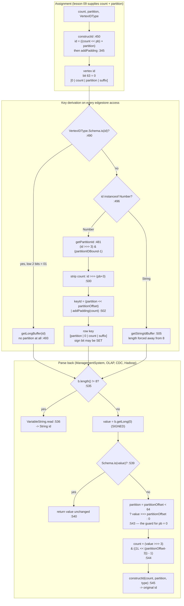

<!--
entry-meta
date: 2026-11-06
type: lesson
track: JanusGraph
lesson: 08
category: Database Internals
title: IDManager: the vertex id bit layout and the row key rotation
slug: janusgraph-id-bit-layout
-->

# `IDManager`: the vertex id bit layout and the row key rotation

**2026-11-06 · JanusGraph Track · Lesson 08 of 28**

Part II opens. Everything below is read at the pinned commit `a59ae8d8` (2026-10-28) on
`JanusGraph/janusgraph` `master` — **deliberately not re-pinned** at the Part boundary, so that every
byte offset in lessons 08–13 stays directly comparable with the storage-contract lessons 02–07.

## Where This Fits

- **Lesson 07** established the wiring: `Backend` opens six stores, `edgestore` among them, through
  `storeManagerLocking`, wrapped in an `ExpirationKCVSCache`; `BackendTransaction` holds
  `EDGESTORE_MIN_KEY = zeroBuffer(8)` and `EDGESTORE_MAX_KEY = oneBuffer(8)` with the comment
  *"Assumes 64 bit key length as specified in IDManager"*, and lesson 07 left open whether that maximal
  key is assignable. See [lesson 07](../2026-11-05-janusgraph-backend-store-wiring/README.md).
- **This lesson** supplies the thing that comment is deferring to: `IDManager`, the single class that
  owns JanusGraph's id bit patterns. It answers what an id *is* (a 63-bit `[0 | count | partition |
  padding]` word), what a row key *is* (a different 64-bit word with the partition rotated to the top),
  why those two are not the same number, and — closing lesson 07's question — that `EDGESTORE_MAX_KEY`
  is **unreachable by construction**.
- **It sets up** lesson 09 (`VertexIDAssigner` / `ConsistentKeyIDAuthority`: where the `count` comes
  from) and lesson 10 (`EdgeSerializer.writeRelation`, which consumes the `TYPE_LEN_RESERVE = 3` bits
  this lesson accounts for but does not spend).

Assumed from earlier lessons: `StaticBuffer` and its unsigned byte-wise `compareTo`, `Entry`,
`SliceQuery`'s half-open interval, the `edgestore` row-per-vertex model, and lesson 05's
fixed-vs-variable key-length handling on an ordered key-value backend.

---

## 1. There are two numbers, not one

This is the whole lesson in one sentence: **the vertex id that Gremlin returns and the row key that
goes to the storage backend are different 64-bit words**, and the transformation between them is a
rotation of the partition field from the middle of the word to the top.

The in-memory id layout is stated in a comment at
[`IDManager.java:446-448`](https://github.com/JanusGraph/janusgraph/blob/a59ae8d8024207598eada34998d867617df51adf/janusgraph-core/src/main/java/org/janusgraph/graphdb/idmanagement/IDManager.java#L446-L448):

```
/*		--- JanusGraphElement id bit format ---
 *  [ 0 | count | partition | ID padding (if any) ]
 */
```

and built by `constructId`
([`:450-459`](https://github.com/JanusGraph/janusgraph/blob/a59ae8d8024207598eada34998d867617df51adf/janusgraph-core/src/main/java/org/janusgraph/graphdb/idmanagement/IDManager.java#L450-L459)):

```java
long id = (count<<partitionBits)+partition;
if (type!=null) id = type.addPadding(id);
return id;
```

The row key is built by `getKey`
([`:489-510`](https://github.com/JanusGraph/janusgraph/blob/a59ae8d8024207598eada34998d867617df51adf/janusgraph-core/src/main/java/org/janusgraph/graphdb/idmanagement/IDManager.java#L489-L510)),
and the line that matters is `:502`:

```java
long partition = getPartitionId((long) vertexId);
long count = (long) vertexId>>>(partitionBits+USERVERTEX_PADDING_BITWIDTH);
assert count>0;
long keyId = (partition<<partitionOffset) | type.addPadding(count);
return BufferUtil.getLongBuffer(keyId);
```

`partitionOffset = Long.SIZE - partitionBits` (`:431`) — note **`Long.SIZE`, 64, not `TOTAL_BITS`, 63**.
So in the key the partition field is pushed hard against the top of the word, sign bit included, and
the count is **not** shifted left by `partitionBits` at all: it stays in the low bits, padded only by
the 3-bit type suffix.

| | `[63 … ]` | middle | `[… 0]` |
|---|---|---|---|
| **id** (`constructId`) | `0` (always) | `count` | `partition`, then 3-bit `suffix` |
| **row key** (`getKey`) | `partition` (top `partitionBits`) | one always-zero gap bit | `count`, then 3-bit `suffix` |

Why the rotation exists: the backend sorts and shards by the row key's leading bytes. Putting the
partition in the top bits makes vertices in different partitions land in different regions of the key
space, while vertices with adjacent `count` in the *same* partition get keys 8 apart — which is
exactly what the data-model doc means by *"Ids are assigned such that vertices which are frequently
co-accessed have ids with small absolute difference."*

Worked examples, `partitionBits = 3` (`cluster.max-partitions = 8`, the value
`JanusGraphPartitionGraphTest` uses at
[`:87`](https://github.com/JanusGraph/janusgraph/blob/a59ae8d8024207598eada34998d867617df51adf/janusgraph-backend-testutils/src/main/java/org/janusgraph/graphdb/JanusGraphPartitionGraphTest.java#L87)),
`NormalVertex`:

| count | partition | id (dec) | id (hex) | row key (hex) |
|---|---|---|---|---|
| 1 | 0 | 64 | `0x0000000000000040` | `0x0000000000000008` |
| 1 | 5 | 104 | `0x0000000000000068` | `0xa000000000000008` |
| 2 | 5 | 168 | `0x00000000000000a8` | `0xa000000000000010` |
| 1000 | 7 | 64056 | `0x000000000000fa38` | `0xe000000000001f40` |

Two observations that are easy to miss:

- **The id is small and the key is huge.** `id = 104` becomes the key `0xa000000000000008`. Anyone
  debugging by eyeballing hex keys who expects to see the id there will not find it.
- **With `partitionBits = 0` the two words are identical.** `count=1` → id `8`, key
  `0x0000000000000008`. This is why the distinction is invisible in most unit tests.

## 2. The always-zero gap bit

`TOTAL_BITS = Long.SIZE - 1 = 63`, documented as *"We use only 63 bits to make sure that all ids are
positive"*
([`:382-387`](https://github.com/JanusGraph/janusgraph/blob/a59ae8d8024207598eada34998d867617df51adf/janusgraph-core/src/main/java/org/janusgraph/graphdb/idmanagement/IDManager.java#L382-L387)).
In the constructor (`:419-432`):

```java
vertexCountBound = (1L << (TOTAL_BITS - partitionBits - USERVERTEX_PADDING_BITWIDTH));
partitionOffset  = Long.SIZE - partitionBits;
```

So `count < 2^(60-partitionBits)`, hence `count << 3 < 2^(63-partitionBits)`, occupying bits
`0 … 62-partitionBits`. The partition field starts at bit `64-partitionBits`. **Bit
`63-partitionBits` of every user-vertex row key is therefore always zero** — one bit per key wasted by
construction, the price of keeping ids positive in a signed `long` while using the full 64 bits of the
key. For `partitionBits = 0` that bit is bit 63 itself, which is the sign bit the comment is about.

The consequence that does bite: with `partitionBits > 0` and a partition in the upper half of the
range, **the row key's sign bit is set**. `partition = 17, partitionBits = 5` gives
`0x8800000000000008`, a negative signed `long`. `BufferUtil.getLongBuffer` writes it big-endian
([`BufferUtil.java` `getLongBuffer`](https://github.com/JanusGraph/janusgraph/blob/a59ae8d8024207598eada34998d867617df51adf/janusgraph-core/src/main/java/org/janusgraph/diskstorage/util/BufferUtil.java))
and `StaticBuffer` compares unsigned byte-wise, so the *ordering* is fine. What is not fine is any
arithmetic on the value after `StaticBuffer.getLong(0)`, which returns it signed. That is why
`getKeyID` (`:534-547`) uses `>>>` everywhere and never `>>`, and why its javadoc says so explicitly
at
[`:523-529`](https://github.com/JanusGraph/janusgraph/blob/a59ae8d8024207598eada34998d867617df51adf/janusgraph-core/src/main/java/org/janusgraph/graphdb/idmanagement/IDManager.java#L523-L529):

> NOTE: due to design reason, the encoding scheme of long-type ID here is different from `IDHandler`.
> An important difference here is that the first bit of the first byte for a long-type ID is not
> guaranteed to be zero (as opposed to the case in `IDHandler`).

## 3. `VertexIDType`: a 17-member enum that is really a prefix code

`VertexIDType`
([`:63-367`](https://github.com/JanusGraph/janusgraph/blob/a59ae8d8024207598eada34998d867617df51adf/janusgraph-core/src/main/java/org/janusgraph/graphdb/idmanagement/IDManager.java#L63-L367))
is not a tag stored alongside the id. It is a variable-length **suffix** code occupying the low bits,
and the type hierarchy is encoded as prefix containment. Each member supplies `offset()` (how many low
bits it owns), `suffix()` (the value of those bits) and `isProper()` (whether an actual element may
carry it, as opposed to it being only an interior node of the hierarchy).

| member | offset | suffix | binary | proper |
|---|---|---|---|---|
| `UserVertex` | 1 | 0 | `0` | no |
| `NormalVertex` | 3 | 0 | `000` | **yes** |
| `PartitionedVertex` | 3 | 2 | `010` | **yes** |
| `UnmodifiableVertex` | 3 | 4 | `100` | **yes** |
| `Invisible` | 1 | 1 | `1` | no |
| `InvisibleVertex` | 2 | 3 | `11` | **yes** |
| `Schema` | 2 | 1 | `01` | no |
| `SchemaType` | 3 | 5 | `101` | no |
| `RelationType` | 4 | 5 | `0101` | no |
| `PropertyKey` | 5 | 5 | `00101` | no |
| `UserPropertyKey` | 6 | 5 | `000101` | **yes** |
| `SystemPropertyKey` | 6 | 37 | `100101` | **yes** |
| `EdgeLabel` | 5 | 21 | `10101` | no |
| `UserEdgeLabel` | 6 | 21 | `010101` | **yes** |
| `SystemEdgeLabel` | 6 | 53 | `110101` | **yes** |
| `VertexLabel` | 5 | 13 | `01101` | **yes** |
| `GenericSchemaType` | 4 | 9 | `1001` | **yes** |

The three operations (`:345-366`):

```java
public final long addPadding(long count) {
    assert offset()>0;
    Preconditions.checkArgument(count>0 && count<(1L <<(TOTAL_BITS-offset())), ...);
    return (count << offset()) | suffix();
}
public final long removePadding(long id) { return id >>> offset(); }
public final boolean is(Object id) {
    if (id instanceof Number) {
        return (((Number) id).longValue() & ((1L << offset()) - 1)) == suffix();
    } else {
        // only user-defined vertex can be of other type
        return suffix() == 0;
    }
}
```

Three things follow from the table that are worth holding on to:

- **`is()` is a masked compare, so the hierarchy is free.** `RelationType.is(id)` checks only the low
  4 bits, and both `UserEdgeLabel` (`010101`) and `UserPropertyKey` (`000101`) end in `0101`. No
  dispatch table, no instanceof chain — `isRelationTypeId`, `isEdgeLabelId`, `isPropertyKeyId`,
  `isVertexLabelVertexId`, `isGenericSchemaVertexId` (`:727-749`) are each one mask.
- **`is()` on a non-`Number` returns `suffix() == 0`.** That is the custom-string-id path: a string id
  answers `true` to `UserVertex.is` and `NormalVertex.is` and `false` to everything else, so a string
  vertex is a normal user vertex by definition and can never be a schema element or a partitioned
  vertex.
- **All three proper user-vertex types have `offset() == 3`.** This is load-bearing, not coincidence:
  `getKey` asserts it at `:498` (`assert type.offset()==USERVERTEX_PADDING_BITWIDTH`), and
  `IDManagementTest.testUserVertexBitWidth` guards it for the whole enum
  ([`IDManagementTest.java` `testUserVertexBitWidth`](https://github.com/JanusGraph/janusgraph/blob/a59ae8d8024207598eada34998d867617df51adf/janusgraph-test/src/test/java/org/janusgraph/graphdb/idmanagement/IDManagementTest.java)) —
  though note that guard's first clause is a bare `assert`, so it is a no-op unless the suite runs with
  `-ea`.

## 4. The id → key → id round trip



Three branches of that diagram deserve a sentence each.

**Schema vertices have no partition.** `getKey` returns the id verbatim for them (`:490-493`, comment
*"No partition for schema vertices"*), and `getPartitionId` short-circuits to
`SCHEMA_PARTITION = 0` (`:482`). Schema ids are built by the static `getSchemaId`
([`:691-694`](https://github.com/JanusGraph/janusgraph/blob/a59ae8d8024207598eada34998d867617df51adf/janusgraph-core/src/main/java/org/janusgraph/graphdb/idmanagement/IDManager.java#L691-L694)),
which is pure `type.addPadding(count)` with no partition term — the layout comment at `:678-681` says
`[ 0 | count | ID padding ]` and *"(there is no partition)"*. `UserPropertyKey` with `count = 1` is
therefore id `69` = `0b1000101`; `UserEdgeLabel` with `count = 1` is `85` = `0b1010101`.

**`:543`'s ternary is not defensive style, it is required.** Java masks shift distances to 6 bits for
`long`, so `value >>> 64` is `value >>> 0` — without the `partitionOffset < Long.SIZE` guard, a
`partitionBits = 0` graph would read the entire key as the partition id.

**The length-8 trick is the string/long discriminator.** `getKeyID` decides by `b.length() != longSize`
(`:535`), and `BufferUtil.getStringIdBuffer` cooperates by appending a dummy `STOP_MASK` byte precisely
when `s.length() + 1 == 8` would have produced an 8-byte buffer. The javadoc at `:512-533` explains why
this differs from `IDHandler`'s first-bit trick: here the whole buffer is the id, there only part of
the buffer is.

## 5. `partitionBits` is 5 in production and 0 nowhere

`IDManager` has two constructors (`:419-436`). The parameterised one validates
`0 <= partitionBits <= MAX_PARTITION_BITS (16)`; the no-arg one passes
`DEFAULT_PARTITION_BITS = 0`. **The no-arg constructor has no caller anywhere in the tree** — a code
search for `new IDManager(` at the pinned commit returns exactly two files,
[`VertexIDAssigner.java:105`](https://github.com/JanusGraph/janusgraph/blob/a59ae8d8024207598eada34998d867617df51adf/janusgraph-core/src/main/java/org/janusgraph/graphdb/database/idassigner/VertexIDAssigner.java#L105)
and `IDManagementTest`, both passing an explicit width. `DEFAULT_PARTITION_BITS` is dead.

The real production value comes from one line
([`VertexIDAssigner.java:104-107`](https://github.com/JanusGraph/janusgraph/blob/a59ae8d8024207598eada34998d867617df51adf/janusgraph-core/src/main/java/org/janusgraph/graphdb/database/idassigner/VertexIDAssigner.java#L104-L107)):

```java
int partitionBits = NumberUtil.getPowerOf2(config.get(CLUSTER_MAX_PARTITIONS));
idManager = new IDManager(partitionBits);
Preconditions.checkArgument(idManager.getPartitionBound() <= Integer.MAX_VALUE && idManager.getPartitionBound()>0);
```

`cluster.max-partitions` is `ConfigOption.Type.FIXED` with default **32** and a validator demanding
`> 1` and a power of 2.
[`NumberUtil.getPowerOf2`](https://github.com/JanusGraph/janusgraph/blob/a59ae8d8024207598eada34998d867617df51adf/janusgraph-core/src/main/java/org/janusgraph/util/stats/NumberUtil.java)
is `Long.SIZE - (numberOfLeadingZeros(value) + 1)`, so **every default graph runs with
`partitionBits = 5`**. The validator's `> 1` means `partitionBits = 0` is not even configurable;
`ConsistentKeyIDAuthority` re-derives the same number and re-checks `0 … 16` independently.

That fixes the real bounds. `FIXED` means they are frozen at graph creation and cannot be changed
afterwards:

| `partitionBits` | `cluster.max-partitions` | `vertexCountBound` | `relationCountBound` | `partitionOffset` |
|---|---|---|---|---|
| 0 | 1 *(not configurable)* | 2^60 = 1,152,921,504,606,846,976 | `Long.MAX_VALUE` | 64 |
| 1 | 2 | 2^59 | 2^62 | 63 |
| 3 | 8 *(test default)* | 2^57 = 144,115,188,075,855,872 | 2^60 | 61 |
| **5** | **32 (default)** | **2^55 = 36,028,797,018,963,968** | **2^58** | **59** |
| 8 | 256 | 2^52 = 4,503,599,627,370,496 | 2^55 | 56 |
| 12 | 4096 | 2^48 = 281,474,976,710,656 | 2^51 | 52 |
| 16 | 65536 *(max)* | 2^44 = 17,592,186,044,416 | 2^47 | 48 |

Every partition bit costs one bit of vertex count. At the maximum 16 bits the ceiling is 17.6 trillion
vertices *per graph* — still far beyond any real deployment, which is why nobody notices the tradeoff.
Note `relationCountBound` is special-cased to `Long.MAX_VALUE` when `partitionBits == 0` (`:427`),
because the general formula `1L << (63 - 0)` would overflow to a negative number.

Also fixed by that formula: `SCHEMA_COUNT_BOUND` (`:402-410`) is
`1L << (TOTAL_BITS - MAX_PADDING_BITWIDTH - TYPE_LEN_RESERVE)` = `1 << 54`, using the *maximum* padding
width (6, from `UserEdgeLabel`) rather than each type's own, plus the 3 bits `TYPE_LEN_RESERVE`
reserves for serialization. It does not depend on `partitionBits` at all, since schema ids have no
partition field. Lesson 10 spends those 3 bits.

## 6. Partitioned vertices: one logical vertex, `2^partitionBits` row keys

A vertex label declared `.partition()` gets `VertexIDType.PartitionedVertex` (suffix `010`), and the
rules change.

- `getVertexID` (`:555-564`) checks `partition == PARTITIONED_VERTEX_PARTITION (1)` and then
  **discards it**, calling `getCanonicalVertexIdFromCount(count)` instead. The constant exists to make
  the id-pool bookkeeping in `VertexIDAssigner` line up (`:132-133` allocates a dedicated
  `StandardIDPool` for partition 1), not to place the vertex.
- The placement is a **XOR fold** of the count over itself, `getPartitionHashForId`
  ([`:566-577`](https://github.com/JanusGraph/janusgraph/blob/a59ae8d8024207598eada34998d867617df51adf/janusgraph-core/src/main/java/org/janusgraph/graphdb/idmanagement/IDManager.java#L566-L577)):

  ```java
  long result = 0;
  int offset = 0;
  while (offset<Long.SIZE) {
      result = result ^ ((id>>>offset) & (partitionIDBound-1));
      offset+=partitionBits;
  }
  ```

  `checkState(partitionBits>0, "no partition bits")` guards the loop — with `partitionBits == 0` the
  `offset` never advances and this spins forever. Note the fold's behaviour on small inputs: every
  `count` below `2^partitionBits` folds to **itself**, because all the higher chunks are zero. At
  `partitionBits = 16`, counts 1…10 map to partitions 1…10 in order. The hash only starts mixing once
  the count exceeds the partition width, which is why `testPartitionHashes`
  ([`JanusGraphPartitionGraphTest.java:113-119`](https://github.com/JanusGraph/janusgraph/blob/a59ae8d8024207598eada34998d867617df51adf/janusgraph-backend-testutils/src/main/java/org/janusgraph/graphdb/JanusGraphPartitionGraphTest.java#L113-L119))
  probes `1 … 2*getPartitionBound()` and asserts only `hashes.size() > bound/2`.
- `getCanonicalVertexId` (`:584-588`) recomputes the fold from the count, so it is idempotent;
  `isCanonicalVertexId` (`:590-592`) is `id == getCanonicalVertexId(id)`.
- `getPartitionedVertexId(id, otherPartition)` (`:594-599`) re-stamps the same count into a *different*
  partition — this is how one logical partitioned vertex acquires a representative row in every
  partition. `getPartitionedVertexRepresentatives` (`:601-609`) materialises all of them:

  ```java
  long[] ids = new long[(int)getPartitionBound()];
  for (int i=0;i<getPartitionBound();i++) ids[i]=getPartitionedVertexId(partitionedVertexId,i);
  ```

  At the default `partitionBits = 5` that is 32 longs. At the maximum 16 it is **65,536 longs, 512 KB,
  allocated fresh on every call** — and `assert getPartitionBound()<Integer.MAX_VALUE` at `:603` is the
  only thing standing between that and an `int` overflow, which again is a no-op without `-ea` (the
  real guard is `VertexIDAssigner:106`).

So a partitioned vertex is one id but up to 65,536 edgestore rows, and a traversal touching it issues
one slice query per representative. That is the cost side of the supernode mitigation; lesson 19 will
meet the read side.

## 7. Temporary ids: the same bit pattern, negated

Pre-commit, a vertex has no allocated count. `makeTemporary`
([`:665-668`](https://github.com/JanusGraph/janusgraph/blob/a59ae8d8024207598eada34998d867617df51adf/janusgraph-core/src/main/java/org/janusgraph/graphdb/idmanagement/IDManager.java#L665-L668)):

```java
private static long makeTemporary(long id) {
    Preconditions.checkArgument(id>0);
    return (1L <<63) | id; //make negative but preserve bit pattern
}
```

`isTemporary(id)` is just `id < 0` (`:670-672`). Because the pattern is preserved, every
`VertexIDType.is()` check still works on a temporary id — `IDManagementTest` asserts exactly that
(`NormalVertex.is`, `UserEdgeLabel.is` and `Invisible.is` all hold on temporaries). Temporary ids carry
no partition, as the section comment at `:650-654` says. The collision risk is structural: bit 63 is
the always-zero gap bit from §2 at `partitionBits = 0`, so a temporary id and a committed id can never
be confused by sign — but every consumer of an id that does arithmetic must decide whether negatives
are in scope, and §8 is about one that does not.

## 8. `fromVertexId` accepts a temporary id and returns garbage

`toVertexId` / `fromVertexId`
([`:611-636`](https://github.com/JanusGraph/janusgraph/blob/a59ae8d8024207598eada34998d867617df51adf/janusgraph-core/src/main/java/org/janusgraph/graphdb/idmanagement/IDManager.java#L611-L636))
are the public API for `graph.set-vertex-id`, documented as inverses:

```java
public long toVertexId(long id) {
    Preconditions.checkArgument(id > 0, "Vertex id must be positive: %s", id);
    Preconditions.checkArgument(vertexCountBound > id, "Vertex id is too large: %s", id);
    return id<<(partitionBits+USERVERTEX_PADDING_BITWIDTH);
}

public long fromVertexId(long id) {
    Preconditions.checkArgument(id >>> USERVERTEX_PADDING_BITWIDTH+partitionBits > 0
        && id <= (vertexCountBound-1)<<USERVERTEX_PADDING_BITWIDTH+partitionBits, "Invalid vertex id provided: %s", id);
    return id>>USERVERTEX_PADDING_BITWIDTH+partitionBits;
}
```

`toVertexId` rejects non-positive input outright. `fromVertexId` does not, and both of its
preconditions pass for a negative id:

- Clause 1 uses `>>>`, so a negative id's sign bit shifts in as magnitude and the result is comfortably
  positive.
- Clause 2 compares a **signed** negative `id` against a positive bound, which is trivially true.
- The return then uses `>>`, arithmetic, sign-extending.

Worked, at the production `partitionBits = 5`, for `getTemporaryVertexID(NormalVertex, 1)` =
`0x8000000000000008`:

| step | value |
|---|---|
| `id` | `-9223372036854775800` |
| clause 1: `id >>> 8` | `36028797018963968` → `> 0` ✓ passes |
| clause 2 bound: `(2^55-1) << 8` | `9223372036854775552` → `id <= bound` ✓ passes |
| returned: `id >> 8` | **`-36028797018963968`** |

A negative "user id" comes back where an `IllegalArgumentException` belongs. The same holds at every
width (verified for `partitionBits ∈ {0, 3, 5, 16}`); the legitimate round trip
`fromVertexId(toVertexId(7)) == 7` is unaffected. The gap is in the test too:
`VertexIDAssignerTest` probes `fromVertexId` for out-of-range input with exactly
`new long[] {0, idManager.getVertexCountBound()}` — zero and too-large, never negative. See PR
candidate 1.

## 9. Closing lesson 07: `EDGESTORE_MAX_KEY` is unreachable

Lesson 07 left open whether `BackendTransaction.EDGESTORE_MAX_KEY = oneBuffer(8)` — eight `0xFF`
bytes — is an assignable row key, which matters because lesson 02's half-open interval **excludes** the
upper bound of a full ordered scan. The answer is no, by construction, on both paths:

- **User vertices.** The low 3 bits of a user-vertex row key are `type.suffix()`, which for the three
  proper types is `000`, `010` or `100` — never `111`. `getUserVertexIDType` (`:461-470`) throws
  `InvalidIDException` for anything else, so there is no fourth value.
- **Schema vertices.** The key *is* the id (`:493`), and reaching that branch requires
  `VertexIDType.Schema.is(value)`, i.e. low 2 bits `01`. `0xFF & 3 == 3`. Unreachable.
- **String ids.** `getStringIdBuffer` guarantees `length != 8`, and `BackendTransaction`'s ordered-scan
  branch is gated on `isKeyOrdered() && !allowCustomVertexIdType` anyway, so string keys and the
  8-byte bounds never meet.

`EDGESTORE_MIN_KEY = zeroBuffer(8)` is likewise unreachable, for a different reason: it would need
`count == 0`, and `addPadding` requires `count > 0` (`:347`) while `getKey` asserts it at `:501`. The
bounds are strictly outside the assignable key space at both ends, which means the half-open interval
is safe here — but it is safe *by accident of the suffix encoding*, not by anything written down. Lesson
07 counted this as the fourth consumer of the half-open contract with none of the enforcement; this is
the fourth consumer's proof, and it belongs next to that constant as a comment.

## Hands-On

Prerequisite from lesson 02 onward: fork cloned, `mvn clean install -pl janusgraph-inmemory -am
-DskipTests` built once.

### 1. See the rotation yourself, through the public API

`ManagementSystem` exposes the key derivation directly:
[`getVertexKey`](https://github.com/JanusGraph/janusgraph/blob/a59ae8d8024207598eada34998d867617df51adf/janusgraph-core/src/main/java/org/janusgraph/graphdb/database/management/ManagementSystem.java#L566-L568)
(`:566-568`) is `Hex.encodeHexString(graph.getIDManager().getKey(vertexId).asByteBuffer())` and
[`getVertexId`](https://github.com/JanusGraph/janusgraph/blob/a59ae8d8024207598eada34998d867617df51adf/janusgraph-core/src/main/java/org/janusgraph/graphdb/database/management/ManagementSystem.java#L561-L563)
(`:561-563`) is the inverse through `getKeyID`. In `bin/gremlin.sh` or a scratch test:

```groovy
conf = org.janusgraph.graphdb.configuration.GraphDatabaseConfiguration.buildGraphConfiguration()
conf.set(org.janusgraph.graphdb.configuration.GraphDatabaseConfiguration.STORAGE_BACKEND, "inmemory")
// leave cluster.max-partitions at its default 32 -> partitionBits = 5
graph = org.janusgraph.core.JanusGraphFactory.open(conf.getConfiguration())
mgmt  = graph.openManagement()
idm   = graph.getIDManager()

(1..12).each {
  v = graph.addVertex()
  id = v.id()
  println String.format("id=%-12d part=%-3d key=%s  roundtrip=%s",
      id, idm.getPartitionId(id), mgmt.getVertexKey(id), mgmt.getVertexId(mgmt.getVertexKey(id)) == id)
}
graph.tx().commit()
```

**What to look for.** The `key` column's *first* hex digits change as `part` changes while the tail
stays small and increments by 8 — that is the rotation. The id column, by contrast, increments in steps
of `32 << 3 = 256` for a fixed partition. Confirm `roundtrip=true` on every line: that is `getKey` →
`getKeyID` → `constructId` closing, the same assertion `IDManagementTest.testEntityID` makes
(`assertEquals(id, eid.getKeyID(eid.getKey(id)))`).

Then re-open with `conf.set(GraphDatabaseConfiguration.CLUSTER_MAX_PARTITIONS, 2)` and watch the key
tail grow while the leading digit only ever takes two values.

### 2. Reproduce §8 in jshell — no graph needed

`IDManager` is a pure function of `partitionBits`, so this needs nothing but the core jar:

```bash
cd ~/janusgraph
mvn -q -pl janusgraph-core -am -DskipTests install
jshell --class-path "$(ls janusgraph-core/target/janusgraph-core-*.jar | head -1):$HOME/.m2/repository/com/google/guava/guava/$(ls $HOME/.m2/repository/com/google/guava/guava | head -1)/guava-$(ls $HOME/.m2/repository/com/google/guava/guava | head -1).jar"
```

```java
import org.janusgraph.graphdb.idmanagement.IDManager;
import org.janusgraph.graphdb.idmanagement.IDManager.VertexIDType;

var idm = new IDManager(5);                       // the production default
long good = idm.toVertexId(7L);
System.out.println(idm.fromVertexId(good));       // 7  -- the documented inverse

long temp = IDManager.getTemporaryVertexID(VertexIDType.NormalVertex, 1L);
System.out.printf("temp = %s (0x%016x), isTemporary=%b%n", temp, temp, IDManager.isTemporary(temp));
System.out.println(idm.fromVertexId(temp));       // expect IllegalArgumentException; observe -36028797018963968
```

**What to look for.** The third call must throw and does not. While you are there, print
`idm.getVertexCountBound()` (expect `36028797018963968`) and
`Long.toHexString(idm.getKey(idm.getVertexID(1L, 17L, VertexIDType.NormalVertex)).getLong(0))` — expect
`8800000000000008`, the negative-as-signed key from §2.

### 3. Run the partition tests that actually run

```bash
mvn -pl janusgraph-inmemory -am -DskipTests install
mvn -pl janusgraph-inmemory -Dtest=InMemoryPartitionGraphTest#testPartitionHashes test
mvn -pl janusgraph-inmemory -Dtest=InMemoryPartitionGraphTest#testVertexPartitioning test
```

**What to look for.** Then read
[`InMemoryPartitionGraphTest.java`](https://github.com/JanusGraph/janusgraph/blob/a59ae8d8024207598eada34998d867617df51adf/janusgraph-inmemory/src/test/java/org/janusgraph/graphdb/inmemory/InMemoryPartitionGraphTest.java)
end to end — it is 51 lines — and notice that it overrides **three** inherited tests with empty bodies:
`testPartitionSpreadFlushBatch`, `testPartitionSpreadFlushNoBatch` and `testKeyBasedGraphPartitioning`.
Run them (`-Dtest=InMemoryPartitionGraphTest#testPartitionSpreadFlushBatch`) and they report as
**passing**. The three tests that check partition spread, i.e. that the rotation in §1 is doing its
job, are the three that do not execute on the in-memory backend. This is the same empty-override
anti-pattern lesson 05 found in the BerkeleyJE KCVS tests (PR candidate 3 carried in `TRACK.md`); it
now has a third site.

## Where This Breaks Down

- **`cluster.max-partitions` is `FIXED`, so §5's table is a decision made once, at graph creation.**
  Picking 16 bits for future headroom costs 11 bits of vertex count permanently and makes
  `getPartitionedVertexRepresentatives` allocate 512 KB per call. Picking the default 5 caps the
  partition count at 32 forever; growing the cluster past that is a full reload, not a config change.
- **The partition is placement, not locality, and the id does not know which partition it is in
  until `getPartitionId` masks it out.** Nothing in the bit layout prevents the placement strategy from
  concentrating writes on one partition; `IDManager` only provides the field. Lesson 09's
  `SimpleBulkPlacementStrategy` and `CONCURRENT_PARTITIONS` are where spread actually lives, and
  §Hands-On 3 shows the in-memory suite does not test it.
- **The XOR fold is not a hash for small counts.** §6: counts below `2^partitionBits` map to
  themselves. Partitioned vertices are rare and allocated from a dedicated pool starting at low counts,
  so in practice the first handful of partitioned vertices land in partitions 1, 2, 3, … — exactly the
  sequential placement the fold exists to avoid. The in-tree test only asserts `> bound/2` distinct
  values over `1 … 2*bound` and comments *"This is a probabilistic test that might fail"*.
- **Three of `IDManager`'s invariants are `assert`, not `Preconditions`.** `getKey:498` (all user
  vertex types pad by 3), `getKey:501` (`count>0`), `getPartitionedVertexRepresentatives:603`
  (`getPartitionBound()<Integer.MAX_VALUE`), plus `IDManagementTest.testUserVertexBitWidth`'s first
  clause. Under a normal JVM these are no-ops. Each is cheap and on a cold path.
- **`relationCountBound` and `constructId` disagree at `partitionBits = 0`.** `getRelationID` (`:549`)
  admits `count < Long.MAX_VALUE`, then `constructId` (`:453`) requires
  `unsignedBitLength(count) + 0 + 0 <= 63`. Counts in `[2^63, 2^63)` — i.e. the top bit — fail the
  second check after passing the first, producing an error from the wrong line. Unreachable in
  practice, since `partitionBits = 0` is not configurable (§5).
- **`docs/advanced-topics/data-model.md` is wrong about the key once partitioning is on.** It says the
  64-bit vertex id *"is the key which points to the row containing the vertex's adjacency list"* and
  describes no transformation. That is true only at `partitionBits = 0`, which no real graph uses. See
  PR candidate 2.

## Further Study

- [`docs/advanced-topics/custom-vertex-id.md` at the pinned commit](https://github.com/JanusGraph/janusgraph/blob/a59ae8d8024207598eada34998d867617df51adf/docs/advanced-topics/custom-vertex-id.md) —
  the user-facing contract for `toVertexId` / `fromVertexId`, the `graph.set-vertex-id` and
  `graph.allow-custom-vid-types` options, and the relation-delimiter restriction on string ids.
- [`docs/advanced-topics/data-model.md` at the pinned commit](https://github.com/JanusGraph/janusgraph/blob/a59ae8d8024207598eada34998d867617df51adf/docs/advanced-topics/data-model.md) —
  read alongside §1 and note what it does *not* say about the key.
- [`IDManagementTest.java` at the pinned commit](https://github.com/JanusGraph/janusgraph/blob/a59ae8d8024207598eada34998d867617df51adf/janusgraph-test/src/test/java/org/janusgraph/graphdb/idmanagement/IDManagementTest.java) —
  `EntityIDTest`'s parameter sets `(12, 2341, …)`, `(16, 64000, …)`, `(4, 14, …)`, `(10, 1, …)`,
  `(0, 0, …)` are a ready-made matrix for any change to the layout. `edgeTypeIDTest` runs 1,000,000
  trials through `IDHandler` and is lesson 10's starting point.
- [`BufferUtil.java` at the pinned commit](https://github.com/JanusGraph/janusgraph/blob/a59ae8d8024207598eada34998d867617df51adf/janusgraph-core/src/main/java/org/janusgraph/diskstorage/util/BufferUtil.java) —
  `getStringIdBuffer`'s dummy-byte trick, and `nextBiggerBuffer` / `padBuffer`, which lesson 10 needs.

## Next Steps

1. **Lesson 09 inherits three specific things from here.** Where `count` comes from
   (`StandardIDPool` per partition, plus the dedicated schema and partitioned-vertex pools at
   `VertexIDAssigner:130-133`), who chooses `partition` (`IDPlacementStrategy`, injected at `:112`),
   and the `renewalThreads = 3 * partitionIdBound + 2` sizing at `:123` — three id kinds per partition
   plus schema plus partitioned vertices, which is a direct consequence of §5 and §6. Carry forward
   lesson 07's finding that the `ids` store is opened through the **unwrapped** manager with no cache
   and no lock wrapper, and lesson 06's that `StorageSetup.getInMemoryConfiguration()` zeroes
   `IDAUTHORITY_WAIT`.
2. **File PR candidate 1 (`fromVertexId`) as an issue first, not a PR.** The fix is a one-line
   precondition, but tightening a public method's input validation can break a caller relying on the
   current leniency. Ask, attach the §8 table, then send the fix plus a `VertexIDAssignerTest` case.
3. **Write the comment that §9 earned**, next to `EDGESTORE_MIN_KEY`/`EDGESTORE_MAX_KEY` in
   `BackendTransaction`: the bounds are outside the assignable key space because no proper
   `VertexIDType` suffix is `111` and no schema id ends in `11`. Smallest possible contribution, and it
   records a proof that currently exists nowhere.
4. **Carry to lesson 10** the `TYPE_LEN_RESERVE = 3` bits and `MAX_PADDING_BITWIDTH = 6`:
   `EdgeSerializer.writeRelation` is what spends them, and `SCHEMA_COUNT_BOUND = 1 << 54` is the
   budget. `IDHandler`'s *different* first-bit convention (per `getKeyID`'s javadoc) is the thing to
   reconcile there.
5. **Carry to lesson 19** the partitioned-vertex read cost from §6: one logical vertex, up to
   `2^partitionBits` representative rows, one slice query each.
6. **Still open from earlier lessons, unchanged this run:** PR candidates 2–7 in `TRACK.md`
   (the `KCVSProxy:67` `unwrapTx` omission, the `RetryingTestExecutionExtension` message, the empty
   BerkeleyJE overrides, the un-failable BerkeleyJE test, the `getBackend()` experiment, the #4781
   reproduction, the `BackendOperation` backoff issue); the 24 unanswered questions from sessions
   01–04; and the `getNoCopy` aliasing question owed to `KeyColumnValueStoreTest`.

## Sources

Read this run with `mcp__github__get_file_contents` at commit `a59ae8d8024207598eada34998d867617df51adf`:

- [`janusgraph-core/.../graphdb/idmanagement/IDManager.java`](https://github.com/JanusGraph/janusgraph/blob/a59ae8d8024207598eada34998d867617df51adf/janusgraph-core/src/main/java/org/janusgraph/graphdb/idmanagement/IDManager.java) (whole file, 754 lines)
- [`janusgraph-core/.../diskstorage/util/BufferUtil.java`](https://github.com/JanusGraph/janusgraph/blob/a59ae8d8024207598eada34998d867617df51adf/janusgraph-core/src/main/java/org/janusgraph/diskstorage/util/BufferUtil.java) (whole file)
- [`janusgraph-core/.../util/stats/NumberUtil.java`](https://github.com/JanusGraph/janusgraph/blob/a59ae8d8024207598eada34998d867617df51adf/janusgraph-core/src/main/java/org/janusgraph/util/stats/NumberUtil.java) (whole file)
- [`janusgraph-core/.../graphdb/database/idassigner/VertexIDAssigner.java`](https://github.com/JanusGraph/janusgraph/blob/a59ae8d8024207598eada34998d867617df51adf/janusgraph-core/src/main/java/org/janusgraph/graphdb/database/idassigner/VertexIDAssigner.java) (whole file; §5 cites L104-107, L112, L123, L130-133)
- [`janusgraph-core/.../graphdb/database/management/ManagementSystem.java`](https://github.com/JanusGraph/janusgraph/blob/a59ae8d8024207598eada34998d867617df51adf/janusgraph-core/src/main/java/org/janusgraph/graphdb/database/management/ManagementSystem.java#L561-L568) (whole file; L561-568 used)
- [`janusgraph-test/.../graphdb/idmanagement/IDManagementTest.java`](https://github.com/JanusGraph/janusgraph/blob/a59ae8d8024207598eada34998d867617df51adf/janusgraph-test/src/test/java/org/janusgraph/graphdb/idmanagement/IDManagementTest.java) (whole file)
- [`janusgraph-backend-testutils/.../graphdb/JanusGraphPartitionGraphTest.java`](https://github.com/JanusGraph/janusgraph/blob/a59ae8d8024207598eada34998d867617df51adf/janusgraph-backend-testutils/src/main/java/org/janusgraph/graphdb/JanusGraphPartitionGraphTest.java) (whole file; L87, L97-99, L113-119, L391, L396, L493 used)
- [`janusgraph-inmemory/.../graphdb/inmemory/InMemoryPartitionGraphTest.java`](https://github.com/JanusGraph/janusgraph/blob/a59ae8d8024207598eada34998d867617df51adf/janusgraph-inmemory/src/test/java/org/janusgraph/graphdb/inmemory/InMemoryPartitionGraphTest.java) (whole file, 51 lines)
- [`docs/advanced-topics/data-model.md`](https://github.com/JanusGraph/janusgraph/blob/a59ae8d8024207598eada34998d867617df51adf/docs/advanced-topics/data-model.md) (whole file)
- [`docs/advanced-topics/custom-vertex-id.md`](https://github.com/JanusGraph/janusgraph/blob/a59ae8d8024207598eada34998d867617df51adf/docs/advanced-topics/custom-vertex-id.md) (whole file)

Read with `mcp__github__search_code` at the same commit (snippets only, cited without line numbers):
`GraphDatabaseConfiguration.CLUSTER_MAX_PARTITIONS`'s declaration; the complete caller sets of
`new IDManager(`, `IDManager()` and `fromVertexId`;
[`VertexIDAssignerTest.java`](https://github.com/JanusGraph/janusgraph/blob/a59ae8d8024207598eada34998d867617df51adf/janusgraph-test/src/test/java/org/janusgraph/graphdb/idmanagement/VertexIDAssignerTest.java)'s
`fromVertexId` out-of-range case.

Fetched:

- [JanusGraph Data Model (published docs)](https://docs.janusgraph.org/advanced-topics/data-model/)

The §1/§5 tables, the §8 worked table and the §9 reachability argument were computed from the formulas
as read at the pinned commit, with a Python model of `constructId` / `getKey` / `getKeyID` round-tripped
against `IDManagementTest.EntityIDTest`'s own five parameter sets (0 mismatches over ~9,000 counts ×
3 user-vertex types).

## Takeaways

- **An id and a row key are two different numbers.** `[0 | count | partition | suffix]` becomes
  `[partition | 0 | count | suffix]`. One line, `getKey:502`, and it is the reason the partition leads
  the key bytes the backend shards on.
- **`VertexIDType` is a prefix code in the low bits, not a stored tag.** Type checks are one mask; the
  type hierarchy is suffix containment; and the three proper user-vertex suffixes being `000`/`010`/`100`
  is what makes `EDGESTORE_MAX_KEY` unreachable.
- **Every default graph runs at `partitionBits = 5`, not 0.** `cluster.max-partitions = 32`, `FIXED`,
  validator forbids 1. `DEFAULT_PARTITION_BITS = 0` and the no-arg constructor have no caller.
- **Partition bits are paid for out of vertex count, one for one**, and the choice is frozen at graph
  creation.
- **A partitioned vertex is one id and up to `2^partitionBits` rows**, placed by an XOR fold that is the
  identity for counts below the partition width.
- **`fromVertexId` is missing `toVertexId`'s positivity check**, and the `>>>` in its precondition versus
  the `>>` in its body is what hides it.
