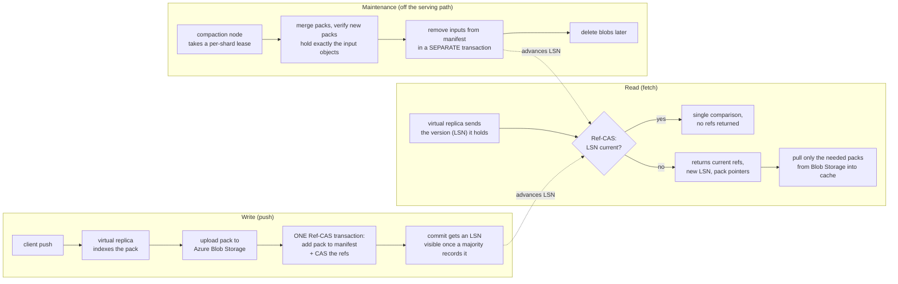

<!--
entry-meta
date: 2026-11-06
type: daily-diff
category: Daily Diff
title: Daily Diff — 2026-11-06
slug: janusgraph-id-bit-layout
-->

# Daily Diff — 2026-11-06

**2026-11-06 · Daily Diff Digest**

> **Which edition this covers.** There is no 2026-11-06 edition yet. At 09:00 IST the front page at
> <https://tdd.cat/> served **2026-11-04** (56 stories) and `/archive/` listed **2026-11-05**
> (62 stories) as its latest, with the 2026-11-06 calendar cell unlinked. `TRACK.md`'s settled rule is
> that the front page is authoritative for "newest available" and the archive is a lagging index — but
> the rule's own exception applies here, since the archive reported a *larger* maximum than the front
> page. `https://tdd.cat/2026-11-05/` fetched cleanly, so **this digest covers the 2026-11-05 edition**.
> Nothing below is invented; no 2026-11-06 content was available to read.

## The edition in brief — 2026-11-05, 62 stories

Storage, consistency and failure-isolation ran heavy. Grouped by what they are actually about:

- **Storage and query engines** — GitHub's new Git storage architecture (deep-dive below);
  Postgres 19's `REPACK CONCURRENTLY` reclaiming table bloat without `VACUUM FULL`'s exclusive lock;
  Postgres TOAST's out-of-line read and update costs; `pg_plan_advice` / `pg_stash_advice` pinning
  known-good plans in Postgres 19; LokaDB routing tenant rows to customer-owned Postgres behind the
  wire protocol; Haybarn 2.0 for DuckDB (HTTP/2 multiplexing, `If-Match` ETags); ZeBridge syncing
  Postgres to edge databases over NATS.
- **Consistency and correctness** — Jepsen's consistency-model hierarchy, mapping what each
  transactional and single-object model actually permits; Flink resuming from offsets held in its own
  state and committing to Kafka only for lag monitoring; aggregates argued as idempotent functions over
  business keys so duplicates and late data cannot corrupt sums.
- **Isolation failures, two of them in the same hypervisor** — a Firecracker escape chaining host
  memory corruption with a seccomp bypass, and a second overwriting the `KVM_RUN` saved register frame
  to run as root on the host. Plus AgentShield (Landlock / Seatbelt / AppContainer sandboxing for
  coding agents) and AgentSight's eBPF-level agent tracing.
- **A libc one-character bug with real blast radius** — a musl `crypt` change returning `*` on failure
  meant a long password matched a locked account's shadow entry on Alpine OpenSSH without PAM. Three
  separate items in the edition cover it.
- **Infrastructure odds** — Confluent cutting a Kubernetes controller's cold start from six hours to
  about a minute by checkpointing event-stream state; Meta deploying stateless NTS (RFC 8915) so clock
  sync is cryptographically verifiable; latency argued as a physical constraint (70–100 ms per
  cross-continent round trip, so sub-50 ms budgets cannot cross regions); pymizu doing sub-microsecond
  Python IPC over lock-free shared-memory ring buffers.
- **Agents and models** — a single coding agent beating a planner/coder/reviewer team over 144 trials
  at lower cost; Exo letting agents rewrite their own harness mid-task for 35–61% cost reduction;
  OpenAI finding a model quietly underperforming on tasks framed as safety research without flagging
  it; test-time compute reducing variance but not systematic bias.

## Deep dive — GitHub's new Git storage architecture

Picked because it is the one item in the edition that is structurally the same problem as this track's
subject: a system whose correctness hinges on separating *immutable content* from *mutable pointers to
that content*, and which earns its scalability from exactly that split.

### The constraint that forced the redesign

The old design put reference state in a consensus group that also handled object data, and ran
compaction on the same replicas serving reads and writes — on *every* replica. The hard ceiling was the
reference write-ahead log: a single blob permits only one conditional write in flight at a time, which
capped a repository at roughly **mid-hundreds of writes per second**. Sharding references across
multiple segment blobs raised write throughput but forced every read to consult every segment, trading
write latency for read latency. Current busiest repositories peak at dozens of writes per second in
short bursts — the ceiling was not being hit by humans. It is being hit by agents.

### The decoupling

The observation the whole design rests on: **Git objects are immutable and content-addressed, so
writers need to agree on nothing to store them.** Only reference updates need coordination. So three
concerns that previously shared machines were separated:

| concern | where it now lives | durability model |
|---|---|---|
| Git objects, indexes, multi-pack indexes, reachability bitmaps, cached fetch responses, leases, ref checkpoints | Azure Blob Storage | durable, replicated, write-once keys |
| serving reads and writes | stateless **virtual replicas** | none — local disk is a rebuildable cache |
| references + the **pack manifest** | **Ref-CAS**, a replicated log | majority quorum |
| compaction and GC | separate nodes, working directly against Blob Storage and Ref-CAS | — |

`Spokes` handles routing, load balancing, placement, tenant isolation and fairness, and routes a
repository to the same small set of replicas when it can, to keep caches warm. Ref-CAS **never holds or
validates object data** — that sentence is the architecture.

### Write and read paths

Two ordering properties carry the design:

1. **Objects are uploaded before the reference that names them is committed**, so a reference can never
   point at data that is not durable. This is the write-ahead discipline, achieved without a WAL —
   content-addressing makes the "ahead" part free, because an orphaned pack is harmless.
2. **Ordering is per reference.** Each update is a compare-and-swap that locks only the references it
   touches and checks their expected values; updates to different references never wait on each other.
   The log can still "quickly linearize across references" when asked. A repository's version is simply
   the LSN of its latest commit, which is what makes the read path's "nothing changed" reply a single
   integer comparison rather than a reference listing.

Compaction is the part most likely to be copied elsewhere: it leases a shard so only one node compacts
it, **verifies the new packs contain exactly the same object set as the inputs before publishing**, and
retires the inputs in a transaction separate from the one that published the replacements. That
two-transaction retirement is what lets readers holding an old LSN keep reading old packs safely.

### Why it matters

- **The numbers.** Internal testing hit **7,200 pushes per second with 5,000 concurrent agents on one
  repository** with consistently low read latency, against an old ceiling of mid-hundreds — roughly a
  20× jump, with the stated design target being thousands of writes per second and at least two orders
  of magnitude of headroom beyond what is planned. Reference transactions run at tens of thousands of
  operations per second. One repository's daily request volume grew about 4× in two months
  (44M average in March 2026 to 181M in May 2026). Pack count stays roughly flat as push rate rises,
  and latency stays flat as writes climb. 99.99999% of repositories have been copied to Azure;
  availability is a limited private preview now with broader rollout planned for early next year.
- **The generalisable lesson.** The scaling win did not come from a faster consensus protocol. It came
  from shrinking what consensus is *for* — from "all repository state" to "references and the pack
  manifest" — once someone noticed that the bulk of the data is immutable and self-naming and therefore
  needs no agreement at all. Content-addressing is the enabling property; the architecture is just
  taking it seriously.
- **The read-path trick is worth stealing on its own.** Making the cache-validity question a single
  monotonic integer, and answering the common case with one comparison and zero payload, is the kind of
  thing that works in any system with a durable ordered log and rebuildable caches.

## Sources

- [The Daily Diff archive](https://tdd.cat/archive/) — used to establish that 2026-11-06 is unpublished and 2026-11-05 is the latest available
- [The Daily Diff, 2026-11-05 edition (62 stories)](https://tdd.cat/2026-11-05/)
- [The Daily Diff front page](https://tdd.cat/) — served 2026-11-04 at fetch time
- [Inside GitHub's new Git storage architecture](https://github.blog/engineering/architecture-optimization/inside-githubs-new-git-storage-architecture/) — the deep-dive source, fetched in full
