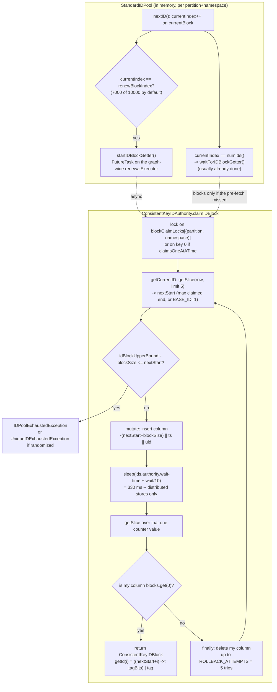
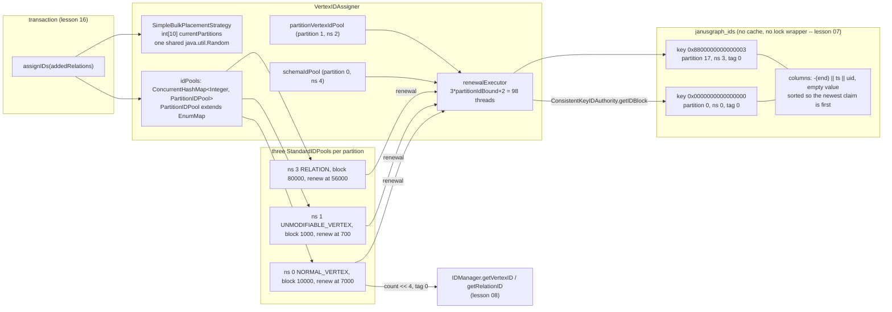

<!--
entry-meta
date: 2026-11-07
type: lesson
track: JanusGraph
lesson: 09
category: Database Internals
title: VertexIDAssigner and the ID authority - one claim per 10,000 vertices, and the four bits that discard fifteen sixteenths of the id space
slug: janusgraph-id-authority-block-allocation
-->

# `VertexIDAssigner` and the ID authority: one claim per 10,000 vertices, and the four bits that discard fifteen sixteenths of the id space

**2026-11-07 · JanusGraph Track · Lesson 09 of 28**

## Where This Fits

- **Lesson 08** ([`2026-11-06-janusgraph-id-bit-layout`](../2026-11-06-janusgraph-id-bit-layout/README.md)) established what an id *is*: `[0 | count | partition | 3-bit type suffix]`, with `getKey` rotating the partition to the top of the word to produce the edgestore row key. It took `count` and `partition` as given inputs and said nothing about where either comes from.
- **This lesson** supplies both. `partition` comes from an `IDPlacementStrategy` that picks one of ten integers at random; `count` comes from a per-partition in-memory counter that is refilled, a block at a time, by a write-wait-read consensus protocol over one row of the `janusgraph_ids` store that lesson 07 watched `Backend` open.
- **It closes lesson 08's one open arithmetic question** — why no assignable `count` is ever `0` — with a two-character answer: `BASE_ID = 1`.
- **It sets up lesson 10** (`EdgeSerializer.writeRelation`), which spends the relation ids this lesson mints, and **lesson 16** (`StandardJanusGraph.commit`), which is the only caller of `assignIDs`.

The headline finding is not about the protocol. It is that the production default throws away four of the sixty-three bits lesson 08 counted so carefully, and sets them to zero.

---

## 1. The problem, stated honestly

Every vertex, edge and property needs a 64-bit id before it can be written, and lesson 08 showed the id is not opaque: the `partition` field must be a real partition and the `count` field must be globally unique within `(partition, type)`. So JanusGraph needs a distributed counter, and it has no coordinator process and no consensus service — only a key-column-value store it has to assume is eventually consistent.

The design splits coordination from allocation along one axis: **how often it happens**.

| Layer | File | Runs | Cost |
|---|---|---|---|
| `VertexIDAssigner.assignID` | [`VertexIDAssigner.java:341-404`](https://github.com/JanusGraph/janusgraph/blob/a59ae8d8024207598eada34998d867617df51adf/janusgraph-core/src/main/java/org/janusgraph/graphdb/database/idassigner/VertexIDAssigner.java#L341-L404) | per element | a map lookup and a bit shift |
| `StandardIDPool.nextID` | [`StandardIDPool.java:216-234`](https://github.com/JanusGraph/janusgraph/blob/a59ae8d8024207598eada34998d867617df51adf/janusgraph-core/src/main/java/org/janusgraph/graphdb/database/idassigner/StandardIDPool.java#L216-L234) | per element | one `synchronized` block, one array index, one increment |
| `StandardIDPool.nextBlock` | [`StandardIDPool.java:185-215`](https://github.com/JanusGraph/janusgraph/blob/a59ae8d8024207598eada34998d867617df51adf/janusgraph-core/src/main/java/org/janusgraph/graphdb/database/idassigner/StandardIDPool.java#L185-L215) | per `blockSize` elements | a `Future.get` that is usually already done |
| `ConsistentKeyIDAuthority.claimIDBlock` | [`ConsistentKeyIDAuthority.java:283-422`](https://github.com/JanusGraph/janusgraph/blob/a59ae8d8024207598eada34998d867617df51adf/janusgraph-core/src/main/java/org/janusgraph/diskstorage/idmanagement/ConsistentKeyIDAuthority.java#L283-L422) | per `blockSize` elements, **off the hot path** | 3 storage round trips + a **330 ms** wall-clock wait |

At the defaults that is one 330 ms coordination event per **10,000** vertices and per **80,000** relations, and it happens on a background thread while the current block still has 30% of its ids left. The amortized coordination cost per element is therefore approximately zero, and the whole design exists to make that sentence true.

The `IDBlock` interface the authority returns is deliberately tiny — [`IDBlock.java:25-42`](https://github.com/JanusGraph/janusgraph/blob/a59ae8d8024207598eada34998d867617df51adf/janusgraph-core/src/main/java/org/janusgraph/diskstorage/IDBlock.java#L25-L42) is `numIds()` and `getId(long index)` and nothing else. It is *not* a range. That indirection is what lets the authority hand back a block whose ids are not consecutive, which §4 shows is what actually happens.

---

## 2. Five pools, three of them per partition

`PoolType` ([`VertexIDAssigner.java:454-497`](https://github.com/JanusGraph/janusgraph/blob/a59ae8d8024207598eada34998d867617df51adf/janusgraph-core/src/main/java/org/janusgraph/graphdb/database/idassigner/VertexIDAssigner.java#L454-L497)) is a private enum whose `getIDNamespace()` is literally `ordinal()` (`:458-460`). **The id namespace written into every row key of `janusgraph_ids` is an enum ordinal** — reorder the enum constants and every existing graph's id rows are reinterpreted.

| Namespace | `PoolType` | `hasOnePerPartition()` | Block size at `ids.block-size=10000` | Count bound at `pb=5` |
|---|---|---|---|---|
| 0 | `NORMAL_VERTEX` | yes | `baseBlockSize` = **10,000** | `vertexCountBound` = 2^55 |
| 1 | `UNMODIFIABLE_VERTEX` | yes | `max(10, base/10)` = **1,000** | 2^55 |
| 2 | `PARTITIONED_VERTEX` | **no** | `max(10, base/100)` = **100** | 2^55 |
| 3 | `RELATION` | yes | `base * 8` = **80,000** | `relationCountBound` = 2^58 |
| 4 | `SCHEMA` | **no** | **50**, a hard-coded literal | `SCHEMA_COUNT_BOUND` = 2^54 |

Block sizes come from `SimpleVertexIDBlockSizer.getBlockSize` ([`:429-446`](https://github.com/JanusGraph/janusgraph/blob/a59ae8d8024207598eada34998d867617df51adf/janusgraph-core/src/main/java/org/janusgraph/graphdb/database/idassigner/VertexIDAssigner.java#L429-L446)); bounds from `PoolType.getCountBound` ([`:462-472`](https://github.com/JanusGraph/janusgraph/blob/a59ae8d8024207598eada34998d867617df51adf/janusgraph-core/src/main/java/org/janusgraph/graphdb/database/idassigner/VertexIDAssigner.java#L462-L472)) via the lesson-08 bounds. Three observations worth keeping:

- **Relations get 8x the block size of vertices** because a graph has more edges than vertices. That is the only place in the codebase that encodes a guess about graph shape as a constant.
- **Schema gets 50 and no scaling at all.** `ids.block-size` does not move it. §4 shows this has a side effect its author probably did not intend.
- The two namespaces with `hasOnePerPartition() == false` get **one pool for the whole graph**, created in the constructor at [`:130-133`](https://github.com/JanusGraph/janusgraph/blob/a59ae8d8024207598eada34998d867617df51adf/janusgraph-core/src/main/java/org/janusgraph/graphdb/database/idassigner/VertexIDAssigner.java#L130-L133) with the fixed partitions `IDManager.SCHEMA_PARTITION = 0` and `PARTITIONED_VERTEX_PARTITION = 1`. Those two partition numbers are also perfectly ordinary partitions that the placement strategy can hand to normal vertices — the collision is avoided by the namespace byte in the row key, not by reserving the partition.

`PartitionIDPool` ([`:499-541`](https://github.com/JanusGraph/janusgraph/blob/a59ae8d8024207598eada34998d867617df51adf/janusgraph-core/src/main/java/org/janusgraph/graphdb/database/idassigner/VertexIDAssigner.java#L499-L541)) **extends `EnumMap<PoolType,IDPool>`** rather than holding one, so the pool container inherits `put`, `remove` and `clear` as public API, and `close()` at `:519-522` is implemented as `super.clear()`. It fills only the three `hasOnePerPartition()` types, which is where the thread-pool sizing at `:123` comes from:

```java
final int renewalThreads = config.has(IDS_RENEW_POOL_SIZE)
    ? config.get(IDS_RENEW_POOL_SIZE) : 3 * partitionIdBound + 2;
```

Three per partition, plus schema, plus partitioned vertices. At the production default `cluster.max-partitions = 32` that is **98** core threads with `allowCoreThreadTimeOut(true)` (`:124-127`). But `ids.num-partitions` defaults to **10** ([`SimpleBulkPlacementStrategy.java:52-54`](https://github.com/JanusGraph/janusgraph/blob/a59ae8d8024207598eada34998d867617df51adf/janusgraph-core/src/main/java/org/janusgraph/graphdb/database/idassigner/placement/SimpleBulkPlacementStrategy.java#L52-L54)), so at most **32** pools can be live at once (10 x 3 + 2). The provisioning is 3x the ceiling, and at `cluster.max-partitions = 65536` the formula asks for **196,610** threads while the live-pool ceiling is still 32:

| `cluster.max-partitions` | `partitionIdBound` | `renewalThreads` | live pools at `ids.num-partitions=10` |
|---|---|---|---|
| 1 | 1 | 5 | 5 |
| **32** (default) | 32 | **98** | **32** |
| 65536 | 65536 | **196,610** | 32 |

Core threads are created lazily on submission, so the 196,610 is a ceiling rather than an allocation — but it is a ceiling that no longer bears any relation to the thing it was derived from, because the derivation predates `ids.num-partitions` being the thing that limits live pools.

---

## 3. The hot path is a counter, and that is the entire point

`nextID()` ([`StandardIDPool.java:216-234`](https://github.com/JanusGraph/janusgraph/blob/a59ae8d8024207598eada34998d867617df51adf/janusgraph-core/src/main/java/org/janusgraph/graphdb/database/idassigner/StandardIDPool.java#L216-L234)) in full, shorn of logging:

```java
public synchronized long nextID() {
    if (currentIndex == currentBlock.numIds()) nextBlock();     // blocks only if the pre-fetch missed
    if (currentIndex == renewBlockIndex) startIDBlockGetter();  // fire the pre-fetch
    long returnId = currentBlock.getId(currentIndex);
    currentIndex++;
    if (returnId >= idUpperBound) throw new IDPoolExhaustedException(...);
    return returnId;
}
```

Three details:

- **The pool starts out exhausted, not empty.** `currentBlock` is initialised to `UNINITIALIZED_BLOCK` ([`:65-73`](https://github.com/JanusGraph/janusgraph/blob/a59ae8d8024207598eada34998d867617df51adf/janusgraph-core/src/main/java/org/janusgraph/graphdb/database/idassigner/StandardIDPool.java#L65-L73)), an anonymous `IDBlock` whose `numIds()` is `0` and whose `getId` throws `ArrayIndexOutOfBoundsException`. So the first `nextID()` satisfies `currentIndex == currentBlock.numIds()` by construction and falls into `nextBlock()`. No null check, no boolean flag.
- **Exhaustion is also a sentinel block.** `ID_POOL_EXHAUSTION` ([`:53-63`](https://github.com/JanusGraph/janusgraph/blob/a59ae8d8024207598eada34998d867617df51adf/janusgraph-core/src/main/java/org/janusgraph/graphdb/database/idassigner/StandardIDPool.java#L53-L63)) throws `UnsupportedOperationException` from both methods and exists purely to be compared by reference at `:195`. `IDBlockGetter.call` converts an `IDPoolExhaustedException` from the authority into this sentinel (`:314-316`) so that the exception crosses the `Future` boundary as a value rather than as an `ExecutionException`.
- **The upper-bound check runs after the increment.** `currentIndex++` happens before the `returnId >= idUpperBound` test, so the id that trips the bound is consumed and lost, and every subsequent call throws on the *next* id. Harmless, because the caller treats `IDPoolExhaustedException` as "this partition is finished" — but it means the pool is never left in a repeatable state.

The renewal is handed to an `Executor`, and the choice of executor is the one thing in this class that changed recently. `MoreExecutors.newSequentialExecutor(renewalExecutor)` ([`:139`](https://github.com/JanusGraph/janusgraph/blob/a59ae8d8024207598eada34998d867617df51adf/janusgraph-core/src/main/java/org/janusgraph/graphdb/database/idassigner/StandardIDPool.java#L139)) wraps the graph-wide pool so that **this pool's** renewals run one after another while **different pools** renew concurrently. The alternative branch builds a `ThreadPoolExecutor(1, 1, ...)` of the pool's own, named `JanusGraphID(partition)(namespace)[n]` (`:131-137`) — which is the thread name to grep for in a stack dump.

`close()` ([`:236-258`](https://github.com/JanusGraph/janusgraph/blob/a59ae8d8024207598eada34998d867617df51adf/janusgraph-core/src/main/java/org/janusgraph/graphdb/database/idassigner/StandardIDPool.java#L236-L258)) and the `closeBlockers` queue exist for one specific case: a renewal that timed out on a backend that does not support interruption. `waitForIDBlockGetter` can neither cancel it (an interrupt can break a storage backend's I/O — `VertexIDAssigner.close`'s comment at [`:174-178`](https://github.com/JanusGraph/janusgraph/blob/a59ae8d8024207598eada34998d867617df51adf/janusgraph-core/src/main/java/org/janusgraph/graphdb/database/idassigner/VertexIDAssigner.java#L174-L178) names BerkeleyJE's whole `Environment` as the casualty) nor abandon it, so it parks the `Future` in a 4-element `ArrayDeque` and `close()` waits on each. The queue is swept one element per append (`:165-171`), so it is bounded by the number of *concurrently outstanding* runaway renewals, not by the total.

---

## 4. The renewal trigger, and the two namespaces that double-buffer from id zero

`nextBlock()` computes when to pre-fetch, at [`:213`](https://github.com/JanusGraph/janusgraph/blob/a59ae8d8024207598eada34998d867617df51adf/janusgraph-core/src/main/java/org/janusgraph/graphdb/database/idassigner/StandardIDPool.java#L213):

```java
renewBlockIndex = Math.max(0,
    currentBlock.numIds() - Math.max(RENEW_ID_COUNT, Math.round(currentBlock.numIds() * renewBufferPercentage)));
```

`RENEW_ID_COUNT` is a hard-coded **100** (`:76`); `renewBufferPercentage` is `ids.renew-percentage`, default **0.3**. So the trigger is "whichever is larger: 30% of the block, or 100 ids". Worked out per namespace at the defaults:

| Namespace | `blockSize` | `max(100, 30%)` | `renewBlockIndex` | ids of runway after the pre-fetch fires |
|---|---|---|---|---|
| `NORMAL_VERTEX` | 10,000 | 3,000 | **7,000** | 3,000 |
| `UNMODIFIABLE_VERTEX` | 1,000 | 300 | **700** | 300 |
| `PARTITIONED_VERTEX` | 100 | **100** | **0** | 100 |
| `RELATION` | 80,000 | 24,000 | **56,000** | 24,000 |
| `SCHEMA` | 50 | **100** | **0** (clamped from -50) | 50 |

**The two smallest-block namespaces renew on the first id of every block.** For `SCHEMA` the clamp at `Math.max(0, ...)` is doing real work: `50 - 100 = -50`. Because the check in `nextID` is `currentIndex == renewBlockIndex` and `nextBlock()` sets `currentIndex = 0` immediately before returning, the very next statement fires `startIDBlockGetter()`. So the schema pool and the partitioned-vertex pool **permanently hold one spare block in flight** and are never observed waiting on the authority after their first claim — a double-buffering that falls out of `RENEW_ID_COUNT` exceeding `blockSize`, not out of any decision.

The assertion at `:215`, `renewBlockIndex < currentBlock.numIds() && renewBlockIndex >= currentIndex`, holds for all five (`0 < 50`, `0 >= 0`).

The operational number this gives you: with 3,000 ids of runway and a 330 ms claim on a distributed backend, **one vertex pool sustains about 9,090 vertices/second before a commit stalls on `nextBlock()`**. Ten partitions in use, so about 90,000 vertices/second per instance, and that is the quantitative content of the `ids.block-size` documentation's "setting this too low will make commits frequently block on slow reservation requests" ([`GraphDatabaseConfiguration.java:1044-1048`](https://github.com/JanusGraph/janusgraph/blob/a59ae8d8024207598eada34998d867617df51adf/janusgraph-core/src/main/java/org/janusgraph/graphdb/configuration/GraphDatabaseConfiguration.java#L1044-L1048)) and of [`docs/operations/bulk-loading.md:78-91`](https://github.com/JanusGraph/janusgraph/blob/a59ae8d8024207598eada34998d867617df51adf/docs/operations/bulk-loading.md#L78-L91)'s rule of thumb ("set `ids.block-size` to the number of vertices you expect to add per JanusGraph instance per hour").

---

## 5. Where a claim lands: the `janusgraph_ids` row key

`getPartitionKey` ([`ConsistentKeyIDAuthority.java:252-261`](https://github.com/JanusGraph/janusgraph/blob/a59ae8d8024207598eada34998d867617df51adf/janusgraph-core/src/main/java/org/janusgraph/diskstorage/idmanagement/ConsistentKeyIDAuthority.java#L252-L261)) builds an 8-byte key from two big-endian ints:

```java
components[0] = (partitionBitWidth > 0 ? (partition << (Integer.SIZE - partitionBitWidth)) : 0) + uniqueId;
components[1] = idNamespace;
```

**This is lesson 08's row-key rotation again, one word narrower.** The partition is shifted hard against the top of the first int exactly as `IDManager.getKey` shifts it against the top of the 64-bit row key, and for exactly the same reason: so that two partitions land in different regions of a distributed store's key space instead of being neighbours. The conflict-avoidance tag occupies the *low* bits of the same int. The two never overlap because `partitionBitWidth <= 16` is asserted at `:172` and `uniqueIdBitWidth <= 16` at `:175`, and `32 - 16 = 16`. The constraint is exactly tight.

Keys verified by reconstructing the two `putInt` calls under OpenJDK 21 at `pb=5`:

| partition | namespace | tag | row key |
|---|---|---|---|
| 0 | 0 (`NORMAL_VERTEX`) | 0 | `0x0000000000000000` |
| 17 | 0 (`NORMAL_VERTEX`) | 0 | `0x8800000000000000` |
| 17 | 3 (`RELATION`) | 0 | `0x8800000000000003` |
| 0 | 4 (`SCHEMA`) | 0 | `0x0000000000000004` |
| 1 | 2 (`PARTITIONED_VERTEX`) | 0 | `0x0800000000000002` |
| 17 | 0 | **9** | `0x8800000900000000` |

Note that `AbstractIDAuthority` carries its own `getPartitionKey(int)` at [`AbstractIDAuthority.java:99-101`](https://github.com/JanusGraph/janusgraph/blob/a59ae8d8024207598eada34998d867617df51adf/janusgraph-core/src/main/java/org/janusgraph/diskstorage/idmanagement/AbstractIDAuthority.java#L99-L101) which produces a 4-byte key from the partition alone. `ConsistentKeyIDAuthority` does not call it and does not override it — it declares a three-argument private method of the same name instead. The inherited one has no caller in the tree.

Within a row, the column layout is documented in a comment at [`:83-92`](https://github.com/JanusGraph/janusgraph/blob/a59ae8d8024207598eada34998d867617df51adf/janusgraph-core/src/main/java/org/janusgraph/diskstorage/idmanagement/ConsistentKeyIDAuthority.java#L83-L92) and built by `getBlockApplication` at `:432-441`:

```
| 8 bytes: -(block end counter) | 8 bytes: timestamp | var bytes: instance uid |
```

with an **empty value**. `StaticArrayEntry.of(finalTarget)` at `:333` writes the column as the entire payload. Lesson 02's `Entry` is a column plus a value; the ids store uses only the column, which is why `Backend` can give it a fixed key length of 8 and no cache.

### The negated counter is the whole index

The counter is stored as `-blockValue`. That is not an encoding quirk; it is the sort order:

| claim | bytes |
|---|---|
| `nextEnd = 10001`, ts `1762000000000`, uid `A` | `ffffffffffffd8ef` `0000019a3f625400` `41` |
| `nextEnd = 20001`, ts `1762000000001`, uid `B` | `ffffffffffffb1df` `0000019a3f625401` `42` |

`b1df < d8ef`, so **the larger counter sorts earlier**. Columns come back from `getSlice` in ascending byte order, so `blocks.get(0)` is always the highest-numbered claim. That is what makes `getCurrentID` ([`:227-241`](https://github.com/JanusGraph/janusgraph/blob/a59ae8d8024207598eada34998d867617df51adf/janusgraph-core/src/main/java/org/janusgraph/diskstorage/idmanagement/ConsistentKeyIDAuthority.java#L227-L241)) correct with `setLimit(5)`: it reads the five *newest* claims, not an arbitrary five, so the `max` loop over them is defensive rather than load-bearing. The row can hold thousands of historical claims and a claim costs one slice of five columns regardless.

Within one counter value the order is timestamp, then uid — and both are ascending — so **the earliest writer at a given counter is `blocks.get(0)`**, and that is the seniority rule the protocol decides by. `getBlockSlice(nextEnd)` at `:425-430` restricts the read to a single counter value by fixing the first 8 bytes and spanning the rest with `putLong(0)` and `putLong(-1)`.

---

## 6. The claim protocol



The three things that make this safe over an eventually consistent store:

1. **The write is unconditional and the decision is a later read.** There is no compare-and-set anywhere. Two instances can both write a claim for `[10001, 20001)`; both then read the row back and exactly one sees its own column first.
2. **The wait is a liveness assumption made explicit.** `sleepAndConvertInterrupts(idApplicationWaitMS.plus(waitGracePeriod))` at `:353` sleeps `ids.authority.wait-time` (300 ms) plus `waitGracePeriod = idApplicationWaitMS.dividedBy(10)` (`:165`) = **330 ms**, on the assumption that any competing claim written before mine is visible by then. The companion check at `:340-341` enforces the other half: if *my own* write took longer than 300 ms, the claim is abandoned with a `TemporaryBackendException` rather than trusted, because a write slower than the wait means someone else's write might not be visible yet.
3. **A lost claim is deleted, and a failed deletion only burns ids.** The `finally` at `:383-409` retries the delete five times with a 200 ms `rollbackWaitTime`. If all five fail, or the process dies between the write and the delete, the orphan column stays and permanently inflates `getCurrentID` for that row. **The failure mode is wasted ids, never reused ids** — which is the only property that matters, and it is why the protocol can afford to be this casual about cleanup.

Both branches are skipped entirely when `manager.getFeatures().isDistributed()` is false (`:338`, `:352`). On BerkeleyJE there is no wait and no slow-write check: the store's own locking is the serialisation. And that is also why `claimsOneAtATime` at `:169` collapses the lock map to a single key:

```java
claimsOneAtATime = manager.getFeatures().hasLocking() && !manager.getFeatures().isDistributed();
```

Lesson 07 noted that `hasLocking()` means two different things depending on who asks. Here it means the third thing: *the store serialises for me, so I must not let my own claims interleave.* The javadoc at [`:118-133`](https://github.com/JanusGraph/janusgraph/blob/a59ae8d8024207598eada34998d867617df51adf/janusgraph-core/src/main/java/org/janusgraph/diskstorage/idmanagement/ConsistentKeyIDAuthority.java#L118-L133) gives the concrete reason: a BerkeleyJE transaction holds read locks until commit, the rows of different partitions and namespaces are neighbours in the ids store, and a read of a row with fewer than five claims (as on a new graph) walks into the next row's newest claim and waits on its commit.

`ClaimLock` ([`:143-157`](https://github.com/JanusGraph/janusgraph/blob/a59ae8d8024207598eada34998d867617df51adf/janusgraph-core/src/main/java/org/janusgraph/diskstorage/idmanagement/ConsistentKeyIDAuthority.java#L143-L157)) is a reference-counted monitor whose count is mutated only inside `ConcurrentHashMap.compute` (`:273` and `:279`), so the increment, the decrement and the removal are all serialised per key by the map itself — no `AtomicInteger`, no explicit lock, and no window in which a lock is removed while a waiter holds a reference to it. The map therefore holds exactly as many locks as there are claims in flight.

The payoff is measured in the project's own changelog ([`docs/changelog.md:2041-2058`](https://github.com/JanusGraph/janusgraph/blob/a59ae8d8024207598eada34998d867617df51adf/docs/changelog.md#L2041-L2058)): on Cassandra, 32 claims across 32 partitions take **0.35 s instead of 11.2 s**, and ten threads writing 100 vertices each on a fresh graph take **1.4 s instead of 7.0 s**. The same note records that a *single* thread's first transaction still takes **6-7 s** — its claims are genuinely sequential, and at 330 ms each that is about twenty of them.

---

## 7. THE finding: four bits, fixed at creation, set to zero

`ConsistentKeyIDBlock.getId` ([`:486-491`](https://github.com/JanusGraph/janusgraph/blob/a59ae8d8024207598eada34998d867617df51adf/janusgraph-core/src/main/java/org/janusgraph/diskstorage/idmanagement/ConsistentKeyIDAuthority.java#L486-L491)) is where the block stops being a range:

```java
public long getId(long index) {
    if (index < 0 || index >= numIds) throw new ArrayIndexOutOfBoundsException((int) index);
    return ((startIDCount + index) << uniqueIDBitWidth) + uniqueID;
}
```

The conflict-avoidance tag lives in the **low bits of the count**. Now the defaults, from [`GraphDatabaseConfiguration.java:1108-1174`](https://github.com/JanusGraph/janusgraph/blob/a59ae8d8024207598eada34998d867617df51adf/janusgraph-core/src/main/java/org/janusgraph/graphdb/configuration/GraphDatabaseConfiguration.java#L1108-L1174) and confirmed in the generated reference at [`docs/configs/janusgraph-cfg.md:102-113`](https://github.com/JanusGraph/janusgraph/blob/a59ae8d8024207598eada34998d867617df51adf/docs/configs/janusgraph-cfg.md#L102-L113):

| Option | Default | Mutability |
|---|---|---|
| `ids.authority.conflict-avoidance-mode` | `NONE` | `GLOBAL_OFFLINE` |
| `ids.authority.conflict-avoidance-tag` | `0` | `LOCAL` |
| **`ids.authority.conflict-avoidance-tag-bits`** | **4** | **`FIXED`** |
| `ids.authority.randomized-conflict-avoidance-retries` | 5 | `MASKABLE` |
| `ids.authority.wait-time` | 300 ms | `GLOBAL_OFFLINE` |

So on every default graph: `uniqueIdBitWidth = 4`, mode `NONE` means `randomizeUniqueId = false` (`:191`) and `uniqueId = 0` (`:200`). **`getId` therefore returns `count << 4` with a zero tag — every count JanusGraph ever assigns is a multiple of 16.** Verified against the real bit layout from lesson 08 (`NormalVertex.offset() = 3`, `suffix() = 0`, `pb = 5`):

| block index | `count` returned | `NormalVertex` id, partition 0 | partition 17 |
|---|---|---|---|
| 0 | **16** | **4096** | 4232 |
| 1 | 32 | 8192 | 8328 |
| 2 | 48 | 12288 | 12424 |
| 3 | 64 | 16384 | 16520 |

**The lowest user vertex id in a fresh default JanusGraph is 4096.** With `conflict-avoidance-tag-bits = 0` it would be 256. The stride between consecutive vertices in one partition is 128, not 8.

And the ceiling moves with it. `claimIDBlock` computes the usable counter space at [`:287-290`](https://github.com/JanusGraph/janusgraph/blob/a59ae8d8024207598eada34998d867617df51adf/janusgraph-core/src/main/java/org/janusgraph/diskstorage/idmanagement/ConsistentKeyIDAuthority.java#L287-L290):

```java
final int maxAvailableBits = (VariableLong.unsignedBitLength(idUpperBound) - 1) - uniqueIdBitWidth;
final long idBlockUpperBound = (1L << maxAvailableBits);
```

`unsignedBitLength` is `64 - numberOfLeadingZeros` ([`VariableLong.java:85-87`](https://github.com/JanusGraph/janusgraph/blob/a59ae8d8024207598eada34998d867617df51adf/janusgraph-core/src/main/java/org/janusgraph/graphdb/database/idhandling/VariableLong.java#L85-L87)), so for a bound of 2^55 it is 56, and the four tag bits come straight off the top:

| Namespace | `idUpperBound` (pb=5) | `idBlockUpperBound` at tag-bits **4** | at tag-bits 0 | blocks available at default sizes |
|---|---|---|---|---|
| `NORMAL_VERTEX` | 2^55 | **2^51** | 2^54 | 225,179,981,368 |
| `UNMODIFIABLE_VERTEX` | 2^55 | 2^51 | 2^54 | 2,251,799,813,685 |
| `PARTITIONED_VERTEX` | 2^55 | 2^51 | 2^54 | 22,517,998,136,852 |
| `RELATION` | 2^58 | **2^54** | 2^57 | 225,179,981,368 |
| `SCHEMA` | 2^54 | **2^50** | 2^53 | 22,517,998,136,852 |

**Fifteen sixteenths of the count space in every namespace is unreachable, on every graph, by default.** 2^51 vertices per partition is still 2.25 x 10^15, so nobody will hit it — but lesson 08 spent a whole section on how each partition bit is paid for one-for-one out of the vertex-count ceiling, and this is four more bits spent on a field whose default value is zero and whose default mode does not use it. The option is `FIXED`, so it cannot be changed after graph creation.

The three modes ([`ConflictAvoidanceMode.java:23-75`](https://github.com/JanusGraph/janusgraph/blob/a59ae8d8024207598eada34998d867617df51adf/janusgraph-core/src/main/java/org/janusgraph/diskstorage/idmanagement/ConflictAvoidanceMode.java#L23-L75)) are what the bits are for, and they differ in *which row* a claim goes to:

- **`NONE`** — tag 0, one row per `(partition, namespace)`. Every instance contends on the same rows. Correct, slower under contention.
- **`GLOBAL_MANUAL` / `LOCAL_MANUAL`** — you assign each instance a distinct tag, so each instance gets **its own row** and never contends at all. `LOCAL_MANUAL` additionally drops to `getLocalKeyConsistentTxConfig()` (`:196`), i.e. datacenter-local quorum, and the javadoc's warning at `:45-49` is blunt: duplicate tags in this mode mean **silent graph corruption**, because local quorum cannot detect the conflict.
- **`GLOBAL_AUTO`** — a fresh `ThreadLocalRandom.nextInt(uniqueIDUpperBound)` per attempt (`:243-250`), with `IDAUTHORITY_CAV_RETRIES` (5) attempts before `IDPoolExhaustedException`. Duplicate tags are safe here because the write-wait-read protocol still runs at global quorum.

Two honest consequences of the tag being only 4 bits wide:

- In `GLOBAL_AUTO` there are **16 tags**. With four instances drawing randomly, two collide with probability 1 - (15/16)(14/16)(13/16) = **33.5%**; with eight, 93%. The mode is safe anyway, because collision falls back to the ordinary protocol — but the contention it is supposed to avoid is mostly not avoided at 4 bits.
- `exhaustedUniquePIDs` (`:292`, `:308`) records *attempts*, not distinct tags, and `getUniquePartitionID` samples with replacement. So the 5 retries may re-draw the same exhausted tag, and the `"Exhausted %d uniqueid(s): %s"` message at `:310-312` can list the same value more than once.

---

## 8. Partition selection, and `BASE_ID = 1`

`assignID(InternalElement, VertexIDType)` ([`VertexIDAssigner.java:193-272`](https://github.com/JanusGraph/janusgraph/blob/a59ae8d8024207598eada34998d867617df51adf/janusgraph-core/src/main/java/org/janusgraph/graphdb/database/idassigner/VertexIDAssigner.java#L193-L272)) picks the partition before it picks the count, and the rule depends on what is being assigned:

| Element | Partition |
|---|---|
| `JanusGraphSchemaVertex` | `IDManager.SCHEMA_PARTITION` = 0 |
| `PartitionedVertex` | `IDManager.PARTITIONED_VERTEX_PARTITION` = 1 |
| any other vertex | `placementStrategy.getPartition(element)` |
| relation, attempt `< getLen()` | the partition of incident vertex `attempt` (`:206-219`) |
| relation, later attempts | `placementStrategy.getPartition(element)` |
| relation on a custom **string** vertex id | `Math.abs(incident.id().hashCode() % partitionIdBound)` (`:218`) |

The retry loop runs up to `MAX_PARTITION_RENEW_ATTEMPTS = 1000` (`:75`) and `continue`s on `IDPoolExhaustedException` (`:226-228`) — "try a different partition" is the recovery for an exhausted pool, which is why exhaustion has to be a distinguishable exception type.

**Relations are co-located with an endpoint.** That is the single most consequential line in the method: an edge gets the partition of one of its endpoints, so the two edgestore rows the edge is written to (lesson 01: every edge stored twice) are at least sometimes in the same partition. The block at `:231-268` then re-homes relations incident to partitioned vertices — properties always to the canonical representative, edges to the non-partitioned endpoint, and if both ends are partitioned, to `idManager.getPartitionHashForId(relation.longId())`, which lesson 08 showed is the identity for counts below `2^partitionBits`.

`SimpleBulkPlacementStrategy` is where the ten partitions come from. `currentPartitions` is an `int[ids.num-partitions]` filled once by `setLocalPartitionBounds` ([`:112-119`](https://github.com/JanusGraph/janusgraph/blob/a59ae8d8024207598eada34998d867617df51adf/janusgraph-core/src/main/java/org/janusgraph/graphdb/database/idassigner/placement/SimpleBulkPlacementStrategy.java#L112-L119)) and changed only when a partition is reported exhausted (`:125-133`). Three things about it:

- **The class javadoc is wrong about the per-element path.** It says the strategy "assigns all vertices created in a transaction to the same partition id" (`:37-45`). That is true of `getPartitions(Map)` at `:100-105`, which draws one partition for the whole map — the path `assignIDs` takes when `supportsBulkPlacement()`. It is false of `getPartition(element)` at `:95-97`, which calls `nextPartitionID()` and re-rolls on **every call**, and that is the path every relation and every partitioned vertex takes.
- **`getPartition` ignores its argument entirely.** The "placement strategy" does not look at the element. `PropertyPlacementStrategy` does, and is the only other implementation in the tree — and it is not in `REGISTERED_PLACEMENT_STRATEGIES` (`:80`, which maps exactly one name, `"simple"`), so it can only be selected by full class name.
- **One shared `java.util.Random`** at `:58`, used by every placement decision on every thread. `Random` is thread-safe via a CAS on its seed, so under concurrent loading all vertex placement funnels through one contended `AtomicLong` — while the authority two layers down already uses `ThreadLocalRandom` for exactly the same kind of draw. `currentPartitions` is also a plain non-volatile `int[]` written by `updateElement` from any thread and read unsynchronised by `nextPartitionID`; a stale read is harmless (it is still a valid partition), but the race is there and `exhaustedPartitions` right beside it was deliberately made a concurrent set.

Finally, **lesson 08's open question, closed.** Lesson 08 proved `EDGESTORE_MIN_KEY` is unreachable because it needs `count == 0`, which `VertexIDType.addPadding` forbids — but did not show that no `count == 0` is ever offered. Here it is: `getCurrentID` starts from `BASE_ID` ([`AbstractIDAuthority.java:40-45`](https://github.com/JanusGraph/janusgraph/blob/a59ae8d8024207598eada34998d867617df51adf/janusgraph-core/src/main/java/org/janusgraph/diskstorage/idmanagement/AbstractIDAuthority.java#L40-L45)), which is **1**, carrying the comment *"This value can't be changed without either corrupting existing ID allocations or taking some additional action to prevent such corruption."* The first block is `[1, 1+blockSize)`, `getId(0)` is `1 << tagBits`, and `IDAuthorityTest.checkBlock` asserts `id > 0` on every id of every block ([`IDAuthorityTest.java:197-214`](https://github.com/JanusGraph/janusgraph/blob/a59ae8d8024207598eada34998d867617df51adf/janusgraph-backend-testutils/src/main/java/org/janusgraph/diskstorage/IDAuthorityTest.java#L197-L214)). Count 0 is not reachable from the authority at all, and `IDManager`'s `Preconditions` were never the thing protecting it.

---

## 9. Four smaller findings, all verified at the pinned commit

**(a) The timeout in the give-up message is always printed as 0.** [`:420-421`](https://github.com/JanusGraph/janusgraph/blob/a59ae8d8024207598eada34998d867617df51adf/janusgraph-core/src/main/java/org/janusgraph/diskstorage/idmanagement/ConsistentKeyIDAuthority.java#L420-L421):

```java
throw new TemporaryLockingException(String.format(
    "Reached timeout %d (%s elapsed) when attempting to allocate id block on partition(%d)-namespace(%d)",
    timeout.getNano(), methodTime, partition, idNamespace));
```

`Duration.getNano()` is the nanosecond-of-second component, not the total. The timeout reaching this method is `ids.renew-timeout`, default `Duration.ofMillis(120000)`. Measured under OpenJDK 21:

| `timeout` | `getNano()` | `toMillis()` |
|---|---|---|
| `PT2M` (the 120 s default) | **0** | 120000 |
| `PT2S` | **0** | 2000 |
| `PT0.3S` | 300000000 | 300 |
| `PT1.5S` | 500000000 | 1500 |

So the one log line emitted when ID allocation finally gives up — the line that fails the whole database, per the `IDS_RENEW_TIMEOUT` javadoc at [`GraphDatabaseConfiguration.java:1069-1076`](https://github.com/JanusGraph/janusgraph/blob/a59ae8d8024207598eada34998d867617df51adf/janusgraph-core/src/main/java/org/janusgraph/graphdb/configuration/GraphDatabaseConfiguration.java#L1069-L1076) — reads *"Reached timeout 0"* on any whole-second configuration, including every default deployment. One-token fix.

**(b) The rollback's "normal consistency level" is the same consistency level.** The `finally` block builds an anonymous `TransactionalProvider` at `:392-399` with the comment *"Use normal consistency level for these non-critical delete operations"*. Its `openTx()` body is `manager.beginTransaction(storeTxConfigBuilder.build())` — character for character what `ConsistentKeyIDAuthority.openTx()` does at `:223-225`. `storeTxConfigBuilder` had the key-consistent custom options baked in at construction (`:189`, `:196`, `:198`) and is never re-derived. The anonymous class differs from `this` only in that `close()` is a no-op instead of closing `idStore`, which `BackendOperation.execute` never calls. The comment describes an intent the code does not implement.

**(c) Two contiguity assertions in `IDAuthorityTest` are dead in every parameterization.** `checkBlock` guards its "the block is one contiguous run" assertion on `hasEmptyUid` ([`:207-209`](https://github.com/JanusGraph/janusgraph/blob/a59ae8d8024207598eada34998d867617df51adf/janusgraph-backend-testutils/src/main/java/org/janusgraph/diskstorage/IDAuthorityTest.java#L207-L209)), and `testSimpleIDAcquisition` guards its across-block version on the same flag (`:247-251`, making `previous` write-only). `hasEmptyUid` is `uidBitWidth == 0` (`:137`), and `configs()` at `:84-103` produces exactly three configurations with tag-bits **4** (the default), **9** and **7**. **None of the three has tag-bits 0**, so neither assertion has ever executed. Nothing in the suite checks that a block's ids are evenly spaced or that consecutive blocks abut — the two properties `getId`'s shift is responsible for.

**(d) A volatile timestamp written on the hottest path, for a getter with no callers.** `assignID` calls `partitionPool.accessed()` after every successful `nextID` ([`:378`](https://github.com/JanusGraph/janusgraph/blob/a59ae8d8024207598eada34998d867617df51adf/janusgraph-core/src/main/java/org/janusgraph/graphdb/database/idassigner/VertexIDAssigner.java#L378)), which is `lastAccess = System.currentTimeMillis()` on a `volatile long` (`:501`, `:533-535`). The only reader is `getLastAccess()` at `:537-539`, and a search of the whole source tree for `getLastAccess` returns that declaration and nothing else. Measured cost of the statement on OpenJDK 21 in this container, 50M iterations after warmup: **33.0 ns/op** against 0.30 ns for the empty loop. Per element id. A 10M-vertex load with three relations each pays roughly 1.3 seconds for a field nothing reads.

A fifth that is real but practically unreachable, stated for completeness: `PartitionIDPool.getPool` guards on `!exhausted` with `Preconditions.checkArgument` (`:514-517`), so it throws `IllegalArgumentException`. `assignID` checks `partitionPool.isExhausted()` at `:365` and calls `getPool` at `:371`/`:374`; a thread that passes the first check while another thread runs `exhaustedIdPool()` (`:524-527`, which sets the flag *and* `clear()`s the map) gets an `IllegalArgumentException` out of a `try` whose only `catch` is for `IDPoolExhaustedException` (`:226`), so it escapes the thousand-attempt retry loop to the user. Reaching it requires actually exhausting a partition's 2^51 counts, so this is a wrong exception type rather than a bug anyone will hit.

---

## 10. The whole path, as one picture



---

## Hands-On

Everything here runs against the in-memory and BerkeleyJE backends from lessons 04-07; no container needed.

### 1. Watch a single pool renew, and confirm the 7,000 trigger

`IDPoolTest` ([`janusgraph-test/src/test/java/org/janusgraph/graphdb/idmanagement/IDPoolTest.java`](https://github.com/JanusGraph/janusgraph/blob/a59ae8d8024207598eada34998d867617df51adf/janusgraph-test/src/test/java/org/janusgraph/graphdb/idmanagement/IDPoolTest.java)) drives `StandardIDPool` against a `MockIDAuthority`, so the renewal arithmetic is observable without a store:

```bash
mvn -pl janusgraph-test -am -DskipTests install -q
mvn -pl janusgraph-test -Dtest=IDPoolTest test
```

Turn the pool's own logging on and the trigger becomes explicit — `StandardIDPool` logs `"Starting id block renewal upon {}"` with `currentIndex` at [`:265`](https://github.com/JanusGraph/janusgraph/blob/a59ae8d8024207598eada34998d867617df51adf/janusgraph-core/src/main/java/org/janusgraph/graphdb/database/idassigner/StandardIDPool.java#L265) and `"ID partition({})-namespace({}) acquired block: [{}]"` at `:203`:

```bash
mvn -pl janusgraph-test -Dtest=IDPoolTest#aPoolOnASharedExecutorRenewsOneBlockAtATime test \
  -Dorg.slf4j.simpleLogger.log.org.janusgraph.graphdb.database.idassigner.StandardIDPool=debug
```

**What to look for.** The `acquired block: [...]` lines print `ConsistentKeyIDBlock.toString` (`:493-498`), whose format is `[start,end)` and, *only when tag-bits is non-zero*, `/tag:width`. That suffix is the fastest way to see whether a deployment is spending the four bits. Then check that the renewal line's index is `numIds - max(100, round(numIds * 0.3))` for the block size the test's sizer returns — and run `IDPoolTest#testStandardIDPoolsSharingARenewalExecutor` and `closingAPoolOnASharedExecutorWaitsForARenewalItGaveUpOn` to see the `closeBlockers` path from §3 exercised deliberately.

### 2. Read the claim columns out of a real ids store

`InMemoryIDAuthorityTest` ([`janusgraph-inmemory/src/test/java/org/janusgraph/diskstorage/inmemory/InMemoryIDAuthorityTest.java`](https://github.com/JanusGraph/janusgraph/blob/a59ae8d8024207598eada34998d867617df51adf/janusgraph-inmemory/src/test/java/org/janusgraph/diskstorage/inmemory/InMemoryIDAuthorityTest.java)) is 8 `ConsistentKeyIDAuthority` instances over one store (`CONCURRENCY = 8`, `:79`), each with a distinct `UNIQUE_INSTANCE_ID_SUFFIX` (`:155`):

```bash
mvn -pl janusgraph-inmemory -am -DskipTests install -q
mvn -pl janusgraph-inmemory -Dtest=InMemoryIDAuthorityTest test
```

**What to look for.** `testMultiIDAcquisition` (`:367`) and `testManyThreadsOneIDAuthority` (`:316`) are the contention tests; `getBasicConfig` sets `IDAUTHORITY_WAIT` to 100 ms and `IDS_BLOCK_SIZE` to 400 (`:112-117`). The in-memory backend is not distributed, so `:338` and `:352` are both false and the 330 ms wait never runs — **every in-memory id test passes with the coordination latency removed**, which is lesson 06's `IDAUTHORITY_WAIT = Duration.ZERO` observation generalised: it is not the config that removes the wait, it is `isDistributed()`.

Then add a temporary dump of the raw columns after a claim — a `getSlice(new KeySliceQuery(partitionKey, BufferUtil.zeroBuffer(1), BufferUtil.oneBuffer(17)), txh)` printed as hex — and check the three facts from §5 against real bytes: the first 8 bytes are the two's complement of the block end; the newest claim is `blocks.get(0)`; the value is empty. Do not commit the dump.

### 3. Prove the four tag bits are being spent, in `jshell`

No JanusGraph build needed. This reproduces `getId`, `constructId` and `addPadding` from their sources:

```java
jshell> int pb = 5, tagBits = 4, tag = 0;
jshell> long getId(long start, long i, int tb, int t) { return ((start + i) << tb) + t; }
jshell> long normalVertexId(long count, long partition, int pb) { return (((count << pb) + partition) << 3); }
jshell> normalVertexId(getId(1, 0, tagBits, tag), 0, pb)   // first vertex, partition 0
$1 ==> 4096
jshell> normalVertexId(getId(1, 0, 0, 0), 0, pb)           // what tag-bits 0 would give
$2 ==> 256
jshell> getId(1, 1, tagBits, tag) - getId(1, 0, tagBits, tag)   // count stride
$3 ==> 16
jshell> 64 - Long.numberOfLeadingZeros(1L << 55) - 1 - tagBits  // maxAvailableBits, NORMAL_VERTEX
$4 ==> 51
```

**What to look for.** `$4 == 51` against a `vertexCountBound` of 2^55 is the finding: 2^51 reachable counts out of 2^55. Then confirm it from the other direction on a real graph — open any default-configured graph, add one vertex, and read `g.V().next().id()`. It will not be 256, 8 or 1; at `partition = p` it is `4096 + 8p`, and dividing by 16 after undoing the type padding and the partition field recovers the count the authority actually handed out.

### 4. Count the renewal threads

```bash
jcmd <pid> Thread.print | grep -c 'JanusGraphID-renewal-'
jcmd <pid> Thread.print | grep -c 'JanusGraphID('
```

**What to look for.** The first counts the shared pool (`:126`), the second counts pools that fell back to a thread of their own because no `renewalExecutor` was passed. On a graph opened through `JanusGraphFactory` the second should be **0** — every `StandardIDPool` in `VertexIDAssigner` is constructed with the shared executor (`:130-133`, `:509-510`). A non-zero count means something constructed a pool through the six-argument constructor at `:100-102`, which is the one with no caller in production code.

---

## Where This Breaks Down

- **The 330 ms wait is an assumption, not a proof.** The protocol is safe only if a claim written before mine is visible to my read 330 ms later. At global quorum on a healthy cluster that holds; under partition or GC pause it does not, and the only compensating control is the slow-write check at `:340-341`, which catches the case where *my* write was slow and not the case where *theirs* was. `ids.authority.wait-time` is `GLOBAL_OFFLINE`: raising it on a cluster with a long tail means taking the graph down.
- **Ids leak and never come back.** A block claimed and partially consumed is lost when the instance stops — that is the stated tradeoff in the `ids.block-size` documentation. A claim column whose five rollback attempts all fail is worse: it inflates `getCurrentID` forever, so the ids between it and the next successful claim are burned with no record of why. Nothing reclaims either, and there is no tooling to see how much has been lost.
- **The tag space is 16 wide and the mode that uses it randomly has 5 retries.** `GLOBAL_AUTO` with more than a handful of instances mostly collides; `GLOBAL_MANUAL` requires you to administer unique tags across the fleet; `LOCAL_MANUAL` turns a duplicate tag into silent corruption. The safe default therefore spends the bits and uses none of them, and because the option is `FIXED` you cannot reclaim them later.
- **One pool per partition per namespace means one lock per partition per namespace.** `nextID` is `synchronized` on the pool, so all threads writing to the same partition serialise on one monitor for every id. That is cheap (a counter bump) until a block runs dry, at which point every one of them waits on the same `nextBlock()`. The pre-fetch exists precisely to make that rare, and `ids.num-partitions = 10` exists to spread the contention — which also means a single-threaded loader uses one partition at a time and sees no benefit from either.
- **The first transaction on a fresh graph is slow and always will be.** The changelog measures 6-7 seconds for a single thread, unchanged by the per-partition locking work, because its claims are genuinely sequential: schema types, then the vertex pool, then the relation pool, each a full round of the protocol. Any benchmark that opens a graph and times the first write is measuring this, not the write path.
- **The whole design assumes a key-consistent store.** `ConsistentKeyIDAuthority`'s constructor asserts `manager.getFeatures().isKeyConsistent()` (`:161`), and lesson 07 found `Backend.initialize` throws rather than fall back. There is no second `IDAuthority` implementation in the tree.

## Further Study

- [JanusGraph issue #3007 — "Ineffective storage strategy in ConsistentKeyIDAuthority"](https://github.com/JanusGraph/janusgraph/issues/3007) — open since 2022-04-14, labelled `kind/performance`, no assignee. The only open issue in the repository about this class.
- [`docs/operations/bulk-loading.md`](https://github.com/JanusGraph/janusgraph/blob/a59ae8d8024207598eada34998d867617df51adf/docs/operations/bulk-loading.md) — the `ids.block-size` rule of thumb and the warning that every instance must agree on it.
- [`docs/configs/janusgraph-cfg.md`](https://github.com/JanusGraph/janusgraph/blob/a59ae8d8024207598eada34998d867617df51adf/docs/configs/janusgraph-cfg.md) — the generated reference; the `ids` and `ids.authority` sections are the ones this lesson reads.
- [`docs/changelog.md`](https://github.com/JanusGraph/janusgraph/blob/a59ae8d8024207598eada34998d867617df51adf/docs/changelog.md) — the per-partition claim-lock note at L2041-2058 is the best prose description of the contention this layer used to have, with Cassandra numbers.

## Next Steps

1. **Lesson 10 (`EdgeSerializer.writeRelation`)** spends the relation ids minted here. It inherits from lesson 08 the unpaid `TYPE_LEN_RESERVE = 3` and `MAX_PADDING_BITWIDTH = 6`, and from this lesson the fact that relation counts arrive in steps of 16 from a pool whose block is 80,000 wide.
2. **File finding (a)** — the `Duration.getNano()` message — as a PR. It is one token, it has no behavioural risk, and the broken line is the one that fires when ID allocation fails the database.
3. **File findings (b), (c) and (d)** as separate small PRs: the misleading rollback comment, the two dead assertions plus a tag-bits-0 parameterization that would make them live, and the `accessed()`/`getLastAccess()` dead write.
4. **Run Hands-On §2's column dump** and record the real bytes, so lesson 27 can compare the ids-store column layout against CQL's directly.
5. **Carry to lesson 16** the question this lesson deliberately did not open: `assignIDs` is called from `StandardJanusGraph.prepareCommit`, and `ids.flush` (default `true`) decides whether vertices get ids at creation or at commit. `VertexIDAssignerTest#testDisableIdsFlush` ([`VertexIDAssignerTest.java:123`](https://github.com/JanusGraph/janusgraph/blob/a59ae8d8024207598eada34998d867617df51adf/janusgraph-test/src/test/java/org/janusgraph/graphdb/idmanagement/VertexIDAssignerTest.java#L123)) is the starting point.
6. **Still owed from earlier lessons:** the `getNoCopy` aliasing test (lesson 19), `MemoryEntryList` sizing (lesson 19), the `RowIterator`/`KeyIteratorImpl` reading and `SimpleScanJob` (lesson 22), and the locking stack (lesson 18).

## Sources

Every file below was read at commit `a59ae8d8024207598eada34998d867617df51adf` during this run; line numbers are from that commit.

- [`VertexIDAssigner.java`](https://github.com/JanusGraph/janusgraph/blob/a59ae8d8024207598eada34998d867617df51adf/janusgraph-core/src/main/java/org/janusgraph/graphdb/database/idassigner/VertexIDAssigner.java) (whole, 545 lines)
- [`StandardIDPool.java`](https://github.com/JanusGraph/janusgraph/blob/a59ae8d8024207598eada34998d867617df51adf/janusgraph-core/src/main/java/org/janusgraph/graphdb/database/idassigner/StandardIDPool.java) (whole)
- [`IDBlockSizer.java`](https://github.com/JanusGraph/janusgraph/blob/a59ae8d8024207598eada34998d867617df51adf/janusgraph-core/src/main/java/org/janusgraph/graphdb/database/idassigner/IDBlockSizer.java) (whole)
- [`ConsistentKeyIDAuthority.java`](https://github.com/JanusGraph/janusgraph/blob/a59ae8d8024207598eada34998d867617df51adf/janusgraph-core/src/main/java/org/janusgraph/diskstorage/idmanagement/ConsistentKeyIDAuthority.java) (whole, 500 lines)
- [`AbstractIDAuthority.java`](https://github.com/JanusGraph/janusgraph/blob/a59ae8d8024207598eada34998d867617df51adf/janusgraph-core/src/main/java/org/janusgraph/diskstorage/idmanagement/AbstractIDAuthority.java) (whole)
- [`ConflictAvoidanceMode.java`](https://github.com/JanusGraph/janusgraph/blob/a59ae8d8024207598eada34998d867617df51adf/janusgraph-core/src/main/java/org/janusgraph/diskstorage/idmanagement/ConflictAvoidanceMode.java) (whole)
- [`IDBlock.java`](https://github.com/JanusGraph/janusgraph/blob/a59ae8d8024207598eada34998d867617df51adf/janusgraph-core/src/main/java/org/janusgraph/diskstorage/IDBlock.java) (whole)
- [`SimpleBulkPlacementStrategy.java`](https://github.com/JanusGraph/janusgraph/blob/a59ae8d8024207598eada34998d867617df51adf/janusgraph-core/src/main/java/org/janusgraph/graphdb/database/idassigner/placement/SimpleBulkPlacementStrategy.java) (whole)
- [`IDManager.java` L60-130](https://github.com/JanusGraph/janusgraph/blob/a59ae8d8024207598eada34998d867617df51adf/janusgraph-core/src/main/java/org/janusgraph/graphdb/idmanagement/IDManager.java#L60-L130) and [L370-430](https://github.com/JanusGraph/janusgraph/blob/a59ae8d8024207598eada34998d867617df51adf/janusgraph-core/src/main/java/org/janusgraph/graphdb/idmanagement/IDManager.java#L370-L430), [L450-460](https://github.com/JanusGraph/janusgraph/blob/a59ae8d8024207598eada34998d867617df51adf/janusgraph-core/src/main/java/org/janusgraph/graphdb/idmanagement/IDManager.java#L450-L460), [L545-565](https://github.com/JanusGraph/janusgraph/blob/a59ae8d8024207598eada34998d867617df51adf/janusgraph-core/src/main/java/org/janusgraph/graphdb/idmanagement/IDManager.java#L545-L565), [L610-650](https://github.com/JanusGraph/janusgraph/blob/a59ae8d8024207598eada34998d867617df51adf/janusgraph-core/src/main/java/org/janusgraph/graphdb/idmanagement/IDManager.java#L610-L650), [L715-725](https://github.com/JanusGraph/janusgraph/blob/a59ae8d8024207598eada34998d867617df51adf/janusgraph-core/src/main/java/org/janusgraph/graphdb/idmanagement/IDManager.java#L715-L725)
- [`GraphDatabaseConfiguration.java` L1040-1180](https://github.com/JanusGraph/janusgraph/blob/a59ae8d8024207598eada34998d867617df51adf/janusgraph-core/src/main/java/org/janusgraph/graphdb/configuration/GraphDatabaseConfiguration.java#L1040-L1180)
- [`VariableLong.java` L77-92](https://github.com/JanusGraph/janusgraph/blob/a59ae8d8024207598eada34998d867617df51adf/janusgraph-core/src/main/java/org/janusgraph/graphdb/database/idhandling/VariableLong.java#L77-L92)
- [`IDAuthorityTest.java` L75-295](https://github.com/JanusGraph/janusgraph/blob/a59ae8d8024207598eada34998d867617df51adf/janusgraph-backend-testutils/src/main/java/org/janusgraph/diskstorage/IDAuthorityTest.java#L75-L295)
- [`IDPoolTest.java`](https://github.com/JanusGraph/janusgraph/blob/a59ae8d8024207598eada34998d867617df51adf/janusgraph-test/src/test/java/org/janusgraph/graphdb/idmanagement/IDPoolTest.java) and [`VertexIDAssignerTest.java`](https://github.com/JanusGraph/janusgraph/blob/a59ae8d8024207598eada34998d867617df51adf/janusgraph-test/src/test/java/org/janusgraph/graphdb/idmanagement/VertexIDAssignerTest.java) (test inventories)
- [`InMemoryIDAuthorityTest.java`](https://github.com/JanusGraph/janusgraph/blob/a59ae8d8024207598eada34998d867617df51adf/janusgraph-inmemory/src/test/java/org/janusgraph/diskstorage/inmemory/InMemoryIDAuthorityTest.java), [`CQLIDAuthorityTest.java`](https://github.com/JanusGraph/janusgraph/blob/a59ae8d8024207598eada34998d867617df51adf/janusgraph-cql/src/test/java/org/janusgraph/diskstorage/cql/CQLIDAuthorityTest.java), [`HBaseIDAuthorityTest.java`](https://github.com/JanusGraph/janusgraph/blob/a59ae8d8024207598eada34998d867617df51adf/janusgraph-hbase/src/test/java/org/janusgraph/diskstorage/hbase/HBaseIDAuthorityTest.java)
- [`PropertyPlacementStrategy.java` L95-110](https://github.com/JanusGraph/janusgraph/blob/a59ae8d8024207598eada34998d867617df51adf/janusgraph-core/src/main/java/org/janusgraph/graphdb/database/idassigner/placement/PropertyPlacementStrategy.java#L95-L110)
- [`docs/changelog.md` L2041-2058](https://github.com/JanusGraph/janusgraph/blob/a59ae8d8024207598eada34998d867617df51adf/docs/changelog.md#L2041-L2058), [`docs/configs/janusgraph-cfg.md` L88-113](https://github.com/JanusGraph/janusgraph/blob/a59ae8d8024207598eada34998d867617df51adf/docs/configs/janusgraph-cfg.md#L88-L113), [`docs/operations/bulk-loading.md` L78-91](https://github.com/JanusGraph/janusgraph/blob/a59ae8d8024207598eada34998d867617df51adf/docs/operations/bulk-loading.md#L78-L91)
- [JanusGraph issue #3007](https://github.com/JanusGraph/janusgraph/issues/3007)

Numbers reported as measured (`getNano()` table, the row-key and column-byte tables, the bounds table, the first-id table, `33.0 ns/op`) were produced in this run under `openjdk 21.0.12.1` by reimplementing the cited expressions verbatim.

## Takeaways

- **Coordination is amortised, not eliminated.** One 330 ms three-round-trip consensus per 10,000 vertices, started 3,000 ids before it is needed, on a thread nobody is waiting on. The in-memory counter is the whole product; the protocol just refills it.
- **The negated counter is the index.** Storing `-blockValue` big-endian makes lexicographic column order mean "newest claim first", which is what lets `getCurrentID` answer with a 5-column slice over a row that may hold thousands of historical claims.
- **Seniority, not compare-and-set.** Everyone writes; the lexicographically first column at the contested counter value wins; losers delete their own claim. A failed delete burns ids and never duplicates them, and that asymmetry is the reason the protocol tolerates an eventually consistent store.
- **The production default spends four bits of the id on a zero.** `conflict-avoidance-tag-bits` is 4, `FIXED` at graph creation, with the mode `NONE` and the tag `0` — so every count is a multiple of 16, the first user vertex id is 4096, and 15/16 of every namespace's count space is unreachable on every graph anyone has ever created with the defaults.
- **`BASE_ID = 1` is why the scan bounds are safe.** Lesson 08 proved `EDGESTORE_MIN_KEY` needs `count == 0` and that `addPadding` forbids it. The stronger statement is that the authority never offers one.
- **The three hardest-working lines in this layer are a shift, a negation and a clamp.** `partition << (32 - pb)` to spread claims across the ring, `-blockValue` to invert the sort, and `Math.max(0, ...)` to keep two namespaces double-buffered. None of them is commented.