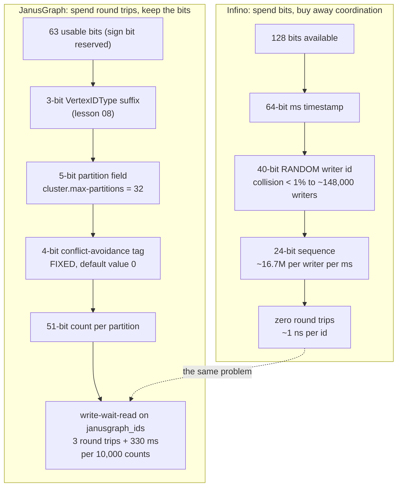

<!--
entry-meta
date: 2026-11-07
type: daily-diff
category: Daily Diff
title: Daily Diff — 2026-11-07
slug: janusgraph-id-authority-block-allocation
-->

# Daily Diff — the 2026-11-06 edition

**2026-11-07 · Daily Diff Digest**

> **Edition covered: 2026-11-06, 52 stories.** At ~03:40 UTC the front page served **2026-11-05 / 62 stories** — the edition lesson 08 digested yesterday — while [`/archive/`](https://tdd.cat/archive/) reported **131 editions** with **2026-11-06 / 52** as *Latest* and showed 2026-11-07 as an unlinked calendar cell. The archive was ahead by one, so the one-way cross-check fired and [`https://tdd.cat/2026-11-06/`](https://tdd.cat/2026-11-06/) served the complete edition with every source URL on the first attempt. Three fetches, no forward probe, no fallback. **No 2026-11-07 edition exists yet.** Rendering note, the fourth in five runs: the filter bar again read *"No stories match the selected filters in today's edition"* above a full 52-item list, so Must-Read and Recommended tags were unreadable.

## The edition, point-wise

**Sandboxing agents is now the dominant infrastructure theme — six independent items.** Replit moved hundreds of millions of projects to microVM sandboxes to contain untrusted agent code while keeping container-like startup; Google donated *Agent Substrate*, gVisor plus suspend/wake so a sandbox only runs during a tool call; Devvm gives each project its own VM with host credentials out of reach behind an allowlisting proxy; AgentShield uses Landlock, Seatbelt and AppContainer to block credential exfiltration; Zalando's identity broker issues short-lived scoped OAuth2 delegations so agents never hold raw user credentials; and *Current* restricts agents to typed proposals that an Elixir runtime verifies and logs, so the agent never executes anything itself. The common move in all six is the same one: take execution authority away from the model and give it a capability instead.

**Two independent Firecracker guest-to-host escapes in one edition.** Both overwrite saved thread registers in the `KVM_RUN` frame from a guest memory-corruption primitive and end up running as host root. Appearing alongside six items about moving agent workloads *into* microVMs is the edition's sharpest accidental juxtaposition.

**Git at agent scale, from two angles.** GitHub's *Rubicon* post (carried over from the 11-05 edition, where it was also item 1) splits immutable objects from the small coordinated reference updates, so concurrent writers skip coordination entirely; *Aspen* does per-branch atomic compare-and-swap, stores packfiles in object storage with refs and metadata in Postgres, and serves stock Git clients — avoiding the per-repo serial lock.

**Storage and database items.**

- **Postgres `SKIP LOCKED` queues saturate CPU before connection limits** — on one core an unpooled queue maxed out at ~375 jobs/s; a 20-connection pool pushed it past 650.
- **Carquet**, a zero-dependency C11 Parquet library using `mmap`, arena allocation and runtime-selected SIMD kernels.
- **JetDatabaseWriter**, a pure-managed C# reader/writer for Microsoft Access files with Dafny-verified codec kernels — no COM, no OleDB.
- **Tandem**, optimistic local writes replayed over confirmed server state.
- **Haybarn 2.0** on DuckDB: HTTP/2 multiplexing and ETag checks to cut waste during remote scans.
- **TieredQ**, 0-to-12 bits per PCA component by variance, reportedly 36-52% less RAM and disk at comparable recall.
- **Infino's id generation** — the deep dive below.

**Verification and formal methods, three items.** `mbrotli` and `mzstd` translate Rust decompressors into Lean 4 to prove RFC compliance, on the argument that differential testing against the C implementation can only show agreement with another implementation. Microsoft Research's PDD Kit generates formal specs and proofs for agent-written full-stack apps. And Dan Luu finds that current models execute TDD, property testing and fuzzing with real effect where older ones produced the shape of those techniques without the substance.

**Two items that are really about measurement being wrong.** *Cost per successful task* ranks the worst agent first, because dividing spend by successes rewards models that give up early on hard problems. *Idle GPU counts do not guarantee schedulability* — Slurm must also satisfy GPU type, QoS, node and interconnect constraints, so idle GPUs coexist with pending multi-GPU jobs. Brendan Gregg's *active benchmarking* classic is in the same edition and is the general form of both: profile the system during a sustained run instead of trusting the number the benchmark prints.

**Smaller things worth the click.** Checking for whitespace under Unicode is 25 code points, not one comparison, and Guava uses a bitmask and lookup table for it. A percent-encoded backslash slips past an Nginx exact-match block and still routes to the protected Node.js handler — parser disagreement as an access-control bypass. The musl `crypt` OpenSSH bypass is here for the third consecutive edition, now with a `bleepingcomputer` writeup: on passwords over 256 bytes musl returns `"*"`, which matches the disabled-account shadow entry. And someone built a compiler that targets HEVC decoding so that decoding a HEIC file displays the SHA-256 of that same file — a hashquine in a video codec.

---

## Deep dive: minting ids with no coordinator at all

**Item 27, [*Generating billions of uncoordinated identifiers per second at scale*](https://infino.ai/blog/id-generation/).** Followed the source link and read the post.

This is today's lesson's problem with the opposite answer, and the two together make the tradeoff legible in a way neither does alone. JanusGraph spends three storage round trips and a 330 ms wall-clock wait to agree on a block of counts. Infino spends **40 bits**.

### The layout

| Field | Width | Purpose |
|---|---|---|
| millisecond timestamp | 64 bits | time ordering, no custom epoch |
| writer id | **40 bits** | drawn at random once per writer at startup, registered with nobody |
| sequence | 24 bits | ids minted within one millisecond, ~16.7M per writer per ms |

Total **128 bits**, stored as a `Decimal128(38, 0)` Parquet column. The timestamp is the most significant field, so byte order is time order. The generator keeps only its last id: if the shared millisecond clock has advanced, the sequence restarts at 0; otherwise the next id is last + 1.

### Why 40 bits is the whole argument

The post does the birthday arithmetic explicitly, and it is the crux: **with 32 writers drawing random 10-bit ids — Snowflake's machine-id width — two collide 38% of the time**, which is exactly why Snowflake machine ids have to be *assigned* by something. At 40 bits the collision probability stays under 1% up to roughly **148,000** concurrent writers, and at 1,000 writers it is about 1 in 2.2 million. That is the entire reason there is no coordinator: the field is wide enough that randomness is cheaper than agreement. A duplicate id additionally requires the same writer id *and* the same sequence in the same millisecond.

A restarted writer simply draws a fresh random writer id, so restart needs no registration either. The one place coordination reappears is crash recovery: reserved id runs go into the write-ahead log before any dependent work, and a recovering process replays those runs rather than minting new ids under its own writer id.

### The numbers

Measured with `idbench` on a GCP `c3-highcpu-8`: **~1.4 billion ids/s** for one writer at batches of 1,024; **~4.5 billion/s** across eight writers; **~1 ns per id** for single minting. The batching matters more than it looks — eight threads sharing one generator with a lock taken once per 1,024-id batch reach ~3.75 billion/s, and the same eight threads locking per id reach **~4.7 million/s**, an 800x difference from where the lock sits.

### The part that is genuinely clever: the ids compress back down

A 128-bit id is sixteen bytes, which should be ruinous. It is not, because ids minted together share their timestamp and writer bits and differ only in the low sequence bits. In the Parquet `_id` column that lands at about **1.08 bytes per id**. The sidecar does it explicitly: ids are grouped in blocks of 1,024, each block storing a **base** (its smallest id) and each id's offset from that base, bit-packed to the width the largest offset needs, with each 64-bit half packed separately — about **1.29 bytes per id**. Lookup finds a block by division and extracts the two halves without decompressing: **~0.5 µs** from the sidecar against **~214 µs** from Parquet, about 400x.

The post notes the corollary for UUIDv7, whose random tail defeats this entirely unless the generator uses a counter instead.

### Side by side with today's lesson

The symmetry is exact and it runs through one field. Infino's 40-bit random writer id and JanusGraph's `ids.authority.conflict-avoidance-tag` are the same idea — *give each writer its own slice of the key space so writers never meet* — and JanusGraph's version is **4 bits wide**, sixteen slices. At that width the post's own arithmetic says random assignment does not work: four JanusGraph instances in `GLOBAL_AUTO` mode collide 33.5% of the time, eight collide 93%. So JanusGraph cannot do what Infino does, and keeps the write-wait-read protocol as the thing that makes a collision safe rather than fatal. Today's lesson found that on a default graph those four bits are not used at all — mode `NONE`, tag `0` — and still cost fifteen sixteenths of the count space.

Three transferable observations:

1. **Id width is a coordination budget.** Infino had 128 bits and bought away all coordination with 40 of them. JanusGraph has 63 and has to spend three of them on a type code and five on a partition, so there is nothing left to buy with — the protocol is not a legacy choice, it is what a 64-bit id forces.
2. **Time-ordered ids compress to about a byte, and that is an argument for wide ids, not against them.** The usual objection to 128-bit keys is storage. Shared high bits plus block-local offsets erase it, which inverts the usual reasoning about narrow ids on disk.
3. **Where the lock sits is worth more than how fast it is.** 4.7M ids/s locking per id against 3.75B/s locking per 1,024-id batch is the same mechanism JanusGraph uses one layer up: `StandardIDPool.nextID` is `synchronized` per id, but the expensive thing behind it happens once per block.

## Sources

- [The Daily Diff, 2026-11-06 edition](https://tdd.cat/2026-11-06/) (52 stories; the source for every item above)
- [The Daily Diff archive](https://tdd.cat/archive/) (131 editions, maximum 2026-11-06, 2026-11-07 unlinked)
- [The Daily Diff front page](https://tdd.cat/) (served 2026-11-05 / 62 at the time of this run)
- [Infino — *Generating billions of uncoordinated identifiers per second at scale*](https://infino.ai/blog/id-generation/) (the deep-dive item, fetched and read)
- [Inside GitHub's new Git storage architecture](https://github.blog/engineering/architecture-optimization/inside-githubs-new-git-storage-architecture/) and [Aspen](https://reasonmachines.com/blog/aspen) (items 1 and 2)
- [Sandboxing untrusted AI agents at scale](https://opensource.googleblog.com/2026/11/sandboxing-untrusted-ai-agents-at-scale.html), [Replit's microVM sandbox engine](https://frontier.replit.com/sandbox-engine-microvms-part-1/), [Devvm](https://devvm.dev/) (items 12, 7, 5)
- [Firecracker escape via saved thread registers](https://pwn.ai/blog/firecracker-escape) (item 3)
- [Postgres SKIP LOCKED queues](https://garbagecollected.io/posts/postgres-task-queue-where-it-breaks/), [Carquet](https://vitruves.github.io/carquet/), [JetDatabaseWriter](https://symbiogenesis.github.io/JetDatabaseWriter/) (items 44, 18, 43)
- [Formal verification of mbrotli and mzstd](https://m-compressors.github.io/2026/formal-verification-mbrotli-mzstd/), [Dan Luu on verification techniques](https://danluu.com/astra-testing/) (items 15, 28)
- [Active benchmarking](https://www.brendangregg.com/activebenchmarking.html), [Cost per successful task](https://www.stet.sh/blog/cost-per-successful-task), [Idle GPUs waiting jobs](https://nodeox.com/blog/idle-gpus-waiting-jobs) (items 24, 41, 35)
- [Unicode whitespace](https://serce.me/posts/2026-10-30-how-hard-is-it-to-check-for-whitespace), [encoded backslash route bypass](https://octri.dev/blog/backslash-nginx-node-admin-route), [the musl crypt OpenSSH bypass](https://www.bleepingcomputer.com/news/security/openssh-flaw-lets-attackers-log-into-password-disabled-linux-accounts/), [HEIC hashquine](https://www.irisc2.com/blog/heic-hashquine) (items 14, 13, 48, 37)
